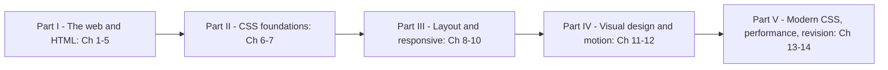

# HTML & CSS Handbook

One place to learn how web pages are built, from "what happens when I type a URL" to confident intermediate work with semantic HTML, accessibility, forms, the CSS cascade, flexbox, grid, responsive design, animation and modern CSS architecture, and to prepare for front-end interviews, without switching between platforms. Each topic combines, in one explanation:
- **the standards**: the WHATWG HTML Living Standard, the W3C CSS specifications and WCAG 2.2,
- **official documentation**: MDN Web Docs, web.dev and the web-features / Baseline data (for every "Baseline since…" label), Google Search Central for SEO,
- **classic books and teachers**: *CSS: The Definitive Guide* (Meyer & Weyl), and ideas from Josh Comeau and *Every Layout*, retold in my own words,
- **real-world examples** from sites and design systems you use.

Every chapter is written for a first-time learner and defines each term the first time it appears. Layout and rendering claims were checked in a real browser: the examples are small self-contained `.html` pages, and each chapter's scripts open them in headless **Chrome 154** and print what the browser actually computed (box sizes, computed styles, contrast ratios, performance metrics). Those **real outputs** and screenshots appear under the code. Every chapter was independently reviewed for accuracy, and browser-support statements were re-checked in September 2026.

> Personal study notes, written in my own words. Not for redistribution.

## Who it's for
| Reader | What you get |
|---|---|
| Complete beginners | How the web works, then HTML and CSS taught from zero (Ch 1–7), every term defined |
| Back-end developers who need front-end basics | Enough HTML, forms, CSS and layout to build and fix real pages without cargo-cult CSS |
| Developers who want layout and responsive mastery | Why boxes end up where they do: the cascade, the box model, formatting contexts, flexbox and grid sizing, container queries, intrinsic layouts (Ch 6–10, 13) |
| Accessibility-minded developers | Landmarks, the accessibility tree, ARIA, keyboard and focus, accessible forms and WCAG 2.2 AA (Ch 3, 5), plus contrast and reduced motion (Ch 11, 12) |
| Interview candidates | 47 interview questions with answers, cheat sheets and a 212-term glossary (Ch 14), plus an "In the interview" block in every topic |

## How to use it
Every topic follows the same rhythm: *what it is → why it matters → how it works → code with real output → trade-offs → common mistakes → real-world use → in the interview → self-check → TL;DR*. To review, skim the TL;DRs. To check you really learned a topic, answer the self-check questions without looking back.

**Complete-beginner path (read in order):**
1. **Ch 1** (URLs, DNS, HTTP, the rendering pipeline, your first page), then **Ch 2–5** (HTML: structure and text, semantics and accessibility, images and media, tables and forms).
2. **Ch 6–7** (CSS: selectors, specificity, the cascade, units, colours; the box model, `display`, positioning, stacking).
3. **Ch 8–10** (flexbox, grid, responsive design), then **Ch 11–13** (typography and effects, animation, modern CSS and architecture).
4. Finish with **Ch 14** (performance and SEO), and keep its cheat sheets open while you build things.

Build each example page yourself, open it in a browser and change values until the explanation clicks.

**"Back-end developer who needs front-end basics" path:**
1. **Ch 1** (skim §1.1–1.5 if you know HTTP; read §1.7 on the rendering pipeline).
2. **Ch 2** §2.2–2.3 and §2.8 (document structure, the `<head>`, links), **Ch 3** §3.1–3.2 and §3.7 (semantic elements, landmarks, keyboard and focus).
3. **Ch 5** (forms: `action`/`method`/`name`, input types, built-in validation — and why the server must validate anyway).
4. **Ch 6** §6.2–6.5 (selectors, specificity, the cascade), **Ch 7** §7.1–7.4 (box model, `box-sizing`, `display`).
5. **Ch 8** and **Ch 9** (flexbox and grid: enough to build any layout), **Ch 10** §10.2–10.4 (viewport meta tag, media queries, mobile-first).
6. **Ch 13** §13.7–13.11 (BEM, Tailwind, CSS Modules, CSS-in-JS — so you can read the codebase you join).

**Layout and responsive mastery path (you already write some CSS):**
1. **Ch 6** §6.4–6.6 and §6.10 (specificity, the full cascade, inheritance, how computed values are produced).
2. **Ch 7** in full: margin collapsing, formatting contexts and `flow-root`, the containing block, `overflow` (including `clip`), stacking contexts.
3. **Ch 8**: the flex sizing algorithm (grow, shrink weighted by basis, the automatic minimum size and `min-width: 0`).
4. **Ch 9**: tracks, `fr` and `minmax()`, `auto-fill` vs `auto-fit`, the implicit grid, subgrid, grid vs flexbox.
5. **Ch 10**: container queries (size and style), fluid type with `clamp()`, intrinsic layouts without breakpoints, testing reflow at 320px and 200% zoom.
6. **Ch 13** §13.1–13.6 (nesting, `:is()`/`:where()`, `:has()`, `@layer`, `@scope`, logical properties) and §13.14 (theming with tokens and `light-dark()`).

**Interview-prep path:**
1. Skim the TL;DRs of Ch 3, 6, 7, 8, 9 and 10 to find gaps.
2. Answer the 47 questions in **§14.6** out loud, then follow each link to the full explanation for any you missed.
3. Practise the classics until you can explain them without notes: specificity and the cascade (§6.4–6.5), margin collapsing and BFCs (§7.3, §7.5), `z-index` and stacking contexts (§7.8), `flex: 1` and `min-width: 0` (§8.4), `auto-fill` vs `auto-fit` (§9.3), "what happens when you type a URL" (§1.6), Core Web Vitals (§14.3).
4. The night before, review the cheat sheets (**§14.7**) and the glossary (**§14.8**).



## What's in here
| Path | Purpose |
|---|---|
| `HTML-CSS-Handbook.pdf` | The whole book as one PDF, with a cover and a table of contents (built by `tools/regen_pdfs.sh`). |
| `interview/HTML-CSS-Interview-Edition.pdf` + `interview/INTERVIEW.md` | The **Interview Edition**: a ~32-page fast-revision summary of all 14 chapters (must-know facts, key numbers, likely questions, gotchas, top 25 questions, last-minute checklist). |
| `chapters/NN-name/README.md` + `ChapterNN-Notes.pdf` | One chapter (Markdown source and its PDF). |
| `chapters/NN-name/code/` | The example pages (`.html`, `.css`) and the Node scripts (`.mjs`) that load them in headless Chrome or jsdom and print what the browser computed. |
| `chapters/NN-name/img/` | Screenshots and figures rendered from those pages. |
| `tools/` | `regen_pdfs.sh` (rebuild all PDFs) and `md2pdf.mjs` (Markdown → PDF). See [tools/README.md](tools/README.md). |

## Chapters
| # | Chapter | In one line | PDF |
|---|---|---|---|
| **Part I — The web and HTML** | | | |
| 01 | [How the Web Works](chapters/01-how-the-web-works/README.md) | Clients and servers, URLs, DNS, TCP/TLS and HTTP/1.1–3, requests and responses, "what happens when you type a URL", the rendering pipeline, DevTools, your first page | `Chapter01-Notes.pdf` |
| 02 | [HTML Structure and Text](chapters/02-html-structure-and-text/README.md) | Elements and attributes, the doctype and standards mode, the `<head>`, headings, whitespace, text-level semantics, lists, links, character references, validation | `Chapter02-Notes.pdf` |
| 03 | [Semantic HTML and Accessibility](chapters/03-semantic-html-and-accessibility/README.md) | Landmarks (incl. `<search>`), the heading outline, the accessibility tree and accessible names, alt text, ARIA and its first rule, keyboard and focus, `<dialog>`, accessible forms, WCAG 2.2, testing tools | `Chapter03-Notes.pdf` |
| 04 | [Images, Media and Embeds](chapters/04-images-media-and-embeds/README.md) | `` and reserved space, JPEG/PNG/GIF/WebP/AVIF/SVG, `srcset`/`sizes`/`<picture>`, `loading`/`decoding`/`fetchpriority`, figures, audio and video with captions, `<iframe>` and `sandbox`, SVG, `<canvas>` | `Chapter04-Notes.pdf` |
| 05 | [Tables and Forms](chapters/05-tables-and-forms/README.md) | Table semantics (`caption`, `th scope`, `colgroup`), how a form submits, input types, `select`/`datalist`/`fieldset`/`output`/`meter`, built-in validation and the Constraint Validation API, `autocomplete`, accessible errors | `Chapter05-Notes.pdf` |
| **Part II — CSS foundations** | | | |
| 06 | [CSS Fundamentals](chapters/06-css-fundamentals/README.md) | Adding CSS, selectors, pseudo-classes and pseudo-elements, specificity, the cascade and origins, inheritance, units, colours (`oklch()`, `color-mix()`), custom properties | `Chapter06-Notes.pdf` |
| 07 | [The Box Model and Layout Basics](chapters/07-box-model-and-layout-basics/README.md) | The box model, `box-sizing`, margin collapsing, `display`, normal flow and formatting contexts, positioning and sticky, overflow, `z-index` and stacking contexts, floats | `Chapter07-Notes.pdf` |
| **Part III — Layout and responsive design** | | | |
| 08 | [Flexbox](chapters/08-flexbox/README.md) | Container and items, the two axes, grow/shrink/basis, the `flex` shorthand and automatic minimum sizes, alignment, wrapping and `gap`, common patterns, debugging | `Chapter08-Notes.pdf` |
| 09 | [CSS Grid](chapters/09-grid/README.md) | Lines, tracks and areas, `fr` and `minmax()`, `repeat()` with `auto-fill`/`auto-fit`, placement, the implicit grid, alignment, subgrid, grid vs flexbox, patterns | `Chapter09-Notes.pdf` |
| 10 | [Responsive Design](chapters/10-responsive-design/README.md) | The viewport meta tag and viewport units, media queries and range syntax, mobile-first, user-preference queries, container (size and style) queries, fluid type with `clamp()`, intrinsic layouts, testing | `Chapter10-Notes.pdf` |
| **Part IV — Visual design and motion** | | | |
| 11 | [Typography, Colour and Visual Effects](chapters/11-typography-color-and-visual-effects/README.md) | Fonts and `@font-face`, `font-display`, preload and self-hosting, text properties, WCAG contrast, `color-mix()` and relative colours, backgrounds and gradients, borders, shadows, filters, blend modes, masks, `object-fit` | `Chapter11-Notes.pdf` |
| 12 | [Transitions, Transforms and Animation](chapters/12-transitions-transforms-and-animation/README.md) | Transitions and easing, 2D/3D transforms, keyframes, the Web Animations API, animating `transform`/`opacity`, `@starting-style`, reduced motion, view transitions, scroll-driven animations | `Chapter12-Notes.pdf` |
| **Part V — Modern CSS, performance and revision** | | | |
| 13 | [Modern CSS and Architecture](chapters/13-modern-css-and-architecture/README.md) | Native nesting, `:is()`/`:where()`, `:has()`, `@layer`, `@scope`, logical properties, BEM, Tailwind CSS v4, CSS Modules, CSS-in-JS, Sass and PostCSS, resets, theming and dark mode | `Chapter13-Notes.pdf` |
| 14 | [Performance, SEO, Interview Prep and Cheat Sheets](chapters/14-performance-seo-interview-and-cheatsheet/README.md) | The critical rendering path, render-blocking resources (measured), Core Web Vitals (LCP, INP, CLS, measured and fixed), SEO basics and JSON-LD, 47 interview questions, cheat sheets, 212-term glossary | `Chapter14-Notes.pdf` |

Each chapter's PDF sits next to its README: `chapters/NN-name/ChapterNN-Notes.pdf`.

## Colour code (in the PDFs)
Section headings are coloured by their role, so you can scan a page for the part you need:

| Colour | Headings |
|---|---|
| Green | **What it is**, analogies, overviews |
| Red / coral | **The problem it solves** |
| Blue | **How it works**, walkthroughs |
| Amber | **Trade-offs**, comparisons, **When not to use it** |
| Bright red | **Common mistakes**, pitfalls |
| Violet | **Real-world examples** |
| Pink | **In the interview**, 30-second answers (boxed), follow-ups |
| Teal | **Self-check** |
| Yellow | **TL;DR** (boxed) |

Code blocks are syntax-highlighted, and Mermaid diagrams are rendered as images.

## Running the code
The scripts need **Node 24** (checked on v24.11) and **Google Chrome** at `/Applications/Google Chrome.app` (checked with Chrome 154). Shared helpers live one level up, in the notes root: `tools_run_js.sh`, `tools_web_shot.mjs`, `tools_dom.mjs`, and the npm packages in `.web-books/`. No example needs network access: pages load local files only, and Chapter 14's "slow network" is simulated inside Puppeteer.

```bash
# from html-css/ — run every example in the book (prints OK / FAIL / SKIP per file)
bash ../tools_run_js.sh html-css

# run one example (from its code/ folder: scripts open the .html pages next to them)
cd chapters/07-box-model-and-layout-basics/code
node 02_margin_collapse.mjs
```
- **What the runner does:** it runs every `chapters/*/code/*.{js,mjs}` file with Node, 120 s limit each. Files marked `// tools_run: skip` are not standalone programs (the `measure.mjs` helpers, browser-only scripts loaded by a page) and are reported as SKIP. At the last full run: 81 OK, 26 SKIP, 0 FAIL.
- **Measuring in a real browser — the `measure.mjs` helpers (Ch 7–13):** each of these chapters has a small `code/measure.mjs` built on **puppeteer-core** that launches your installed Chrome headless, opens one of the chapter's pages and hands the script a page object. The `NN_*.mjs` scripts then read what Chrome computed (`getBoundingClientRect()`, `getComputedStyle()`, the CSSOM) and print it. Chapter 10's version (copied into Ch 11–13) adds viewport width, phone emulation (so `<meta name="viewport">` is honoured), emulated user preferences such as `prefers-color-scheme` and `prefers-reduced-motion`, screenshots, and contact sheets that put several screenshots side by side. If Chrome lives elsewhere, change the `CHROME` path at the top of `measure.mjs` (and of `tools_web_shot.mjs`).
- **DOM examples under Node:** a few scripts (Ch 2, 5, 13) start with `import '../../../../tools_dom.mjs';`, which gives them a browser-like `document`, `window` and events from **jsdom**, for things that don't need layout (character references, `FormData`, the Constraint Validation API, table header associations, a mini CSS-in-JS library).
- **Screenshots:** re-shoot any page from `html-css/` with, for example:
  ```bash
  node ../tools_web_shot.mjs chapters/09-grid/code/01_tracks.html /tmp/grid.png 900
  node ../tools_web_shot.mjs chapters/10-responsive-design/code/03_preferences.html /tmp/dark.png 700 --dark
  node ../tools_web_shot.mjs chapters/12-transitions-transforms-and-animation/code/05_keyframes.html /tmp/anim.png 900 --wait=600
  ```
  Arguments: page, output PNG, viewport width in CSS pixels (the PNG is twice that, at 2× scale), optional fixed height. Pages are shot in the **light** colour scheme regardless of your Mac's theme unless you add `--dark`; `--wait=ms` waits for transitions, animations or timers before the shot. Chapters with many figures also have a `code/make_figures.mjs` that regenerates all of their images.

Pixel values and timings depend on the machine, fonts and Chrome version; your numbers may differ slightly, but the pattern should not. Chapter 14's performance timings in particular vary by a few milliseconds between runs.

### Installed tools
| Tool | Version | Used for |
|---|---|---|
| Google Chrome (headless, via puppeteer-core 25) | 154 | Every layout measurement, screenshot and Web Vitals run |
| Tailwind CSS (`tailwindcss`, `@tailwindcss/*`) | 4.3 | §13.8: a real Tailwind v4 build of a component, and the CSS it generates |
| Lightning CSS (`lightningcss`) | 1.32 | §13.1 lowering native nesting for old browsers; §13.9 CSS Modules class renaming |
| jsdom | 29 | DOM-only examples under Node (`tools_dom.mjs`), Chapter 14's SEO audit |

All are installed in `../.web-books/node_modules` (the runner sets `NODE_PATH` to it); nothing is installed globally.

## Rebuilding the PDFs
Requires Node 18+ and Google Chrome (the path is set in `tools/md2pdf.mjs`). The script installs `tools/node_modules` on its first run.

```bash
bash tools/regen_pdfs.sh      # every ChapterNN-Notes.pdf + HTML-CSS-Handbook.pdf (cover title "HTML & CSS Handbook")

# one chapter only
node tools/md2pdf.mjs chapters/09-grid/Chapter09-Notes.pdf chapters/09-grid/README.md
```
`md2pdf.mjs` reports any Mermaid errors or broken images.

## Sources
- **Standards:** the WHATWG HTML Living Standard (elements, forms, parsing, loading hints); the W3C CSS specifications (Cascading and Inheritance 5 and 6, Box Model, Display, Flexbox, Grid 2, Values and Units 4, Color 4 and 5, Media Queries 4 and 5, Containment 3, Transitions, Animations, View Transitions, Scroll-driven Animations, Nesting); WAI-ARIA 1.2; **WCAG 2.2** and its Understanding documents.
- **Documentation:** MDN Web Docs; **web.dev** (rendering performance, Core Web Vitals and their thresholds); the **web-features** project and its Baseline statuses, used for every "Baseline since…" / "widely available" label; Google Search Central (SEO, structured data); the Tailwind CSS v4 and Lightning CSS docs.
- **Books and teachers:** Eric Meyer and Estelle Weyl, *CSS: The Definitive Guide*; ideas from Josh Comeau's CSS articles and Heydon Pickering and Andy Bell's *Every Layout*, explained in my own words.
- **Verification:** every rendering claim was measured in headless Chrome 154; browser-support dates were checked against web-features / MDN browser-compat-data in September 2026. There is no DesignGurus course behind this book.

## Companion books
| Book | Read it for |
|---|---|
| [JavaScript Handbook](../javascript/README.md) | The language, then the DOM, events and browser APIs (its Ch 13–14) — the behaviour layer on top of the pages built here |
| [React Handbook](../react/README.md) | Component-based UIs, state, routing, data fetching and testing — where this book's HTML, accessibility and CSS architecture (Ch 3, 5, 13) are applied at scale |
