# HTML & CSS — Capstone Projects

## How to use this book

A **capstone** is a project big enough to pull several chapters together into one thing you could show someone: a page, a site or a small system of components that has real requirements, real users and real ways to fail. Reading about the cascade or grid gives you the parts. A capstone makes you choose between them, find out where your understanding is thin, and leave with something for a portfolio.

This book holds **40 design briefs**: 10 beginner, 15 intermediate and 15 advanced, in that order. Almost all of them are **HTML and CSS only**. Where a brief allows JavaScript it says so, and it is a few lines at most (a theme toggle, say). Many projects that used to need JavaScript (accordions, dialogs, popovers, tooltips, scroll effects) can now be built with the platform alone. Learning where that line now sits is part of the point.

**How to pick one.** Use the project map below. Start at the first level where you can't already build every row without thinking. Prerequisites are chapters of the [HTML & CSS Handbook](../README.md). If a brief lists a chapter you haven't read, skim that chapter's TL;DRs first. You don't need to do the projects in order, but the beginner ones introduce habits the later ones assume: semantic HTML first, mobile-first CSS, and checking in a real browser.

**How to use a brief.**
1. Read *What it is*, *The problem it solves* and *Requirements*, then close the book and sketch the page or component on paper.
2. Compare your sketch with *The architecture* and *Data model*. In this book, **architecture** means the page, component and file structure, and **data model** means the content model (which pieces of content exist and what they contain) or the design-token table.
3. Build the **milestones in order**. Each has a *done when* check. Don't move on until it passes, because later milestones build on earlier ones.
4. Read *Deep dive* when you get stuck, or after you finish to compare approaches. Then do the *Testing strategy*.
5. Pick one or two **stretch goals**. Finish by answering *In the interview* out loud.

**Using these projects in interviews.** Each *In the interview* section is built to be said out loud. Lead with the **30-second answer**: what you built, the key decision and why, the hardest problem and one number. Make sure you can explain every item under **Key terms** in plain words, because interviewers probe the vocabulary first. Practise the Q&As aloud until the answers come in your own words, not the book's. Quote your own numbers from the build: Lighthouse scores, LCP and CLS, kilobytes shipped, contrast ratios, breakpoints tested, test counts. Expect follow-ups such as "what would you change at 10x?" and "what breaks first?", and read **Common mistakes** so you don't repeat them.

**The briefs describe what to build and why. You write the code.** There are no solutions here on purpose: the learning is in making the decisions.

**Colour code (in the PDF).** Section headings are coloured by their role, the same as in the main handbook:

| Colour | Sections |
|---|---|
| Green | **What it is** |
| Coral | **The problem it solves**, **Requirements** |
| Violet | **Real-world examples** |
| Blue | **The architecture**, **Deep dive** |
| Amber | **Trade-offs, scaling and failure modes** |
| Pink | **In the interview** |
| Teal | **Self-check** |
| Yellow | **TL;DR** |

**Level legend.**
- **Beginner**: one page or a handful of pages. Uses Ch 1–9 material: semantic HTML, forms, the box model, flexbox, basic grid. One weekend each.
- **Intermediate**: a multi-section page or small site with a responsive system, theming, motion or print. Uses Ch 10–13. One to two weeks each.
- **Advanced**: a reusable system (component library, token pipeline, accessibility audit, performance budget) with tests and measurable targets. Uses newer CSS from Ch 12–14. Two to four weeks each.

**Browser support.** "Baseline" statements were checked against the web-features dataset (the data behind MDN's Baseline badges and webstatus.dev) in September 2026. **Baseline newly available** means it works in the current versions of Chrome, Edge, Firefox and Safari. **Widely available** means that has been true for 30 months. A feature that isn't Baseline goes behind `@supports` as an enhancement, and the page must still work without it.

## Project map

| # | Project | Level | Time | Prerequisites (chapters) |
|---|---|---|---|---|
| 1 | Personal profile page | Beginner | 1 weekend | Ch 1, 2, 3, 6 |
| 2 | Recipe page | Beginner | 1 weekend | Ch 2, 3, 4, 6 |
| 3 | Accessible contact form | Beginner | 1 weekend | Ch 3, 5, 6 |
| 4 | Pricing table | Beginner | 1 weekend | Ch 5, 6, 7, 8 |
| 5 | Blog article layout | Beginner | 1 weekend | Ch 2, 4, 6, 11 |
| 6 | Restaurant menu | Beginner | 1 weekend | Ch 2, 6, 7, 8 |
| 7 | Photo gallery with grid | Beginner | 1 weekend | Ch 4, 9 |
| 8 | Conference schedule table | Beginner | 1 weekend | Ch 2, 5, 7 |
| 9 | Accessible site header and navigation | Beginner | 1 weekend | Ch 3, 7, 8 |
| 10 | Small-business multi-page site | Beginner | 1–2 weekends | Ch 1–9 |
| 11 | Responsive landing page | Intermediate | 1 week | Ch 4, 8, 9, 10 |
| 12 | Documentation site with sidebar | Intermediate | 1–2 weeks | Ch 3, 7, 9, 10 |
| 13 | Dashboard layout with grid areas | Intermediate | 1 week | Ch 7, 9, 10 |
| 14 | CSS-only accordion and tabs | Intermediate | 1 week | Ch 3, 12, 13 |
| 15 | Email-safe newsletter | Intermediate | 1 week | Ch 2, 5, 11 |
| 16 | Dark mode theming with custom properties | Intermediate | 1 week | Ch 6, 10, 11, 13 |
| 17 | Print stylesheet résumé | Intermediate | 1 week | Ch 2, 7, 10, 11 |
| 18 | Animated product card | Intermediate | 1 week | Ch 11, 12 |
| 19 | Design-token system | Intermediate | 1–2 weeks | Ch 6, 11, 13 |
| 20 | Magazine layout with subgrid | Intermediate | 1–2 weeks | Ch 9, 10, 11 |
| 21 | Multi-step checkout form | Intermediate | 1–2 weeks | Ch 3, 5, 13 |
| 22 | Responsive image portfolio | Intermediate | 1 week | Ch 4, 9, 14 |
| 23 | Typography system with variable fonts | Intermediate | 1 week | Ch 10, 11 |
| 24 | Dialogs and drawers without JavaScript | Intermediate | 1 week | Ch 3, 7, 12 |
| 25 | Custom form controls kit | Intermediate | 1–2 weeks | Ch 5, 6, 11, 13 |
| 26 | Component library with cascade layers | Advanced | 3–4 weeks | Ch 6, 13 |
| 27 | Container-query card system | Advanced | 2–3 weeks | Ch 9, 10, 13 |
| 28 | WCAG 2.2 AA e-commerce product page | Advanced | 3–4 weeks | Ch 3, 4, 5, 11 |
| 29 | CSS art with view transitions and scroll-driven animation | Advanced | 2–3 weeks | Ch 11, 12 |
| 30 | Performance-budget site with Core Web Vitals | Advanced | 2–3 weeks | Ch 1, 4, 11, 14 |
| 31 | i18n RTL-ready site with logical properties | Advanced | 2–3 weeks | Ch 2, 11, 13 |
| 32 | Popover and anchor-positioning UI kit | Advanced | 2–3 weeks | Ch 3, 7, 12 |
| 33 | Static site with semantic SEO and structured data | Advanced | 2–3 weeks | Ch 2, 3, 14 |
| 34 | CSS architecture refactor of a legacy site | Advanced | 3–4 weeks | Ch 6, 13 |
| 35 | Responsive complex data tables | Advanced | 2 weeks | Ch 5, 7, 10 |
| 36 | Preference-aware site | Advanced | 2 weeks | Ch 3, 10, 11, 12 |
| 37 | CSS-only data visualisation from tables | Advanced | 2 weeks | Ch 5, 9, 11 |
| 38 | Progressive-enhancement form service | Advanced | 3 weeks | Ch 1, 3, 5 |
| 39 | CSS testing and linting pipeline | Advanced | 2–3 weeks | Ch 13, 14 |
| 40 | Multi-brand theming with style queries | Advanced | 3 weeks | Ch 6, 10, 13 |

## 1. Personal profile page

**Level:** Beginner · **Time:** 1 weekend · **Prerequisites:** Ch 1, Ch 2, Ch 3, Ch 6

### What it is
A single page about you: a name, a photo, a short bio, a list of skills, a few projects and ways to get in touch. Think of it as a business card written in HTML. It is the "hello world" of web design, and still worth building carefully: it is the first page an interviewer may open, and it proves you can write a valid, accessible, styled document from an empty file.

### The problem it solves
People need one stable address that says who you are, and they want it to load instantly, read well on a phone and work in a screen reader. Profile pages built with heavy site builders often ship a megabyte of scripts for what is five paragraphs of text. A hand-written page gives you full control and a tiny file. It also teaches the basic loop you will repeat in every project: write the HTML, open it in a browser, check it, then style it.

### Real-world examples
- MDN's beginner tutorial [Your first website](https://developer.mozilla.org/en-US/docs/Learn_web_development/Getting_started/Your_first_website) walks through exactly this kind of page: plan, write HTML, add CSS, publish.
- The [h-card microformat](https://microformats.org/wiki/h-card) is a set of class names (`h-card`, `p-name`, `u-url`) that personal sites use so that other tools can read contact details from the HTML. The IndieWeb community uses it widely on personal home pages.

### Requirements
**Functional**
- A header with your name as the only `<h1>`, a role line and a photo with meaningful `alt` text.
- Sections for *About*, *Skills*, *Projects* and *Contact*, each with an `<h2>`.
- Projects as a list of links. Contact as `mailto:` and profile links.
- A footer with the year and a link back to the top.

**Non-functional**
- One HTML file plus one CSS file. Total weight under **100 KB** including the photo.
- Validates with zero errors in the [W3C Nu HTML Checker](https://validator.w3.org/).
- Readable from **320 px** wide to 1440 px with no horizontal scroll.
- Body text contrast at least **4.5:1** (WCAG AA).

### The architecture
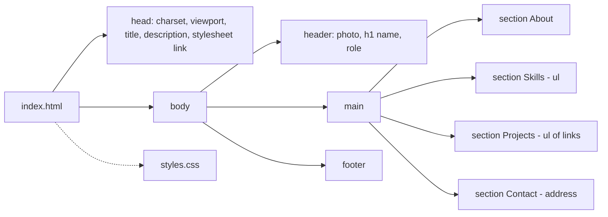
- **head**: metadata only. `<meta charset="utf-8">` comes first. The viewport meta tag stops phones rendering at a fake 980 px width. `<title>` is what shows in tabs and search results.
- **header / main / footer**: the three landmark elements. A **landmark** is a region that screen-reader users can jump to directly.
- **section with h2**: each section has its own heading, so the **heading outline** (the table of contents a screen reader builds from headings) reads like a CV.
- **address**: the element for contact information about the nearest `<article>` or the page.
- **styles.css**: one external stylesheet, which the browser can cache.

### Data model
The content is small but still worth listing, because the same fields come back in later projects:

| Field | HTML element | Notes |
|---|---|---|
| Name | `h1` | One per page |
| Photo | `img` with `width`, `height`, `alt` | Reserve space to avoid layout shift |
| Bio | `p` | 2–4 sentences |
| Skills | `ul > li` | Plain text, no progress bars |
| Projects | `ul > li > a` + `p` | Title, one-line summary |
| Contact | `address > a` | `mailto:` and profile links |

### Tech stack
| Component | Choice | Why |
|---|---|---|
| Markup | Hand-written HTML | You learn every element |
| Styles | One plain CSS file | No build step |
| Fonts | System font stack | Zero download, instant render |
| Hosting | Any static host | A static page is just files |

### Milestones
1. **Content first.** Write the whole page in HTML with no CSS. *Done when* it validates and reads well as plain text.
2. **Base styles.** Add `box-sizing: border-box`, a system font stack, `max-inline-size: 65ch` on the main column and comfortable line height. *Done when* lines stay between about 45 and 75 characters.
3. **Header layout.** Use flexbox to put the photo beside the name on wide screens and above it on narrow ones (`flex-wrap: wrap`). *Done when* it reflows at 320 px without overflow.
4. **Polish.** Add link, hover and `:focus-visible` styles and a colour palette that passes contrast. *Done when* you can reach every link with Tab and always see where focus is.

### Deep dive: the hard parts
- **Alt text that says something.** "Photo of me" adds nothing. Write what a sighted visitor would take from the photo, for example "Priya smiling outdoors". If the photo is purely decorative and your name is right beside it, `alt=""` is also valid. Chapter 3 covers how to decide.
- **Reserving image space.** Without `width` and `height` attributes the browser doesn't know the photo's size until it downloads, so the text below jumps down when it arrives. This jump is **layout shift**. With the attributes, the browser computes the aspect ratio up front, and CSS `max-inline-size: 100%; block-size: auto` keeps it responsive.
- **Focus styles.** Many resets remove the outline. Keep a visible indicator using `:focus-visible`, which matches when the browser decides focus should be shown (keyboard use, typically) and not on every mouse click.

### Testing strategy
- Validate with the Nu HTML Checker.
- Tab through the page with no mouse.
- Open DevTools' accessibility tree and check the landmarks and heading levels.
- Zoom to 200 % and check that nothing overlaps.
- Run Lighthouse's accessibility audit and fix every failure.

### Trade-offs, scaling and failure modes
Hand-written HTML doesn't scale to fifty pages, but that's project 10's job. A system font stack loads instantly but looks different on each OS. A web font gives consistency at the cost of a download and a possible flash of different text. A photo is the heaviest asset: an unoptimised 3 MB phone photo would be 30 times the page budget. Export it at about twice its displayed size and compress it.

### Stretch goals
- Add h-card classes and check the result with a microformats parser.
- Add a `prefers-color-scheme: dark` palette.
- Add Open Graph meta tags so links to your page show a preview card.

### Skills practised
- [Ch 1 — How the Web Works](../chapters/01-how-the-web-works/README.md): your first page, DevTools.
- [Ch 2 — HTML Structure and Text](../chapters/02-html-structure-and-text/README.md): the head, headings, lists, links.
- [Ch 3 — Semantic HTML and Accessibility](../chapters/03-semantic-html-and-accessibility/README.md): landmarks, alt text, focus.
- [Ch 6 — CSS Fundamentals](../chapters/06-css-fundamentals/README.md): selectors, colours, units.

### In the interview
**30-second answer:** I built a one-page profile site from an empty file: one HTML file, one stylesheet, no framework, under 100 KB including the photo. I wrote the content as semantic HTML first (header, main, footer, a section with an `<h2>` per topic) and only then styled it mobile-first. The hardest part was the photo: without `width` and `height` attributes the text jumped when it loaded, so I added them and let CSS scale the image, which brought layout shift to zero. It validates with no errors, passes 4.5:1 contrast and reflows at 320 px.

**Key terms to know:**
- **Semantic HTML** — choosing elements for their meaning (`<header>`, `<nav>`, `<section>`) rather than their look. Every region of the profile uses one.
- **Landmark** — a page region (banner, main, contentinfo) that screen-reader users can jump to. `<header>`, `<main>` and `<footer>` create them here.
- **Heading outline** — the table of contents built from `<h1>`–`<h6>`. One `<h1>` (your name), then an `<h2>` per section.
- **Viewport meta tag** — `width=device-width, initial-scale=1`, which stops phones laying the page out at a fake 980 px width.
- **Alt text** — the text alternative for an image. The photo needs a meaningful one, or `alt=""` if it's purely decorative.
- **Layout shift (CLS)** — content jumping as late resources arrive. Prevented by the image's `width`/`height` attributes.
- **Box model and `box-sizing`** — content, padding, border, margin. `border-box` makes `width` include padding and border, which the base styles set.
- **`:focus-visible`** — matches when the browser decides a focus ring should show (usually keyboard use). Used for link focus styles.
- **Measure** — line length. `max-inline-size: 65ch` keeps the bio readable.
- **Contrast ratio** — WCAG AA asks for at least 4.5:1 for body text.

**Q:** Why use `<header>`, `<main>` and `<footer>` instead of `<div>`s?

**A:** They create landmarks in the accessibility tree, so screen-reader users can jump between regions. They also document intent for the next developer. A `<div>` has no role at all, so it gives assistive technology nothing to work with.

**Q:** What does the viewport meta tag do?

**A:** Without it, mobile browsers lay the page out at a wide virtual width (typically 980 px) and shrink it to fit. `width=device-width, initial-scale=1` makes the layout viewport match the device width, so media queries and text sizes behave as written.

**Q:** Why put `width` and `height` on an `` when CSS resizes it anyway?

**A:** The browser uses their ratio to reserve the right amount of space before the image downloads, which prevents layout shift. CSS such as `max-inline-size: 100%; block-size: auto` then scales it responsively while keeping that ratio.

**Q:** What does `box-sizing: border-box` change, and why set it globally?

**A:** By default (`content-box`), `width` sets only the content area, and padding and border are added on top, so a 300 px box with 20 px padding is really 340 px wide. With `border-box`, padding and border fit inside the declared width. Setting it on everything makes sizes predictable, which is why almost every reset starts with it.

**Q:** Should you write `alt="Photo of me"`?

**A:** No. Screen readers already say "image", so "photo of" adds noise, and "me" tells the listener nothing. Describe what a sighted visitor gets from it ("Priya smiling outdoors"), or use `alt=""` if your name is right beside it and the photo adds nothing. Never omit the attribute, because some screen readers then read the file name.

**Q:** Why `:focus-visible` instead of `:focus` for the focus ring?

**A:** `:focus` matches every time an element gets focus, including mouse clicks on buttons, which is why designers used to ask for outlines to be removed. `:focus-visible` matches only when the browser's heuristics say an indicator is useful, mainly keyboard navigation. Keyboard users keep a clear ring and mouse users don't see one on click.

**Q:** This page has to become 50 pages. What breaks first?

**A:** Duplication. The header, footer and `<head>` are copied into every file, so a fix to one gets missed in others, and relative links break when pages move into folders. At that point you want templates or a static-site generator, and a stylesheet organised into tokens and components (projects 10 and 33).

**Q:** The photo is a 3 MB phone picture. What happens and how do you fix it?

**A:** It is 30 times the whole page budget, so it dominates load time on mobile and probably becomes the slow LCP element. Export it at about twice its displayed size, compress it to WebP or AVIF, keep the `width`/`height` attributes, and check the Network panel to confirm the transferred size.

**Q:** How do you prove the page is finished?

**A:** Run the W3C Nu checker (zero errors), Tab through every link with no mouse, check the accessibility tree for landmarks and heading levels, zoom to 200 % and resize to 320 px with no horizontal scroll, and run Lighthouse's accessibility audit. Each requirement maps to one of these checks.

**Common mistakes in answers:**
- Saying semantic elements are "for SEO". The main reason is the accessibility tree and maintainability. Search benefits are a side effect.
- Saying `width`/`height` on images make them non-responsive. They only set the aspect ratio for space reservation, and CSS still controls the rendered size.
- Removing outlines with `outline: none` "because they look ugly". The correct fix is `:focus-visible` with a styled, high-contrast ring.

### TL;DR
Write the content as valid semantic HTML first, then style it mobile-first with one stylesheet. Landmarks, real alt text, reserved image space and visible focus are the habits every later project assumes.

## 2. Recipe page

**Level:** Beginner · **Time:** 1 weekend · **Prerequisites:** Ch 2, Ch 3, Ch 4, Ch 6

### What it is
A page for one recipe: title, hero photo, short introduction, timing and serving facts, an ingredients list, numbered steps, and notes. It's the classic exercise in choosing the right list and structure, and it adds two real-world twists: a **print style** so the cook can print just the recipe, and **structured data** so search engines understand it.

### The problem it solves
Recipe sites are known for burying the recipe under a life story and adverts. Readers want to jump to the ingredients, keep their place while cooking, and print a clean copy. Search engines want machine-readable cooking time and ingredients so they can show rich results. Good HTML serves both. An ordered list is literally "steps in order", and a `<time>` element carries a machine-readable duration.

### Real-world examples
- Google Search Central documents [Recipe structured data](https://developers.google.com/search/docs/appearance/structured-data/recipe): the JSON-LD properties (`recipeIngredient`, `recipeInstructions`, `totalTime`) that make a page eligible for recipe rich results.
- The vocabulary itself is [schema.org/Recipe](https://schema.org/Recipe), shared by all the major search engines.

### Requirements
**Functional**
- `<article>` wrapping the recipe, with `<h1>`, a summary paragraph and a hero `<figure>` with `<figcaption>`.
- A facts block: prep time, cook time, servings. Use a description list (`<dl>`) for the label/value pairs and `<time datetime="PT20M">` for durations.
- Ingredients as `<ul>` (order doesn't matter). Method as `<ol>` (order matters).
- A "Jump to recipe" skip link at the top.
- A JSON-LD `<script type="application/ld+json">` block describing the recipe.

**Non-functional**
- Hero image under **150 KB**, with `width`/`height` set.
- Printed output fits on **one or two A4 pages** with no navigation, adverts or comments.
- Steps readable at arm's length on a tablet: body text at least **18 px**.

### The architecture
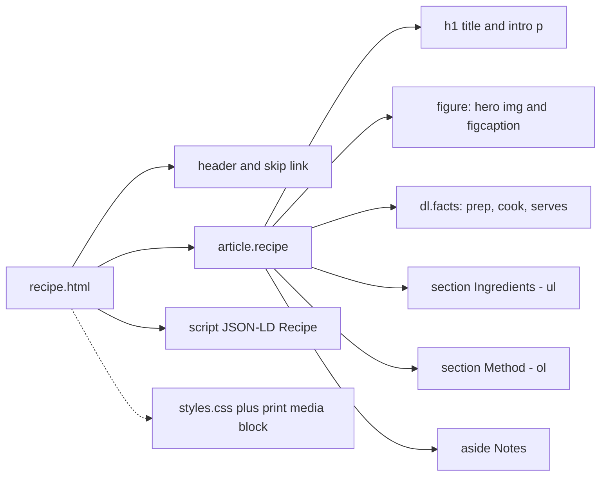
- **article**: a self-contained composition. A recipe could be syndicated on its own, which is the test for `<article>`.
- **dl.facts**: a description list pairs terms (`<dt>`) with values (`<dd>`). Screen readers announce it as a list of pairs.
- **ul vs ol**: the choice carries meaning. Assistive technology announces "list, 9 items" and, for `<ol>`, the step numbers.
- **aside**: content related to the recipe but not part of the main flow (substitutions, storage).
- **JSON-LD**: JavaScript Object Notation for Linked Data, a script block containing data only. Browsers don't execute it.

### Data model
| Content type | Fields | Machine-readable form |
|---|---|---|
| Recipe | name, description, image, author | JSON-LD `Recipe` |
| Duration | prep, cook, total | `time datetime="PT1H5M"` (ISO 8601 duration) |
| Ingredient | quantity, unit, item | `li` text, mirrored in `recipeIngredient` |
| Step | text, optional tip | `ol > li`, mirrored as `HowToStep` |
| Yield | servings | `recipeYield` |

### Tech stack
- **HTML** with `<figure>`, `<dl>`, `<time>`, lists: the semantics do most of the work.
- **CSS** with a `@media print` block: no extra file to load.
- **JSON-LD**: Google recommends this format for structured data, and it stays separate from the visible HTML.

### Milestones
1. **Semantic skeleton.** *Done when* the page validates and the heading outline is h1, then h2 for Ingredients, Method and Notes.
2. **Layout.** On wide screens, put ingredients in a narrow sticky column beside the steps using grid, with a single column on phones. *Done when* ingredients stay visible while you scroll the method on a laptop.
3. **Print styles.** Hide the header, skip link and hero image (or shrink it), set black text on white, and add `break-inside: avoid` on each step. *Done when* print preview shows a clean one or two page recipe.
4. **Structured data.** Add JSON-LD. *Done when* Google's Rich Results Test reports a valid Recipe with no errors.

### Deep dive: the hard parts
- **Duplicated data.** The JSON-LD repeats what the HTML shows. If they drift apart, search engines may treat it as misleading. Keep a habit of updating both together, or generate one from the other in project 33.
- **Sticky ingredients.** `position: sticky; inset-block-start: 1rem` only works if no ancestor has `overflow: hidden` and the sticky element is shorter than the viewport. Chapter 7 explains both conditions.
- **Checkbox ingredients without JS.** Turning each ingredient into a `<label><input type="checkbox"> 200 g flour</label>` lets cooks tick items off, and `:has(:checked)` can strike through the text. This is a real usability win, but it isn't saved if the page reloads.

### Testing strategy
Print preview in two browsers. Rich Results Test for the JSON-LD. Screen reader check that "list, 9 items" is announced for ingredients. 200 % zoom check. Lighthouse for the image size.

### Trade-offs, scaling and failure modes
Making the ingredient column sticky helps laptops but can trap short viewports, so only enable it inside a `min-height` media query. Structured data makes the page *eligible* for rich results but doesn't guarantee them. Hiding the photo in print saves ink but some cooks want it, so offer a smaller version instead.

### Stretch goals
- Add a "Cook mode" toggle with a checkbox and `:has()` that enlarges the steps.
- Add `@page { margin: 15mm }` and a printed source URL using `a[href]::after { content: " (" attr(href) ")" }`.
- Scale ingredient quantities with a `<select>` (needs a little JS, so it's optional).

### Skills practised
- [Ch 2 — HTML Structure and Text](../chapters/02-html-structure-and-text/README.md): lists, `<time>`, `<dl>`.
- [Ch 3 — Semantic HTML and Accessibility](../chapters/03-semantic-html-and-accessibility/README.md): `<article>`, `<aside>`, skip links.
- [Ch 4 — Images, Media and Embeds](../chapters/04-images-media-and-embeds/README.md): `<figure>`, image sizing.
- [Ch 14 — Performance, SEO, Interview and Cheat Sheets](../chapters/14-performance-seo-interview-and-cheatsheet/README.md): JSON-LD.

### In the interview
**30-second answer:** I built a recipe page that serves three audiences from one HTML file: cooks on a tablet, people printing it, and search engines. The key decision was letting the elements carry meaning: `<ul>` for ingredients, `<ol>` for steps, a `<dl>` for prep and cook times with `<time datetime="PT20M">`, and a JSON-LD Recipe block that mirrors the visible content. The hardest part was print, which I solved with an `@media print` block that hides chrome and keeps each step whole with `break-inside: avoid`. It fits on one or two A4 pages and passes Google's Rich Results Test.

**Key terms to know:**
- **`<article>`** — a self-contained piece of content that would make sense syndicated on its own. The recipe is one.
- **`<ul>` vs `<ol>`** — unordered when order doesn't matter (ingredients), ordered when it does (method steps).
- **Description list (`<dl>`)** — pairs of terms (`<dt>`) and values (`<dd>`). Used for the facts block.
- **`<time datetime>`** — a machine-readable date or ISO 8601 duration such as `PT1H5M`, alongside human text.
- **`<figure>` and `<figcaption>`** — groups the hero image with its caption.
- **JSON-LD** — structured data in a `<script type="application/ld+json">` block, read by search engines and never executed.
- **schema.org Recipe** — the shared vocabulary (`recipeIngredient`, `totalTime`) the JSON-LD uses.
- **Rich results** — enhanced search listings. Structured data makes a page eligible, not guaranteed.
- **Print stylesheet** — `@media print` rules plus `@page` for margins, and `break-inside` to control page breaks.
- **`position: sticky`** — keeps the ingredients column visible while you scroll the method on wide screens.

**Q:** When would you use `<ol>` rather than `<ul>`?

**A:** When order is part of the meaning, like recipe steps. Assistive technology announces the item count and the numbers, and reordering the items would change the meaning. Ingredients are a set, so `<ul>` is honest there.

**Q:** What is JSON-LD and why put it in a script tag?

**A:** It is structured data in JSON format using a vocabulary like schema.org. A `<script>` with a non-JavaScript `type` isn't executed, so it's a safe container for data that search engines read, and it stays separate from the visible markup.

**Q:** How do you make content print well?

**A:** Use a `@media print` block to hide navigation and decoration, force readable black-on-white colours, control breaks with `break-inside: avoid` on steps and `break-after: avoid` on headings, and set page margins with `@page { margin: 15mm }`. Then check print preview in two browsers, because print engines differ.

**Q:** Why a `<dl>` for prep time, cook time and servings instead of a table or paragraphs?

**A:** The data is a short list of label and value pairs, which is exactly what a description list models. A table would imply two-dimensional data, and paragraphs would lose the pairing. Screen readers announce the list and its items so the structure is kept.

**Q:** The sticky ingredients column doesn't stick. What do you check?

**A:** First that it has an inset such as `inset-block-start: 1rem`, because sticky does nothing without one. Then that no ancestor has `overflow: hidden` or `auto`, which makes that ancestor the scroll container. Finally that the element is shorter than the viewport and its parent is taller than it, or there is no room to stick.

**Q:** The JSON-LD says 30 minutes but the page now says 45. Why does it matter?

**A:** Search engines expect structured data to describe what's visible, and a mismatch can make the page ineligible for rich results or look misleading. Hand-written duplicates drift, so in a real site you generate both the HTML and the JSON-LD from one source, as in project 33.

**Q:** What's one code-level gotcha with JSON-LD in HTML?

**A:** If any string in the JSON contains `</script>`, the HTML parser ends the script element early and the rest spills into the page. Generators should escape `<` as `<` (or `</` as `<\/`) when serialising. Never build JSON-LD by concatenating strings.

**Q:** What changes if this becomes a site with 5,000 recipes?

**A:** Hand-written HTML and JSON-LD stop being viable, so recipes move into data (Markdown or a database) rendered by templates that output both. Images need an automated pipeline for sizes and formats. The print stylesheet and semantics stay the same, which is the benefit of getting them right in the template once.

**Q:** How do you test it?

**A:** Validate the HTML, run Google's Rich Results Test on the JSON-LD, print-preview in two browsers, and use a screen reader to confirm "list, 9 items" for ingredients and numbered steps. Check zoom at 200 % and image size in Lighthouse.

**Common mistakes in answers:**
- Saying JSON-LD "improves ranking". It makes a page eligible for rich results, which can raise click-through, but it isn't a ranking boost on its own.
- Using `<br>` or numbered paragraphs for steps. The list element is what gives assistive technology the structure.
- Claiming `display: none` in print hides content from screen readers on screen. Print styles only apply to printed output and print preview.

### TL;DR
A recipe is a lesson in choosing lists (`ul` for ingredients, `ol` for steps), description lists and `<time>`. Add print styles and JSON-LD, and the same HTML serves cooks, printers and search engines.

## 3. Accessible contact form

**Level:** Beginner · **Time:** 1 weekend · **Prerequisites:** Ch 3, Ch 5, Ch 6

### What it is
A contact form with name, email, topic, message and a consent checkbox, built so that everyone can complete it: keyboard users, screen-reader users, people on phones, people who make mistakes. It submits to a real endpoint (a form-handling service or a tiny server) and shows clear errors.

### The problem it solves
Forms are where many websites lock people out. Placeholder text is used instead of labels, errors appear only in red, and the submit button is a `<div>`. Each of these fails real users and WCAG. A form is also the place where HTML does the most free work: built-in validation, the right mobile keyboard and browser autofill all come from choosing the right attributes.

### Real-world examples
- The W3C's [Forms tutorial](https://www.w3.org/WAI/tutorials/forms/) covers labels, grouping, instructions and error notification.
- The GOV.UK Design System's [error message](https://design-system.service.gov.uk/components/error-message/) and [error summary](https://design-system.service.gov.uk/components/error-summary/) components are a well-tested pattern: a summary at the top linking to each field, plus an inline message attached to each field.

### Requirements
**Functional**
- Fields: name (`autocomplete="name"`), email (`type="email"`, `autocomplete="email"`), topic (`<select>` or radio group in a `<fieldset>` with `<legend>`), message (`<textarea>`), consent checkbox.
- Every control has a visible `<label>`. Hints are linked with `aria-describedby`.
- Required fields are marked in text ("required"), not only with an asterisk or colour.
- Native validation on submit. Error styling only after the user has interacted, using `:user-invalid`.
- `method="post"` to a real `action` URL. Show a confirmation page afterwards.

**Non-functional**
- All controls reachable and operable with the keyboard alone.
- Touch targets at least **24 × 24 CSS px** (WCAG 2.2 criterion 2.5.8), ideally 44 px.
- Error text contrast at least **4.5:1**. Error state is also shown by an icon or text, never colour alone.
- Works with JavaScript turned off.

### The architecture
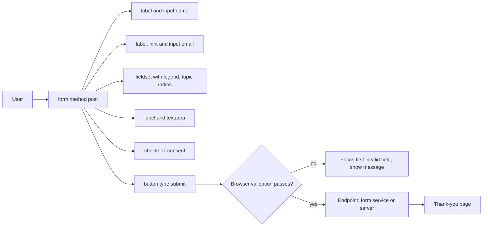
- **label**: gives each control its **accessible name** (what a screen reader reads out). Clicking it also focuses the control.
- **fieldset/legend**: groups related radios and names the group, so "Topic" is read before each option.
- **Browser validation**: `required`, `type="email"`, `minlength` and similar attributes give you the **Constraint Validation API** for free. The browser blocks submission and shows a message.
- **Endpoint**: the server must validate again. Client validation is a convenience, never security.

### Data model
| Field | Type | Constraints | Autocomplete token |
|---|---|---|---|
| name | text | required, maxlength 100 | `name` |
| email | email | required | `email` |
| topic | radio group | required, one of 3 | none |
| message | textarea | required, minlength 20, maxlength 2000 | none |
| consent | checkbox | required | none |

### Tech stack
| Component | Choice | Why |
|---|---|---|
| Form | Native HTML form | Validation, autofill and keyboard support built in |
| Error styling | `:user-invalid` (Baseline, widely available since May 2026) | Only shows after interaction |
| Endpoint | Any form-to-email service or a tiny server | Keeps the project HTML-only |
| Layout | Single column, block flow | Easiest to scan and to zoom |

### Milestones
1. **Markup.** *Done when* every control has a label, the radios are in a fieldset, and the form submits with JS off.
2. **Validation attributes.** *Done when* submitting an empty form focuses the first field and the browser shows its message.
3. **Styling.** Visible focus ring, large targets, required markers in text, error styles via `:user-invalid`. *Done when* errors don't appear before the user has typed.
4. **Server round trip.** *Done when* a valid submission reaches your inbox and the thank-you page has a clear `<h1>`.

### Deep dive: the hard parts
- **`:invalid` vs `:user-invalid`.** `:invalid` matches from page load, so an empty required field is "red" before the user has done anything, which is hostile. `:user-invalid` matches only after the user has changed the field or tried to submit.
- **Native error bubbles.** Browser validation messages look different in each browser and disappear quickly. To get the GOV.UK-style persistent inline errors and summary you need either server-side rendering of errors (works without JS) or a few lines of JS using the Constraint Validation API. For this project, render server-side errors on the returned page.
- **Placeholder is not a label.** Placeholder text vanishes as you type, often fails contrast, and some assistive technology ignores it. Use it, if at all, only for an example format.

### Testing strategy
Keyboard-only run. Screen reader run (VoiceOver or NVDA): is each field's name, role, required state and hint read? Submit empty, then submit invalid email. Check the autofill fills name and email. Run axe DevTools. Test on a real phone for the email keyboard.

### Trade-offs, scaling and failure modes
Native validation is robust but limited in style. Custom validation is consistent but needs JS and care. A third-party endpoint is easy but sends user data to someone else, so mention it in your privacy note. Spam will arrive: a hidden "honeypot" field that humans never fill is a cheap first defence. Without server-side validation, any rule you set can be skipped with DevTools.

### Stretch goals
- An error summary at the top of the server-rendered error page, focused on load.
- Character counter for the message (needs JS) announced politely with `aria-live`.
- `field-sizing: content` on the textarea so it grows with text (Baseline newly available since June 2026, so treat it as an enhancement).

### Skills practised
- [Ch 3 — Semantic HTML and Accessibility](../chapters/03-semantic-html-and-accessibility/README.md): accessible names, forms, WCAG 2.2.
- [Ch 5 — Tables and Forms](../chapters/05-tables-and-forms/README.md): input types, validation, autocomplete.
- [Ch 6 — CSS Fundamentals](../chapters/06-css-fundamentals/README.md): pseudo-classes.

### In the interview
**30-second answer:** I built a contact form that everyone can complete: keyboard users, screen-reader users, people on phones and people who make mistakes. The key decision was using native HTML for almost everything: visible `<label>`s, a `<fieldset>` and `<legend>` for the topic radios, `type="email"`, `autocomplete` tokens and built-in constraint validation, with errors styled by `:user-invalid` so a fresh form isn't red. The hard part was persistent, accessible error messages, which I solved by validating again on the server and rendering errors into the returned page. It works with JavaScript turned off, and every target is at least 24 × 24 px.

**Key terms to know:**
- **Accessible name** — what a screen reader announces for a control. A `<label for>` provides it here.
- **`<fieldset>` and `<legend>`** — group related controls and name the group, so "Topic" is read with each radio.
- **`aria-describedby`** — links hint and error text to a field so it is read after the name.
- **Constraint Validation API** — the browser's built-in checks driven by `required`, `type`, `minlength` and similar attributes.
- **`:invalid` vs `:user-invalid`** — the first matches from page load, the second only after the user interacts or submits.
- **`autocomplete` tokens** — values like `name` and `email` that let the browser autofill correctly.
- **Server-side validation** — re-checking every value on the server, because client checks can be bypassed.
- **WCAG 2.5.8 Target Size (Minimum)** — targets of at least 24 × 24 CSS px, or enough spacing around them.
- **Use of colour (WCAG 1.4.1)** — errors must not be shown by colour alone, so add text or an icon.
- **Honeypot field** — a hidden field humans never fill, used as a cheap spam filter.

**Q:** How do you make a form field accessible?

**A:** A visible `<label>` tied to it with `for`/`id`, hints linked with `aria-describedby`, the right `type` and `autocomplete`, related controls grouped in a fieldset with a legend, and errors described in text and linked to the field. Required state should be in text ("required"), not only an asterisk or colour.

**Q:** Is client-side validation enough?

**A:** No. It improves the experience but anyone can bypass it with DevTools or by posting directly to the endpoint. The server must validate everything again and return useful errors.

**Q:** Why `:user-invalid` instead of `:invalid`?

**A:** `:invalid` matches an empty required field as soon as the page loads, so the form shouts errors before the user has typed anything. `:user-invalid` waits until the user has changed the field or tried to submit, which is how GOV.UK-style forms behave.

**Q:** Why is placeholder text not a label?

**A:** It disappears as soon as you type, so people forget what the field was for. It often fails contrast and some assistive technology doesn't treat it as a reliable name. Use a real label, and placeholders only for an example format if at all.

**Q:** Why not use a `<div>` with a click handler as the submit button?

**A:** A `<div>` isn't focusable, has no button role, doesn't respond to Enter or Space, and doesn't submit the form. A `<button type="submit">` gets all of that for free and works with JS off. Recreating it means `tabindex`, `role`, key handlers and submission logic you'd have to maintain.

**Q:** What happens if the form-handling service is down when someone submits?

**A:** With a plain POST the user lands on an error page from the endpoint and their message may be lost. Mitigations are a server you control that re-renders the form with the user's input and a clear "try again" message, and a fallback contact method (email address) on the page. Never show success until the server confirms it.

**Q:** Spam floods in. What's your first response?

**A:** Add a honeypot field that is visually hidden and labelled "leave this empty", and reject submissions that fill it. Then add server-side rate limiting. A CAPTCHA is a last resort because many are inaccessible, and WCAG 2.2's Accessible Authentication criterion warns against cognitive tests.

**Q:** How do you test it?

**A:** Keyboard-only run, then a screen reader pass checking each field's name, role, required state and hint. Submit empty, then submit an invalid email, and confirm autofill fills name and email. Run axe DevTools, and try a real phone to check the email keyboard appears.

**Q:** Give one snippet that links a hint and shows the error state accessibly.

**A:** The hint is linked by id, and the error styling only appears after interaction.
```html
<label for="email">Email (required)</label>
<p id="email-hint">We only use this to reply.</p>
<input id="email" type="email" autocomplete="email"
       required aria-describedby="email-hint">
```
With `input:user-invalid { border-color: var(--danger) }` plus an icon or text, never colour alone.

**Common mistakes in answers:**
- Saying `aria-label` is the best way to label inputs. A visible `<label>` is better because sighted users see it, it enlarges the click target, and it's what the first rule of ARIA prefers.
- Treating `required` on the client as security. It is a convenience. Only server checks protect data.
- Saying a red border is enough to show an error. WCAG 1.4.1 needs a non-colour cue such as text or an icon.

### Self-check
- Which attribute makes the browser offer saved emails?
- What does a `<legend>` do for a screen-reader user tabbing into a radio group?

### TL;DR
Labels, fieldsets, input types, `autocomplete` and native validation give you most of an accessible form for free. Style errors with `:user-invalid`, never rely on colour alone, and always validate again on the server.

## 4. Pricing table

**Level:** Beginner · **Time:** 1 weekend · **Prerequisites:** Ch 5, Ch 6, Ch 7, Ch 8

### What it is
A pricing section for a made-up product with three plans (Free, Pro, Team). It has two parts: **plan cards** with a price, a short pitch and a call-to-action button, and a **feature comparison table** below that lists every feature against every plan. You'll practise when to use cards (flexbox) and when to use a real data table.

### The problem it solves
Pricing pages often show comparison grids built from `<div>`s with tick-mark images. They look fine, but a screen reader hears a stream of disconnected ticks with no idea which plan or feature they belong to. A real `<table>` with header cells fixes that, because each cell is announced with its row and column headers. The cards above it need to line up neatly whatever the text length, which is a classic flexbox problem.

### Real-world examples
- The W3C [Tables tutorial](https://www.w3.org/WAI/tutorials/tables/) explains `<caption>`, `<th>`, and the `scope` attribute, which are exactly what a comparison table needs.
- MDN's [HTML table accessibility](https://developer.mozilla.org/en-US/docs/Learn_web_development/Core/Structuring_content/Table_accessibility) lesson shows how header associations are read out.

### Requirements
**Functional**
- Three plan cards, each an `<article>` with the plan name as a heading, a price, a feature summary list and a button. The buttons must line up at the bottom even when summaries differ in length.
- One "Most popular" plan visually highlighted *and* labelled in text.
- A monthly/yearly price switch done with two radio buttons and `:has()`. No JS.
- A comparison `<table>` with `<caption>`, column headers for plans (`scope="col"`), row headers for features (`scope="row"`), and ticks as text ("Included" / "Not included") with a visible icon.

**Non-functional**
- At 320 px, cards stack. The table scrolls horizontally inside its own container (not the page), and the first column stays visible.
- The "popular" badge is not conveyed by colour alone.
- Whole section under **30 KB** of HTML and CSS.

### The architecture
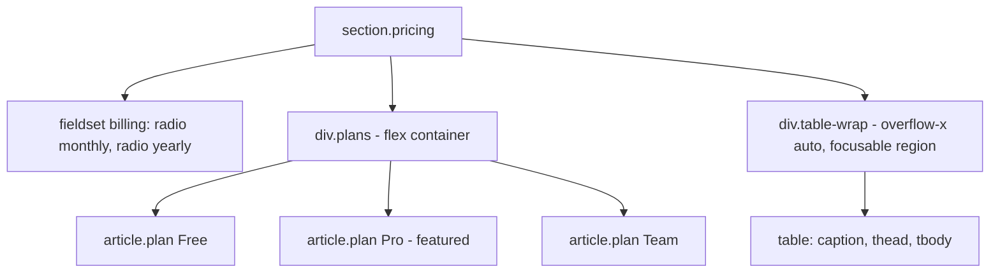
- **fieldset billing**: the two radios set the state. `.pricing:has(#yearly:checked) .price-monthly { display: none }` swaps the visible prices.
- **div.plans**: a flex container with `flex-wrap: wrap` and `gap`. Each card is itself a flex column, so `margin-block-start: auto` on the button pushes it to the bottom.
- **div.table-wrap**: scrolls the table, not the page. Give it `tabindex="0"`, `role="region"` and an `aria-label` so keyboard users can scroll it.

### Data model
| Plan | Monthly | Yearly (per month) | Key limits |
|---|---|---|---|
| Free | 0 | 0 | 1 project, community support |
| Pro | 12 | 10 | 20 projects, email support |
| Team | 29 per seat | 24 per seat | Unlimited, SSO, priority support |

Each feature row in the table has: feature name (row header), and one cell per plan with "Included", "Not included" or a limit value.

### Tech stack
- **Flexbox** for cards: one dimension, content-sized, wraps naturally.
- **`<table>`** for the comparison: two-dimensional data with headers is exactly what tables are for.
- **`:has()`** (Baseline since December 2023, widely available since June 2026) for the billing toggle.
- **`position: sticky`** on the first column so feature names stay visible while scrolling sideways.

### Milestones
1. **Table semantics.** *Done when* a screen reader announces "Pro, SSO, Not included" style context for a cell.
2. **Cards.** *Done when* the three buttons align at the bottom with summaries of different lengths, and cards wrap to one column at 320 px.
3. **Billing toggle.** *Done when* switching the radios changes all prices with no JS, and the radios are keyboard operable.
4. **Responsive table.** *Done when* the table scrolls inside its wrapper on a phone, the first column stays put, and the page itself never scrolls sideways.

### Deep dive: the hard parts
- **Equal-height cards with bottom-aligned buttons.** Flex items in a row stretch to the same height by default (`align-items: stretch`). Making each card `display: flex; flex-direction: column` and giving the button `margin-block-start: auto` uses the free space above the button.
- **Ticks that mean something.** A tick icon alone has no text. Use visually hidden text ("Included") plus an `aria-hidden="true"` icon, or simply show the words. Never leave a cell empty to mean "no".
- **Sticky first column.** `th[scope=row] { position: sticky; inset-inline-start: 0; background: var(--surface) }`. The background is required, otherwise scrolled cells show through.

### Testing strategy
Screen-reader table navigation (Ctrl+Alt+arrows in VoiceOver/NVDA). Resize to 320 px. Keyboard: Tab to the table region and scroll with arrows. Check contrast of the featured card's colours.

### Trade-offs, scaling and failure modes
Showing "per month, billed yearly" is clear but legally sensitive: make the billing terms plain text, not a tooltip. CSS-only toggles can't remember the choice across pages. A long feature table on mobile is unavoidable: horizontal scroll is acceptable for real data tables (WCAG's reflow criterion explicitly allows two-dimensional content to scroll), but plan cards must not.

### Stretch goals
- Group feature rows with `<tbody>` sections, each with a header row.
- Highlight the column of the plan whose card is hovered using `:has()`.
- Animate the price swap with a short opacity transition, disabled under `prefers-reduced-motion`.

### Skills practised
- [Ch 5 — Tables and Forms](../chapters/05-tables-and-forms/README.md): `caption`, `scope`, radios.
- [Ch 7 — Box Model and Layout Basics](../chapters/07-box-model-and-layout-basics/README.md): sticky, overflow.
- [Ch 8 — Flexbox](../chapters/08-flexbox/README.md): wrapping, auto margins.
- [Ch 13 — Modern CSS and Architecture](../chapters/13-modern-css-and-architecture/README.md): `:has()`.

### In the interview
**30-second answer:** I built a pricing section with two parts: three plan cards to sell, and a real comparison `<table>` to compare. Cards use flexbox, and each card is itself a flex column so `margin-block-start: auto` pins every button to the bottom regardless of text length. The comparison table has a `<caption>`, `scope="col"` plan headers and `scope="row"` feature headers, so a screen reader reads "Pro, SSO, Not included" for any cell. A monthly/yearly switch uses two radios and `:has()` with no JS, and on a 320 px phone the table scrolls inside a focusable wrapper while the page never scrolls sideways.

**Key terms to know:**
- **Flexbox** — one-dimensional layout along a row or column. Used for the card row and inside each card.
- **`align-items: stretch`** — the default that makes flex items in a row equal height.
- **Auto margins in flexbox** — an `auto` margin absorbs free space, pushing the button to the bottom.
- **`<caption>` and `scope`** — give the table a name and tell assistive technology which headers apply to which cells.
- **`:has()`** — the "parent" selector. `.pricing:has(#yearly:checked)` styles the section from a radio's state.
- **`:checked`** — matches a selected radio or checkbox, the state the toggle relies on.
- **`position: sticky` first column** — keeps feature names visible while the table scrolls sideways. Needs a background.
- **Focusable scroll region** — `tabindex="0"`, `role="region"` and an `aria-label` so keyboard users can scroll the table.
- **WCAG 1.4.10 Reflow** — content must work at 320 px without horizontal scroll, except two-dimensional content such as data tables.
- **Use of colour** — the "Most popular" plan is labelled in text, not only highlighted.

**Q:** Cards or table for a plan comparison?

**A:** Both. Cards for the pitch and the call to action, a table for the feature matrix, because the matrix is two-dimensional data where each cell needs its row and column context.

**Q:** How do you push a button to the bottom of a flex column?

**A:** Make the card `display: flex; flex-direction: column` and give the button `margin-block-start: auto`. An auto margin in flexbox absorbs all the free space on that side, so the button sits at the bottom of every card.

**Q:** How can you swap content without JavaScript?

**A:** Use real form state, such as a checked radio, and select on it with `:checked` and `:has()`: `.pricing:has(#yearly:checked) .price-monthly { display: none }`. It's keyboard accessible because the radios are, and screen readers announce the choice.

**Q:** Why flexbox for the cards and not grid?

**A:** The cards are one row of content-sized items that should wrap when space runs out, which is flexbox's strength. Grid would also work and is better if you need columns to line up across rows. A reasonable answer names the trade-off: flex for content-out wrapping, grid for layout-in tracks.

**Q:** What does `scope` do on a `<th>`?

**A:** It says whether the header applies to its column (`scope="col"`) or its row (`scope="row"`). Screen readers then announce the matching headers as you move between cells. Without it, browsers guess, and they guess wrong in tables that have both row and column headers.

**Q:** The sticky first column shows the scrolled cells through it. Why?

**A:** Sticky cells have a transparent background by default, so content scrolling underneath is visible. Give the sticky `th` a solid background from your surface token, and a `z-index` if other positioned cells overlap it.

**Q:** What happens on a 320 px phone if you don't add a wrapper?

**A:** The table is wider than the viewport, so the whole page scrolls sideways, which fails reflow for the rest of the content and makes the cards awkward too. Wrapping the table in an `overflow-x: auto` container confines the scroll to the data, which WCAG allows for tables.

**Q:** The client wants 12 plans. What breaks first?

**A:** The table becomes too wide to compare at a glance, and the card row wraps into a wall. Group plans (personal vs business tabs or pages), put features into `<tbody>` groups with header rows, and consider letting users pick two or three plans to compare.

**Q:** How do you test the table?

**A:** Use screen-reader table navigation (Ctrl+Alt+arrow keys in NVDA or VoiceOver) and confirm each cell reads its plan and feature. Resize to 320 px, Tab to the scroll region and scroll with arrow keys, and check the featured card's colour contrast.

**Common mistakes in answers:**
- Using tick images in `<div>` grids for the matrix. Without table semantics, a screen reader hears disconnected ticks.
- Saying empty cells are fine for "not included". Always write the words, with any icon `aria-hidden="true"`.
- Saying `:has()` needs JS fallbacks today. It is Baseline, so the risk is low, but the radios must still be keyboard operable.

### TL;DR
Flexbox cards for selling, a semantic table for comparing. `:has()` and radios give you a no-JS billing switch, and a scrolling, focusable table wrapper keeps the page from overflowing on phones.

## 5. Blog article layout

**Level:** Beginner · **Time:** 1 weekend · **Prerequisites:** Ch 2, Ch 4, Ch 6, Ch 11

### What it is
A long-form article template: title, byline and date, lead paragraph, body text with headings, quotes, code samples, images with captions, footnotes and a "related posts" area. The project is mostly about **typography and reading comfort**: line length, line height, vertical rhythm and headings that wrap nicely.

### The problem it solves
Most text on the web is read, not clicked. Yet many article templates use lines 120 characters long, light grey text and headings that leave a single orphaned word on the last line. Good typography is mostly a few CSS properties, applied with intent. An article template is also reused hundreds of times, so getting it right once pays off.

### Real-world examples
- Matthew Butterick's *Practical Typography* recommends [an average line length of 45–90 characters](https://practicaltypography.com/line-length.html). The CSS `ch` unit makes that easy to hit.
- Chrome's article on [`text-wrap: balance`](https://developer.chrome.com/docs/css-ui/css-text-wrap-balance) shows how balancing short multi-line text, such as headings, avoids ragged last lines. It is Baseline since May 2024.

### Requirements
**Functional**
- `<article>` with `<header>` (h1, byline with `<address>` or author link, `<time datetime>`), body and `<footer>` (tags, share links).
- Block quotes with `<blockquote>` and `<cite>`. Code with `<pre><code>`. Images in `<figure>` with `<figcaption>`.
- Footnotes as links to an ordered list at the end, with back-links.
- A related-posts `<aside>` or `<nav aria-label="Related">`.

**Non-functional**
- Measure (line length) **60–75 ch** for body text.
- Body font size at least **1rem** (16 px default), line height around **1.5–1.7**.
- Wide code blocks scroll inside themselves. Images never overflow.
- Text resizes to **200 %** without loss of content.

### The architecture
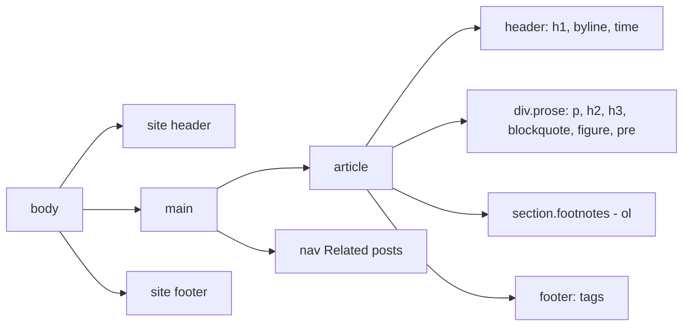
- **div.prose**: a wrapper whose styles apply to whatever elements authors put inside (a "prose" or "flow" class). This is where measure and rhythm live.
- **section.footnotes**: footnotes are an ordered list. Each reference is a superscript link with an `id` so the note can link back.
- **nav Related**: a second navigation landmark, so it needs an `aria-label` to tell it apart from the main nav.

### Data model
| Content block | Element | Styling concern |
|---|---|---|
| Lead | first `p` | Larger size, maybe a different weight |
| Section heading | `h2` / `h3` | Space above larger than below (proximity) |
| Quote | `blockquote > p` + `cite` | Inline-start border, indent |
| Figure | `figure > img + figcaption` | Max width 100 %, caption smaller |
| Code | `pre > code` | Monospace, `overflow-x: auto`, `tab-size` |
| Footnote | `sup > a` + `ol > li` | Back-link, target highlight with `:target` |

### Tech stack
- **System fonts or one self-hosted variable font** with `font-display: swap`.
- **`max-inline-size: 70ch`** on the prose column.
- **Flow spacing**: `.prose > * + * { margin-block-start: 1em }` (the "lobotomised owl" selector) for consistent rhythm.
- **`text-wrap: balance`** on headings, **`hyphens: auto`** on body text with `lang` set.

### Milestones
1. **Markup a real article** of about 1,500 words. *Done when* it validates and the outline is correct.
2. **Measure and rhythm.** *Done when* body lines are 60–75 characters and spacing is consistent between every block type.
3. **Media and code.** *Done when* a 2,000 px image and a 200-character code line both fit at 320 px.
4. **Footnotes and `:target`.** *Done when* clicking a footnote jumps to it, it is highlighted, and the back-link returns you to the same place.

### Deep dive: the hard parts
- **Why `ch`?** One `ch` is the width of the "0" glyph in the current font. `70ch` is therefore roughly 70 characters of average text, and it scales with the font size and with user zoom, which pixels don't.
- **Rhythm with the owl selector.** `* + *` matches any element that follows a sibling. Setting a top margin only on those means the first element never adds space at the top of the container, and margin collapsing (Chapter 7) never doubles spacing.
- **Headings that wrap well.** `text-wrap: balance` evens out line lengths for blocks up to a few lines (browsers cap it for performance). For body text, `text-wrap: pretty` avoids single-word last lines, but it isn't Baseline (no Firefox at the time of writing), so treat it as an enhancement that does nothing elsewhere.

### Testing strategy
Count characters per line at three widths. Zoom to 200 % and use browser text-only zoom. Test with a long German word to check hyphenation. Turn off CSS and check that the article still reads correctly.

### Trade-offs, scaling and failure modes
A web font gives brand character but costs bytes and may cause a visible font swap. Hyphenation improves justified or narrow text but depends on the browser's dictionary for the declared `lang`. Strict rhythm breaks when authors paste in odd HTML, which is why the prose styles should be resilient to any element order.

### Stretch goals
- A drop cap with `initial-letter` (check support first: it isn't Baseline).
- Reading-progress indicator with a scroll-driven animation in `@supports`.
- A dark theme for the article (preview of project 16).

### Skills practised
- [Ch 2 — HTML Structure and Text](../chapters/02-html-structure-and-text/README.md): text-level semantics, quotes, code.
- [Ch 4 — Images, Media and Embeds](../chapters/04-images-media-and-embeds/README.md): figures.
- [Ch 7 — Box Model and Layout Basics](../chapters/07-box-model-and-layout-basics/README.md): margin collapsing.
- [Ch 11 — Typography, Colour and Visual Effects](../chapters/11-typography-color-and-visual-effects/README.md): measure, line height, `text-wrap`.

### In the interview
**30-second answer:** I built a reusable long-form article template where the real work was typography: a 60–75 character measure using `max-inline-size: 70ch`, unitless line height around 1.6, consistent flow spacing with `.prose > * + *`, and balanced headings with `text-wrap: balance`. The HTML is fully semantic: `<article>` with a header, byline and `<time datetime>`, `<blockquote>` with `<cite>`, `<figure>` for images, `<pre><code>` for code, and footnotes as an ordered list with back-links. The hard problem was making wide content safe, so a 200-character code line scrolls inside its own block and a 2,000 px image never overflows at 320 px. Text still works at 200 % zoom.

**Key terms to know:**
- **Measure** — line length in characters. 60–75 is comfortable for body text.
- **`ch` unit** — the width of the "0" glyph in the current font. It scales with font size and zoom.
- **Unitless `line-height`** — inherited as a ratio and recomputed per element's font size.
- **Owl selector (`* + *`)** — selects every element that has a previous sibling, for even spacing between blocks.
- **Margin collapsing** — adjacent vertical margins combine into the larger one instead of adding up.
- **`text-wrap: balance`** — evens out line lengths in short multi-line text like headings.
- **`hyphens: auto`** — lets the browser hyphenate using the dictionary for the element's `lang`.
- **`:target`** — matches the element whose `id` is in the URL fragment. Used to highlight the footnote you jumped to.
- **Logical properties** — `max-inline-size`, `margin-block-start` and so on, which follow writing direction.
- **WCAG 1.4.4 Resize Text** — text must scale to 200 % without loss of content.

**Q:** How do you control line length responsively?

**A:** `max-inline-size` in `ch` units, around 60–75ch for body text, centred with `margin-inline: auto`. Because `ch` depends on the font size, the measure stays right when users zoom or change their default font size, which pixel widths don't.

**Q:** What does `* + *` do?

**A:** It selects every element that has a previous sibling, so you can space siblings evenly without adding space before the first one. Scoped to `.prose > * + *` it applies only to direct children of the article body.

**Q:** Why is `line-height` usually unitless?

**A:** A unitless value is inherited as a ratio and recomputed for each element's font size. A length like `24px` (or a computed `em` value) is inherited as a fixed length, so a 40 px heading would get 24 px lines and overlap.

**Q:** Why do the owl selector and margin collapsing work well together?

**A:** Vertical margins between block siblings collapse to the larger value, so if both a heading and a paragraph set margins you don't get double spacing. Setting only a top margin through `* + *` means one margin controls each gap, and the container never gets stray space at its top or bottom.

**Q:** A long code line makes the whole page scroll sideways. How do you fix it?

**A:** Give `pre` an `overflow-x: auto` so it scrolls inside itself, and `tabindex="0"` so keyboard users can scroll it. If the article sits in a grid or flex column, also give that column `min-width: 0` or `minmax(0, 1fr)`, because flex and grid items default to a minimum size equal to their content.

**Q:** Why `text-wrap: balance` on headings but not on paragraphs?

**A:** Balancing compares possible line breaks across the whole block, which is expensive, so browsers limit it to a few lines. It's meant for headings and captions. For paragraphs, `text-wrap: pretty` avoids single-word last lines, but treat it as an enhancement because it isn't Baseline.

**Q:** What happens to hyphenation if the page has no `lang` attribute?

**A:** `hyphens: auto` needs to know the language to choose a dictionary, so without `lang` most browsers don't hyphenate at all. The same `lang` also tells screen readers which voice to use, so it should always be on `<html>`.

**Q:** Authors will paste in odd HTML, such as two images in a row or a list inside a quote. What breaks first?

**A:** Fixed per-element spacing rules break, because they assume a particular order. The flow rule `* + *` is resilient to any order, and sizing rules like `img { max-inline-size: 100% }` protect against oversized media. Test with deliberately messy content.

**Q:** How do you test the template?

**A:** Count characters per line at three widths, zoom to 200 % and use text-only zoom, try a long German word to check hyphenation, and turn CSS off to confirm the article still reads in order. Click a footnote and its back-link to check `:target` and return position.

**Common mistakes in answers:**
- Setting `max-width: 700px` and calling it measure. Pixels don't track font size, so zoomed text gets fewer characters per line.
- Using `font-size: 2vw` for headings. Viewport units alone ignore user font settings and can fail WCAG 1.4.4.
- Putting `<cite>` around the quote text. `<cite>` marks the title of a work, while the quoted words go in `<blockquote>`.

### TL;DR
Long-form reading is about measure (60–75ch), unitless line height, consistent flow spacing and headings that wrap well. Semantic quotes, figures, code and footnotes complete a template you can reuse everywhere.

## 6. Restaurant menu

**Level:** Beginner · **Time:** 1 weekend · **Prerequisites:** Ch 2, Ch 6, Ch 7, Ch 8

### What it is
An online menu for a fictional restaurant: sections (starters, mains, desserts, drinks), dishes with name, description, price and dietary tags, and a print-friendly version for the window. The visual signature is the classic **dotted leader** between dish name and price.

### The problem it solves
Many restaurants publish their menu as a PDF or as a photo of the paper menu. On a phone, you pinch and zoom, the text can't be read by screen readers or translated, and search engines can't index the dishes. A real HTML menu is searchable, accessible, translatable and lighter than a PDF.

### Real-world examples
- MDN's [`<dl>` reference](https://developer.mozilla.org/en-US/docs/Web/HTML/Reference/Elements/dl) describes description lists for name/value groups such as glossary terms or metadata, a natural fit for dish/description pairs.
- [schema.org/Menu](https://schema.org/Menu) defines `Menu`, `MenuSection` and `MenuItem` with `offers` for prices and `suitableForDiet` for dietary information.

### Requirements
**Functional**
- `<h1>` restaurant name, `<nav>` with in-page links to each section.
- Each section is a `<section>` with `<h2>` and a list of dishes.
- Each dish: name, price, description, dietary tags (V, VG, GF) with a key explaining the abbreviations, and `<abbr title>` for the tags.
- Dotted leaders between name and price that adapt to any width.
- A print stylesheet that fits the whole menu on one A4 page in two columns.

**Non-functional**
- Prices always visible with the dish name, never wrapped onto a separate line far away.
- Works at 320 px. Long dish names wrap without breaking the leader.
- No images required, so the page should be under **20 KB**.

### The architecture
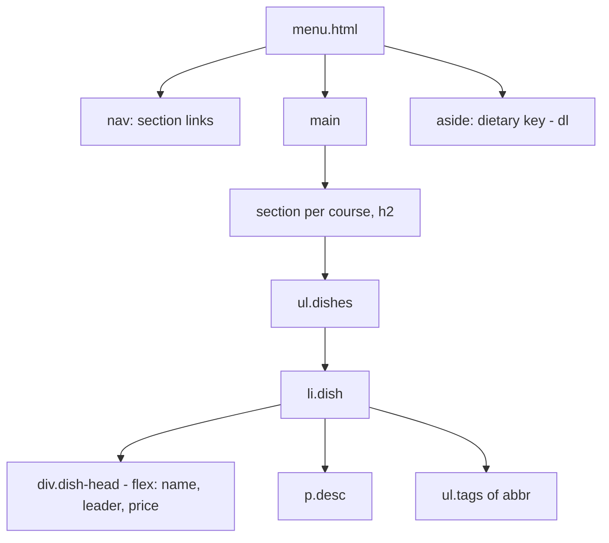
- **div.dish-head**: a flex row with three children: name, an empty leader span that grows (`flex: 1`) with a dotted bottom border, and the price.
- **ul.tags**: tags in a list so screen readers announce the count. `<abbr title="Vegan">VG</abbr>` expands the meaning.
- **aside dietary key**: a `<dl>` explaining each abbreviation, which works for everyone, including touch users who can't hover to see `title`.

### Data model
| Field | Example | Element |
|---|---|---|
| Section | Mains | `section > h2` |
| Dish name | Roast squash risotto | `h3` or `strong` |
| Price | 14.50 | `data value="14.50"` |
| Description | One sentence | `p` |
| Diet tags | V, GF | `abbr` in `ul` |

The `<data>` element pairs human-readable text with a machine-readable `value`, useful for the price.

### Tech stack
- **Flexbox** for the name-leader-price row.
- **CSS columns** (`columns: 2`) for print.
- **`scroll-margin-top`** so in-page links don't hide headings under a sticky nav.
- **`scroll-behavior: smooth`** inside `prefers-reduced-motion: no-preference` only.

### Milestones
1. **Content and semantics.** *Done when* the heading outline is restaurant, courses, dishes, and the tag key is present.
2. **Leader row.** *Done when* dotted leaders fill the space between any name and price at any width, and long names wrap with the price staying on the last line.
3. **Section nav.** *Done when* in-page links land with the heading fully visible below a sticky nav.
4. **Print.** *Done when* print preview shows the full menu on one A4 page in two balanced columns, with no section split across columns.

### Deep dive: the hard parts
- **Leaders that survive wrapping.** With `display: flex; align-items: baseline`, the leader span gets `flex: 1; border-block-end: 2px dotted; min-inline-size: 2ch`. Baseline alignment keeps the dots on the text's baseline even when the name wraps to two lines.
- **Columns without broken dishes.** `break-inside: avoid` on each `li.dish` and on section headings stops a dish splitting across columns. `break-after: avoid` on headings stops a heading sitting alone at a column bottom.
- **Prices as data.** Reading "14.50" out of context is ambiguous. Include a currency symbol in the visible text, and use `<data value>` if you want machines to read it.

### Testing strategy
Resize from 320 px to 1600 px and watch the leaders. Print preview in two browsers. Screen reader: does each dish read name, price, description, tags in a sensible order? Check that the page reads properly with CSS disabled.

### Trade-offs, scaling and failure modes
A menu that changes daily is painful to hand-edit; a small CMS or a JSON file and template fixes that in later projects. Dotted leaders are decorative: make sure they are a border on an empty span, not a string of "....." characters that a screen reader would read out. CSS multi-column is great for print but awkward on screens, where it makes readers scroll up and down.

### Stretch goals
- Filter dishes by diet using checkboxes and `:has()` (for example hide non-vegan items).
- Add schema.org `Menu` JSON-LD.
- A "today's specials" section highlighted with a different background, labelled in text.

### Skills practised
- [Ch 2 — HTML Structure and Text](../chapters/02-html-structure-and-text/README.md): `abbr`, `data`, lists.
- [Ch 7 — Box Model and Layout Basics](../chapters/07-box-model-and-layout-basics/README.md): borders, sticky nav.
- [Ch 8 — Flexbox](../chapters/08-flexbox/README.md): growing items, baseline alignment.
- [Ch 10 — Responsive Design](../chapters/10-responsive-design/README.md): print media.

### In the interview
**30-second answer:** I replaced a restaurant's PDF menu with a semantic HTML menu under 20 KB that reflows on phones, can be read by screen readers and translated, and prints on one A4 page in two columns. The signature detail is the dotted leader between dish name and price: a flex row with the name, an empty span that grows with `flex: 1` and a dotted bottom border, then the price, all aligned on the baseline so it survives wrapping. Dietary tags are `<abbr>` elements in a list with a visible key, because touch users can't hover to see a `title`. For print I used `columns: 2` with `break-inside: avoid` so no dish splits across columns.

**Key terms to know:**
- **Flex grow (`flex: 1`)** — lets an item take the leftover space in the row. The leader span uses it.
- **`align-items: baseline`** — aligns flex items on their text baseline, so dots sit on the text line even when the name wraps.
- **`<abbr title>`** — marks an abbreviation such as "VG" and gives its expansion.
- **`<data value>`** — pairs human text with a machine-readable value, used for prices.
- **Multi-column layout (`columns`)** — flows content into newspaper-style columns. Used in print.
- **Fragmentation (`break-inside`, `break-after`)** — controls where columns and pages may break.
- **`scroll-margin-top`** — offsets anchor jumps so headings aren't hidden under a sticky nav.
- **`prefers-reduced-motion`** — the user setting that gates `scroll-behavior: smooth`.
- **schema.org Menu** — the vocabulary (`Menu`, `MenuSection`, `MenuItem`) for structured data about dishes.

**Q:** How would you build dotted leaders?

**A:** A flex row: name, a growing empty element with a dotted bottom border, then the price, aligned on the baseline. It adapts to any width without fake dot characters. Give the leader a `min-inline-size` such as `2ch` so a long name can't squeeze it to nothing.

**Q:** Why is a PDF menu worse than HTML?

**A:** It doesn't reflow on phones, so people pinch and zoom. It's harder for assistive technology, isn't easily translated or indexed, and is usually heavier. HTML is responsive, searchable and accessible by default.

**Q:** How do you stop content splitting across columns in print?

**A:** `break-inside: avoid` on each dish and on section blocks, and `break-after: avoid` on headings so a heading never sits alone at the bottom of a column. These are requests, so very tall items may still split.

**Q:** Why not type "......" between the name and the price?

**A:** The number of dots would be wrong at every other width, and screen readers would read "dot dot dot" or skip unpredictably. A border on an empty element is pure decoration that assistive technology ignores and that resizes itself.

**Q:** Is `title` on `<abbr>` enough to explain "GF"?

**A:** No. `title` only appears on mouse hover, so touch and keyboard users rarely see it, and screen readers handle it inconsistently. The visible dietary key (a `<dl>`) is the reliable explanation, and `title` is a bonus.

**Q:** Why use `align-items: baseline` instead of `center`?

**A:** With `center`, a two-line dish name pushes the dots and price to the vertical middle, between the lines. Baseline alignment puts the dots and price on the first line's baseline, which reads naturally.

**Q:** The menu changes every day. What breaks first?

**A:** Hand-editing HTML: typos, wrong prices and forgotten updates. Move the dishes into a JSON file or a small CMS and render the menu with a template. The CSS stays the same because the structure doesn't change.

**Q:** In-page links hide the section heading under the sticky nav. How do you fix it?

**A:** Add `scroll-margin-top` on the headings (or `scroll-padding-top` on the root) equal to the nav height plus a little room. Anchor jumps and focus scrolling then stop short of the bar.

**Q:** How do you test it?

**A:** Resize from 320 px to 1600 px and watch the leaders and wrapping, print-preview in two browsers, and check with a screen reader that each dish reads name, price, description, tags in a sensible order. Turn CSS off to confirm the source order makes sense.

**Common mistakes in answers:**
- Using a `<table>` for the menu "because it has prices". A menu is a list of items, not a two-dimensional grid of data.
- Saying `columns` is a good screen layout. On screens it makes readers scroll down and back up, so keep it for print.
- Forgetting the currency in the visible price. "14.50" alone is ambiguous.

### TL;DR
A menu teaches flexbox with baseline alignment (leaders), honest semantics for tags and prices, and print layout with columns and break control. HTML beats a PDF on every axis that matters to diners.

## 7. Photo gallery with grid

**Level:** Beginner · **Time:** 1 weekend · **Prerequisites:** Ch 4, Ch 9

### What it is
A responsive gallery of 24–60 photos laid out with CSS Grid, where the number of columns adapts to the space available without any media queries. Each thumbnail links to a full-size view. Some photos span two columns or rows to create a featured look.

### The problem it solves
Galleries used to rely on JavaScript masonry libraries or floats with fragile percentage widths. Grid's `repeat(auto-fill, minmax())` solves the core layout in one line. The real challenges are then image performance (many images, lazy loading, no layout shift) and accessibility (meaningful alt text, a keyboard-usable full view).

### Real-world examples
- web.dev's [Learn CSS: Grid](https://web.dev/learn/css/grid) module explains `auto-fill`, `auto-fit` and `minmax()`, the core of this layout.
- web.dev's [Browser-level image lazy loading](https://web.dev/articles/browser-level-image-lazy-loading) explains `loading="lazy"` and why you should not lazy-load images that are visible on first paint.

### Requirements
**Functional**
- A `<ul>` of `<li><a></a></li>` thumbnails, each with alt text and a caption.
- Columns at least **200 px** wide, as many as fit, with a consistent `gap`.
- Featured photos span 2 × 2 on wide screens only.
- Thumbnails cropped to a consistent shape with `aspect-ratio` and `object-fit: cover`.
- Each thumbnail links to a full-size image page (or the image file) with a "back to gallery" link.

**Non-functional**
- First screen of thumbnails loads eagerly. The rest use `loading="lazy"`.
- Layout shift (CLS) near **0**: every image has `width` and `height`.
- Each thumbnail file under **40 KB** (WebP or AVIF).
- Visible focus ring around the focused thumbnail.

### The architecture
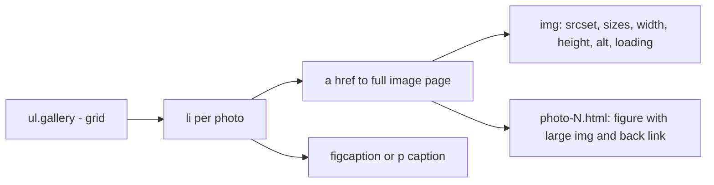
- **ul.gallery**: `display: grid; grid-template-columns: repeat(auto-fill, minmax(200px, 1fr)); gap: 1rem`.
- **img**: `srcset` offers two or three widths, `sizes` tells the browser roughly how wide the slot is, and the browser picks the smallest suitable file.
- **Full image page**: plain HTML is the robust baseline. A lightbox can come later as a stretch goal.

### Data model
| Field | Example | Use |
|---|---|---|
| id | `p017` | File and page names |
| alt | "Fishing boats at dawn, Porto harbour" | `alt` text |
| caption | "Porto, 2025" | Visible caption |
| width, height | 1600, 1067 | Aspect ratio, `width`/`height` attributes |
| featured | true/false | Adds a class for 2 × 2 span |
| files | 400w, 800w, 1600w | `srcset` |

### Tech stack
| Need | Choice | Why |
|---|---|---|
| Layout | Grid with `auto-fill` + `minmax()` | Responsive without breakpoints |
| Cropping | `aspect-ratio` + `object-fit: cover` | Uniform tiles from mixed photos |
| Formats | AVIF with WebP or JPEG fallback | Smaller files |
| Loading | `loading="lazy"`, `decoding="async"` | Defers offscreen images |

### Milestones
1. **Static grid.** *Done when* the column count changes smoothly as you resize, with no media queries.
2. **Uniform tiles.** *Done when* portrait and landscape photos display as identical squares or 4:3 tiles without distortion.
3. **Performance.** *Done when* Lighthouse shows CLS 0 and the network panel shows below-the-fold images loading only on scroll.
4. **Featured spans.** Use a media query here (the one place you need one) so 2 × 2 spans only apply when there are at least four columns, then add `grid-auto-flow: dense`. *Done when* there are no holes, and the visual order still makes sense.

### Deep dive: the hard parts
- **`auto-fill` vs `auto-fit`.** Both create as many columns as fit. With few items, `auto-fill` keeps empty tracks and `auto-fit` collapses them so the items stretch. For a gallery with many items they behave the same. With three photos on a wide screen, `auto-fit` makes huge tiles.
- **`dense` and reading order.** `grid-auto-flow: dense` backfills holes by moving later items earlier *visually*. Tab order and screen-reader order follow the HTML, so the focus ring may jump around. That's acceptable for a photo grid where order matters little. It isn't for steps or articles.
- **Choosing `sizes`.** If tiles are about a third of the viewport on desktop and full width on phones, `sizes="(min-width: 700px) 33vw, 100vw"` is close enough. Being roughly right is fine, but being badly wrong makes the browser download much larger files than needed.

### Testing strategy
Resize the window and count the columns. Lighthouse for CLS and image sizes. Throttled network in DevTools to watch lazy loading. Keyboard: Tab through tiles and check that focus is visible. Screen reader: read the alt texts in sequence. Do they describe, not just say "image"?

### Trade-offs, scaling and failure modes
Square crops look tidy but can cut off the subject. `object-position` can shift the focus for individual images. True masonry (items of varied height packed tightly) isn't possible with ordinary Grid. The new `display: grid-lanes` layout (the agreed name for CSS masonry) has shipped only in Safari 26.4 so far, so it isn't Baseline: treat it as an enhancement over a plain grid. With hundreds of photos, add pagination rather than one huge list.

### Stretch goals
- A CSS-only lightbox using `:target`, or a `<dialog>` (project 24).
- `content-visibility: auto` on rows far below the fold.
- Captions that appear on hover *and* focus, with `:focus-within`.

### Skills practised
- [Ch 4 — Images, Media and Embeds](../chapters/04-images-media-and-embeds/README.md): `srcset`, formats, lazy loading.
- [Ch 9 — CSS Grid](../chapters/09-grid/README.md): `auto-fill`, `minmax()`, spanning, `dense`.
- [Ch 11 — Typography, Colour and Visual Effects](../chapters/11-typography-color-and-visual-effects/README.md): `object-fit`.

### In the interview
**30-second answer:** I built a photo gallery whose column count adapts with one line of CSS Grid, `repeat(auto-fill, minmax(200px, 1fr))`, and no media queries for the basic layout. Tiles are cropped consistently with `aspect-ratio` and `object-fit: cover`, and each `` has `width`, `height`, `srcset` and `sizes` so the browser reserves space and downloads the smallest suitable file. The hard part was performance: first-screen images load eagerly, the rest use `loading="lazy"`, and thumbnails are WebP or AVIF under 40 KB. The result is CLS of 0 in Lighthouse, and keyboard focus stays visible on every tile.

**Key terms to know:**
- **`repeat(auto-fill, minmax(200px, 1fr))`** — as many columns as fit, each at least 200 px, sharing extra space.
- **`auto-fill` vs `auto-fit`** — both create as many tracks as fit. `auto-fit` collapses empty ones so items stretch.
- **`fr` unit** — a fraction of the free space in the grid container.
- **`aspect-ratio` + `object-fit: cover`** — fixed tile shape with the photo cropped, not squashed.
- **`srcset` and `sizes`** — candidate files by width, and a hint of how wide the slot is, so the browser picks a file.
- **Lazy loading** — `loading="lazy"` defers offscreen images until the user scrolls near them.
- **LCP (Largest Contentful Paint)** — time until the biggest visible element renders. Lazy-loading it makes it worse.
- **`grid-auto-flow: dense`** — backfills holes with later items, so visual order can differ from DOM order.
- **Spanning** — `grid-column: span 2; grid-row: span 2` for featured photos.

**Q:** Explain `repeat(auto-fill, minmax(200px, 1fr))`.

**A:** Create as many columns as fit, each at least 200 px and sharing leftover space equally. The column count adapts to the container without media queries. On a container narrower than 200 px it would overflow, which is why many people write `minmax(min(200px, 100%), 1fr)`.

**Q:** Should every image be lazy-loaded?

**A:** No. Images visible on first load, especially the LCP image, should load eagerly, because lazy-loading them delays the largest paint. Lazy-load only images below the fold.

**Q:** What's the risk with `grid-auto-flow: dense`?

**A:** Visual order no longer matches DOM order, so keyboard and screen-reader order differs from what's on screen. That's acceptable for a photo grid where order barely matters, not for steps or articles.

**Q:** When do `auto-fill` and `auto-fit` look different?

**A:** Only when there are fewer items than columns would fit. `auto-fill` keeps the empty tracks, so three photos stay 200-ish px wide. `auto-fit` collapses empty tracks and the three photos stretch to fill the row, which can look huge on a wide screen.

**Q:** How does the browser choose a file from `srcset`?

**A:** It reads `sizes` to learn the slot's width in CSS pixels, multiplies by the device pixel ratio, and picks the smallest candidate that's at least that wide. It may choose a smaller one on a slow connection. That's why `sizes` must roughly match your CSS.

**Q:** Why do the featured 2 × 2 spans need a media query?

**A:** With only one or two columns, a tile that spans two columns forces extra columns or overflows. A `min-width` media query applies the span only when there are at least four columns. This is the one place the layout needs a breakpoint.

**Q:** The gallery grows to 2,000 photos. What breaks first?

**A:** The DOM and the initial HTML get huge and every image request competes, even with lazy loading. Add pagination or "load more" pages, consider `content-visibility: auto` on rows far below the fold, and generate thumbnails with a build pipeline or an image CDN.

**Q:** A photo's subject is cut off by the square crop. How do you fix it?

**A:** Set `object-position` per image, for example `object-position: 30% 20%`, to move the crop's focus towards the subject. Store the focal point with the image data so it's applied automatically.

**Q:** How do you prove the gallery is fast and stable?

**A:** Lighthouse for CLS and properly sized images, then the Network panel with throttling to watch lazy images arrive only on scroll. Check `currentSrc` in the console to see which file was chosen, and Tab through the tiles to confirm focus is visible.

**Common mistakes in answers:**
- Using `loading="lazy"` on the hero or first-row images. It delays LCP.
- Saying `object-fit` resizes the file. It only changes how the downloaded image is painted in its box, so the bytes are the same.
- Claiming CSS Grid can do true masonry today. Grid has fixed rows, and native masonry (`grid-lanes`) isn't Baseline yet.

### TL;DR
One grid line gives a responsive gallery. The real work is images: reserved space, sensible `srcset`/`sizes`, modern formats, lazy loading below the fold, and real alt text.

## 8. Conference schedule table

**Level:** Beginner · **Time:** 1 weekend · **Prerequisites:** Ch 2, Ch 5, Ch 7

### What it is
A one-day conference schedule with three parallel tracks: time slots down the side, rooms across the top, talks in the cells, and a few sessions (keynote, lunch) that span all rooms. It's built as a real data table that stays usable on a phone.

### The problem it solves
Schedules are genuinely two-dimensional: a talk only makes sense with its time *and* its room. People need to answer "what's on in Room B at 14:00?" and "what's on right now?". A table with proper headers lets screen-reader users get both answers too. Spanning cells, a sticky time column and sensible mobile behaviour are the challenges.

### Real-world examples
- The W3C tutorial on [tables with multi-level headers](https://www.w3.org/WAI/tutorials/tables/multi-level/) shows how to use `headers`/`id` and `scope` when cells span, which this schedule needs.
- MDN's [`<time>` reference](https://developer.mozilla.org/en-US/docs/Web/HTML/Reference/Elements/time) explains machine-readable `datetime` values for times and dates.

### Requirements
**Functional**
- `<table>` with `<caption>` (conference name and date), `<thead>` row of rooms (`scope="col"`), first column of times as `<th scope="row">` containing `<time datetime="09:30">`.
- Talk cells: title (as a link to the talk detail), speaker, level tag.
- Keynote and lunch rows using `colspan="3"`.
- A "Your timezone" note in the caption.

**Non-functional**
- On phones (under about 600 px) the table scrolls horizontally inside a focusable wrapper, and the time column stays visible.
- Header row stays visible on long schedules (`position: sticky`).
- Readable when printed in landscape.

### The architecture
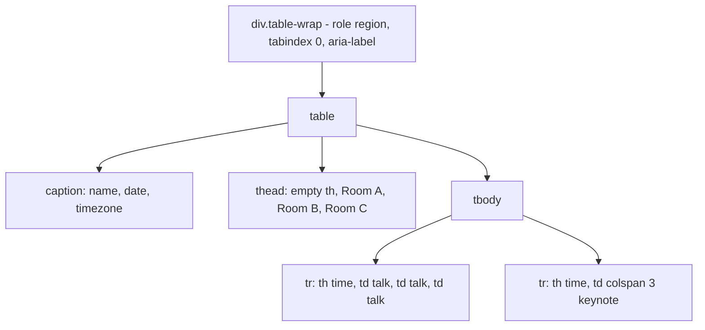
- **caption**: the table's accessible name. Screen readers announce it on entering the table.
- **thead th scope col**: each room header applies to its column.
- **th scope row**: the time header applies to its row, so a cell reads "09:30, Room B, CSS Grid deep dive".
- **colspan cells**: a spanning keynote cell is associated with all three room headers automatically when scopes are set.

### Data model
| Entity | Fields |
|---|---|
| Slot | start time, end time |
| Room | name, capacity |
| Session | title, speaker, level (Beginner/Intermediate/Advanced), room or "all", slot |

### Tech stack
- **Native table** with `scope`.
- **`position: sticky`** for the header row and first column (inside the scrolling wrapper).
- **`border-collapse: separate; border-spacing: 0`**: sticky cells behave more reliably with separate borders.
- **`@media print` with `@page { size: landscape }`**.

### Milestones
1. **Table semantics.** *Done when* screen-reader table navigation reads time and room for every talk.
2. **Visual design.** Zebra rows, a highlighted keynote row, level tags as text badges. *Done when* contrast passes everywhere.
3. **Mobile.** *Done when* at 360 px the page doesn't scroll sideways, the table does, and the time column stays visible.
4. **Sticky header.** *Done when* room names stay visible while scrolling a 20-row schedule.

### Deep dive: the hard parts
- **Sticky in two directions.** A cell can be sticky to the top and the start at once. The top-left corner cell needs both, plus a higher `z-index` so scrolled cells pass beneath it. Sticky headers only stick within their scroll container, which is the wrapper, not the page, so the wrapper needs a `max-block-size` for vertical stickiness to show.
- **Spanning and headers.** For simple spans, `scope` is enough. If you add a second header level (for example, a morning/afternoon row group header), use `<tbody>` per period with its own header row, or explicit `headers` attributes.
- **Don't turn it into cards with `display: block`.** Changing table elements' `display` on mobile can remove table semantics in some browsers, and the time/room relationship gets lost. Horizontal scroll is the safer choice for a true grid.

### Testing strategy
Screen-reader table navigation. Keyboard: focus the wrapper and scroll with the arrow keys. Narrow viewport. Print preview in landscape. Validate the HTML, because `colspan` mistakes show up as validator errors ("table column count").

### Trade-offs, scaling and failure modes
A table is right for three tracks. With fifteen tracks it becomes unreadable on any screen, and a per-room list or a "now and next" view works better. Times are ambiguous for remote attendees, so state the timezone. Highlighting "now" needs JS or server rendering.

### Stretch goals
- A "my schedule" selection with checkboxes and `:has()` to dim unselected talks.
- An alternative list view per room using the same data.
- Add `Event` structured data for each session.

### Skills practised
- [Ch 2 — HTML Structure and Text](../chapters/02-html-structure-and-text/README.md): `<time>`.
- [Ch 5 — Tables and Forms](../chapters/05-tables-and-forms/README.md): `caption`, `scope`, `colspan`.
- [Ch 7 — Box Model and Layout Basics](../chapters/07-box-model-and-layout-basics/README.md): sticky positioning, overflow, stacking.

### In the interview
**30-second answer:** I built a three-track conference schedule as a real data table, because a talk only makes sense with its time and its room. It has a `<caption>` with the date and timezone, room headers with `scope="col"`, time headers with `scope="row"` containing `<time datetime>`, and keynote and lunch rows spanning all rooms with `colspan="3"`. The hard part was mobile: rather than turning rows into blocks, the table scrolls inside a labelled, focusable wrapper with the header row and time column sticky in both directions. A screen reader announces "09:30, Room B, CSS Grid deep dive" for any talk.

**Key terms to know:**
- **`<caption>`** — the table's accessible name, announced when a screen reader enters the table.
- **`scope="col"` / `scope="row"`** — tell assistive technology which headers apply to each data cell.
- **`colspan`** — makes a cell span several columns, as with the keynote row.
- **`headers` attribute** — explicit list of header ids for a cell, used for irregular tables.
- **`<time datetime>`** — a machine-readable time next to the human-readable one.
- **Scroll container** — the nearest ancestor with `overflow` other than visible. Sticky elements stick within it.
- **Sticky in two directions** — the corner cell uses both `top` and `left` insets and a higher `z-index`.
- **Focusable region** — `tabindex="0"`, `role="region"` and a label so keyboard users can scroll the wrapper.
- **`border-collapse: separate`** — keeps borders on cells, which sticky cells need.
- **`@page { size: landscape }`** — requests landscape pages for printing.

**Q:** When is a `<table>` the right choice?

**A:** When content is two-dimensional data where each cell needs its row and column context. Never for page layout.

**Q:** Why might `position: sticky` not work in a table?

**A:** An ancestor with `overflow` other than visible becomes the scroll container, and the element sticks within that. If that container doesn't scroll in that direction, nothing sticks. Also check that an inset such as `top: 0` is set, and that the wrapper has a `max-block-size` if you want vertical sticking inside it.

**Q:** How do you make a scrollable region keyboard accessible?

**A:** Give it `tabindex="0"` so it can be focused and scrolled with arrow keys, plus `role="region"` and an `aria-label` (or `aria-labelledby` pointing to the caption) so screen readers announce what it is.

**Q:** Why not turn the table into stacked cards on phones with `display: block`?

**A:** Changing `display` on table elements has caused some browsers to drop table semantics, so the time and room relationship is lost for screen readers. Cards also kill the ability to compare rooms at a glance. WCAG reflow allows data tables to scroll, so scrolling is the honest choice.

**Q:** How does a cell that spans all three rooms get its headers?

**A:** With `scope` set on the room headers, a cell with `colspan="3"` is associated with all three columns it covers, so the keynote reads with every room and its time. For more complex structures, use explicit `headers` attributes listing the header ids.

**Q:** Why does the top-left corner cell need special treatment?

**A:** It's sticky to both the top and the inline start, and every other sticky cell scrolls underneath it. Give it both insets, a solid background and a higher `z-index`, otherwise scrolled headers paint over it.

**Q:** The conference grows to 15 tracks. What breaks first?

**A:** The table becomes unreadable on any screen, because nobody can scan 15 columns. Switch to a per-room list or a "now and next" view generated from the same data, and keep the full grid as an optional view.

**Q:** Attendees join remotely from other timezones. What fails?

**A:** Times like "14:00" are wrong for most of them. State the timezone in the caption, and use full `datetime` values with an offset (`2026-10-14T14:00+01:00`) so a script or calendar export can convert them. Highlighting "now" needs JS or server rendering.

**Q:** How do you find a `colspan` mistake?

**A:** Run the Nu HTML Checker, which reports rows whose cell count doesn't match the column count. Then navigate the table with a screen reader to confirm headers are announced correctly for spanning cells.

**Common mistakes in answers:**
- Saying sticky "doesn't work on tables". It does on `th`/`td`. The usual cause is the wrong scroll container or a missing inset.
- Using `<td><strong>` for headers. Only `<th>` creates header associations.
- Making the wrapper scrollable but not focusable, so keyboard users can't reach the hidden columns.

### TL;DR
A conference schedule is real tabular data: caption, scoped headers, spans for shared sessions. On phones, scroll the table inside a labelled, focusable wrapper with sticky headers rather than breaking it into blocks.

## 9. Accessible site header and navigation

**Level:** Beginner · **Time:** 1 weekend · **Prerequisites:** Ch 3, Ch 7, Ch 8

### What it is
The header that sits on every page of a site: a skip link, a logo that links home, the primary navigation with the current page marked, a search form, and a compact layout for small screens that needs **no JavaScript**. You'll build it once here and reuse it in project 10.

### The problem it solves
The header is the most-used and most-copied component on any site, and it's often the least accessible. Typical problems are a missing skip link, the current page shown only by colour, a hamburger icon with no name, and a menu that only opens with a mouse. Because it repeats on every page, every flaw is multiplied.

### Real-world examples
- WebAIM's article on [skip navigation links](https://webaim.org/techniques/skipnav/) explains why keyboard users need a way to bypass repeated navigation, and how to make the link visible when focused.
- The W3C [Menus tutorial](https://www.w3.org/WAI/tutorials/menus/) covers marking up navigation and indicating the current page.
- The GOV.UK Design System's [service navigation](https://design-system.service.gov.uk/components/service-navigation/) component is a tested, production pattern for a site's main navigation.

### Requirements
**Functional**
- First focusable element: "Skip to main content", hidden until focused.
- Logo as a link to `/` with an accessible name (the site name, not "logo").
- `<nav aria-label="Main">` containing a `<ul>` of links. The current page link has `aria-current="page"` and a non-colour indicator (underline or bar).
- A `<search>` element with a labelled input and submit button. `<search>` is Baseline, widely available since April 2026.
- On narrow screens, the nav collapses into a disclosure using `<details>`/`<summary>` labelled "Menu".

**Non-functional**
- Works without JS. Every link and control is reachable by keyboard in visual order.
- Targets at least **24 × 24 px**. Header no taller than **80 px** on phones.
- Sticky header must not hide focused elements (WCAG 2.2 criterion 2.4.11, Focus Not Obscured).

### The architecture
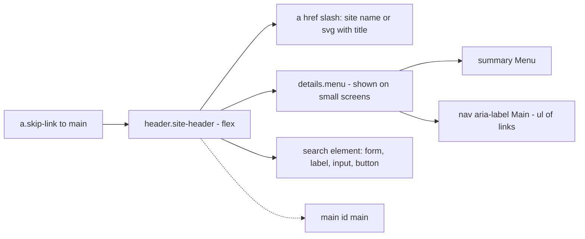
- **a.skip-link**: positioned off-screen until `:focus`, then shown at the top-left. Its `href="#main"` moves focus to the main content.
- **details.menu**: a native disclosure. `<summary>` is a button that toggles the content, with keyboard support and an expanded or collapsed state announced. On wide screens the nav is shown without the disclosure.
- **search**: a landmark element for search functionality.

### Data model
| Item | Fields | Notes |
|---|---|---|
| Nav link | label, URL, current | `aria-current="page"` on one |
| Site identity | name, logo SVG | SVG gets `role="img"` and a `<title>` |
| Search | query field name | `type="search"`, `name="q"` |

### Tech stack
- **Flexbox** with `flex-wrap` and `gap` for the header row.
- **`<details>`** for the mobile menu (or two copies of nav: one inside details for mobile, one outside for desktop, hidden by media queries. Discuss both).
- **`:focus-visible`**, `scroll-padding-top` for the sticky header.

### Milestones
1. **Static header.** *Done when* it validates, the skip link appears on first Tab, and activating it moves focus into `<main>`.
2. **Current page.** *Done when* the current link is announced as "current page" and is visibly distinct without colour.
3. **Responsive menu.** *Done when* below 640 px the nav is behind a "Menu" disclosure that opens with Enter or Space, and above 640 px all links are visible.
4. **Sticky behaviour.** *Done when* tabbing through a long page never leaves focus hidden under the header (`scroll-padding-top` set to the header height).

### Deep dive: the hard parts
- **One nav or two?** A `<details>` that should be open on desktop and closed on mobile can't be controlled by CSS alone, because `open` is an HTML attribute. Two options: keep the details always present but on wide screens hide the `<summary>` and force its content visible with `::details-content` styling (Baseline since September 2025), or render the link list twice and hide one copy with `display: none`, which also removes it from the accessibility tree. The duplicate is simple and robust. The `::details-content` approach is cleaner but newer. Pick one and justify it.
- **Visually hidden vs hidden.** `display: none` and `hidden` remove content from screen readers too. The "visually hidden" utility (clip, 1 px size, `overflow: hidden`) hides from the eye only. The skip link uses a variant that becomes visible on focus.
- **Hamburger labelling.** If you use an icon, the button text must still say "Menu" in the accessible name. Visually hidden text works. An `aria-label` on `<summary>` also works.

### Testing strategy
Keyboard pass on every breakpoint. Screen reader: landmarks list should show banner, navigation "Main", search, main. Zoom to 400 % (equivalent to 320 px) to confirm the mobile menu kicks in. Check the sticky header with long pages.

### Trade-offs, scaling and failure modes
A sticky header costs screen space on short phones, where landscape phones may have only about 350 px of height. Consider making it static under a `max-height` query. A `<details>` menu doesn't close when you click outside, which users may expect. That's a reasonable trade for zero JS. With more than about seven items, think about restructuring the information architecture before making the menu cleverer.

### Stretch goals
- A dropdown sub-menu using nested `<details>` with the `name` attribute so only one is open.
- Popover-based menu (`popover` attribute) that does light-dismiss on outside click (preview of project 32).
- A high-contrast check in Windows forced-colors mode (project 36).

### Skills practised
- [Ch 3 — Semantic HTML and Accessibility](../chapters/03-semantic-html-and-accessibility/README.md): landmarks, `<search>`, skip links, `aria-current`.
- [Ch 7 — Box Model and Layout Basics](../chapters/07-box-model-and-layout-basics/README.md): sticky, stacking.
- [Ch 8 — Flexbox](../chapters/08-flexbox/README.md): wrapping header rows.
- [Ch 10 — Responsive Design](../chapters/10-responsive-design/README.md): breakpoints, reflow.

### In the interview
**30-second answer:** I built the header that every page of a site reuses, with no JavaScript: a skip link that appears on first Tab, a logo link named with the site name, a `<nav aria-label="Main">` with `aria-current="page"` and a non-colour indicator, a `<search>` landmark, and a `<details>` "Menu" disclosure on small screens. The hardest decision was how to show the nav open on desktop and collapsed on mobile, since CSS can't toggle the `open` attribute. I chose one approach (styling `::details-content`, or a duplicated list hidden with `display: none`) and can explain the trade-off. The sticky header never hides focused elements because `scroll-padding-top` equals its height.

**Key terms to know:**
- **Skip link** — the first focusable link, jumping to `<main>`. Meets WCAG 2.4.1 Bypass Blocks.
- **`aria-current="page"`** — announces the current page link as "current page".
- **Landmarks** — banner (`<header>`), navigation (`<nav>`), search (`<search>`), main. Screen readers list them.
- **`<details>`/`<summary>`** — a native disclosure with keyboard support and expanded/collapsed state.
- **Visually hidden** — hides content from the eye but keeps it in the accessibility tree, unlike `display: none`.
- **Accessible name** — the hamburger button must still be named "Menu".
- **`scroll-padding-top`** — keeps scrolled-to and focused content clear of a sticky header.
- **WCAG 2.4.11 Focus Not Obscured (Minimum)** — a focused element must not be entirely hidden by author content like a sticky bar.
- **`::details-content`** — pseudo-element for the content part of `<details>`, which can be styled.

**Q:** What is a skip link and why is it needed?

**A:** A link at the top of the page that jumps to the main content. Without it, keyboard users have to tab through every header link on every page. WCAG requires a way to bypass repeated blocks, and the link is hidden until focused so it doesn't clutter the design.

**Q:** How do you mark the current page in navigation?

**A:** `aria-current="page"` on the link, plus a visual indicator that isn't only colour, such as an underline or bar. You can style it with `[aria-current="page"]`, which keeps state and style in one place.

**Q:** How do you stop a sticky header covering focused elements?

**A:** Set `scroll-padding-top` on the scrolling element to the header height, so focus and anchor scrolling leave room for it. Then tab through a long page to confirm, because it's what WCAG 2.4.11 checks.

**Q:** What's the difference between `display: none` and a visually-hidden class?

**A:** `display: none` (and the `hidden` attribute) removes content from layout and from the accessibility tree, so screen readers can't reach it. A visually-hidden utility clips the element to 1 px with `overflow: hidden`, so it's invisible but still read. Use it for labels on icon-only controls.

**Q:** Why can't CSS alone make `<details>` open on desktop and closed on mobile?

**A:** `open` is an HTML attribute that represents state, and CSS can't set attributes. You can instead style the closed content to show anyway on wide screens through `::details-content` and hide the `<summary>`, or render the link list twice and hide one copy with `display: none`. Each needs testing in screen readers.

**Q:** Why use `<details>` rather than a checkbox hack for the mobile menu?

**A:** `<summary>` is exposed as a button with expanded/collapsed state and responds to Enter and Space. A hidden checkbox with a styled label announces as "checkbox, not checked", which is misleading. Native semantics beat clever selectors.

**Q:** The `<details>` menu doesn't close when the user taps elsewhere. Is that a bug?

**A:** It's a known trade-off of zero JS: `<details>` has no light dismiss. Users can close it with the summary. If outside-click closing matters, use the Popover API (`popover="auto"`), which provides light dismiss natively (project 32).

**Q:** The client wants 12 top-level nav items. What do you say?

**A:** The header will wrap or need a menu even on desktop, and users scan fewer items better. Restructure the information architecture into fewer sections first. Only then add sub-menus, using nested disclosures with normal Tab navigation rather than an ARIA menu.

**Q:** How do you test the header?

**A:** Keyboard pass at every breakpoint (skip link appears first and moves focus into `<main>`), a screen-reader landmarks list showing banner, navigation "Main", search and main, and zoom to 400 % to check the mobile menu kicks in. Tab down a long page to check the sticky header.

**Common mistakes in answers:**
- Adding `role="navigation"` to `<nav>`. It already has that role, and redundant ARIA adds noise.
- Using `role="menu"` for site navigation. That promises application-menu keyboard behaviour that links don't have.
- Hiding the skip link with `display: none`, which makes it unfocusable. It must be visually hidden until focused.

### TL;DR
Skip link, named nav with `aria-current`, a `<search>` landmark, a native `<details>` menu for small screens and `scroll-padding-top` for the sticky header: a header that works for everyone with no JavaScript.

## 10. Small-business multi-page site

**Level:** Beginner · **Time:** 1–2 weekends · **Prerequisites:** Ch 1–9

### What it is
A five-page site for a fictional local business (say, a bike repair shop): Home, Services, About, Contact and a 404 page. It brings together the beginner projects: the header from project 9, the contact form from project 3, a services price table like project 4, and a small gallery like project 7. They all share one stylesheet and a consistent page template.

### The problem it solves
Single pages are easy to keep consistent. Five pages that share a header, footer and styles show you why CSS architecture matters. A change to the header must be copied everywhere, relative links break when a page moves folder, and inconsistent class names multiply. This project makes you design a small, coherent system and publish it.

### Real-world examples
- MDN's lesson on [structuring documents](https://developer.mozilla.org/en-US/docs/Learn_web_development/Core/Structuring_content/Structuring_documents) covers the page template (header, nav, main, aside, footer) every page here shares.
- The [W3C Nu HTML Checker](https://validator.w3.org/) can validate a whole site page by page. Use it on every page before publishing.

### Requirements
**Functional**
- Five pages with the same header, footer and `<head>` pattern. Each has a unique `<title>` and meta description.
- Home: hero with a call to action, three service highlights, opening hours (a `<table>` or `<dl>`), a map link.
- Services: price list. About: story and team photos. Contact: form plus address and hours.
- A custom 404 page with links back.
- One shared `styles.css`, organised in sections: reset, tokens (custom properties), base elements, layout, components, utilities.

**Non-functional**
- Each page under **150 KB** total, first load.
- Lighthouse accessibility and SEO scores of **100** on all pages, performance **90+** on mobile.
- Zero validator errors. No broken links (checked with a link checker).
- Consistent spacing using a small scale of custom properties (for example 4, 8, 16, 24, 40 px).

### The architecture
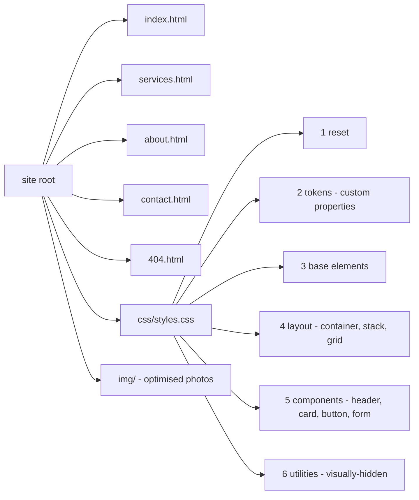
- **Pages**: each copies the same template. Without a build tool, that means manual copy-paste, which is exactly why static-site generators exist (project 33).
- **Section order in the stylesheet**: from generic to specific. Later rules intentionally override earlier ones, and specificity stays low. This is the idea behind ITCSS ("inverted triangle CSS"), which cascade layers formalise in project 26.
- **tokens**: custom properties like `--space-3` and `--color-brand` defined on `:root`, so a palette change is one edit.

### Data model
Design tokens for this small site:

| Token | Value | Used for |
|---|---|---|
| `--color-brand` | a dark teal | Buttons, links |
| `--color-text` | near-black | Body text (contrast at least 7:1) |
| `--color-surface` | off-white | Page background |
| `--space-1 … --space-5` | 0.25rem to 2.5rem | Margins, gaps, padding |
| `--radius` | 0.5rem | Cards, buttons |
| `--font-body` | system stack | Everything |

### Tech stack
| Component | Choice | Why |
|---|---|---|
| Pages | Hand-written HTML | Teaches the cost of duplication |
| Styles | One CSS file with sections | Cached once across pages |
| Images | WebP/AVIF, `srcset` | Light pages |
| Hosting | Static host with a custom 404 | Any static host can serve this |

### Milestones
1. **Template.** Build one page fully, including head metadata. *Done when* it scores 100 in Lighthouse accessibility.
2. **Tokens and components.** Extract colours and spacing into custom properties, and buttons and cards into reusable classes. *Done when* no colour hex value appears outside the tokens section.
3. **All pages.** *Done when* all five pages validate and share identical header and footer markup.
4. **Publish.** Deploy to a static host with a custom 404. *Done when* a link checker reports zero broken links and the 404 page is served for a bad URL.

### Deep dive: the hard parts
- **Relative vs root-relative links.** `href="css/styles.css"` resolves against the current page's folder. `href="/css/styles.css"` resolves from the site root. Root-relative works from any folder depth but breaks if the site lives in a sub-path (like a project page on a shared host). Choose deliberately.
- **Class naming.** Pick a convention and stick to it. A light version of BEM (`.card`, `.card__title`, `.card--featured`) is enough. It keeps selectors at one class of specificity, which keeps overrides predictable.
- **The 404 page.** It must return HTTP status 404, not 200 (a "soft 404"), so search engines don't index it. Most static hosts do this when you name the file `404.html`. Check it in DevTools' Network panel.

### Testing strategy
Validator on each page. A link checker. Lighthouse on each page in mobile mode. Keyboard and screen-reader pass of the contact page. Check the 404 page's status code. View on a real phone over a mobile connection.

### Trade-offs, scaling and failure modes
Copy-pasted headers drift: one page gets a fix the others don't. That pain is the motivation for templates and includes. One CSS file is efficient for five pages, but with fifty pages, unused CSS grows. Hand-optimised images are fine for 20 photos but not for 2,000. Opening hours in HTML must be updated by hand, or customers turn up to a closed shop.

### Stretch goals
- Move the site to a static-site generator with a shared layout (preview of project 33).
- Add `LocalBusiness` JSON-LD with opening hours.
- Add a print stylesheet for the contact page.

### Skills practised
- [Ch 1 — How the Web Works](../chapters/01-how-the-web-works/README.md): URLs, status codes, hosting.
- [Ch 3 — Semantic HTML and Accessibility](../chapters/03-semantic-html-and-accessibility/README.md): page templates, landmarks.
- [Ch 6 — CSS Fundamentals](../chapters/06-css-fundamentals/README.md): custom properties, specificity.
- [Ch 9 — CSS Grid](../chapters/09-grid/README.md) and [Ch 8 — Flexbox](../chapters/08-flexbox/README.md): page and component layout.
- [Ch 14 — Performance, SEO, Interview and Cheat Sheets](../chapters/14-performance-seo-interview-and-cheatsheet/README.md): titles, descriptions, Lighthouse.

### In the interview
**30-second answer:** I built a five-page site for a local bike shop, with Home, Services, About, Contact and a real 404, sharing one header, footer, `<head>` pattern and stylesheet. The key decision was organising one CSS file from generic to specific (reset, tokens, base, layout, components, utilities) with single-class BEM-style selectors, so source order decides conflicts and specificity stays flat. The hardest problems were the ones a single page hides: copied headers drifting, relative links breaking, and a 404 page that must return status 404, not 200. Every page validates, has zero broken links and scores 100 on Lighthouse accessibility and SEO.

**Key terms to know:**
- **Custom properties (tokens)** — `--color-brand`, `--space-3` on `:root`, so a palette change is one edit.
- **Specificity** — the (id, class, type) weight that decides which selector wins. Kept at one class here.
- **Cascade order** — when specificity ties, the later rule wins, which is why files go generic to specific.
- **ITCSS** — "inverted triangle" ordering of CSS from broad to narrow. Cascade layers formalise it later.
- **BEM** — Block, Element, Modifier naming (`.card__title`, `.card--featured`).
- **Relative vs root-relative URL** — `css/a.css` resolves from the current folder, `/css/a.css` from the site root.
- **HTTP status codes** — 200 OK, 301 moved permanently, 404 not found.
- **Soft 404** — an error page served with status 200.
- **Meta description and `<title>`** — unique per page, shown in tabs and search results.
- **Lighthouse** — the audit tool for accessibility, SEO and performance scores.

**Q:** How would you organise CSS for a small site?

**A:** From general to specific: reset, tokens, base element styles, layout primitives, components, utilities. Keep specificity low and flat with single-class selectors so order decides conflicts. Utilities go last so they can override components.

**Q:** What's a soft 404?

**A:** An error page served with status 200. Search engines may index it as real content. A missing page should return a real 404 status, which most static hosts do when the file is named `404.html`. Check it in DevTools' Network panel.

**Q:** Why use custom properties for colours?

**A:** One source of truth: change the palette in one place, theme with overrides, and keep values consistent across components. Unlike preprocessor variables, they're live in the browser, inherit and can be changed per element or media query.

**Q:** How is specificity calculated?

**A:** As three counts compared left to right: ID selectors, then classes, attributes and pseudo-classes, then type selectors and pseudo-elements. `#nav a` is (1,0,1) and beats `.nav .link`, which is (0,2,0). Inline styles and `!important` sit above that, and `:where()` adds zero.

**Q:** Root-relative or relative links?

**A:** Root-relative (`/css/styles.css`) works from any folder depth, so pages can move. It breaks if the site is served from a sub-path such as `example.com/shop/`. Relative links survive sub-paths but break when a page moves folder. Choose deliberately and check with a link checker.

**Q:** Why are utilities placed last, and why is BEM useful here?

**A:** Utilities like `.visually-hidden` should win over component styles, and with equal single-class specificity the later rule wins. BEM keeps every selector at one class, so you never need IDs or nesting to win a fight, and the names say what each class belongs to.

**Q:** The site grows to 50 pages. What breaks first?

**A:** The copy-pasted header and footer drift, because a fix lands on some pages but not others. Use a static-site generator or server includes for shared templates. The single stylesheet also accumulates unused CSS, so split by component or check coverage.

**Q:** The shop changes its opening hours and forgets the website. What fails?

**A:** Customers trust the site and arrive at a closed shop. Put hours in one data file used by every page (and by `LocalBusiness` JSON-LD), so there is only one place to update, and add a "last updated" note.

**Q:** How do you verify the site before launch?

**A:** Validate every page, run a link checker, run Lighthouse on each page in mobile mode, check the 404 status code in the Network panel, and do a keyboard and screen-reader pass of the contact form. Then view it on a real phone over a mobile connection.

**Common mistakes in answers:**
- Fixing a conflict by adding an ID or `!important`. That raises the bar for every later override.
- Thinking custom properties are the same as Sass variables. Sass variables vanish at build time, while custom properties exist at runtime and cascade.
- Assuming a pretty 404 page is enough. The status code is what search engines and tools read.

### TL;DR
Five pages expose the real problems of a site: shared templates, consistent tokens, organised CSS, correct links and status codes. Solve them by hand once and you'll understand what every framework is automating.

## 11. Responsive landing page

**Level:** Intermediate · **Time:** 1 week · **Prerequisites:** Ch 4, Ch 8, Ch 9, Ch 10

### What it is
A marketing landing page for a fictional app: a hero with a headline, sub-headline, call-to-action buttons and a product image, then a features grid, a testimonial strip, a pricing teaser, an FAQ and a footer. It's built **mobile-first** with **fluid typography** and **intrinsic layouts**, layouts that adapt to their content and container instead of relying on a list of device breakpoints.

### The problem it solves
Landing pages are judged in the first two seconds. A slow hero image, text that jumps as fonts load, or a layout that breaks on an in-between tablet width costs sign-ups. Older responsive techniques used many fixed breakpoints (375, 768, 1024, 1440) and still broke in between. Modern CSS (`clamp()`, `minmax()`, `flex-wrap`, container-relative units) lets most sections adapt continuously, with only one or two media queries.

### Real-world examples
- web.dev's [Optimize Largest Contentful Paint](https://web.dev/articles/optimize-lcp) breaks LCP into four sub-parts (time to first byte, resource load delay, resource load time, render delay) and shows how to fix each for a hero image.
- [Utopia](https://utopia.fyi/) is a method and calculator for fluid type and space scales that interpolate between a minimum and maximum viewport using `clamp()`.
- [Every Layout](https://every-layout.dev/) by Heydon Pickering and Andy Bell describes layout primitives (Stack, Cluster, Sidebar, Switcher, Grid) that respond to their content without media queries.

### Requirements
**Functional**
- Hero: `<h1>`, supporting paragraph, primary and secondary call-to-action links, and a product image that sits beside the text on wide screens and below on narrow ones.
- Features: 6 cards with an icon, heading and text, in a grid that goes from 1 to 3 columns.
- Testimonials: a horizontal scroll-snap strip of quotes, each a `<figure>` with `<blockquote>` and `<figcaption>`.
- FAQ using `<details>`.
- Footer with three link columns that wrap.

**Non-functional**
- **LCP at most 2.5 s**, **CLS at most 0.1** on a mid-range phone profile in Lighthouse (Core Web Vitals "good" thresholds).
- At most **2 media queries** in the whole stylesheet. Everything else is intrinsic.
- Font sizes scale smoothly between 320 px and 1440 px. Text zoom to 200 % still works (no `vw`-only font sizes).
- Total transfer under **500 KB** on first load.

### The architecture
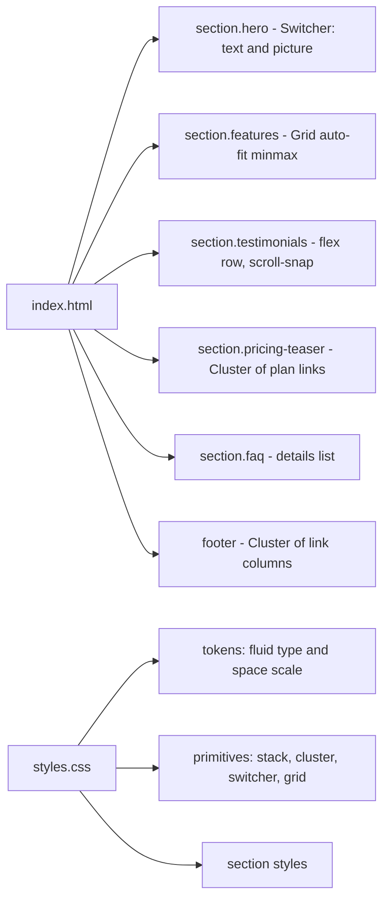
- **Switcher**: a flex container where items sit side by side when there is room and stack when there isn't. The trick is `flex-basis: calc((30rem - 100%) * 999)`: the basis becomes huge and negative or huge and positive depending on the container width, so it flips without a media query.
- **Grid auto-fit minmax**: the features grid from project 7, now with `min()` inside to avoid overflow on tiny screens: `minmax(min(18rem, 100%), 1fr)`.
- **scroll-snap strip**: `overflow-x: auto; scroll-snap-type: x mandatory`, with each item `scroll-snap-align: start`. A native, swipeable carousel with no JS.
- **tokens**: a fluid scale like `--step-0: clamp(1rem, 0.9rem + 0.5vw, 1.25rem)`.

### Data model
Fluid type tokens (example values, generate your own with a calculator):

| Token | Min (320 px) | Max (1440 px) | Use |
|---|---|---|---|
| `--step--1` | 0.83rem | 0.9rem | Captions |
| `--step-0` | 1rem | 1.125rem | Body |
| `--step-1` | 1.2rem | 1.5rem | Lead text |
| `--step-3` | 1.73rem | 2.67rem | h2 |
| `--step-5` | 2.49rem | 4.2rem | Hero h1 |

### Tech stack
| Need | Choice | Why |
|---|---|---|
| Fluid type | `clamp()` with a `rem` + `vw` middle term | Scales smoothly and respects zoom |
| Hero image | `<picture>` with AVIF/WebP, `fetchpriority="high"` | Fastest LCP |
| Layout | Flex and grid primitives | Few breakpoints |
| Carousel | CSS scroll snap | No JS, native swiping |

### Milestones
1. **Content and mobile layout.** Build at 360 px first. *Done when* every section reads well in one column with no overflow.
2. **Fluid tokens.** *Done when* headings and spacing scale smoothly as you drag the window, and 200 % zoom enlarges text.
3. **Intrinsic layouts.** *Done when* hero, features and footer adapt across 320–1440 px using at most two media queries.
4. **Performance.** *Done when* Lighthouse mobile shows LCP under 2.5 s, CLS under 0.1, and the LCP element is the hero image or heading, loaded without delay.
5. **FAQ and polish.** *Done when* the FAQ is keyboard operable and all interactive elements have hover and focus styles.

### Deep dive: the hard parts
- **Why `clamp()` needs a `rem` term.** `font-size: 5vw` ignores the user's text-size setting, and page zoom barely helps on wide screens, which can fail WCAG 1.4.4 (Resize Text). Adding a `rem` component (`1rem + 2vw`) means zoom and user font preferences still change the size.
- **The hero image and LCP.** The LCP image must be discoverable in the HTML (not a CSS background, not lazy-loaded), ideally with `fetchpriority="high"` (Baseline since October 2024). Give it `width`/`height` to avoid shift. If the hero image is decorative and the headline is the LCP element, make sure web fonts don't delay it: `font-display: swap` or `optional`.
- **Scroll snap accessibility.** A scrolling region needs to be reachable by keyboard (`tabindex="0"` plus a label) and should show that more content exists, for example by letting the next card peek in. Avoid `mandatory` snapping with very tall items, because it can make content impossible to reach.

### Testing strategy
Lighthouse mobile run (three runs, take the median). DevTools device mode at 320, 375, 768, 1024, 1440 and every width in between by dragging. Zoom 200 % and 400 %. Keyboard pass of the testimonials strip. WebPageTest or PageSpeed Insights on a deployed URL.

### Trade-offs, scaling and failure modes
Fluid everything can make large screens feel oversized, so cap with the `clamp()` maximum. Intrinsic primitives are robust but less obvious to teammates who expect breakpoints, so document them. A heavy hero video kills LCP and data budgets. If marketing insists, use a poster image as the LCP element and load the video later. Scroll-snap carousels hide content, so put the most important testimonial first.

### Stretch goals
- A dark theme (project 16).
- Section entrance animations using scroll-driven animations inside `@supports` and `prefers-reduced-motion: no-preference`.
- A/B-ready hero: two hero variants switched by a class, without changing CSS structure.

### Skills practised
- [Ch 4 — Images, Media and Embeds](../chapters/04-images-media-and-embeds/README.md): `<picture>`, `fetchpriority`.
- [Ch 8 — Flexbox](../chapters/08-flexbox/README.md) and [Ch 9 — CSS Grid](../chapters/09-grid/README.md): intrinsic primitives.
- [Ch 10 — Responsive Design](../chapters/10-responsive-design/README.md): mobile-first, `clamp()`, intrinsic layout.
- [Ch 14 — Performance, SEO, Interview and Cheat Sheets](../chapters/14-performance-seo-interview-and-cheatsheet/README.md): Core Web Vitals.

### In the interview
**30-second answer:** I built a marketing landing page mobile-first with fluid `clamp()` type and space tokens and intrinsic layout primitives (a flex "switcher" for the hero, an auto-fit grid for features, a scroll-snap strip for testimonials), using only two media queries in the whole stylesheet. The key decision was adapting continuously instead of to a list of device widths, which removed the in-between widths where layouts usually break. The hardest part was the hero image as the LCP element: it's a `<picture>` in the HTML with AVIF/WebP, `fetchpriority="high"`, `width`/`height` and no lazy loading. Lighthouse mobile shows LCP under 2.5 s and CLS under 0.1, and 200 % zoom still enlarges the text.

**Key terms to know:**
- **Mobile-first** — base styles for the smallest screen, with `min-width` queries adding layout as space grows.
- **Intrinsic layout** — layouts that respond to their content and container instead of fixed breakpoints.
- **`clamp(min, preferred, max)`** — a value that scales with the middle term but never leaves the bounds.
- **Fluid type** — font sizes that scale between two viewport widths, here with a `rem + vw` middle term.
- **Switcher primitive** — a flex layout that flips from side by side to stacked at a container threshold, with no media query.
- **`minmax(min(18rem, 100%), 1fr)`** — an auto-fit grid track that can't overflow on tiny screens.
- **CSS scroll snap** — `scroll-snap-type` and `scroll-snap-align` for a swipeable strip with no JS.
- **LCP and CLS** — Core Web Vitals for loading (good at 2.5 s or less) and visual stability (good at 0.1 or less).
- **`fetchpriority="high"`** — tells the browser to fetch the hero image early.
- **WCAG 1.4.4 Resize Text** — text must scale to 200 %, which `vw`-only font sizes can break.

**Q:** What does mobile-first mean in CSS?

**A:** Base styles target the smallest screen, and `min-width` queries add complexity as space grows. The default is the simplest layout, small devices apply fewer overrides, and you design the content priority before the decoration.

**Q:** How do you make type fluid without breaking zoom?

**A:** `clamp(min, rem + vw, max)`. The `rem` part keeps the size tied to user preferences and zoom, and the limits stop it growing too large or small. A pure `vw` size barely changes when users zoom on a wide screen.

**Q:** How would you improve a slow hero image?

**A:** Put it in the HTML as `` or `<picture>` (not a CSS background), never lazy-load it, give it `fetchpriority="high"`, serve AVIF/WebP at the right size via `srcset`, and set `width`/`height`. Most of the gain usually comes from early discovery, not compression.

**Q:** How does the switcher flip without a media query?

**A:** Each item gets `flex-grow: 1` and `flex-basis: calc((30rem - 100%) * 999)`. When the container is wider than 30rem the basis becomes a huge negative number (treated as 0), so items share the row. When it's narrower the basis is huge and positive, so each item takes a full line and they stack.

**Q:** Why `minmax(min(18rem, 100%), 1fr)` rather than `minmax(18rem, 1fr)`?

**A:** On a container narrower than 18rem, a fixed 18rem minimum overflows sideways. `min(18rem, 100%)` lowers the minimum to the container width in that case, so a single column fits on any phone.

**Q:** Why only two media queries? Isn't that dogma?

**A:** It's a design constraint that forces intrinsic solutions, not a rule. Media queries are still right for page-level changes and user preferences. The benefit is that components adapt at every width, including the in-between tablet sizes that fixed breakpoints miss.

**Q:** Marketing wants an autoplaying hero video. What happens to the budget?

**A:** A video is heavy and can become or delay the LCP element, and it eats mobile data. Use a compressed poster image as the LCP element, load the video later without blocking, respect `prefers-reduced-motion` and data concerns, and always provide a pause control.

**Q:** The testimonial carousel uses `scroll-snap-type: x mandatory`. What can go wrong?

**A:** With `mandatory`, if an item is taller or wider than the scrollport, parts of it can become unreachable because the browser always snaps back. The region also needs to be keyboard focusable and labelled. Use `proximity` for tall items, and let the next card peek in so users see there's more.

**Q:** How do you measure LCP reliably?

**A:** Run Lighthouse mobile three times and take the median, because lab runs vary. Confirm in the Performance panel which element is the LCP candidate. After deploying, check PageSpeed Insights for field data from real users at the 75th percentile.

**Common mistakes in answers:**
- Writing `font-size: 4vw` for fluid type. It ignores user font settings and can fail WCAG 1.4.4.
- Preloading the hero and also lazy-loading it. `loading="lazy"` delays the request regardless of the hint.
- Saying mobile-first means "design for phones only". It is about the order in which you write CSS and prioritise content.

### TL;DR
Build mobile-first with fluid `clamp()` tokens and intrinsic primitives (switcher, auto-fit grid, cluster) so the page adapts at every width with almost no breakpoints. Treat the hero image as the LCP element and load it first.

## 12. Documentation site with sidebar

**Level:** Intermediate · **Time:** 1–2 weeks · **Prerequisites:** Ch 3, Ch 7, Ch 9, Ch 10

### What it is
A documentation site for a fictional library: a top bar, a **left sidebar** with the section tree, the article in the middle, and an **"On this page" table of contents** on the right on wide screens. It includes code blocks, callouts (note, warning), "previous/next" links and anchor links on headings. All layout is CSS. Navigation is plain HTML.

### The problem it solves
Docs are read in a very particular way. People search, jump to a heading, copy a code sample and leave. The layout has to keep the navigation visible without stealing reading space, keep long code readable, and collapse gracefully on phones. Three sticky columns, scroll containers and deep heading links are where many docs sites go wrong, with sidebars that don't scroll, headings hidden under the top bar, or code blocks that widen the page.

### Real-world examples
- [mdBook](https://rust-lang.github.io/mdBook/), used for *The Rust Programming Language* book, produces this layout from Markdown: collapsible chapter sidebar, article, previous/next arrows.
- [Docusaurus](https://docusaurus.io/) generates documentation sites with a sidebar, article and right-hand table of contents, a pattern found on many open-source projects.

### Requirements
**Functional**
- Three regions on wide screens: sidebar, article, on-this-page TOC. Two regions on medium screens (TOC moves to the top of the article as a `<details>`). One region on phones (sidebar behind a "Menu" disclosure).
- Sidebar: nested `<ul>` inside `<nav aria-label="Docs">` with the current page marked by `aria-current="page"`. Sections collapse with `<details>`.
- Headings `h2`/`h3` have `id`s and a visible "#" anchor link on hover and focus.
- Code blocks with a language label and horizontal scrolling. Callouts as `<aside>` with a role-appropriate label ("Note", "Warning").
- Previous/next links at the bottom with `rel="prev"`/`rel="next"`.

**Non-functional**
- Article measure **at most 75ch**.
- Sidebar and TOC scroll independently when taller than the viewport.
- Anchor jumps land with the heading visible under the sticky top bar.
- No horizontal page scroll at any width from 320 px.

### The architecture
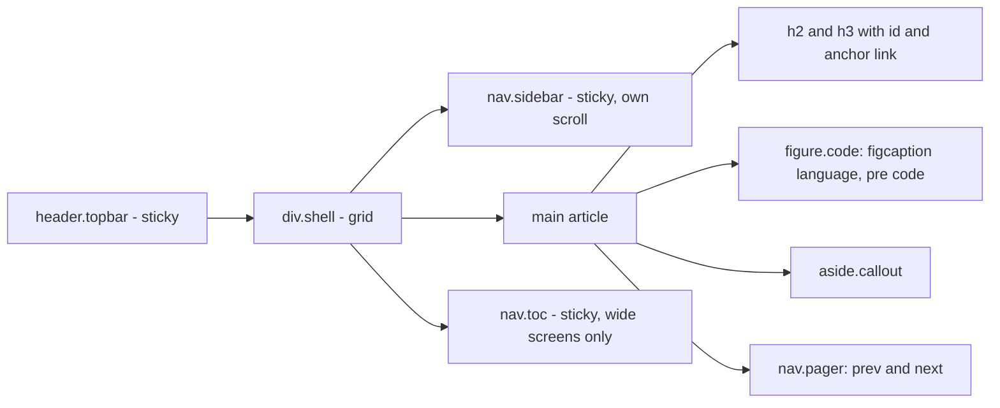
- **div.shell**: `grid-template-columns: 16rem minmax(0, 1fr) 14rem` on wide screens. `minmax(0, 1fr)` is critical: a plain `1fr` has an automatic minimum of its content's width, so a long code line would widen the middle column.
- **nav.sidebar / nav.toc**: `position: sticky; inset-block-start: var(--topbar-h); max-block-size: calc(100dvh - var(--topbar-h)); overflow-y: auto`. Each scrolls on its own.
- **figure.code**: the caption labels the language. `pre` gets `overflow-x: auto` and `tabindex="0"` so keyboard users can scroll it.

### Data model
| Content type | Fields | Rendered as |
|---|---|---|
| Page | title, section, order, prev, next | `h1`, sidebar entry, pager |
| Heading | level, text, id | `h2`/`h3` with `id`, TOC entry |
| Code sample | language, code, optional filename | `figure > figcaption + pre > code` |
| Callout | kind (note, tip, warning), body | `aside.callout--kind` with a heading |

### Tech stack
- **Grid** for the shell, with named lines or areas so the layout can change per breakpoint.
- **Sticky + own overflow** for the sidebars.
- **`scroll-margin-top`** on headings.
- **`:target`** to highlight the heading you jumped to.
- **Container query** (stretch) to switch callout layout by available width.

### Milestones
1. **Content.** Write three real-looking doc pages with headings, code and callouts. *Done when* the outline is correct and all heading anchors work.
2. **Three-column shell.** *Done when* a 300-character code line scrolls inside its block and never widens the page.
3. **Sticky sidebars.** *Done when* a 60-item sidebar scrolls on its own and the article scrolls independently.
4. **Responsive collapse.** *Done when* at about 1000 px the TOC moves into a `<details>` above the article, and under 700 px the sidebar is behind a disclosure.
5. **Polish.** *Done when* anchor jumps land below the top bar and the target heading is briefly highlighted.

### Deep dive: the hard parts
- **The `min-width: auto` trap.** Grid and flex items default to a minimum size equal to their content's minimum width. A `<pre>` with a long line has a huge minimum width, so the column grows and the page overflows. Fix it with `minmax(0, 1fr)` on the track (or `min-width: 0` on the item). Chapter 8 measures this for flex items, and Chapter 9 covers the grid version.
- **Sticky + scroll.** A sticky sidebar taller than the viewport can never show its bottom. Limiting its height and giving it its own `overflow-y: auto` solves that, but it creates a nested scroll container. Make sure it is keyboard scrollable and that the current page's link is visible on load (put the current section near the top or use `scroll-margin`).
- **Headings under a sticky bar.** `scroll-margin-top: calc(var(--topbar-h) + 1rem)` on headings (or `scroll-padding-top` on the root) offsets anchor jumps. This also matters for WCAG 2.4.11 when focus moves to a link under the bar.

### Testing strategy
Long-content stress test: 300-character code lines, 80-item sidebar, a 40-word heading. Keyboard: Tab through sidebar, then article, then TOC. Is the order sensible? Screen reader landmarks: two named navs plus main. Zoom 200 %. Check every width from 320 to 1920.

### Trade-offs, scaling and failure modes
Three columns are great on 1440 px screens and wasteful on 1024 px ones. Decide where the TOC moves. Independent scroll areas confuse some users and trap trackpad scrolling, so keep them only where needed. Hand-written TOCs drift from headings. In a real project, generate them in the build step. Highlighting the current TOC entry while scrolling needs JS, or scroll-driven animations' `view()` timeline as a progressive enhancement.

### Stretch goals
- Generate the site from Markdown with a static generator (project 33).
- Use `@container` on the article to switch callouts from stacked to side-by-side.
- A print stylesheet that prints just the article with URLs after links.

### Skills practised
- [Ch 3 — Semantic HTML and Accessibility](../chapters/03-semantic-html-and-accessibility/README.md): multiple named navs, `aria-current`.
- [Ch 7 — Box Model and Layout Basics](../chapters/07-box-model-and-layout-basics/README.md): sticky, overflow, scroll containers.
- [Ch 9 — CSS Grid](../chapters/09-grid/README.md): tracks, `minmax(0, 1fr)`.
- [Ch 10 — Responsive Design](../chapters/10-responsive-design/README.md): layout changes per width.

### In the interview
**30-second answer:** I built a documentation shell with three regions: a sticky sidebar tree, the article, and an "On this page" table of contents, collapsing to two and then one region as width shrinks. The key decision was the grid track `minmax(0, 1fr)` for the article column, because a plain `1fr` refuses to shrink below a long code line and widens the whole page. Each sidebar is sticky with a `max-block-size` and its own `overflow-y: auto`, and headings use `scroll-margin-top` so anchor jumps land below the sticky top bar. A 300-character code line scrolls inside its block, and there's no horizontal page scroll from 320 px up.

**Key terms to know:**
- **`minmax(0, 1fr)`** — a track that can shrink to zero, overriding the automatic content-based minimum.
- **Automatic minimum size** — grid and flex items default to `min-width: auto`, roughly their content's min-content width.
- **Sticky + own scroll** — `position: sticky` plus `max-block-size` and `overflow-y: auto` for long sidebars.
- **Scroll container** — any element with `overflow` other than visible. Nested ones need keyboard access.
- **`scroll-margin-top`** — offsets the scroll position when a heading is the anchor target.
- **`:target`** — matches the element named in the URL fragment, used to highlight the heading you jumped to.
- **Multiple navigation landmarks** — two `<nav>`s, each with a distinct `aria-label`.
- **`aria-current="page"`** — marks the current page in the sidebar tree.
- **`dvh` unit** — 1 % of the dynamic viewport height, which accounts for mobile browser toolbars.
- **`rel="prev"` / `rel="next"`** — link relations on the pager.

**Q:** Why does a long code block break a grid layout, and how do you fix it?

**A:** Grid items have an automatic minimum size of their content, so `1fr` won't shrink below the code's width. Use `minmax(0, 1fr)` on the track or `min-width: 0` on the item, and let the `pre` scroll with `overflow-x: auto`.

**Q:** How do you stop anchor links hiding headings under a sticky header?

**A:** `scroll-margin-top` on the targets or `scroll-padding-top` on the scrolling element, set to the header height plus some breathing room. Store the header height in a custom property so both use the same value.

**Q:** How do you label two navigation regions?

**A:** Give each `<nav>` an `aria-label` ("Docs", "On this page") so screen readers can tell them apart in the landmarks list. Don't include the word "navigation", because the role is already announced.

**Q:** Why is the sidebar sticky and scrollable rather than `position: fixed`?

**A:** A fixed sidebar is taken out of flow, so you have to reserve its space manually and it ignores the grid. Sticky stays in the grid column and scrolls normally until it reaches its inset. Adding `max-block-size: calc(100dvh - var(--topbar-h))` and `overflow-y: auto` lets a long tree scroll independently.

**Q:** Why `100dvh` and not `100vh`?

**A:** On mobile browsers `100vh` equals the largest viewport, with toolbars hidden, so content sized with it is partly hidden behind the address bar when toolbars show. `dvh` tracks the current visible height. `svh` is a safe smallest value if you don't want resizing as toolbars move.

**Q:** Where should the "On this page" TOC go on a medium screen?

**A:** At about 1000 px there isn't room for three columns plus a 75ch article, so it moves above the article inside a `<details>`. The grid template changes per breakpoint, and the HTML order (sidebar, article, TOC) stays sensible for keyboard and screen readers.

**Q:** The sidebar has 500 entries. What breaks first?

**A:** The current page's link may be far down the scroll area and invisible on load, and the HTML is heavy on every page. Collapse sections with `<details>`, open only the current section, and ensure the current link is in view. At that size, generate the tree in the build and consider search as the main way in.

**Q:** Hand-written TOCs drift from the headings. How do you prevent it?

**A:** Generate the TOC and heading `id`s from the content at build time, so a renamed heading updates both. Add a link checker in CI to catch fragments that no longer exist.

**Q:** How do you stress-test the layout?

**A:** Use a 300-character code line, an 80-item sidebar and a 40-word heading. Tab through sidebar, article and TOC to check order, list landmarks in a screen reader, zoom to 200 %, and sweep widths from 320 px to 1920 px.

**Common mistakes in answers:**
- Fixing overflow with `overflow-x: hidden` on `body`. That hides the bug and can break sticky positioning.
- Saying `1fr` means "equal width". It means a share of free space after the automatic minimums are met.
- Leaving nested scroll areas unfocusable, so keyboard users can't scroll the sidebar.

### TL;DR
A docs shell is a three-track grid with `minmax(0, 1fr)` in the middle, two sticky sidebars with their own scroll, scroll margins for headings and code blocks that scroll themselves. Collapse to fewer columns as width shrinks.

## 13. Dashboard layout with grid areas

**Level:** Intermediate · **Time:** 1 week · **Prerequisites:** Ch 7, Ch 9, Ch 10

### What it is
The layout shell of an analytics dashboard: header, collapsible navigation rail, a row of KPI tiles, two charts, a recent-activity table and a notifications panel. The content is static placeholders (images or simple CSS bars). The project is about **`grid-template-areas`**, re-arranging the same HTML into different layouts at different sizes, and keeping it usable.

### The problem it solves
Dashboards are dense. Designers draw a desktop layout with eight regions, then ask "what about tablet?". Without grid areas, each layout needs different HTML or a pile of positioning. Named areas let you draw the layout as ASCII art in CSS and redraw it per breakpoint, with the same DOM. The trap is that visual order can drift away from source order, which breaks keyboard and screen-reader users.

### Real-world examples
- MDN's guide to [grid template areas](https://developer.mozilla.org/en-US/docs/Web/CSS/CSS_grid_layout/Grid_template_areas) shows how to name areas and redefine them inside media queries.
- Rachel Andrew's [Grid by Example](https://gridbyexample.com/) collects layout patterns, including multi-region application layouts, with explanations of the placement rules.

### Requirements
**Functional**
- Regions: `header`, `nav`, `kpis`, `chart-a`, `chart-b`, `table`, `notes`.
- Three layouts: phone (single column, nav becomes a bottom bar or disclosure), tablet (two columns), desktop (nav rail plus three columns).
- KPI tiles in their own nested grid (auto-fit).
- Nav rail collapsible to icons with a checkbox toggle and `:has()`, with labels kept available to screen readers.
- Table region scrolls on its own if needed.

**Non-functional**
- Fits a **1366 × 768** laptop screen without page scroll for the top fold (header, KPIs, charts).
- Source order equals a sensible reading order at every breakpoint.
- No region overflows at **320 px**.

### The architecture
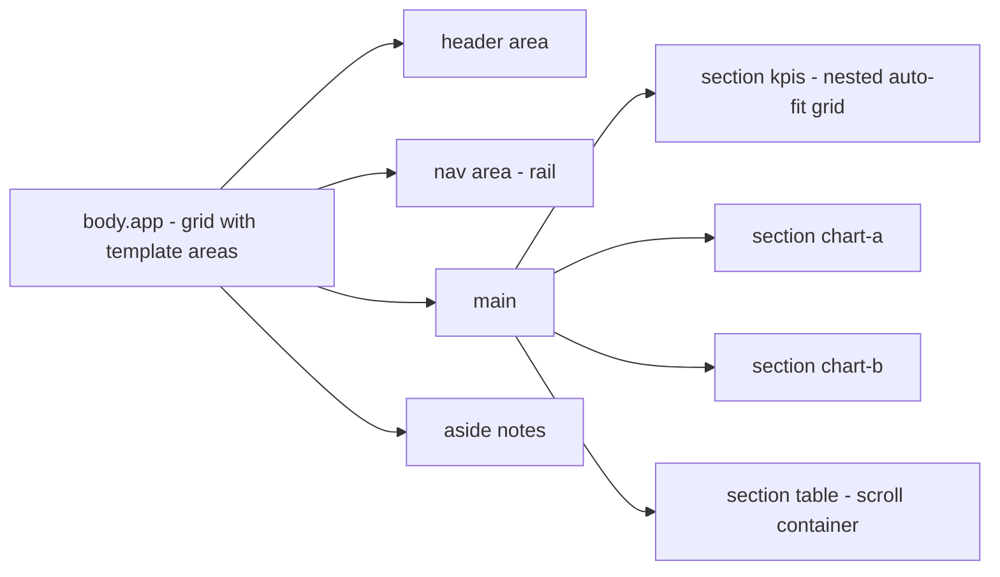
- **body.app**: the outer grid. Desktop: `"nav header header" "nav main notes"`. Inside `main`, a second grid places KPIs, charts and table.
- **Two grid levels**: putting everything in one flat grid tempts you to remove `<main>` for layout's sake. Keeping semantic wrappers and using nested grids (or `display: contents`, carefully) preserves landmarks.
- **nav rail toggle**: `.app:has(#collapse:checked)` changes the nav column from `14rem` to `4rem`.

### Data model
Layout map by breakpoint:

| Breakpoint | Columns | Areas (rows) |
|---|---|---|
| under 600 px | 1fr | header, kpis, chart-a, chart-b, table, notes, nav (bottom bar) |
| 600–1100 px | 1fr 1fr | header header, kpis kpis, chart-a chart-b, table table, notes notes |
| over 1100 px | rail 1fr 1fr 20rem | nav header header header, nav kpis kpis notes, nav chart-a chart-b notes, nav table table notes |

### Tech stack
| Need | Choice | Why |
|---|---|---|
| Shell | `grid-template-areas` | Readable, re-arrangeable layout |
| KPI row | `repeat(auto-fit, minmax(10rem, 1fr))` | Tiles wrap naturally |
| Rail toggle | checkbox + `:has()` | No JS |
| Heights | `minmax(0, 1fr)` rows, `100dvh` shell | Fits the screen, avoids overflow |

### Milestones
1. **Semantic HTML** for all regions. *Done when* landmarks read header, nav, main, complementary.
2. **Desktop areas.** *Done when* the layout matches the desktop map and fits 1366 × 768.
3. **Tablet and phone.** *Done when* the areas are redefined per breakpoint with no HTML changes and nothing overflows at 320 px.
4. **Rail collapse.** *Done when* toggling the checkbox shrinks the rail to icons, labels stay readable to screen readers, and the main area widens.
5. **Order audit.** *Done when* tabbing through the page follows the visual order at every breakpoint.

### Deep dive: the hard parts
- **Visual order vs DOM order.** Moving `nav` to the bottom on phones is fine visually, but a keyboard user still meets it first in the DOM. WCAG 1.3.2 (Meaningful Sequence) and 2.4.3 (Focus Order) require the order to make sense. Choose a source order that works everywhere (for example header, nav, main, aside) and only move things where the move doesn't change meaning. `reading-flow` can make focus follow the grid's visual order, but it's Chromium-only and not Baseline, so don't rely on it.
- **Fitting the viewport.** `block-size: 100dvh` on the shell with `grid-template-rows: auto minmax(0, 1fr)` lets the middle row shrink, and inner regions scroll. Without `minmax(0, …)`, a tall table pushes the whole page taller.
- **Collapsed labels.** Hiding the nav text with `display: none` removes it from the accessibility tree, leaving icon-only links with no name. Use the visually-hidden technique on the labels in collapsed mode instead, and add a `title` or tooltip for sighted mouse users.

### Testing strategy
Grid inspector in DevTools (area names overlay). Every breakpoint at 320, 600, 900, 1100, 1366 and 1920 px. Keyboard order at each. Screen reader landmarks. Zoom to 200 % at 1366 px. Effectively a 683 px layout, so the tablet layout should kick in.

### Trade-offs, scaling and failure modes
Named areas are readable but every new widget means editing every template string. For user-configurable dashboards, explicit line placement or auto-placement is more flexible. Fixed-height dashboards look neat but can hide content on small laptops, so allow page scroll as a fallback. Many nested scroll regions are hard to use on touch screens.

### Stretch goals
- Container queries in each widget so it adapts to its area's width (project 27).
- A dark theme using tokens (project 16).
- A print layout that lays widgets out in one column with page breaks between.

### Skills practised
- [Ch 9 — CSS Grid](../chapters/09-grid/README.md): areas, nested grids, `auto-fit`.
- [Ch 7 — Box Model and Layout Basics](../chapters/07-box-model-and-layout-basics/README.md): overflow, scroll containers.
- [Ch 10 — Responsive Design](../chapters/10-responsive-design/README.md): `dvh`, breakpoints, testing.
- [Ch 3 — Semantic HTML and Accessibility](../chapters/03-semantic-html-and-accessibility/README.md): landmarks, focus order.

### In the interview
**30-second answer:** I built a dashboard shell with named `grid-template-areas`, drawing the layout as text and redrawing it at three breakpoints without changing the HTML. Header, nav rail, KPI tiles, two charts, a table and a notes panel fit a 1366 × 768 laptop without page scroll, using `100dvh` on the shell and `minmax(0, 1fr)` rows so inner regions scroll instead of stretching the page. The nav rail collapses to icons with a checkbox and `:has()`, keeping labels visually hidden rather than removed. The hardest part was order: I fixed one source order that makes sense everywhere, because keyboard and screen readers follow the DOM, not the grid.

**Key terms to know:**
- **`grid-template-areas`** — named regions drawn as strings, with `grid-area` placing each child.
- **Implicit vs explicit grid** — tracks you define vs tracks the browser creates for extra items.
- **Nested grids** — a grid inside a grid item (here inside `<main>`) so landmarks stay intact.
- **`display: contents`** — removes an element's box so its children join the parent grid. Risky on semantic elements.
- **`minmax(0, 1fr)` rows** — let a row shrink so inner content scrolls instead of growing the page.
- **DOM order vs visual order** — WCAG 1.3.2 Meaningful Sequence and 2.4.3 Focus Order require them to agree where it matters.
- **`reading-flow`** — a newer property to make focus follow visual grid order. Chromium only, not Baseline.
- **`:has()` toggle** — `.app:has(#collapse:checked)` changes the rail width with no JS.
- **Visually hidden labels** — keep icon links named in the collapsed rail.

**Q:** What are `grid-template-areas` good for?

**A:** Naming regions and drawing the layout as a string map. You can redefine the map per breakpoint without touching HTML, and the CSS reads like a picture of the page.

**Q:** What's the accessibility risk of re-ordering with grid?

**A:** Screen readers and keyboard focus follow the DOM, not the visual order. If they diverge in a way that changes meaning, the page fails WCAG's sequence and focus order criteria.

**Q:** Why does a grid row grow past the viewport even with `1fr`?

**A:** `1fr` has an automatic minimum of its content's size. Use `minmax(0, 1fr)` and let the inner region scroll with `overflow: auto`.

**Q:** What are the rules for writing a template-areas string?

**A:** Each string is a row and each word is a cell, every row must have the same number of cells, and each named area must form a rectangle. Use `.` for an empty cell. An invalid template makes the whole declaration invalid, so nothing is placed by name.

**Q:** Why keep `<main>` and use nested grids instead of one flat grid?

**A:** To put everything in one grid you'd have to remove `<main>` or use `display: contents` on it, and `display: contents` has a history of bugs that dropped semantics from the accessibility tree. Nested grids keep the landmarks and still give precise placement.

**Q:** Why not hide the rail labels with `display: none` when collapsed?

**A:** That removes them from the accessibility tree, leaving icon-only links with no accessible name. Use a visually-hidden class in collapsed mode instead, and a `title` or tooltip for sighted mouse users.

**Q:** Users want to drag and arrange their own widgets. Do named areas still work?

**A:** Poorly, because every new widget means editing every template string. For user-configurable dashboards, line-based placement (`grid-column: 2 / span 3`) or auto-placement with stored positions scales better. Named areas suit fixed designer layouts.

**Q:** What happens on a small laptop where the fixed-height layout doesn't fit?

**A:** Content gets squeezed into tiny scroll regions or hidden, and multiple nested scroll areas are hard to use on touch. Allow the page to scroll as a fallback below a minimum height, for example with a `min-height` media query that drops the `100dvh` lock.

**Q:** How do you debug the layout?

**A:** Turn on the DevTools grid inspector with area names, check each breakpoint (320, 600, 1100, 1366, 1920 px), then Tab through the page at each to confirm focus follows the visual order. At 200 % zoom on a 1366 px screen the effective width is 683 px, so the tablet layout should apply.

**Common mistakes in answers:**
- Saying `order` or grid placement "fixes" tab order. It only moves boxes, and focus still follows the DOM.
- Using one flat grid by stripping semantic wrappers.
- Assuming `1fr` rows will keep content inside the viewport. Without `minmax(0, 1fr)` they grow with content.

### TL;DR
Draw the dashboard with named grid areas, redraw it per breakpoint with the same HTML, and keep source order sensible. Use `minmax(0, 1fr)` and inner scrolling to fit the viewport, and a checkbox with `:has()` for a no-JS collapsible rail.

## 14. CSS-only accordion and tabs

**Level:** Intermediate · **Time:** 1 week · **Prerequisites:** Ch 3, Ch 12, Ch 13

### What it is
A small set of disclosure components built on the native `<details>` and `<summary>` elements: an FAQ accordion where only one panel opens at a time, an animated open/close, and a "tabs-like" layout that shows panels side by side with their labels on wide screens. Part of the project is deciding honestly **where CSS-only stops** and real ARIA tabs (which need JS) begin.

### The problem it solves
Accordions are everywhere, and many are built from `<div>`s with click handlers, no keyboard support and no announced state. `<details>` gives you all of that for free. The `name` attribute (Baseline since September 2024) makes several `<details>` an **exclusive accordion**, where opening one closes the others, which used to need JavaScript. Animating the height of a disclosure used to need JS too. Modern CSS can do it with `::details-content` and a grid or `interpolate-size` trick.

### Real-world examples
- Chrome's article on the [exclusive accordion](https://developer.chrome.com/docs/css-ui/exclusive-accordion) explains how `<details name="…">` groups work.
- The WAI-ARIA Authoring Practices [Accordion pattern](https://www.w3.org/WAI/ARIA/apg/patterns/accordion/) and [Tabs pattern](https://www.w3.org/WAI/ARIA/apg/patterns/tabs/) describe the expected keyboard behaviour. Tabs need arrow-key navigation between tabs and `role="tablist"`, `tab` and `tabpanel`, which HTML alone doesn't provide.

### Requirements
**Functional**
- FAQ: 6 `<details name="faq">` elements. Opening one closes the previous.
- Custom marker: replace the default triangle with a rotating chevron using `summary::marker` or `list-style: none` plus a pseudo-element.
- Animated open and close using `::details-content` (Baseline since September 2025) with a fallback that simply snaps open.
- A "settings" layout where, on wide screens, the summaries line up as a row of tab-like labels above the open panel.
- The opened item's `<summary>` shows a clear "expanded" style that isn't only colour.

**Non-functional**
- Fully keyboard operable (Enter/Space on summary), state announced by screen readers.
- Animation **200–300 ms** and disabled under `prefers-reduced-motion: reduce`.
- Content inside closed panels stays in the DOM (not removed with `display: none`), so browsers that support it can find it with find-in-page.

### The architecture
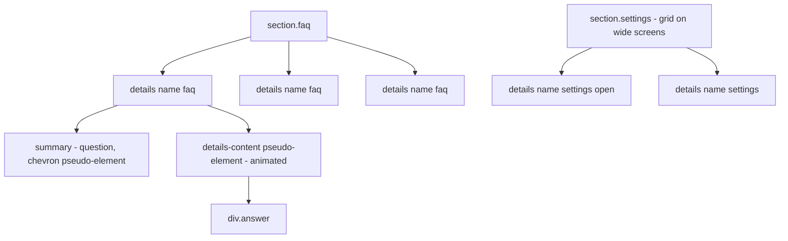
- **details name**: browsers ensure only one element in a same-`name` group is open.
- **summary**: the built-in toggle button. Screen readers announce it as expanded or collapsed.
- **::details-content**: a pseudo-element wrapping everything except the summary. You can transition its `block-size` and `content-visibility` to animate.
- **section.settings grid**: on wide screens, a grid with summaries in row 1 and the open content in row 2 makes the group look like tabs. The trick relies on `display: contents` on each `<details>` so its children join the parent grid. Test that carefully, because `display: contents` has a history of accessibility bugs on interactive elements.

### Data model
| Component | State | Source of truth |
|---|---|---|
| FAQ item | open / closed | `open` attribute on `details` |
| FAQ group | at most one open | shared `name` attribute |
| Settings group | exactly one open (start with one `open`) | `name` + initial `open` |
| Motion | full / reduced | `prefers-reduced-motion` |

### Tech stack
- **`<details>`/`<summary>`** with `name`.
- **`::details-content`** with `transition: block-size, content-visibility allow-discrete`.
- **`interpolate-size: allow-keywords`** to transition to `auto`. Chromium only, not Baseline, so put it in a progressive-enhancement block.
- **Grid `0fr → 1fr`** trick as the cross-browser alternative.

### Milestones
1. **Plain FAQ.** *Done when* 6 items work with keyboard and screen readers, and only one opens at a time.
2. **Custom marker.** *Done when* the chevron rotates on open and Safari's default marker is hidden (it needs `summary::-webkit-details-marker { display: none }` in older versions).
3. **Animation.** *Done when* items slide open in browsers that support your chosen technique, open instantly elsewhere, and reduced motion disables sliding.
4. **Tab-like layout.** *Done when* on wide screens the settings group shows labels in a row with one panel visible, and on phones it's a normal accordion.
5. **Honesty check.** Write down in your README how your "tabs" differ from the APG tabs pattern.

### Deep dive: the hard parts
- **Animating to `auto`.** Browsers historically can't interpolate between `0` and `auto`. Options: `interpolate-size: allow-keywords` on `:root` (Chromium only) lets `block-size: auto` transition. The grid trick (an inner grid whose single row transitions from `0fr` to `1fr`) works across modern browsers. Closing needs the content to stay rendered during the transition, which is what `transition-behavior: allow-discrete` on `content-visibility` provides.
- **When "tabs" aren't tabs.** Real tabs have one tab stop for the tablist with arrow keys moving between tabs, and announce "tab 2 of 4". Details-based "tabs" are a group of disclosures, each its own tab stop, announced as "expanded/collapsed". That's accessible, just different. Don't add `role="tab"` to a summary without implementing the keyboard behaviour, because that would promise something the component doesn't do.
- **Find-in-page.** The HTML standard now says find-in-page should open a closed `<details>` when it matches text inside, and Chromium does this. Check each browser you support. Hiding answers with `display: none` instead makes them unsearchable everywhere.

### Testing strategy
Keyboard and screen reader on each component. Ctrl+F for a word inside a closed answer. Reduced motion emulation in DevTools. Test in Chrome, Firefox and Safari to see the enhancement and fallback paths.

### Trade-offs, scaling and failure modes
Exclusive accordions can frustrate users who want to compare two answers. Use `name` only when that is really better. `display: contents` tricks are clever but fragile. If the tab-like layout causes any screen-reader issue, fall back to a plain accordion. For real tabs, the APG pattern with a few lines of JS is still the right answer.

### Stretch goals
- Open the panel matching the URL fragment on load (`:target` can't open details, so you'll need a little JS, or explore `hidden="until-found"`, which isn't Baseline).
- Count open items with CSS counters and show "2 of 6 open" (non-exclusive version).
- Style the open item with `details[open] > summary` and `:has([open])` on the group.

### Skills practised
- [Ch 3 — Semantic HTML and Accessibility](../chapters/03-semantic-html-and-accessibility/README.md): disclosure semantics, ARIA's first rule.
- [Ch 12 — Transitions, Transforms and Animation](../chapters/12-transitions-transforms-and-animation/README.md): transitions, `allow-discrete`, reduced motion.
- [Ch 13 — Modern CSS and Architecture](../chapters/13-modern-css-and-architecture/README.md): `:has()`, progressive enhancement.

### In the interview
**30-second answer:** I built an FAQ accordion and a tab-like settings group on the native `<details>`/`<summary>` elements with no JavaScript. The shared `name` attribute makes an exclusive accordion where opening one item closes the others, and the browser announces expanded and collapsed state for free. I animated opening with `::details-content` and the grid `0fr`-to-`1fr` trick as an enhancement, disabled under reduced motion. The key judgement was honesty: my "tabs" are disclosures, not ARIA tabs, so I didn't add `role="tab"` without the arrow-key behaviour that role promises.

**Key terms to know:**
- **`<details>`/`<summary>`** — a native disclosure widget. `<summary>` acts as the toggle button.
- **Exclusive accordion** — several `<details>` with the same `name`, so only one is open at a time.
- **`::details-content`** — pseudo-element wrapping everything except the summary, which can be transitioned.
- **`interpolate-size: allow-keywords`** — allows transitions to `auto` sizes. Chromium only, not Baseline.
- **Grid `0fr`/`1fr` trick** — an inner grid row that transitions from `0fr` to `1fr` to animate height.
- **`transition-behavior: allow-discrete`** — lets discrete properties like `content-visibility` flip at the right moment of a transition.
- **First rule of ARIA** — use a native element with the semantics you need instead of adding roles.
- **APG tabs pattern** — `tablist`/`tab`/`tabpanel` roles, one tab stop and arrow keys between tabs, which needs JS.
- **Find-in-page** — the HTML standard says matching text should auto-open a closed `<details>`.
- **`prefers-reduced-motion`** — disables the slide animation.

**Q:** How do you make an accordion where only one item opens, without JS?

**A:** Give each `<details>` the same `name` attribute. The browser closes the others when one opens.

**Q:** Can you animate `height: auto`?

**A:** Not with plain transitions in all browsers. Use the grid `0fr`/`1fr` trick, or `interpolate-size: allow-keywords` where it's supported, and fall back to no animation.

**Q:** Are `<details>`-based tabs real tabs?

**A:** No. They're disclosures. They're accessible, but they don't have tab semantics or arrow-key navigation. Real tabs follow the APG tabs pattern with ARIA roles and JS.

**Q:** Why not build the accordion from `<div>`s with click handlers?

**A:** You'd have to add a button role, focusability, Enter and Space handling and `aria-expanded` yourself, and it fails without JS. `<details>` provides all of that natively and also supports find-in-page in browsers that implement it.

**Q:** Why keep closed answers in the DOM instead of removing them?

**A:** Content that exists but is collapsed can be found with Ctrl+F (which opens the matching `<details>` in supporting browsers) and is still in the HTML for search engines. Removing it or hiding it with `display: none` on your own wrapper makes it unsearchable.

**Q:** How does the grid trick animate height?

**A:** The content sits in a grid with one row. Closed, the row is `0fr` and the child has `min-height: 0` and `overflow: hidden`. Open, it becomes `1fr`. Grid track sizes are animatable, so the row grows smoothly to the content's height.
```css
.panel { display: grid; grid-template-rows: 0fr; transition: grid-template-rows .25s; }
details[open] .panel { grid-template-rows: 1fr; }
.panel > div { min-block-size: 0; overflow: hidden; }
```

**Q:** What's the risk with `display: contents` in the tab-like layout?

**A:** It removes the element's box so its children join the parent grid, and some browsers have historically dropped the element's semantics from the accessibility tree, especially on interactive elements. Test with screen readers and fall back to a plain accordion if anything breaks.

**Q:** When is an exclusive accordion a bad idea?

**A:** When users need to compare two answers or settings side by side, because opening the second closes the first. Use `name` only where one-at-a-time genuinely helps, such as long FAQs on phones.

**Q:** How do you test it?

**A:** Keyboard and screen reader on each component (state announced as expanded or collapsed), Ctrl+F for a word inside a closed answer, reduced-motion emulation, and Chrome, Firefox and Safari to see both the enhancement and the fallback path.

**Common mistakes in answers:**
- Adding `role="tab"` to `<summary>` to "make it tabs". That changes the announcement without adding the expected keyboard behaviour.
- Animating with `max-height: 1000px`. It guesses a height, clips long content and gives uneven timing.
- Forgetting the reduced-motion guard on the open animation.

### TL;DR
`<details name>` gives you an accessible, exclusive accordion with zero JS. Animate it with `::details-content` as an enhancement, and be honest that disclosure "tabs" aren't ARIA tabs.

## 15. Email-safe newsletter

**Level:** Intermediate · **Time:** 1 week · **Prerequisites:** Ch 2, Ch 5, Ch 11

### What it is
An HTML email newsletter template: logo header, hero image, a lead story, a two-column row of smaller stories, a call-to-action button, and a footer with address and unsubscribe link. It must render acceptably in the major email clients, which support a much older and stranger subset of HTML and CSS than browsers do.

### The problem it solves
Email clients are not browsers. Some strip `<style>` blocks, some ignore flexbox and grid, and one major desktop client renders HTML with a word-processor engine. A newsletter built like a web page falls apart. Email development is its own discipline. Learning it teaches you how much modern CSS you rely on, how progressive enhancement works in a hostile environment, and why table layout still exists.

### Real-world examples
- [Can I email](https://www.caniemail.com/) is the "Can I use" of email: support tables for HTML and CSS features across email clients.
- [MJML](https://mjml.io/) is an open-source markup language that compiles to email-safe, table-based HTML.
- [Good Email Code](https://www.goodemailcode.com/) is a collection of accessible, tested email code patterns.

### Requirements
**Functional**
- Layout built from `<table role="presentation">`s so screen readers don't announce layout tables as data.
- Single-column on phones, two columns on wide clients, using a "hybrid" or fluid approach that works even where media queries are ignored.
- A "bulletproof" button: a link styled with padding and background, which still works when images are blocked.
- `lang` and `dir` on the root, a hidden preheader text, a plain-text alternative version.
- Unsubscribe link and postal address in the footer.

**Non-functional**
- Total HTML under **100 KB**. Gmail clips messages above roughly 102 KB, hiding the rest behind a "view entire message" link.
- Width **600 px** maximum for the content column (a common convention that fits preview panes).
- Readable with images off: every image has alt text, and text is never baked into images.
- Text contrast at least **4.5:1**, body text at least **16 px**.

### The architecture
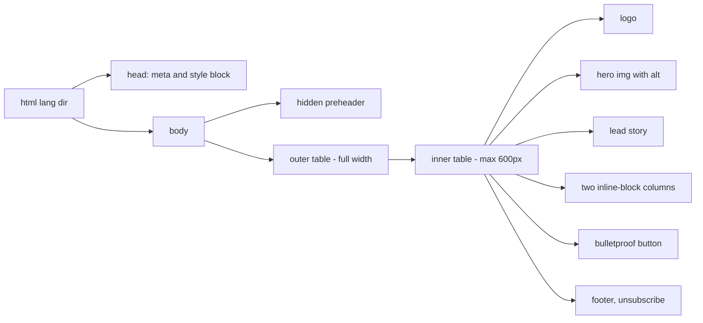
- **Wrapper table**: provides a full-width background colour. The inner table limits the content width.
- **Two inline-block columns**: each column is a `<div>` with `display: inline-block; width: 100%; max-width: 300px`. They sit side by side when there's room and stack when there isn't, even in clients that ignore media queries. This is the "hybrid" or "spongy" technique.
- **Inline styles**: critical styles are inlined on each element (usually by a build tool), and the `<style>` block adds enhancements like media queries and dark mode for clients that support them.

### Data model
| Block | Fields | Fallback |
|---|---|---|
| Preheader | text (85–100 chars) | Hidden text shown in inbox preview |
| Hero | image URL, alt, link | Alt text styled with font and colour |
| Story | heading, summary, link | Plain text |
| Button | label, URL | Link still works without styles |
| Footer | address, unsubscribe URL | Required by anti-spam law in many countries |

### Tech stack
| Need | Choice | Why |
|---|---|---|
| Layout | Nested presentation tables + inline-block | Widest client support |
| Styles | Inlined CSS + head `<style>` for enhancements | Some clients strip head styles |
| Build | MJML or a CSS inliner | Avoids hand-inlining everything |
| Testing | Real inboxes and a rendering service | Clients differ wildly |

### Milestones
1. **Single-column template.** *Done when* it renders correctly in a desktop web client and a phone client you have access to.
2. **Hybrid two columns.** *Done when* columns sit side by side at 600 px and stack on phones, even with the `<style>` block deleted.
3. **Images off.** *Done when* the email still makes sense with images blocked (styled alt text, live text button).
4. **Accessibility.** *Done when* a screen reader reads the email without announcing table structure, in the right order, in the right language.
5. **Dark mode.** *Done when* clients that auto-invert colours still show a readable logo and button (test a transparent PNG logo with a light outline).

### Deep dive: the hard parts
- **Why tables?** Some major clients don't support `display: flex`, `grid`, or even reliable `max-width` on `<div>`s. Tables are the one layout primitive every client renders. `role="presentation"` removes their table semantics so screen readers read just the content.
- **Dark mode in email.** Clients handle dark mode in three ways: no change, partial inversion of light backgrounds, or full inversion. You can't fully control it. `prefers-color-scheme` works in some clients only. Design assets that survive inversion: logos with transparent backgrounds and an outline, and no text in images.
- **Bulletproof buttons.** An image button disappears when images are blocked. A styled `<a>` with padding works in most clients. Some clients ignore padding on `<a>`, so the cell around it gets the background too.

### Testing strategy
Send to real accounts on at least three clients (a webmail, a desktop client, a phone app). Use Can I email for every CSS feature you add. Check with images off. Screen reader test on the HTML file. Check the file size and the plain-text version.

### Trade-offs, scaling and failure modes
Hand-coding email is slow. Frameworks like MJML trade control for reliability. Every enhancement (web fonts, background images, animated GIFs) has clients where it fails, so make sure the fallback is acceptable. Large emails get clipped and the unsubscribe link disappears below the fold. Tracking pixels and image-heavy designs also hurt deliverability and privacy.

### Stretch goals
- Build the same email in MJML and compare the output HTML.
- Add an interactive-ish "kinetic" element (a CSS-only reveal) that falls back to static content.
- Generate the plain-text version automatically.

### Skills practised
- [Ch 2 — HTML Structure and Text](../chapters/02-html-structure-and-text/README.md): `lang`, `dir`, document structure.
- [Ch 5 — Tables and Forms](../chapters/05-tables-and-forms/README.md): table structure (and why layout tables need `role="presentation"`).
- [Ch 11 — Typography, Colour and Visual Effects](../chapters/11-typography-color-and-visual-effects/README.md): contrast, dark mode concerns.
- [Ch 4 — Images, Media and Embeds](../chapters/04-images-media-and-embeds/README.md): alt text.

### In the interview
**30-second answer:** I built an HTML email newsletter that renders acceptably across major clients, including classic Outlook for Windows, which uses Word's rendering engine. Layout is nested `<table role="presentation">`s with critical styles inlined, and the two-column row uses the "hybrid" technique: inline-block columns with `max-width: 300px` that sit side by side or stack even where media queries are ignored. The hard parts were images-off and dark-mode inversion, so the button is a styled link (bulletproof), every image has alt text and no text is baked into images. The file stays under 100 KB to avoid Gmail clipping at about 102 KB, which would hide the unsubscribe link.

**Key terms to know:**
- **Layout tables with `role="presentation"`** — tables used only for layout, with table semantics removed for screen readers.
- **Inlined CSS** — styles written into `style` attributes, because some clients or contexts strip `<style>` blocks.
- **Hybrid (spongy) columns** — inline-block columns with `max-width` that wrap without media queries.
- **Bulletproof button** — a padded, coloured link (and table cell) that works with images blocked.
- **Preheader** — hidden text shown after the subject line in inbox previews.
- **Gmail clipping** — messages over about 102 KB are cut off behind "View entire message".
- **Conditional comments (`<!--[if mso]>`)** — markup seen only by Outlook's Word engine, used for "ghost tables".
- **Dark-mode inversion** — clients may partially or fully invert colours, which you can't fully control.
- **Plain-text alternative** — a text part of the multipart email for clients and users that prefer it.
- **Can I email** — support tables for HTML and CSS features in email clients.

**Q:** Why do HTML emails still use tables?

**A:** Email clients have limited and inconsistent CSS support, and some render with engines that don't support flexbox, grid or reliable `div` sizing. Tables render everywhere. `role="presentation"` keeps them accessible.

**Q:** How do you make columns responsive without media queries?

**A:** Use inline-block columns with `max-width` and `width: 100%` inside a fixed-max container. They sit side by side when there's room and wrap when there isn't. Outlook for Windows ignores `max-width` on divs, so a conditional ghost table gives it fixed columns.

**Q:** What's a preheader?

**A:** Hidden text at the start of the email that inbox lists show as a preview after the subject line. Without one, clients show the first text they find, often "View in browser".

**Q:** Why can't you just use your website's CSS?

**A:** Many clients strip or rewrite `<style>` blocks, ignore external stylesheets, don't support flexbox or grid, and sanitise selectors. Classic Outlook uses Word's HTML engine, which supports a small, old subset. You design for the weakest client and enhance for the rest.

**Q:** How do you handle dark mode in email?

**A:** Accept that you can't control it fully: some clients do nothing, some invert light backgrounds, some invert everything. Use logos with transparent backgrounds and an outline, avoid text in images, and add `prefers-color-scheme` styles for the clients that honour them.

**Q:** Images are blocked by default. What does the reader see?

**A:** With good habits, a readable email: styled alt text in place of images, a live-text button, and headlines in real text. With bad habits, a blank grey box. Always test with images off, because many clients block them until the reader allows it.

**Q:** The email grows to 140 KB. What breaks?

**A:** Gmail clips it, so the bottom (usually the footer with the unsubscribe link and address) is hidden behind a link. That hurts compliance and deliverability. Cut inline-style duplication, remove comments and whitespace, and move long content to the website.

**Q:** Why a bulletproof button instead of an image button?

**A:** An image button disappears when images are blocked and its text can't be read by screen readers if alt text is weak. A link with padding and a background colour on the surrounding cell works in nearly every client and stays clickable.

**Q:** How do you test across clients?

**A:** Send to real accounts on at least three clients (webmail, a desktop client, a phone app), use a rendering-preview service for the rest, check every CSS feature against Can I email, test images off, and run a screen reader on the HTML to confirm no table structure is announced.

**Common mistakes in answers:**
- Saying "nobody uses tables any more". In email they're still the most reliable layout primitive.
- Forgetting `role="presentation"`, so screen readers announce "table with 3 rows" for every layout table.
- Relying on media queries alone for mobile. Several clients ignore them, which is why hybrid columns exist.

### TL;DR
Email is web development with the clock turned back: presentation tables, inlined styles, hybrid columns, bulletproof buttons and alt-text-first design. Test in real clients and keep the file under the clipping limit.

## 16. Dark mode theming with custom properties

**Level:** Intermediate · **Time:** 1 week · **Prerequisites:** Ch 6, Ch 10, Ch 11, Ch 13

### What it is
A theming system for an existing page (reuse project 10 or 11): light and dark colour schemes that follow the operating system by default, plus a manual override (Light / Dark / System). All colours come from **semantic custom properties**, so components never mention a raw colour. Form controls, scrollbars and images adapt too.

### The problem it solves
Bolting dark mode onto a site usually means hundreds of overrides like `.dark .card { background: #222 }`, missed elements that stay white, low-contrast text and form controls that stay light. A token-based theme fixes this structurally: components use roles (`--surface`, `--text`, `--accent`), and a theme is just a different mapping of roles to colours. The CSS `color-scheme` property and the `light-dark()` function (Baseline since May 2024) handle the browser's own UI.

### Real-world examples
- web.dev's article [prefers-color-scheme: Hello darkness, my old friend](https://web.dev/articles/prefers-color-scheme) covers the media query, `color-scheme`, and design considerations like dimming images.
- MDN documents [`light-dark()`](https://developer.mozilla.org/en-US/docs/Web/CSS/color_value/light-dark), which picks one of two colours based on the element's used colour scheme.
- GitHub's [Primer](https://primer.style/) design system offers multiple light, dark and high-contrast themes built on semantic colour tokens.

### Requirements
**Functional**
- Semantic tokens: `--color-bg`, `--color-surface`, `--color-text`, `--color-text-muted`, `--color-border`, `--color-accent`, `--color-accent-text`, `--color-danger`, `--color-focus`.
- Default follows the OS (`color-scheme: light dark`).
- A three-way switch (radio group: Light, Dark, System). The page reacts via `:root:has(#theme-dark:checked)`. Persisting the choice across visits needs a few lines of JS (allowed).
- Form controls and scrollbars follow the theme.
- Images: slightly dimmed in dark mode, and logos swapped via `<picture>` with a `prefers-color-scheme` media source.

**Non-functional**
- Every text and background pair meets **4.5:1** (3:1 for large text and UI component borders) in both themes.
- No **flash of the wrong theme** on load for a returning visitor who chose a theme.
- Theme switch repaints in under **100 ms** (no layout changes, colour only).

### The architecture
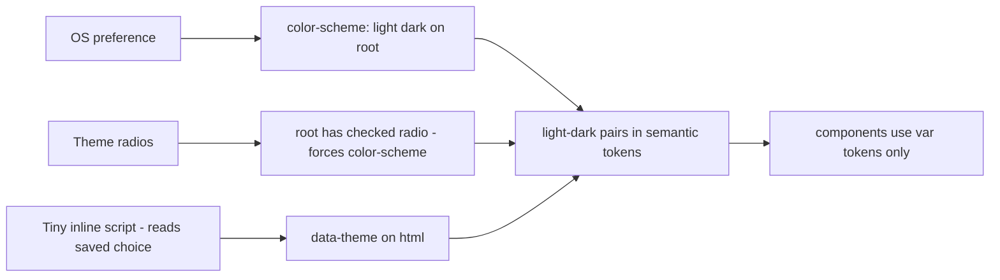
- **color-scheme**: tells the browser which schemes the page supports. It themes form controls, scrollbars and the default canvas, and it controls which branch `light-dark()` uses.
- **Semantic tokens with `light-dark()`**: `--color-text: light-dark(oklch(25% 0.02 260), oklch(93% 0.01 260))`. One declaration per token, both themes side by side.
- **Override**: forcing `color-scheme: dark` on `:root` makes every `light-dark()` pick the dark value, so the manual switch is a one-line change.
- **Inline script in head**: reads the saved choice from `localStorage` and sets `data-theme` before first paint, which prevents the flash.

### Data model
| Token | Light | Dark | Role |
|---|---|---|---|
| `--color-bg` | near-white | near-black (not pure black) | Page background |
| `--color-surface` | white | dark grey, lighter than bg | Cards, raised areas |
| `--color-text` | very dark grey | very light grey | Body text |
| `--color-text-muted` | mid grey (4.5:1) | light grey (4.5:1) | Secondary text |
| `--color-accent` | saturated brand | lighter, less saturated brand | Links, buttons |
| `--color-focus` | high-contrast blue | high-contrast yellow or light blue | Focus rings |

### Tech stack
| Need | Choice | Why |
|---|---|---|
| Colour space | `oklch()` | Perceptually even lightness makes contrast tuning predictable |
| Scheme logic | `color-scheme` + `light-dark()` | Native, also themes form controls |
| Manual switch | radios + `:has()` | Works without JS, JS only persists |
| Derived shades | `color-mix()` | Hover and border shades from base tokens |

### Milestones
1. **Token audit.** Replace every raw colour in components with a semantic token. *Done when* searching the component CSS for `#`, `rgb(` and `oklch(` finds nothing.
2. **System theme.** *Done when* switching the OS theme flips the page, including form controls.
3. **Manual switch.** *Done when* the three radios override the OS without JS.
4. **Persistence, no flash.** *Done when* a reload with "Dark" chosen shows no white flash, even with a throttled connection.
5. **Contrast pass.** *Done when* every token pair passes in both themes (check with DevTools or a contrast tool).

### Deep dive: the hard parts
- **Dark is not inverted.** Pure black backgrounds with pure white text cause halation (glowing text) for many people. Use dark greys and slightly reduced text lightness. Elevation in dark themes is shown with *lighter* surfaces, not shadows. Saturated brand colours vibrate on dark backgrounds, so lighten and desaturate them.
- **The flash of incorrect theme.** CSS alone can follow the OS with no flash. A *saved* user choice lives in storage, which only JS can read. The script must be small, inline, and in `<head>` before the stylesheet applies, or the page paints in the default theme first. This is a rare case where a render-blocking script is correct.
- **Images and logos.** `<picture><source media="(prefers-color-scheme: dark)" srcset="logo-dark.svg"></picture>` follows the OS but *not* your manual override, because media queries don't know about it. For logos that must follow the override, use inline SVG with `fill: currentColor` or CSS-controlled tokens.

### Testing strategy
DevTools rendering panel: emulate light and dark. Test the manual override in both OS modes (four combinations). Contrast check every token pair. Throttled reload to look for flash. Forced-colors mode (Windows High Contrast) to make sure your theme doesn't fight it (project 36).

### Trade-offs, scaling and failure modes
`light-dark()` only handles two schemes. A third theme (high contrast, or a brand theme) needs token overrides on a `[data-theme]` selector instead. Storing the choice needs JS. Without it, the override resets each page load. Theme-specific images double asset work. Third-party embeds (maps, videos) may ignore your theme.

### Stretch goals
- A high-contrast theme triggered by `prefers-contrast: more`.
- Use `@property` to register colour tokens so theme switches can transition smoothly.
- Generate the dark palette from the light one with relative colour syntax (`oklch(from var(--brand) calc(l + 0.2) c h)`).

### Skills practised
- [Ch 6 — CSS Fundamentals](../chapters/06-css-fundamentals/README.md): custom properties, `oklch()`, `color-mix()`.
- [Ch 10 — Responsive Design](../chapters/10-responsive-design/README.md): user-preference media queries.
- [Ch 11 — Typography, Colour and Visual Effects](../chapters/11-typography-color-and-visual-effects/README.md): contrast.
- [Ch 13 — Modern CSS and Architecture](../chapters/13-modern-css-and-architecture/README.md): theming with tokens, `light-dark()`, `:has()`.

### In the interview
**30-second answer:** I built a theming system where components never mention a raw colour: they use semantic tokens like `--color-surface` and `--color-text`, defined once with `light-dark()` pairs. `color-scheme: light dark` makes the page follow the OS and also themes form controls and scrollbars, and a Light/Dark/System radio group overrides it through `:root:has(#theme-dark:checked)` with no JS. The hard problem was the flash of the wrong theme for returning visitors, which I solved with a tiny inline script in `<head>` that reads the saved choice and sets `data-theme` before first paint. Every token pair passes 4.5:1 in both themes, and switching repaints colour only, with no layout change.

**Key terms to know:**
- **Semantic colour tokens** — custom properties named by role (`--color-text-muted`), not by value.
- **`color-scheme`** — declares supported schemes so the browser themes native UI and picks `light-dark()` branches.
- **`light-dark(a, b)`** — returns the first colour in a light scheme and the second in a dark one.
- **`prefers-color-scheme`** — the media feature reporting the OS preference.
- **Flash of incorrect theme** — the page painting in the default theme before a saved choice is applied.
- **Render-blocking inline script** — a small synchronous script in `<head>` that runs before first paint.
- **`oklch()`** — a perceptual colour space where lightness behaves predictably, useful for tuning contrast.
- **`color-mix()`** — derives hover and border shades from base tokens.
- **Contrast ratio** — 4.5:1 for text, 3:1 for large text and UI component boundaries.
- **Halation** — the glow of bright text on pure black, a reason to use dark greys.

**Q:** How would you implement dark mode?

**A:** Semantic colour tokens that components use exclusively, `color-scheme: light dark` so the browser themes its UI, token values via `light-dark()` or per-theme overrides, and a manual override that sets `color-scheme` or a data attribute, persisted with a tiny inline script.

**Q:** What does `color-scheme` do?

**A:** It declares which schemes the page supports, so the browser renders form controls, scrollbars and the default background to match, and it decides which value `light-dark()` returns.

**Q:** How do you avoid a theme flash on load?

**A:** Read the saved preference with a small inline script in the head that sets the theme attribute before first paint. It must be inline (no network request) and before the body renders. Following the OS alone needs no script, because CSS media queries apply immediately.

**Q:** Why semantic tokens instead of `.dark .card { background: #222 }` overrides?

**A:** Overrides multiply per component and theme, and every missed selector stays light. With semantic tokens, a theme is just a different mapping of a dozen roles to colours, so new components are themed automatically and a third theme is cheap.

**Q:** What does `light-dark()` need to work, and what are its limits?

**A:** The element's used colour scheme must be set through `color-scheme`, otherwise it always picks the light value. It handles exactly two schemes, so a high-contrast or brand theme needs token overrides on a `[data-theme]` selector instead.

**Q:** The logo uses `<picture>` with a dark-mode source, but it doesn't change when the user picks "Dark" manually. Why?

**A:** The `media="(prefers-color-scheme: dark)"` on `<source>` reads the OS setting, not your page's override. For logos that must follow the switch, use inline SVG with `fill: currentColor` or token-driven colours, which follow `color-scheme` and the cascade.

**Q:** Why not pure black and white for the dark theme?

**A:** Very high contrast between pure white text and pure black backgrounds causes halation and eye strain for many people. Dark greys with slightly reduced text lightness read better. In dark themes, raised surfaces get lighter instead of using shadows, and saturated brand colours need lightening.

**Q:** JavaScript fails to load. What does the user see?

**A:** The page still follows the OS theme through CSS, and the radio switch still works within the page through `:has()`. Only persistence across visits is lost. That's the benefit of keeping JS to the one job only it can do.

**Q:** How do you test it?

**A:** Emulate light and dark in DevTools, try the manual override in both OS modes (four combinations), check every token pair's contrast, reload on a throttled connection to look for a flash, and check forced-colors mode so your theme doesn't fight the user's.

**Common mistakes in answers:**
- Inverting the page with `filter: invert(1)`. It wrecks images, brand colours and contrast tuning.
- Forgetting `color-scheme`, which leaves form controls and scrollbars bright white in dark mode.
- Loading the theme script with `defer`. Deferred scripts run after parsing, too late to prevent the flash.

### TL;DR
Components use semantic tokens only. `color-scheme` plus `light-dark()` handles the OS theme and native controls, and a `:has()`-driven switch with a tiny inline script gives a manual override without flashing.

## 17. Print stylesheet résumé

**Level:** Intermediate · **Time:** 1 week · **Prerequisites:** Ch 2, Ch 7, Ch 10, Ch 11

### What it is
Your CV as one HTML page that looks good on screen *and* prints, or saves as PDF, as a polished two-page A4 or US Letter document. The screen version is responsive. The print version uses `@page` rules, break control and print-specific typography. The PDF you send to employers comes straight from the browser.

### The problem it solves
Most people keep two CVs, a web page and a word-processor file, and they drift apart. CSS for paged media lets one HTML source produce both. It also teaches a part of CSS many developers never touch: page boxes, margins, page breaks, orphans and widows, and how to show link URLs on paper where you can't click.

### Real-world examples
- MDN's [`@page` reference](https://developer.mozilla.org/en-US/docs/Web/CSS/@page) documents page size and margins. `@page` is Baseline since December 2024, when Safari 18.2 added support.
- Rachel Andrew's [Designing For Print With CSS](https://www.smashingmagazine.com/2015/01/designing-for-print-with-css/) in Smashing Magazine explains paged media and how publishers produce books from HTML.
- [Paged.js](https://pagedjs.org/) is an open-source library that polyfills paged-media features (running headers, page counters) in the browser.

### Requirements
**Functional**
- Semantic sections: header (name, contact), summary, experience (each job an `<article>` with role, company, `<time>` range, achievements list), education, skills, projects.
- Screen: responsive single column on phones, two columns (sidebar for skills and contact) on wide screens.
- Print: `@page { size: A4; margin: 15mm }`, black text on white, no backgrounds unless intentional, link URLs printed after link text, no job entry split across pages.
- A "Download PDF" instruction (the browser's print dialog), since this is HTML only.

**Non-functional**
- Print output: exactly **2 pages** on A4 and on US Letter, with body text **10–11 pt**.
- Fonts embedded in the PDF (self-hosted web font or a system font).
- Screen version passes WCAG AA contrast.
- Selectable, searchable text in the PDF (no screenshots), which applicant tracking systems need.

### The architecture
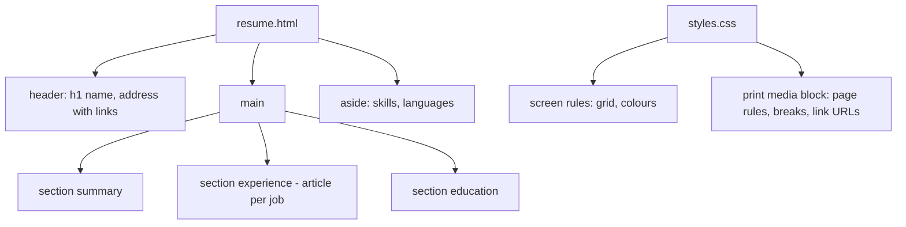
- **article per job**: each job is self-contained. `break-inside: avoid` keeps it on one page.
- **print block**: one `@media print` section that strips decoration and sets page geometry. The `@page` rule sits at the top level of the stylesheet.
- **address with links**: `mailto:` and profile links. In print, `a[href^="http"]::after { content: " (" attr(href) ")" }` writes the URL out.

### Data model
| Section | Fields | Print rule |
|---|---|---|
| Header | name, title, email, phone, links | First page only, compact |
| Job | role, company, location, start, end, bullets | `break-inside: avoid` |
| Education | degree, institution, year | `break-inside: avoid` |
| Skills | grouped lists | May split across pages |

### Tech stack
- **HTML** with `<time datetime="2023-04">`.
- **CSS paged media**: `@page`, `size`, `margin`, `break-*`, `orphans`, `widows`.
- **`print-color-adjust: exact`** (Baseline since May 2025) only where a background must print, such as a coloured name bar.
- **Units** for print: `pt` and `mm` are fine in print styles, even though screen styles should use `rem`.

### Milestones
1. **Content and screen layout.** *Done when* the page validates, works on a phone, and reads well with CSS off.
2. **Print basics.** *Done when* print preview shows black-on-white text, no navigation or buttons, and readable link URLs.
3. **Page geometry.** *Done when* the CV fits exactly two A4 pages with sensible margins.
4. **Break control.** *Done when* no job, heading or education entry is split, and no heading sits alone at a page bottom.
5. **Letter size.** *Done when* switching the paper to US Letter still gives two clean pages.

### Deep dive: the hard parts
- **Break control is a request, not a command.** `break-inside: avoid` asks the browser not to split an element. If the element is taller than a page, it must split anyway. Keep job entries short. `break-after: avoid` on headings keeps them with the next block, and `orphans: 3; widows: 3` stop single lines being left alone at the start or end of a page.
- **Paper sizes.** A4 is 210 × 297 mm. US Letter is 8.5 × 11 in (about 216 × 279 mm), so it is wider and shorter. If you hard-code `size: A4`, US readers' printers scale it. Leaving `size` unset uses the user's paper. Either design for both or set `size` and accept scaling.
- **Running headers and page numbers.** CSS defines page-margin boxes (`@top-right { content: counter(page) }`), but support is limited to Chromium. Paged.js polyfills them. For a two-page CV, a name in a small footer on page 2 is a nice touch, but optional.

### Testing strategy
Print preview in Chrome, Firefox and Safari. Save as PDF and open the PDF: check text selection, links and fonts (in a PDF viewer's document properties). Paste the PDF text into a plain text editor to see what an applicant tracking system would read. Check both A4 and Letter.

### Trade-offs, scaling and failure modes
Browsers' print engines differ, so the PDF from one browser may break differently from another. Pick one browser to generate the official PDF. Two-column print layouts look smart but some applicant tracking systems read columns in the wrong order, so a single-column print layout is safer. Backgrounds are off by default in print, which is good for ink and bad for designs that depend on them.

### Stretch goals
- Add JSON-LD `Person` data.
- Add a "compact" print variant (one page) via a class you add before printing.
- Use Paged.js to add page numbers and compare with native CSS.

### Skills practised
- [Ch 2 — HTML Structure and Text](../chapters/02-html-structure-and-text/README.md): `<time>`, `<address>`, lists.
- [Ch 7 — Box Model and Layout Basics](../chapters/07-box-model-and-layout-basics/README.md): box sizing, flow.
- [Ch 10 — Responsive Design](../chapters/10-responsive-design/README.md): print media type.
- [Ch 11 — Typography, Colour and Visual Effects](../chapters/11-typography-color-and-visual-effects/README.md): type sizes, fonts.

### In the interview
**30-second answer:** I built my CV as one HTML page that's responsive on screen and prints, or saves as PDF, as exactly two clean A4 or US Letter pages. The print side uses `@page { size; margin }`, an `@media print` block that strips decoration and forces black on white, printed URLs after links with `a[href^="http"]::after { content: " (" attr(href) ")" }`, and break control so no job entry splits. The hard part is that break rules are requests, so I kept entries short and added `orphans` and `widows`. The PDF has selectable, searchable text that applicant tracking systems can read.

**Key terms to know:**
- **Paged media** — CSS for content laid out on pages, such as printing and PDF.
- **`@page`** — sets page size, orientation and margins for the page box.
- **`@media print`** — rules that apply only when printing or in print preview.
- **`break-inside: avoid`** — asks the browser not to split an element across pages.
- **`break-after: avoid`** — keeps a heading with the content that follows.
- **`orphans` / `widows`** — minimum lines left at the bottom or carried to the top of a page.
- **Generated content (`::after` with `attr()`)** — prints link URLs that can't be clicked on paper.
- **`print-color-adjust: exact`** — keeps a deliberate background when printing.
- **A4 vs US Letter** — 210 × 297 mm vs 8.5 × 11 in (about 216 × 279 mm).
- **Applicant tracking system (ATS)** — software that extracts text from CVs and can misread columns.

**Q:** How do you stop an element breaking across printed pages?

**A:** `break-inside: avoid` on the element, `break-after: avoid` on headings, and `orphans`/`widows` for paragraphs. These are requests, so content taller than a page still splits.

**Q:** How do you show link URLs in print?

**A:** In print styles, `a[href]::after { content: " (" attr(href) ")" }`, usually limited to external links with `a[href^="http"]`. Skip it for `mailto:` links where the text already is the address.

**Q:** What does `@page` control?

**A:** The page box: size, orientation and margins for paged media like printing and PDF. It's an at-rule at the top level of the stylesheet, and pseudo-classes like `@page :first` target specific pages.

**Q:** Should you set `size: A4`?

**A:** If you set it, US Letter printers scale the page to fit, which shrinks the text. If you leave `size` unset, the user's paper is used, so you must design margins and content to fit both. I tested both sizes and kept the layout flexible.

**Q:** Why might the PDF from Chrome look different from Firefox's?

**A:** Print engines differ in how they handle breaks, page-margin boxes and font rendering. Pick one browser to generate the official PDF and test the others for readers who print themselves.

**Q:** Why are backgrounds missing when you print?

**A:** Browsers skip background colours and images by default to save ink, unless the user enables them. For a background that carries meaning or brand, set `print-color-adjust: exact` on that element only.

**Q:** Why single-column in print when the screen version has a sidebar?

**A:** Some applicant tracking systems read text in source or geometric order and mix up two columns, so skills land inside job descriptions. A single column prints predictably and still looks professional.

**Q:** A new job pushes the CV to three pages. What do you do?

**A:** Treat the page count as a content budget: tighten older entries rather than shrinking the font below 10 pt. A "compact" class can reduce spacing for print. Check that no entry is now taller than a page, because then `break-inside: avoid` can't help.

**Q:** How do you test the output?

**A:** Print preview in Chrome, Firefox and Safari, save as PDF, then check text selection, links and embedded fonts in a PDF viewer. Paste the PDF text into a plain editor to see what an ATS would read, and repeat on A4 and Letter.

**Common mistakes in answers:**
- Saying `page-break-inside` is current. It's the legacy name, and `break-inside` is the standard property (the old one still works as an alias).
- Using screenshots or images of text in the PDF. Text must be selectable for search and ATS.
- Using `px` sizing logic for print. `pt` and `mm` are fine in print styles, where physical size matters.

### TL;DR
One HTML CV, two outputs: a responsive screen layout and a print layout with `@page` size and margins, break control and printed URLs. Test in print preview and the generated PDF, and keep text selectable.

## 18. Animated product card

**Level:** Intermediate · **Time:** 1 week · **Prerequisites:** Ch 11, Ch 12

### What it is
A product card for an online shop with polished interaction: an image that zooms gently on hover, a second image that cross-fades in, a "quick add" button that slides up, a colour-swatch selector that changes the image, a "new" badge that pulses once, and a smooth entry animation when cards appear. Everything is CSS. Every effect respects reduced motion and works with keyboard focus, not just hover.

### The problem it solves
Motion can make an interface feel responsive and help explain changes, or it can make it janky, distracting and inaccessible. Most problems come from animating the wrong properties (width, top, box-shadow), which forces layout or paint on every frame, and from hover-only effects that keyboard and touch users never see. This project teaches performant, purposeful, inclusive motion.

### Real-world examples
- web.dev's [How to create high-performance CSS animations](https://web.dev/articles/animations-guide) explains why `transform` and `opacity` animate smoothly while other properties trigger layout or paint.
- web.dev's [prefers-reduced-motion](https://web.dev/articles/prefers-reduced-motion) explains the media query and why some users need motion reduced (vestibular disorders).
- MDN documents [`@starting-style`](https://developer.mozilla.org/en-US/docs/Web/CSS/@starting-style), which defines the "before" styles for an element's first render so entry transitions work without JS (Baseline since August 2024).

### Requirements
**Functional**
- Card is an `<article>` with a link (the product name) whose clickable area covers the card (stretched-link pattern), plus a separate "Add to basket" `<button>`.
- Hover *and* `:focus-within`: image zooms to 1.05, second image fades in, the button slides up.
- Colour swatches as radio buttons. `:has(input[value=red]:checked)` swaps the visible image.
- Badge pulses twice on load, then stops.
- Cards fade and rise in when rendered, via `@starting-style`.

**Non-functional**
- All animations use only `transform` and `opacity`, aiming for **60 fps** (a frame every 16.7 ms) on a mid-range phone.
- Durations **150–400 ms**. Easing chosen per purpose (ease-out for entering, ease-in for leaving).
- Under `prefers-reduced-motion: reduce`: no zoom, slide or pulse. Cross-fades of 150 ms or less may remain.
- Touch devices: the quick-add button is always visible, using `@media (hover: none)`.

### The architecture
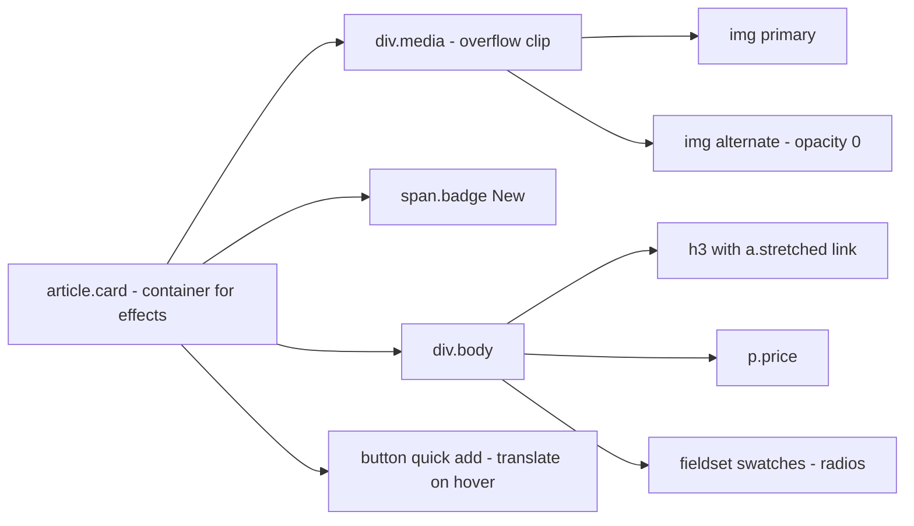
- **div.media**: `overflow: clip` hides the zoomed image's edges. The image scales with `transform`, not by changing width.
- **a.stretched**: the link's `::after` pseudo-element is absolutely positioned to cover the card, so the whole card is clickable while the HTML stays a single link. The button and swatches get `position: relative; z-index: 1` to stay clickable above it.
- **swatches**: real radios, so keyboard and screen readers work. `:has()` on the card selects the right image.

### Data model
| State | Trigger | Effect |
|---|---|---|
| Rest | none | Primary image, button hidden (pointer devices) |
| Engaged | `:hover`, `:focus-within` | Zoom, alt image, button visible |
| Colour chosen | radio `:checked` | Matching image shown |
| Entering | first render | Fade and rise via `@starting-style` |
| Reduced | `prefers-reduced-motion: reduce` | Static, fades only |

### Tech stack
| Need | Choice | Why |
|---|---|---|
| Hover effects | Transitions on `transform`/`opacity` | Compositor-friendly |
| Badge pulse | `@keyframes` with `animation-iteration-count: 2` | Finite, not distracting |
| Entry | `@starting-style` | No JS |
| Touch | `@media (hover: none)` | Show controls by default |

### Milestones
1. **Static accessible card.** *Done when* the name link and the button are separate tab stops, the whole card is clickable, and the swatch radios work.
2. **Hover and focus effects.** *Done when* the effects trigger with mouse and with keyboard focus anywhere in the card.
3. **Performance.** *Done when* a DevTools Performance recording of hovering shows no layout or paint during the animation (only compositing).
4. **Reduced motion and touch.** *Done when* reduced-motion emulation shows a still card and touch emulation shows the button.
5. **Entry animation.** *Done when* cards fade in on first render, with no JS, in browsers that support `@starting-style`, and appear normally elsewhere.

### Deep dive: the hard parts
- **Why `transform` and `opacity`?** The browser's pipeline is style, layout, paint, composite. Changing `width` or `top` re-runs layout for the element and possibly its neighbours. Changing `box-shadow` repaints. `transform` and `opacity` can be handled at the compositing stage, often on the GPU, without redoing layout or paint. Animate a pseudo-element's `opacity` to fake a growing shadow cheaply.
- **The stretched link and nested interactives.** Putting a `<button>` inside an `<a>` is invalid HTML and confusing for assistive technology. The stretched-link pattern keeps them as siblings. Text inside the card can no longer be selected by dragging, which is an acceptable trade for a product card.
- **Entry with `@starting-style`.** A transition needs a "from" value, but a newly inserted element has no previous style. `@starting-style { .card { opacity: 0; translate: 0 1rem } }` provides one. With `prefers-reduced-motion`, drop the translate.

### Testing strategy
DevTools Performance panel with CPU throttling at 4× or 6×. Rendering panel: paint flashing on while hovering. Reduced-motion emulation. Keyboard: Tab into the card and see the effects. Touch emulation. Screen reader: the card reads name, price, colour options, button.

### Trade-offs, scaling and failure modes
`will-change: transform` can help on very heavy pages but costs memory per element. Don't apply it to 100 cards. Hover effects hide functionality from touch users unless you plan for them. Loading two images per card doubles bandwidth, so lazy-load the alternate image or load it only on hover via a CSS background (a trade: it may arrive late).

### Stretch goals
- A 3D tilt using `perspective` and `rotate`, driven by `:hover` on a 3 × 3 grid of invisible zones (a known CSS trick).
- An "added" animation on the button using `:active` and a keyframe.
- View transition between the card and a product detail page (project 29).

### Skills practised
- [Ch 11 — Typography, Colour and Visual Effects](../chapters/11-typography-color-and-visual-effects/README.md): `object-fit`, shadows, clipping.
- [Ch 12 — Transitions, Transforms and Animation](../chapters/12-transitions-transforms-and-animation/README.md): transitions, keyframes, `@starting-style`, reduced motion.
- [Ch 13 — Modern CSS and Architecture](../chapters/13-modern-css-and-architecture/README.md): `:has()`, `:focus-within`.

### In the interview
**30-second answer:** I built a product card with polished motion that stays fast and inclusive: image zoom, a cross-fading second image, a slide-up "Add to basket" button, a one-off badge pulse and an entry fade with `@starting-style`, all in CSS. Every effect animates only `transform` and `opacity`, so the browser can do it at the compositing stage without layout or paint, and a Performance recording confirms that. Effects trigger on `:focus-within` as well as `:hover`, `@media (hover: none)` keeps the button visible on touch screens, and `prefers-reduced-motion: reduce` removes movement. The whole card is clickable through a stretched link while the button stays a separate, valid control.

**Key terms to know:**
- **Rendering pipeline** — style, layout, paint, composite. Cheaper animations skip the earlier stages.
- **Compositor-friendly properties** — `transform` and `opacity`, which can animate without layout or paint.
- **`@starting-style`** — the "from" styles for an element's first render, enabling entry transitions.
- **`:focus-within`** — matches an element containing the focused element, so keyboard users see the effects.
- **`@media (hover: none)`** — detects devices whose primary input can't hover.
- **Stretched link** — a link's `::after` covers the card, so the card is clickable without nesting interactive elements.
- **`prefers-reduced-motion`** — the user preference to minimise non-essential movement.
- **Easing** — ease-out for entering, ease-in for leaving.
- **`will-change`** — a hint to prepare a layer. Costs memory, so use sparingly.
- **`:has()` with radios** — swatch radios swap the visible image.

**Q:** Which properties are cheap to animate and why?

**A:** `transform` and `opacity`, because they can be handled by the compositor without re-running layout or paint. Animating `width`, `top` or `box-shadow` forces layout or paint on every frame and can drop below 60 fps on mid-range phones.

**Q:** How do you make hover effects accessible?

**A:** Trigger the same effects on `:focus-visible` or `:focus-within`, never hide essential controls behind hover, and use `@media (hover: none)` for touch.

**Q:** How do you respect reduced motion?

**A:** Wrap non-essential movement in `@media (prefers-reduced-motion: no-preference)`, or override it under `reduce`. Keep subtle fades if they carry meaning.

**Q:** Why not put the button inside the link so the whole card is one link?

**A:** A `<button>` inside an `<a>` is invalid HTML, and assistive technology gets confused about which action happens. The stretched-link pattern keeps them as siblings: the link's pseudo-element covers the card, and the button gets `position: relative; z-index: 1` to sit above it.

**Q:** How do you fake an animated shadow cheaply?

**A:** Put the bigger shadow on a pseudo-element with `opacity: 0`, and animate that pseudo-element's opacity on hover. The shadow is painted once, and only opacity changes per frame.

**Q:** What does `@starting-style` solve, and what's the gotcha?

**A:** A newly rendered element has no previous style, so a transition has nothing to start from. `@starting-style` provides those starting values. If you write it as a separate rule with the same specificity, it must come after the normal rule, or the normal rule overrides it. Nesting it inside the rule avoids that.

**Q:** Should you add `will-change: transform` to all 100 cards?

**A:** No. Each promoted layer costs GPU memory, and too many can make performance worse. Modern browsers promote layers during animations anyway. Use `will-change` only for a measured problem, ideally just before the animation.

**Q:** Loading two images per card doubles bandwidth. How do you handle a grid of 60 cards?

**A:** Lazy-load the alternate image, or load it only on interaction. Lazy-load cards below the fold and reserve image space to avoid layout shift. Measure the total transfer and LCP with and without the second image.

**Q:** How do you prove the animations are smooth?

**A:** Record hovering in the DevTools Performance panel with 4× CPU throttling and check there are no layout or paint events during the animation. Turn on paint flashing, emulate reduced motion and touch, and Tab into the card to check focus triggers the same effects.

**Common mistakes in answers:**
- Saying "CSS animations are always GPU accelerated". Only some properties can be composited, and others trigger layout or paint.
- Hiding "Add to basket" until hover with no touch or keyboard alternative.
- Thinking reduced motion means removing all animation. It means removing non-essential movement, and small fades can stay.

### TL;DR
Animate `transform` and `opacity` only, trigger effects on focus as well as hover, use real radios with `:has()` for state, `@starting-style` for entry, and remove movement under reduced motion.

## 19. Design-token system

**Level:** Intermediate · **Time:** 1–2 weeks · **Prerequisites:** Ch 6, Ch 11, Ch 13

### What it is
A small design-token pipeline: tokens for colour, typography, spacing, radius, shadow and motion are written once in a JSON file, transformed by a build tool into CSS custom properties (and optionally other platforms), and consumed by a handful of components. You define three tiers of tokens, **primitive**, **semantic** and **component**, and document them on a generated token reference page.

### The problem it solves
In real teams, "brand blue" exists as `#1a73e8` in CSS, a slightly different value in the design tool and another in the mobile app. Spacing is 15 px here and 16 px there. **Design tokens** are named design decisions stored in a neutral format, so every platform uses the same source of truth. Tiers separate *what values exist* (primitives) from *what they're for* (semantic), which makes theming and rebranding cheap.

### Real-world examples
- The W3C [Design Tokens Community Group](https://www.designtokens.org/) publishes a vendor-neutral JSON format for tokens (properties such as `$value` and `$type`), so tools can exchange them.
- [Style Dictionary](https://styledictionary.com/) is an open-source build system that turns token files into CSS variables, Sass, iOS and Android resources.
- Adobe's [Spectrum tokens](https://github.com/adobe/spectrum-tokens) are a public example of a large design system's token set.

### Requirements
**Functional**
- Token source in JSON (DTCG-style): primitives (`color.blue.500`, `space.4`), semantics (`color.text.default`, `color.action.primary`), component tokens (`button.padding-inline`).
- Semantic tokens *reference* primitives (aliases), never raw values.
- Build step outputs `tokens.css` with custom properties on `:root`, and a dark theme file overriding semantic tokens only.
- Five components (button, input, card, badge, alert) use only semantic or component tokens.
- A generated `tokens.html` reference page listing every token with a swatch or sample.

**Non-functional**
- One command rebuilds everything in under **2 seconds**.
- Zero raw colour, size or duration values in component CSS (enforced with a lint rule).
- Token names are stable: renaming a token requires a deprecation note.
- Every semantic text and background pairing meets **4.5:1**.

### The architecture
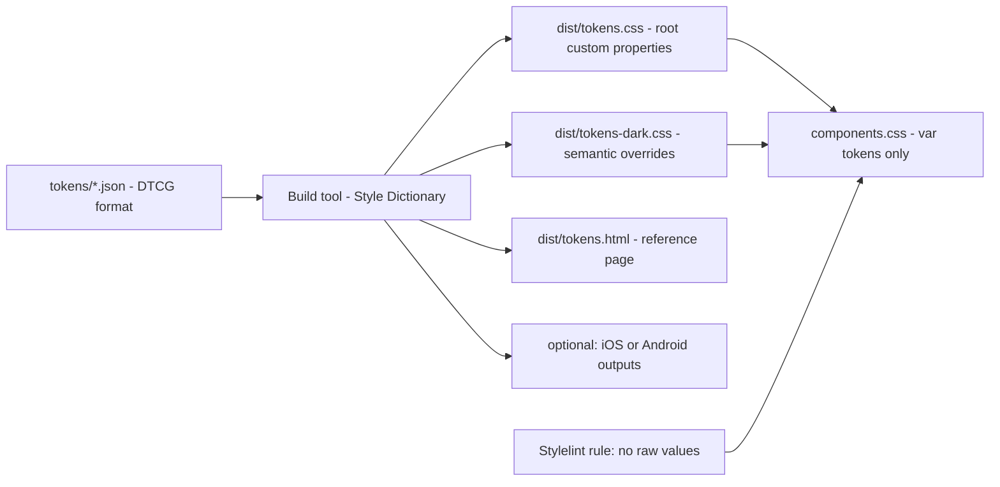
- **tokens/*.json**: one file per category. Aliases like `"{color.blue.600}"` link semantic tokens to primitives.
- **Build tool**: resolves aliases, applies transforms (for example px to rem, names to kebab-case) and writes each output format.
- **tokens.css**: `--color-text-default: var(--color-gray-900)`. Keeping semantic tokens as `var()` references, rather than resolved values, lets a theme file override a primitive and see the effect everywhere.
- **Lint rule**: Stylelint's `declaration-property-value-disallowed-list` or a plugin can reject hex colours in component files.

### Data model
| Tier | Example name | Example value | Who changes it |
|---|---|---|---|
| Primitive | `color.blue.600` | `oklch(52% 0.18 255)` | Brand designers, rarely |
| Primitive | `space.4` | `1rem` | Rarely |
| Semantic | `color.action.primary` | `{color.blue.600}` | Theme authors |
| Semantic | `color.text.muted` | `{color.gray.600}` | Theme authors |
| Component | `button.radius` | `{radius.md}` | Component owners |
| Component | `button.padding-inline` | `{space.4}` | Component owners |

### Tech stack
| Component | Choice | Why |
|---|---|---|
| Format | DTCG JSON | Neutral, tool-friendly |
| Build | Style Dictionary (current version), run with Node 24 | Widely used, multi-platform |
| Output | CSS custom properties | Runtime theming without rebuilds |
| Docs | Generated HTML page | Always in sync |

### Milestones
1. **Primitives.** Define colour scales, a spacing scale, a type scale, radii, shadows, durations. *Done when* the build emits valid CSS.
2. **Semantic layer.** *Done when* components can be written with semantic tokens alone, and each semantic token is an alias.
3. **Components.** *Done when* five components render using only tokens, and the lint rule passes.
4. **Dark theme.** *Done when* overriding only semantic tokens produces a working dark theme.
5. **Docs page.** *Done when* `tokens.html` lists every token with its resolved value and a preview, generated by the build.

### Deep dive: the hard parts
- **Naming.** Names should describe purpose, not appearance: `color.text.danger`, not `color.red-text`. A common scheme is category, then concept, then property, then variant or state (`color.action.primary.hover`). Names are an API: once components depend on them, renames break things.
- **How many tiers?** Primitives plus semantics are enough for most projects. Component tokens are worth it when several themes or brands need to tweak one component without changing global meaning. Too many tiers create indirection nobody can follow.
- **Resolved values vs references in CSS output.** Emitting `--a: #1a73e8` everywhere is simpler, but a theme then has to override every semantic token. Emitting references (`--color-action-primary: var(--color-blue-600)`) keeps the chain alive at runtime, which is more flexible but harder to debug in DevTools.

### Testing strategy
Build in CI. Snapshot-test the generated CSS (diff on every change). A contrast script that checks each declared text and background pair in both themes. Lint for raw values. Visual check of the reference page.

### Trade-offs, scaling and failure modes
Tokens add a build step and indirection. For a five-page site, plain custom properties (project 10) are enough. Over-tokenising (a token for every margin in every component) makes the system harder to use than raw CSS. Tokens can't express everything. Layout decisions and interaction patterns still need documentation and components.

### Stretch goals
- Generate a TypeScript or JSON export for JavaScript consumers.
- Add a high-contrast theme and a second brand.
- Register colour tokens with `@property` so theme changes can transition.

### Skills practised
- [Ch 6 — CSS Fundamentals](../chapters/06-css-fundamentals/README.md): custom properties, colour functions.
- [Ch 11 — Typography, Colour and Visual Effects](../chapters/11-typography-color-and-visual-effects/README.md): type scale, contrast.
- [Ch 13 — Modern CSS and Architecture](../chapters/13-modern-css-and-architecture/README.md): theming with tokens, `@property`.

### In the interview
**30-second answer:** I built a design-token pipeline: tokens for colour, type, space, radius, shadow and motion live once in DTCG-format JSON, and Style Dictionary builds them into CSS custom properties, a dark-theme file and a generated reference page. The key design was three tiers: primitives (what values exist), semantic tokens (what they're for, always aliases of primitives) and a few component tokens. Five components use only semantic or component tokens, enforced by a Stylelint rule that rejects raw colours, so a dark theme is just overrides of semantic tokens. The full build runs in under 2 seconds, and every semantic text and background pair meets 4.5:1.

**Key terms to know:**
- **Design token** — a named design decision (a colour, a spacing step) stored in a platform-neutral format.
- **Primitive token** — a raw value such as `color.blue.600`.
- **Semantic token** — a role such as `color.action.primary` that points to a primitive.
- **Component token** — a per-component setting like `button.padding-inline`.
- **Alias / reference** — a token whose value is another token, written `"{color.blue.600}"` in DTCG.
- **DTCG format** — the W3C Design Tokens Community Group JSON format with `$value` and `$type`.
- **Style Dictionary** — a build tool that resolves aliases and writes tokens to CSS and other platforms.
- **Transforms** — build steps such as px to rem or naming to kebab-case.
- **Lint rule** — a Stylelint check rejecting raw values in component CSS.
- **Snapshot test** — diffing the generated CSS on every change.

**Q:** What are design tokens?

**A:** Named design decisions (colours, spacing, type, motion) stored in a platform-neutral format and transformed into each platform's code, so design and every codebase share one source of truth.

**Q:** Why separate primitive and semantic tokens?

**A:** Primitives list the available values. Semantics say what each is for. Components use semantics, so a theme or rebrand changes the mapping without touching components.

**Q:** How do you stop people bypassing the tokens?

**A:** A lint rule that rejects raw values in component styles (Stylelint rules like `color-no-hex` or `declaration-property-value-disallowed-list`), plus docs and code review. The generated reference page makes the right token easy to find.

**Q:** Should the CSS output keep references or resolved values?

**A:** References (`--color-action-primary: var(--color-blue-600)`) keep the chain alive at runtime, so a theme can override one primitive and everything updates, but they're harder to read in DevTools. Resolved values are simpler and slightly faster to debug, but a theme must override every semantic token. I kept references for semantic tokens.

**Q:** How do you name tokens?

**A:** By purpose, not appearance: `color.text.danger`, not `color.red-text`, because the colour may change and the purpose won't. A predictable order (category, concept, property, variant, state) makes them guessable. Names are an API, so renames need a deprecation period.

**Q:** Why not just use CSS custom properties directly, without JSON and a build?

**A:** For a single website, plain custom properties are enough and simpler. Tokens in JSON pay off when the same decisions must reach several platforms (iOS, Android, design tools) or several themes and brands, and when you want generated docs and checks.

**Q:** Someone renames `color.text.muted`. What breaks?

**A:** Every component that uses `var(--color-text-muted)` silently falls back to the inherited or initial value, because an undefined custom property makes the declaration invalid at computed-value time. Keep the old name as an alias with a deprecation note, and add a CI check that every `var(--…)` used in components exists in the build output.

**Q:** What changes at 10 brands and 3 platforms?

**A:** The token set stays the same shape, but you add brand files that override primitives or semantics, and more output formats. Build time and review load grow, so keep tiers shallow, generate everything, and snapshot-test outputs per brand and platform.

**Q:** How do you test the system?

**A:** Build in CI, snapshot-test the generated CSS, run a contrast script on each declared text and background pair in both themes, lint components for raw values, and visually check the reference page.

**Common mistakes in answers:**
- Calling every CSS variable a "design token". Tokens are shared design decisions with a source of truth, not any variable.
- Letting components use primitives directly. Then a theme can't remap them without editing components.
- Over-tokenising every margin in every component, which makes the system harder to use than plain CSS.

### TL;DR
Write tokens once in JSON with three tiers (primitive, semantic, component), build them into CSS custom properties and a docs page, and lint components so they use semantic tokens only. Themes become semantic overrides.

## 20. Magazine layout with subgrid

**Level:** Intermediate · **Time:** 1–2 weeks · **Prerequisites:** Ch 9, Ch 10, Ch 11

### What it is
An editorial home page in the style of a print magazine: a 12-column grid, a large lead story, a row of story cards whose **titles, images, excerpts and bylines line up across cards**, a pull-quote that breaks out of the column, and a feature article page where figures and asides align to the same underlying grid. **Subgrid** makes the alignment possible.

### The problem it solves
Editorial design depends on alignment across components: the headline of card 1 lines up with the headline of card 3 even when card 2's title wraps to three lines. Before subgrid, each card had its own internal layout, so rows could only be aligned by fixing heights (which breaks with real content) or JS measurement. `grid-template-rows: subgrid` lets each card reuse the parent grid's row tracks, so tracks size to the tallest content in that row across all cards. Subgrid has been Baseline since September 2023 and widely available since March 2026.

### Real-world examples
- MDN's [Subgrid guide](https://developer.mozilla.org/en-US/docs/Web/CSS/CSS_grid_layout/Subgrid) shows cards whose internal rows align using a subgrid.
- web.dev's [CSS subgrid](https://web.dev/articles/css-subgrid) explains inheriting tracks, line names and gaps from the parent grid.

### Requirements
**Functional**
- Page grid: 12 columns with `minmax(0, 1fr)` tracks, a max content width, and full-bleed areas using named lines (`[full-start] … [content-start] … [content-end] … [full-end]`).
- Lead story spans 8 columns with a 4-column sidebar of "most read".
- Card row: 3 or 4 cards. Each card spans 4 rows of the parent grid (`grid-row: span 4; grid-template-rows: subgrid`) so image, kicker, title and byline align.
- Feature page: body text in the content columns, figures that break out to wider columns, a pull-quote that sits in the margin on wide screens.
- Typographic polish: drop-in kicker labels, balanced headlines, hanging punctuation where supported.

**Non-functional**
- Works from **320 px** (single column, subgrid alignment irrelevant) to **1600 px**.
- Titles of different lengths stay aligned across a row with no fixed heights.
- Reading order in the DOM follows the editorial priority.

### The architecture
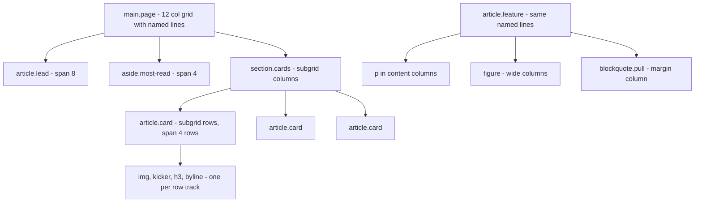
- **Named lines**: `grid-column: content` or `grid-column: full` places elements by name, and figures can break out without nested wrappers.
- **section.cards**: spans all content columns and uses `grid-template-columns: subgrid` so cards align to the page's 12 columns. Each card spans 3 or 4 of them.
- **article.card with subgrid rows**: the card itself is a grid of 4 rows that are the parent's rows. Each child sits in its own row, so the title row is as tall as the tallest title in the row of cards.

### Data model
| Content type | Fields | Grid placement |
|---|---|---|
| Lead story | kicker, headline, standfirst, image, byline | `content-start / span 8` |
| Card story | image, kicker, headline, byline | 4 subgrid rows |
| Most-read item | rank, headline | sidebar list |
| Feature figure | image, caption, size (normal, wide, full) | `content`, `wide` or `full` lines |
| Pull-quote | quote, attribution | margin column on wide screens |

### Tech stack
- **CSS Grid with named lines and subgrid.**
- **`text-wrap: balance`** for headlines.
- **`hanging-punctuation`** (Safari only, an enhancement).
- **Container queries** (stretch) for cards in different contexts.

### Milestones
1. **Page grid with named lines.** *Done when* text sits in the content columns and a full-bleed figure reaches the viewport edges with no extra wrapper.
2. **Lead and sidebar.** *Done when* the 8 + 4 layout collapses to one column below about 800 px.
3. **Subgrid cards.** *Done when* titles of 1, 2 and 3 lines in the same row leave images, titles and bylines aligned across cards.
4. **Feature page.** *Done when* figures can be normal, wide or full width by class, and the pull-quote floats into the margin on wide screens.
5. **Typography.** *Done when* headlines are balanced and the page reads well at every width.

### Deep dive: the hard parts
- **Subgrid row spans.** A card must span exactly as many parent rows as it has children (`grid-row: span 4`). If the parent uses implicit rows, each set of cards creates four new row tracks. Gaps are inherited from the parent unless you override `row-gap` on the subgrid.
- **Named lines and breakouts.** A common pattern defines `grid-template-columns: [full-start] minmax(1rem, 1fr) [content-start] minmax(0, 60rem) [content-end] minmax(1rem, 1fr) [full-end]`. Every direct child defaults to `content`, and a `.full` class switches to `full`. Combining this with a 12-column internal grid takes careful naming. Draw it on paper first.
- **Pull-quotes and reading order.** A pull-quote repeats text from the article. For screen readers that's a duplicate, so mark it `aria-hidden="true"` if it's a pure visual repetition, or keep it as a real `<blockquote>` if it adds content. Decide and document.

### Testing strategy
Grid inspector with line names shown. Stress-test titles from 2 to 20 words. Widths 320–1600 px. Firefox's grid inspector is particularly good with subgrid. Screen reader pass for order and duplicates.

### Trade-offs, scaling and failure modes
Strict magazine alignment works with curated content. User-generated content with wildly varying image ratios needs `aspect-ratio` on images to keep rows sane. Subgrid alignment only applies within one row of cards. Deep nesting of subgrids gets hard to reason about. Very wide 12-column grids on phones are pointless, so switch to a simpler grid.

### Stretch goals
- Multi-column text (`columns`) for a feature's sidebar box.
- `initial-letter` drop cap behind `@supports`.
- Scroll-driven parallax on the lead image in `@supports` and reduced-motion guards.

### Skills practised
- [Ch 9 — CSS Grid](../chapters/09-grid/README.md): named lines, spans, subgrid.
- [Ch 10 — Responsive Design](../chapters/10-responsive-design/README.md): collapsing layouts.
- [Ch 11 — Typography, Colour and Visual Effects](../chapters/11-typography-color-and-visual-effects/README.md): headline typography.
- [Ch 3 — Semantic HTML and Accessibility](../chapters/03-semantic-html-and-accessibility/README.md): reading order, duplicates.

### In the interview
**30-second answer:** I built a magazine-style home page and feature article on a 12-column grid with named lines, so figures can break out to `wide` or `full` width without extra wrappers. The key feature is subgrid: each story card spans four parent rows and uses `grid-template-rows: subgrid`, so images, kickers, titles and bylines line up across every card in a row, whatever the title length. That replaced fixed heights, which break with real content. Headlines are balanced with `text-wrap: balance`, and the layout collapses to one column below about 800 px while keeping a sensible reading order.

**Key terms to know:**
- **Subgrid** — a nested grid that uses its parent's tracks instead of defining its own.
- **Named grid lines** — `[full-start]`, `[content-start]` and so on, so items can be placed with `grid-column: content`.
- **Full-bleed / breakout layout** — content in a centred column, with chosen elements spanning to the viewport edges.
- **`grid-row: span 4`** — the card occupies four parent rows, one per child.
- **`minmax(0, 1fr)`** — truly equal columns that ignore content's minimum width.
- **Implicit rows** — rows the grid creates automatically as more items are placed.
- **Gap inheritance** — a subgrid inherits the parent's gaps unless it overrides them.
- **`text-wrap: balance`** — evens line lengths for headlines.
- **`aria-hidden` on pull-quotes** — hides a purely visual repeat of article text from screen readers.

**Q:** What problem does subgrid solve?

**A:** It lets a nested grid reuse its parent's tracks, so content inside separate components (like card titles) aligns across components without fixed heights.

**Q:** What is a full-bleed layout with named lines?

**A:** A grid whose outer tracks are named (for example `full`) and inner ones `content`, so most content sits in `content` while chosen elements span `full` to the viewport edges.

**Q:** Why `minmax(0, 1fr)` rather than `1fr` for columns?

**A:** `1fr` has a minimum of the content's min-content size, so long words or images can make columns unequal or overflow. `minmax(0, 1fr)` makes them truly equal.

**Q:** How exactly do the card rows align?

**A:** The card row is a grid, and each card spans four of its rows and declares `grid-template-rows: subgrid`. The card's four children (image, kicker, title, byline) each sit in one of those shared rows, so the title row's height is set by the tallest title among all cards in that row.
```css
.card { display: grid; grid-row: span 4;
        grid-template-rows: subgrid; }
```

**Q:** What goes wrong if a card has five children but spans four rows?

**A:** The extra child creates an implicit row inside the card that isn't shared with the other cards, so that part no longer aligns, and the layout below may shift. The span must equal the number of children, or the children must be grouped.

**Q:** Why not use flexbox and `min-height` on titles?

**A:** A fixed minimum height guesses the tallest title and breaks with real headlines in other languages or at other widths. JavaScript measuring is fragile and causes layout shift. Subgrid lets the browser size the shared track to the real content.

**Q:** Should the pull-quote be read by screen readers?

**A:** If it repeats a sentence from the article purely for visual emphasis, it's a duplicate, so `aria-hidden="true"` avoids reading it twice. If it adds new content, keep it as a real `<blockquote>`. Decide and document it.

**Q:** User-uploaded images with random aspect ratios break the rows. How do you fix it?

**A:** Set `aspect-ratio` and `object-fit: cover` on card images so the image row has a predictable height. Subgrid aligns content, but wildly varied images still make the shared row as tall as the tallest one.

**Q:** How do you debug the layout?

**A:** Use the Firefox or Chrome grid inspector with line names and subgrid overlays turned on, stress-test titles from 2 to 20 words, sweep widths from 320 to 1600 px, and use a screen reader to check order and duplicates.

**Common mistakes in answers:**
- Saying subgrid is "a grid inside a grid". A plain nested grid has its own tracks, and subgrid is specifically about sharing the parent's.
- Forgetting that subgrid alignment only works within one parent row of cards.
- Using a 12-column grid on phones. Below a breakpoint, a single column is simpler and clearer.

### TL;DR
A 12-column grid with named lines handles breakouts, and subgrid makes cards share the parent's row tracks so titles and bylines align across a row. Editorial layout on the web finally works with real content.

## 21. Multi-step checkout form

**Level:** Intermediate · **Time:** 1–2 weeks · **Prerequisites:** Ch 3, Ch 5, Ch 13

### What it is
The checkout of a fictional shop as a sequence of server-rendered pages: contact details, shipping address, delivery method, payment, and a review page. Each step is one HTML form that posts to the server. The focus is getting the **HTML attributes** exactly right so browsers autofill, show the right keyboards and validate, plus CSS that shows progress and state with `:has()` and `:user-invalid`.

### The problem it solves
Checkout is where shops lose money. Every unnecessary field, every keyboard that shows letters for a postcode, every autofill that fails, causes people to give up. Most of these failures are HTML mistakes: missing `autocomplete` tokens, wrong `type`, no `inputmode`, labels that aren't connected. A correct form lets the browser fill name, address and card details in one tap.

### Real-world examples
- web.dev's [Payment and address form best practices](https://web.dev/articles/payment-and-address-form-best-practices) covers `autocomplete` values, single name fields, address fields and input types.
- MDN's [`autocomplete` attribute reference](https://developer.mozilla.org/en-US/docs/Web/HTML/Reference/Attributes/autocomplete) lists every token (`given-name`, `postal-code`, `cc-number`, `shipping street-address` and so on).
- MDN's [`:user-invalid`](https://developer.mozilla.org/en-US/docs/Web/CSS/:user-invalid) explains styling invalid fields only after the user has interacted.

### Requirements
**Functional**
- Steps: Contact, Shipping, Delivery, Payment, Review. Each a separate page with one `<form method="post">`.
- A progress indicator as an ordered list, with the current step marked `aria-current="step"`, completed steps linked, future steps not.
- Correct `autocomplete` on every field, including `shipping`/`billing` section prefixes.
- Delivery options as a radio group in a `<fieldset>`, each label showing price and date. The selected card is highlighted via `:has(:checked)`.
- "Billing same as shipping" checkbox that hides the billing fieldset via `:has()` (and the server ignores those fields when checked).
- Review page summarises everything with "Change" links back to each step.

**Non-functional**
- Each page works with JavaScript off.
- No more than **one** required field per piece of information (one name field, not first/middle/last unless the business needs it).
- Field widths hint at expected length (postcode narrow, address wide), using `ch` units.
- Error messages are specific ("Enter a postcode, like SW1A 1AA") and associated with the field.

### The architecture
```mermaid
flowchart TD
    S1["1 Contact page"] -- "POST valid" --> S2["2 Shipping page"]
    S2 -- "POST valid" --> S3["3 Delivery page"]
    S3 -- "POST valid" --> S4["4 Payment page"]
    S4 -- "POST valid" --> S5["5 Review page"]
    S5 -- "Place order" --> DONE["Confirmation page"]
    S2 -- "POST invalid" --> S2E["Shipping page with error summary"]
    S5 -- "Change link" --> S2
```
- **One form per page**: each page is short, the browser's back button works, and the server keeps progress in a session.
- **POST invalid**: the server re-renders the same page with an error summary at the top and inline messages, keeping the user's input (project 3's pattern).
- **Review**: the "check your answers" pattern. Users fix mistakes before paying.

### Data model
| Step | Fields | Autocomplete tokens |
|---|---|---|
| Contact | email, phone (optional) | `email`, `tel` |
| Shipping | full name, address lines, city, postcode, country | `shipping name`, `shipping address-line1`, `shipping address-level2`, `shipping postal-code`, `shipping country` |
| Delivery | method (standard, express, pickup) | none |
| Payment | card number, expiry, CVC, name on card | `cc-number`, `cc-exp`, `cc-csc`, `cc-name` |
| Billing | same fields as shipping, or "same" flag | `billing …` prefixes |

### Tech stack
| Need | Choice | Why |
|---|---|---|
| Inputs | `type`, `inputmode`, `autocomplete` | Correct keyboards and autofill |
| Validation | Native constraints + server | Robust, works without JS |
| State styling | `:has(:checked)`, `:user-invalid` | No JS |
| Progress | `ol` with `aria-current="step"` | Semantic and announced |

### Milestones
1. **Contact and shipping pages.** *Done when* browser autofill completes both in one action and the mobile keyboard is correct for each field.
2. **Delivery options.** *Done when* the radio cards are keyboard operable, the selected card is visibly highlighted (not only by colour), and price and date are part of each label.
3. **Payment.** *Done when* card fields autofill from the browser's saved cards (test with a test card in your browser settings), and the number field uses `inputmode="numeric"`, not `type="number"`.
4. **Errors.** *Done when* submitting invalid data shows a linked error summary and inline messages, and nothing typed is lost.
5. **Review.** *Done when* each "Change" link returns to the right step and back to review afterwards.

### Deep dive: the hard parts
- **`type="number"` is wrong for card numbers and postcodes.** It's meant for quantities. It adds spinners, may drop leading zeros and rejects spaces. Use `type="text"` with `inputmode="numeric"` (numeric keyboard) and `autocomplete="cc-number"`, and validate the format on the server.
- **`:has()` to hide billing fields.** `form:has(#same-as-shipping:checked) .billing { display: none }` hides the fieldset, and `display: none` also removes it from the accessibility tree, which is what you want. Its inputs are still *submitted* if they have values, and hidden `required` fields still block submission. Either avoid `required` there and validate on the server, or put the billing step on its own page that's skipped.
- **Names and addresses are global.** A single "Full name" field avoids forcing people into first/last structures that don't match many cultures. Address formats vary by country. Keep fields flexible (two address lines, a free-text region) and don't validate postcodes with one country's pattern.

### Testing strategy
Autofill test in two browsers with saved addresses and cards. Keyboard-only run of the whole flow. Screen reader: progress list, error summary, radio group. JS disabled run. Phone run to check keyboards. Validation edge cases: international addresses, long names, names with apostrophes and accents.

### Trade-offs, scaling and failure modes
Multiple pages add round trips but are easier to complete and to recover from errors. A single long page suits short forms. Client-side niceties (live card formatting, address lookup) need JS. Make sure the form still works without them. Real payments should go through a payment provider's hosted fields so card data never touches your server. This project uses dummy fields for learning only.

### Stretch goals
- An address-lookup enhancement that degrades to manual fields.
- A sticky order summary on wide screens using grid and `position: sticky`.
- Save progress so a returning user resumes at the right step.

### Skills practised
- [Ch 5 — Tables and Forms](../chapters/05-tables-and-forms/README.md): input types, `autocomplete`, validation.
- [Ch 3 — Semantic HTML and Accessibility](../chapters/03-semantic-html-and-accessibility/README.md): fieldsets, error messages, `aria-current`.
- [Ch 13 — Modern CSS and Architecture](../chapters/13-modern-css-and-architecture/README.md): `:has()`.
- [Ch 1 — How the Web Works](../chapters/01-how-the-web-works/README.md): POST, redirects.

### In the interview
**30-second answer:** I built a five-step checkout (contact, shipping, delivery, payment, review) as server-rendered pages, one `<form method="post">` each, that works with JavaScript off. The key work was the HTML attributes: correct `autocomplete` tokens with `shipping` and `billing` prefixes, `inputmode="numeric"` instead of `type="number"` for card numbers and postcodes, and labels on everything, so browser autofill completes each step in one action. Delivery options are radio cards highlighted with `:has(:checked)`, and invalid submissions come back with a linked error summary and nothing typed lost. The hard edge case was hiding billing fields with `:has()`: hidden `required` fields still block submission, so the server validates that step.

**Key terms to know:**
- **`autocomplete` tokens** — values such as `given-name`, `postal-code` and `cc-number` that drive autofill.
- **Section prefixes** — `shipping` and `billing` tell the browser which address a field belongs to.
- **`inputmode`** — chooses the on-screen keyboard (for example `numeric`) without changing validation.
- **`type="number"`** — for quantities only. It adds spinners and rejects spaces.
- **`aria-current="step"`** — marks the current step in the progress list.
- **Error summary** — a list at the top of the page linking to each invalid field.
- **`:user-invalid`** — styles invalid fields only after interaction.
- **`:has(:checked)`** — highlights the selected delivery card.
- **Check your answers** — a review page with "Change" links back to each step.
- **Hosted payment fields** — a payment provider's iframe fields so card data never touches your server.

**Q:** What makes browser autofill work?

**A:** Correct `autocomplete` tokens on each field (with `shipping`/`billing` prefixes where needed), plus sensible `name`, `type` and labels.

**Q:** Why not `type="number"` for a credit card?

**A:** It's for quantities: it adds spinners, can drop leading zeros and rejects spaces. Use text with `inputmode="numeric"`.

**Q:** Why split checkout into steps?

**A:** Shorter pages reduce cognitive load and errors, each step can be validated and recovered independently, and the back button works naturally.

**Q:** Why one "Full name" field instead of first and last name?

**A:** Many people's names don't fit a first/last structure (single names, family name first, multiple surnames). One field with `autocomplete="name"` works for everyone and still autofills. Split only if a downstream system truly needs it.

**Q:** How do you hide the billing fields when "same as shipping" is checked, and what's the trap?

**A:** `form:has(#same:checked) .billing { display: none }` hides them visually and from the accessibility tree. The trap is that a hidden `required` field still takes part in validation, so the browser blocks submission with an error the user can't see. Don't put `required` on those fields, and validate them on the server only when the box is unchecked.

**Q:** How would you mark up the progress indicator?

**A:** An ordered list, because the steps have a sequence. Completed steps are links, the current step has `aria-current="step"`, and future steps are plain text. Screen readers announce "current step" and the count.

**Q:** The server rejects a postcode. What should the user experience?

**A:** The same page comes back with the title prefixed "Error:", an error summary at the top linking to the field, an inline message like "Enter a postcode, like SW1A 1AA" connected with `aria-describedby`, and everything else they typed still filled in. Never clear the form.

**Q:** International customers can't complete the address step. What's wrong?

**A:** Usually validation built for one country: a strict postcode pattern, a required "state" field, or a short maximum length. Keep address fields flexible (two lines, free-text region, optional postcode where countries don't use one) and validate format per country on the server.

**Q:** Would you store card numbers in your own form for a real shop?

**A:** No. Real card data should go through a payment provider's hosted fields or redirect, so it never touches your server and you avoid most PCI compliance scope. This project uses dummy fields only to practise the HTML attributes.

**Q:** How do you test the flow?

**A:** Autofill test in two browsers with saved addresses and cards, a keyboard-only run, a screen-reader pass of the progress list, error summary and radio groups, a JS-disabled run, and a real phone to check keyboards. Add edge cases: long names, apostrophes, accents and international addresses.

**Common mistakes in answers:**
- Using `autocomplete="off"` to "secure" checkout. It mostly frustrates users and many browsers ignore it for addresses and passwords.
- Using `pattern` or `type="number"` to force digits in card fields and blocking spaces users naturally type.
- Treating `:has()`-hidden fields as "gone". They are still submitted if they hold values, and still validated if `required`.

### TL;DR
A checkout is mostly correct HTML: the right `type`, `inputmode` and `autocomplete` on every field, one form per step, server validation with a linked error summary, and `:has()` to style choices without JS.

## 22. Responsive image portfolio

**Level:** Intermediate · **Time:** 1 week · **Prerequisites:** Ch 4, Ch 9, Ch 14

### What it is
A photographer's or illustrator's portfolio: a home page with a full-width hero image, project pages each with 10–20 large images, and an "about" page. The focus is serving each visitor the **right image**: the right size for their screen and pixel density, the right format for their browser, and the right crop for their layout (art direction), without hurting load speed.

### The problem it solves
Images are usually the heaviest part of a page. Serving one 4000 px JPEG to a phone wastes megabytes and seconds. Serving a tiny image to a 4K screen looks blurry. A wide landscape hero cropped into a phone screen may lose its subject. HTML has precise tools for all three problems (`srcset` with `sizes`, `<picture>` with `type`, and `<picture>` with `media`), but they're often misunderstood.

### Real-world examples
- web.dev's [Learn Responsive Design: Responsive images](https://web.dev/learn/design/responsive-images) explains `srcset`, `sizes`, and when to use `<picture>`.
- MDN's [Using responsive images in HTML](https://developer.mozilla.org/en-US/docs/Web/HTML/Guides/Responsive_images) distinguishes resolution switching from art direction.
- Jake Archibald's [AVIF has landed](https://jakearchibald.com/2020/avif-has-landed/) compares AVIF with WebP and JPEG on real images and shows where each format wins. AVIF is Baseline since January 2024 and widely available since July 2026.

### Requirements
**Functional**
- Hero: `<picture>` with an art-directed portrait crop for narrow screens and a landscape crop for wide ones.
- Project pages: images with `srcset` at 5 widths (for example 480, 800, 1200, 1600, 2400) and an accurate `sizes`.
- Format negotiation: AVIF, then WebP, then JPEG, using `<source type>`.
- Captions in `<figcaption>`. Credits and alt text written per image.
- A project index grid with thumbnails (`auto-fill` grid, `aspect-ratio`).

**Non-functional**
- Hero LCP at most **2.5 s** on a mobile profile.
- On a 375 px wide phone at 3× density, the browser never downloads an image wider than about **1200 px** for a full-width slot.
- **CLS 0**: every image has `width`/`height`.
- Images below the fold lazy-load. The hero has `fetchpriority="high"`.

### The architecture
```mermaid
flowchart TD
    SRC["Originals - large TIFF or JPEG"] --> BUILD["Image build script - resize and encode"]
    BUILD --> AV["AVIF at 5 widths"]
    BUILD --> WB["WebP at 5 widths"]
    BUILD --> JP["JPEG at 5 widths"]
    AV --> PIC["picture element"]
    WB --> PIC
    JP --> PIC
    PIC --> BROWSER["Browser picks format by type, then width by sizes and DPR"]
```
- **Image build script**: a small Node 24 script with an image library, or a command-line tool, that turns each original into 15 files. Doing this by hand doesn't scale.
- **picture element**: `<source type="image/avif" srcset="…" sizes="…">`, then a WebP source, then the `` with JPEG `srcset` as the fallback. The browser uses the first `<source>` whose `type` it supports.
- **Browser choice**: from `sizes` it knows the slot width in CSS pixels. Multiplied by the device pixel ratio (DPR) it gets the needed pixel width, and it picks the smallest candidate that's large enough (browsers may also factor in network conditions).

### Data model
| Field | Example | Use |
|---|---|---|
| slug | `harbour-07` | File names |
| alt | "Fishing boats moored at dawn, mist on the water" | Alt text |
| caption, credit | "Porto, 2025" | `figcaption` |
| intrinsic size | 6000 × 4000 | `width`/`height` ratio |
| crops | landscape, portrait | Art direction sources |
| focal point | 60 %, 40 % | `object-position` for thumbnails |

### Tech stack
| Need | Choice | Why |
|---|---|---|
| Resolution switching | `srcset` with `w` descriptors + `sizes` | Browser picks the right width |
| Formats | `<picture>` + `type` | AVIF/WebP with fallback |
| Art direction | `<picture>` + `media` | Different crops per layout |
| Build | Node 24 script | Repeatable, part of the deploy |

### Milestones
1. **Image pipeline.** *Done when* one command produces all widths and formats for every original.
2. **Project page.** *Done when* DevTools shows a phone downloading a small AVIF and a desktop a larger one, for the same ``.
3. **Accurate `sizes`.** *Done when* for each layout breakpoint the selected file is no more than one step larger than needed (check `currentSrc` in the console).
4. **Art-directed hero.** *Done when* a portrait crop shows on phones and landscape on desktop, with the subject visible in both.
5. **Performance.** *Done when* Lighthouse mobile reports LCP under 2.5 s, CLS 0 and no "properly size images" warnings.

### Deep dive: the hard parts
- **Writing `sizes`.** `sizes` describes the image's rendered width *before* CSS loads, so it must mirror your CSS layout. For a grid that's 100 % wide under 600 px, two columns up to 1200 px and three columns with a 1200 px max beyond that: `sizes="(max-width: 600px) 100vw, (max-width: 1200px) 50vw, 400px"`. Account for padding and gaps roughly. Too large wastes bytes, too small looks soft. `sizes="auto"` works for lazy-loaded images in Chromium, but it isn't Baseline yet.
- **Density vs width descriptors.** `1x, 2x` descriptors suit fixed-size images like logos. `w` descriptors plus `sizes` suit fluid images. Don't mix them in one `srcset`.
- **Format trade-offs.** AVIF usually gives the smallest files for photos, but encoding is slow and very fine detail can soften at aggressive settings. Check visually at the quality setting you choose. Keep the JPEG fallback for old browsers and for social-media preview crawlers.

### Testing strategy
DevTools Network panel filtered to images at several device emulations (DPR 1, 2, 3). Console: `document.querySelector('img').currentSrc`. Lighthouse. Visual quality check of each format at 100 % zoom. Throttled 3G-like profile for the hero.

### Trade-offs, scaling and failure modes
Five widths times three formats is 15 files per image, which is fine for a portfolio and heavy for a big catalogue, where an image CDN that resizes on request is better. Art direction doubles editorial work. Too many breakpoints in `sizes` become unmaintainable, so match your real layout's 2–4 breakpoints.

### Stretch goals
- A low-quality blurred placeholder as a CSS background that the real image covers.
- An image CDN version, comparing bytes with your build.
- A lightbox with `<dialog>` (project 24).

### Skills practised
- [Ch 4 — Images, Media and Embeds](../chapters/04-images-media-and-embeds/README.md): `srcset`, `sizes`, `<picture>`, formats.
- [Ch 9 — CSS Grid](../chapters/09-grid/README.md): thumbnail grid.
- [Ch 14 — Performance, SEO, Interview and Cheat Sheets](../chapters/14-performance-seo-interview-and-cheatsheet/README.md): LCP, CLS.

### In the interview
**30-second answer:** I built a portfolio that serves every visitor the right image: the right size for their screen and pixel density, the right format, and the right crop. A Node script turns each original into five widths in AVIF, WebP and JPEG, and the pages use `<picture>` with `type` sources for format negotiation, `srcset` with `w` descriptors plus an accurate `sizes` for resolution switching, and `media` sources for an art-directed portrait hero on phones. The hard part was writing `sizes` to mirror the CSS layout, which I checked with `currentSrc` at each breakpoint. The hero LCP is under 2.5 s on mobile and CLS is 0.

**Key terms to know:**
- **Resolution switching** — the same image at several widths, chosen by the browser via `srcset` and `sizes`.
- **Art direction** — different crops for different layouts, chosen by `<source media>`.
- **Format negotiation** — `<source type="image/avif">` then WebP then JPEG fallback.
- **`w` vs `x` descriptors** — width candidates for fluid images, density candidates for fixed-size images.
- **`sizes`** — the image's display width at different viewport widths, known before CSS loads.
- **Device pixel ratio (DPR)** — physical pixels per CSS pixel. A 3× phone needs three times the pixels.
- **`currentSrc`** — the URL the browser actually chose, readable in the console.
- **AVIF and WebP** — modern formats, usually much smaller than JPEG for photos.
- **`fetchpriority="high"`** — prioritises the LCP hero.
- **Image CDN** — a service that resizes and encodes on request.

**Q:** What's the difference between `srcset` and `<picture>`?

**A:** `srcset` with `sizes` offers the same image at different resolutions and lets the browser choose. `<picture>` lets you force choices: different formats via `type`, or different crops via `media`.

**Q:** What does `sizes` tell the browser?

**A:** How wide the image will be displayed at different viewport widths, before CSS is loaded, so it can pick a candidate early. It's read in order, and the first matching media condition wins.

**Q:** Why keep a JPEG fallback?

**A:** For browsers and tools that don't support AVIF or WebP, including some crawlers that generate link previews.

**Q:** On a 375 px phone at 3×, which file does a full-width image download?

**A:** With `sizes="100vw"` the slot is 375 CSS px, times a DPR of 3 is 1125 physical pixels, so the browser picks the smallest candidate at least 1125 px wide, here the 1200 px file. If `sizes` were missing it would assume `100vw` anyway, but in a three-column grid that assumption would download images three times too large.

**Q:** Why can't the browser just measure the image slot itself?

**A:** The preload scanner starts fetching images while the HTML is still being parsed, before CSS has loaded and layout exists. `sizes` gives it the layout information early, which is why it must match your CSS. `sizes="auto"` for lazy-loaded images is the exception, but it isn't Baseline yet.

**Q:** Why not mix `1x, 2x` and `w` descriptors?

**A:** They answer different questions. `x` descriptors suit a fixed-size image like a 120 px logo. `w` descriptors with `sizes` suit fluid images. A single `srcset` can't mix them, and mixing makes the attribute invalid.

**Q:** What's the order of `<source>` elements and why?

**A:** Most preferred first: AVIF, then WebP, then the `` with JPEG. The browser takes the first source whose `type` it supports (and whose `media` matches), so putting JPEG first would mean nobody gets AVIF. The `` is required, and it carries `alt`, `width`, `height` and loading attributes.

**Q:** The portfolio becomes a 20,000-image shop catalogue. What breaks first?

**A:** Build time and storage: five widths times three formats is 15 files per image, so 300,000 files. Switch to an image CDN that resizes and encodes on request and caches the result, and keep only the originals in storage.

**Q:** How do you verify the right file is downloaded?

**A:** In DevTools, emulate devices at DPR 1, 2 and 3, filter the Network panel to images, and run `document.querySelector('img').currentSrc` in the console. Lighthouse's "properly size images" audit flags oversized downloads.

**Common mistakes in answers:**
- Thinking `sizes` sets the displayed size. CSS sets the size, and `sizes` only helps the browser choose a file.
- Using `<picture>` with `media` for simple resolution switching. That removes the browser's freedom to choose by network or density.
- Lazy-loading the hero image, which delays LCP.

### TL;DR
Generate several widths and formats with a script, use `srcset` plus an accurate `sizes` for resolution switching, `<picture>` with `type` for formats and `media` for art direction, and treat the hero as the LCP image.

## 23. Typography system with variable fonts

**Level:** Intermediate · **Time:** 1 week · **Prerequisites:** Ch 10, Ch 11

### What it is
A reusable typography system for a site: one or two self-hosted **variable fonts** (a single font file that contains a continuous range of weights, widths or other axes), a fluid modular type scale, vertical rhythm, and styles for headings, body, captions, code, quotes and UI labels. You ship a specimen page that demonstrates everything, and you measure the font loading.

### The problem it solves
Typography carries most of a site's personality and most of its readability, and fonts are a performance risk. Loading six static font files (regular, italic, bold, bold italic, light, medium) costs requests and bytes. Text may be invisible while fonts load, or jump when they arrive. Variable fonts can replace many files with one or two, and `font-display`, preloading and fallback metric tuning keep loading smooth.

### Real-world examples
- web.dev's [Introduction to variable fonts on the web](https://web.dev/articles/variable-fonts) explains axes (`wght`, `wdth`, `opsz`, `ital`, `slnt`), `font-variation-settings` and how to declare them in `@font-face`.
- [Utopia](https://utopia.fyi/) generates fluid type scales: a minimum and maximum font size and ratio, interpolated with `clamp()`.

### Requirements
**Functional**
- Self-hosted WOFF2 variable font(s) with `@font-face` declaring the weight range (`font-weight: 100 900`).
- Fluid type scale with at least 7 steps, as custom properties.
- Elements styled: h1–h4, body, small, lead, blockquote, code and pre, lists, tables, form labels.
- Use the `opsz` (optical size) axis if the font has it, via `font-optical-sizing: auto`.
- A specimen page showing every style with sample text in at least two languages.

**Non-functional**
- Total font transfer at most **100 KB** for the main text font (subset if necessary).
- No invisible text: `font-display: swap` (or `optional` for non-critical fonts).
- Layout shift from font swap at most **0.01 CLS**, using fallback metric overrides.
- Body text: at least 1rem, line height 1.5ish, measure 60–75ch.

### The architecture
```mermaid
flowchart TD
    FONTS["fonts folder: text-var.woff2, mono-var.woff2"] --> FF["font-face rules with weight range and font-display"]
    FB["fallback font-face: local Arial with size-adjust and ascent-override"] --> STACK["font-family stack: Text, Text-fallback, system-ui"]
    FF --> STACK
    SCALE["type tokens: step -2 to step 5, clamp"] --> ELEM["element styles"]
    STACK --> ELEM
    PRE["link rel preload for the text font"] --> FF
```
- **font-face with ranges**: one `@font-face` covers all weights. `font-weight: 650` then works without a separate file.
- **fallback font-face**: a second `@font-face` named, say, "Text-fallback", with `src: local("Arial")` and `size-adjust`, `ascent-override`, `descent-override` tuned so the fallback takes the same space as the web font. When the swap happens, little moves.
- **preload**: `<link rel="preload" as="font" type="font/woff2" crossorigin>` starts the font download before the CSS is parsed. Use it only for the one or two most important files.

### Data model
| Token | Use | Weight | Line height |
|---|---|---|---|
| `--step-5` | h1 | 700 | 1.1 |
| `--step-4` | h2 | 650 | 1.15 |
| `--step-3` | h3 | 600 | 1.2 |
| `--step-1` | lead | 400 | 1.45 |
| `--step-0` | body | 400 | 1.55 |
| `--step--1` | caption, small | 400 | 1.4 |
| `--step--2` | legal | 400 | 1.4 |

### Tech stack
| Need | Choice | Why |
|---|---|---|
| Font format | WOFF2 variable | Best compression, one file for many weights |
| Loading | `font-display: swap` + preload | Text visible immediately |
| Shift control | `size-adjust` and metric overrides | Fallback matches web font size |
| Scale | `clamp()` tokens | Fluid between breakpoints |

### Milestones
1. **Fonts in place.** *Done when* weights 300–800 all render from one file, and DevTools shows only one or two font requests.
2. **Type scale.** *Done when* the specimen page shows all steps scaling smoothly from 320 to 1440 px.
3. **Element styles.** *Done when* a long article (reuse project 5) looks consistent with no ad-hoc sizes.
4. **Loading performance.** *Done when* on a throttled connection text is visible immediately and the swap causes CLS under 0.01.
5. **Subsetting.** *Done when* the font is subset to the characters you need (Latin plus punctuation, say) and is under 100 KB.

### Deep dive: the hard parts
- **`font-display` values.** `swap` shows fallback text immediately and swaps when the font arrives, which risks shift. `optional` uses the font only if it arrives very quickly (otherwise the fallback for this page view), so there's no shift, but sometimes no web font either. `block` hides text for up to about 3 seconds, so avoid it for body text.
- **Metric overrides.** Different fonts at the same `font-size` have different x-heights and widths, so swapping reflows text. `size-adjust` scales the fallback's glyphs, and `ascent-override`/`descent-override` fix line box heights. Tools can calculate these from the font files. Safari doesn't support the ascent and descent overrides yet, so measure the shift in each browser.
- **Subsetting and `unicode-range`.** If you need Latin and Cyrillic, split the font into two subsets and declare each with `unicode-range`. The browser downloads only the subsets whose characters appear on the page.

### Testing strategy
DevTools Network: font requests, sizes, timing. Performance panel with throttling: watch text visibility and swap. Lighthouse CLS. Specimen page in three browsers (variable font rendering differs). Text-zoom and 200 % zoom checks.

### Trade-offs, scaling and failure modes
A variable font file is bigger than one static weight. If you only use regular and bold, two static files may be smaller. Self-hosting gives control and privacy, and avoids a third-party connection. Preloading too many fonts competes with the LCP image. Fluid type at extremes can make headings too large on desktop or too small on watches, so the clamp limits matter.

### Stretch goals
- Use the `wdth` axis to condense headings on narrow screens.
- Animate weight on hover for a heading (with reduced-motion guard).
- `font-size-adjust` (Baseline since July 2024) to keep x-height consistent across fallbacks.

### Skills practised
- [Ch 11 — Typography, Colour and Visual Effects](../chapters/11-typography-color-and-visual-effects/README.md): `@font-face`, `font-display`, preload, self-hosting.
- [Ch 10 — Responsive Design](../chapters/10-responsive-design/README.md): fluid type with `clamp()`.
- [Ch 14 — Performance, SEO, Interview and Cheat Sheets](../chapters/14-performance-seo-interview-and-cheatsheet/README.md): CLS, render-blocking resources.

### In the interview
**30-second answer:** I built a reusable typography system on one self-hosted, subset WOFF2 variable font that covers weights 300–800 in a single file under 100 KB, plus a seven-step fluid type scale with `clamp()`. Loading was the hard part: I preload the main font, use `font-display: swap` so text is visible immediately, and define a metric-matched fallback `@font-face` with `size-adjust` and ascent/descent overrides so the swap barely moves anything. That kept font-swap CLS under 0.01 on a throttled connection. A specimen page shows every style in two languages.

**Key terms to know:**
- **Variable font** — one file with continuous axes such as weight (`wght`), width (`wdth`) and optical size (`opsz`).
- **`@font-face` weight range** — `font-weight: 100 900` declares that one file covers every weight in the range.
- **WOFF2** — the best-compressed web font format.
- **`font-display`** — what to show while the font loads: `swap`, `optional`, `block`, `fallback`.
- **FOIT and FOUT** — flash of invisible text (text hidden) and flash of unstyled text (fallback first, then swap).
- **`<link rel="preload" as="font" crossorigin>`** — starts the font download early.
- **Metric overrides** — `size-adjust`, `ascent-override`, `descent-override` make the fallback take the same space.
- **Subsetting and `unicode-range`** — ship only needed characters, and download per-script files only when used.
- **Modular type scale** — sizes related by a ratio, made fluid with `clamp()`.
- **`font-optical-sizing: auto`** — uses the `opsz` axis to adjust glyph design for size.

**Q:** What's a variable font and why use one?

**A:** One font file containing continuous design axes like weight and width. It can replace several static files and lets you use any value in the range.

**Q:** Compare `font-display: swap` and `optional`.

**A:** `swap` always shows fallback text first and swaps later, which risks layout shift. `optional` only uses the web font if it's available almost immediately, so there's no shift but the web font might not be used on that page view.

**Q:** How do you reduce shift when a web font loads?

**A:** Match the fallback font's metrics with `size-adjust` and ascent/descent overrides, preload the main font, and subset it so it arrives sooner.

**Q:** Why does a font preload need `crossorigin`?

**A:** Fonts are always fetched in CORS mode, even from your own origin. A preload without `crossorigin` is made in a different mode, so the browser can't reuse it and downloads the font twice. Always include `type="font/woff2"` and `crossorigin`.

**Q:** When is a variable font the wrong choice?

**A:** When you only need one or two weights. A variable file is larger than a single static weight, so regular and bold as two static files may be smaller in total. Measure before switching.

**Q:** What does `unicode-range` do?

**A:** It tells the browser which characters a `@font-face` file covers. If a page has no Cyrillic characters, the Cyrillic subset is never downloaded. It's how large multilingual fonts stay cheap for each page.

**Q:** Why not preload every font?

**A:** Preloads compete for bandwidth with the LCP image and critical CSS. Preloading italic and mono files that only appear further down delays what matters. Preload one or two critical files at most.

**Q:** What happens if the font file fails to load?

**A:** With `swap` or `optional`, users keep the fallback stack, so text stays readable. That's why the fallback is metric-matched and the stack ends in `system-ui` or a generic family. With `block`, text could be invisible for up to about three seconds first, so avoid it for body text.

**Q:** How do you measure the loading behaviour?

**A:** DevTools Network for font requests, sizes and timing, and the Performance panel with throttling to watch when text appears and swaps. Lighthouse reports CLS. Check variable font rendering in three browsers, and test text zoom and 200 % zoom.

**Common mistakes in answers:**
- Saying `font-display: swap` removes layout shift. It removes invisible text but can cause shift, which metric overrides address.
- Loading fonts from a third-party CSS URL "for caching". Browsers partition caches by site, so shared-CDN caching no longer helps, and the extra connection delays text.
- Setting `font-variation-settings: "wght" 700` instead of `font-weight: 700`. The low-level property overrides cascade-friendly ones and is harder to maintain.

### TL;DR
Self-host one or two subset WOFF2 variable fonts, declare weight ranges, preload the main one, use `font-display: swap` with a metric-matched fallback, and drive sizes from a fluid `clamp()` scale.

## 24. Dialogs and drawers without JavaScript

**Level:** Intermediate · **Time:** 1 week · **Prerequisites:** Ch 3, Ch 7, Ch 12

### What it is
A set of overlay components built with no JavaScript at all: a **modal confirmation dialog**, a **side drawer** for navigation or filters, and a **toast-like notice**. They use the `<dialog>` element, the **Invoker Commands API** (`command` and `commandfor` attributes on buttons, Baseline since December 2025) and the **Popover API** (`popover` and `popovertarget`, Baseline since January 2025), animated with `@starting-style`.

### The problem it solves
Modals are among the most commonly broken UI components: focus escapes into the page behind, Escape doesn't close them, the background stays scrollable and clickable, and screen readers can still wander into the page. `<dialog>` opened with `showModal()` solves these: it renders in the **top layer** (above everything, no `z-index` fights), makes the rest of the page **inert** (not focusable or clickable), and closes on Escape. Until recently you needed JS to call `showModal()`. Invoker commands now let a button do it declaratively.

### Real-world examples
- MDN's [Invoker Commands API](https://developer.mozilla.org/en-US/docs/Web/API/Invoker_Commands_API) documents `command` values like `show-modal`, `close` and `toggle-popover`.
- Chrome's [Introducing command and commandfor](https://developer.chrome.com/blog/command-and-commandfor) explains the motivation: common button-to-element actions without event listeners.
- MDN's [`<dialog>` reference](https://developer.mozilla.org/en-US/docs/Web/HTML/Reference/Elements/dialog) covers modal vs non-modal dialogs, `method="dialog"` forms and the `::backdrop` pseudo-element.

### Requirements
**Functional**
- Confirm dialog: `<button commandfor="confirm" command="show-modal">Delete</button>` opens `<dialog id="confirm">` with a heading, explanation and two buttons. "Cancel" uses `command="close"`. "Delete" submits a real form to the server.
- Drawer: a `<dialog>` styled as a side sheet that slides in from the inline-end edge, with `::backdrop` dimming the page.
- Notice: a `popover="manual"` element shown by a button, which stays until dismissed.
- Light-dismiss menu: `popover="auto"` element that closes on outside click or Escape.
- Entry and exit animations with `@starting-style` and `transition-behavior: allow-discrete`.

**Non-functional**
- Zero `<script>` elements on the page.
- When a modal opens, focus moves into it. When it closes, focus returns to the button that opened it.
- Animations **at most 250 ms**, disabled under reduced motion.
- Fallback: in browsers without invoker commands, the buttons should do something sensible, such as linking to a page version of the dialog.

### The architecture
```mermaid
flowchart LR
    B1["button command show-modal"] --> DLG["dialog id confirm - top layer, page inert"]
    DLG --> CANCEL["button command close"]
    DLG --> FORM["form method post - Delete"]
    B2["button command show-modal"] --> DRAWER["dialog.drawer - slides from inline end"]
    B3["button popovertarget notice"] --> POP["div popover manual"]
    B4["button popovertarget menu"] --> MENU["div popover auto - light dismiss"]
```
- **dialog with show-modal**: the browser puts it in the top layer, makes everything else inert, and traps focus in practice because nothing else is focusable.
- **command close**: closes the dialog and returns focus to the invoker.
- **popover auto**: the browser handles "light dismiss" (outside click and Escape close it) and only one auto popover is open at a time (except nested ones).
- **popover manual**: stays open until explicitly closed. Good for notices.

### Data model
| Component | Element | Modal? | Dismissed by |
|---|---|---|---|
| Confirm | `dialog` + `show-modal` | Yes | Escape, Cancel, submit |
| Drawer | `dialog` + `show-modal` | Yes | Escape, close button |
| Menu | `popover="auto"` | No | Outside click, Escape, other popover |
| Notice | `popover="manual"` | No | Its close button |

### Tech stack
| Need | Choice | Why |
|---|---|---|
| Modal | `<dialog>` + invoker commands | Top layer, inert background, Escape |
| Non-modal overlay | Popover API | Light dismiss, top layer |
| Animation | `@starting-style`, `allow-discrete` on `display` and `overlay` | Animate in and out of `display: none` |
| Backdrop | `::backdrop` | Dim the page |

### Milestones
1. **Confirm dialog.** *Done when* it opens with no JS, Tab cycles within it, Escape closes it, and focus returns to the trigger.
2. **Drawer.** *Done when* it slides in from the right in LTR and from the left in RTL (use logical properties), with a dimmed backdrop.
3. **Popovers.** *Done when* the menu closes on outside click and the notice stays until dismissed.
4. **Animation.** *Done when* dialogs fade and slide both in and out where supported, and appear instantly elsewhere.
5. **Fallback and audit.** *Done when* screen readers announce the dialog role and name (via `aria-labelledby` pointing to the heading), and older browsers get a usable fallback.

### Deep dive: the hard parts
- **Animating to and from `display: none`.** A closed dialog is `display: none`, which normally can't transition. `transition-behavior: allow-discrete` lets `display` and `overlay` flip at the right moment (at the end of an exit, at the start of an entry), and `@starting-style` gives the entry its "from" values. `transition-behavior` is Baseline (since August 2024), but the `overlay` property, which keeps a closing dialog or popover in the top layer until its exit transition ends, is Chromium-only. In other browsers the element leaves the top layer at once, so the exit animation may be cut short or not seen. Treat exit motion as a bonus.
- **Modal vs popover.** A modal dialog makes the rest of the page inert, which is right when the user must respond. A popover doesn't, which is right for menus and tooltips. Using a popover where a modal is needed lets users wander off mid-task. Using a modal for a menu is heavy-handed.
- **Light dismiss for modal dialogs.** `<dialog closedby="any">` closes a modal on backdrop click, but it isn't Baseline (no Safari yet). Without it, provide a visible close button. That is required anyway.

### Testing strategy
Keyboard: open, Tab, Shift+Tab, Escape, check focus return. Screen reader: role, name and modal state announced. Test in Chrome, Firefox and Safari for animation differences. Reduced-motion emulation. Test with a browser version that lacks invoker commands to confirm the fallback.

### Trade-offs, scaling and failure modes
Declarative commands cover show, close and toggle. Anything conditional (validate first, then close) still needs JS. Very new attributes have no effect in older browsers, so the fallback matters more than usual. Stacking several modals is rarely good UX. Toasts that disappear on a timer need JS and must not hide important information (WCAG 2.2.1, Timing Adjustable).

### Stretch goals
- A lightbox gallery with a `<dialog>` per image (combine with project 22).
- Position the menu popover next to its button with anchor positioning (project 32).
- Prevent background scroll while a modal is open with `body:has(dialog[open]) { overflow: hidden }`.

### Skills practised
- [Ch 3 — Semantic HTML and Accessibility](../chapters/03-semantic-html-and-accessibility/README.md): `<dialog>`, focus management, inert.
- [Ch 7 — Box Model and Layout Basics](../chapters/07-box-model-and-layout-basics/README.md): stacking contexts and the top layer.
- [Ch 12 — Transitions, Transforms and Animation](../chapters/12-transitions-transforms-and-animation/README.md): `@starting-style`, `allow-discrete`.
- [Ch 13 — Modern CSS and Architecture](../chapters/13-modern-css-and-architecture/README.md): logical properties, `:has()`.

### In the interview
**30-second answer:** I built a modal confirmation dialog, a side drawer, a dismissible notice and a light-dismiss menu with zero `<script>` elements. Buttons open the dialogs declaratively with invoker commands (`commandfor` plus `command="show-modal"`), so the browser puts them in the top layer, makes the rest of the page inert, closes on Escape and returns focus to the trigger. Non-modal overlays use the Popover API (`auto` for light dismiss, `manual` for the notice). The hard part was animating in and out of `display: none`, which I did with `@starting-style` and `transition-behavior: allow-discrete`, treating the exit animation as a bonus because the `overlay` property is Chromium-only.

**Key terms to know:**
- **`<dialog>` and `showModal()`** — the native modal. Opening it modally makes the page behind inert.
- **Top layer** — a layer above all content, so no `z-index` or `overflow` clipping issues.
- **`inert`** — content that can't be focused, clicked or found by assistive technology.
- **Invoker Commands API** — `command` and `commandfor` attributes letting a button act on another element.
- **Popover API** — the `popover` attribute and `popovertarget` for non-modal overlays.
- **Light dismiss** — closing on outside click or Escape, built into `popover="auto"`.
- **`::backdrop`** — the pseudo-element behind a modal dialog or popover.
- **`@starting-style`** — starting values for entry transitions.
- **`transition-behavior: allow-discrete`** — lets `display` and `overlay` change at the right moment of a transition.
- **`method="dialog"`** — a form inside a dialog that closes it on submit and sets `returnValue`.

**Q:** What does `showModal()` give you that a positioned `<div>` doesn't?

**A:** Top-layer rendering (no `z-index` fights), an inert background so focus and clicks can't escape, Escape to close, a `::backdrop`, and correct dialog semantics.

**Q:** How can a button open a dialog without JavaScript?

**A:** With invoker commands: `commandfor` names the dialog's `id` and `command="show-modal"` says what to do. `command="close"` closes it.
```html
<button commandfor="confirm" command="show-modal">Delete</button>
<dialog id="confirm" aria-labelledby="t">
  <h2 id="t">Delete this file?</h2>
  <button commandfor="confirm" command="close">Cancel</button>
</dialog>
```

**Q:** When would you use a popover instead of a dialog?

**A:** For non-modal overlays like menus, pickers and tooltips that should close on outside click and shouldn't block the rest of the page.

**Q:** What's the difference between `show()` and `showModal()`?

**A:** `show()` opens a non-modal dialog in normal flow: the page behind stays interactive, there's no backdrop, and Escape doesn't close it. `showModal()` uses the top layer, makes everything else inert and adds Escape handling. For a confirmation, you want modal.

**Q:** Why is animating a dialog's exit hard?

**A:** Closing sets `display: none` and removes it from the top layer instantly, so there's nothing left to animate. `transition-behavior: allow-discrete` on `display` and `overlay` delays those flips until the transition ends. `overlay` is Chromium-only, so other browsers may cut the exit short.

**Q:** How do you stop the page scrolling behind an open modal?

**A:** `body:has(dialog[open]) { overflow: hidden }` (or `html:has(dialog:modal)`). The page is already inert, so it can't be clicked or focused, but it would still scroll with the wheel or touch without this.

**Q:** A browser doesn't support invoker commands. What happens?

**A:** The `command` attributes are ignored and the buttons do nothing, which is a broken page. Plan a fallback: make the button a link to a page version of the dialog, or add a tiny script that feature-detects (`'command' in HTMLButtonElement.prototype`) and calls `showModal()`.

**Q:** The design wants clicking the backdrop to close the modal. How?

**A:** `<dialog closedby="any">` provides light dismiss for modals, but it isn't Baseline (no Safari yet). Without it, provide a visible close button, which is required anyway, and accept that backdrop clicks won't close it in some browsers.

**Q:** How do you test the dialogs?

**A:** Keyboard: open, Tab and Shift+Tab stay inside, Escape closes, and focus returns to the trigger. Screen reader: role, name (from `aria-labelledby`) and modal state announced. Test animations in Chrome, Firefox and Safari, emulate reduced motion, and use a browser without invoker commands to check the fallback.

**Common mistakes in answers:**
- Writing a manual focus trap for `showModal()`. The inert background already keeps focus inside.
- Raising `z-index` to 9999 for overlays. The top layer makes `z-index` irrelevant.
- Using a popover for a must-answer confirmation. Popovers don't make the page inert, so users can wander off mid-task.

### TL;DR
`<dialog>` plus `command`/`commandfor` gives you accessible modals with no script. The Popover API covers menus and notices with light dismiss, and `@starting-style` with `allow-discrete` animates them in and out where supported.

## 25. Custom form controls kit

**Level:** Intermediate · **Time:** 1–2 weeks · **Prerequisites:** Ch 5, Ch 6, Ch 11, Ch 13

### What it is
A small kit of styled form controls that keep their native behaviour: checkboxes, radios, a toggle switch, a styled `<select>`, text inputs, a range slider, a file input and a progress/meter display. Every control remains the real HTML element. CSS changes how it looks, never what it is. The kit includes states: hover, focus, checked, indeterminate, disabled, invalid.

### The problem it solves
Designers want controls that match the brand, and the classic answer was to hide the native input and build a fake one from `<div>`s. That breaks keyboard use, screen readers, form submission and browser autofill. Modern CSS lets you restyle the real control: `accent-color` for quick brand colouring, `appearance: none` for full control of checkboxes and radios, and pseudo-elements for range and file inputs. The native element keeps its semantics, focus and form participation.

### Real-world examples
- MDN's [`accent-color`](https://developer.mozilla.org/en-US/docs/Web/CSS/accent-color) reference shows recolouring checkboxes, radios, range and progress with one property.
- Stephanie Eckles' [Pure CSS Custom Checkbox Style](https://moderncss.dev/pure-css-custom-checkbox-style/) on Modern CSS Solutions restyles a real checkbox with `appearance: none` and a grid-placed pseudo-element.
- The GOV.UK Design System's [checkboxes](https://design-system.service.gov.uk/components/checkboxes/) component uses large, high-contrast custom checkboxes built on real inputs and tested with users.

### Requirements
**Functional**
- Checkbox and radio with `appearance: none`, a custom check mark or dot drawn with CSS, and support for `:indeterminate` on checkboxes.
- Toggle switch: a checkbox with `role="switch"` styled as a track and thumb, announced as "on/off".
- Select: styled closed state (border, arrow icon via background), native dropdown. Optionally the customizable select (`appearance: base-select`) as an enhancement where supported.
- Range: custom track and thumb using `::-webkit-slider-thumb` and `::-moz-range-thumb`.
- File input: styled `::file-selector-button`.
- All controls use tokens (project 19) and work in light and dark themes.

**Non-functional**
- Click or tap target at least **24 × 24 px**. Labels are clickable too.
- Focus indicator at least **2 px** thick with **3:1** contrast against adjacent colours (WCAG 1.4.11 non-text contrast).
- Every state distinguishable without colour (check mark, dot position, strike or icon).
- Works in Windows forced-colors mode (controls remain visible).

### The architecture
```mermaid
flowchart LR
    KIT["controls.css"] --> BASE["base: font inherit, sizes, focus ring"]
    KIT --> CB["checkbox and radio: appearance none, grid, pseudo-element mark"]
    KIT --> SW["switch: checkbox role switch, track and thumb"]
    KIT --> SEL["select: border, arrow background, base-select enhancement"]
    KIT --> RNG["range: vendor pseudo-elements for track and thumb"]
    KIT --> FILE["file: file-selector-button"]
    KIT --> FC["forced-colors block: system colours"]
    TOK["tokens.css"] --> KIT
```
- **base**: form controls don't inherit font by default, so `font: inherit` on `input, select, textarea, button` is the first rule.
- **appearance none**: removes the platform's drawing so your borders and pseudo-elements show. The element is still a checkbox for keyboard, screen readers and forms.
- **forced-colors block**: in Windows High Contrast, author colours are replaced by system colours. Custom marks drawn with backgrounds can disappear, so use borders or `CanvasText`/`Highlight` system colours there.

### Data model
| Control | States to style | Selector |
|---|---|---|
| Checkbox | unchecked, checked, indeterminate, disabled, invalid, focus | `:checked`, `:indeterminate`, `:disabled`, `:user-invalid`, `:focus-visible` |
| Radio | unchecked, checked, disabled, focus | `:checked`, `:disabled` |
| Switch | off, on, disabled | `[role=switch]:checked` |
| Text input | empty, filled, invalid, disabled, read-only | `:placeholder-shown`, `:user-invalid`, `:read-only` |
| Range | value | vendor thumb and track pseudo-elements |

### Tech stack
| Need | Choice | Why |
|---|---|---|
| Quick theming | `accent-color` | One line, keeps native look (not yet Baseline, harmless fallback) |
| Full restyle | `appearance: none` (Baseline, widely available) | Real element, custom look |
| Marks | `::before` with `clip-path` or a CSS mask | No images |
| High contrast | `@media (forced-colors: active)` | Controls stay visible |

### Milestones
1. **Baseline form.** A form using every control, unstyled except `font: inherit` and `accent-color`. *Done when* everything works by keyboard and submits.
2. **Checkbox and radio.** *Done when* the custom versions show all states, including indeterminate, and are announced identically to the native ones.
3. **Switch.** *Done when* screen readers announce "switch, on/off" and Space toggles it.
4. **Select, range, file.** *Done when* each matches the design in Chrome, Firefox and Safari.
5. **Forced colors and themes.** *Done when* every control is visible and usable in forced-colors emulation and in dark mode.

### Deep dive: the hard parts
- **Why not hide the input?** The old pattern was `opacity: 0` on the input and styling a sibling span. It works, but the real input and the visible one can get out of sync (focus ring on the wrong thing, a click target that doesn't match). `appearance: none` styles the input itself, so there's nothing to sync.
- **Range inputs are fragmented.** WebKit/Blink and Gecko expose different pseudo-elements (`::-webkit-slider-thumb`, `::-moz-range-thumb`). You must write each rule separately. A selector list combining both is invalid in each browser and the whole rule is dropped.
- **The customizable select.** `appearance: base-select` on `<select>` and its picker unlocks full styling of the dropdown, including rich option content. It is in Chromium and Safari 27 but not yet Firefox, so it isn't Baseline. Write it as an enhancement, and the classic select remains the fallback.

### Testing strategy
Screen reader: each control's role, name and state. Keyboard: Space on checkboxes and switches, arrows in radio groups and on the range. Forced-colors emulation in DevTools. Zoom 200 %. Three browsers. Touch test on a phone for target sizes.

### Trade-offs, scaling and failure modes
Full custom styling costs maintenance in three engines. `accent-color` alone may be enough for many products. Styled selects can't change the native dropdown list in most browsers today. Custom marks drawn with `background` vanish in forced colors unless you plan for it. Over-styled controls can stop looking like controls at all. Keep affordances like boxes, circles and tracks.

### Stretch goals
- A star-rating input built from radios (with a visible label for each value).
- Use `field-sizing: content` on text inputs and textareas as an enhancement.
- A segmented control (radio group styled as joined buttons).

### Skills practised
- [Ch 5 — Tables and Forms](../chapters/05-tables-and-forms/README.md): every input type and state.
- [Ch 6 — CSS Fundamentals](../chapters/06-css-fundamentals/README.md): pseudo-classes, pseudo-elements.
- [Ch 11 — Typography, Colour and Visual Effects](../chapters/11-typography-color-and-visual-effects/README.md): masks, clip-path, contrast.
- [Ch 13 — Modern CSS and Architecture](../chapters/13-modern-css-and-architecture/README.md): tokens, theming.

### In the interview
**30-second answer:** I built a kit of branded form controls (checkbox, radio, switch, select, text input, range, file input, progress and meter) where every control is still the real HTML element. The key decision was restyling the native element with `appearance: none` and pseudo-elements, or `accent-color` for quick wins, instead of hiding it behind fake `<div>`s, so keyboard, screen-reader, autofill and form behaviour stay native. The hard parts were range inputs, which need separate WebKit and Firefox pseudo-element rules, and Windows forced-colors mode, where marks drawn with backgrounds or shadows disappear. Every state is distinguishable without colour, and focus rings are at least 2 px with 3:1 contrast.

**Key terms to know:**
- **`appearance: none`** — removes the platform drawing of a control so you can style it, without changing what it is.
- **`accent-color`** — sets the highlight colour of native checkboxes, radios, range and progress.
- **`role="switch"`** — makes a checkbox announce as a switch, on or off.
- **`:indeterminate`** — matches a checkbox in the mixed state, which can only be set from JS.
- **Vendor pseudo-elements** — `::-webkit-slider-thumb` and `::-moz-range-thumb` for range styling.
- **`::file-selector-button`** — styles the button part of a file input.
- **WCAG 1.4.11 Non-text Contrast** — UI components and focus indicators need 3:1 against adjacent colours.
- **Forced colors mode** — Windows High Contrast, where author colours become system colours.
- **System colour keywords** — `CanvasText`, `Highlight`, `ButtonText` and similar for forced colors.
- **`appearance: base-select`** — the customizable select. Not Baseline, so an enhancement.

**Q:** How do you style a checkbox without breaking accessibility?

**A:** Keep the real `<input type="checkbox">`, use `appearance: none` and draw the box and mark with CSS (borders, pseudo-elements). Keyboard, screen-reader and form behaviour stay native.

**Q:** What's `accent-color`?

**A:** A property that sets the highlight colour of native checkboxes, radios, range and progress controls without restyling them.

**Q:** What breaks in forced-colors mode?

**A:** Author colours are replaced with system colours, `box-shadow` and `text-shadow` are removed, and gradient backgrounds are dropped (url images are kept). Marks drawn with gradients, background colours or shadows can disappear. Use borders, `currentColor` and system colour keywords there.

**Q:** Why not use the older hide-the-input pattern with `opacity: 0` and a styled `<span>`?

**A:** It works, but the real input and the visible fake can get out of sync: the focus ring may appear on the wrong element, the click target may not match, and states need duplicate selectors. Styling the input itself with `appearance: none` leaves nothing to keep in sync.

**Q:** Why must WebKit and Firefox range rules be written separately?

**A:** If any selector in a selector list is invalid, the whole rule is dropped. Firefox doesn't recognise `::-webkit-slider-thumb` and Chromium doesn't recognise `::-moz-range-thumb`, so combining them with a comma means neither browser applies the rule.
```css
input[type=range]::-webkit-slider-thumb { /* thumb */ }
input[type=range]::-moz-range-thumb { /* same thumb */ }
```

**Q:** How do you put a checkbox in the indeterminate state?

**A:** There's no HTML attribute for it. Set `checkbox.indeterminate = true` in JS, then style it with `:indeterminate`. It's typical for a "select all" box when only some children are checked.

**Q:** Why the rule `font: inherit` on form controls?

**A:** Inputs, selects, textareas and buttons don't inherit font family and size by default, so they render in a small system font. `font: inherit` makes them match the page and respect user font-size settings.

**Q:** A user in Windows High Contrast says the checkbox ticks are invisible. How do you fix it?

**A:** The tick is probably drawn with a background colour or `box-shadow`, which forced colors overrides or removes. Draw it with a border or a `clip-path`/mask using `currentColor`, and in `@media (forced-colors: active)` set it to a system colour like `CanvasText`. Use `forced-color-adjust: none` only as a last resort.

**Q:** How do you test the kit?

**A:** Screen reader for each control's role, name and state, keyboard (Space on checkboxes and switches, arrows in radio groups and on range), forced-colors emulation, 200 % zoom, three browsers, and a phone to check target sizes.

**Common mistakes in answers:**
- Building a "checkbox" from a `<div role="checkbox">`. You then owe keyboard handling, state, form submission and labelling.
- Saying a styled `<select>` can fully restyle the dropdown list everywhere. Only the customizable select can, and it isn't Baseline.
- Removing the focus outline on custom controls and relying on a colour change.

### TL;DR
Restyle the real controls (`accent-color` for quick wins, `appearance: none` for full control), cover every state with pseudo-classes, write vendor rules for range separately, and check forced-colors mode so nothing disappears.

## 26. Component library with cascade layers

**Level:** Advanced · **Time:** 3–4 weeks · **Prerequisites:** Ch 6, Ch 13

### What it is
A small CSS component library, about 15 components (button, link, input, select, checkbox, card, badge, alert, tabs-as-disclosures, dialog, table, navigation, breadcrumb, pagination, toast), organised with **cascade layers** (`@layer`) so that resets, tokens, base styles, components, utilities and consumer overrides have a guaranteed priority order, regardless of selector specificity or file order. It ships as a single CSS file plus documentation pages.

### The problem it solves
In large codebases, CSS conflicts are resolved by specificity wars: adding classes, IDs or `!important` until a rule wins. Each fix makes the next one harder. **Cascade layers** (Baseline since March 2022, widely available) add a step to the cascade that's checked *before* specificity: a rule in a later layer beats any rule in an earlier layer, however specific. A library can put itself in a low layer, so consumers can override it with a single class, and third-party CSS can be contained.

### Real-world examples
- MDN's [`@layer` reference](https://developer.mozilla.org/en-US/docs/Web/CSS/@layer) covers declaring layer order, nested layers, anonymous layers and how unlayered styles beat all layers.
- Miriam Suzanne's [A Complete Guide to CSS Cascade Layers](https://css-tricks.com/css-cascade-layers/) on CSS-Tricks explains the design of layers, which she helped specify, and practical layer orders.
- [Open Props](https://open-props.style/) is an open-source library of CSS custom-property tokens designed to be dropped into any project. It's a good model for how a library can expose tokens without imposing component styles.

### Requirements
**Functional**
- Declared layer order at the top: `@layer reset, tokens, base, layout, components, utilities, overrides;`.
- Each component is a separate source file wrapped in `@layer components { … }`, or in a sub-layer like `components.button`.
- Single-class selectors (or `:where()` for zero specificity) inside the library.
- Variants via modifier classes or data attributes (`.button[data-variant="danger"]`), sizes via tokens.
- Third-party CSS (for example a date picker's stylesheet) imported into its own low layer: `@import url(vendor.css) layer(vendor);`.
- Docs: one page per component with live examples, states, do and don't, and accessibility notes.

**Non-functional**
- No `!important` in the library except inside `utilities` (where it's intentional and documented).
- Consumers can override any library style with **one class selector** in an unlayered stylesheet.
- Library CSS under **30 KB** compressed.
- Every component passes axe checks and keyboard tests on its docs page.

### The architecture
```mermaid
flowchart LR
    ENTRY["library.css - declares layer order"] --> RESET["layer reset"]
    ENTRY --> TOKENS["layer tokens - custom properties"]
    ENTRY --> BASE["layer base - element defaults"]
    ENTRY --> LAYOUT["layer layout - stack, cluster, grid"]
    ENTRY --> COMP["layer components - one sub-layer per component"]
    ENTRY --> UTIL["layer utilities - single-purpose helpers"]
    VENDOR["vendor.css imported into layer vendor"] --> ENTRY
    APP["app.css - unlayered"] -->|"always wins over layers"| COMP
```
- **Layer order statement**: the first declaration fixes the order. Later `@layer components { }` blocks add to the existing layer without changing order.
- **Sub-layers**: `components.button` lets you order components relative to each other if needed (rarely).
- **Unlayered app styles**: normal-importance unlayered rules beat all layered rules. That's a feature: consumers who don't use layers still win easily.
- **utilities**: highest library layer so a `.visually-hidden` or `.mt-0` utility beats component styles without specificity tricks.

### Data model
Layer priority table (normal declarations, lowest to highest):

| Priority | Layer | Contents | Typical specificity |
|---|---|---|---|
| 1 | reset | box-sizing, margins | `:where()` or elements |
| 2 | vendor | third-party CSS | anything, contained |
| 3 | tokens | custom properties on `:root` | one pseudo-class |
| 4 | base | element defaults, typography | elements |
| 5 | layout | primitives | one class |
| 6 | components | button, card and so on | one class |
| 7 | utilities | helpers | one class |
| 8 | unlayered | the consuming app | anything |

Note that for `!important` declarations the order reverses: an important rule in the *earliest* layer wins. That lets a reset protect something critical.

### Tech stack
| Need | Choice | Why |
|---|---|---|
| Priority control | `@layer` | Order beats specificity |
| Low-specificity defaults | `:where()` | Zero specificity, trivially overridable |
| Bundling | Lightning CSS or a simple concatenation | One output file, keeps layers |
| Docs | Static HTML pages per component | No framework needed |

### Milestones
1. **Layer skeleton.** *Done when* the order statement exists and a test page proves that a `.button` in `utilities` beats `#id .button` in `components`.
2. **Tokens and base.** *Done when* the base layer gives readable defaults for all text elements and form controls.
3. **Ten components.** *Done when* each has a docs page with every variant and state, using only tokens.
4. **Vendor containment.** *Done when* a third-party stylesheet with high-specificity selectors is imported into `vendor` and cannot override your components.
5. **Consumer override test.** *Done when* an unlayered `.my-button { background: purple }` overrides the library's button with no `!important`.
6. **Remaining components and audit.** *Done when* all 15 pass axe and keyboard checks.

### Deep dive: the hard parts
- **Unlayered beats layered.** People are surprised that a low-specificity unlayered rule beats a high-specificity layered one. If you put your app in a layer too, it must be declared *after* the library's layers. If you forget the order statement, the first time a layer name appears determines its position, which depends on file order and is easy to get wrong.
- **`!important` reverses.** Within layers, important declarations go in reverse order: `reset` beats `utilities` for `!important`. That's deliberate (lower layers can protect essentials) but confusing. Keep `!important` out of all layers except utilities, and document why.
- **Specificity inside a layer still matters.** Layers only decide between layers. Within `components`, the usual specificity and order rules apply. Keep components to one class plus states (`.button:hover`, `.button[aria-pressed="true"]`). Use `:where()` around anything you want to be trivially overridable.

### Testing strategy
A "cascade test" page that asserts which rule wins for 10 tricky cases (inspect computed styles, or write a small headless-browser script that reads `getComputedStyle`). axe on each docs page. Visual regression snapshots (project 39). Keyboard and screen-reader pass per component. Bundle size check in CI.

### Trade-offs, scaling and failure modes
Layers are powerful but invisible: a developer who doesn't know about them can't explain why their ID selector loses. Put a comment at the top of every file, and use the DevTools Styles panel, which shows layer names. Libraries that layer themselves can conflict with consumers' own layer names, so namespace them (`@layer mylib.components`). Old browsers without layer support ignore the whole `@layer` block. That stopped mattering when layers became widely available, but check your support policy.

### Stretch goals
- Use `@scope` (Baseline since March 2026) for a component whose styles must not leak into nested content.
- Ship each component as a separate file consumers can import into the layer of their choice.
- A theming API based on component tokens (`--button-bg`) documented per component.

### Skills practised
- [Ch 6 — CSS Fundamentals](../chapters/06-css-fundamentals/README.md): the cascade, specificity, origins.
- [Ch 13 — Modern CSS and Architecture](../chapters/13-modern-css-and-architecture/README.md): `@layer`, `:where()`, `@scope`, BEM, tokens.
- [Ch 3 — Semantic HTML and Accessibility](../chapters/03-semantic-html-and-accessibility/README.md): accessible components.

### In the interview
**30-second answer:** I built a 15-component CSS library organised with cascade layers: one order statement, `@layer reset, tokens, base, layout, components, utilities, overrides;`, then each component in its own file inside `components`. The key idea is that layer order is checked before specificity, so a utility class beats `#id .button` in the components layer, vendor CSS imported with `layer(vendor)` can't override my components, and an unlayered consumer rule with one class beats the whole library without `!important`. The confusing part, and the thing I tested most, is that `!important` reverses layer order. The library is under 30 KB compressed and every component passes axe and keyboard checks.

**Key terms to know:**
- **The cascade** — the algorithm that picks one value per property: origin and importance, context, inline styles, layers, specificity, then order.
- **Cascade layer (`@layer`)** — a named bucket of rules, ordered by its first declaration.
- **Layer order statement** — `@layer a, b, c;` at the top, fixing priority regardless of file order.
- **Unlayered styles** — normal declarations outside any layer beat all layered ones.
- **`!important` reversal** — important declarations in earlier layers beat important ones in later layers.
- **Specificity** — still decides between rules inside the same layer.
- **`:where()`** — wraps selectors with zero specificity, ideal for resets and defaults.
- **`@import … layer()`** — puts an imported stylesheet into a named layer.
- **Nested layers** — `components.button`, sub-layers within a layer.
- **`revert-layer`** — rolls a property back to the value from the previous layer.

**Q:** Where do cascade layers sit in the cascade?

**A:** After origin and importance (and inline `style` attributes), before specificity. So a rule in a later layer wins over an earlier layer regardless of selector specificity. Unlayered styles count as the last layer for normal declarations.

**Q:** Why would a library put itself in a layer?

**A:** So any consumer style, even a single class, wins without specificity hacks or `!important`.

**Q:** What happens with `!important` in layers?

**A:** The order reverses: important declarations in earlier layers beat those in later layers, so lower layers can protect critical rules.

**Q:** A teammate's `#sidebar .button` loses to `.button` in your utilities layer. Why?

**A:** If `#sidebar .button` is in the components layer and `.button` is in utilities, layer order decides first and utilities comes later, so it wins. Specificity is only compared within the same layer. DevTools' Styles panel shows the layer name next to each rule, which explains it.

**Q:** What happens if you forget the order statement?

**A:** Each layer's position is set by the first time its name appears, which depends on file and import order. A component file that loads before the reset could put `components` below `reset`. Always declare the full order once at the very top.

**Q:** How does `:where()` help inside a layer?

**A:** `:where()` gives its selector zero specificity, so `:where(.button)[data-variant]` style defaults can be overridden by any later single-class rule in the same layer. It's most useful in resets, where even element selectors can get in the way.

**Q:** What does `revert-layer` do?

**A:** It makes a property fall back to whatever the previous layers would have given it, as if this layer's declaration didn't exist. It's handy in a utilities or overrides layer to "undo" a component style without hard-coding the old value.

**Q:** A consumer also uses layers. What can go wrong?

**A:** Their layer names can collide with yours (two `components` layers merge), and their layers might be declared before yours. Namespace the library (`@layer mylib.components`) and document that consumers should either stay unlayered or declare their layers after `mylib`.

**Q:** How do you prove the priority order works?

**A:** A cascade test page with about ten tricky cases (ID selector in a low layer, utility vs component, vendor high-specificity rule, consumer override, `!important` in reset), checked with a headless browser reading `getComputedStyle`. Run it in CI so a refactor can't silently change priorities.

**Q:** What's an `@import` gotcha with layers?

**A:** `@import` must come before all other rules except `@charset` and `@layer` statements, so the order statement goes first and imports straight after it. An `@import` placed later is ignored.
```css
@layer reset, vendor, tokens, base, components, utilities;
@import url(vendor.css) layer(vendor);
```

**Common mistakes in answers:**
- Saying layers raise specificity. They are a separate step before specificity and don't change it.
- Saying a later layer always wins. For `!important` declarations, the earliest layer wins.
- Putting the app in a layer declared before the library, so the library unexpectedly overrides the app.

### Self-check
- If you `@import` a vendor stylesheet without `layer()`, where do its rules end up?
- Why is `:where()` useful in a reset?

### TL;DR
Declare a layer order once, put each concern in its layer, keep specificity flat inside layers, contain vendors in a low layer, and let unlayered app styles win. Layers turn specificity wars into an explicit, documented priority list.

## 27. Container-query card system

**Level:** Advanced · **Time:** 2–3 weeks · **Prerequisites:** Ch 9, Ch 10, Ch 13

### What it is
A family of card components (article card, product card, profile card, media object) that **adapt to the space they're placed in**, not the viewport. The same card appears in a narrow sidebar, a three-column grid and a full-width feature slot, and lays itself out differently in each. Container size queries, container query units and a few style queries make it work.

### The problem it solves
Media queries ask about the viewport, but a component doesn't know where it will be placed. A card in a 300 px sidebar on a 1440 px screen gets "desktop" styles and breaks. Teams used to work around this with modifier classes (`.card--compact`) chosen by whoever placed the card, which is brittle. **Container queries** (size queries Baseline since February 2023, widely available since August 2025) let a component query its container's size, so it becomes truly reusable.

### Real-world examples
- MDN's [Container queries guide](https://developer.mozilla.org/en-US/docs/Web/CSS/CSS_containment/Container_queries) covers `container-type`, named containers, query syntax and container units.
- Ahmad Shadeed's [CSS container queries are finally here](https://ishadeed.com/article/container-queries-are-finally-here/) works through card and component examples that switch layout by container width.
- web.dev's [Container queries land in stable browsers](https://web.dev/blog/cq-stable) announced cross-browser support in 2023.

### Requirements
**Functional**
- A wrapper element around each slot with `container-type: inline-size` (and a `container-name` where useful).
- Each card has at least three layouts: stacked (under about 25rem), horizontal media object (25–45rem), and feature (over 45rem with overlay text or larger type).
- Typography and spacing inside cards use container query units (`cqi`, 1 % of the container's inline size) inside `clamp()`.
- A "featured" variant switched with a **style query** on a custom property: `@container style(--featured: true)`. Style queries on custom properties are Baseline since May 2026, so put a class-based fallback underneath.
- A demo page with the same cards in a sidebar, a grid, a carousel and a hero slot.

**Non-functional**
- Zero viewport media queries inside card CSS.
- No layout loops or overflow at any container width from **200 px** to **1200 px**.
- Card HTML is identical in every placement.

### The architecture
```mermaid
flowchart TD
    PAGE["page layout - grid, media queries allowed here"] --> SIDEBAR["aside.slot - container inline-size"]
    PAGE --> GRID["div.grid - each cell a container"]
    PAGE --> HERO["section.hero-slot - container inline-size"]
    SIDEBAR --> CARD1["article.card"]
    GRID --> CARD2["article.card"]
    HERO --> CARD3["article.card"]
    CARD1 --> CQ["container queries pick stacked, media or feature layout"]
    CARD2 --> CQ
    CARD3 --> CQ
```
- **Page layout**: the page still uses media queries for its own structure. Components don't.
- **Slots as containers**: the container must be an ancestor of the card, not the card itself, because an element can't query its own size (that would create a loop: the query changes the size, which changes the query).
- **Container units**: `font-size: clamp(1rem, 4cqi, 1.75rem)` scales titles with the card's slot.

### Data model
| Card layout | Container width | Image | Title size | Extras shown |
|---|---|---|---|---|
| Stacked | under 25rem | Top, 16:9 | step 1 | excerpt hidden |
| Media object | 25–45rem | Left, square, 40 % | step 2 | excerpt |
| Feature | over 45rem | Background, overlay | step 4 | excerpt, author, tags |

### Tech stack
| Need | Choice | Why |
|---|---|---|
| Size adaptation | `@container (inline-size > 25rem)` | Responds to slot, not viewport |
| Fluid inner type | `cqi` units in `clamp()` | Scales with the slot |
| Variants | Style queries + class fallback | Theme-like switches without extra classes |
| Layout inside card | Grid with areas | Rearranged per container size |

### Milestones
1. **Containers.** *Done when* each slot is a container and DevTools shows the container badge.
2. **Three layouts.** *Done when* dragging a resizable container (use `resize: horizontal` on a demo wrapper) smoothly switches the card between layouts.
3. **Container units.** *Done when* the title scales smoothly within each layout band and text zoom still works (`rem` lower bound).
4. **Style query variant.** *Done when* setting `--featured: true` on a slot changes the card's accent in supporting browsers, and a class does it elsewhere.
5. **Demo page.** *Done when* the same HTML card looks right in all four slots at every viewport width.

### Deep dive: the hard parts
- **Containment side effects.** `container-type: inline-size` applies inline-size containment: the container's width can no longer depend on its children. If the container is a flex or grid item sized by content (for example `width: fit-content`), it may collapse to zero. Containers need an externally determined width, like a grid cell or a block.
- **No self-query.** A card can't be its own container for queries about its own layout. Wrap it, or make the card's *inner* element the thing that changes (the card is the container, its child grid adapts). Many systems make the card the container and style a direct child wrapper.
- **Style queries scope.** Style queries test computed custom-property values on the container. Custom properties inherit, so `--featured: true` set on a grid also applies to every nested container below it unless reset. Register the property with `@property` and `inherits: false` if you want it local.

### Testing strategy
Resizable demo wrappers to sweep widths. Viewport sweep from 320 to 1920 px. Zoom 200 %. Screen reader to confirm the HTML order makes sense in every layout. A headless script that sets container widths and asserts the computed `grid-template-areas` of the card.

### Trade-offs, scaling and failure modes
Container queries move responsibility into components, which is great for reuse but makes page-level behaviour harder to predict. Document each component's breakpoints. Every container adds containment, which can surprise you (for example, percentage heights). Too many tiny breakpoints per component hurts consistency, so share container breakpoint tokens across the system.

### Stretch goals
- Scroll-state container queries (sticky "stuck" styling), which are Chromium only, as an enhancement.
- A list component that switches between list and grid by container width.
- Use the cards inside the dashboard from project 13.

### Skills practised
- [Ch 10 — Responsive Design](../chapters/10-responsive-design/README.md): container size and style queries, container units.
- [Ch 9 — CSS Grid](../chapters/09-grid/README.md): areas inside components.
- [Ch 13 — Modern CSS and Architecture](../chapters/13-modern-css-and-architecture/README.md): component architecture, `@property`.

### In the interview
**30-second answer:** I built a family of cards that adapt to the space they're placed in, not the viewport: the same HTML card is stacked in a narrow sidebar, a horizontal media object in a grid cell and a large feature in a hero slot. Each slot is a container with `container-type: inline-size`, cards switch layout with `@container (inline-size > 25rem)` rules, and inner type scales with `cqi` units inside `clamp()` so text zoom still works. A "featured" variant uses a style query on `--featured`, with a class fallback because style queries are newly Baseline. Card CSS contains zero viewport media queries and works from 200 px to 1200 px.

**Key terms to know:**
- **Container query** — a rule that applies based on an ancestor container's size or style.
- **`container-type: inline-size`** — makes an element a size container for its inline axis.
- **Size containment** — the container's size no longer depends on its children.
- **`container-name`** — lets a query target a specific ancestor instead of the nearest one.
- **`cqi` unit** — 1 % of the query container's inline size.
- **Style query** — `@container style(--featured: true)` tests a custom property's computed value.
- **`@property` with `inherits: false`** — keeps a flag from flowing into nested containers.
- **Media query vs container query** — page-level and user preferences vs component-level adaptation.
- **Range syntax** — `(inline-size > 25rem)` comparisons in queries.

**Q:** Media query or container query?

**A:** Media queries for page-level layout and user preferences. Container queries for components that must adapt to whatever space they're placed in.

**Q:** Why can't an element query its own size?

**A:** The query result could change the element's size, which would change the query result, creating a loop. Containment breaks the loop by making the container's size independent of its contents.

**Q:** What's `cqi`?

**A:** 1 % of the query container's inline size. Useful for type and spacing that scale with the component's slot, with a `rem` term or lower bound in `clamp()` so user font settings still apply.

**Q:** What's a common bug when you add `container-type: inline-size`?

**A:** The container's width can no longer come from its content. If it's sized by content, such as a flex item with no basis or an element with `width: fit-content`, it can collapse to zero width. Containers need an externally determined width, like a grid cell or a block element.

**Q:** Should the card be the container?

**A:** The card can't query itself, so either wrap it in a container (the slot) or make the card a container and let its inner wrapper change layout. The slot approach keeps card HTML identical, and the card-as-container approach makes the card self-contained. Both are valid if you're consistent.

**Q:** What does a minimal container query look like?

**A:** Name the slot as an inline-size container, then query that name.
```css
.slot { container: card-slot / inline-size; }
@container card-slot (inline-size > 25rem) {
  .card { grid-template-columns: 40% 1fr; }
}
```
The shorthand `container` sets name and type together.

**Q:** Why give style-query flags `inherits: false`?

**A:** Custom properties inherit by default, so `--featured: true` on a grid would also apply to every nested container. Registering it with `@property` and `inherits: false` keeps the flag local to the element it's set on.

**Q:** The design system grows to 40 components, each with its own breakpoints. What breaks first?

**A:** Consistency. Every component picks slightly different thresholds, and page behaviour becomes hard to predict. Share container breakpoint tokens across components and document each component's layouts. Also watch for unexpected containment side effects as more elements become containers.

**Q:** How do you test it?

**A:** Use demo wrappers with `resize: horizontal` to sweep container widths, then a viewport sweep from 320 to 1920 px, 200 % zoom, and a screen reader to confirm the same HTML order works in every layout. A headless script can set container widths and assert the card's computed layout.

**Common mistakes in answers:**
- Saying container queries replace media queries. Page layout and user preferences still need media queries.
- Using `container-type: size` by default. It also contains height, which collapses containers whose height comes from content.
- Using `cqi` alone for font size, which ignores the user's font setting.

### TL;DR
Make each slot an `inline-size` container, let cards choose stacked, media or feature layouts by container width, scale their insides with `cqi`, and use style queries (with a fallback) for variants. Card HTML stays identical everywhere.

## 28. WCAG 2.2 AA e-commerce product page

**Level:** Advanced · **Time:** 3–4 weeks · **Prerequisites:** Ch 3, Ch 4, Ch 5, Ch 11

### What it is
A fully accessible product detail page for an online shop: image gallery, product title, price and sale price, rating summary, size and colour pickers, quantity input, stock status, "Add to basket", delivery information, specifications table, accordion of details, and customer reviews. The goal is **WCAG 2.2 Level AA conformance**, documented with an audit report that maps each success criterion to how the page meets it.

### The problem it solves
The product page is where online shopping succeeds or fails, and it's often inaccessible. Image carousels can't be paused or operated by keyboard, colour swatches have no names, prices are announced wrongly, "out of stock" is shown only in grey, and the sticky "Add to basket" bar covers the focused element. Accessibility is a legal requirement in many places (for example, the European Accessibility Act has applied to many e-commerce services since June 2025), and inaccessible shops lose customers.

### Real-world examples
- The W3C's [WCAG 2.2](https://www.w3.org/TR/WCAG22/) is the standard itself. Level AA is the common legal and contractual target.
- [What's New in WCAG 2.2](https://www.w3.org/WAI/standards-guidelines/wcag/new-in-22/) summarises the new criteria, including Focus Not Obscured (2.4.11), Dragging Movements (2.5.7), Target Size Minimum (2.5.8), Consistent Help (3.2.6), Redundant Entry (3.3.7) and Accessible Authentication (3.3.8), and notes that 4.1.1 Parsing was removed.
- The WAI-ARIA Authoring Practices [Carousel pattern](https://www.w3.org/WAI/ARIA/apg/patterns/carousel/) describes accessible image rotators, including pause controls and labelling.

### Requirements
**Functional**
- Gallery: a main image with thumbnail buttons, operable by keyboard, no auto-rotation. Each thumbnail button names the view ("Back view").
- Price: current price and original price with text that explains them ("Was £60, now £45"), not just a strikethrough.
- Colour and size: radio groups in fieldsets. Colour swatches have text names. Unavailable sizes are disabled *and* labelled "out of stock".
- Quantity: `<input type="number" min="1" max="10">` with a visible label.
- Add to basket: a real form submit. The result page or region announces success.
- Specs as a `<table>` with row headers. Details in `<details>`. Reviews as a list of `<article>`s with ratings in text.
- A "Help" link in the same place on every page (3.2.6).

**Non-functional**
- Every WCAG 2.2 A and AA criterion addressed, recorded in an audit table.
- Contrast: text **4.5:1**, large text and UI components **3:1**.
- Targets at least **24 × 24 px** or with enough spacing (2.5.8).
- Sticky elements never fully hide focused elements (2.4.11).
- Reflows to **320 px** wide without two-dimensional scrolling, except the spec table (1.4.10).
- Usable with text spacing increased (1.4.12) and zoom to 200 %.

### The architecture
```mermaid
flowchart LR
    PAGE["product.html"] --> BC["nav Breadcrumb"]
    PAGE --> MAIN["main"]
    MAIN --> GAL["section gallery: main img, thumbnail buttons"]
    MAIN --> BUY["section buy box"]
    BUY --> H1["h1 product name, price with text"]
    BUY --> FORM["form: colour fieldset, size fieldset, quantity, submit"]
    BUY --> STOCK["stock status text"]
    MAIN --> DETAILS["section details: details elements, spec table"]
    MAIN --> REV["section reviews: summary, list of articles"]
    PAGE --> STICKY["sticky add-to-basket bar - mobile only"]
    PAGE --> HELP["footer: consistent help link"]
```
- **Gallery without JS**: each thumbnail can be a radio (state) with `:has()` showing the matching image, or a link to an anchor. Radios give keyboard arrow navigation within the group for free.
- **Buy box form**: the single most important form. All choices are native inputs, so autofill-like behaviours, validation and screen-reader announcements work.
- **Sticky bar**: on phones a bar repeats the price and the button. It must not cover focus: `scroll-padding-bottom` equal to its height.
- **Reviews**: each review is an `<article>` with a heading. The rating is text ("4 out of 5 stars") with stars as decoration.

### Data model
| Content | Fields | Accessibility note |
|---|---|---|
| Product | name, brand, price, was-price, currency | Price text says "was/now" |
| Variant | colour name, size, stock | Disabled + "out of stock" text |
| Image | src set, alt per view | Alt describes the view, not "image 1" |
| Spec | label, value | Table with `th scope="row"` |
| Review | author, date, rating, title, body | Rating as text, heading per review |

### Tech stack
| Need | Choice | Why |
|---|---|---|
| Choices | Native radios in fieldsets | Keyboard, names, states for free |
| Gallery | Radios + `:has()` or anchor links | No JS, keyboard operable |
| Testing | axe-core, manual screen reader, keyboard | Automation catches only mechanical issues |
| Docs | Audit table (criterion, status, evidence) | Shows conformance |

### Milestones
1. **Semantic page** with all sections. *Done when* the heading outline and landmarks are logical and the HTML validates.
2. **Buy box.** *Done when* colour, size and quantity are fully keyboard and screen-reader operable, with unavailable options announced as such.
3. **Gallery.** *Done when* every view is reachable by keyboard, each has proper alt text, and nothing moves automatically.
4. **Visual compliance.** *Done when* contrast, target size, focus visibility, reflow, text spacing and 200 % zoom all pass.
5. **Audit.** *Done when* a table lists all WCAG 2.2 A and AA criteria with pass, not applicable or fail, plus evidence for each.

### Deep dive: the hard parts
- **Colour swatches.** A circle of red is not a name. Each swatch is a radio with a visually hidden or visible label "Burgundy". The selected swatch needs a non-colour indicator (a thick ring or a check), and the ring must meet 3:1 against the background (1.4.11).
- **Disabled vs unavailable.** Disabled controls are exempt from contrast requirements and skipped by Tab, so users may never learn a size exists. One common approach is to keep out-of-stock sizes focusable but marked unavailable in text, with a "notify me" option. Decide, and test with users if you can.
- **Focus not obscured.** A sticky bottom bar on phones and a sticky header can together cover a focused field. 2.4.11 requires the focused element to be at least partly visible. `scroll-padding` on the root for both bars fixes keyboard scrolling into view. Check by tabbing through the whole page on a small viewport.
- **Automated tools are not enough.** Tools like axe catch mechanical issues (missing alt, contrast, missing labels). They can't judge whether alt text is meaningful, whether focus order is logical or whether an error message helps. Plan manual tests for each criterion.

### Testing strategy
axe DevTools on every state (sizes selected, errors shown). Keyboard-only purchase. Screen reader purchase with NVDA or VoiceOver. Zoom 200 % and 400 %. Text-spacing bookmarklet (line height 1.5, letter spacing 0.12em, word spacing 0.16em, paragraph spacing 2em). Forced-colors mode. Reduced motion. Record evidence in the audit table.

### Trade-offs, scaling and failure modes
Conformance is about the whole page in every state. A single inaccessible third-party widget (reviews, payment button, chat) can break it, so audit vendors too. Design choices like light-grey "sale" text or tiny swatches can conflict with brand guidelines. Bring contrast numbers to that conversation. An audit is a snapshot, so add automated checks to CI to stop regressions (project 39).

### Stretch goals
- Product structured data (`Product`, `Offer`, `AggregateRating`) in JSON-LD (project 33).
- A size-guide dialog using project 24's pattern.
- Usability test with one screen-reader user and write up what you learned.

### Skills practised
- [Ch 3 — Semantic HTML and Accessibility](../chapters/03-semantic-html-and-accessibility/README.md): WCAG 2.2, testing tools, accessible names.
- [Ch 4 — Images, Media and Embeds](../chapters/04-images-media-and-embeds/README.md): alt text, responsive images.
- [Ch 5 — Tables and Forms](../chapters/05-tables-and-forms/README.md): fieldsets, tables, validation.
- [Ch 11 — Typography, Colour and Visual Effects](../chapters/11-typography-color-and-visual-effects/README.md): contrast.

### In the interview
**30-second answer:** I built an e-commerce product page to WCAG 2.2 Level AA and documented it in a criterion-by-criterion audit table. Every choice is a native control: colour and size are radio groups in fieldsets with text names, prices are written out as "Was £60, now £45", stock is stated in text, specs are a table with row headers, and reviews are articles with ratings in text. The hard parts were new 2.2 criteria: a sticky mobile "Add to basket" bar must not hide the focused field (`scroll-padding` for both bars), targets must be at least 24 × 24 px, and help appears in the same place on every page. axe catches mechanical issues, and the audit records manual keyboard, screen-reader, zoom and text-spacing evidence for the rest.

**Key terms to know:**
- **WCAG 2.2 Level AA** — the common legal and contractual accessibility target, with A and AA success criteria.
- **POUR** — WCAG's principles: perceivable, operable, understandable, robust.
- **2.4.11 Focus Not Obscured (Minimum)** — a focused element must not be entirely hidden by author content.
- **2.5.8 Target Size (Minimum)** — targets at least 24 × 24 CSS px, or enough spacing.
- **3.2.6 Consistent Help** — help mechanisms appear in the same relative place across pages.
- **1.4.11 Non-text Contrast** — 3:1 for UI components, focus rings and selected-state indicators.
- **1.4.10 Reflow** — usable at 320 CSS px wide without two-dimensional scrolling, except things like tables.
- **1.4.12 Text Spacing** — content survives user-increased line, letter, word and paragraph spacing.
- **Accessible name** — swatches named "Burgundy", thumbnails named "Back view".
- **European Accessibility Act** — EU law applying accessibility requirements to many e-commerce services since June 2025.

**Q:** Name three criteria new in WCAG 2.2 and how you'd meet them.

**A:** Focus Not Obscured (keep sticky bars from covering focus with `scroll-padding`), Target Size Minimum (24 × 24 px targets or enough spacing), Dragging Movements (provide a single-pointer alternative to any drag, like buttons beside a slider).

**Q:** How do you make a colour swatch accessible?

**A:** Make it a radio with a text label (the colour name), group it in a fieldset with a legend, and show selection with something other than colour that meets 3:1 contrast.

**Q:** Can automated tools prove WCAG conformance?

**A:** No. They only catch issues a machine can detect, like missing names or low contrast. Manual keyboard, screen-reader and visual checks are needed for most criteria.

**Q:** Should an out-of-stock size be `disabled`?

**A:** Disabled controls are skipped by Tab and exempt from contrast, so some users never learn the size exists. A common alternative is keeping it focusable, labelled "out of stock" in text, and offering "notify me". Either way, unavailability must be stated in text, not only greyed out.

**Q:** Why write "Was £60, now £45" instead of using a strikethrough?

**A:** Most screen readers don't announce `<del>` or `text-decoration: line-through` by default, so users hear "£60 £45" with no meaning. Visible or visually hidden text that says "was" and "now" makes the relationship explicit for everyone.

**Q:** How do you build the gallery without JS and keep it accessible?

**A:** Use radios (one per view) with `:has()` to show the matching image, or links to anchors. Radios give arrow-key navigation within the group for free. Each control is named after the view ("Back view"), each image has alt text describing that view, and nothing rotates automatically.

**Q:** A third-party reviews widget fails the audit. What do you do?

**A:** Conformance is for the whole page, so one inaccessible widget means the page doesn't conform. Report it to the vendor with evidence, ask for their accessibility conformance report, and meanwhile provide an accessible alternative (server-rendered reviews) or remove it. Include vendors in procurement checks.

**Q:** How do you keep the page accessible after launch?

**A:** An audit is a snapshot, so add automated checks (axe on every page state, computed-style checks for focus and target size) to CI (project 39), and schedule periodic manual audits. Make accessibility part of the definition of done for new features.

**Q:** What does your testing look like?

**A:** axe DevTools on every state, a keyboard-only purchase, a screen-reader purchase with NVDA or VoiceOver, zoom to 200 % and 400 %, the text-spacing bookmarklet, forced-colors mode and reduced motion. Each result goes into the audit table as evidence.

**Common mistakes in answers:**
- Saying 2.4.11 requires the focused element to be fully visible. At AA it must not be entirely hidden. Full visibility is the AAA criterion 2.4.12.
- Claiming a Lighthouse 100 means WCAG compliant. It's a small automated subset.
- Saying WCAG 2.2 still has 4.1.1 Parsing. It was removed in 2.2.

### TL;DR
Build the product page from native, labelled controls, show prices and stock in text, keep focus visible past sticky bars, meet contrast and target sizes, and prove it with a criterion-by-criterion audit, because automated tools alone can't.

## 29. CSS art with view transitions and scroll-driven animation

**Level:** Advanced · **Time:** 2–3 weeks · **Prerequisites:** Ch 11, Ch 12

### What it is
An illustrated, animated story page and a small gallery of CSS illustrations. Three parts: a **CSS art** illustration drawn only with HTML elements, gradients, borders, `clip-path` and shadows; a **scroll-driven** narrative where scenes animate as you scroll; and **view transitions** that morph a gallery thumbnail into its detail view when you switch views. Everything degrades to a readable static page.

### The problem it solves
Expressive motion on the web used to require JavaScript animation libraries, scroll listeners and careful performance work. Two newer platform features change that. **Scroll-driven animations** link a CSS animation's progress to scroll position (`animation-timeline: scroll()` or `view()`). They're supported in Chrome and Safari 26 but not Firefox, so they aren't Baseline. **View transitions** animate between two DOM states by snapshotting the old and new views and morphing them. Same-document view transitions are Baseline since October 2025. Learning them shows where CSS animation is going, and how to use not-yet-Baseline features responsibly.

### Real-world examples
- Chrome's [View Transitions documentation](https://developer.chrome.com/docs/web-platform/view-transitions) covers same-document and cross-document transitions, `view-transition-name` and the pseudo-element tree.
- Bramus Van Damme's [Scroll-driven Animations](https://scroll-driven-animations.style/) site collects demos and tools for `scroll()` and `view()` timelines and animation ranges.
- Diana Smith's [Francine](https://diana-adrianne.com/purecss-francine/) is a well-known oil-painting-style portrait drawn entirely with HTML and CSS, showing how far CSS art can go.

### Requirements
**Functional**
- One CSS illustration of at least 30 shapes, built from elements with gradients, `clip-path`, borders and shadows. The illustration is `role="img"` with an `aria-label` description.
- Story page: five scenes. As each scene scrolls into view, elements move, fade or scale using `animation-timeline: view()` and `animation-range`.
- A progress bar at the top driven by `animation-timeline: scroll(root)`.
- Gallery: thumbnails that open a detail view. The image morphs from thumbnail to large position via a view transition. On browsers without support the view simply switches.
- Cross-document stretch: the same morph between two real pages using `@view-transition { navigation: auto }` (Chrome and Safari only).

**Non-functional**
- All scroll-driven effects inside `@supports (animation-timeline: view())`. The page is fully readable without them, with all content visible by default.
- Under `prefers-reduced-motion: reduce`: no scroll-linked motion, and view transitions become a quick cross-fade or nothing.
- Animate only `transform`, `opacity`, `clip-path` and `filter` where possible. **60 fps** on a mid-range laptop.
- The CSS illustration renders identically in all three engines (within reason).

### The architecture
```mermaid
flowchart TD
    STORY["story.html"] --> PROG["div.progress - scroll timeline of root"]
    STORY --> SCENES["section.scene x5 - view timelines"]
    SCENES --> ACTORS["actors: animation-timeline view, animation-range entry and cover"]
    GALLERY["gallery.html"] --> THUMBS["thumbnail buttons"]
    THUMBS --> VT["startViewTransition on state change, tiny JS, or cross-document navigation"]
    VT --> DETAIL["detail view with matching view-transition-name"]
    ART["art.html"] --> ILLU["div role img - shapes with gradients and clip-path"]
```
- **Scroll timeline**: `animation-timeline: scroll(root)` maps 0–100 % of the page's scroll to 0–100 % of the animation. Animate a bar's `transform: scaleX()` from 0 to 1.
- **View timeline**: `animation-timeline: view()` tracks an element's visibility in the scrollport. `animation-range: entry 0% cover 40%` runs the animation as it enters.
- **View transitions**: in a single page, `document.startViewTransition(() => updateDOM())` needs a few lines of JS (allowed here). Elements with the same `view-transition-name` before and after morph. For multi-page sites, `@view-transition { navigation: auto }` in both pages' CSS does it with no JS.

### Data model
| Effect | Timeline | Range | Property |
|---|---|---|---|
| Progress bar | `scroll(root)` | whole page | `transform: scaleX` |
| Scene title reveal | `view()` | entry 0 % to entry 100 % | `opacity`, `translate` |
| Parallax layer | `view()` | cover 0 % to cover 100 % | `translate` |
| Thumbnail morph | view transition | n/a | snapshot geometry |
| Reduced motion | none | n/a | static |

### Tech stack
| Need | Choice | Why |
|---|---|---|
| Scroll effects | Scroll-driven animations in `@supports` | No scroll listeners, runs off the main thread where possible |
| State morph | View Transitions API | Browser snapshots and animates |
| Art | Gradients, `clip-path`, `shape()` where supported | Pure CSS shapes |
| Safety | `prefers-reduced-motion`, `@supports` | Inclusive and progressive |

### Milestones
1. **CSS illustration.** *Done when* it renders consistently in three browsers and has a meaningful text alternative.
2. **Static story.** *Done when* the story reads perfectly with no animation at all.
3. **Scroll-driven layer.** *Done when* in Chrome or Safari scenes animate with scroll, Firefox shows the static story, and reduced motion disables the effects.
4. **View transition gallery.** *Done when* the thumbnail morphs into the detail view in supporting browsers, and the swap is instant elsewhere.
5. **Performance pass.** *Done when* a Performance recording shows no long tasks or layout work during scroll animations.

### Deep dive: the hard parts
- **Content must be visible without the animation.** If your scene titles start at `opacity: 0` in the base CSS and only the scroll animation reveals them, browsers without support show nothing. Put the starting states *inside* the `@supports` block, or use `animation-fill-mode` so the keyframe "from" only applies when the animation exists.
- **`view-transition-name` must be unique.** Two elements with the same name at the same time abort the transition. In a gallery, give the clicked thumbnail the name just before the transition and remove it afterwards, or use `view-transition-class` to style groups.
- **CSS art and accessibility.** Thirty `<div>`s mean nothing to a screen reader. Wrap the illustration in a `role="img"` container with an `aria-label`, and mark the shape elements as presentational (they are empty `<div>`s, so they add nothing anyway). Keep CSS art out of essential content: it's decoration.

### Testing strategy
Chrome, Safari and Firefox side by side. Reduced-motion emulation. DevTools Animations panel to scrub scroll timelines. Performance panel with CPU throttling. Screen reader on the art and story pages.

### Trade-offs, scaling and failure modes
Scroll-linked motion is fun for some users and nauseating for others. Keep it subtle and always honour reduced motion. Non-Baseline features mean a split experience: that's fine for decoration, never for function. View transitions snapshot as images, so text inside a morphing element can look stretched mid-animation. Tune with `object-fit` on `::view-transition-old/new`. CSS art is fragile across engines when it relies on sub-pixel rendering.

### Stretch goals
- Cross-document view transitions between gallery and detail pages with no JS.
- Use `shape()` in `clip-path` (Baseline since February 2026) for a responsive organic shape.
- Scroll-snap scenes combined with view timelines for a "slide deck" feel.

### Skills practised
- [Ch 11 — Typography, Colour and Visual Effects](../chapters/11-typography-color-and-visual-effects/README.md): gradients, `clip-path`, masks, shadows.
- [Ch 12 — Transitions, Transforms and Animation](../chapters/12-transitions-transforms-and-animation/README.md): keyframes, view transitions, scroll-driven animations, reduced motion.
- [Ch 13 — Modern CSS and Architecture](../chapters/13-modern-css-and-architecture/README.md): `@supports`, progressive enhancement.

### In the interview
**30-second answer:** I built three pieces of expressive CSS: an illustration of 30+ shapes drawn with gradients, `clip-path`, borders and shadows, a five-scene story animated by scroll-driven animations, and a gallery whose thumbnails morph into the detail view with view transitions. The key discipline was progressive enhancement: scroll-driven animations aren't Baseline, so every effect lives inside `@supports (animation-timeline: view())`, the static page is complete without them, and reduced motion turns them off. The hardest bug was content that started at `opacity: 0` outside the `@supports` block and vanished in Firefox, which I fixed by moving starting states inside it. Performance recordings show no layout work during scroll animations.

**Key terms to know:**
- **Scroll-driven animation** — a CSS animation whose progress follows scroll position instead of time.
- **`scroll()` timeline** — progress of a scroll container, such as `scroll(root)` for the page.
- **`view()` timeline** — progress of an element moving through the scrollport.
- **`animation-range`** — which part of the timeline the animation runs over, such as `entry 0% cover 40%`.
- **View Transitions API** — snapshots old and new states and animates between them.
- **`view-transition-name`** — pairs an old and new element so they morph. Must be unique at a time.
- **`::view-transition-old/new`** — pseudo-elements for the snapshots, which you can style.
- **`@supports`** — feature query wrapping enhancements.
- **`clip-path` and gradients** — tools for drawing shapes in CSS art.
- **`role="img"` with `aria-label`** — gives the illustration a single text alternative.

**Q:** How do scroll-driven animations differ from a scroll listener in JS?

**A:** They're declarative: the animation's progress is tied to a scroll or view timeline, and the browser can run them off the main thread for compositor-friendly properties. A scroll listener runs JS on the main thread and can jank.

**Q:** How does a view transition work?

**A:** The browser snapshots the old state, you update the DOM, it snapshots the new state, then animates between them using pseudo-elements. Elements with matching `view-transition-name` morph individually.

**Q:** How do you ship a non-Baseline effect safely?

**A:** Wrap it in `@supports`, make sure the default experience is complete without it, and respect `prefers-reduced-motion`.

**Q:** Your scroll animation does nothing even in Chrome. What's a likely code-level cause?

**A:** The `animation` shorthand resets `animation-timeline` to `auto`, because the timeline is a reset-only part of the shorthand. If `animation-timeline` is declared before `animation`, it's wiped out. Declare it after.
```css
.bar { animation: grow linear both;
       animation-timeline: scroll(root); }
```

**Q:** What happens if two elements share a `view-transition-name`?

**A:** Names must be unique among rendered elements at the time of the snapshot, so the transition is skipped and the DOM update just happens. In a gallery, give the clicked thumbnail the name right before the transition and remove it after, or set names dynamically.

**Q:** Same-document vs cross-document view transitions?

**A:** Same-document transitions are started with `document.startViewTransition(callback)` in a single page, which needs a little JS. Cross-document transitions animate between two real page loads on the same origin, opted into with `@view-transition { navigation: auto }` in both pages' CSS and no JS. Cross-document support is narrower.

**Q:** How should reduced motion affect these effects?

**A:** Scroll-linked movement should be removed under `prefers-reduced-motion: reduce`, because it's movement the user didn't ask for. View transitions can become a short cross-fade or be disabled by setting `animation: none` on the `::view-transition-group(*)` pseudo-elements.

**Q:** Text inside a morphing card looks stretched mid-transition. Why?

**A:** The old and new states are captured as images and scaled between sizes, so text inside them stretches like a picture. Use `object-fit` on `::view-transition-old/new`, give the text its own `view-transition-name` so it moves separately, or keep size changes small.

**Q:** How do you test and debug the story?

**A:** Compare Chrome, Safari and Firefox side by side, emulate reduced motion, scrub scroll timelines in the DevTools Animations panel, record with CPU throttling in the Performance panel, and check the art and story pages with a screen reader.

**Common mistakes in answers:**
- Saying scroll-driven animations are Baseline. They are not yet supported in every major engine, so they must be enhancements.
- Leaving content hidden by default and revealed only by the animation, which leaves it invisible where unsupported.
- Exposing 30 empty `<div>`s to assistive technology instead of one labelled `role="img"`.

### TL;DR
Draw with gradients and `clip-path`, animate scenes with scroll and view timelines inside `@supports`, morph views with view transitions, and make sure the static, reduced-motion page is complete on its own.

## 30. Performance-budget site with Core Web Vitals

**Level:** Advanced · **Time:** 2–3 weeks · **Prerequisites:** Ch 1, Ch 4, Ch 11, Ch 14

### What it is
A content site (a small news or blog site of about 10 pages, reuse earlier projects) that is built and verified against a **performance budget**: explicit limits on page weight, request count and Core Web Vitals, checked automatically on every change. You'll measure a deliberately slow "before" version, fix it, and keep it fast with CI.

### The problem it solves
Sites get slower one reasonable change at a time: a new font, a tracking script, a large hero video. Without numbers nobody notices until users leave. A **performance budget** turns "fast" into limits that can fail a build. **Core Web Vitals** (LCP, INP, CLS) are Google's user-centred metrics, measured at the 75th percentile of real visits, and they also feed into search ranking signals.

### Real-world examples
- web.dev's [Web Vitals](https://web.dev/articles/vitals) defines the "good" thresholds: LCP at most 2.5 s, INP at most 200 ms, CLS at most 0.1, assessed at the 75th percentile.
- web.dev's [Performance budgets 101](https://web.dev/articles/performance-budgets-101) explains quantity, milestone and rule-based budgets, with examples like a cap on critical-path resources.
- [Lighthouse CI](https://github.com/GoogleChrome/lighthouse-ci) runs Lighthouse in continuous integration and fails builds that break assertions.

### Requirements
**Functional**
- 10 pages: home, article list, 6 articles, about, contact.
- A "before" branch with typical mistakes: unoptimised hero, render-blocking web fonts from a third-party host, a large CSS framework, images without dimensions, a late-injected banner.
- An "after" branch that fixes each, with a write-up of before/after numbers per fix.
- A budget file checked in CI.

**Non-functional (the budget)**
- LCP at most **2.0 s** in lab (mobile profile), so there's headroom against the 2.5 s field threshold.
- CLS at most **0.05** in lab. INP has no lab measurement, so use Total Blocking Time at most **100 ms** as the lab proxy, and keep JavaScript near zero.
- HTML + CSS at most **50 KB** compressed per page. Fonts at most **100 KB**. Images at most **300 KB** above the fold.
- At most **15 requests** on first load.

### The architecture
```mermaid
flowchart TD
    DEV["Developer push"] --> BUILD["Build: HTML, minify CSS, image pipeline"]
    BUILD --> SERVE["Preview server"]
    SERVE --> LHCI["Lighthouse CI - 3 runs per page"]
    LHCI --> ASSERT{"Budget assertions pass?"}
    ASSERT -- "yes" --> DEPLOY["Deploy"]
    ASSERT -- "no" --> FAIL["Fail build with report"]
    DEPLOY --> RUM["Field data: CrUX or web-vitals library"]
    RUM --> REVIEW["Monthly review of p75 field metrics"]
```
- **Lighthouse CI**: runs lab tests on each page several times and asserts on metrics and resource sizes.
- **Budget assertions**: a JSON config (for example `resourceSizes` and `timings` budgets, or LHCI assertions) that turns numbers into pass/fail.
- **Field data**: lab tests use one simulated device. Real users vary, so check field data from the Chrome UX Report (CrUX) or a small `web-vitals` script (the only JS on the site) to confirm.

### Data model
| Budget item | Limit | Measured by | Fix if over |
|---|---|---|---|
| LCP (lab) | 2.0 s | Lighthouse | Hero image priority, size, format, preload |
| CLS (lab) | 0.05 | Lighthouse | Dimensions on media, reserved space for banners |
| TBT (lab) | 100 ms | Lighthouse | Remove or defer JS |
| CSS size | 30 KB | resource size | Remove unused CSS, split critical CSS |
| Font size | 100 KB | resource size | Subset, fewer weights, variable font |
| Requests | 15 | request count | Inline small assets, drop third parties |

### Tech stack
| Need | Choice | Why |
|---|---|---|
| Lab metrics | Lighthouse and Lighthouse CI | Repeatable, scriptable |
| Field metrics | CrUX, `web-vitals` library | Real-user p75 |
| CSS delivery | Small external file, critical CSS inline if needed | Fewer render-blocking bytes |
| Images | AVIF/WebP, `srcset`, `fetchpriority` | Fast LCP |

### Milestones
1. **Baseline the "before" site.** *Done when* you have Lighthouse numbers and a filmstrip for every page, saved in a table.
2. **Fix LCP.** *Done when* the LCP element is in the initial HTML, correctly sized, prioritised, and LCP is under 2.0 s.
3. **Fix CLS.** *Done when* every image and embed has reserved space, the banner reserves space or overlays, and CLS is under 0.05.
4. **Trim CSS and fonts.** *Done when* CSS and fonts meet the budget and no render-blocking third-party requests remain.
5. **CI.** *Done when* a pull request that adds a 500 KB image fails the build automatically.

### Deep dive: the hard parts
- **LCP's four parts.** LCP time is the sum of time to first byte, resource load delay (time before the browser *starts* fetching the LCP image), load time and render delay. Most sites lose time in load delay, when the image is discovered late (CSS background, lazy-loaded, injected by JS). Making it a plain `` with `fetchpriority="high"` often fixes more than compressing it.
- **Render-blocking CSS.** The browser won't paint until all CSS in the `<head>` is downloaded and parsed. Keep CSS small. For large sites, inline the critical CSS for the first screen and load the rest without blocking. Third-party font CSS adds DNS, connection and download time before any text paints, so self-host.
- **Lab vs field.** Lab numbers are for regression testing. Field p75 is what users and search see. A page can pass in the lab and fail in the field because of slower devices, cold caches, or user interactions that only happen in real use (INP). Always check both.

### Testing strategy
Lighthouse CI on every push (median of 3 runs). WebPageTest filmstrips for before/after. Chrome DevTools Performance panel with network and CPU throttling. Field monitoring once deployed. Manual check on a real low-end phone.

### Trade-offs, scaling and failure modes
Budgets are only useful if someone owns them. Without an owner, the team raises them every time a build fails. Lab variance (about ±10 %) can cause flaky failures, so assert on medians and leave headroom. Budgets can conflict with business requests (a hero video, a chat widget), and that's when you negotiate with numbers. Third-party scripts are the most common budget-breaker and the hardest to control.

### Stretch goals
- Speculation rules for instant navigations (Chromium only, an enhancement).
- `content-visibility: auto` on long article lists (Baseline since September 2025).
- An HTTP caching strategy: long `max-age` with hashed file names, short for HTML.

### Skills practised
- [Ch 1 — How the Web Works](../chapters/01-how-the-web-works/README.md): HTTP, caching, the rendering pipeline.
- [Ch 4 — Images, Media and Embeds](../chapters/04-images-media-and-embeds/README.md): image formats, loading hints.
- [Ch 11 — Typography, Colour and Visual Effects](../chapters/11-typography-color-and-visual-effects/README.md): font loading.
- [Ch 14 — Performance, SEO, Interview and Cheat Sheets](../chapters/14-performance-seo-interview-and-cheatsheet/README.md): critical rendering path, Core Web Vitals.

### In the interview
**30-second answer:** I took a 10-page content site, measured a deliberately slow "before" version, fixed it, and kept it fast with a performance budget enforced in CI by Lighthouse CI. The budget is explicit: lab LCP at most 2.0 s, CLS at most 0.05, Total Blocking Time at most 100 ms, under 50 KB of HTML and CSS per page and at most 15 requests. The biggest win was LCP discovery, making the hero a plain `` with `fetchpriority="high"` instead of a lazy-loaded or CSS background image, followed by self-hosting fonts and removing a CSS framework. A pull request that adds a 500 KB image now fails the build, and field data from CrUX confirms the p75 numbers.

**Key terms to know:**
- **Core Web Vitals** — LCP (loading), INP (responsiveness), CLS (visual stability), judged at the 75th percentile of real visits.
- **Good thresholds** — LCP at most 2.5 s, INP at most 200 ms, CLS at most 0.1.
- **LCP sub-parts** — time to first byte, resource load delay, resource load time, element render delay.
- **INP** — Interaction to Next Paint, the latency of clicks, taps and key presses through the next frame.
- **TBT** — Total Blocking Time, a lab metric used as a proxy for responsiveness.
- **Lab vs field data** — simulated Lighthouse runs vs real-user data (CrUX, `web-vitals`).
- **Render-blocking CSS** — the browser doesn't paint until stylesheets in `<head>` load.
- **Critical CSS** — inlining the styles for the first screen.
- **Performance budget** — agreed limits that fail a build when exceeded.
- **Lighthouse CI** — runs Lighthouse in CI and asserts on metrics and sizes.

**Q:** What are the Core Web Vitals and their "good" thresholds?

**A:** LCP (loading) at most 2.5 s, INP (responsiveness) at most 200 ms, CLS (visual stability) at most 0.1, each at the 75th percentile of real page loads.

**Q:** What's a performance budget and how do you enforce it?

**A:** Agreed limits on metrics and resource sizes. Enforce them in CI with Lighthouse CI or bundler checks so a change that breaks the budget fails the build.

**Q:** Why might a page pass Lighthouse but fail Core Web Vitals?

**A:** Lighthouse is one simulated lab run. Core Web Vitals use real users' devices, networks and interactions at p75, which can be much worse, and INP can't be measured in a lab at all.

**Q:** Which part of LCP does `fetchpriority="high"` mainly improve?

**A:** Resource load delay, the gap between the page starting to load and the browser starting to fetch the LCP image. A high priority hint gets the request queued earlier and ahead of less important images. Compressing the image improves load time instead, a different sub-part.

**Q:** How is CLS calculated?

**A:** Each unexpected layout shift scores impact fraction (how much of the viewport moved) times distance fraction (how far it moved). Shifts are grouped into session windows (up to 5 s, with gaps under 1 s), and CLS is the worst window. Shifts within 500 ms of user input don't count.

**Q:** Why is CSS render-blocking, and what do you do about it?

**A:** The browser won't paint until it has the CSS that applies to the page, to avoid a flash of unstyled content. Keep CSS small, self-host fonts, inline critical CSS for the first screen on large sites, and avoid `@import` chains that add sequential requests.

**Q:** Build failures keep happening randomly. What's wrong?

**A:** Lab variance, often around 10 %, makes single runs flaky. Run each page three times and assert on the median, leave headroom below the real target, and run on consistent CI hardware. Flaky budgets get ignored, which defeats them.

**Q:** Marketing adds a chat widget and LCP and INP get worse. What do you do?

**A:** Measure the cost with and without it, then negotiate with numbers. Load it after the page is interactive or on user intent (a "Chat with us" button that loads the script), and keep it off pages where it doesn't help. Third parties are the most common budget-breakers.

**Q:** How do you find the cause of a slow LCP?

**A:** Identify the LCP element in Lighthouse or the Performance panel, then break the time into its four sub-parts. A large load delay means late discovery (CSS background, lazy loading, JS injection). A large render delay means blocking CSS, fonts or scripts.

**Common mistakes in answers:**
- Saying FID is a Core Web Vital. INP replaced FID in March 2024.
- Optimising only the lab score. Field p75 is what users and search see.
- Thinking compression is always the main LCP fix. Late discovery is often the bigger problem.

### Self-check
- Which part of LCP does `fetchpriority="high"` mainly improve?
- Why is a CSS background image a poor LCP candidate?

### TL;DR
Write the budget down (LCP, CLS, TBT, bytes, requests), fix LCP discovery, reserved space and render-blocking CSS and fonts, then enforce the budget in CI with Lighthouse CI and confirm with field data.

## 31. i18n RTL-ready site with logical properties

**Level:** Advanced · **Time:** 2–3 weeks · **Prerequisites:** Ch 2, Ch 11, Ch 13

### What it is
A small multilingual site (home, article, form and pricing pages) in English, Arabic and one more language with long words (German or Finnish), built from **one stylesheet** that works in both left-to-right (LTR) and right-to-left (RTL) directions. Layout uses **logical properties** (`margin-inline-start`, `padding-block`, `inset-inline-end`) instead of physical ones (`margin-left`, `top`, `right`). Bonus: one page in vertical Japanese text.

### The problem it solves
Arabic, Hebrew, Persian and Urdu are read right to left. A site styled with `left` and `right` has to be mirrored by a second stylesheet or a pile of `[dir="rtl"]` overrides, which drift out of sync. **Logical properties** describe layout relative to the writing direction (start and end, block and inline), so one rule works for both. They've been Baseline since September 2021. Internationalisation (i18n) also means handling longer translations, different fonts, numbers, icons that should or shouldn't flip, and correct language tagging.

### Real-world examples
- Ahmad Shadeed's [Right-to-left Styling](https://rtlstyling.com/) guide walks through what to flip and what not to (logos, media controls, numbers), with layout examples.
- MDN's [CSS logical properties and values](https://developer.mozilla.org/en-US/docs/Web/CSS/CSS_logical_properties_and_values) maps every physical property to its logical equivalent.
- The W3C Internationalization Activity's [Structural markup and right-to-left text in HTML](https://www.w3.org/International/questions/qa-html-dir) explains `dir` on the `<html>` element, `dir="auto"` and `<bdi>`.

### Requirements
**Functional**
- `<html lang="ar" dir="rtl">` per page, with language switcher links that use `hreflang` and `lang` on each link's text.
- Zero physical properties for layout in the stylesheet (`margin-left`, `padding-right`, `left`, `text-align: left` and similar), enforced by a lint rule.
- Directional icons (arrows, "next" chevrons) flip with `:dir(rtl)` (Baseline since December 2023). Non-directional ones (logos, play buttons, checkmarks) don't.
- User-generated content (names, comments) wrapped in `<bdi>` or with `dir="auto"` so mixed-direction text displays correctly.
- Fonts that support Arabic script, declared with `unicode-range` so Latin pages don't download them.
- Vertical stretch: one Japanese page with `writing-mode: vertical-rl`, which still lays out correctly because everything is logical.

**Non-functional**
- Layouts survive **30–40 %** longer text (German) without overflow or truncation.
- Arabic body text at least **1.125rem** with line height around **1.7** (Arabic script benefits from more vertical space).
- No horizontal overflow at **320 px** in any language.

### The architecture
```mermaid
flowchart TD
    EN["en/index.html - dir ltr"] --> CSS["styles.css - logical properties only"]
    AR["ar/index.html - dir rtl"] --> CSS
    DE["de/index.html - dir ltr, long words"] --> CSS
    JA["ja/vertical.html - writing-mode vertical-rl"] --> CSS
    CSS --> LOGICAL["layout: inline and block properties, flex and grid follow direction"]
    CSS --> ICONS["icons: flip directional ones with dir pseudo-class"]
    CSS --> FONTS["fonts: per-script font-face with unicode-range, lang selectors"]
    LINT["Stylelint: disallow physical properties"] --> CSS
```
- **Per-language folders**: each page sets `lang` and `dir` on `<html>`. Search engines get `<link rel="alternate" hreflang>` between versions.
- **Flex and grid**: they already follow writing direction: `flex-direction: row` starts at the inline-start side, so a nav that's left-aligned in English is right-aligned in Arabic for free.
- **`:lang()` selectors**: `:lang(ar) { font-family: var(--font-arabic); line-height: 1.7 }` adjusts typography per language.

### Data model
| Physical | Logical | Notes |
|---|---|---|
| `margin-left` | `margin-inline-start` | Start side follows `dir` |
| `padding-top/bottom` | `padding-block` | Block axis is vertical in horizontal writing |
| `left` / `right` | `inset-inline-start` / `-end` | For positioned elements |
| `width` / `height` | `inline-size` / `block-size` | Swap meaning in vertical writing |
| `text-align: left` | `text-align: start` | |
| `border-top-left-radius` | `border-start-start-radius` | Block-start and inline-start corner |

### Tech stack
| Need | Choice | Why |
|---|---|---|
| Direction-agnostic layout | Logical properties | One stylesheet for LTR, RTL and vertical |
| Mixed-direction text | `<bdi>`, `dir="auto"` | Bidirectional isolation |
| Icon mirroring | `:dir(rtl)` + `scale: -1 1` | Only where meaning is directional |
| Enforcement | Stylelint with a logical-properties plugin | Stops regressions |

### Milestones
1. **Convert the CSS.** Take an earlier project's stylesheet and replace every physical property. *Done when* the lint rule passes.
2. **Arabic pages.** *Done when* the Arabic home, article and form pages look like natural mirrors of the English ones.
3. **Icons and mixed text.** *Done when* arrows point the right way, logos don't flip, and an English product name inside Arabic text displays correctly.
4. **Long-text stress.** *Done when* German translations fit everywhere, with `hyphens: auto` and `overflow-wrap: break-word` where needed.
5. **Vertical page.** *Done when* the Japanese page lays out vertically with no CSS changes beyond `writing-mode`.

### Deep dive: the hard parts
- **What should not flip.** Numbers and phone numbers stay LTR. Media play buttons, clocks, checkmarks and logos don't mirror. Progress bars and sliders usually do. Charts are debated. Decide per element and document it.
- **The bidi algorithm.** Browsers order mixed-direction text with the Unicode Bidirectional Algorithm. A username like "Ali123!" inside an Arabic sentence can have its punctuation jump to the wrong end. `<bdi>` (bidirectional isolate) treats its content as a separate run, which fixes most cases. For form inputs where users may type either direction, `dir="auto"` picks direction from the first strong character.
- **Physical properties sneak back.** `transform: translateX(10px)`, `background-position: left`, box-shadow offsets and some animations are physical with no logical equivalent. For these, use a custom property like `--dir: 1` set to `-1` under `:dir(rtl)`, and multiply: `translate: calc(10px * var(--dir)) 0`.

### Testing strategy
Switch `dir` in DevTools on every page. Pseudo-localisation: a script that lengthens strings by 40 % and adds accented characters. Screen reader in Arabic (VoiceOver supports Arabic voices) to confirm `lang` switching. Check `hreflang` links with a crawler. Test with real translated text, not lorem ipsum.

### Trade-offs, scaling and failure modes
Logical properties are a small mental shift for teams, so a lint rule makes it stick. Some older CSS libraries and third-party widgets are physical-only and need overrides. Machine translation can produce strings that break layouts and meaning, so leave room and review. Separate URLs per language are best for SEO, but they multiply pages to maintain.

### Stretch goals
- Language-aware quotation marks with the `quotes` property.
- Numbers in Arabic-Indic digits for the Arabic version, and decide where Western digits should remain.
- Ruby annotations (`<ruby>`) for Japanese readings.

### Skills practised
- [Ch 2 — HTML Structure and Text](../chapters/02-html-structure-and-text/README.md): `lang`, `dir`, `<bdi>`.
- [Ch 11 — Typography, Colour and Visual Effects](../chapters/11-typography-color-and-visual-effects/README.md): fonts per script, `hyphens`.
- [Ch 13 — Modern CSS and Architecture](../chapters/13-modern-css-and-architecture/README.md): logical properties, `:dir()`.
- [Ch 8 — Flexbox](../chapters/08-flexbox/README.md): direction-aware layout.

### In the interview
**30-second answer:** I built a small site in English, Arabic and German from one stylesheet that works left-to-right and right-to-left, plus a vertical Japanese page. The key decision was logical properties everywhere (`margin-inline-start`, `padding-block`, `inset-inline-end`, `text-align: start`), enforced by a Stylelint rule, so `dir="rtl"` on `<html>` mirrors the layout with no overrides. Flex and grid already follow writing direction. The hard parts were what not to flip (logos, play buttons, numbers) and mixed-direction text, which I isolated with `<bdi>` and `dir="auto"`. German text 30–40 % longer fits everywhere, and nothing overflows at 320 px in any language.

**Key terms to know:**
- **Logical properties** — properties relative to writing direction: inline/block axes and start/end sides.
- **Inline vs block axis** — the direction text runs in a line vs the direction blocks stack.
- **`dir` attribute** — sets text direction (`ltr`, `rtl`, `auto`) on an element, ideally on `<html>`.
- **`lang` attribute** — declares language for screen readers, hyphenation, fonts and `:lang()` selectors.
- **`:dir(rtl)`** — matches elements by their computed direction, used to flip directional icons.
- **Unicode Bidirectional Algorithm** — how browsers order mixed LTR and RTL text.
- **`<bdi>`** — bidirectional isolate, keeping user content from scrambling surrounding text.
- **`writing-mode`** — horizontal or vertical text flow, such as `vertical-rl` for Japanese.
- **`hreflang`** — tells search engines which URL serves which language.
- **Pseudo-localisation** — lengthening and accenting strings to stress-test layouts.

**Q:** What are logical properties and why use them?

**A:** Properties defined relative to writing direction (inline and block, start and end) instead of physical sides. One stylesheet then works for LTR, RTL and vertical writing.

**Q:** How do you handle a username in a different direction from the surrounding text?

**A:** Wrap it in `<bdi>`, or use `dir="auto"` on its container, so the bidi algorithm treats it as an isolated run.

**Q:** Should everything mirror in RTL?

**A:** No. Directional things like arrows and layout do. Logos, media controls, numbers and checkmarks don't.

**Q:** Why set `dir` in HTML rather than `direction: rtl` in CSS?

**A:** Direction is part of the content's meaning, so it belongs in the markup, where it also works with CSS off and is available to assistive technology and the bidi algorithm. The CSS Writing Modes spec itself advises authors to use the HTML `dir` attribute rather than the `direction` property, because stylesheets can be turned off or overridden.

**Q:** Which CSS has no logical equivalent, and how do you handle it?

**A:** `transform: translateX()`, `background-position: left`, shadow offsets and some gradients are physical. Use a direction custom property and multiply.
```css
:root { --dir: 1; }
:dir(rtl) { --dir: -1; }
.slide { translate: calc(1rem * var(--dir)) 0; }
```

**Q:** What does `dir="auto"` do on an input?

**A:** It sets the element's direction from the first strong directional character in its content. In a comment box where people may type Arabic or English, the text aligns and orders correctly for whichever they type.

**Q:** German text is 40 % longer. What breaks first?

**A:** Fixed-width buttons, nav items and labels truncate or overflow, and long compound words don't wrap. Size with padding instead of widths, allow wrapping, use `hyphens: auto` with `lang` set, and `overflow-wrap: break-word` as a last resort.

**Q:** How do you stop Latin-language pages downloading the Arabic font?

**A:** Declare the Arabic font with a `unicode-range` covering the Arabic block. The browser only downloads a font file when characters in its range appear on the page, so English pages never fetch it.

**Q:** How do you test it?

**A:** Toggle `dir` in DevTools on every page, run pseudo-localisation, test with real translated text, check `lang` switching with a screen reader that has an Arabic voice, and crawl the `hreflang` links. The lint rule catches physical properties creeping back.

**Common mistakes in answers:**
- Saying RTL support means `transform: scaleX(-1)` on the page. That mirrors text glyphs too and makes them unreadable.
- Flipping every icon, including logos and play buttons.
- Forgetting that `width` and `height` swap meaning in vertical writing, which is why `inline-size` and `block-size` exist.

### TL;DR
Set `lang` and `dir` per page, use logical properties everywhere (lint-enforced), flip only directional icons with `:dir(rtl)`, isolate mixed-direction text with `<bdi>`, and stress-test with long and RTL text. One stylesheet then serves every direction.

## 32. Popover and anchor-positioning UI kit

**Level:** Advanced · **Time:** 2–3 weeks · **Prerequisites:** Ch 3, Ch 7, Ch 12

### What it is
A kit of floating UI built with the platform: **tooltips**, **toggletips** (a button that shows a short explanation), **dropdown menus**, a **date-hint popover** next to a form field, and a **"select-like" listbox**. They use the **Popover API** for showing, hiding and the top layer, and **CSS anchor positioning** to place each floating element next to its trigger, flipping when it would overflow the viewport. Positioning libraries normally do this job in JavaScript.

### The problem it solves
Floating UI is hard. It must appear above everything (no `z-index` or `overflow: hidden` clipping), sit next to its trigger, flip sides near screen edges, close on outside click and Escape, and be accessible. The Popover API (Baseline since January 2025) handles the top layer and light dismiss. Anchor positioning (`anchor-name`, `position-anchor`, `position-area`, `anchor()`, `position-try-fallbacks`) handles placement. Its core properties now work in Chrome, Safari 26 and Firefox 147+ (released January 2026), but web-features doesn't yet mark the whole feature Baseline as of September 2026. So this kit must work, less elegantly, without it.

### Real-world examples
- Chrome's [Introducing the CSS anchor positioning API](https://developer.chrome.com/blog/anchor-positioning-api) explains anchors, `position-area`, the `anchor()` function and fallback positions.
- MDN's [Popover API](https://developer.mozilla.org/en-US/docs/Web/API/Popover_API) guide covers `popover="auto"`, `manual` and declarative `popovertarget` triggers.
- MDN's [CSS anchor positioning](https://developer.mozilla.org/en-US/docs/Web/CSS/CSS_anchor_positioning) module overview lists the properties and how fallbacks are tried.
- [Open UI](https://open-ui.org/), a W3C community group, researched and proposed the popover attribute and related form-control work.

### Requirements
**Functional**
- Dropdown menu: `<button popovertarget="m1">` and `<div id="m1" popover>` with a list of links or buttons, anchored below the button and flipping above it near the bottom of the viewport.
- Toggletip: a small "i" button that opens a `popover="auto"` explanation. The button has an accessible name ("More about delivery").
- Tooltip on hover and focus for icon buttons. Show only supplementary text, never essential information. Use `popover="hint"` where supported (not Baseline), otherwise a CSS `:hover`/`:focus-visible` approach.
- Field hint: a manual popover next to an input, anchored with `position-area: inline-end` that falls back to `block-end` on narrow screens.
- Fallback without anchor positioning: popovers appear centred or in a fixed position near the top, still usable.

**Non-functional**
- Overlays never clipped by ancestors with `overflow: hidden` (top layer).
- Tooltips appear on keyboard focus and can be dismissed with Escape without moving focus (WCAG 1.4.13, Content on Hover or Focus).
- Pointer can move from the trigger into a tooltip without it disappearing (also 1.4.13).
- Zero JavaScript, except an optional tiny script for arrow-key navigation inside menus.

### The architecture
```mermaid
flowchart TD
    BTN["button popovertarget menu - anchor-name --menu-btn"] --> POP["div popover auto - top layer"]
    POP --> PA["position-anchor --menu-btn"]
    PA --> AREA["position-area block-end span-inline-end"]
    AREA --> TRY["position-try-fallbacks flip-block, flip-inline"]
    POP --> SUP{"supports anchor-name?"}
    SUP -- "no" --> FB["fallback: fixed position near top of viewport"]
```
- **anchor-name**: names the trigger as an anchor (`--menu-btn`). Names are dashed idents, like custom properties.
- **position-anchor**: tells the positioned popover which anchor to use. Recent browsers can also anchor a popover to its invoker implicitly, but the explicit name is the most compatible choice.
- **position-area**: places the popover in a 3 × 3 grid of areas around the anchor (for example below and aligned to the start).
- **position-try-fallbacks**: alternative placements tried in order if the first overflows. `flip-block` mirrors top and bottom.
- **@supports fallback**: wrap anchor rules in `@supports (anchor-name: --a)` so unsupported browsers get a simpler placement.

### Data model
| Component | Popover type | Anchored to | Fallbacks |
|---|---|---|---|
| Dropdown menu | `auto` | its button | `flip-block`, `flip-inline` |
| Toggletip | `auto` | info button | `flip-block` |
| Tooltip | `hint` (enhancement) or CSS | icon button | `flip-block` |
| Field hint | `manual` | input | `block-end` on narrow screens |
| Listbox | `auto` | trigger button | `flip-block` |

### Tech stack
| Need | Choice | Why |
|---|---|---|
| Show/hide, top layer, light dismiss | Popover API | Native, Baseline |
| Placement | Anchor positioning in `@supports` | Native flipping, no JS |
| Animation | `@starting-style`, `allow-discrete` | Smooth entry, exit where supported |
| Semantics | Buttons, lists, `aria-expanded` from the browser | Popover triggers expose state |

### Milestones
1. **Popovers without positioning.** *Done when* all components open and close with mouse and keyboard, light dismiss works, and focus returns to the trigger.
2. **Anchoring.** *Done when* each popover sits next to its trigger in supporting browsers.
3. **Fallbacks.** *Done when* menus near the viewport bottom flip above, and near the inline edge flip sideways.
4. **Graceful degradation.** *Done when* in a browser without anchor positioning every popover is still visible, usable and not off-screen.
5. **Accessibility audit.** *Done when* tooltips meet WCAG 1.4.13 (dismissible, hoverable, persistent), and menus are announced correctly.

### Deep dive: the hard parts
- **Menus vs disclosures.** A "menu" in ARIA terms (`role="menu"`) promises application-style keyboard behaviour (arrow keys, type-ahead) that needs JS. A navigation dropdown is usually better as a disclosure: a button that shows a list of links, with normal Tab navigation. Don't add `role="menu"` unless you implement the full pattern.
- **Tooltips are for supplementary text.** Touch users can't hover, and some screen readers don't announce `title`. If the text matters, use a toggletip (a real button that shows text on click) or visible text. For icon-only buttons, the accessible name should come from `aria-label` or hidden text, and the tooltip just mirrors it visually.
- **Anchor positioning support nuances.** Core properties shipped in Chrome 125–129, Safari 26 and Firefox 147, but details (such as some `position-anchor` values and `position-visibility` keywords) are newer. Test the specific properties you use, and keep everything inside `@supports`.

### Testing strategy
Keyboard: open, navigate, Escape, focus return for each component. Screen reader: button state (expanded or collapsed), popover content announced. Place triggers at all four viewport edges and in a scrolling container with `overflow: hidden`. Test in a browser version without anchor positioning. Zoom 200 % to force flipping.

### Trade-offs, scaling and failure modes
Native features reduce JS and bugs but move complexity into browser support matrices. JS positioning libraries offer more control (collision padding, virtual elements) and consistent behaviour today. Anchor positioning is the future, but check your audience's browsers. Many floating elements on a page (for example tooltips on every table cell) can clutter the top layer, so create them sparingly.

### Stretch goals
- A customizable `<select>` using `appearance: base-select` (Chromium and Safari 27, not Baseline) as an enhancement for the listbox.
- An arrow pointing at the anchor using `anchor()` in the arrow's position.
- Nested sub-menus with nested auto popovers.

### Skills practised
- [Ch 3 — Semantic HTML and Accessibility](../chapters/03-semantic-html-and-accessibility/README.md): disclosures, ARIA's first rule, hover and focus content.
- [Ch 7 — Box Model and Layout Basics](../chapters/07-box-model-and-layout-basics/README.md): positioning, stacking contexts, overflow clipping.
- [Ch 12 — Transitions, Transforms and Animation](../chapters/12-transitions-transforms-and-animation/README.md): `@starting-style`, `allow-discrete`.
- [Ch 13 — Modern CSS and Architecture](../chapters/13-modern-css-and-architecture/README.md): `@supports`, progressive enhancement.

### In the interview
**30-second answer:** I built floating UI (dropdown menus, toggletips, tooltips, a field hint and a listbox) with the platform instead of a positioning library. The Popover API handles showing, hiding, the top layer and light dismiss, so nothing is clipped by `overflow: hidden` ancestors, and CSS anchor positioning places each popover next to its trigger with `position-area`, flipping with `position-try-fallbacks` near viewport edges. Because anchor positioning isn't fully Baseline, all anchoring lives in `@supports` with a simpler fixed-position fallback that is still usable. Tooltips meet WCAG 1.4.13: they show on focus, can be dismissed with Escape, and stay while you hover them.

**Key terms to know:**
- **Popover API** — the `popover` attribute and `popovertarget` buttons for non-modal overlays.
- **`popover="auto"` vs `"manual"`** — auto has light dismiss and closes other auto popovers, manual stays until closed.
- **Top layer** — rendering above everything, immune to `z-index` and ancestor clipping.
- **`anchor-name`** — names an element as an anchor (`--menu-btn`).
- **`position-anchor`** — tells a positioned element which anchor to use.
- **`position-area`** — places the element in a 3 × 3 grid of areas around the anchor.
- **`position-try-fallbacks`** — alternative placements such as `flip-block` when the first overflows.
- **Toggletip** — a button that reveals a short explanation on click.
- **WCAG 1.4.13 Content on Hover or Focus** — dismissible, hoverable and persistent.
- **Disclosure vs ARIA menu** — a button showing links vs an application menu with arrow-key behaviour.

**Q:** What does the Popover API give you?

**A:** Declarative show and hide from a button, top-layer rendering (no clipping or `z-index` issues), light dismiss for `auto` popovers, and automatic accessibility wiring for the trigger's expanded state.

**Q:** How does anchor positioning work?

**A:** The trigger gets an `anchor-name`, the floating element references it with `position-anchor`, and is placed with `position-area` or `anchor()` in inset properties. `position-try-fallbacks` lists alternative placements when it would overflow.
```css
.btn { anchor-name: --menu-btn; }
.menu { position-anchor: --menu-btn;
        position-area: block-end span-inline-end;
        position-try-fallbacks: flip-block; }
```

**Q:** Why not put essential information in a tooltip?

**A:** Touch users can't hover, it may not be announced, and it disappears. Essential text should be visible or behind a real button.

**Q:** Why not use `role="menu"` for a navigation dropdown?

**A:** `role="menu"` promises application-style behaviour: arrow keys between items, type-ahead and a single tab stop, which needs JS. A navigation dropdown is better as a disclosure, a button that shows a list of links with normal Tab navigation. Adding the role without the behaviour misleads screen-reader users.

**Q:** Why is a popover not clipped by a parent with `overflow: hidden`?

**A:** An open popover is moved into the top layer, which renders outside the normal stacking and containing-block hierarchy of the page. Ancestor `overflow`, `z-index` and stacking contexts no longer apply to it, which used to require portalling elements to the end of `<body>` with JS.

**Q:** What happens in a browser without anchor positioning?

**A:** The anchor properties are ignored, so a popover would appear at its default top-layer position, centred in the viewport. That's why the anchor rules sit inside `@supports (anchor-name: --a)` and the fallback gives a deliberate fixed position that's always on-screen and usable.

**Q:** How do you meet WCAG 1.4.13 for a tooltip?

**A:** Dismissible: Escape hides it without moving focus. Hoverable: the pointer can move from the trigger onto the tooltip without it vanishing, so leave no gap or add a short hide delay. Persistent: it stays until the user moves away, dismisses it or it's no longer relevant, never on a timer.

**Q:** A table has a tooltip on every one of 500 cells. What's the problem?

**A:** It's heavy markup, a cluttered experience and often hides data that should be visible. Show the information in the table itself or in a details panel, and use one shared popover that's populated on demand if a tooltip is truly needed.

**Q:** How do you test the kit?

**A:** Keyboard: open, navigate, Escape and focus return for every component. Screen reader: the trigger's expanded state and the popover content. Place triggers at all four viewport edges and inside an `overflow: hidden` container, zoom to 200 % to force flipping, and test in a browser without anchor positioning.

**Common mistakes in answers:**
- Saying `popover` makes something modal. Popovers never make the page inert. Use `<dialog>` with `showModal()` for that.
- Relying on the `title` attribute for tooltips. It isn't keyboard accessible and isn't announced consistently.
- Shipping anchor positioning without a fallback because "Chrome supports it".

### TL;DR
Use the Popover API for showing, hiding, top layer and light dismiss. Use anchor positioning in `@supports` to place and flip overlays next to triggers. Keep tooltips supplementary, use disclosures rather than ARIA menus for navigation, and make sure everything still works where anchoring isn't supported.

## 33. Static site with semantic SEO and structured data

**Level:** Advanced · **Time:** 2–3 weeks · **Prerequisites:** Ch 2, Ch 3, Ch 14

### What it is
A blog or knowledge site of about 30 pages generated from Markdown by a **static-site generator** (SSG): a tool that turns content files and templates into plain HTML at build time. The emphasis is on what search engines and social platforms read: semantic HTML, titles and descriptions, canonical URLs, sitemaps, `robots.txt`, Open Graph tags, and **JSON-LD structured data** generated from the content, not hand-typed.

### The problem it solves
Most SEO problems are HTML problems: duplicate or missing titles, no canonical URL, content hidden behind JavaScript, headings used for styling, images without alt text, broken internal links. An SSG lets you fix these once in a template and have every page get them right. Structured data makes pages eligible for rich results (article dates, breadcrumbs, FAQs), and generating it from the same source as the visible content keeps the two in sync.

### Real-world examples
- Google's [SEO Starter Guide](https://developers.google.com/search/docs/fundamentals/seo-starter-guide) covers titles, descriptions, site structure, links and images from the search engine's point of view.
- Google's [Introduction to structured data markup](https://developers.google.com/search/docs/appearance/structured-data/intro-structured-data) explains JSON-LD, the supported types and how to test them.
- [Eleventy](https://www.11ty.dev/) is a JavaScript static-site generator that outputs zero client-side JS by default, which suits an HTML-first project.
- The [Open Graph protocol](https://ogp.me/) defines the `og:` meta tags used for link previews on social platforms.

### Requirements
**Functional**
- Content in Markdown with front matter (title, description, date, updated, author, tags, image).
- Layout templates producing: unique `<title>` and meta description, `<link rel="canonical">`, Open Graph and Twitter card tags, `lang`, one `<h1>` per page.
- JSON-LD per page type: `WebSite` on home, `BlogPosting` on articles (headline, dates, author, image), `BreadcrumbList` everywhere except home.
- Generated `sitemap.xml`, `robots.txt`, RSS/Atom feed, and a custom 404 returning status 404.
- Breadcrumb navigation in HTML that matches the JSON-LD.
- Tag pages with pagination, `noindex` on thin pages if appropriate.

**Non-functional**
- Zero client-side JavaScript.
- Lighthouse SEO and accessibility **100**, performance **95+** on mobile.
- Rich Results Test: no errors for article and breadcrumb markup.
- Build time for 30 pages under **5 s** with Node 24.
- No broken internal links (checked in CI).

### The architecture
```mermaid
flowchart TD
    MD["content/*.md - front matter"] --> SSG["Static-site generator"]
    TPL["layouts: base, article, list"] --> SSG
    DATA["site data: name, URL, author"] --> SSG
    SSG --> HTML["HTML pages with meta and JSON-LD"]
    SSG --> SITEMAP["sitemap.xml and robots.txt"]
    SSG --> FEED["feed.xml"]
    HTML --> CHECK["CI: link checker, HTML validator, Rich Results tests"]
    CHECK --> HOST["Static host with redirects and 404"]
```
- **Front matter**: a block at the top of each Markdown file with metadata. It feeds both visible content (dates, author) and structured data, which is the single source of truth.
- **Layouts**: a base layout writes the `<head>` for every page. Article and list layouts extend it.
- **JSON-LD generation**: a template partial builds the JSON from front matter and site data, escaping properly. Never concatenate strings by hand.
- **CI checks**: validate output HTML, check links, and run a structured-data validator on sample pages.

### Data model
| Content type | Front matter fields | Structured data |
|---|---|---|
| Article | title, description, date, updated, author, tags, image, slug | `BlogPosting` |
| Tag page | tag, page number | `CollectionPage` (optional) |
| Author | name, bio, URL, sameAs links | `Person` |
| Site | name, URL, logo, language | `WebSite`, `Organization` |
| Breadcrumb | derived from URL path | `BreadcrumbList` |

### Tech stack
| Need | Choice | Why |
|---|---|---|
| Generator | Eleventy (current version) or any SSG | Templates once, HTML out |
| Templates | Nunjucks, Liquid or similar | Partials for head and JSON-LD |
| Hosting | Static host with redirects | Fast, cheap, correct status codes |
| Checks | HTML validator, link checker, Lighthouse CI | Regressions caught early |

### Milestones
1. **Generator and base layout.** *Done when* 30 Markdown files build to valid HTML with correct titles, descriptions and canonicals.
2. **Structured data.** *Done when* every article passes the Rich Results Test for article and breadcrumb types.
3. **Discovery files.** *Done when* the sitemap lists every indexable page with `lastmod`, `robots.txt` points to it, and the feed validates.
4. **Social previews.** *Done when* sharing a URL in a link-preview debugger shows the right title, description and image.
5. **CI.** *Done when* a broken internal link or a missing description fails the build.

### Deep dive: the hard parts
- **Canonical URLs.** The same content often lives at several URLs (with and without a trailing slash, with tracking parameters, on tag pages). `<link rel="canonical">` tells search engines which one to index. Pick one URL format and redirect the others with 301s. Canonicals are hints, and redirects are stronger.
- **Structured data must match visible content.** Google's guidelines say structured data should describe what's on the page. A `dateModified` that changes on every build (because you used the build time) misleads. Use the content's real `updated` date.
- **Semantic HTML is SEO.** Search engines use headings, links, `<main>`, `<article>`, `<time>` and alt text to understand pages. A site that's accessible is mostly already well-structured for search. Titles of 50–60 characters and descriptions under about 160 characters are guidelines for display, not rules. Write for humans.

### Testing strategy
HTML validator on all output. Link checker. Rich Results Test and Schema Markup Validator on samples. Lighthouse CI. A crawler (any SEO crawler, or a small script) to find duplicate titles, missing descriptions and non-200 pages. Social preview debuggers.

### Trade-offs, scaling and failure modes
Static sites are fast and secure but need a rebuild for every change, which takes minutes at large scale (incremental builds help). Structured data makes pages eligible for rich results, but there's no guarantee. Over-optimising (stuffing keywords, fake FAQ markup) can get rich results removed. Client-side rendering frameworks can hide content from crawlers that don't run JS well. Static HTML avoids that problem entirely.

### Stretch goals
- `hreflang` alternates for a second language (project 31).
- An image pipeline in the build (project 22).
- A search page with a prebuilt index (small JS, optional).

### Skills practised
- [Ch 2 — HTML Structure and Text](../chapters/02-html-structure-and-text/README.md): the head, metadata, links.
- [Ch 3 — Semantic HTML and Accessibility](../chapters/03-semantic-html-and-accessibility/README.md): landmarks, headings, breadcrumbs.
- [Ch 14 — Performance, SEO, Interview and Cheat Sheets](../chapters/14-performance-seo-interview-and-cheatsheet/README.md): SEO basics, JSON-LD.
- [Ch 1 — How the Web Works](../chapters/01-how-the-web-works/README.md): status codes, redirects.

### In the interview
**30-second answer:** I built a 30-page blog with a static-site generator, so every page gets correct SEO from templates: a unique `<title>` and description, a canonical URL, Open Graph tags, one `<h1>`, `lang`, and JSON-LD (`BlogPosting`, `BreadcrumbList`, `WebSite`) generated from each post's front matter, never typed by hand. The build also outputs `sitemap.xml`, `robots.txt`, an RSS feed and a 404 page that returns status 404. The key principle is that structured data must match visible content, so dates come from front matter rather than build time. The site ships zero client-side JS, scores 100 for SEO and accessibility, and CI fails on broken links or missing descriptions.

**Key terms to know:**
- **Static-site generator (SSG)** — builds plain HTML from content files and templates at build time.
- **Front matter** — metadata at the top of a Markdown file, the single source for visible dates and JSON-LD.
- **Canonical URL** — `<link rel="canonical">` naming the preferred URL for duplicate content.
- **301 redirect** — a permanent redirect, a stronger signal than a canonical.
- **JSON-LD structured data** — schema.org data in a script block that makes pages eligible for rich results.
- **Open Graph** — `og:` meta tags used for link previews on social platforms.
- **`sitemap.xml`** — a list of indexable URLs with `lastmod` dates.
- **`robots.txt`** — crawl instructions. It controls crawling, not indexing.
- **`noindex`** — a meta robots directive that keeps a page out of search results.
- **Rich Results Test** — Google's tool for checking structured data eligibility.

**Q:** What's a canonical URL and why does it matter?

**A:** The preferred URL for content available at several addresses. It consolidates ranking signals and avoids duplicate-content confusion. Back it with redirects where possible.

**Q:** Why JSON-LD rather than microdata?

**A:** It's separate from the visible HTML, easier to generate and maintain, and Google recommends it. It must still match what the page shows.

**Q:** How does a static-site generator help SEO?

**A:** Templates apply correct metadata, headings and structured data to every page consistently, the output is plain HTML that every crawler reads, and pages are fast.

**Q:** Does `Disallow` in `robots.txt` keep a page out of Google?

**A:** No. It stops crawling, but a blocked URL can still be indexed (without content) if other sites link to it. To keep a page out of results, allow crawling and add `<meta name="robots" content="noindex">`, because the crawler has to fetch the page to see the `noindex`.

**Q:** Why not use build time for `dateModified`?

**A:** Every build would claim every post changed, which misleads search engines and readers and contradicts the visible content. Use the content's real `updated` field from front matter, and only change it for meaningful edits.

**Q:** Why is semantic HTML part of SEO?

**A:** Search engines use headings, links, `<main>`, `<article>`, `<time>` and alt text to understand what a page is about and how pages relate. An accessible, well-structured page is mostly already well-structured for crawlers. Keyword stuffing and fake markup do the opposite.

**Q:** How do you generate JSON-LD safely in a template?

**A:** Build a data object from front matter and site data and serialise it with the template engine's JSON filter, which escapes quotes correctly. Also escape `<` (or at least `</`) so a title containing `</script>` can't end the script block. Never concatenate JSON strings by hand.

**Q:** The site grows to 50,000 pages. What breaks first?

**A:** Build time, because a full rebuild for every change takes minutes, so use incremental builds or on-demand rendering. A single sitemap file is limited to 50,000 URLs and 50 MB uncompressed, so split it and add a sitemap index. Thin tag pages multiply and may need `noindex`.

**Q:** How do you test the SEO output?

**A:** Validate all HTML, run a link checker, test samples in the Rich Results Test and Schema Markup Validator, run Lighthouse CI, crawl the output to find duplicate titles, missing descriptions and non-200 pages, and check previews in social debuggers.

**Common mistakes in answers:**
- Saying structured data improves rankings directly. It makes pages eligible for rich results, which isn't guaranteed.
- Using `robots.txt` to remove pages from search results.
- Treating canonical tags as redirects. They're hints that search engines may ignore.

### TL;DR
Generate plain HTML from Markdown, write titles, descriptions, canonicals, Open Graph and JSON-LD in templates from front matter, produce sitemaps and feeds, and check validity and links in CI. Good semantic HTML does most of the SEO work.

## 34. CSS architecture refactor of a legacy site

**Level:** Advanced · **Time:** 3–4 weeks · **Prerequisites:** Ch 6, Ch 13

### What it is
A refactor of a messy legacy stylesheet, either one you write deliberately badly or an old open-source theme: 5,000+ lines, IDs in selectors, deep nesting from a preprocessor, `!important` everywhere, duplicated colours, dead rules, and a few float layouts. You'll measure it, plan a target architecture (tokens, cascade layers, flat component classes, modern layout), migrate **incrementally without breaking the site**, and prove with visual regression tests that nothing changed unexpectedly.

### The problem it solves
Most CSS work in real jobs is changing existing CSS, not writing new CSS. Legacy stylesheets become "append-only": nobody dares delete anything, so every fix adds an override, and the file grows. A big-bang rewrite is risky and usually fails. The skill employers value is an **incremental** migration: measure, protect with tests, introduce a new structure alongside the old one, move pieces across, and delete safely.

### Real-world examples
- Harry Roberts' ITCSS (inverted triangle CSS), described in xfive's [ITCSS: Scalable and Maintainable CSS Architecture](https://www.xfive.co/blog/itcss-scalable-maintainable-css-architecture/), orders CSS from generic to specific. Cascade layers now let you enforce that order in the browser.
- Andy Bell's [CUBE CSS](https://cube.fyi/) (Composition, Utility, Block, Exception) is a methodology that leans on the cascade and global styles rather than fighting them.
- [Project Wallace](https://www.projectwallace.com/) analyses CSS and reports metrics like specificity distribution, unique colours, `!important` count and selector complexity, which are useful for a before/after report.

### Requirements
**Functional**
- A metrics report "before": file size, rule count, unique colours, unique font sizes, `!important` count, ID selectors, maximum specificity, maximum nesting depth, unused rules (from coverage).
- A written target architecture: layer order, naming convention, token set, layout primitives.
- Legacy CSS imported into a `legacy` layer that sits *below* the new layers, so new code wins without specificity fights.
- Page-by-page migration of at least 5 components and 2 page layouts to the new system.
- Visual regression tests covering 10 pages at 3 widths before any change.
- A metrics report "after", with the deltas.

**Non-functional**
- **Zero unintended visual changes**, as verified by visual regression (intended changes are reviewed and approved).
- `!important` count reduced by at least **80 %**. No ID selectors in new code.
- Stylesheet size reduced by at least **30 %** (after removing dead code).
- The site stays deployable after each migration step.

### The architecture
```mermaid
flowchart TD
    OLD["legacy.css - 5000 lines"] --> LAYER["imported into layer legacy"]
    ORDER["layer order: reset, legacy, tokens, base, layout, components, utilities"] --> LAYER
    NEW["new files per layer"] --> ORDER
    TESTS["visual regression baseline - 10 pages x 3 widths"] --> STEP["migration step: move one component"]
    STEP --> RUN["run tests"]
    RUN --> DIFF{"Only intended diffs?"}
    DIFF -- "yes" --> DEL["delete the legacy rules for that component"]
    DIFF -- "no" --> FIX["fix and rerun"]
    DEL --> STEP
```
- **Legacy layer**: wrapping old CSS in `@import url(legacy.css) layer(legacy)` makes every old rule, IDs and all, lose to any new layered rule, with one important caveat: `!important` declarations in lower layers beat normal declarations in higher layers. Remove or neutralise old `!important`s early.
- **Strangler pattern**: the new system grows around the old one and replaces it piece by piece, like a strangler fig. At any moment, both coexist and the site works.
- **Delete step**: deletion only happens after tests show the new code fully covers the component. Coverage tools and search help prove the old selectors are unused.

### Data model
| Metric | Before (example) | Target |
|---|---|---|
| Size (minified) | 180 KB | under 120 KB |
| `!important` | 240 | under 50 |
| ID selectors | 90 | 0 in new code |
| Unique colours | 70 | under 20, all tokens |
| Unique font sizes | 35 | type scale of 7–9 |
| Max specificity | (1,4,3) | (0,2,0) in new code |

### Tech stack
| Need | Choice | Why |
|---|---|---|
| Measurement | Project Wallace or similar, DevTools Coverage | Objective before/after |
| Safety net | Visual regression with Playwright screenshots | Catches unintended changes |
| Ordering | `@layer` with legacy at the bottom | New code wins cleanly |
| Linting | Stylelint with rules for IDs, `!important`, raw colours | Stops regressions |

### Milestones
1. **Measure and protect.** *Done when* the metrics report exists and visual regression baselines are captured and stable (re-running shows zero diffs).
2. **Layer the legacy.** *Done when* legacy CSS is in the `legacy` layer, the order statement is in place, and tests show zero diffs.
3. **Tokens.** *Done when* colours and font sizes are mapped to a token set, and the new layers use only tokens.
4. **Migrate components.** *Done when* 5 components and 2 layouts use the new system and their legacy rules are deleted, with all diffs reviewed.
5. **Report.** *Done when* the after-metrics show the targets met, and lint rules block regressions.

### Deep dive: the hard parts
- **Finding dead CSS.** DevTools Coverage only shows rules unused on the pages and states you visit. Hover states, error messages, CMS content and rarely-used pages hide real usage. Combine coverage across many pages and states, search templates for class names, and delete in small batches behind visual tests.
- **Specificity archaeology.** A rule like `#content .sidebar ul li a` exists because something else had to be beaten. Before replacing it, find what it was overriding (DevTools shows overridden declarations struck through). Often both can be deleted together.
- **Visual tests that aren't flaky.** Screenshots differ due to fonts loading, animations, dates and ads. Freeze time, disable animations (`prefers-reduced-motion` plus a test-only CSS override), wait for fonts (`document.fonts.ready`), and mask dynamic regions. Flaky tests get ignored, which defeats the safety net.

### Testing strategy
Visual regression on every step (Playwright screenshot comparison at 375, 768 and 1280 px). Coverage reports for dead code. Lint on new code. Manual exploratory testing of interactive states the screenshots miss (hover, focus, errors).

### Trade-offs, scaling and failure modes
Refactoring has no visible feature, so get buy-in by showing metrics and the cost of the current pain (time per CSS change, bug count). Coexisting systems double the mental model for a while, so keep the migration window short. Layers make old code easy to override, which can tempt teams to never finish deleting it. Schedule the deletions.

### Stretch goals
- Replace float layouts with flexbox and grid and measure the reduction.
- Replace preprocessor nesting with native CSS nesting (Baseline since December 2023).
- Add a CSS budget to CI (size, `!important` count, specificity ceiling).

### Skills practised
- [Ch 6 — CSS Fundamentals](../chapters/06-css-fundamentals/README.md): specificity, the cascade.
- [Ch 13 — Modern CSS and Architecture](../chapters/13-modern-css-and-architecture/README.md): `@layer`, BEM, Sass vs native, resets, theming.
- [Ch 7 — Box Model and Layout Basics](../chapters/07-box-model-and-layout-basics/README.md): floats and their replacements.
- [Ch 9 — CSS Grid](../chapters/09-grid/README.md): modern layout replacements.

### In the interview
**30-second answer:** I refactored a 5,000-line legacy stylesheet full of IDs, deep nesting and `!important`, incrementally and without breaking the site. First I measured it (size, specificity, `!important` count, unique colours, coverage) and captured visual regression baselines of 10 pages at 3 widths. Then I imported the old CSS into a low cascade layer, `@import url(legacy.css) layer(legacy)`, so new token-based, single-class code in higher layers wins without specificity fights, and migrated component by component, deleting legacy rules only after screenshots showed no unintended change. The result met the targets: at least 80 % fewer `!important`s, no IDs in new code and a stylesheet at least 30 % smaller, with lint rules blocking regressions.

**Key terms to know:**
- **Incremental migration** — changing a system in small, deployable steps instead of a rewrite.
- **Strangler pattern** — growing the new system around the old one and removing the old piece by piece.
- **Legacy layer** — old CSS imported into a low cascade layer so new layers override it.
- **Specificity** — why `#content .sidebar ul li a` was hard to override.
- **`!important` in layers** — important declarations in lower layers beat normal ones in higher layers.
- **Visual regression testing** — screenshots compared against approved baselines.
- **DevTools Coverage** — shows which CSS rules were used on the visited pages and states.
- **ITCSS / CUBE CSS** — methodologies that order and structure CSS from generic to specific.
- **Design tokens** — mapped from the legacy's 70 colours and 35 font sizes into a small set.
- **Stylelint** — rules like `selector-max-id` and `declaration-no-important` to stop regressions.

**Q:** How would you approach a messy legacy stylesheet?

**A:** Measure it, put visual regression tests in place, wrap the old CSS in a low cascade layer, introduce tokens and a new layered structure alongside it, migrate component by component, delete old rules only after tests pass, and add lint rules to prevent regressions.

**Q:** How do cascade layers help a refactor?

**A:** New code in higher layers beats legacy code regardless of the legacy selectors' specificity, so you don't need specificity hacks to override it.

**Q:** How do you know CSS is safe to delete?

**A:** Combine coverage data across many pages and states, search templates for the selectors, and rely on visual regression tests to confirm nothing changed.

**Q:** What's the catch with putting legacy CSS in a low layer?

**A:** The legacy `!important` declarations still win over your new normal declarations, because important rules sit above all normal ones and reverse layer order. Remove or neutralise legacy `!important`s early, starting with those that touch components you're migrating.

**Q:** Why not rewrite the stylesheet from scratch?

**A:** A big-bang rewrite has to match years of undocumented edge cases at once, can't ship until it's finished, and usually stalls. Incremental migration keeps the site deployable after every step, delivers value early and limits the blast radius of each mistake.

**Q:** Coverage says 40 % of the CSS is unused. Can you delete it?

**A:** Not directly. Coverage only knows the pages and states you visited, so hover and error states, CMS content and rare pages look unused. Combine coverage from many pages and states, search the templates for class names, and delete in small batches behind visual tests.

**Q:** Your visual tests fail randomly. What do you do?

**A:** Make them deterministic: wait for `document.fonts.ready`, disable animations and transitions, freeze dates, mask dynamic regions like ads, and run in the same container image every time. Flaky tests get ignored, which removes the safety net.

**Q:** How do you get buy-in for a refactor with no visible feature?

**A:** Show numbers: time spent per CSS change, bugs caused by overrides, the metrics report, and how the change unblocks theming or redesign work. Agree a short migration window and visible milestones, then report the before and after metrics.

**Q:** How do you approach a rule like `#content .sidebar ul li a`?

**A:** Find what it was written to beat, because DevTools shows overridden declarations struck through. Often the overridden rule and the overriding rule can be deleted together and replaced by one single-class component rule.

**Common mistakes in answers:**
- Proposing to add more specific selectors or `!important` to win, which deepens the problem.
- Deleting "unused" CSS from a single coverage run.
- Treating layers as the end state. They make old code easy to override, but the goal is still to delete it.

### TL;DR
Measure, protect with visual tests, layer the legacy CSS at the bottom, grow a token-based layered system beside it, migrate and delete component by component, and lock in the gains with lint rules and metrics.

## 35. Responsive complex data tables

**Level:** Advanced · **Time:** 2 weeks · **Prerequisites:** Ch 5, Ch 7, Ch 10

### What it is
A set of data-heavy tables for a fictional finance or sports-statistics site: a wide table with 15 columns, a table with **two levels of column headers** and grouped rows, a comparison table with a sticky first column, and a long table with a sticky header. Each must stay **accessible** (headers announced correctly) and **usable on a phone**, without turning real tables into fake ones.

### The problem it solves
Tables are where responsive design meets its hardest case. Common "responsive table" tricks either change table elements' `display` (which can strip table semantics in some browsers), hide columns (losing data), or turn rows into cards (making comparison across rows impossible). WCAG's Reflow criterion (1.4.10) explicitly allows two-dimensional content like data tables to scroll in two directions. The real job is making that scroll usable: sticky headers, a focusable scroll container, visible scroll cues and clear captions.

### Real-world examples
- Adrian Roselli's [A Responsive Accessible Table](https://adrianroselli.com/2017/11/a-responsive-accessible-table.html) shows how to keep table semantics when restyling for narrow screens, including restoring roles that `display` changes remove.
- Adrian Roselli's [Fixed Table Headers](https://adrianroselli.com/2020/01/fixed-table-headers.html) covers sticky headers in a scrolling container and the accessibility considerations.
- The W3C's [Understanding Reflow](https://www.w3.org/WAI/WCAG22/Understanding/reflow.html) explains the exception for content that requires two-dimensional layout, such as data tables.

### Requirements
**Functional**
- Wide table: `<caption>`, `<thead>` with `scope="col"`, row headers with `scope="row"`, numeric columns right-aligned with `font-variant-numeric: tabular-nums`.
- Two-level headers: a top header row with `colspan` groups ("2025", "2026") and a second row with quarters, using `scope="colgroup"` and `<colgroup>` elements.
- Grouped rows: multiple `<tbody>` sections, each with a row-group header (`scope="rowgroup"`).
- Scroll wrapper: `role="region"`, `aria-labelledby` pointing to the caption, `tabindex="0"`, visible focus.
- Sticky header row and sticky first column within the wrapper, with the corner cell above both.
- Scroll shadows: a visual cue showing that more columns exist, made with background gradients that react to scroll (`background-attachment: local`).

**Non-functional**
- No horizontal *page* scroll at **320 px**. Only the table wrapper scrolls.
- Screen readers announce correct row and column headers for any data cell, including under two-level headers.
- Sorting, if added, announces the sort state (`aria-sort`). It's optional and needs JS.
- Printing: the table prints with repeated headers on each page (`thead` repeats by default in most browsers).

### The architecture
```mermaid
flowchart LR
    FIG["figure or div.table-wrap - region, focusable, labelled by caption"] --> T["table"]
    T --> CAP["caption"]
    T --> CG["colgroup elements"]
    T --> TH["thead: group row with colspan, sub-header row"]
    T --> TB1["tbody group 1: row-group header, rows"]
    T --> TB2["tbody group 2"]
    FIG --> SH["scroll shadows via local backgrounds"]
```
- **Wrapper**: the scroll container. `overflow: auto` plus a `max-block-size` makes both sticky header and sticky column work.
- **colgroup**: lets you style columns (background, width) and gives `scope="colgroup"` headers something to refer to.
- **Scroll shadows**: four layered gradients. Two use `background-attachment: local` (they move with the content and cover the shadows at the ends), and two use `scroll` (they stay at the edges). The result is shadows that appear only when there is more to scroll.

### Data model
| Table | Rows | Columns | Header structure |
|---|---|---|---|
| Player stats | 40 | 15 | one header row + row headers |
| Quarterly revenue | 12 in 3 groups | 1 + 8 | two-level column headers, row groups |
| Plan comparison | 25 | 1 + 4 | sticky first column |
| Transaction log | 200 | 6 | sticky header |

### Tech stack
| Need | Choice | Why |
|---|---|---|
| Semantics | Native table elements and `scope` | Correct announcements |
| Small screens | Scrolling wrapper, not reflowed cards | Keeps comparison possible |
| Numbers | `tabular-nums`, right-aligned | Easy column scanning |
| Cues | Scroll shadows, partial next column visible | Users discover the scroll |

### Milestones
1. **Semantics.** *Done when* screen-reader table navigation reads "2026, Q2, Revenue, North" style context for cells under two-level headers.
2. **Scroll wrapper.** *Done when* at 320 px the page doesn't scroll sideways, and the wrapper is reachable and scrollable with the keyboard.
3. **Sticky header and column.** *Done when* both stay put while scrolling within the wrapper, and the corner cell stays above both.
4. **Scroll cues.** *Done when* shadows appear only on sides with hidden content.
5. **Card alternative (experiment).** Build a card layout for the transaction log on narrow screens, restoring roles with ARIA if you change `display`. *Done when* you've documented what works and what doesn't in two screen readers.

### Deep dive: the hard parts
- **`display` changes and semantics.** Setting `display: block` or `grid` on `<table>`, `<tr>` or `<td>` has historically caused some browsers to drop the table roles from the accessibility tree. If you do it, add `role="table"`, `row`, `cell`, `columnheader` back explicitly. Browser fixes have reduced this problem, but test before you trust it.
- **Sticky cells and borders.** With `border-collapse: collapse`, borders belong to the table, not the cells, so sticky cells scroll away from their borders. Use `border-collapse: separate; border-spacing: 0` and put borders on cells, or draw them with `box-shadow`. Sticky cells also need an opaque background.
- **Header association with spans.** `scope="colgroup"` on a spanning header applies to all columns in its group. For irregular structures, explicit `headers="id1 id2"` attributes on each data cell are the most reliable, at the cost of verbosity. Generate them in the template rather than writing them by hand.

### Testing strategy
Screen readers (NVDA with Firefox or Chrome, VoiceOver with Safari): navigate cells and listen to headers. Keyboard scroll of the wrapper. Narrow viewport and 400 % zoom. Print preview for repeated headers. Validator for `colspan` and `headers` mistakes.

### Trade-offs, scaling and failure modes
Horizontal scrolling is honest but less discoverable, which is why cues matter. Card layouts are friendlier for one-record-at-a-time reading but kill comparison. Offer them only where users look at single rows. Very long tables need pagination or virtualisation (JS), and huge DOM tables slow rendering, where `content-visibility` on `<tbody>` groups can help. Sticky headers inside a page-height wrapper can feel like "a scroll inside a scroll", so test on touch devices.

### Stretch goals
- Column sorting with `aria-sort` and a small script.
- A column visibility toggle using checkboxes and `:has()` with `<colgroup>`-based hiding (test carefully).
- Highlight row and column on hover with `:has()`.

### Skills practised
- [Ch 5 — Tables and Forms](../chapters/05-tables-and-forms/README.md): table semantics, `scope`, `colgroup`.
- [Ch 7 — Box Model and Layout Basics](../chapters/07-box-model-and-layout-basics/README.md): sticky positioning, overflow, stacking.
- [Ch 10 — Responsive Design](../chapters/10-responsive-design/README.md): reflow testing.
- [Ch 11 — Typography, Colour and Visual Effects](../chapters/11-typography-color-and-visual-effects/README.md): gradients, `font-variant-numeric`.

### In the interview
**30-second answer:** I built four data-heavy tables, including a 15-column player stats table and a quarterly revenue table with two levels of column headers and grouped rows, that stay accessible and usable on a phone. Each remains a real `<table>`, using `scope="colgroup"` with `<colgroup>`, `scope="rowgroup"` on `<tbody>` headers and `tabular-nums` for numbers. On small screens only the table scrolls, inside a `role="region"` wrapper labelled by the caption and focusable with `tabindex="0"`, with a sticky header row, a sticky first column and scroll shadows built from `background-attachment: local` gradients. Screen readers announce "2026, Q2, Revenue, North" for nested headers, and the page never scrolls sideways at 320 px.

**Key terms to know:**
- **`scope="colgroup"` / `"rowgroup"`** — header cells that apply to a group of columns or rows.
- **`<colgroup>` and `<col>`** — define column groups for header association and column styling.
- **Multiple `<tbody>`** — row groups, each with its own header row.
- **`headers` attribute** — explicit header ids on a cell for irregular structures.
- **WCAG 1.4.10 Reflow** — allows two-dimensional scrolling for content like data tables.
- **Sticky header and column** — `position: sticky` inside the wrapper, with the corner cell above both.
- **`border-collapse: separate`** — keeps borders attached to sticky cells.
- **Scroll shadows** — gradient cues that appear only when more content is hidden.
- **`font-variant-numeric: tabular-nums`** — equal-width digits so numbers line up.
- **`aria-sort`** — announces sort state on a column header when sorting is added.

**Q:** How do you make a data table responsive?

**A:** Usually by keeping it a real table inside a focusable, labelled scroll container, with sticky headers and scroll cues. WCAG's reflow criterion allows two-dimensional scrolling for data tables. Card layouts are an option only when users don't need to compare rows.

**Q:** What can go wrong if you set `display: block` on table elements?

**A:** Some browsers drop the table semantics, so screen readers lose row and column headers. You'd need to add ARIA roles back.

**Q:** How do you associate cells with two levels of headers?

**A:** `scope="colgroup"` on group headers with matching `<colgroup>`s, `scope="col"` on sub-headers, or explicit `headers` attributes for irregular tables.

**Q:** Why do borders detach from sticky cells?

**A:** With `border-collapse: collapse`, borders belong to the table grid rather than each cell, so when a cell sticks its borders scroll away. Use `border-collapse: separate; border-spacing: 0` with borders on the cells, or draw lines with `box-shadow`, and give sticky cells an opaque background.

**Q:** How do scroll shadows work without JavaScript?

**A:** Layer four backgrounds on the wrapper: two shadow gradients with `background-attachment: scroll` stay at the edges, and two "cover" gradients in the surface colour with `background-attachment: local` move with the content. At the very start or end, a cover sits over its shadow and hides it, so a shadow is visible only on a side with more content.

**Q:** Why right-align numbers and use `tabular-nums`?

**A:** With proportional digits, "1,111" and "8,888" have different widths, so place values don't line up and columns are hard to compare. Tabular figures give every digit the same width, and right alignment lines up units, tens and hundreds.

**Q:** The transaction log has 20,000 rows. What breaks first?

**A:** Rendering and memory: a huge DOM table is slow to lay out and scroll. Paginate on the server, or virtualise rows with JS. `content-visibility: auto` on `<tbody>` groups helps the browser skip rendering offscreen groups, but doesn't reduce the HTML size.

**Q:** When are cards the right choice for a table on mobile?

**A:** When users look at one record at a time (a transaction's details) and don't compare across rows. If you switch to cards with `display` changes, restore `role="table"`, `row`, `cell` and `columnheader` explicitly and test in two screen readers.

**Q:** How do you test complex headers?

**A:** Navigate cells with NVDA (with Firefox or Chrome) and VoiceOver (with Safari) and listen to the headers announced, scroll the wrapper with the keyboard, check 320 px and 400 % zoom, print-preview to confirm repeated headers, and validate to catch `colspan` and `headers` mistakes.

**Common mistakes in answers:**
- Hiding columns on mobile, which loses data rather than making it responsive.
- Saying horizontal scrolling always fails WCAG. Reflow explicitly exempts content that needs two-dimensional layout.
- Making the wrapper scroll but not focusable or labelled, so keyboard users can't reach hidden columns.

### TL;DR
Keep data tables as real tables. Use `scope`, `colgroup` and `tbody` groups for complex headers, a focusable labelled scroll wrapper with sticky header and column, and scroll shadows as cues. Reflowing into cards is a trade-off, not a default.

## 36. Preference-aware site

**Level:** Advanced · **Time:** 2 weeks · **Prerequisites:** Ch 3, Ch 10, Ch 11, Ch 12

### What it is
A site (reuse project 10 or 11) that adapts to **every user preference the browser exposes**: light and dark colour schemes, increased contrast, Windows **forced colours** (high contrast) mode, reduced motion, reduced transparency where supported, larger default font sizes, user text-spacing overrides and zoom up to 400 %. You'll produce a test matrix and fix every cell.

### The problem it solves
Many users change OS or browser settings because they need to: low vision, migraines and vestibular disorders, dyslexia, light sensitivity. Sites that hard-code pixel font sizes, rely on background images for icons, ignore forced colours or animate regardless of settings override those choices and become unusable. Media features let CSS respect them: `prefers-color-scheme`, `prefers-contrast` (Baseline since May 2022), `forced-colors` (Baseline since September 2022) and `prefers-reduced-motion` are all widely available.

### Real-world examples
- MDN's [`forced-colors`](https://developer.mozilla.org/en-US/docs/Web/CSS/@media/forced-colors) reference explains how the browser replaces author colours with a limited user-chosen palette and how to use system colour keywords like `CanvasText` and `Highlight`.
- The W3C's [Understanding Text Spacing](https://www.w3.org/WAI/WCAG22/Understanding/text-spacing.html) explains WCAG 1.4.12: content must still work when users set line height to 1.5, paragraph spacing to 2× font size, letter spacing to 0.12× and word spacing to 0.16×.
- web.dev's [prefers-reduced-motion](https://web.dev/articles/prefers-reduced-motion) explains why and how to reduce motion.

### Requirements
**Functional**
- Colour scheme: light and dark via tokens (project 16).
- `prefers-contrast: more`: stronger borders, no low-contrast muted text, solid backgrounds instead of translucent ones.
- `forced-colors: active`: every control, focus indicator and icon stays visible. Icons use `currentColor` (SVG `fill`). Meaningful backgrounds are replaced with borders.
- `prefers-reduced-motion: reduce`: no parallax, auto-playing animation or large movement. Small fades are kept.
- Font sizes in `rem`/`em`, never `px` for text, so the browser's default font-size setting works.
- Layout survives text-spacing overrides (no fixed heights on text containers) and 400 % zoom (reflow at 320 CSS px).

**Non-functional**
- A test matrix of at least **8 preference combinations × 5 pages**, all passing.
- Focus indicator visible in every mode, at least 2 px with 3:1 contrast in normal modes.
- No information conveyed only by colour, background image or animation.

### The architecture
```mermaid
flowchart LR
    TOK["tokens.css - semantic colours"] --> SCHEME["color-scheme and light-dark"]
    TOK --> CONTRAST["prefers-contrast more - token overrides"]
    BASE["components.css"] --> FC["forced-colors active - system colours, borders"]
    BASE --> MOTION["prefers-reduced-motion - motion tokens set to 0"]
    BASE --> SIZE["rem-based type and spacing - respects default font size"]
    BASE --> SPACING["no fixed heights - survives text spacing"]
    MATRIX["test matrix - pages x preferences"] --> BASE
```
- **Token overrides for contrast**: `@media (prefers-contrast: more) { :root { --color-text-muted: var(--color-text); --border-width: 2px } }`. Components don't change.
- **Motion tokens**: `--duration-md: 250ms` becomes `0.01ms` under reduced motion, so every transition using the token is effectively instant without editing each component. Keep a few essential fades.
- **Forced colours**: the browser overrides most colours automatically. Your job is the things it can't fix: backgrounds used as meaning, box-shadows used as focus rings (shadows are removed), and SVGs with hard-coded fills.

### Data model
| Preference | Detected by | Your response |
|---|---|---|
| Dark | `prefers-color-scheme: dark` | Dark tokens |
| More contrast | `prefers-contrast: more` | Stronger tokens, no transparency |
| Forced colours | `forced-colors: active` | System colours, borders, `currentColor` icons |
| Reduced motion | `prefers-reduced-motion: reduce` | Motion tokens to near zero |
| Reduced transparency | `prefers-reduced-transparency` (Chromium only) | Solid surfaces |
| Larger text | browser default font size | `rem`-based everything |

### Tech stack
| Need | Choice | Why |
|---|---|---|
| Detection | Media features | Native, no JS |
| Central control | Token overrides | One place per preference |
| Icons | Inline SVG with `currentColor` | Adapts to every scheme and forced colours |
| Testing | DevTools emulation + real OS settings | Emulation misses some details |

### Milestones
1. **Units audit.** *Done when* no font size or text container height uses `px`, and setting the browser default to 24 px scales the whole site sensibly.
2. **Contrast and scheme.** *Done when* light, dark and more-contrast variants pass contrast checks.
3. **Forced colours.** *Done when* in Windows High Contrast (or DevTools emulation) every control, focus ring and icon is visible.
4. **Motion.** *Done when* reduced motion removes all large movement site-wide via tokens.
5. **Text spacing and zoom.** *Done when* the text-spacing bookmarklet and 400 % zoom cause no clipping, overlap or loss of content.

### Deep dive: the hard parts
- **Focus rings in forced colours.** `box-shadow` is removed in forced-colors mode, so a focus style that relies on it disappears. Use `outline` (which is kept and recoloured), or add `outline: 2px solid transparent` alongside the shadow: invisible normally, but forced colours make it visible.
- **`forced-color-adjust: none` is a last resort.** It opts an element out of forced colours, for example a colour swatch picker where the actual colour is the content. Using it broadly defeats the user's choice.
- **Fixed heights break text spacing.** A button with `height: 40px` and text that gets 1.5 line height plus letter spacing will clip. Use padding and `min-block-size`, and let text wrap. The same applies to cards with fixed heights and `overflow: hidden`.

### Testing strategy
DevTools rendering emulation for scheme, contrast, forced colours and reduced motion. Real Windows contrast themes (forced colours look different from emulation). Text-spacing bookmarklet. Browser default font size at 20 and 24 px. Zoom 200 % and 400 %. Fill in the matrix with screenshots as evidence.

### Trade-offs, scaling and failure modes
Every preference multiplies test combinations, so centralise responses in tokens to keep it manageable. Brand teams may resist high-contrast variants. These modes are for the users who need them, not the brand's default look. Some preferences (`prefers-reduced-data`, `inverted-colors`) have little or no support, so don't rely on them.

### Stretch goals
- A user-facing settings panel (radios with `:has()`) that mirrors the OS preferences for users who can't change OS settings.
- Use `@media (scripting: none)` (Baseline since December 2023) to adapt the UI when JS is off.
- Write a short accessibility statement page documenting supported preferences.

### Skills practised
- [Ch 3 — Semantic HTML and Accessibility](../chapters/03-semantic-html-and-accessibility/README.md): WCAG 2.2, focus visibility.
- [Ch 10 — Responsive Design](../chapters/10-responsive-design/README.md): user-preference media queries, zoom and reflow testing.
- [Ch 11 — Typography, Colour and Visual Effects](../chapters/11-typography-color-and-visual-effects/README.md): contrast, units.
- [Ch 12 — Transitions, Transforms and Animation](../chapters/12-transitions-transforms-and-animation/README.md): reduced motion.

### In the interview
**30-second answer:** I made an existing site adapt to every preference the browser exposes: light and dark schemes, `prefers-contrast: more`, Windows forced colours, reduced motion, larger default font sizes, text-spacing overrides and 400 % zoom. The key design was centralising each response in token overrides, so for example reduced motion sets the duration tokens near zero and more contrast swaps muted text for full-strength text, with no component edits. The hard parts were things forced colours can't fix for you: focus rings built from `box-shadow` (removed in that mode), SVG icons with hard-coded fills, and meaning carried by backgrounds. A matrix of 8 preference combinations by 5 pages passes, with screenshots as evidence.

**Key terms to know:**
- **User-preference media features** — `prefers-color-scheme`, `prefers-contrast`, `prefers-reduced-motion`, `forced-colors`.
- **Forced colors mode** — the browser replaces author colours with a small user-chosen palette (Windows High Contrast).
- **System colour keywords** — `Canvas`, `CanvasText`, `LinkText`, `ButtonText`, `Highlight` for use in forced colors.
- **`forced-color-adjust: none`** — opts an element out of forced colours. A last resort.
- **`currentColor`** — makes SVG icons follow the text colour in every mode.
- **Motion tokens** — durations as custom properties that reduced motion can zero out.
- **`rem` units** — scale with the user's browser default font size.
- **WCAG 1.4.12 Text Spacing** — content survives line height 1.5, paragraph spacing 2×, letter spacing 0.12× and word spacing 0.16×.
- **WCAG 1.4.10 Reflow** — 400 % zoom on a 1280 px screen is about 320 CSS px wide.
- **Test matrix** — pages × preference combinations, each with evidence.

**Q:** What happens in forced-colors mode and what do you need to fix?

**A:** The browser replaces author colours with a small user-chosen palette, removes box and text shadows, and drops gradient backgrounds (url images remain). Fix focus rings that rely on box-shadow, icons with hard-coded fills, and meaning carried by backgrounds.

**Q:** Why use `rem` for font sizes?

**A:** `rem` scales with the user's browser default font size. Pixel sizes ignore that setting, so users who need larger text don't get it.

**Q:** How do you implement reduced motion site-wide efficiently?

**A:** Put durations in tokens and set them near zero under `prefers-reduced-motion: reduce`, then remove large movement effects explicitly.

**Q:** How do you make a box-shadow focus ring survive forced colours?

**A:** Add a transparent outline alongside it. Normally it's invisible, but forced colours recolour outlines to a system colour, so it appears exactly when the shadow is removed.
```css
:focus-visible {
  box-shadow: 0 0 0 3px var(--color-focus);
  outline: 2px solid transparent;
}
```

**Q:** Why set durations to `0.01ms` rather than `0`?

**A:** Some code listens for `transitionend` or `animationend` events, and a zero duration may skip the transition so the event never fires. A tiny non-zero duration keeps the events while making the motion effectively instant.

**Q:** When is `forced-color-adjust: none` justified?

**A:** When the actual colour is the content, such as a colour swatch picker or a chart legend sample. Using it broadly undoes the user's deliberate choice and can make text unreadable for them.

**Q:** A button has `height: 40px` and clips text under the text-spacing bookmarklet. Why, and how do you fix it?

**A:** Increased line height and letter spacing make the text taller and wider than the fixed box allows. Use padding and `min-block-size` instead of `height`, let text wrap, and avoid `overflow: hidden` on text containers.

**Q:** Every new preference multiplies the test matrix. How do you keep it manageable?

**A:** Centralise responses in tokens so each preference is one override block, automate screenshot runs with emulated media features in CI (project 39), and reserve manual testing for real OS modes like Windows contrast themes, which differ from emulation.

**Q:** How do you test it?

**A:** DevTools rendering emulation for scheme, contrast, forced colours and reduced motion, then real Windows contrast themes, the text-spacing bookmarklet, browser default font size at 20 and 24 px, and zoom to 200 % and 400 %. Record screenshots in the matrix.

**Common mistakes in answers:**
- Saying forced colours removes all background images. Only non-url backgrounds such as gradients are dropped.
- Setting the root font size in pixels (for example `html { font-size: 10px }`), which overrides the user's default font setting. Percentages and `rem` respect it.
- Treating `prefers-reduced-motion` as "no animation at all" instead of "no non-essential movement".

### TL;DR
Respond to every preference the browser exposes, centrally through tokens. Use `rem` units, outlines that survive forced colours, `currentColor` icons, motion tokens and no fixed text heights, and prove it with a page-by-preference test matrix.

## 37. CSS-only data visualisation from tables

**Level:** Advanced · **Time:** 2 weeks · **Prerequisites:** Ch 5, Ch 9, Ch 11

### What it is
A set of charts (bar chart, stacked bar, line-ish area chart, progress rings and a heat map) where **the data lives in an accessible HTML `<table>`** and CSS draws it as a chart. Values are passed to CSS through custom properties (`style="--value: 0.42"`), and Grid, gradients and `clip-path` do the drawing. With CSS off, or in a screen reader, it's a perfectly good table.

### The problem it solves
Charts are often images or canvas drawings with no text alternative, so screen-reader users get nothing, and the data can't be copied or translated. JavaScript charting libraries are powerful but heavy for simple charts. Driving visuals from a real table gives accessibility, printability, translation and zero JS for free. It also teaches custom properties as a data channel, and Grid as a coordinate system.

### Real-world examples
- [Charts.css](https://chartscss.org/) is an open-source framework that styles HTML tables as bar, column, line and area charts using CSS custom properties for values.
- The W3C's [Complex Images tutorial](https://www.w3.org/WAI/tutorials/images/complex/) explains that charts need a text alternative that conveys the data, such as a data table.

### Requirements
**Functional**
- Bar chart: `<table>` with `<caption>`, row headers for categories and a value column. Each value cell carries `style="--size: 0.73"` (value divided by max), and CSS draws a bar with `inline-size: calc(var(--size) * 100%)`.
- Stacked bar: segments as cells in a row, laid out with grid or flex and sized by their values.
- Area chart: a single row of cells, each drawing a slice with `clip-path: polygon()` using `--start` and `--end` values.
- Progress ring: `conic-gradient()` driven by `--percent`, with the number in text at the centre.
- Heat map: a calendar-style grid of cells coloured with `color-mix()` by `--intensity`.
- Every chart has a visible legend, axis labels and the exact values available (visible or on focus).

**Non-functional**
- With CSS disabled, each chart is a readable, correctly headed table.
- Colour is never the only way to tell series apart: use patterns, labels or direct annotation.
- Colours meet **3:1** against the background and against adjacent segments (graphical objects, WCAG 1.4.11).
- Charts respond to container width (container queries) and print legibly in black and white.

### The architecture
```mermaid
flowchart TD
    DATA["data source - JSON or CSV"] --> GEN["template or build step"]
    GEN --> TABLE["table with caption, headers, value cells with custom properties"]
    TABLE --> CSSV["charts.css: grid layout, bars from var size"]
    CSSV --> BAR["bar chart view"]
    CSSV --> AREA["area chart view - clip-path polygons"]
    CSSV --> RING["ring view - conic-gradient"]
    TABLE --> SR["screen readers read the table"]
```
- **Template step**: computes normalised values (0–1) and writes them as inline custom properties. Doing the maths at build time keeps the CSS simple. CSS can also divide (`calc(var(--value) / var(--max))`) if you set `--max` on the table.
- **Grid as coordinate system**: the table body becomes a grid where each row is a bar track. Labels go in one column, bars in another. Changing `display` on table elements may affect semantics (see project 35), so test with screen readers, or style inner `<span>`s inside cells instead of the cells themselves.
- **Gradients and clip-path**: `conic-gradient(var(--c) calc(var(--percent) * 1%), transparent 0)` draws a ring segment. `clip-path: polygon(0 calc(100% - var(--start) * 100%), 100% calc(100% - var(--end) * 100%), 100% 100%, 0 100%)` draws an area slice.

### Data model
| Chart | Table shape | Custom properties per cell |
|---|---|---|
| Bar | category × value | `--size` (0–1) |
| Stacked bar | category × series | `--size` per segment |
| Area | one row of points | `--start`, `--end` |
| Ring | single value | `--percent` |
| Heat map | week × day | `--intensity` (0–1) |

### Tech stack
| Need | Choice | Why |
|---|---|---|
| Data semantics | `<table>` | Accessible by default |
| Value channel | Inline custom properties | Data to CSS without JS |
| Drawing | Grid, `conic-gradient`, `clip-path`, `color-mix()` | Pure CSS shapes |
| Typing values | `@property` with `syntax: "<number>"` | Allows animating values |

### Milestones
1. **Tables first.** *Done when* all five datasets are valid, captioned tables that make sense in a screen reader.
2. **Bar and stacked bar.** *Done when* bars scale correctly from data, with labels and values visible.
3. **Ring and heat map.** *Done when* both render from custom properties and colours pass 3:1.
4. **Area chart.** *Done when* the polygon slices join into a continuous shape for 12 data points.
5. **Responsive and print.** *Done when* charts adapt to container width and print readably in greyscale.

### Deep dive: the hard parts
- **Inline styles as data.** `style="--size: 0.73"` is a legitimate data channel. The cascade treats it as a custom property, and CSS uses it in `calc()`. The values are not real numbers to CSS until used in a numeric context, so registering them with `@property` gives type checking and makes them animatable (for example bars growing on load with a reduced-motion guard).
- **Accessible charts are more than alt text.** A screen-reader user needs the data and the insight. Keep the table, add a short summary of the trend in the caption or a paragraph ("Sales rose every quarter, peaking in Q4"), and make sure the visual chart's colours have text or pattern equivalents.
- **Colour for series.** Pick a palette that stays distinguishable for common colour-vision deficiencies, and add direct labels on segments where there's room. Patterns via `repeating-linear-gradient` help in print.

### Testing strategy
CSS-off view. Screen reader table navigation. Colour-blindness emulation in DevTools. Contrast checks for segments. Container resizing. Print preview in greyscale. Compare a value in the table with the pixel length of its bar to check the maths.

### Trade-offs, scaling and failure modes
CSS charts are excellent for simple, static charts and poor for interactive ones (tooltips with precise positioning, zooming, thousands of points). Use a charting library for those, but still provide a data table. Large tables of hundreds of points make heavy DOMs. Inline custom properties mean the data must be rendered into HTML at build or request time.

### Stretch goals
- Animate bars from zero on load using registered `@property` values and `@starting-style`.
- Toggle between table view and chart view with a checkbox and `:has()`.
- A sparkline per table row using a small inline SVG generated at build time.

### Skills practised
- [Ch 5 — Tables and Forms](../chapters/05-tables-and-forms/README.md): table semantics.
- [Ch 9 — CSS Grid](../chapters/09-grid/README.md): grid as a coordinate system.
- [Ch 11 — Typography, Colour and Visual Effects](../chapters/11-typography-color-and-visual-effects/README.md): gradients, `clip-path`, `color-mix()`, contrast.
- [Ch 6 — CSS Fundamentals](../chapters/06-css-fundamentals/README.md): custom properties.

### In the interview
**30-second answer:** I built bar, stacked-bar, area, ring and heat-map charts where the data lives in an accessible HTML `<table>` and CSS draws it, with zero JavaScript. Each value cell carries an inline custom property like `style="--size: 0.73"`, and CSS turns it into a bar width with `calc()`, a ring with `conic-gradient()`, an area slice with `clip-path: polygon()` or a heat-map colour with `color-mix()`. With CSS off or in a screen reader, every chart is a correctly headed, captioned table, plus a one-sentence summary of the trend. Series are distinguishable without colour, graphical parts meet 3:1 contrast, and charts print legibly in greyscale.

**Key terms to know:**
- **Custom properties as a data channel** — inline `--value` properties carry numbers from HTML into CSS.
- **`calc()`** — turns a 0–1 value into a length or percentage.
- **`conic-gradient()`** — a gradient around a centre point, used for progress rings.
- **`clip-path: polygon()`** — clips an element to a shape, used for area-chart slices.
- **`color-mix()`** — mixes two colours by a percentage, used for heat-map intensity.
- **`@property`** — registers a custom property with a type, initial value and inheritance, making it animatable.
- **WCAG 1.4.11 Non-text Contrast** — 3:1 for graphical objects needed to understand content.
- **Complex image alternative** — charts need the data and the insight as text, not just alt text.
- **Normalisation** — dividing values by the maximum so they fit 0–1.

**Q:** How can CSS draw a chart from data?

**A:** Pass each value as an inline custom property and use it in `calc()` for sizes, in gradient stops for rings, or in `clip-path` coordinates for areas. The data stays in an HTML table.

**Q:** How do you make a chart accessible?

**A:** Provide the underlying data as a table or text, summarise the key insight, don't rely on colour alone, and ensure 3:1 contrast for graphical parts.

**Q:** Why register a custom property with `@property`?

**A:** To give it a type, an initial value and inheritance behaviour, which also lets the browser animate it.

**Q:** Why can't you transition an unregistered `--size` from 0 to 0.73?

**A:** Unregistered custom properties are treated as token streams, not numbers, so the browser can only flip them at the end of a transition. Registering with `syntax: "<number>"` tells the browser it's a number it can interpolate.
```css
@property --size { syntax: "<number>";
  inherits: false; initial-value: 0; }
```

**Q:** How does the bar know how long to be?

**A:** The build step writes the normalised value, `--size: 0.73`, into the cell, and CSS sets `inline-size: calc(var(--size) * 100%)` on the bar. Alternatively, put `--max` on the table and let CSS divide, `calc(var(--value) / var(--max) * 100%)`, which keeps raw values in the HTML.

**Q:** Why style spans inside cells rather than changing the cells' `display`?

**A:** Changing `display` on table elements has caused browsers to drop table semantics, so screen readers would lose the headers that make the chart accessible. Drawing with inner `<span>`s or pseudo-elements leaves the table structure untouched.

**Q:** When would you switch to a JavaScript charting library?

**A:** For interactive charts (precise tooltips, zooming, brushing) or thousands of points, where CSS would mean a huge DOM and no interaction model. Even then, keep a data table or downloadable data as the accessible alternative.

**Q:** Two series are red and green. What's wrong?

**A:** Many people with common colour-vision deficiencies can't tell them apart, and in greyscale print they may look identical. Add direct labels, patterns via `repeating-linear-gradient`, or different shapes, and check with DevTools' colour-blindness emulation.

**Q:** How do you check the charts are correct?

**A:** View with CSS off, navigate the tables with a screen reader, emulate colour-vision deficiencies, check contrast of segments, resize the container, print in greyscale, and compare a table value with the measured length of its bar to verify the maths.

**Common mistakes in answers:**
- Thinking an `alt` on a chart image is enough. Users need the data, not "bar chart of sales".
- Saying inline `style` attributes are always bad practice. Inline custom properties are a legitimate way to pass data.
- Relying on colour alone for series.

### TL;DR
Keep data in an accessible table, pass values to CSS as custom properties, and draw bars, rings, areas and heat maps with Grid, gradients and `clip-path`. Add text summaries and non-colour cues. It's zero JS, printable and readable everywhere.

## 38. Progressive-enhancement form service

**Level:** Advanced · **Time:** 3 weeks · **Prerequisites:** Ch 1, Ch 3, Ch 5

### What it is
A complete online service in the style of a government transaction, for example "Apply for a parking permit". It has a start page, then "one thing per page" questions, conditional branching, a check-your-answers page, and a confirmation with a reference number. It is built **server-rendered HTML first**, works fully with JavaScript disabled, and adds small enhancements on top. The back end can be any small server (Node 24, Python 3.14, Java 25, whatever you know). The front end is HTML and CSS.

### The problem it solves
Public services must work for everyone: old phones, slow networks, assistive technology, corporate laptops with JS blocked, and moments when a script fails to load. **Progressive enhancement** builds the core experience from the most robust layer (HTML forms and links, which every browser handles), then adds CSS for presentation and JS only for improvements. If any upper layer fails, the service still works.

### Real-world examples
- The GOV.UK Service Manual's [Building a robust frontend using progressive enhancement](https://www.gov.uk/service-manual/technology/using-progressive-enhancement) explains why UK government services must work without JS and how to layer enhancements.
- The GOV.UK Design System's [Question pages](https://design-system.service.gov.uk/patterns/question-pages/) pattern describes asking one question per page.
- The [Check answers](https://design-system.service.gov.uk/patterns/check-answers/) pattern describes the summary page where users review and change answers before submitting.

### Requirements
**Functional**
- Start page with what you need and how long it takes, and a "Start now" button.
- 6–8 question pages, each with one `<h1>` that is the question (or a `<legend>` styled as the heading for radio questions).
- Branching: "Do you have an electric vehicle?" Yes leads to an extra question, No skips it. The server decides the next page.
- Errors: error summary at the top (linked to fields, and focused when JS is available), inline messages, the page title prefixed with "Error:".
- Check your answers: a `<dl>` summary list with "Change" links that return to the question and then back to the summary.
- Confirmation page with a reference number, and a "what happens next" section.
- Enhancements only: a character count on a textarea, autofocus on the error summary.

**Non-functional**
- Every journey completes with JS off, CSS off and images off.
- The back button always works (POST, then redirect, then GET).
- Pages under **50 KB**, fast on a slow 3G-like connection.
- WCAG 2.2 AA. Redundant Entry (3.3.7): don't ask for the same information twice in one journey.
- Session times out after a stated period, with a warning, and data is kept or the loss explained.

### The architecture
```mermaid
sequenceDiagram
    participant B as Browser
    participant S as Server
    B->>S: GET question 2
    S-->>B: HTML form for question 2
    B->>S: POST answer
    S->>S: Validate and store in session
    alt invalid
        S-->>B: Same page with error summary, 200
    else valid
        S-->>B: 303 redirect to next page chosen by rules
        B->>S: GET next page
        S-->>B: HTML form
    end
```
- **POST, redirect, GET (PRG)**: after a successful POST, the server redirects with 303 to a GET URL. Refreshing or pressing back never resubmits the form.
- **Server-side branching**: the journey logic lives in one place (a small rules table), so JS can't get it out of sync.
- **Session**: answers are stored server-side, keyed by a session cookie. The page HTML holds only the current question.

### Data model
| Question page | Field | Type | Next page rule |
|---|---|---|---|
| vehicle-reg | registration | text | always: ev |
| ev | is_electric | radio yes/no | yes: charging, no: address |
| charging | needs_charging_bay | radio | always: address |
| address | address lines, postcode | text | always: duration |
| duration | months | radio 3/6/12 | always: check |
| check | none | summary | submit: confirmation |

### Tech stack
| Need | Choice | Why |
|---|---|---|
| Core | Server-rendered HTML forms | Works everywhere |
| Styles | One small CSS file, mobile first | Fast, robust |
| Enhancements | Small JS modules loaded with `type="module"` | Old browsers ignore them safely |
| Server | Any small framework you know | The front end doesn't depend on it |

### Milestones
1. **Happy path, no CSS.** *Done when* a user can apply from start to confirmation with plain HTML pages.
2. **Validation and errors.** *Done when* each question shows a linked error summary and inline errors, and the title is prefixed with "Error:".
3. **Branching and check answers.** *Done when* both branches work, and every "Change" link returns to the summary afterwards.
4. **Styles.** *Done when* the service looks polished on a phone and a desktop, with large targets and clear focus.
5. **Enhancements.** *Done when* the character count and error-summary focus work with JS, and removing JS changes nothing essential.

### Deep dive: the hard parts
- **Why "one thing per page"?** Each page has one job, one error state and one decision. That suits small screens, screen magnifier users and people with cognitive impairments, and it makes branching simple. It costs more page loads, which are cheap when pages are 20 KB of HTML.
- **Error pages done right.** The error summary is a `role="alert"` region (or focused on load) listing each error as a link to its field. The field gets `aria-describedby` pointing at its message, and `aria-invalid="true"`. The `<title>` starts with "Error:" so screen-reader users hear it immediately on page load.
- **The back button and session state.** With PRG, the back button shows the previous GET page, filled with the stored answer. If users go back and change an answer that alters the branch, the server must recompute the journey and discard answers that no longer apply.

### Testing strategy
Run the whole journey with JS off, CSS off, and on a throttled connection. Screen reader journey. Keyboard only. Automated end-to-end tests with a headless browser (both JS on and JS off). Validation edge cases. Back-button and refresh at every step.

### Trade-offs, scaling and failure modes
Multi-page forms need server state and more round trips than a single-page app, but they're far more robust. Session timeouts must be handled kindly: warn users and save where possible. Enhancements must be tested in both states, or they drift into being requirements. Third-party scripts (analytics, chat) are the most likely things to break the experience, so load them last and make sure their failure is harmless.

### Stretch goals
- Save and return later with a link (needs care with personal data).
- A Welsh or second-language version (project 31).
- An accessibility statement page listing known issues.

### Skills practised
- [Ch 1 — How the Web Works](../chapters/01-how-the-web-works/README.md): HTTP methods, redirects, cookies.
- [Ch 3 — Semantic HTML and Accessibility](../chapters/03-semantic-html-and-accessibility/README.md): accessible errors, headings, WCAG 2.2.
- [Ch 5 — Tables and Forms](../chapters/05-tables-and-forms/README.md): form submission, validation.
- [Ch 2 — HTML Structure and Text](../chapters/02-html-structure-and-text/README.md): `<dl>`, titles.

### In the interview
**30-second answer:** I built a government-style "Apply for a parking permit" service as server-rendered, one-question-per-page HTML forms that work with JavaScript, CSS and images all turned off. Each POST is validated on the server and answered with a 303 redirect to the next page chosen by a rules table, so refresh and the back button never resubmit, and branching lives in one place. Errors come back with "Error:" in the title, a linked error summary and inline messages tied to fields with `aria-describedby`. JS only adds enhancements, such as a character count, and removing it changes nothing essential. Pages stay under 50 KB.

**Key terms to know:**
- **Progressive enhancement** — build the core on HTML and server logic, then layer CSS and JS that can fail safely.
- **POST/redirect/GET (PRG)** — answer a successful POST with a redirect to a GET page.
- **303 See Other** — the redirect status that tells the browser to follow with a GET.
- **Server-side session** — answers stored on the server, keyed by a cookie.
- **One thing per page** — each page asks one question, with one error state and one decision.
- **Error summary** — a list of errors linking to fields, focused or announced on load.
- **`aria-invalid` and `aria-describedby`** — mark a field invalid and connect its message.
- **Check your answers** — a `<dl>` summary with "Change" links.
- **WCAG 3.3.7 Redundant Entry** — don't make users re-enter information already given in the same process.
- **`type="module"` scripts** — enhancements old browsers skip safely.

**Q:** What is progressive enhancement?

**A:** Building the core experience from the most robust technology (HTML and server logic), then layering CSS and JS improvements so that if a layer fails, the service still works.

**Q:** What is the POST/redirect/GET pattern?

**A:** After processing a POST, the server responds with a redirect to a GET page. Refreshing or going back doesn't resubmit the form.

**Q:** How should form errors be presented accessibly?

**A:** An error summary at the top linking to each field, inline messages connected with `aria-describedby`, `aria-invalid` on fields, and "Error:" at the start of the page title.

**Q:** Why 303 and not 302 for the redirect?

**A:** 303 See Other explicitly tells the browser to fetch the new URL with GET, whatever the original method. 302 historically had ambiguous method handling (browsers usually switched to GET, but the spec didn't require it). 303 states the intent of PRG precisely.

**Q:** Why does an invalid submission return 200 with the same page instead of redirecting?

**A:** The page must show the user's input and the errors, which are part of this response. Redirecting would need to stash them in the session. Returning the re-rendered form directly is simpler, and the user fixes and resubmits, so nothing is duplicated.

**Q:** A user goes back and changes "Electric vehicle?" from Yes to No. What must the server do?

**A:** Recompute the journey from the rules table and discard the answers to questions that no longer apply (the charging-bay question), so the check-your-answers page and the final submission don't contain stale data. Branching logic on the server keeps this in one place.

**Q:** The session times out mid-application. What should happen?

**A:** Warn users before it expires (with JS where available, and state the time limit on the start page), let them extend it, and if it does expire explain clearly what was lost and how to start again. WCAG 2.2.1 Timing Adjustable requires warning and extension for time limits.

**Q:** Why "one thing per page" when it means more page loads?

**A:** It suits small screens, screen magnifier users and people with cognitive impairments, and makes errors and branching simple. The extra loads are cheap when each page is about 20 KB of HTML with cached CSS.

**Q:** How do you test that JS is truly optional?

**A:** Run automated end-to-end tests twice, with JS enabled and disabled in the headless browser, and run the journey manually with CSS off and on a throttled connection. Press back and refresh at every step.

**Common mistakes in answers:**
- Saying progressive enhancement means "no JavaScript". It means JS is an enhancement, not a requirement.
- Putting the branching logic in client-side JS, which breaks without it and drifts from the server rules.
- Clearing the form after a validation error.

### TL;DR
Build the service as server-rendered, one-question-per-page HTML forms with POST/redirect/GET, server-side branching and validation, a check-your-answers page and accessible errors. Then add CSS and small JS enhancements that are never required.

## 39. CSS testing and linting pipeline

**Level:** Advanced · **Time:** 2–3 weeks · **Prerequisites:** Ch 13, Ch 14

### What it is
A continuous integration (CI) pipeline for a CSS codebase, such as your component library from project 26. It runs **Stylelint** rules (syntax errors, banned patterns, token-only colours, logical properties), **visual regression tests** (screenshots compared against approved baselines), **automated accessibility checks** with axe-core, **computed-style assertions** for tricky layout rules, and **budget checks** for CSS size. Every pull request gets a report.

### The problem it solves
CSS has no compiler to catch mistakes, and a one-line change can break a page you didn't look at. Most teams test JavaScript thoroughly and CSS barely at all. Regressions show up in production as misaligned buttons, invisible focus rings or broken dark mode. A pipeline turns "I checked it looks OK" into repeatable checks: lint rules catch bad patterns, screenshots catch visual changes, axe catches mechanical accessibility errors, and size budgets catch bloat.

### Real-world examples
- Playwright's [visual comparisons](https://playwright.dev/docs/test-snapshots) documentation shows `toHaveScreenshot()`, which captures a screenshot and compares it with a stored baseline, failing on differences above a threshold.
- [Stylelint](https://stylelint.io/) is the standard CSS linter, with configurable rules and plugins (for example disallowing ID selectors or requiring logical properties).
- [axe-core](https://github.com/dequelabs/axe-core) is Deque's open-source accessibility rules engine, used by many testing tools.

### Requirements
**Functional**
- Stylelint config: a standard base config, plus custom rules: no IDs, no `!important` outside utilities, colours only via `var(--color-*)`, logical properties only, max selector specificity, no unknown properties.
- Visual tests: every component docs page at 3 viewport widths × light and dark, plus forced-colors emulation for key components.
- Accessibility tests: axe-core on every page and state (including opened dialogs and error states).
- Computed-style tests: a few assertions with `getComputedStyle()` for rules that screenshots might miss, such as the focus outline width, `min-block-size` of targets being at least 24 px, and `scroll-padding-top` being set.
- Budget: CSS bundle size and number of custom properties reported, failing above limits.
- CI runs on every pull request and posts a summary, with screenshot diffs attached when they fail.

**Non-functional**
- Full pipeline under **5 minutes** for 15 components.
- Flake rate under **1 %** (a test that fails, then passes on re-run without changes).
- Baselines are updated only via an explicit, reviewed command.

### The architecture
```mermaid
flowchart TD
    PR["Pull request"] --> LINT["1 Stylelint - fails fast"]
    LINT --> BUILD["2 Build CSS bundle and check size budget"]
    BUILD --> SERVE["3 Serve the docs pages"]
    SERVE --> TESTS["4 Browser tests: screenshots, axe-core, computed styles"]
    TESTS --> REPORT["5 PR summary with screenshot diffs"]
```
- **Stylelint**: fast and runs first, failing early on rule violations.
- **Static server**: serves the docs pages built from the library, so tests run against real HTML and CSS.
- **Playwright**: drives Chromium, Firefox and WebKit headlessly. Screenshots are compared pixel by pixel with a small tolerance.
- **Computed-style assertions**: precise checks that are cheaper and clearer than screenshots for specific rules.

### Data model
| Test type | Unit | Baseline stored as | Fails when |
|---|---|---|---|
| Lint | rule per file | config | any error |
| Visual | page × width × theme × engine | PNG in repo | diff above threshold |
| Accessibility | page × state | none | any serious or critical violation |
| Computed style | assertion | expected value | mismatch |
| Budget | bundle | limits file | over limit |

### Tech stack
| Need | Choice | Why |
|---|---|---|
| Lint | Stylelint (current version) | Standard, pluggable |
| Browser automation | Playwright, run with Node 24 | Three engines, built-in screenshot diff |
| Accessibility | axe-core via a Playwright integration | Widely used rule set |
| CI | Any CI that runs Node and stores artefacts | Diffs need to be viewable |

### Milestones
1. **Lint.** *Done when* the config enforces the custom rules and the existing code passes (or has documented exceptions).
2. **Stable screenshots.** *Done when* visual tests run twice in a row with zero diffs, after freezing fonts, animations and dynamic content.
3. **Accessibility and computed styles.** *Done when* axe runs on every page and state, and five computed-style assertions pass.
4. **CI integration.** *Done when* a pull request that changes a button's padding fails with a visible diff, and one that removes a focus outline fails the computed-style test.
5. **Baseline workflow.** *Done when* updating baselines is a single reviewed command, and the reviewer sees before/after images.

### Deep dive: the hard parts
- **Determinism.** Screenshots vary with font rendering, animation timing, caret blinking, scrollbars and image decoding. Run in a fixed container image (same OS fonts), disable animations and transitions in a test-only stylesheet, hide the text caret, wait for `document.fonts.ready` and image `decode()`, and use a fixed viewport. Cross-engine baselines must be stored per engine.
- **Choosing thresholds.** Zero tolerance causes flakes from anti-aliasing. A large tolerance misses 1 px border changes. Start with a small `maxDiffPixelRatio` and tighten for components where precision matters.
- **What axe can't catch.** Meaningful alt text, logical focus order, sensible headings and whether a component actually works with a screen reader need humans. Note the gap in the pipeline's report so nobody treats a green build as "accessible".

### Testing strategy
Test the tests: introduce deliberate regressions (wrong colour, removed outline, 1 px padding change, ID selector) and confirm each is caught by the expected stage. Track flake rate over two weeks. Time each stage.

### Trade-offs, scaling and failure modes
Visual tests are powerful but expensive to maintain: every intended change needs baseline updates, and three engines triple the images. Cover components in isolation and a few key pages, not every page. Lint rules that are too strict get disabled with comments everywhere, so start strict on new code and lenient on legacy. A slow pipeline gets skipped, so keep it under the agreed time.

### Stretch goals
- Run Lighthouse CI in the same pipeline (project 30).
- Automatically comment screenshot diffs on the pull request.
- Track CSS metrics over time (size, specificity, `!important` count) in a chart.

### Skills practised
- [Ch 13 — Modern CSS and Architecture](../chapters/13-modern-css-and-architecture/README.md): architecture rules, tooling.
- [Ch 14 — Performance, SEO, Interview and Cheat Sheets](../chapters/14-performance-seo-interview-and-cheatsheet/README.md): budgets, audits.
- [Ch 3 — Semantic HTML and Accessibility](../chapters/03-semantic-html-and-accessibility/README.md): automated vs manual testing.
- [Ch 6 — CSS Fundamentals](../chapters/06-css-fundamentals/README.md): computed values.

### In the interview
**30-second answer:** I built a CI pipeline that tests CSS like code. Stylelint runs first with custom rules (no IDs, no `!important` outside utilities, token-only colours, logical properties, a specificity ceiling), then a size budget, then Playwright drives Chromium, Firefox and WebKit for screenshot comparisons, axe-core on every page and state, and `getComputedStyle` assertions for things screenshots miss, like focus outline width and 24 px target sizes. The hardest part was making screenshots deterministic, which meant a fixed container image, disabled animations, waiting for fonts and masking dynamic regions. The pipeline runs in under 5 minutes with a flake rate under 1 %, and baselines only change through a reviewed command.

**Key terms to know:**
- **Stylelint** — the CSS linter. Rules like `selector-max-id`, `declaration-no-important`, `selector-max-specificity`.
- **Visual regression test** — a screenshot compared with an approved baseline image.
- **Baseline** — the stored "known good" screenshot per page, width, theme and engine.
- **Diff threshold** — tolerance such as `maxDiffPixelRatio`, balancing flakes against missed changes.
- **Determinism** — identical output on every run, required for screenshot tests.
- **axe-core** — Deque's accessibility rules engine for automated checks.
- **Computed-style assertion** — reading `getComputedStyle()` in a browser test to check a specific value.
- **Flake rate** — the share of failures that pass on re-run without changes.
- **Size budget** — a CI limit on the CSS bundle size.

**Q:** How do you test CSS?

**A:** Lint for patterns and errors, visual regression screenshots against baselines, computed-style assertions for critical rules, automated accessibility checks, and size budgets, all in CI.

**Q:** How do you make visual tests reliable?

**A:** Fixed environment and fonts, disabled animations, waiting for fonts and images, masking dynamic content, per-engine baselines, and a small diff tolerance.

**Q:** Does a passing axe run mean the page is accessible?

**A:** No. It catches mechanical issues only. Manual testing with keyboard and screen readers is still required.

**Q:** Show a Playwright screenshot assertion and what its defaults do for you.

**A:** `toHaveScreenshot()` disables CSS animations and transitions and hides the text caret by default, which removes two common causes of flakes. You add masks for dynamic regions and a tolerance.
```js
await page.goto('/button.html');
await page.evaluate(() => document.fonts.ready.then(() => true));
await expect(page).toHaveScreenshot('button.png',
  { mask: [page.locator('.date')], maxDiffPixelRatio: 0.001 });
```

**Q:** Why use computed-style assertions when you have screenshots?

**A:** Some regressions are invisible in a static screenshot (a focus outline that only appears on focus, a `scroll-padding-top` value) or are too subtle for a threshold. A direct assertion like "outline width is at least 2 px" is precise, fast and explains itself when it fails.

**Q:** Why order the stages lint, budget, then browser tests?

**A:** Lint and size checks take seconds and catch many problems, so they fail fast before spending minutes starting browsers. Developers get the cheapest feedback first.

**Q:** Why store baselines per engine?

**A:** Chromium, Firefox and WebKit render fonts and anti-aliasing differently, so one shared baseline would always fail in two engines or need a huge tolerance. Per-engine baselines triple the images but keep thresholds tight.

**Q:** The pipeline grows to 40 minutes. What happens and what do you cut?

**A:** People skip it or merge without waiting, so it stops protecting anything. Cover components in isolation rather than every page, run the full engine and theme matrix nightly with a smaller set per pull request, and shard tests across machines.

**Q:** How do you test the tests?

**A:** Introduce deliberate regressions (a wrong colour, a removed outline, a 1 px padding change, an ID selector) and confirm each is caught by the expected stage. Track flake rate over two weeks and time each stage.

**Common mistakes in answers:**
- Setting the diff threshold to zero. Anti-aliasing differences cause constant flakes.
- Updating baselines automatically when tests fail, which accepts every regression.
- Thinking lint rules alone are "CSS tests". They check code patterns, not what the user sees.

### TL;DR
Give CSS a real test pipeline: Stylelint rules, deterministic Playwright screenshots, axe-core on every state, computed-style assertions for critical rules and size budgets. Update baselines deliberately, and never mistake green for "accessible".

## 40. Multi-brand theming with style queries

**Level:** Advanced · **Time:** 3 weeks · **Prerequisites:** Ch 6, Ch 10, Ch 13

### What it is
A "white-label" component set used by three fictional brands, each with its own colours, typography, radius and density, plus light and dark modes. Sections of one page can be themed differently (a partner's promo block inside your page). Theming is driven by **token overrides on any container**, **registered custom properties** (`@property`), **relative colour syntax** to derive palettes from one brand colour, and **container style queries** so components can react to theme flags like density or "inverted" surfaces.

### The problem it solves
Agencies, SaaS platforms and companies with several products need one component codebase that can look like many brands. Copying the CSS per brand multiplies maintenance. Global theme classes on `<html>` only allow one theme per page. Combining tokens (project 19), custom-property inheritance (any subtree can be re-themed) and style queries (components can switch structure, not just colours, based on a theme flag) gives a system that scales to brands *and* nested contexts.

### Real-world examples
- Chrome's [Getting Started with Style Queries](https://developer.chrome.com/docs/css-ui/style-queries) shows querying a container's custom property values, for example switching a card style based on a theme flag.
- MDN's [`@property`](https://developer.mozilla.org/en-US/docs/Web/CSS/@property) reference covers registering custom properties with a syntax, inheritance and initial value (Baseline since July 2024).
- Material Design 3's [dynamic color](https://m3.material.io/styles/color/dynamic/user-generated-source) generates full colour schemes from a single source colour, the same idea as deriving a palette with relative colours.

### Requirements
**Functional**
- One component set (button, card, nav, form field, alert, hero) using only semantic tokens.
- Three brand theme files, each setting a handful of **brand inputs** (`--brand-hue`, `--brand-chroma`, `--font-brand`, `--radius-base`, `--density`). All other tokens are derived from these.
- Palettes derived with `oklch()` and relative colour syntax: for example `--color-action: oklch(55% var(--brand-chroma) var(--brand-hue))`, and hover states as `oklch(from var(--color-action) calc(l - 0.08) c h)`.
- Any element with `data-brand="b"` re-themes its subtree.
- Style queries: `@container style(--density: compact)` tightens spacing and switches the nav to icon mode. `@container style(--surface: inverted)` swaps text colours. Provide class-based fallbacks, since style queries are Baseline only since May 2026.
- Light and dark per brand via `light-dark()`.

**Non-functional**
- Adding a fourth brand takes **under 20 lines** of CSS.
- Every derived text and background pair meets **4.5:1** in every brand and mode, verified by a script.
- No component CSS changes when adding a brand.
- Theme switching causes no layout shift unless density changes.

### The architecture
```mermaid
flowchart TD
    INPUTS["brand inputs: hue, chroma, font, radius, density"] --> DERIVE["derived tokens: relative colour, color-mix, calc"]
    DERIVE --> SEM["semantic tokens: action, surface, text, border"]
    SEM --> COMP["components: var tokens only"]
    SCOPE["any element with data-brand"] --> INPUTS
    FLAGS["flags: density, surface - registered with property"] --> SQ["container style queries in components"]
    SQ --> COMP
    CHECK["contrast script: brands x modes"] --> SEM
```
- **Brand inputs**: the only thing a brand file sets. Registering them with `@property` gives each a type (`<number>`, `<angle>`) so invalid values fall back to the initial value instead of breaking everything.
- **Derived tokens**: computed from inputs at the point of use. Because custom properties resolve per element, a subtree with different inputs gets a different palette automatically, as long as derived tokens are declared on `[data-brand]` elements (or a universal selector), not only on `:root`.
- **Style query flags**: `--density` and `--surface` are custom properties set on containers. Components inside use `@container style(--density: compact)` to change spacing or layout.

### Data model
| Input | Brand A | Brand B | Brand C |
|---|---|---|---|
| `--brand-hue` | 250 (blue) | 145 (green) | 25 (red-orange) |
| `--brand-chroma` | 0.16 | 0.12 | 0.18 |
| `--font-brand` | humanist sans | geometric sans | serif |
| `--radius-base` | 0.5rem | 0 | 1rem |
| `--density` | comfortable | compact | comfortable |

### Tech stack
| Need | Choice | Why |
|---|---|---|
| Palette derivation | `oklch()`, relative colours (Baseline since September 2024), `color-mix()` | Perceptually even, few inputs |
| Typed inputs | `@property` | Validation, animatable, inheritance control |
| Structural variants | Container style queries + class fallback | Components react to theme flags |
| Verification | Headless-browser contrast script | Derived colours must be checked |

### Milestones
1. **Inputs and derivation.** *Done when* changing `--brand-hue` alone re-colours every component consistently.
2. **Three brands.** *Done when* three brand files of fewer than 20 lines each produce three distinct, polished looks.
3. **Nested theming.** *Done when* a Brand B promo block renders correctly inside a Brand A page.
4. **Style query flags.** *Done when* setting `--density: compact` on a container tightens its components, with a class fallback that does the same.
5. **Contrast verification.** *Done when* a script computes every semantic pair's contrast for 3 brands × 2 modes and all pass.

### Deep dive: the hard parts
- **Where to declare derived tokens.** If `--color-action` is computed on `:root` from `--brand-hue`, a nested `[data-brand="b"]` that changes `--brand-hue` won't recompute it. Custom properties inherit the *computed value*, not the formula. Declare derived tokens on every theme scope (`:root, [data-brand]`), so each scope recomputes from its own inputs.
- **Derived colours and contrast.** Lightness in OKLCH tracks perceived lightness well, but contrast still depends on hue and chroma. A yellow at 55 % lightness behaves differently from a blue at 55 %. Clamp lightness per role (for example text on action colour uses `contrast-color()` where available, which is Baseline since April 2026, or a fixed light or dark choice), then verify with a script rather than trusting the maths.
- **Style queries vs classes.** Style queries let a component respond to inherited context without the page adding modifier classes to every component. They only query containers (ancestors), and they're new. Keep the class fallback until your support policy allows dropping it, and register flags with `inherits: true` or `false` deliberately.

### Testing strategy
Visual regression across brands × modes × densities (project 39). Contrast script. Nested-theme test page. Browser matrix for style queries and relative colour support. Forced-colors check: derived palettes are overridden there, so make sure nothing depends on them for meaning.

### Trade-offs, scaling and failure modes
Deriving everything from a few inputs is elegant but limits brand expression. Some brands need hand-picked colours, so allow overrides of semantic tokens as an escape hatch. Runtime derivation is harder to inspect in DevTools than pre-computed values. A build step could pre-compute palettes for production and keep runtime derivation for previews. Nested theming can produce clashing combinations, which designers should sign off.

### Stretch goals
- A live theme editor page with range inputs bound to the inputs (tiny JS) for previewing new brands.
- Animated theme transitions using registered colour properties.
- Export each brand's resolved tokens to JSON for native apps (project 19's pipeline).

### Skills practised
- [Ch 6 — CSS Fundamentals](../chapters/06-css-fundamentals/README.md): custom properties, inheritance, `oklch()`, `color-mix()`.
- [Ch 10 — Responsive Design](../chapters/10-responsive-design/README.md): container style queries.
- [Ch 11 — Typography, Colour and Visual Effects](../chapters/11-typography-color-and-visual-effects/README.md): relative colours, contrast.
- [Ch 13 — Modern CSS and Architecture](../chapters/13-modern-css-and-architecture/README.md): theming, `@property`, architecture.

### In the interview
**30-second answer:** I built one component set that renders three brands, each in light and dark, and lets any subtree be themed differently, such as a partner's promo block inside our page. Each brand file sets a few typed inputs (`--brand-hue`, `--brand-chroma`, `--font-brand`, `--radius-base`, `--density`) registered with `@property`, and all palette tokens are derived from them with `oklch()`, relative colour syntax and `color-mix()`. The hard bug was nested theming: custom properties inherit computed values, not formulas, so I declare derived tokens on every theme scope (`:root, [data-brand]`). Container style queries switch density and inverted surfaces, with class fallbacks. A new brand takes under 20 lines, and a script verifies contrast for every brand and mode.

**Key terms to know:**
- **Brand inputs** — the few values a brand file sets, from which all tokens derive.
- **`@property`** — registers a custom property with `syntax`, `inherits` and `initial-value`.
- **`oklch()`** — perceptual colour space with lightness, chroma and hue.
- **Relative colour syntax** — `oklch(from var(--c) calc(l - 0.08) c h)` derives a colour from another.
- **`color-mix()`** — blends colours, for borders and tints.
- **Computed-value inheritance** — children inherit a custom property's computed value, not its formula.
- **Theme scope** — any element with `data-brand` that re-declares inputs and derived tokens.
- **Container style query** — `@container style(--density: compact)` reacts to a custom property on an ancestor.
- **`light-dark()`** — per-brand light and dark values.
- **Contrast verification script** — computes every semantic pair's ratio across brands and modes.

**Q:** How would you support several brands with one component library?

**A:** Components use semantic tokens only. Each brand sets a few typed inputs from which tokens are derived, scoped to any element so subtrees can be re-themed, with contrast verified automatically.

**Q:** Why doesn't changing an input on a nested element update a token computed on `:root`?

**A:** Custom properties inherit computed values, not formulas. The derived token must be declared again on the nested scope so it recomputes from the new input.

**Q:** What are container style queries useful for?

**A:** Letting components react to inherited context flags (density, inverted surface, brand variant) set as custom properties on an ancestor container, without adding modifier classes to every component.

**Q:** What does registering `--brand-hue` with a syntax protect against?

**A:** If a brand file sets an invalid value, say `--brand-hue: blue`, an unregistered property passes it through and every colour using it becomes invalid at computed-value time. With `syntax: "<number>"` registered, the invalid value is treated as unset, so the property falls back to the inherited hue or the registered initial value and the palette still renders.
```css
@property --brand-hue { syntax: "<number>";
  inherits: true; initial-value: 250; }
```

**Q:** Why can't OKLCH lightness alone guarantee contrast?

**A:** OKLCH lightness tracks perceived lightness much better than HSL, but WCAG contrast is calculated from relative luminance, which still varies with hue and chroma. A yellow and a blue at 55 % lightness can give different ratios against white. That's why the derived pairs are checked by a script.

**Q:** Why not just copy the CSS per brand?

**A:** Every bug fix and new component would need doing three times and the copies would drift. Global theme classes on `<html>` also allow only one theme per page. Deriving from inputs on any scope gives one codebase, nested themes and a cheap fourth brand.

**Q:** A brand insists on a hand-picked button colour that the formula doesn't produce. What do you do?

**A:** Allow overrides of semantic tokens in the brand file as a documented escape hatch, then run the contrast script on the override. Derivation should be the default, not a cage.

**Q:** What changes at 50 brands?

**A:** Runtime derivation and visual testing get expensive: 50 brands × 2 modes × densities is hundreds of screenshot combinations. Pre-compute resolved palettes at build time for production, keep runtime derivation for previews, and test a representative sample of brands per pull request with the full set nightly.

**Q:** How do you test it?

**A:** Visual regression across brands × modes × densities, the contrast script, a nested-theme page (Brand B inside Brand A), a browser matrix for style queries and relative colours, and forced-colors mode to make sure no meaning depends on derived colours.

**Common mistakes in answers:**
- Declaring derived tokens only on `:root` and expecting nested `[data-brand]` scopes to recompute them.
- Saying style queries can query any CSS property today. Browsers support custom-property style queries only.
- Trusting the colour maths without measuring contrast.

### Self-check
- What does registering `--brand-hue` with `syntax: "<number>"` protect against?
- How would you test that a fourth brand doesn't break contrast?

### TL;DR
Derive each brand's palette and tokens from a few typed inputs with `oklch()` and relative colours, declare derived tokens on every theme scope so subtrees can be re-themed, use style queries (with fallbacks) for structural theme flags, and verify contrast with a script.

## Appendix: Concepts you need

Every technical term, acronym, tool and technique named in the 40 project briefs above is listed here alphabetically, with a short plain-English definition and the projects that use it. Networking and server ideas that the briefs only touch on (HTTP, caching, CDNs, sessions, rate limiting) are explained in depth in [System Design Fundamentals](../../system-design-patterns/modules/00-system-design-fundamentals/README.md). Where this book teaches a concept, a chapter link points you to it.

### A

- **A/B testing** — Showing two versions of a page to different visitors and measuring which one performs better. Used in project 11.
- **A4 and US Letter** — The two common paper sizes: A4 (210 × 297 mm) is used in most of the world, US Letter (8.5 × 11 in) in North America. Used in projects 2, 6, 17. ([Ch 10](../chapters/10-responsive-design/README.md))
- **`<abbr>`** — Element that marks an abbreviation such as "VG"; its `title` attribute can hold the full form. Used in project 6. ([Ch 2](../chapters/02-html-structure-and-text/README.md))
- **Absolute positioning** — `position: absolute` takes an element out of normal flow and places it relative to its nearest positioned ancestor. Used in project 18. ([Ch 7](../chapters/07-box-model-and-layout-basics/README.md))
- **`accent-color`** — CSS property that recolours the highlight of native checkboxes, radios, range sliders and progress bars without rebuilding them. Used in project 25. ([Ch 11](../chapters/11-typography-color-and-visual-effects/README.md))
- **Accessibility (a11y)** — Designing pages so everyone can use them, including people who rely on keyboards, screen readers, magnification or reduced motion. Used in projects 1, 2, 3, 4, 6, 7, 8, 9, 10, 11, 12, 13, 14, 15, 18, 20, 21, 24, 25, 26, 28, 29, 32, 33, 35, 36, 37, 38, 39. ([Ch 3](../chapters/03-semantic-html-and-accessibility/README.md))
- **Accessibility audit** — A structured check of a page against accessibility criteria (usually WCAG), recording pass or fail with evidence for each. Used in projects 1, 10, 13, 16, 22, 24, 26, 28, 32, 36. ([Ch 3](../chapters/03-semantic-html-and-accessibility/README.md))
- **Accessibility tree** — The browser's parallel version of the DOM that lists each element's role, name and state for assistive technology. Used in projects 1, 9, 13, 14, 21, 35. ([Ch 3](../chapters/03-semantic-html-and-accessibility/README.md))
- **Accessible Authentication (WCAG 3.3.8)** — WCAG 2.2 criterion: logging in must not depend on a memory or puzzle test (such as many CAPTCHAs) unless an alternative is offered. Used in projects 3, 28. ([Ch 3](../chapters/03-semantic-html-and-accessibility/README.md))
- **Accessible name** — The text a screen reader announces for an element, coming from its label, its content, `alt` or `aria-label`. Used in projects 3, 8, 9, 13, 28, 32. ([Ch 3](../chapters/03-semantic-html-and-accessibility/README.md))
- **Accordion** — A stack of headings that each expand to show or hide a panel of content beneath them. Used in projects 14, 28. ([Ch 3](../chapters/03-semantic-html-and-accessibility/README.md))
- **Alias (token reference)** — A design token whose value points at another token (for example `{color.blue.600}`) instead of holding a raw value. Used in project 19. ([Ch 13](../chapters/13-modern-css-and-architecture/README.md))
- **`align-items`** — Flexbox and grid property that aligns items on the cross axis: `stretch` (default), `start`, `center`, `baseline` and so on. Used in projects 4, 6. ([Ch 8](../chapters/08-flexbox/README.md))
- **Alt text (`alt`)** — The text alternative for an image, read by screen readers and shown if the image fails; `alt=""` marks a purely decorative image. Used in projects 1, 4, 7, 15, 18, 22, 28, 33, 37, 38, 39. ([Ch 3](../chapters/03-semantic-html-and-accessibility/README.md))
- **Anchor link (URL fragment)** — A link to a spot inside a page, written `#id`; the part after `#` in a URL is called the fragment. Used in projects 5, 6, 9, 12, 14, 28. ([Ch 2](../chapters/02-html-structure-and-text/README.md))
- **Anchor positioning** — Newer CSS that places a floating element next to another element (its anchor) using `anchor-name`, `position-anchor`, `position-area` and fallback positions; not yet fully Baseline. Used in projects 24, 32. ([Ch 12](../chapters/12-transitions-transforms-and-animation/README.md))
- **`animation-range`** — Says which part of a scroll or view timeline an animation runs over, for example `entry 0% cover 40%`. Used in project 29. ([Ch 12](../chapters/12-transitions-transforms-and-animation/README.md))
- **`animation-timeline`** — Links an animation's progress to a timeline other than time, such as `scroll()` or `view()`. Used in project 29. ([Ch 12](../chapters/12-transitions-transforms-and-animation/README.md))
- **Anti-aliasing** — Smoothing of edges by blending pixels; tiny differences in it between machines make screenshot tests flaky. Used in project 39.
- **APG (ARIA Authoring Practices Guide)** — W3C guide describing how common widgets (tabs, menus, carousels) should behave with the keyboard and which ARIA roles they need. Used in projects 14, 28. ([Ch 3](../chapters/03-semantic-html-and-accessibility/README.md))
- **API (application programming interface)** — A set of functions or attributes one piece of software offers to another; browser APIs such as the Popover API add capabilities to HTML, CSS or JS. Used in projects 3, 9, 19, 24, 26, 29, 32.
- **`appearance`** — `appearance: none` removes the browser's built-in drawing of a form control so you can style it while it stays the real control; `base-select` unlocks a fully stylable `<select>`. Used in projects 25, 32.
- **Applicant tracking system (ATS)** — Recruitment software that extracts text from CVs; it can misread columns or text in images. Used in project 17.
- **ARIA** — Accessible Rich Internet Applications: attributes (`role`, `aria-*`) that tell assistive technology what an element is and what state it is in, when HTML alone can't. Used in projects 3, 4, 5, 8, 9, 12, 14, 20, 21, 24, 26, 28, 29, 32, 35, 38. ([Ch 3](../chapters/03-semantic-html-and-accessibility/README.md))
- **`aria-current`** — Marks the current item in a set, such as the current page in navigation (`page`) or the current step in a process (`step`). Used in projects 9, 12, 21. ([Ch 3](../chapters/03-semantic-html-and-accessibility/README.md))
- **`aria-describedby`** — Points from a control to the id of extra text (a hint or error) that a screen reader reads after the control's name. Used in projects 3, 21, 38. ([Ch 5](../chapters/05-tables-and-forms/README.md))
- **`aria-expanded`** — Tells assistive technology whether the element a button controls is currently open or closed. Used in projects 14, 32. ([Ch 3](../chapters/03-semantic-html-and-accessibility/README.md))
- **`aria-hidden`** — `aria-hidden="true"` hides an element from assistive technology while leaving it visible on screen; used for decorative icons and duplicates. Used in projects 4, 20. ([Ch 3](../chapters/03-semantic-html-and-accessibility/README.md))
- **`aria-invalid`** — Marks a form field whose value failed validation, so screen readers announce it as invalid. Used in project 38. ([Ch 5](../chapters/05-tables-and-forms/README.md))
- **`aria-label` / `aria-labelledby`** — Give an element an accessible name: `aria-label` holds the text directly, `aria-labelledby` points at the id of visible text. Used in projects 3, 4, 5, 8, 9, 12, 24, 29, 32, 35. ([Ch 3](../chapters/03-semantic-html-and-accessibility/README.md))
- **`aria-live`** — Marks a region whose changes screen readers should announce automatically, such as a character counter or status message. Used in project 3. ([Ch 3](../chapters/03-semantic-html-and-accessibility/README.md))
- **`aria-sort`** — Tells assistive technology that a table column is sorted, and in which direction. Used in project 35. ([Ch 5](../chapters/05-tables-and-forms/README.md))
- **Art direction** — Serving a different crop or composition of an image for different layouts, using `<picture>` with `media` conditions. Used in project 22. ([Ch 4](../chapters/04-images-media-and-embeds/README.md))
- **`<article>`** — Element for a self-contained piece of content that would still make sense on its own, such as a post, a card or a review. Used in projects 1, 2, 4, 5, 17, 18, 20, 27, 28, 33. ([Ch 3](../chapters/03-semantic-html-and-accessibility/README.md))
- **`aspect-ratio`** — CSS property (and the ratio implied by an image's `width`/`height`) that fixes a box's width-to-height ratio so space is reserved before content loads. Used in projects 1, 7, 20, 22. ([Ch 4](../chapters/04-images-media-and-embeds/README.md))
- **Assistive technology** — Software or hardware that helps disabled people use computers, such as screen readers, magnifiers, switch devices and voice control. Used in projects 1, 2, 3, 4, 6, 8, 18, 24, 29, 31, 38. ([Ch 3](../chapters/03-semantic-html-and-accessibility/README.md))
- **`async` / `defer` scripts** — Script attributes that download a script without blocking the HTML parser; `defer` runs scripts in order after parsing, `async` runs each as soon as it arrives. Used in projects 7, 16. ([Ch 14](../chapters/14-performance-seo-interview-and-cheatsheet/README.md))
- **At-rule** — A CSS statement that starts with `@`, such as `@media`, `@layer`, `@page` or `@container`. Used in project 17. ([Ch 6](../chapters/06-css-fundamentals/README.md))
- **`attr()`** — CSS function that reads an attribute's value, used with `content` to print a link's `href` after the link text. Used in projects 2, 17. ([Ch 6](../chapters/06-css-fundamentals/README.md))
- **Auto margins (flexbox)** — An `auto` margin on a flex item absorbs all free space on that side, pushing the item away, for example a button to the bottom of a card. Used in projects 4, 5. ([Ch 8](../chapters/08-flexbox/README.md))
- **`auto-fill` / `auto-fit`** — Values for `repeat()` in grid that create as many columns as fit; `auto-fit` then collapses empty columns so items stretch. Used in projects 7, 11, 13, 22. ([Ch 9](../chapters/09-grid/README.md))
- **Autofill and `autocomplete`** — The `autocomplete` attribute names what a field holds (`email`, `postal-code`, `cc-number`) so the browser can fill it from saved data. Used in projects 3, 21, 25, 28. ([Ch 5](../chapters/05-tables-and-forms/README.md))
- **Automatic minimum size (`min-width: auto`)** — Flex and grid items default to a minimum width equal to their content, so a long code line can widen a column; `min-width: 0` or `minmax(0, 1fr)` fixes it. Used in projects 5, 12, 13. ([Ch 8](../chapters/08-flexbox/README.md))
- **AVIF** — A modern image format that usually gives the smallest photo files; served with a WebP or JPEG fallback for older browsers. Used in projects 1, 7, 10, 11, 22, 30. ([Ch 4](../chapters/04-images-media-and-embeds/README.md))
- **axe-core / axe DevTools** — Deque's open-source engine of automated accessibility rules, available as a browser extension and as a library for tests. Used in projects 3, 26, 28, 39.

### B

- **`::backdrop`** — Pseudo-element drawn behind a modal dialog or popover, usually used to dim the page. Used in project 24. ([Ch 12](../chapters/12-transitions-transforms-and-animation/README.md))
- **`background-attachment: local`** — Makes a background scroll with an element's content; combined with fixed ones it creates scroll shadows. Used in project 35. ([Ch 11](../chapters/11-typography-color-and-visual-effects/README.md))
- **Baseline (browser support)** — A label (from the web-features project, shown on MDN) for features that work in current Chrome, Edge, Firefox and Safari; *widely available* means that has been true for 30 months. Used in projects 3, 4, 5, 7, 9, 11, 13, 14, 16, 17, 18, 20, 22, 23, 24, 25, 26, 27, 29, 30, 31, 32, 34, 36, 40. ([Ch 1](../chapters/01-how-the-web-works/README.md))
- **Baseline (visual test)** — In screenshot testing, the stored, approved image that new screenshots are compared against. Used in projects 30, 34, 39.
- **Baseline alignment** — Aligning items on the line their text sits on, so text in neighbouring boxes lines up even if the boxes differ in size. Used in project 6. ([Ch 8](../chapters/08-flexbox/README.md))
- **`<bdi>` and the bidi algorithm** — The Unicode Bidirectional Algorithm orders mixed left-to-right and right-to-left text; `<bdi>` isolates a run (such as a username) so it can't scramble the text around it. Used in project 31. ([Ch 2](../chapters/02-html-structure-and-text/README.md))
- **BEM** — Block, Element, Modifier: a class-naming convention (`.card`, `.card__title`, `.card--featured`) that keeps every selector to one class. Used in projects 10, 26, 34. ([Ch 13](../chapters/13-modern-css-and-architecture/README.md))
- **Blink / Gecko / WebKit** — The rendering engines inside browsers: Blink powers Chrome and Edge, Gecko powers Firefox, WebKit powers Safari. Used in projects 25, 39. ([Ch 1](../chapters/01-how-the-web-works/README.md))
- **Block and inline axis** — The inline axis is the direction text runs in a line; the block axis is the direction lines and blocks stack. Logical properties are named after them. Used in projects 2, 4, 5, 6, 12, 24, 27, 31, 32. ([Ch 13](../chapters/13-modern-css-and-architecture/README.md))
- **`<blockquote>` and `<cite>`** — `<blockquote>` holds a quotation taken from elsewhere; `<cite>` marks the title of the work it came from. Used in projects 5, 11, 20, 23. ([Ch 2](../chapters/02-html-structure-and-text/README.md))
- **Bookmarklet** — A small piece of JavaScript saved as a browser bookmark; clicking it runs on the current page, for example to apply WCAG text spacing. Used in projects 28, 36.
- **`border-collapse`** — Table property: `collapse` merges neighbouring cell borders into one, `separate` keeps a border on each cell (needed for sticky cells). Used in projects 8, 35. ([Ch 5](../chapters/05-tables-and-forms/README.md))
- **Box model and `box-sizing`** — Every box is content, padding, border and margin; `box-sizing: border-box` makes `width` include padding and border. Used in projects 1, 4, 5, 6, 8, 9, 12, 13, 17, 24, 26, 32, 34, 35. ([Ch 7](../chapters/07-box-model-and-layout-basics/README.md))
- **`box-shadow`** — Draws one or more shadows around a box; changing it forces a repaint and it disappears in forced-colors mode. Used in projects 18, 25, 31, 35, 36. ([Ch 11](../chapters/11-typography-color-and-visual-effects/README.md))
- **Breadcrumb** — A trail of links showing where a page sits in the site (Home › Guides › Summer); it can also be described in structured data. Used in projects 26, 28, 33. ([Ch 14](../chapters/14-performance-seo-interview-and-cheatsheet/README.md))
- **`break-inside` / `break-after`** — Fragmentation properties that ask the browser not to split an element across pages or columns, or not to break right after a heading. Used in projects 2, 6, 17. ([Ch 10](../chapters/10-responsive-design/README.md))
- **Breakpoint** — A width at which a layout changes, usually written as a media or container query. Used in projects 7, 9, 11, 12, 13, 20, 22, 23, 27. ([Ch 10](../chapters/10-responsive-design/README.md))
- **Browser engine** — The part of a browser that parses, styles, lays out and paints pages; differences between engines are why you test in several browsers. Used in projects 2, 14, 15, 17, 25, 29, 39. ([Ch 1](../chapters/01-how-the-web-works/README.md))
- **Build step / build tool** — A program that transforms source files before they are served, for example generating HTML, bundling CSS or resizing images. Used in projects 1, 7, 10, 12, 15, 19, 22, 33, 37, 40. ([Ch 13](../chapters/13-modern-css-and-architecture/README.md))
- **Bulletproof button** — In email, a button made from a padded, coloured link (and table cell) instead of an image, so it works when images are blocked. Used in project 15.
- **Bundle / bundler** — A bundler combines many source files into a few optimised output files; the output is the bundle. Used in projects 26, 30, 39. ([Ch 13](../chapters/13-modern-css-and-architecture/README.md))

### C

- **Cache** — A stored copy of a response that the browser or a server reuses instead of downloading again; long cache lifetimes need hashed file names. Used in projects 1, 10, 22, 23, 30, 38. ([Ch 1](../chapters/01-how-the-web-works/README.md))
- **`calc()`** — CSS function that does arithmetic with mixed units, such as `calc(100dvh - var(--topbar-h))`. Used in projects 11, 12, 16, 31, 37, 40. ([Ch 6](../chapters/06-css-fundamentals/README.md))
- **Call to action (CTA)** — The main button or link a page wants visitors to use, such as "Sign up" or "Buy now". Used in projects 4, 10, 11, 15.
- **Canonical URL** — `<link rel="canonical">` names the preferred URL when the same content is reachable at several addresses; a hint to search engines, not a command. Used in project 33. ([Ch 14](../chapters/14-performance-seo-interview-and-cheatsheet/README.md))
- **CAPTCHA** — A challenge meant to tell humans from bots; many are inaccessible, so cheaper defences like honeypot fields come first. Used in project 3.
- **`<caption>`** — The title of a table; it becomes the table's accessible name, announced when a screen reader enters the table. Used in projects 4, 8, 35, 37. ([Ch 5](../chapters/05-tables-and-forms/README.md))
- **Carousel** — A strip of items shown one or a few at a time, moved by swiping, scrolling or buttons. Used in projects 11, 27, 28.
- **Cascade** — The browser's algorithm for choosing one value per property when rules conflict: origin and importance, context, inline style, layers, specificity, then source order. Used in projects 10, 16, 26, 34, 37. ([Ch 6](../chapters/06-css-fundamentals/README.md))
- **Cascade layers (`@layer`)** — Named, ordered groups of CSS rules; a later layer beats an earlier one regardless of specificity, and unlayered styles beat all layers. Used in projects 10, 26, 34. ([Ch 13](../chapters/13-modern-css-and-architecture/README.md))
- **`ch` unit** — A length equal to the width of the "0" character in the current font, handy for line lengths such as `65ch`. Used in projects 1, 5, 6, 12, 21, 23. ([Ch 6](../chapters/06-css-fundamentals/README.md))
- **Checkbox and radio button** — Form controls for on/off choices (checkbox) and one-of-many choices within a named group (radio). Used in projects 2, 3, 4, 6, 8, 9, 13, 16, 18, 21, 25, 26, 28, 35, 36, 37, 38. ([Ch 5](../chapters/05-tables-and-forms/README.md))
- **`:checked`** — Pseudo-class matching a selected checkbox or radio; with `:has()` it lets CSS react to form state without JavaScript. Used in projects 2, 4, 13, 16, 18, 21, 25. ([Ch 6](../chapters/06-css-fundamentals/README.md))
- **Chromium** — The open-source browser project behind Chrome, Edge and Opera; "Chromium-only" means other engines don't support a feature yet. Used in projects 13, 14, 17, 22, 24, 25, 27, 30, 32, 36, 39. ([Ch 1](../chapters/01-how-the-web-works/README.md))
- **CI (continuous integration)** — A service that automatically runs builds and tests on every change, typically on every pull request, and can fail the change. Used in projects 12, 19, 26, 28, 30, 33, 34, 36, 39.
- **`clamp()`** — `clamp(min, preferred, max)` returns the preferred value but never less than min or more than max; used for fluid type and spacing. Used in projects 11, 23, 27. ([Ch 10](../chapters/10-responsive-design/README.md))
- **Client-side vs server-side** — Client-side code runs in the user's browser; server-side code runs on the web server before the response is sent. Validation and security belong on the server. Used in projects 3, 8, 21, 28, 33, 38.
- **`clip-path`** — Clips an element to a shape such as `polygon()` or `circle()`; used to draw shapes and chart slices in CSS. Used in projects 25, 29, 37. ([Ch 11](../chapters/11-typography-color-and-visual-effects/README.md))
- **CLS (Cumulative Layout Shift)** — Core Web Vital for visual stability: how much visible content jumps unexpectedly while the page is used; good is 0.1 or less. Used in projects 1, 7, 11, 18, 20, 22, 23, 30, 40. ([Ch 14](../chapters/14-performance-seo-interview-and-cheatsheet/README.md))
- **CMS (content management system)** — Software such as WordPress that lets non-developers edit site content, which templates then turn into pages. Used in projects 6, 34.
- **Code review** — Teammates reading a change before it is merged, to catch mistakes and keep conventions. Used in projects 19, 34, 39.
- **`<colgroup>` and `<col>`** — Elements that define groups of table columns, for styling columns and for headers with `scope="colgroup"`. Used in project 35. ([Ch 5](../chapters/05-tables-and-forms/README.md))
- **`color-mix()`** — CSS function that blends two colours by a percentage in a chosen colour space, used for hover shades and tints. Used in projects 16, 37, 40. ([Ch 11](../chapters/11-typography-color-and-visual-effects/README.md))
- **`color-scheme`** — Declares which colour schemes (light, dark) a page supports, so the browser themes form controls and scrollbars and `light-dark()` picks a branch. Used in projects 1, 15, 16, 36. ([Ch 10](../chapters/10-responsive-design/README.md))
- **Colour-vision deficiency** — Reduced ability to tell certain colours apart (often red and green); one reason colour must never be the only cue. Used in project 37. ([Ch 11](../chapters/11-typography-color-and-visual-effects/README.md))
- **`colspan`** — Makes a table cell span several columns, such as a keynote row covering all rooms. Used in projects 8, 35. ([Ch 5](../chapters/05-tables-and-forms/README.md))
- **Component** — A reusable piece of interface (button, card, dialog) with its own markup and styles. Used in projects 1, 3, 9, 10, 11, 14, 16, 19, 20, 24, 25, 26, 27, 28, 32, 34, 36, 39, 40. ([Ch 13](../chapters/13-modern-css-and-architecture/README.md))
- **Component token** — A design token for one component's setting, such as `button.padding-inline`, usually pointing at a semantic token. Used in projects 19, 26. ([Ch 13](../chapters/13-modern-css-and-architecture/README.md))
- **Compositing (compositor)** — The final rendering step that stacks painted layers into the screen image, often on the GPU; `transform` and `opacity` can be animated there without layout or paint. Used in projects 18, 29. ([Ch 12](../chapters/12-transitions-transforms-and-animation/README.md))
- **Conditional comments (`<!--[if mso]>`)** — HTML comments that only Microsoft Outlook's Word-based engine reads, used to give it special markup such as fixed-width "ghost" tables. Used in project 15.
- **`conic-gradient()`** — A gradient that sweeps around a centre point, like a pie; used for progress rings. Used in project 37. ([Ch 11](../chapters/11-typography-color-and-visual-effects/README.md))
- **Constraint Validation API** — The browser's built-in form checking driven by attributes like `required`, `type`, `minlength` and `pattern`, plus the JS methods behind it. Used in project 3. ([Ch 5](../chapters/05-tables-and-forms/README.md))
- **Container query** — A rule that applies based on the size (or style) of an ancestor container rather than the viewport, so a component adapts to the slot it is placed in. Used in projects 12, 13, 20, 27, 37, 40. ([Ch 10](../chapters/10-responsive-design/README.md))
- **Container query units (`cqi`)** — Units relative to the query container: `1cqi` is 1 % of its inline size. Used in project 27. ([Ch 10](../chapters/10-responsive-design/README.md))
- **Container style query** — `@container style(--flag: value)` applies rules when an ancestor container has a given custom-property value. Used in projects 27, 40. ([Ch 10](../chapters/10-responsive-design/README.md))
- **`container-type` / `container-name`** — `container-type: inline-size` makes an element a size container; `container-name` lets a query target a particular one. Used in project 27. ([Ch 10](../chapters/10-responsive-design/README.md))
- **Containment** — Telling the browser that an element's size or layout doesn't depend on its contents; containers need it, which is why a container's width must come from outside. Used in projects 26, 27. ([Ch 10](../chapters/10-responsive-design/README.md))
- **`content-visibility`** — `content-visibility: auto` lets the browser skip rendering off-screen content until it is needed; it also animates `<details>` opening. Used in projects 7, 14, 30, 35. ([Ch 14](../chapters/14-performance-seo-interview-and-cheatsheet/README.md))
- **Contrast ratio** — How different two colours are in luminance, from 1:1 to 21:1; WCAG AA needs 4.5:1 for normal text and 3:1 for large text and UI parts. Used in projects 1, 3, 4, 8, 9, 10, 15, 16, 17, 19, 25, 28, 36, 37, 40. ([Ch 11](../chapters/11-typography-color-and-visual-effects/README.md))
- **Cookie** — A small piece of data the browser stores for a site and sends back with each request, for example a session id. Used in project 38.
- **Core Web Vitals** — Google's three user-experience metrics: LCP (loading), INP (responsiveness) and CLS (visual stability), judged at the 75th percentile of real visits. Used in projects 11, 30. ([Ch 14](../chapters/14-performance-seo-interview-and-cheatsheet/README.md))
- **CORS and `crossorigin`** — Cross-Origin Resource Sharing is the browser's permission system for fetching from other origins; fonts always use it, so font preloads need `crossorigin`. Used in project 23. ([Ch 11](../chapters/11-typography-color-and-visual-effects/README.md))
- **Coverage (DevTools)** — A DevTools panel that shows which CSS and JS lines were used on the pages and states you visited. Used in projects 10, 34.
- **CPU and network throttling** — DevTools settings that simulate a slower processor or connection so you can see how a page behaves on modest devices. Used in projects 7, 16, 18, 22, 23, 29, 30, 38. ([Ch 1](../chapters/01-how-the-web-works/README.md))
- **Critical CSS** — The CSS needed to draw the first screen, often inlined in `<head>` so the page can paint before the full stylesheet arrives. Used in projects 23, 30. ([Ch 14](../chapters/14-performance-seo-interview-and-cheatsheet/README.md))
- **CrUX (Chrome UX Report)** — Google's public dataset of real Chrome users' performance (field data), used for Core Web Vitals. Used in project 30. ([Ch 14](../chapters/14-performance-seo-interview-and-cheatsheet/README.md))
- **CSS art** — Illustrations drawn only with HTML elements and CSS (gradients, borders, `clip-path`, shadows). Used in project 29.
- **CSS Grid** — Two-dimensional layout system: you define rows and columns (tracks) and place items into them. Used in projects 2, 4, 5, 6, 7, 8, 10, 11, 12, 13, 14, 15, 17, 18, 20, 21, 22, 25, 26, 27, 31, 32, 34, 35, 37. ([Ch 9](../chapters/09-grid/README.md))
- **CUBE CSS** — Composition, Utility, Block, Exception: a CSS methodology that leans on the cascade and global styles. Used in project 34. ([Ch 13](../chapters/13-modern-css-and-architecture/README.md))
- **`currentColor`** — Keyword meaning "the current text colour"; SVG icons filled with it follow themes and forced colours. Used in projects 16, 25, 36. ([Ch 6](../chapters/06-css-fundamentals/README.md))
- **`currentSrc`** — Property of an `` that holds the URL of the file the browser actually chose from `srcset` or `<picture>`. Used in projects 7, 22. ([Ch 4](../chapters/04-images-media-and-embeds/README.md))
- **Custom properties (CSS variables)** — Author-defined properties such as `--color-brand`, read with `var()`; they inherit, can change per element and exist at runtime. Used in projects 3, 4, 10, 11, 12, 16, 19, 23, 26, 27, 31, 32, 36, 37, 39, 40. ([Ch 6](../chapters/06-css-fundamentals/README.md))
- **CV (résumé)** — A document summarising a person's work history and skills, sent to employers. Used in projects 1, 17.

### D

- **Dark mode** — A colour scheme with light text on dark backgrounds, chosen by the operating system setting or a site switch. Used in projects 5, 11, 13, 15, 16, 19, 25, 39, 40. ([Ch 10](../chapters/10-responsive-design/README.md))
- **`data-*` attributes** — Custom HTML attributes (`data-theme="dark"`) that hold state or settings for CSS selectors and scripts. Used in projects 16, 26, 40. ([Ch 2](../chapters/02-html-structure-and-text/README.md))
- **`<data>`** — Element pairing human-readable text with a machine-readable `value`, such as a price. Used in project 6. ([Ch 2](../chapters/02-html-structure-and-text/README.md))
- **Database** — An organised store of data that a server reads and writes, such as orders, recipes or sessions. Used in project 2.
- **Deprecated** — Still works but is scheduled for removal or replacement; new code shouldn't use it. Used in project 19.
- **Description list (`<dl>`)** — A list of term (`<dt>`) and value (`<dd>`) pairs, such as prep time and cook time. Used in projects 2, 4, 6, 10, 38. ([Ch 2](../chapters/02-html-structure-and-text/README.md))
- **Design system** — A team's shared set of tokens, components, guidelines and docs that keeps products consistent. Used in projects 3, 9, 16, 19, 25, 27, 38. ([Ch 13](../chapters/13-modern-css-and-architecture/README.md))
- **Design token** — A named design decision (a colour, spacing step or duration) stored once and reused, usually as a CSS custom property. Used in projects 1, 4, 10, 11, 13, 16, 19, 21, 23, 25, 26, 27, 34, 36, 37, 39, 40. ([Ch 13](../chapters/13-modern-css-and-architecture/README.md))
- **`::details-content`** — Pseudo-element wrapping everything in a `<details>` except its summary, so it can be styled and animated. Used in projects 9, 14. ([Ch 12](../chapters/12-transitions-transforms-and-animation/README.md))
- **`<details>` and `<summary>`** — A native disclosure widget: clicking the `<summary>` shows or hides the rest, with keyboard support and announced state built in. Used in projects 9, 11, 12, 14, 28. ([Ch 3](../chapters/03-semantic-html-and-accessibility/README.md))
- **Determinism and flaky tests** — A deterministic test gives the same result every run; a flaky test fails and passes without any code change, which makes people ignore it. Used in projects 30, 34, 39.
- **Device pixel ratio (DPR)** — How many physical screen pixels make one CSS pixel; a 3× phone needs three times the image width to look sharp. Used in projects 7, 22. ([Ch 4](../chapters/04-images-media-and-embeds/README.md))
- **DevTools** — The developer tools built into browsers (Elements, Network, Performance, Lighthouse, accessibility tree, emulation). Used in projects 1, 3, 7, 10, 11, 13, 14, 16, 18, 19, 22, 23, 25, 26, 27, 28, 29, 30, 31, 34, 36, 37, 40. ([Ch 1](../chapters/01-how-the-web-works/README.md))
- **`<dialog>` and `showModal()`** — A native dialog element; opened with `showModal()` it sits in the top layer, makes the rest of the page inert and closes with Escape. Used in projects 7, 22, 24, 32. ([Ch 3](../chapters/03-semantic-html-and-accessibility/README.md))
- **Diff** — The difference between two versions (of code, CSS output or screenshots), shown so a person can review it. Used in projects 19, 34, 39.
- **`:dir()`** — Pseudo-class matching elements by their computed direction, used to flip directional icons in right-to-left pages. Used in project 31. ([Ch 13](../chapters/13-modern-css-and-architecture/README.md))
- **`dir` attribute (LTR / RTL)** — Sets text direction: `ltr` (left to right), `rtl` (right to left, as in Arabic and Hebrew) or `auto` (decide from the content). Used in projects 15, 24, 31. ([Ch 13](../chapters/13-modern-css-and-architecture/README.md))
- **Disclosure** — A button that shows or hides a related section; simpler than an ARIA menu and navigated with ordinary Tab. Used in projects 9, 12, 13, 14, 26, 32. ([Ch 3](../chapters/03-semantic-html-and-accessibility/README.md))
- **`display: contents`** — Removes an element's own box so its children join the parent's layout; it has a history of dropping semantics, so test it. Used in projects 13, 14. ([Ch 7](../chapters/07-box-model-and-layout-basics/README.md))
- **`display`** — Sets how a box takes part in layout (`block`, `inline`, `flex`, `grid`); `display: none` removes it from layout and from the accessibility tree. Used in projects 2, 4, 6, 7, 8, 9, 13, 14, 15, 20, 21, 24, 35. ([Ch 7](../chapters/07-box-model-and-layout-basics/README.md))
- **DOM (Document Object Model)** — The browser's live tree of the page's elements, built from the HTML and read by CSS, scripts and assistive technology. Used in projects 7, 13, 14, 20, 29, 35, 37. ([Ch 1](../chapters/01-how-the-web-works/README.md))
- **DOM order vs visual order** — Keyboard focus and screen readers follow the HTML order, so CSS that moves things visually (grid placement, `order`, `dense`) can confuse users. Used in projects 6, 7, 9, 10, 13, 20. ([Ch 9](../chapters/09-grid/README.md))
- **DTCG format** — The W3C Design Tokens Community Group's JSON format for tokens, using properties like `$value` and `$type`. Used in project 19.
- **`dvh` unit** — 1 % of the dynamic viewport height, which changes as mobile browser toolbars appear and disappear (unlike `vh`). Used in projects 12, 13. ([Ch 10](../chapters/10-responsive-design/README.md))

### E

- **Easing** — The speed curve of an animation; ease-out (fast then slow) suits things entering, ease-in suits things leaving. Used in project 18. ([Ch 12](../chapters/12-transitions-transforms-and-animation/README.md))
- **Eleventy** — A JavaScript static-site generator that turns templates and Markdown into plain HTML with no client-side JS by default. Used in project 33.
- **`em` and `rem` units** — `rem` is relative to the root font size and follows the user's browser setting; `em` is relative to the element's own font size. Used in projects 5, 11, 17, 19, 27, 28, 36. ([Ch 6](../chapters/06-css-fundamentals/README.md))
- **Email client** — The program that displays email (Gmail, Outlook, Apple Mail); each supports a different, older subset of HTML and CSS. Used in project 15.
- **Embed** — Content from another site placed in your page, such as a map, video or chat widget, usually in an `<iframe>`. Used in projects 2, 5, 7, 11, 15, 16, 22, 28, 30. ([Ch 4](../chapters/04-images-media-and-embeds/README.md))
- **Endpoint** — The URL on a server that receives a request, such as the address a form posts to. Used in project 3.
- **Error summary** — A box at the top of a form page that lists every error as a link to its field, shown after a failed submission. Used in projects 3, 21, 38. ([Ch 5](../chapters/05-tables-and-forms/README.md))
- **Escaping** — Rewriting special characters so they are treated as text, for example `<` in JSON-LD so a title can't end the `<script>` block. Used in projects 2, 33.
- **European Accessibility Act** — EU law that, since June 2025, requires many products and services, including e-commerce, to be accessible. Used in project 28.
- **Event handler / listener** — JavaScript code that runs when something happens, such as a click; many projects here avoid needing one. Used in projects 3, 14, 24, 36.
- **Exclusive accordion** — Several `<details>` sharing a `name` attribute, so opening one closes the others, with no JavaScript. Used in project 14. ([Ch 3](../chapters/03-semantic-html-and-accessibility/README.md))

### F

- **Fallback** — What users get when a newer feature isn't supported or a resource fails, such as a class-based style or a JPEG image. Used in projects 3, 4, 7, 13, 14, 15, 22, 23, 24, 25, 27, 32, 40.
- **Feature query (`@supports`)** — `@supports (property: value)` applies rules only in browsers that understand that declaration, the usual wrapper for non-Baseline features. Used in projects 5, 11, 20, 29, 32. ([Ch 6](../chapters/06-css-fundamentals/README.md))
- **`fetchpriority`** — Attribute hinting how important a resource is; `fetchpriority="high"` on the hero image helps LCP. Used in projects 11, 22, 30. ([Ch 4](../chapters/04-images-media-and-embeds/README.md))
- **Field data vs lab data** — Field data comes from real users' visits (CrUX, the `web-vitals` library); lab data comes from a controlled, simulated run (Lighthouse). Used in projects 11, 30. ([Ch 14](../chapters/14-performance-seo-interview-and-cheatsheet/README.md))
- **`<fieldset>` and `<legend>`** — `<fieldset>` groups related form controls and its `<legend>` names the group, read before each option. Used in projects 3, 4, 18, 21, 28, 36, 37, 38. ([Ch 5](../chapters/05-tables-and-forms/README.md))
- **`<figure>` and `<figcaption>`** — `<figure>` wraps self-contained media such as an image or code sample, and `<figcaption>` is its caption. Used in projects 2, 5, 7, 11, 12, 20, 22, 35. ([Ch 4](../chapters/04-images-media-and-embeds/README.md))
- **`::file-selector-button`** — Pseudo-element for the button part of a file input, so it can be styled. Used in project 25. ([Ch 6](../chapters/06-css-fundamentals/README.md))
- **Find-in-page** — The browser's search within a page; browsers that support it open a closed `<details>` when the match is inside. Used in project 14.
- **`flex` shorthand (grow, shrink, basis)** — `flex-grow` shares free space, `flex-shrink` absorbs overflow, `flex-basis` is the starting size; `flex: 1` lets an item take leftover space. Used in projects 1, 4, 6, 9, 11. ([Ch 8](../chapters/08-flexbox/README.md))
- **Flexbox** — One-dimensional layout along a row or column; items can grow, shrink, wrap and align. Used in projects 1, 4, 5, 6, 9, 10, 11, 12, 15, 20, 27, 31, 34, 37. ([Ch 8](../chapters/08-flexbox/README.md))
- **Float** — An older layout method that pushes a box to one side and lets text wrap around it; replaced by flexbox and grid for page layout. Used in projects 7, 20, 34. ([Ch 7](../chapters/07-box-model-and-layout-basics/README.md))
- **Focus indicator (focus ring)** — The visible outline showing which element has keyboard focus; never remove it without a clear replacement. Used in projects 1, 3, 7, 11, 16, 25, 28, 35, 36, 39. ([Ch 3](../chapters/03-semantic-html-and-accessibility/README.md))
- **Focus order** — The sequence in which Tab moves through interactive elements, which follows the DOM order. Used in projects 12, 13, 14, 18, 24, 28, 32, 39. ([Ch 3](../chapters/03-semantic-html-and-accessibility/README.md))
- **`:focus-visible`** — Pseudo-class matching focus when the browser thinks an indicator should show (mainly keyboard use), not on every mouse click. Used in projects 1, 9, 18, 25, 32, 36. ([Ch 3](../chapters/03-semantic-html-and-accessibility/README.md))
- **`:focus-within`** — Pseudo-class matching an element that contains the focused element, so a whole card can react to keyboard focus. Used in projects 7, 18. ([Ch 6](../chapters/06-css-fundamentals/README.md))
- **FOIT and FOUT** — Flash of invisible text (hidden while a web font loads) and flash of unstyled text (fallback font first, then a visible swap). Used in project 23. ([Ch 11](../chapters/11-typography-color-and-visual-effects/README.md))
- **`font-display`** — Controls what shows while a web font loads: `swap` (fallback now, swap later), `optional`, `block` or `fallback`. Used in projects 5, 11, 23. ([Ch 11](../chapters/11-typography-color-and-visual-effects/README.md))
- **`@font-face`** — Rule that declares a web font: its family name, file URLs, weight range and loading behaviour. Used in projects 23, 31. ([Ch 11](../chapters/11-typography-color-and-visual-effects/README.md))
- **`font-variant-numeric: tabular-nums`** — Makes every digit the same width so numbers line up in columns. Used in project 35. ([Ch 11](../chapters/11-typography-color-and-visual-effects/README.md))
- **Forced colors mode** — A Windows accessibility mode where the browser replaces your colours with a small user-chosen palette and removes shadows and gradient backgrounds. Used in projects 9, 16, 25, 28, 36, 39, 40. ([Ch 10](../chapters/10-responsive-design/README.md))
- **`forced-color-adjust`** — `forced-color-adjust: none` opts an element out of forced colours; a last resort for things like colour swatches. Used in projects 25, 36. ([Ch 10](../chapters/10-responsive-design/README.md))
- **`fr` unit** — Grid unit meaning a share of the free space in the container; `1fr` still has a content-based minimum unless written `minmax(0, 1fr)`. Used in projects 5, 7, 11, 12, 13, 14, 20, 27. ([Ch 9](../chapters/09-grid/README.md))
- **Framework** — A ready-made library that shapes how you build (a CSS framework, a static-site generator, a server framework). Used in projects 1, 10, 15, 26, 30, 33, 37, 38.
- **Front matter** — A block of metadata (title, date, tags) at the top of a Markdown file, read by the site generator. Used in project 33.
- **Full-bleed / breakout layout** — Content sits in a centred column while chosen elements (images, banners) stretch to the viewport edges, often using named grid lines. Used in project 20. ([Ch 9](../chapters/09-grid/README.md))

### G

- **`gap`** — Space between flex or grid items (and between rows and columns), without margins on the items. Used in projects 4, 7, 9, 20. ([Ch 8](../chapters/08-flexbox/README.md))
- **GOV.UK Design System** — The UK government's public design system of tested, accessible components and patterns, such as error summaries and question pages. Used in projects 3, 9, 25, 38.
- **GPU (graphics processing unit)** — The chip specialised in drawing pixels; compositing often runs there, which is why `transform` and `opacity` animate smoothly. Used in project 18. ([Ch 12](../chapters/12-transitions-transforms-and-animation/README.md))
- **Gradient** — A CSS image that blends colours: `linear-gradient()`, `radial-gradient()`, `conic-gradient()` and repeating versions. Used in projects 25, 29, 31, 35, 36, 37. ([Ch 11](../chapters/11-typography-color-and-visual-effects/README.md))
- **`grid-auto-flow: dense`** — Makes grid auto-placement fill earlier holes with later items, so visual order can differ from DOM order. Used in projects 7, 13, 23. ([Ch 9](../chapters/09-grid/README.md))
- **`grid-template-areas`** — Names regions of a grid with strings that look like a map of the layout; children are placed with `grid-area`. Used in projects 13, 27. ([Ch 9](../chapters/09-grid/README.md))

### H

- **Halation** — The glowing, smeared look of bright text on a pure black background, which is why dark themes use dark greys. Used in project 16.
- **Hamburger menu** — A button with a three-line icon that opens navigation on small screens; it still needs a text name such as "Menu". Used in project 9.
- **`:has()`** — The relational pseudo-class: `A:has(B)` matches A when B matches inside or after it, letting CSS style a parent from a child's state. Used in projects 2, 4, 6, 8, 13, 14, 16, 18, 21, 24, 28, 35, 36, 37. ([Ch 13](../chapters/13-modern-css-and-architecture/README.md))
- **Hash / hashed file names** — A short code computed from a file's contents and added to its name (`app.3f9a1c.css`), so a changed file gets a new name and can be cached for a long time. Used in project 30. ([Ch 14](../chapters/14-performance-seo-interview-and-cheatsheet/README.md))
- **Heading outline** — The table of contents formed by `<h1>`–`<h6>`; screen-reader users navigate by it, so levels shouldn't skip. Used in projects 1, 2, 5, 6, 12, 28. ([Ch 3](../chapters/03-semantic-html-and-accessibility/README.md))
- **Headless browser** — A real browser run by a script with no visible window, used for automated tests and screenshots. Used in projects 26, 27, 38, 39, 40.
- **Hero** — The large banner area at the top of a page, often with a big image and headline; its image is frequently the LCP element. Used in projects 2, 7, 10, 11, 15, 22, 27, 30, 40.
- **Hex colour** — A colour written as hexadecimal digits, such as `#2563eb` (red, green and blue pairs). Used in projects 10, 16, 19. ([Ch 6](../chapters/06-css-fundamentals/README.md))
- **`hidden` attribute** — HTML attribute that hides an element like `display: none`; `hidden="until-found"` lets find-in-page reveal it. Used in projects 9, 14. ([Ch 3](../chapters/03-semantic-html-and-accessibility/README.md))
- **Honeypot field** — A form field hidden from humans; bots tend to fill it, so submissions that do are rejected as spam. Used in project 3.
- **Hosted payment fields** — Card fields supplied by a payment provider in an iframe, so card data never touches your server and PCI (card-security standard) obligations stay small. Used in project 21.
- **Hover and `@media (hover: none)`** — `:hover` matches under a mouse pointer; `@media (hover: none)` detects devices that can't hover, such as phones, so controls aren't hidden there. Used in projects 18, 26, 32. ([Ch 10](../chapters/10-responsive-design/README.md))
- **`hreflang`** — Attribute on alternate-language links telling search engines which URL serves which language. Used in projects 31, 33. ([Ch 14](../chapters/14-performance-seo-interview-and-cheatsheet/README.md))
- **HTML validator (Nu HTML Checker)** — The W3C's checker that reports invalid HTML, such as mismatched `colspan` counts or a button inside a link. Used in projects 1, 2, 5, 8, 9, 10, 17, 21, 28, 33, 35. ([Ch 2](../chapters/02-html-structure-and-text/README.md))
- **HTTP and status codes** — HTTP is the request/response protocol of the web; each response has a status code such as 200 (OK), 301 (moved permanently), 303 (see other) or 404 (not found). Used in projects 10, 30, 33, 38. ([Ch 1](../chapters/01-how-the-web-works/README.md))
- **`hyphens: auto`** — Lets the browser break long words with hyphens using a dictionary for the element's `lang`. Used in projects 5, 31. ([Ch 11](../chapters/11-typography-color-and-visual-effects/README.md))

### I

- **i18n (internationalisation)** — Preparing a site for many languages and regions: translations, text direction, fonts, number and date formats. Used in project 31.
- **`<iframe>`** — Element that embeds another web page inside yours, such as a map, video or payment field. Used in project 21. ([Ch 4](../chapters/04-images-media-and-embeds/README.md))
- **Image CDN** — A content delivery network (servers around the world holding copies of files) that also resizes and re-encodes images on request. Used in projects 7, 22, 23. ([Ch 4](../chapters/04-images-media-and-embeds/README.md))
- **Implicit grid** — Rows or columns the grid creates automatically for items placed outside the tracks you defined. Used in projects 13, 20. ([Ch 9](../chapters/09-grid/README.md))
- **`@import`** — Loads another stylesheet from CSS; `@import url(x.css) layer(name)` puts it into a cascade layer. It must come before other rules. Used in projects 26, 30, 34. ([Ch 6](../chapters/06-css-fundamentals/README.md))
- **Incremental migration** — Changing a system in small, deployable steps rather than one big rewrite. Used in projects 33, 34.
- **`:indeterminate`** — Pseudo-class for a checkbox in the mixed state, set from JavaScript, as in a "select all" box when only some items are checked. Used in project 25. ([Ch 5](../chapters/05-tables-and-forms/README.md))
- **`inert`** — An inert part of the page can't be focused, clicked or found by assistive technology; a modal dialog makes the rest of the page inert. Used in projects 24, 32. ([Ch 3](../chapters/03-semantic-html-and-accessibility/README.md))
- **Information architecture** — How a site's content is organised, grouped and labelled, which decides its navigation. Used in project 9.
- **Inheritance** — Some CSS properties (colour, font, custom properties) pass their computed value from parent to child automatically. Used in projects 5, 10, 19, 20, 25, 27, 37, 40. ([Ch 6](../chapters/06-css-fundamentals/README.md))
- **Inline styles and inline scripts** — CSS or JS written directly in the HTML (`style="…"`, `<script>` in the page) instead of a separate file; inline custom properties can carry data. Used in projects 10, 15, 16, 26, 30, 36, 37. ([Ch 14](../chapters/14-performance-seo-interview-and-cheatsheet/README.md))
- **`inline-block`** — A box that sits in a line like text but accepts width, height and padding like a block. Used in project 15. ([Ch 7](../chapters/07-box-model-and-layout-basics/README.md))
- **`inline-size` / `block-size`** — Logical names for width and height that follow writing direction (`max-inline-size`, `min-block-size` and so on). Used in projects 1, 5, 6, 8, 12, 13, 14, 27, 31, 35, 36, 37, 39. ([Ch 13](../chapters/13-modern-css-and-architecture/README.md))
- **INP (Interaction to Next Paint)** — Core Web Vital for responsiveness: the delay from a click, tap or key press until the next frame is painted; good is 200 ms or less. Used in project 30. ([Ch 14](../chapters/14-performance-seo-interview-and-cheatsheet/README.md))
- **Input types** — The `type` attribute of `<input>` (`email`, `number`, `search`, `range`, …) sets validation, keyboard and built-in UI. Used in projects 2, 3, 9, 21, 22, 25, 28. ([Ch 5](../chapters/05-tables-and-forms/README.md))
- **`inputmode`** — Chooses the on-screen keyboard (such as `numeric`) without changing validation; better than `type="number"` for card numbers and postcodes. Used in project 21. ([Ch 5](../chapters/05-tables-and-forms/README.md))
- **`inset` and inset properties** — Shorthand for `top/right/bottom/left` and their logical forms (`inset-block-start`, `inset-inline-end`), used with positioning. Used in projects 2, 4, 8, 12, 31, 32. ([Ch 7](../chapters/07-box-model-and-layout-basics/README.md))
- **`interpolate-size`** — `interpolate-size: allow-keywords` lets sizes transition to and from `auto`; Chromium only, so treat it as an enhancement. Used in project 14. ([Ch 12](../chapters/12-transitions-transforms-and-animation/README.md))
- **Intrinsic layout** — Layouts that adapt to their content and container (with `minmax()`, `clamp()`, `flex-wrap`) instead of a list of fixed breakpoints. Used in projects 11, 22. ([Ch 10](../chapters/10-responsive-design/README.md))
- **Invalid at computed-value time** — When a `var()` can't be resolved to a valid value, the declaration falls back to the inherited or initial value instead of an earlier declaration. Used in projects 19, 40. ([Ch 6](../chapters/06-css-fundamentals/README.md))
- **Invoker Commands API** — Button attributes `commandfor` (target id) and `command` (such as `show-modal`, `close`) that open and close dialogs and popovers with no JavaScript. Used in project 24.
- **ISO 8601** — The international standard for writing dates, times and durations in machine-readable form, such as `2026-10-14` or `PT20M` (20 minutes). Used in project 2. ([Ch 2](../chapters/02-html-structure-and-text/README.md))
- **ITCSS** — Inverted Triangle CSS: ordering stylesheets from generic, low-specificity rules to specific, high-specificity ones; cascade layers can enforce it. Used in projects 10, 34. ([Ch 13](../chapters/13-modern-css-and-architecture/README.md))

### J

- **Jank** — Visible stutter when the browser misses frames, usually because each frame does too much layout, paint or JavaScript. Used in projects 18, 29. ([Ch 12](../chapters/12-transitions-transforms-and-animation/README.md))
- **JavaScript (JS)** — The programming language of the browser; these briefs keep it optional, used only for small enhancements. Used in projects 2, 3, 4, 7, 8, 9, 11, 12, 13, 14, 16, 18, 19, 20, 21, 24, 25, 28, 29, 30, 32, 33, 35, 36, 37, 38, 39, 40.
- **JSON** — JavaScript Object Notation: a plain-text data format of `{ "key": value }` objects and lists. Used in projects 2, 6, 10, 17, 19, 28, 30, 33, 37, 40.
- **JSON-LD** — Structured data written as JSON inside `<script type="application/ld+json">`, using the schema.org vocabulary; browsers don't execute it. Used in projects 2, 6, 10, 17, 28, 33. ([Ch 14](../chapters/14-performance-seo-interview-and-cheatsheet/README.md))

### K

- **Keyboard accessibility** — Everything must work with the keyboard alone: Tab to move, Enter or Space to activate, arrow keys within groups, Escape to close. Used in projects 1, 3, 4, 5, 6, 7, 8, 9, 10, 11, 12, 13, 14, 18, 21, 24, 25, 26, 28, 32, 35, 38, 39. ([Ch 3](../chapters/03-semantic-html-and-accessibility/README.md))
- **`@keyframes`** — Defines the named steps of a CSS animation, which `animation` properties then play. Used in projects 18, 29. ([Ch 12](../chapters/12-transitions-transforms-and-animation/README.md))
- **KPI** — Key performance indicator: a headline number on a dashboard, such as sales today. Used in project 13.

### L

- **`<label>`** — Element that names a form control; clicking it focuses the control, and it gives the control its accessible name. Used in projects 2, 3, 4, 5, 8, 9, 11, 12, 13, 14, 15, 20, 21, 23, 25, 28, 29, 31, 32, 37, 40. ([Ch 5](../chapters/05-tables-and-forms/README.md))
- **Landmark** — A page region (banner, navigation, main, search, contentinfo) that screen-reader users can list and jump to; created by `<header>`, `<nav>`, `<main>` and friends. Used in projects 1, 5, 9, 10, 12, 13, 28, 33. ([Ch 3](../chapters/03-semantic-html-and-accessibility/README.md))
- **`:lang()`** — Pseudo-class matching elements by language, used to adjust fonts and line height per language. Used in project 31. ([Ch 6](../chapters/06-css-fundamentals/README.md))
- **`lang` attribute** — Declares the language of the page or a passage, used by screen readers, hyphenation, fonts and translation tools. Used in projects 5, 15, 31, 33. ([Ch 2](../chapters/02-html-structure-and-text/README.md))
- **Layout (rendering step)** — The rendering step that computes every box's size and position; animating layout properties redoes it on every frame. Used in projects 18, 29. ([Ch 1](../chapters/01-how-the-web-works/README.md))
- **Lazy loading** — `loading="lazy"` delays fetching an image or iframe until it is near the viewport; never use it on the LCP image. Used in projects 7, 11, 18, 22, 30. ([Ch 4](../chapters/04-images-media-and-embeds/README.md))
- **LCP (Largest Contentful Paint)** — Core Web Vital for loading: when the largest visible image or text block is painted; good is 2.5 s or less. Used in projects 1, 7, 11, 18, 22, 23, 30. ([Ch 14](../chapters/14-performance-seo-interview-and-cheatsheet/README.md))
- **LCP sub-parts** — LCP time split into time to first byte, resource load delay, resource load duration and element render delay. Used in projects 11, 30. ([Ch 14](../chapters/14-performance-seo-interview-and-cheatsheet/README.md))
- **Legacy code** — Old code still in use, often without tests or documentation, that is risky to change. Used in projects 17, 34, 39.
- **Light dismiss** — Closing an overlay by clicking outside it or pressing Escape, built into `popover="auto"`. Used in projects 9, 24, 32. ([Ch 12](../chapters/12-transitions-transforms-and-animation/README.md))
- **`light-dark()`** — CSS colour function returning its first value in a light colour scheme and its second in a dark one. Used in projects 16, 36, 40. ([Ch 13](../chapters/13-modern-css-and-architecture/README.md))
- **Lightbox** — An overlay that shows a large version of an image over the dimmed page. Used in projects 7, 22, 24.
- **Lighthouse and Lighthouse CI** — Google's lab auditing tool for performance, accessibility, SEO and best practices; Lighthouse CI runs it on every change and can fail the build. Used in projects 1, 2, 7, 10, 11, 22, 23, 28, 30, 33, 39. ([Ch 14](../chapters/14-performance-seo-interview-and-cheatsheet/README.md))
- **Lightning CSS** — A fast CSS compiler that bundles, minifies, adds prefixes and lowers new syntax for older browsers. Used in project 26. ([Ch 13](../chapters/13-modern-css-and-architecture/README.md))
- **Link checker** — A tool that crawls a site and reports links that lead nowhere (404s) or to missing fragments. Used in projects 10, 12, 33.
- **Lint / linter** — A tool that checks source code for errors and banned patterns without running it; Stylelint is the CSS linter. Used in projects 19, 31, 34, 39.
- **`localStorage`** — A small key-value store the browser keeps per site, which survives reloads; used to remember a theme choice. Used in projects 16, 22. ([Ch 13](../chapters/13-modern-css-and-architecture/README.md))
- **Logical properties** — CSS properties named by writing direction (`margin-inline-start`, `padding-block`, `inset-inline-end`) so one stylesheet works for LTR, RTL and vertical text. Used in projects 5, 24, 31, 39. ([Ch 13](../chapters/13-modern-css-and-architecture/README.md))
- **Long task** — Any piece of main-thread work longer than 50 ms; it delays response to input and hurts INP. Used in project 29. ([Ch 14](../chapters/14-performance-seo-interview-and-cheatsheet/README.md))

### M

- **`mailto:` links** — A link that opens the visitor's email program with the address filled in. Used in projects 1, 17. ([Ch 2](../chapters/02-html-structure-and-text/README.md))
- **Main thread** — The browser's single line of work that runs JavaScript, style and layout; when it is busy, the page can't respond. Used in project 29. ([Ch 12](../chapters/12-transitions-transforms-and-animation/README.md))
- **Margin collapsing** — Adjacent vertical margins of blocks merge into the larger one instead of adding up. Used in project 5. ([Ch 7](../chapters/07-box-model-and-layout-basics/README.md))
- **Markdown** — A plain-text format for writing content (`# Heading`, `*emphasis*`) that tools convert to HTML. Used in projects 2, 12, 33.
- **Masonry (`grid-lanes`)** — A layout that packs items of different heights tightly in columns; native CSS masonry (`display: grid-lanes`) isn't Baseline yet. Used in project 7. ([Ch 9](../chapters/09-grid/README.md))
- **Measure** — Typographers' word for line length; about 45–75 characters per line reads comfortably. Used in projects 1, 5, 20, 23. ([Ch 11](../chapters/11-typography-color-and-visual-effects/README.md))
- **Media query** — `@media (condition)` applies rules based on the viewport, device or user preferences. Used in projects 1, 2, 7, 8, 9, 10, 11, 13, 15, 16, 17, 18, 25, 27, 36. ([Ch 10](../chapters/10-responsive-design/README.md))
- **Meta description and `<title>`** — The `<title>` shows in tabs and as the search-result headline; the meta description is often used as the snippet under it. Used in projects 1, 6, 9, 10, 13, 32, 33, 38. ([Ch 14](../chapters/14-performance-seo-interview-and-cheatsheet/README.md))
- **Microformats (h-card)** — Agreed class names (`h-card`, `p-name`) that let tools read data such as contact details from ordinary HTML. Used in project 1.
- **Minify** — Removing spaces, comments and other unneeded characters to make files smaller. Used in projects 30, 34. ([Ch 14](../chapters/14-performance-seo-interview-and-cheatsheet/README.md))
- **`minmax()`** — Grid function giving a track a minimum and maximum size; `minmax(0, 1fr)` lets a track shrink below its content. Used in projects 5, 7, 11, 12, 13, 20. ([Ch 9](../chapters/09-grid/README.md))
- **MJML** — An open-source markup language that compiles to email-safe, table-based HTML. Used in project 15.
- **Mobile-first** — Writing base styles for the smallest screen and adding layout for wider screens with `min-width` queries. Used in projects 1, 11, 38. ([Ch 10](../chapters/10-responsive-design/README.md))
- **Modal vs non-modal** — A modal overlay blocks the rest of the page until it is dealt with; a non-modal one (popover, menu) doesn't. Used in projects 24, 32. ([Ch 3](../chapters/03-semantic-html-and-accessibility/README.md))
- **Modular type scale** — A set of font sizes related by a fixed ratio, often made fluid with `clamp()`. Used in projects 19, 23, 27, 34. ([Ch 11](../chapters/11-typography-color-and-visual-effects/README.md))
- **Multi-column layout (`columns`)** — `columns` flows content into newspaper-style columns; good for print, awkward on screens. Used in projects 6, 20. ([Ch 11](../chapters/11-typography-color-and-visual-effects/README.md))

### N

- **Named grid lines** — Grid lines given names such as `[content-start]`, so items can be placed with `grid-column: content`. Used in projects 12, 20. ([Ch 9](../chapters/09-grid/README.md))
- **Nesting (CSS)** — Writing rules inside other rules (`.card { &:hover {} }`); now native CSS, previously a preprocessor feature. Used in projects 10, 18, 20, 34. ([Ch 13](../chapters/13-modern-css-and-architecture/README.md))
- **Network panel** — The DevTools panel listing every request with its size, timing, status and which file the browser chose. Used in projects 1, 7, 10, 22. ([Ch 1](../chapters/01-how-the-web-works/README.md))
- **Node.js** — A program that runs JavaScript outside the browser; used here for build scripts, generators and test tools. Used in projects 19, 22, 33, 38, 39.
- **`noindex`** — A robots directive (`<meta name="robots" content="noindex">`) that keeps a page out of search results. Used in project 33. ([Ch 14](../chapters/14-performance-seo-interview-and-cheatsheet/README.md))
- **Normalisation (data)** — Dividing values by the maximum so they fit a 0–1 range that CSS can turn into lengths. Used in project 37.
- **NVDA and VoiceOver** — Widely used screen readers: NVDA is free for Windows, VoiceOver is built into Apple devices. Used in projects 3, 4, 28, 31, 35. ([Ch 3](../chapters/03-semantic-html-and-accessibility/README.md))

### O

- **`object-fit` / `object-position`** — Control how an image fills its box: `cover` crops to fill, and `object-position` chooses which part stays visible. Used in projects 7, 18, 20, 22, 29. ([Ch 11](../chapters/11-typography-color-and-visual-effects/README.md))
- **OKLCH (`oklch()`)** — A colour notation of lightness, chroma (colourfulness) and hue in which equal steps look about equally different, useful for deriving palettes. Used in projects 16, 19, 40. ([Ch 11](../chapters/11-typography-color-and-visual-effects/README.md))
- **Open Graph** — `og:` meta tags (title, description, image) that social apps read to build link-preview cards. Used in projects 1, 33. ([Ch 14](../chapters/14-performance-seo-interview-and-cheatsheet/README.md))
- **Open source** — Software whose source code is public and free to use under a licence. Used in projects 12, 15, 17, 19, 26, 34, 37, 39.
- **`orphans` / `widows`** — Minimum number of a paragraph's lines left at the bottom of a page (orphans) or carried to the top of the next (widows). Used in project 17. ([Ch 10](../chapters/10-responsive-design/README.md))
- **`outline`** — A line drawn outside an element's border that takes no space; the standard focus indicator, and it survives forced-colors mode. Used in projects 1, 25, 36, 39. ([Ch 11](../chapters/11-typography-color-and-visual-effects/README.md))
- **`overflow`** — What happens to content too big for its box (`visible`, `hidden`, `auto`, `clip`); anything but `visible` creates a scroll container. Used in projects 1, 2, 4, 5, 7, 8, 9, 11, 12, 13, 14, 18, 20, 24, 27, 31, 32, 35, 36. ([Ch 7](../chapters/07-box-model-and-layout-basics/README.md))
- **`overlay` property** — Keeps a closing dialog or popover in the top layer until its exit animation ends; Chromium only. Used in project 24. ([Ch 12](../chapters/12-transitions-transforms-and-animation/README.md))

### P

- **`@page` and paged media** — CSS for printed pages: `@page` sets size and margins, and paged-media rules control page breaks. Used in projects 2, 8, 17. ([Ch 10](../chapters/10-responsive-design/README.md))
- **Pagination** — Splitting a long list across numbered pages instead of one huge page. Used in projects 7, 26, 33, 35.
- **Paint (and paint flashing)** — The rendering step that draws pixels for each box; DevTools' paint flashing highlights areas being repainted. Used in projects 7, 8, 11, 16, 18, 30. ([Ch 1](../chapters/01-how-the-web-works/README.md))
- **Parallax** — Layers moving at different speeds as you scroll to fake depth; can make people with vestibular disorders unwell. Used in projects 20, 29, 36. ([Ch 12](../chapters/12-transitions-transforms-and-animation/README.md))
- **Parser (HTML parser)** — The part of the browser that reads HTML text and builds the DOM; blocking scripts pause it. Used in projects 1, 2, 16, 22, 23, 28, 30. ([Ch 14](../chapters/14-performance-seo-interview-and-cheatsheet/README.md))
- **PDF** — Portable Document Format, a fixed-layout file for printing and sharing; browsers can save any page as PDF through the print dialog. Used in projects 6, 17.
- **Percentile (p75)** — The value that a given share of measurements beat or match; Core Web Vitals use the 75th percentile of real visits. Used in projects 11, 30. ([Ch 14](../chapters/14-performance-seo-interview-and-cheatsheet/README.md))
- **Performance budget** — Agreed limits on page weight, request count or timing metrics that fail a build when exceeded. Used in projects 1, 11, 17, 30, 34, 39. ([Ch 14](../chapters/14-performance-seo-interview-and-cheatsheet/README.md))
- **Performance panel** — The DevTools panel that records what the browser does over time: scripting, style, layout, paint and compositing per frame. Used in projects 11, 18, 23, 29, 30. ([Ch 1](../chapters/01-how-the-web-works/README.md))
- **`<picture>` and `<source>`** — `<picture>` lets you offer alternative images with `<source>` elements chosen by format (`type`) or layout (`media`), with an `` as the fallback. Used in projects 11, 16, 22. ([Ch 4](../chapters/04-images-media-and-embeds/README.md))
- **Placeholder** — Grey hint text inside an empty field; it disappears as you type, so it must never replace a label. Used in projects 3, 13, 22, 25. ([Ch 5](../chapters/05-tables-and-forms/README.md))
- **Playwright** — A test tool that drives Chromium, Firefox and WebKit from scripts, with built-in screenshot comparison. Used in projects 34, 39.
- **Polyfill** — Code that imitates a missing browser feature using older features, such as Paged.js for print features. Used in project 17.
- **Popover API** — The `popover` attribute and `popovertarget` buttons: non-modal overlays in the top layer; `auto` popovers close on outside click, `manual` ones stay open. Used in projects 9, 24, 32. ([Ch 12](../chapters/12-transitions-transforms-and-animation/README.md))
- **`position: sticky`** — A box acts as normal until scrolling reaches its inset (`top: 0`), then sticks within its scroll container. Used in projects 2, 4, 6, 8, 9, 12, 21, 27, 28, 35. ([Ch 7](../chapters/07-box-model-and-layout-basics/README.md))
- **POST, GET and PRG** — GET requests fetch a page (data in the URL); POST sends form data in the request body. POST/redirect/GET answers a successful POST with a redirect so refresh never resubmits. Used in projects 3, 21, 38. ([Ch 5](../chapters/05-tables-and-forms/README.md))
- **POUR** — WCAG's four principles: content must be Perceivable, Operable, Understandable and Robust. Used in project 28. ([Ch 3](../chapters/03-semantic-html-and-accessibility/README.md))
- **`prefers-color-scheme`** — Media feature reporting whether the user has asked the OS for a light or dark theme. Used in projects 1, 15, 16, 36. ([Ch 10](../chapters/10-responsive-design/README.md))
- **`prefers-contrast`** — Media feature reporting that the user wants more (or less) contrast. Used in projects 16, 36. ([Ch 10](../chapters/10-responsive-design/README.md))
- **`prefers-reduced-motion`** — Media feature reporting that the user wants non-essential movement minimised, for example because motion makes them unwell. Used in projects 4, 6, 11, 14, 18, 20, 23, 24, 28, 29, 34, 36, 37. ([Ch 12](../chapters/12-transitions-transforms-and-animation/README.md))
- **`prefers-reduced-transparency`** — Media feature (Chromium only) reporting that the user wants solid surfaces instead of see-through ones. Used in project 36. ([Ch 10](../chapters/10-responsive-design/README.md))
- **Preheader** — Hidden text at the top of an email that inboxes show as a preview after the subject line. Used in project 15.
- **Preload** — `<link rel="preload">` starts downloading a critical file (a font, the hero image) early, before the browser would otherwise find it. Used in projects 11, 22, 23, 30. ([Ch 14](../chapters/14-performance-seo-interview-and-cheatsheet/README.md))
- **Preload scanner** — A look-ahead parser that finds images and other resources in the HTML and starts fetching them before layout exists. Used in project 22. ([Ch 14](../chapters/14-performance-seo-interview-and-cheatsheet/README.md))
- **Preprocessor (Sass)** — A language that compiles to CSS and adds variables, mixins and loops; Sass is the most used. Its variables disappear at build time. Used in projects 10, 19, 34. ([Ch 13](../chapters/13-modern-css-and-architecture/README.md))
- **Primitive token** — The raw tier of design tokens, such as `color.blue.600`; components shouldn't use them directly. Used in projects 10, 11, 15, 19, 26, 34. ([Ch 13](../chapters/13-modern-css-and-architecture/README.md))
- **Print stylesheet (`@media print`)** — Rules that apply only when printing or in print preview, used to hide navigation, set black on white and control page breaks. Used in projects 2, 6, 8, 10, 12, 17, 35, 37. ([Ch 10](../chapters/10-responsive-design/README.md))
- **`print-color-adjust`** — `print-color-adjust: exact` asks the browser to print an element's background colours, which are normally skipped to save ink. Used in project 17. ([Ch 10](../chapters/10-responsive-design/README.md))
- **Progressive enhancement** — Build the core experience from the most robust layer (HTML, links, forms), then add CSS and JS improvements that can fail without breaking it. Used in projects 3, 5, 7, 12, 14, 15, 20, 21, 25, 27, 29, 30, 32, 38. ([Ch 1](../chapters/01-how-the-web-works/README.md))
- **Pseudo-class** — A selector for a state or position, written with one colon: `:hover`, `:checked`, `:has()`, `:user-invalid`. Used in projects 3, 10, 17, 25, 26, 31. ([Ch 6](../chapters/06-css-fundamentals/README.md))
- **Pseudo-element** — A selector for a part of an element, written with two colons: `::before`, `::after`, `::marker`, `::backdrop`. Used in projects 2, 9, 10, 14, 17, 18, 24, 25, 29, 37. ([Ch 6](../chapters/06-css-fundamentals/README.md))
- **Pseudo-localisation** — Automatically lengthening strings and adding accents to stress-test layouts before real translations exist. Used in project 31.
- **Pull request** — A proposed code change that teammates review and CI checks before it is merged. Used in projects 30, 39, 40.
- **Pull-quote** — A sentence from an article repeated large in the layout for emphasis; a duplicate for screen readers. Used in project 20.

### R

- **Range input** — `<input type="range">`, a slider for choosing a number; its thumb and track need engine-specific pseudo-elements to style. Used in projects 25, 40. ([Ch 5](../chapters/05-tables-and-forms/README.md))
- **Range syntax (queries)** — Writing query conditions with comparison operators, such as `(width >= 48rem)` or `(inline-size > 25rem)`. Used in project 27. ([Ch 10](../chapters/10-responsive-design/README.md))
- **Rate limiting** — Capping how many requests one client can make in a time window, a server-side defence against spam and abuse. Used in project 3.
- **`reading-flow`** — A newer property that makes focus order follow a flex or grid container's visual order; Chromium only, not Baseline. Used in project 13. ([Ch 8](../chapters/08-flexbox/README.md))
- **Redirect (301, 303)** — A response telling the browser to go to another URL: 301 means moved permanently, 303 See Other means fetch the new URL with GET. Used in projects 21, 33, 38. ([Ch 14](../chapters/14-performance-seo-interview-and-cheatsheet/README.md))
- **Reflow (WCAG 1.4.10)** — Content must work at 320 CSS px wide (400 % zoom) without two-direction scrolling, except content like data tables that needs it. Used in projects 1, 4, 6, 8, 9, 23, 28, 35, 36. ([Ch 3](../chapters/03-semantic-html-and-accessibility/README.md))
- **Registered custom property (`@property`)** — `@property` gives a custom property a type, an initial value and an inheritance setting, so it can be validated and animated. Used in projects 16, 19, 27, 37, 40. ([Ch 13](../chapters/13-modern-css-and-architecture/README.md))
- **`rel` attribute** — Describes how a linked resource relates to the page: `stylesheet`, `preload`, `canonical`, `alternate`, `prev`, `next`. Used in projects 12, 23, 31, 33. ([Ch 2](../chapters/02-html-structure-and-text/README.md))
- **Relative colour syntax** — Derives a new colour from an existing one, such as `oklch(from var(--c) calc(l - 0.08) c h)` for a darker hover shade. Used in projects 16, 40. ([Ch 11](../chapters/11-typography-color-and-visual-effects/README.md))
- **Relative vs root-relative URL** — A relative URL (`css/a.css`) resolves from the current page's folder; a root-relative one (`/css/a.css`) from the site root. Used in projects 1, 10. ([Ch 1](../chapters/01-how-the-web-works/README.md))
- **Render-blocking** — A resource the browser must load before it paints anything, such as stylesheets in `<head>` and synchronous scripts. Used in projects 16, 23, 30. ([Ch 14](../chapters/14-performance-seo-interview-and-cheatsheet/README.md))
- **Rendering pipeline** — The browser's steps for each frame: style, layout, paint, composite. Used in projects 18, 30. ([Ch 1](../chapters/01-how-the-web-works/README.md))
- **Reset (CSS reset)** — A small stylesheet that removes or evens out browser default styles (margins, `box-sizing`, form fonts) so you start from a predictable base. Used in projects 1, 10, 26, 27, 34. ([Ch 13](../chapters/13-modern-css-and-architecture/README.md))
- **Resolution switching** — Offering the same image at several widths with `srcset` and `sizes` so the browser downloads the smallest suitable file. Used in project 22. ([Ch 4](../chapters/04-images-media-and-embeds/README.md))
- **Responsive design** — Pages that adapt to any screen size, zoom level and user setting. Used in projects 1, 4, 5, 6, 7, 9, 11, 12, 13, 15, 16, 17, 18, 20, 22, 23, 27, 28, 29, 30, 35, 36, 37, 40. ([Ch 10](../chapters/10-responsive-design/README.md))
- **`revert-layer`** — Value that rolls a property back to what earlier cascade layers would give it. Used in project 26. ([Ch 13](../chapters/13-modern-css-and-architecture/README.md))
- **Rich results** — Search listings enhanced by structured data (recipe cards, ratings, breadcrumbs); structured data makes a page eligible, not guaranteed. Used in projects 2, 33. ([Ch 14](../chapters/14-performance-seo-interview-and-cheatsheet/README.md))
- **Rich Results Test / Schema Markup Validator** — Google's and schema.org's online tools for checking structured data. Used in projects 2, 33. ([Ch 14](../chapters/14-performance-seo-interview-and-cheatsheet/README.md))
- **`robots.txt`** — A file at the site root telling crawlers which URLs not to fetch; it controls crawling, not indexing. Used in project 33. ([Ch 14](../chapters/14-performance-seo-interview-and-cheatsheet/README.md))
- **`role` attribute** — ARIA attribute that says what an element is: `presentation`, `region`, `img`, `switch`, `alert`, `menu` and so on. Prefer native elements first. Used in projects 3, 4, 8, 9, 14, 15, 25, 29, 32, 35, 38. ([Ch 3](../chapters/03-semantic-html-and-accessibility/README.md))
- **RSS / Atom feed** — A machine-readable list of a site's latest posts that feed readers subscribe to. Used in project 33.

### S

- **SaaS** — Software as a service: software rented and used through the browser rather than installed. Used in project 40.
- **schema.org** — The shared vocabulary of types (Recipe, Product, BlogPosting, BreadcrumbList) and properties that structured data uses. Used in projects 2, 6, 33. ([Ch 14](../chapters/14-performance-seo-interview-and-cheatsheet/README.md))
- **`@scope`** — Limits rules to a subtree, optionally with a lower boundary, so component styles don't leak. Used in project 26. ([Ch 13](../chapters/13-modern-css-and-architecture/README.md))
- **Screen reader** — Software that reads the page aloud (or to a braille display) and lets blind and low-vision users navigate by headings, landmarks and controls. Used in projects 1, 2, 3, 4, 5, 6, 7, 8, 9, 10, 12, 13, 14, 15, 18, 20, 21, 24, 25, 26, 27, 28, 29, 31, 32, 35, 37, 38, 39. ([Ch 3](../chapters/03-semantic-html-and-accessibility/README.md))
- **Scroll container** — An element whose `overflow` is not `visible`; it scrolls its own content, and sticky elements stick within it. Used in projects 2, 4, 5, 8, 11, 12, 13, 29, 35. ([Ch 7](../chapters/07-box-model-and-layout-basics/README.md))
- **Scroll shadows** — Shading at the edge of a scroll area that appears only when more content is hidden that way. Used in project 35.
- **Scroll snap** — `scroll-snap-type` and `scroll-snap-align` make a scroll area settle on item boundaries, like a swipeable carousel. Used in projects 11, 29. ([Ch 10](../chapters/10-responsive-design/README.md))
- **`scroll-behavior: smooth`** — Makes in-page jumps scroll smoothly; wrap it in a reduced-motion check. Used in project 6. ([Ch 12](../chapters/12-transitions-transforms-and-animation/README.md))
- **Scroll-driven animation** — A CSS animation whose progress follows scrolling (`scroll()` timeline) or an element moving through the viewport (`view()` timeline); not Baseline yet. Used in projects 5, 11, 12, 20, 29. ([Ch 12](../chapters/12-transitions-transforms-and-animation/README.md))
- **`scroll-margin` / `scroll-padding`** — Offsets that stop anchor jumps and focus scrolling from hiding content under a sticky header or bar. Used in projects 6, 9, 12, 28, 39. ([Ch 7](../chapters/07-box-model-and-layout-basics/README.md))
- **`<search>`** — Landmark element wrapping a site's search or filter form. Used in project 9. ([Ch 3](../chapters/03-semantic-html-and-accessibility/README.md))
- **Selector** — The part of a CSS rule that chooses which elements it applies to; one invalid selector in a list drops the whole rule. Used in projects 1, 4, 5, 9, 10, 15, 16, 18, 25, 26, 31, 34, 39, 40. ([Ch 6](../chapters/06-css-fundamentals/README.md))
- **Semantic HTML** — Choosing elements for their meaning (`<nav>`, `<button>`, `<table>`) rather than their look, which gives browsers and assistive technology structure for free. Used in projects 1, 2, 3, 4, 5, 6, 8, 9, 10, 12, 13, 14, 15, 16, 17, 19, 20, 21, 24, 25, 26, 28, 32, 33, 35, 36, 37, 38, 39, 40. ([Ch 3](../chapters/03-semantic-html-and-accessibility/README.md))
- **Semantic token** — A design token named by role (`--color-text-muted`) that points at a primitive; themes change semantic tokens only. Used in projects 16, 19, 40. ([Ch 13](../chapters/13-modern-css-and-architecture/README.md))
- **SEO (search engine optimisation)** — Making pages easy for search engines to crawl, understand and show well, mostly through good HTML and content. Used in projects 1, 2, 10, 11, 22, 23, 30, 31, 33, 39. ([Ch 14](../chapters/14-performance-seo-interview-and-cheatsheet/README.md))
- **Session** — Server-side storage of one user's progress (such as form answers), found again on each request via a cookie. Used in projects 21, 38.
- **Shorthand property** — One property that sets several at once, such as `inset`, `flex`, `container` or `animation`. Used in projects 27, 29. ([Ch 7](../chapters/07-box-model-and-layout-basics/README.md))
- **Sitemap (`sitemap.xml`)** — An XML file listing a site's indexable URLs with last-modified dates, to help search engines find pages. Used in project 33. ([Ch 14](../chapters/14-performance-seo-interview-and-cheatsheet/README.md))
- **Skip link** — The first focusable link on a page, jumping past repeated navigation to the main content; visible when focused. Used in projects 2, 9. ([Ch 3](../chapters/03-semantic-html-and-accessibility/README.md))
- **Snapshot test** — A test that saves an output (generated CSS, a screenshot) and fails when a later run differs. Used in projects 19, 26.
- **Soft 404** — An error page served with status 200 instead of 404, which search engines may index as real content. Used in project 10.
- **Specificity** — The weight of a selector, counted as (IDs, classes/attributes/pseudo-classes, elements); higher wins when rules conflict in the same layer. Used in projects 10, 18, 26, 34, 39. ([Ch 6](../chapters/06-css-fundamentals/README.md))
- **Speculation rules** — A Chromium feature that prefetches or prerenders likely next pages for near-instant navigation. Used in project 30. ([Ch 14](../chapters/14-performance-seo-interview-and-cheatsheet/README.md))
- **`srcset` and `sizes`** — `srcset` lists candidate image files with their widths; `sizes` tells the browser how wide the image will display, so it picks the smallest adequate file. Used in projects 7, 10, 11, 16, 22, 30. ([Ch 4](../chapters/04-images-media-and-embeds/README.md))
- **SSO (single sign-on)** — Logging in once with one account (often a company's) to use several services. Used in project 4.
- **Stacking context** — A group of elements layered together; `z-index` only compares elements within the same stacking context. Used in projects 4, 8, 9, 18, 24, 32, 35. ([Ch 7](../chapters/07-box-model-and-layout-basics/README.md))
- **`@starting-style`** — Defines the "before" styles for an element's first render, so it can transition in (and out of `display: none`) without JavaScript. Used in projects 18, 24, 32, 37. ([Ch 12](../chapters/12-transitions-transforms-and-animation/README.md))
- **Static host / static site** — A site made of plain files served as they are, with no server code; fast, cheap and secure. Used in projects 1, 10, 29, 33.
- **Static-site generator (SSG)** — A tool that builds plain HTML pages from content files and templates at build time, such as Eleventy. Used in projects 1, 10, 12, 33.
- **Strangler pattern** — Replacing an old system gradually by growing the new one around it and retiring old parts piece by piece. Used in project 34.
- **Structured data** — Machine-readable facts about a page (usually JSON-LD with schema.org) that search engines use for rich results. Used in projects 2, 6, 8, 28, 33. ([Ch 14](../chapters/14-performance-seo-interview-and-cheatsheet/README.md))
- **Style Dictionary** — An open-source build tool that turns token files into CSS variables and other platforms' formats. Used in project 19.
- **Stylelint** — The standard CSS linter; rules such as `selector-max-id` or `declaration-no-important` block bad patterns. Used in projects 19, 31, 34, 39.
- **Subgrid** — `grid-template-rows: subgrid` (or columns) makes a nested grid reuse its parent's tracks so content aligns across siblings. Used in project 20. ([Ch 9](../chapters/09-grid/README.md))
- **Subsetting and `unicode-range`** — Shipping only the characters a font needs, and declaring per-script files with `unicode-range` so they download only when used. Used in projects 15, 23, 28, 30, 31. ([Ch 11](../chapters/11-typography-color-and-visual-effects/README.md))
- **SVG** — Scalable Vector Graphics: images made of shapes in XML that stay sharp at any size and can be styled with CSS. Used in projects 9, 16, 36, 37. ([Ch 4](../chapters/04-images-media-and-embeds/README.md))
- **Switch (`role="switch"`)** — An on/off control; a checkbox with `role="switch"` is announced as "switch, on/off". Used in project 25. ([Ch 5](../chapters/05-tables-and-forms/README.md))
- **Switcher primitive** — A flex layout trick that puts items side by side when the container is wide and stacks them when it is narrow, with no media query. Used in project 11.
- **System colour keywords** — Keywords such as `Canvas`, `CanvasText`, `ButtonText` and `Highlight` that map to the user's chosen colours in forced-colors mode. Used in projects 25, 36. ([Ch 10](../chapters/10-responsive-design/README.md))
- **System font stack** — A `font-family` list that uses the operating system's own fonts: no download, instant text. Used in projects 1, 5, 17, 23, 25. ([Ch 11](../chapters/11-typography-color-and-visual-effects/README.md))

### T

- **`tabindex`** — `tabindex="0"` makes an element reachable with Tab, for example a scrollable region; positive values are an anti-pattern. Used in projects 3, 4, 5, 8, 11, 12, 35. ([Ch 3](../chapters/03-semantic-html-and-accessibility/README.md))
- **Table semantics** — `<table>` with `<caption>`, `<th scope>`, `<thead>` and `<tbody>` so each cell is announced with its row and column headers. Used in projects 4, 6, 8, 10, 13, 15, 28, 35, 37. ([Ch 5](../chapters/05-tables-and-forms/README.md))
- **Tabs (ARIA tabs pattern)** — A tab list where one tab stop and arrow keys switch panels, announced as "tab 2 of 4"; real tabs need ARIA roles and JavaScript. Used in projects 14, 26. ([Ch 3](../chapters/03-semantic-html-and-accessibility/README.md))
- **Target size (WCAG 2.5.8)** — Clickable targets must be at least 24 × 24 CSS px, or have enough space around them. Used in projects 3, 9, 25, 28, 39. ([Ch 3](../chapters/03-semantic-html-and-accessibility/README.md))
- **`:target`** — Pseudo-class matching the element whose id is in the URL fragment, for highlighting the heading or footnote you jumped to. Used in projects 5, 7, 12, 14. ([Ch 6](../chapters/06-css-fundamentals/README.md))
- **TBT (Total Blocking Time)** — A lab metric adding up how long the main thread was blocked by long tasks; a stand-in for INP in tests. Used in project 30. ([Ch 14](../chapters/14-performance-seo-interview-and-cheatsheet/README.md))
- **Template / partial** — A page skeleton filled with data by a generator or server; a partial is a reusable template piece, such as the `<head>`. Used in projects 1, 2, 5, 6, 10, 12, 13, 15, 33, 34, 35, 37.
- **Text spacing (WCAG 1.4.12)** — Content must survive users increasing line height, paragraph, letter and word spacing, so avoid fixed heights on text. Used in projects 28, 36. ([Ch 3](../chapters/03-semantic-html-and-accessibility/README.md))
- **`text-wrap: balance` / `pretty`** — `balance` evens line lengths in short text like headings; `pretty` avoids a lone word on the last line of paragraphs. Used in projects 5, 20. ([Ch 11](../chapters/11-typography-color-and-visual-effects/README.md))
- **Third-party script** — Code from another company (analytics, chat, ads, widgets) loaded into your page; a common source of slowness and failures. Used in projects 3, 16, 23, 26, 28, 30, 31, 38. ([Ch 14](../chapters/14-performance-seo-interview-and-cheatsheet/README.md))
- **`<time datetime>`** — Element that pairs human-readable dates, times or durations with a machine-readable `datetime` value. Used in projects 2, 5, 8, 17, 33. ([Ch 2](../chapters/02-html-structure-and-text/README.md))
- **Toast** — A brief notification that pops up and usually disappears on its own. Used in projects 24, 26.
- **Tooltip and toggletip** — A tooltip shows short help on hover or focus; a toggletip shows it when a small button is clicked, which also works on touch. Used in projects 4, 13, 24, 32, 37.
- **Top layer** — A special layer drawn above the whole page, used by modal dialogs and popovers, so `z-index` and ancestor clipping no longer matter. Used in projects 24, 32. ([Ch 12](../chapters/12-transitions-transforms-and-animation/README.md))
- **`transform`, `translate`, `scale`** — Move, rotate or resize an element's painted image without changing layout; cheap to animate. Used in projects 18, 29, 31. ([Ch 12](../chapters/12-transitions-transforms-and-animation/README.md))
- **Transition** — Animates a property smoothly from its old value to its new one when it changes, such as on hover. Used in projects 4, 14, 16, 18, 19, 24, 29, 32, 34, 36, 37, 39, 40. ([Ch 12](../chapters/12-transitions-transforms-and-animation/README.md))
- **`transition-behavior: allow-discrete`** — Lets discrete properties such as `display` and `overlay` take part in transitions, so elements can animate out before disappearing. Used in projects 14, 24, 32. ([Ch 12](../chapters/12-transitions-transforms-and-animation/README.md))
- **TTFB (time to first byte)** — The time from the request until the first byte of the response arrives; the first part of LCP. Used in projects 11, 30. ([Ch 14](../chapters/14-performance-seo-interview-and-cheatsheet/README.md))
- **TypeScript** — JavaScript with type annotations, checked before it runs. Used in project 19.

### U

- **UI (user interface)** — The parts of software people see and interact with. Used in projects 16, 23, 24, 25, 28, 32, 36.
- **Unicode** — The standard numbering every character in every script; fonts and the bidi algorithm work in terms of it. Used in projects 23, 31. ([Ch 11](../chapters/11-typography-color-and-visual-effects/README.md))
- **Unlayered styles** — CSS not inside any `@layer`; for normal declarations it beats all layered rules. Used in project 26. ([Ch 13](../chapters/13-modern-css-and-architecture/README.md))
- **URL** — A web address: scheme, host, path, query and fragment (`https://example.com/a?b=1#c`). Used in projects 2, 3, 5, 9, 10, 11, 12, 14, 15, 17, 22, 23, 31, 33, 38. ([Ch 1](../chapters/01-how-the-web-works/README.md))
- **`:user-invalid`** — Pseudo-class matching an invalid field only after the user has interacted with it or tried to submit, unlike `:invalid`. Used in projects 3, 21, 25. ([Ch 5](../chapters/05-tables-and-forms/README.md))
- **Utility classes** — Small single-purpose classes (`.visually-hidden`, `.mt-0`) placed in a high layer so they beat component styles. Used in projects 9, 10, 26, 34, 39. ([Ch 13](../chapters/13-modern-css-and-architecture/README.md))

### V

- **Validation (form)** — Checking that entered values meet rules; the browser can check on the client, but the server must always check again. Used in projects 1, 2, 3, 5, 8, 9, 10, 17, 21, 24, 28, 33, 35, 38, 40. ([Ch 5](../chapters/05-tables-and-forms/README.md))
- **Variable font** — One font file with continuous axes such as weight, width and optical size, replacing several static files. Used in projects 5, 23, 30. ([Ch 11](../chapters/11-typography-color-and-visual-effects/README.md))
- **Vendor prefix / vendor pseudo-elements** — Engine-specific names such as `::-webkit-slider-thumb` and `::-moz-range-thumb`; also "vendor CSS" means third-party stylesheets. Used in projects 14, 19, 25, 26, 28. ([Ch 13](../chapters/13-modern-css-and-architecture/README.md))
- **Vestibular disorder** — An inner-ear balance condition; on-screen movement can trigger dizziness or nausea, which is why reduced motion matters. Used in projects 18, 36. ([Ch 12](../chapters/12-transitions-transforms-and-animation/README.md))
- **View transition** — The browser snapshots the old and new state of the page and animates between them; matching `view-transition-name`s morph. Used in projects 18, 29. ([Ch 12](../chapters/12-transitions-transforms-and-animation/README.md))
- **Viewport** — The visible area of the browser window that the page is laid out in. Used in projects 1, 2, 4, 5, 7, 8, 11, 12, 13, 20, 22, 27, 28, 30, 32, 35, 39. ([Ch 10](../chapters/10-responsive-design/README.md))
- **Viewport meta tag** — `<meta name="viewport" content="width=device-width, initial-scale=1">` stops phones laying the page out at a fake 980 px width. Used in project 1. ([Ch 10](../chapters/10-responsive-design/README.md))
- **Viewport units (`vw`, `vh`)** — `1vw` is 1 % of the viewport width; font sizes in `vw` alone ignore zoom and user font settings. Used in projects 7, 11, 22. ([Ch 10](../chapters/10-responsive-design/README.md))
- **Visual regression testing** — Taking screenshots of pages and comparing them with approved baselines to catch unintended visual changes. Used in projects 26, 34, 39, 40.
- **Visually hidden** — A CSS pattern (clip to 1 px, `overflow: hidden`) that hides text from the eye but keeps it for screen readers. Used in projects 3, 4, 9, 10, 13, 26, 28. ([Ch 3](../chapters/03-semantic-html-and-accessibility/README.md))

### W

- **WCAG** — Web Content Accessibility Guidelines, the international standard; success criteria have levels A, AA (the usual legal target) and AAA. Used in projects 1, 3, 4, 5, 8, 9, 11, 12, 13, 17, 24, 25, 28, 32, 35, 36, 37, 38, 40. ([Ch 3](../chapters/03-semantic-html-and-accessibility/README.md))
- **WCAG 1.4.11 Non-text Contrast** — UI components, focus indicators and meaningful graphics need at least 3:1 contrast against adjacent colours. Used in projects 25, 28, 37. ([Ch 3](../chapters/03-semantic-html-and-accessibility/README.md))
- **WCAG 1.4.13 Content on Hover or Focus** — Content that appears on hover or focus must be dismissible, hoverable and persistent. Used in project 32. ([Ch 3](../chapters/03-semantic-html-and-accessibility/README.md))
- **WCAG 1.4.4 Resize Text** — Text must scale to 200 % without losing content or function. Used in projects 5, 11. ([Ch 3](../chapters/03-semantic-html-and-accessibility/README.md))
- **WCAG 2.4.11 Focus Not Obscured** — A focused element must not be entirely hidden by things like sticky headers or bars. Used in projects 9, 12, 28. ([Ch 3](../chapters/03-semantic-html-and-accessibility/README.md))
- **WCAG 3.3.7 Redundant Entry** — Don't make users type the same information twice in one process. Used in projects 28, 38. ([Ch 3](../chapters/03-semantic-html-and-accessibility/README.md))
- **Web font** — A font downloaded with the page via `@font-face`; it costs bytes and can delay or shift text. Used in projects 1, 5, 11, 15, 17, 23, 30. ([Ch 11](../chapters/11-typography-color-and-visual-effects/README.md))
- **WebP** — An image format usually smaller than JPEG or PNG at similar quality. Used in projects 1, 7, 10, 11, 22, 30. ([Ch 4](../chapters/04-images-media-and-embeds/README.md))
- **WebPageTest and PageSpeed Insights** — Online performance testers: WebPageTest gives detailed filmstrips and waterfalls, PageSpeed Insights combines Lighthouse with CrUX field data. Used in projects 11, 30. ([Ch 14](../chapters/14-performance-seo-interview-and-cheatsheet/README.md))
- **`:where()`** — Matches like a selector list but adds zero specificity, so defaults wrapped in it are trivially overridable. Used in projects 10, 26. ([Ch 13](../chapters/13-modern-css-and-architecture/README.md))
- **`will-change`** — A hint that an element will animate so the browser can prepare a layer; it costs memory, so use it sparingly. Used in project 18. ([Ch 12](../chapters/12-transitions-transforms-and-animation/README.md))
- **WOFF2** — The best-compressed web font file format. Used in project 23. ([Ch 11](../chapters/11-typography-color-and-visual-effects/README.md))
- **`writing-mode`** — Sets whether text runs horizontally or vertically (`vertical-rl` for Japanese); logical properties follow it. Used in project 31. ([Ch 13](../chapters/13-modern-css-and-architecture/README.md))

### X

- **XML** — A tag-based text format for data; sitemaps are written in it. Used in project 33.

### Z

- **`z-index`** — Sets the stacking order of positioned elements within their stacking context. Used in projects 4, 8, 18, 24, 32. ([Ch 7](../chapters/07-box-model-and-layout-basics/README.md))
- **Zoom (200 % / 400 %)** — Browser page zoom; WCAG expects text to work at 200 % and layouts to reflow at 400 % (about 320 CSS px wide). Used in projects 1, 2, 3, 5, 6, 9, 11, 12, 13, 18, 22, 23, 25, 27, 28, 32, 35, 36, 37. ([Ch 10](../chapters/10-responsive-design/README.md))
