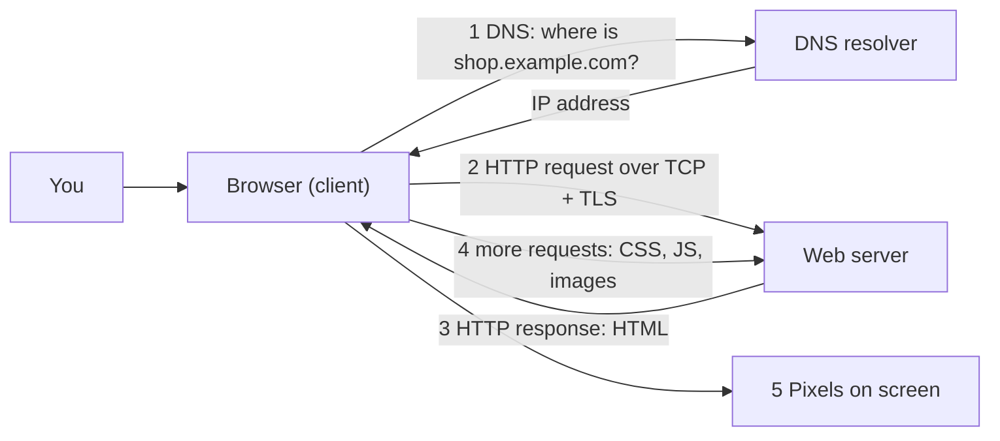
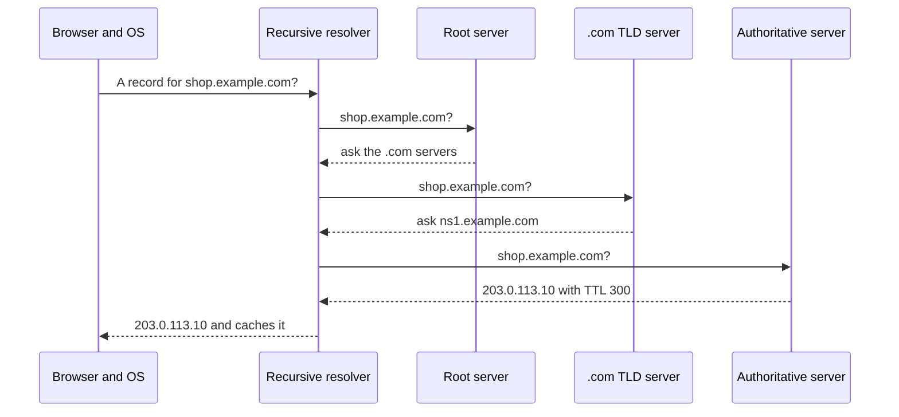
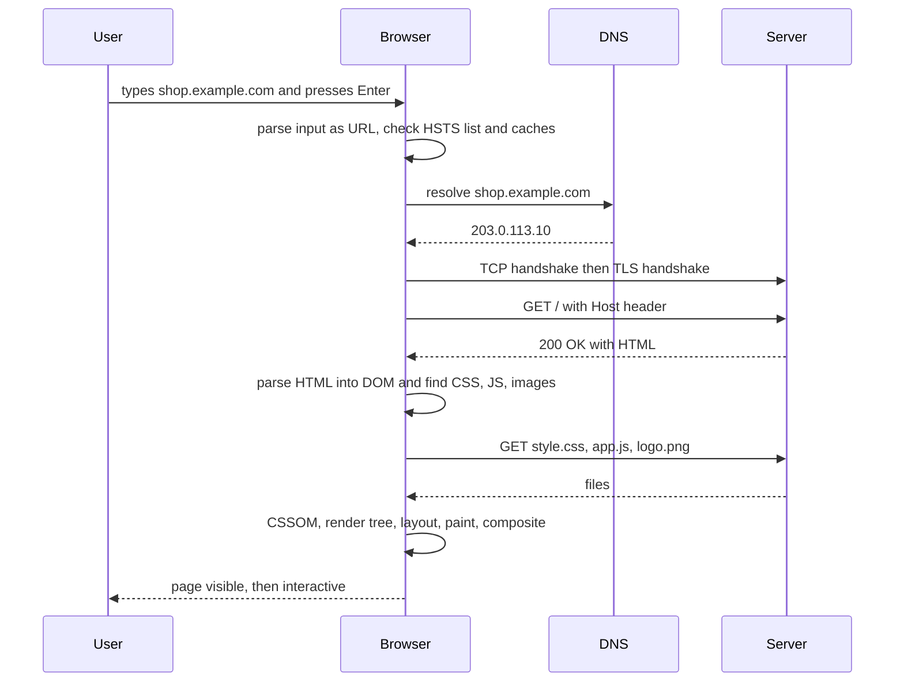
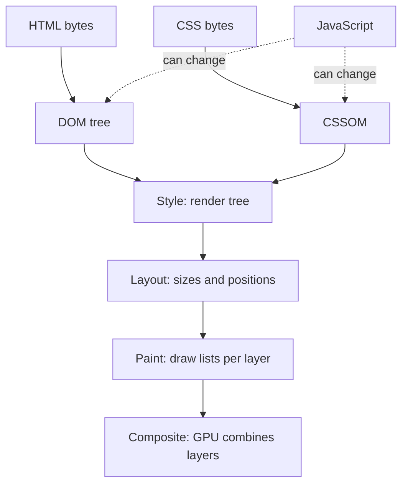
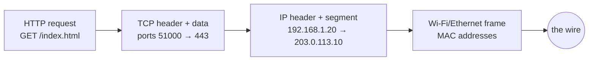

# Chapter 1 — How the Web Works

This chapter follows one page from a server's disk to your screen: the URL that names it, the DNS lookup that finds the server, the HTTP conversation that delivers it, and the browser pipeline that turns text into pixels. It ends with a first real page, a sensible folder layout, and the networking fundamentals interviewers ask about.

**In this chapter:** 1.1 The web in one picture · 1.2 URLs · 1.3 DNS · 1.4 Connections: TCP, TLS, HTTP versions · 1.5 HTTP basics · 1.6 "What happens when you type a URL?" · 1.7 The rendering pipeline · 1.8 Browser DevTools · 1.9 Your first page and file structure · 1.10 Networking fundamentals.

Every example lives in [`code/`](code/). The `.mjs` files (ES-module JavaScript) run with **Node.js 24** — a program that runs JavaScript outside the browser (`node code/01_url_parts.mjs`). Scripts that need a DOM (§1.7) use **jsdom**, a library that imitates a browser document in Node; two drive real **headless Chrome** (Chrome with no window, controlled by a script). Outputs are copied from real runs.

---

## 1.1 The web in one picture

### What it is
The **Internet** is the global network of connected computers plus the low-level **protocols** (agreed rules for how programs talk) that move data between them: **IP** (Internet Protocol) gives every machine an address and moves small chunks called **packets**; TCP and UDP (§1.4, §1.10) carry data between programs. The **World Wide Web** is one service on top: documents and apps named by **URLs**, fetched with **HTTP**, written in **HTML** — the three ideas from Tim Berners-Lee's 1989 CERN proposal (first site live 1991). Email, games and SSH (Secure Shell, remote command-line login) use the Internet but are not "the web".

### The roles

| Term | Meaning | Example |
|---|---|---|
| **Client** | The program that asks for something | Your browser, a phone app, `curl` (command-line download tool) |
| **Server** | A program (and machine) that answers requests | nginx (a popular web server), a Node.js app, a CDN edge node (§1.3) |
| **User agent** | The spec's name for the program acting for the user — usually the browser | Chrome, Firefox, Safari, a screen reader (software that reads the page aloud) + browser |
| **Resource** | Anything a URL points at | An HTML page, an image, a JSON response |
| **Browser engine** | The part that parses (reads and understands) and draws pages | Blink (Chrome, Edge, Opera), Gecko (Firefox), WebKit (Safari) |
| **JavaScript engine** | The part that runs JS | V8 (Chrome, Node.js), SpiderMonkey (Firefox), JavaScriptCore (Safari) |



### The three languages of the front end

| Language | Its job | If it were a house |
|---|---|---|
| **HTML** (HyperText Markup Language) | Structure and meaning: heading, list, button | Walls, rooms, doors |
| **CSS** (Cascading Style Sheets) | Presentation: colour, spacing, layout, animation | Paint, furniture, lighting |
| **JavaScript** | Behaviour: react to clicks, fetch data, change the page | Electricity and plumbing |

Screen readers, search engines and "reader mode" use the HTML alone, so a well-structured page stays usable if CSS fails or JS is off. Building that way — working HTML first, CSS and JS layered on top — is **progressive enhancement**.

### Who defines the rules
| Technology | Standards body |
|---|---|
| HTML + DOM | **WHATWG** (Web Hypertext Application Technology Working Group) — a "living standard" edited continuously at html.spec.whatwg.org; no "HTML6", "HTML5" is a historical label |
| CSS | **W3C** CSS Working Group, as separate modules (Flexbox, Grid, Colour…) |
| HTTP | **IETF**, in RFCs (Requests for Comments) |
| JavaScript | **ECMAScript**, by Ecma TC39 ([JavaScript book](../../../javascript/)) |
| Accessibility (usability for people with disabilities) | WCAG (Web Content Accessibility Guidelines), W3C Web Accessibility Initiative ([Chapter 3](../03-semantic-html-and-accessibility/README.md)) |

**Baseline** (a label on MDN — Mozilla's web reference — and web.dev) marks features that work in all core browsers (Chrome, Edge, Firefox, Safari, desktop and mobile): *newly available* when the last one ships it, *widely available* 30 months later. This book uses it whenever support matters.

---

## 1.2 URLs — the address of everything

### What it is
A **URL** (Uniform Resource Locator) says *how* to reach a resource and *where* it is. Every link, image, stylesheet and API call is a URL.

### How it works — the parts
`https://user@shop.example.com:8443/books/html.html?lang=en&page=2#reviews`

| Part | In the example | Meaning |
|---|---|---|
| Scheme | `https:` | Protocol (`http`, `https`, `mailto`, `tel`, `file`, `data`…) |
| Userinfo | `user@` | Rare, legacy; never put passwords here |
| Host | `shop.example.com` | Domain name (human-readable server name) or IP address |
| Port | `:8443` | Which "door" on the server; omitted = scheme default (80 http, 443 https) |
| Path | `/books/html.html` | Which resource on that server |
| Query | `?lang=en&page=2` | `name=value` parameters separated by `&` |
| Fragment | `#reviews` | A spot *inside* the page (usually an element `id`); never sent to the server |

The **origin** is scheme + host + port (`https://shop.example.com:8443`). Browsers isolate pages by origin — the **same-origin policy**: a script from one origin may not read another's data. It returns with cookies (small data a site stores in the browser), `fetch` (JS's HTTP function) and CORS (Cross-Origin Resource Sharing: how a server lets other origins read its responses) in the JavaScript book.

Node implements the same WHATWG URL Standard as browsers:

```js
// code/01_url_parts.mjs
const u = new URL('https://user@shop.example.com:8443/books/html.html?lang=en&page=2#reviews');
for (const k of ['href', 'protocol', 'username', 'hostname', 'port', 'origin', 'pathname', 'search', 'hash'])
  console.log(k.padEnd(9), u[k]);
console.log('lang    =', u.searchParams.get('lang'), '| page =', u.searchParams.get('page'));

// Relative URLs are resolved against the page's own URL (the "base").
const base = 'https://shop.example.com/books/html.html';
for (const rel of ['css.html', './img/cover.png', '../about.html', '/cart', '?page=3', '#top', '//cdn.example.net/a.js'])
  console.log(rel.padEnd(24), '->', new URL(rel, base).href);

// Special characters are percent-encoded; default ports disappear.
console.log(new URL('https://example.com:443/my file.html?q=café').href);
```

Output:
```
href      https://user@shop.example.com:8443/books/html.html?lang=en&page=2#reviews
protocol  https:
username  user
hostname  shop.example.com
port      8443
origin    https://shop.example.com:8443
pathname  /books/html.html
search    ?lang=en&page=2
hash      #reviews
lang    = en | page = 2
css.html                 -> https://shop.example.com/books/css.html
./img/cover.png          -> https://shop.example.com/books/img/cover.png
../about.html            -> https://shop.example.com/about.html
/cart                    -> https://shop.example.com/cart
?page=3                  -> https://shop.example.com/books/html.html?page=3
#top                     -> https://shop.example.com/books/html.html#top
//cdn.example.net/a.js   -> https://cdn.example.net/a.js
https://example.com/my%20file.html?q=caf%C3%A9
```

### Absolute vs relative URLs

| Kind | Looks like | Resolves to | Use for |
|---|---|---|---|
| Absolute | `https://other.site/page` | Exactly that | Other sites |
| Document-relative | `css.html`, `./img/a.png`, `../about.html` | The current page's folder (`.` = this folder, `..` = parent) | Files next to the page |
| Root-relative | `/cart` | Same origin, from the site root | Links inside a site served from a domain root |
| Scheme-relative | `//cdn.example.net/a.js` | Same scheme as the page | Legacy; write `https://` today |
| Query / fragment only | `?page=3`, `#top` | Same page, new query or jump target | Pagination, in-page links |

Relative links make a site movable between your laptop, staging (a private test copy) and production (the live site).

### Common mistakes
- Backslashes (`img\cat.png`) — URLs always use `/`.
- Root-relative links (`/css/style.css`) when opening files from disk: `/` becomes the root of your *disk*. Use a local server (§1.9) or document-relative paths.
- Secrets or personal data in the query string — URLs end up in logs, history and `Referer` headers (which tell a server the page the visitor came from).
- Forgetting the fragment is client-side only: the server never sees `#reviews`, and changing only the fragment makes no new request.

### Self-check
1. Origin of `http://example.com/a/b?c#d`? → `http://example.com` (port 80 implied).
2. On `https://site.com/docs/intro/start.html`, where does `../api.html` go? → `https://site.com/docs/api.html`.

---

## 1.3 DNS — turning names into addresses

### What it is
Computers route by **IP address** — e.g. `203.0.113.10` (IPv4) or `2001:db8::10` (IPv6, §1.10), both documentation ranges. The **Domain Name System (DNS)** is the Internet's distributed phone book: no single server holds it all ([System Design Fundamentals](../../../system-design-patterns/modules/00-system-design-fundamentals/README.md)).

### How it works
1. The browser checks its **cache** (stored recent answers), then the OS checks its cache and the `hosts` file (`/etc/hosts` on macOS/Linux).
2. On a miss, the OS asks a **recursive resolver** — your ISP's (Internet service provider), your company's, or a public one such as 1.1.1.1 or 8.8.8.8.
3. The resolver walks the name from the right: a **root server** names the `.com` servers; the **TLD (top-level domain) server** names the authoritative server for `example.com`; the **authoritative name server** returns the record.
4. Each answer carries a **TTL** (time to live, seconds); resolver, OS and browser cache it that long, so most lookups take milliseconds.



### Record types you will meet

| Record | Maps | Example use |
|---|---|---|
| `A` | name → IPv4 address | `shop.example.com → 203.0.113.10` |
| `AAAA` | name → IPv6 address | same, for IPv6 |
| `CNAME` | name → another name (alias) | `www.example.com → example.netlify.app` |
| `MX` | domain → mail servers | where `@example.com` email goes |
| `TXT` | arbitrary text | ownership checks, SPF/DKIM (email anti-spoofing) |
| `NS` | domain → its authoritative name servers | delegation (handing part of the name tree to other servers) |

Classic DNS uses unencrypted UDP port 53; **DNS over HTTPS (DoH)** and **DNS over TLS (DoT)** encrypt lookups; most browsers can use DoH.

### Real-world examples
- "Pointing a domain" at GitHub Pages, Netlify or Vercel = adding an `A` or `CNAME` record at your registrar (where you bought the name).
- A **CDN** (content delivery network: Cloudflare, Akamai) answers DNS with the IP of the nearest **edge server** (one of many copy servers close to users), so the same name reaches different machines per country ([CDN notes](../../../system-design-patterns/modules/08-api-and-edge/README.md)).
- DNS changes "take time to propagate" because old answers stay cached until their TTL expires — so lower the TTL a day before moving servers.

---

## 1.4 Connections: TCP, TLS and the HTTP versions

### What it is
With an IP address, the browser needs a reliable, private channel:

- **TCP** (Transmission Control Protocol): an ordered, reliable byte stream. Opening it costs one **round trip** (message out, reply back) — the *three-way handshake* SYN, SYN-ACK, ACK.
- **TLS** (Transport Layer Security): encrypts the stream and proves the server's identity with a **certificate** (a digital ID binding a domain to a public key) signed by a certificate authority (e.g. Let's Encrypt, which verifies you control the domain). TLS 1.3 (2018) adds one round trip for a new connection. `https://` = HTTP inside TLS.
- **HTTP**: the request/response language spoken inside.

### Why HTTPS matters
Three guarantees: **confidentiality** (others on the Wi-Fi cannot read it), **integrity** (nobody injects ads or malware in transit), **authentication** (it really is `bank.com`). Browsers flag plain HTTP "Not secure"; service workers (background scripts that intercept requests, enabling offline use), geolocation, camera and clipboard require a **secure context** (HTTPS or `localhost`); Let's Encrypt made certificates free.

### HTTP versions compared

| Version | Year (current RFC) | Transport | Key idea | Practical effect |
|---|---|---|---|---|
| HTTP/1.1 | 1997 (RFC 9112, 2022) | TCP | Text messages, persistent connections | One request at a time per connection; browsers open ~6 per host |
| HTTP/2 | 2015 (RFC 9113, 2022) | TCP | Binary framing, **multiplexing** many requests on one connection, header compression | Many small files are cheap; one lost packet still stalls every stream (TCP **head-of-line blocking**) |
| HTTP/3 | 2022 (RFC 9114) | **QUIC** over UDP | Independent streams; TLS 1.3 built in | Faster set-up, better on lossy mobile networks, survives network changes |

All versions share the same *semantics* — methods, status codes, headers (RFC 9110). Server and browser negotiate the version; your HTML is unchanged.

---

## 1.5 HTTP basics — requests and responses

### What it is
HTTP (HyperText Transfer Protocol): one request, exactly one response. It is **stateless** — each request stands alone, so anything remembered between requests (login, cart) travels in cookies, tokens (signed strings proving identity) or URLs.

### How it works — anatomy
**Request:** `method path version` line, headers (`Name: value`), blank line, optional body. **Response:** `version status reason` line, headers, blank line, body.

The script talks to a tiny local server over a raw TCP **socket** (one end of a network connection) to show the exact bytes; HTTP/2 and /3 carry the same information in binary frames.

```js
// code/02_http_exchange.mjs (key parts)
function send(res, status, headers, body = '') {
  res.sendDate = false;                                  // no Date header -> identical output on every run
  res.writeHead(status, { ...headers, 'Content-Length': Buffer.byteLength(body) });
  res.end(body);
}
const server = http.createServer((req, res) => {
  if (req.url === '/') send(res, 200, { 'Content-Type': 'text/html; charset=utf-8', 'Cache-Control': 'max-age=60' },
                            '<!DOCTYPE html><title>Hi</title><h1>Hello</h1>');
  else if (req.url === '/old') send(res, 301, { Location: '/' });
  else send(res, 404, { 'Content-Type': 'text/plain' }, 'Not found');
});
// ... raw(path) opens a socket and writes:
//   `GET ${path} HTTP/1.1\r\nHost: localhost\r\nAccept: text/html\r\nConnection: close\r\n\r\n`
await raw('/'); await raw('/old'); await raw('/missing');
```

Output for `/` (abridged from the run):
```
>>> REQUEST
GET / HTTP/1.1
Host: localhost
Accept: text/html
Connection: close
<<< RESPONSE
HTTP/1.1 200 OK
Content-Type: text/html; charset=utf-8
Cache-Control: max-age=60
Content-Length: 46
Connection: close

<!DOCTYPE html><title>Hi</title><h1>Hello</h1>
```
`/old` returns `HTTP/1.1 301 Moved Permanently` with `Location: /` and `Content-Length: 0`; `/missing` returns `HTTP/1.1 404 Not Found` with `Content-Type: text/plain` and body `Not found`.

- `Host` is mandatory in HTTP/1.1 — one IP can serve many sites.
- `Content-Type: text/html; charset=utf-8` tells the browser the bytes are HTML and how to decode them; the browser trusts this header, not the `.html` extension.
- `301` + `Location` is a redirect: the browser immediately requests `/`.
- The fragment (`#...`) never appears in a request line.

### Methods

| Method | Purpose | Safe? (no side effects) | Idempotent? (repeat = same result) | Sent by plain HTML? |
|---|---|---|---|---|
| `GET` | Read a resource | Yes | Yes | Links, images, forms with `method="get"` |
| `HEAD` | Like GET, headers only | Yes | Yes | No |
| `POST` | Create / submit / trigger an action | No | No | Forms with `method="post"` |
| `PUT` | Replace a resource | No | Yes | No (use `fetch`) |
| `PATCH` | Partially update | No | Not necessarily | No |
| `DELETE` | Remove | No | Yes | No |
| `OPTIONS` | Ask what is allowed (CORS preflight — a permission check before the real request) | Yes | Yes | No |

HTML can only send `GET` and `POST` (links and forms, [Chapter 5](../05-tables-and-forms/README.md)); `fetch` can send any method.

### Status codes

| Class | Meaning | Codes you should know |
|---|---|---|
| 1xx | Informational | `103 Early Hints` |
| 2xx | Success | `200 OK`, `201 Created`, `204 No Content` |
| 3xx | Redirection | `301 Moved Permanently`, `302 Found`, `304 Not Modified`, `307`/`308` (redirects that keep the method) |
| 4xx | Client error | `400 Bad Request`, `401 Unauthorized` (not logged in — "who are you?"), `403 Forbidden` (logged in, not allowed), `404 Not Found`, `429 Too Many Requests` |
| 5xx | Server error | `500 Internal Server Error`, `502 Bad Gateway`, `503 Service Unavailable` |

### Headers worth recognising

| Header | Direction | What it does |
|---|---|---|
| `Host` | request | Which site on this server |
| `User-Agent` | request | Identifies the browser |
| `Accept`, `Accept-Language`, `Accept-Encoding` | request | Preferred formats, languages, compression (gzip, br, zstd) |
| `Cookie` / `Set-Cookie` | request / response | Small pieces of state: server sets, browser sends back |
| `Content-Type`, `Content-Length`, `Content-Encoding` | both | What the body is, how big, how compressed |
| `Location` | response | Where a redirect points |
| `Cache-Control`, `ETag`, `Last-Modified` | response | Caching rules and validators (version stamps for freshness checks) |
| `Content-Security-Policy`, `Strict-Transport-Security` | response | Security policies (which scripts may run; always use HTTPS) |

### Caching in one paragraph
`Cache-Control: max-age=60` lets the browser reuse a response for 60 s without asking. After that it *revalidates*: sends `If-None-Match: <etag>` and gets a tiny `304 Not Modified` if unchanged. Sites put a content hash (a fingerprint of the file's bytes) in asset names (`app.3f9a2c.css`) and cache them for a year, while HTML is cached briefly or revalidated every time. More in [Chapter 14](../14-performance-seo-interview-and-cheatsheet/README.md) and the [caching module](../../../system-design-patterns/modules/04-caching/README.md).

### Common mistakes
- Changing data with a `GET` link (`<a href="/delete?id=5">`): crawlers (search robots) and link-prefetchers follow GETs.
- Serving HTML as `text/plain` — the browser shows the source.
- Confusing `401` with `403`.

### Self-check
1. What does `304` mean and when do you see it? → Not Modified; when revalidating a cached copy that is still current.
2. Why is HTTP called stateless? → Every request is independent; state travels in cookies, tokens or URLs.

---

## 1.6 "What happens when you type a URL and press Enter?"



### In the interview
**30-second answer:** "The browser decides whether I typed a URL or a search, then resolves the host to an IP via its caches and DNS. It opens TCP and does a TLS handshake (or QUIC for HTTP/3), sends a GET with headers such as Host and cookies, and gets a response — maybe a redirect, ideally 200 with HTML. It parses the HTML into the DOM while fetching the CSS, JS and images it discovers, builds the CSSOM, combines them into a render tree, runs layout, paints and composites layers. Scripts then make the page interactive."

- *How could you make that faster?* → Fewer round trips (HTTP/2 or /3, a CDN near users, keep-alive — reusing one open connection — and `preconnect` to open connections early), smaller cacheable assets, no unnecessary render-blocking CSS/JS ([Chapter 14](../14-performance-seo-interview-and-cheatsheet/README.md)).
- *What is HSTS?* → `Strict-Transport-Security` tells the browser to always use HTTPS for that site, so it upgrades `http://` itself without sending an insecure request.
- *Where can caching short-circuit this?* → DNS caches, the browser HTTP cache (no request at all under `max-age`), a service worker, a CDN edge cache.

---

## 1.7 The browser rendering pipeline

### What it is
The **rendering pipeline** (the *critical rendering path* when talking about first view) is how an engine turns HTML and CSS bytes into pixels:



### Step 1 — Parsing HTML into the DOM
Bytes are decoded to characters (using the `charset`), split into **tokens** (start tags, end tags, text, comments) and fed to a **tree builder**. The result is the **DOM** (Document Object Model): a tree of objects — *nodes* — that JavaScript can read and change. The WHATWG spec defines parsing exactly, including error recovery, so every modern browser builds the same tree from the same input. It never "fails".

> **Key term — tree:** each **node** has one parent and any number of children. `<html>` is the root; `<head>` and `<body>` are its children; a paragraph's text is a child of its `<p>`. "Sibling" = same parent; "descendant" = anywhere below.

jsdom implements the same algorithm, so we can watch it fix a sloppy document:

```js
// code/03_parse_dom.mjs (key parts)
const body = `<title>Parsing demo</title>
<p>First paragraph
<p>Second <b>bold <i>both</b> italic?</i>
<table><tr><td>cell</td></tr></table>`;
const std = new JSDOM('<!DOCTYPE html>\n' + body).window.document;
console.log('Mode:', std.compatMode, '(CSS1Compat = standards mode)');
show(std.documentElement);                        // prints the tree, one node per line
console.log('\nSerialized back:\n' + std.body.innerHTML);
const quirks = new JSDOM(body).window.document;   // same markup, no doctype
console.log('Is the <table> inside the 2nd <p>?  standards:', !!std.querySelector('p > table'),
            '| quirks:', !!quirks.querySelector('p > table'));
```

Output:
```
Mode: CSS1Compat (CSS1Compat = standards mode)
Source had no <html>, <head>, <body>, </p> or <tbody> — the parser added them:

html
  head
    title
      "Parsing demo"
  body
    p
      "First paragraph"
    p
      "Second"
      b
        "bold"
        i
          "both"
      i
        "italic?"
    table
      tbody
        tr
          td
            "cell"

Serialized back:
<p>First paragraph
</p><p>Second <b>bold <i>both</i></b><i> italic?</i>
</p><table><tbody><tr><td>cell</td></tr></tbody></table>

Without <!DOCTYPE html> -> mode: BackCompat (BackCompat = quirks mode)
Is the <table> inside the 2nd <p>?  standards: false | quirks: true
```

What happened: `<html>`/`<head>`/`<body>` were created; a new `<p>` closed the previous one (paragraphs cannot nest); mis-nested `<b><i></b></i>` was repaired by reopening a fresh `<i>` after `</b>` (the "adoption agency algorithm"); a `<tbody>` was inserted (so `table > tr` never matches). Without `<!DOCTYPE html>` the page is in **quirks mode**, imitating 1990s browser bugs — here a table does *not* close the paragraph. Always use the doctype ([Chapter 2](../02-html-structure-and-text/README.md)) and validate (§2.10) rather than rely on recovery.

**Scripts and parsing.** A plain `<script src>` is *parser-blocking*: the parser stops, downloads and runs it (it might call `document.write`, an old function that inserts markup mid-parse), then continues.

| Script tag | Downloads | Runs | Order kept? | Use for |
|---|---|---|---|---|
| `<script src>` | blocks parsing | immediately | yes | Rarely needed today |
| `<script src defer>` | in parallel | after parsing, before `DOMContentLoaded` | yes | Most page scripts |
| `<script src async>` | in parallel | as soon as downloaded (pauses parser briefly) | no | Independent scripts, e.g. analytics |
| `<script type="module">` | in parallel | deferred by default | yes | ES modules (files that `import`/`export`) |

A **preload scanner** reads ahead in the raw HTML and starts downloading CSS, scripts and images early, even while the parser is blocked.

### Step 2 — Parsing CSS into the CSSOM
CSS from `<link rel="stylesheet">`, `<style>` and `style=""` is parsed into the **CSSOM** (CSS Object Model): rules, their selectors (which elements a rule targets) and declarations (`property: value`). CSS is **render-blocking**: the browser won't paint until it has the stylesheets in `<head>`, to avoid a "flash of unstyled content" (FOUC). So stylesheets belong in the head and should be small.

### Step 3 — Style and the render tree
The browser matches every element against the rules and computes a final value for every property (**computed style**; cascade and specificity in [Chapter 6](../06-css-fundamentals/README.md)). Elements that produce boxes form the **render tree** (Chrome: *layout tree*). Left out: `display: none` elements and their contents, and never-rendered elements (`<head>`, `<script>`, `<meta>`, `<link>`). `visibility: hidden` and `opacity: 0` elements *stay* — invisible but occupying space.

[`code/04_render_tree.mjs`](code/04_render_tree.mjs) styles five elements with `.hidden { display: none }`, `.ghost { visibility: hidden }`, `.faded { opacity: 0 }` and `p { color: #333 }`, prints the CSSOM, then reads `getComputedStyle()` per element:

Output:
```
CSSOM rules:
  .hidden { display: none; }
  .ghost { visibility: hidden; }
  .faded { opacity: 0; }
  p { color: rgb(51, 51, 51); }

Element           display  visibility  in render tree?  painted visibly?
<h1>               block    visible     true             true
<p>                block    visible     true             true
<p .hidden>        none     visible     false            false
<p .ghost>         block    hidden      true             false
<p .faded>         block    visible     true             false
<script>           none     visible     false            false
```

The CSSOM stores parsed values (`#333` → `rgb(51, 51, 51)`). In real Chrome ([`code/render-tree.html`](code/render-tree.html)):


*Figure 1.1 — `display: none` removes B's box entirely; `visibility: hidden` and `opacity: 0` keep its space.*

| Technique | Takes space? | Clickable? | Read by screen readers? |
|---|---|---|---|
| `display: none` | No | No | No |
| `visibility: hidden` | Yes | No | No |
| `opacity: 0` | Yes | **Yes** | **Yes** |
| `hidden` attribute | No (it applies `display: none`) | No | No |

### Step 4 — Layout
**Layout** (Firefox: *reflow*) computes each box's exact position and size in pixels, starting from the **viewport** width (the visible window area): percentages, `em`s, flex and grid become concrete numbers. Any later geometric change — width, font size, new content — can force layout again.

### Step 5 — Paint
**Paint** turns boxes into drawing instructions — backgrounds, borders, text, shadows, images — in stacking order. The page may be split into **layers** (e.g. a fixed header, a video, `will-change: transform`), painted separately, then *rasterised* (converted to pixels), often on the GPU.

### Step 6 — Composite
**Compositing** stacks the layers on screen. `transform` and `opacity` changes can often be handled here alone — no layout or paint — which is why they animate smoothly at 60 fps or more ([Chapter 12](../12-transitions-transforms-and-animation/README.md)).

### What a change costs

| You change | Layout | Paint | Composite | Example |
|---|---|---|---|---|
| `width`, `height`, `margin`, `top`, font size, content | yes | yes | yes | Expanding an accordion |
| `color`, `background-color`, `box-shadow` | no | yes | yes | Hover colour |
| `transform`, `opacity` | no | no | yes | Sliding a drawer |

### Events you can observe
`DOMContentLoaded` = HTML parsed and deferred scripts run (images may still load); `load` = everything, including images and iframes, loaded. First Contentful Paint (first text/image) and Largest Contentful Paint (biggest visible element) are milestones in DevTools and Lighthouse ([Chapter 14](../14-performance-seo-interview-and-cheatsheet/README.md)).

### Common mistakes
- `<script>` without `defer` in `<head>` — nothing renders until it downloads and runs.
- Hiding with `opacity: 0` and forgetting it is still clickable and read aloud.
- Reading a layout value (`offsetHeight`) right after changing styles in a loop — **layout thrashing** (recomputing geometry many times when once would do).

### In the interview
**30-second answer:** "The browser parses HTML into the DOM and CSS into the CSSOM, combines them into a render tree of visible boxes, runs layout for geometry, paints each layer, and composites layers on the GPU. CSS is render-blocking and classic scripts are parser-blocking, so I keep critical CSS small and load scripts with `defer` or as modules. For animation I prefer `transform` and `opacity` because they skip layout and paint."

- *`display:none` vs `visibility:hidden`?* → The first removes the box from the render tree and frees its space; the second keeps the space but draws nothing.
- *`defer` vs `async`?* → Both download in parallel; `defer` runs in document order after parsing, `async` runs on arrival, in any order.
- *What is a reflow?* → Recomputing layout because geometry changed; expensive on large pages.

### Self-check
1. Is `<head>` in the render tree? → No.
2. What does the parser do with a `<p>` inside a `<p>`? → Closes the first paragraph.

---

## 1.8 Browser DevTools

### What it is
Every desktop browser ships **developer tools** showing the DOM, styles, network traffic and performance. Open with **F12**, **Ctrl+Shift+I** (Windows/Linux), **Cmd+Option+I** (macOS), or right-click → *Inspect*.

### The panels you will use (Chrome names; Firefox and Safari are similar)

| Panel | What it shows | Use it to… |
|---|---|---|
| **Elements** (Firefox: Inspector) | The live DOM (not your source) + applied CSS with overridden declarations struck through, box model diagram, computed values | Find why a style isn't applied, try CSS live, see flex/grid overlays |
| **Console** | Errors, warnings, `console.log`; a JS prompt | Spot failing scripts, test expressions (`$0` = selected element) |
| **Sources** (Firefox: Debugger) | Loaded files; breakpoints (where execution pauses) | Step through JavaScript |
| **Network** | Every request: status, type, size, timing waterfall, headers | Find 404s, slow files, check caching and `Content-Type` |
| **Performance** | Timeline of parsing, scripting, style, layout, paint | Find what makes the page slow or janky (stuttering) |
| **Lighthouse** | Audits for performance, accessibility, SEO (search engine optimisation), best practices | A quick report card ([Chapter 14](../14-performance-seo-interview-and-cheatsheet/README.md)) |
| **Application** (Firefox: Storage) | Cookies, local storage (key–value data in the browser), service workers, cache | Debug state and offline behaviour |
| **Accessibility** pane | The accessibility tree, roles, names, contrast | [Chapter 3](../03-semantic-html-and-accessibility/README.md) |

Also: the **device toolbar** (Ctrl/Cmd+Shift+M) simulates phones and slow networks; "Rendering" offers paint flashing and emulating `prefers-color-scheme: dark` (Chapter 10).

### Seeing what the Network panel sees
[`code/05_what_the_browser_fetched.mjs`](code/05_what_the_browser_fetched.mjs) serves the §1.9 site, opens it in headless Chrome via Puppeteer (a Node library that remote-controls Chrome), logs every response (`page.on('response')`) like the Network list, then reads the `<h1>`'s computed colour (proving the CSS applied) and clicks the button (proving the JS runs):


Output:
```
status type       path            content-type
200  document   /index.html     text/html; charset=utf-8
200  stylesheet /css/style.css  text/css
200  script     /js/main.js     text/javascript
404  other      /favicon.ico    

After load: { title: 'My First Page', elements: 31, h1Color: 'rgb(29, 78, 216)' }
After clicking "Say hi": Hi! JavaScript ran.
```

The parser discovered two more requests. The `404` for `/favicon.ico` is the browser automatically asking for a tab icon; `<link rel="icon" href="...">` (Chapter 2) controls it.

### Common mistakes
- Editing styles in DevTools and forgetting they vanish on reload.
- Reading the Elements panel as your source: it shows the DOM *after* parser fixes and JS changes. "View Page Source" (Ctrl/Cmd+U) shows the original.
- Debugging caching with "Disable cache" still ticked (it applies only while DevTools is open).

### Self-check
1. How do you check a file's status code and `Content-Type`? → Network panel → click the request → Headers.

---

## 1.9 Your first page and file structure

### How it works
1. Create `index.html` in a folder (in a plain-text editor such as VS Code, not a word processor) — servers return `index.html` for a folder URL (`https://site.com/` → `/index.html`).
2. Open it by double-clicking (`file://` URL) or, better, a local server so URLs behave as in production: `npx serve .` (npx runs a Node package without installing it) or `python3 -m http.server 8000`, then `http://localhost:8000/` (`localhost` = your own machine).
3. Edit, save, reload; inspect with DevTools.

The complete first page (every line explained in Chapter 2):

```html
<!-- code/site/index.html -->
<!DOCTYPE html>
<html lang="en">
<head>
  <meta charset="utf-8">
  <meta name="viewport" content="width=device-width, initial-scale=1">
  <title>My First Page</title>
  <link rel="stylesheet" href="css/style.css">
</head>
<body>
  <header>
    <h1>Hello, web!</h1>
    <nav><a href="index.html">Home</a> · <a href="about.html">About</a></nav>
  </header>
  <main>
    <p>This site is four plain text files: <code>index.html</code>, <code>about.html</code>, <code>css/style.css</code> and <code>js/main.js</code>.</p>
    <p>The browser read the HTML, fetched the stylesheet it links to, and drew the result.</p>
    <ul>
      <li>HTML says <strong>what</strong> things are.</li>
      <li>CSS says how they <strong>look</strong>.</li>
      <li>JavaScript says how they <strong>behave</strong>.</li>
    </ul>
    <button type="button" id="hi">Say hi</button>
    <output id="msg"></output>
  </main>
  <footer><small>Made with a text editor.</small></footer>
  <script src="js/main.js"></script>
</body>
</html>
```

```css
/* code/site/css/style.css (excerpt) */
body   { font-family: system-ui, sans-serif; max-width: 40rem; margin: 2rem auto; padding: 0 1rem; line-height: 1.5; color: #1f2933; }
header { border-bottom: 2px solid #3b82f6; margin-bottom: 1rem; }
h1     { color: #1d4ed8; margin: 0 0 .25rem; }
button { font: inherit; padding: .4rem .9rem; border-radius: 6px; border: 1px solid #1e3a8a; background: #1d4ed8; color: white; }
```

```js
// code/site/js/main.js
document.getElementById('hi').addEventListener('click', () => {
  document.getElementById('msg').textContent = 'Hi! JavaScript ran.';
});
```


*Figure 1.2 — `code/site/index.html` in Chrome.*

The script sits at the end of `<body>` so the button exists when it runs; `<script src="js/main.js" defer>` in the head is equally good.

### A sensible file structure

```
my-site/
├── index.html          home page  →  /
├── about.html          →  /about.html
├── blog/
│   └── index.html      →  /blog/
├── css/
│   └── style.css
├── js/
│   └── main.js
├── img/
│   ├── logo.svg
│   └── hero.avif
└── favicon.ico
```

| Rule | Why |
|---|---|
| Lower-case, hyphenated names (`contact-us.html`) | URLs are case-sensitive on most servers; spaces become `%20`; hyphens are what search engines expect |
| One folder per asset type (`css/`, `js/`, `img/`) — or per feature in larger projects | Easy to find, easy to set cache rules |
| `index.html` in every folder that is a "page" | Clean URLs such as `/blog/` |
| Document-relative links between pages | Works from any folder or domain |
| Keep source and generated files apart once you add build tools (programs that transform and bundle files for production): `src/` → `dist/` | Never hand-edit generated output |

### Real-world examples
**Static sites** (ready-made files, no server code per request) are **deployed** by uploading the folder to GitHub Pages, Netlify, Cloudflare Pages or an S3 bucket behind a CDN. Frameworks (React, Next.js, Astro) generate the same HTML, CSS and JS files; the browser receives exactly what this chapter describes.

### Common mistakes
- Saving as `index.html.txt` (hidden extensions on Windows/macOS).
- Linking `href="CSS/Style.css"` when the file is `css/style.css` — works on a case-insensitive laptop, breaks on a Linux server.
- Missing `<!DOCTYPE html>` or `<meta charset="utf-8">`: quirks mode and garbled accents.

### Self-check
1. Why prefer a local server over double-clicking? → Root-relative URLs, `fetch`, modules and some APIs behave differently or fail on `file://`.
2. Why is the script at the end of `<body>` (or `defer`)? → Parsing isn't blocked and the elements it uses already exist.

---

## 1.10 Networking fundamentals

### What it is
The machinery under §1.3–1.5: **layers**, transports (**TCP**, **UDP**, **QUIC**), addressing (**IPv4, IPv6, NAT**), and boxes in the path (**firewalls, proxies, VPNs**). Interviewers ask about it, and it explains why your laptop is `192.168.1.20` while websites see another address.

### How it works — the layer models

Protocols are stacked in **layers**: each uses the one below and serves the one above, wrapping the data in its own **header** (labels and control info in front of the data) — **encapsulation**.

| OSI model (7 layers, a teaching model, ISO 7498) | TCP/IP model (4 layers, what the Internet actually runs, RFC 1122) | Examples | Unit of data |
|---|---|---|---|
| 7 Application · 6 Presentation · 5 Session | **Application** | HTTP, DNS, TLS\*, SSH, SMTP (email sending) | message |
| 4 Transport | **Transport** | TCP, UDP, QUIC | segment / datagram |
| 3 Network | **Internet** | IP (v4, v6), ICMP (`ping`; error and test messages) | packet |
| 2 Data link · 1 Physical | **Link** | Ethernet, Wi-Fi, fibre, radio | frame / bits |

\*TLS sits between transport and application — "layer 4.5", or OSI layer 6.



A "layer-4" **load balancer** (spreads requests across identical back-ends) looks only at IPs and ports; "layer 7" reads HTTP (URLs, headers, cookies). See [Load Balancing](../../../system-design-patterns/modules/06-scaling/README.md#load-balancing) and [Reverse Proxy](../../../system-design-patterns/modules/08-api-and-edge/README.md#reverse-proxy).

### How it works — ports and sockets
An IP address finds the **machine**; a **port** (0–65535) finds the **program**. A **socket** = IP + port + protocol. Servers listen on **well-known ports**; clients get a random **ephemeral port** (short-lived, one connection) from the OS (`61804` in the demo below).

| Port | Service | Port | Service |
|---|---|---|---|
| 22 | SSH | 443 | HTTPS (TCP), HTTP/3 (UDP) |
| 25 / 587 | SMTP (mail between servers / from clients) | 3306 / 5432 | MySQL / PostgreSQL |
| 53 | DNS (UDP, TCP for large answers) | 6379 | Redis (in-memory data store) |
| 80 | HTTP | 8080 / 3000 / 5173 | common dev-server choices |

### How it works — TCP vs UDP vs QUIC

| | **TCP** (RFC 9293) | **UDP** (RFC 768) | **QUIC** (RFC 9000) |
|---|---|---|---|
| Connection set-up | 3-way handshake (1 round trip), then TLS | none — just send | 1 round trip including TLS 1.3; 0-RTT on resume |
| Delivery | reliable, ordered, retransmits lost data | best effort: may lose, duplicate or reorder | reliable and ordered **per stream** |
| Shape of data | one **byte stream**, no message boundaries | separate **datagrams**, boundaries kept | many independent streams in one connection |
| Flow / congestion control (not overwhelming receiver / network) | yes | no (the app must be polite) | yes |
| Head-of-line blocking | one lost packet stalls everything behind it | none | only the stream that lost the packet waits |
| Used by | HTTP/1.1, HTTP/2, SSH, databases, email | DNS, video calls, games, VoIP, DHCP (hands out IP addresses) | HTTP/3 |

Games and calls use UDP because late voice or game data is useless — skip it rather than stall for a retransmission. QUIC runs **on top of UDP** because routers and firewalls everywhere already pass UDP, while a new transport would be blocked; QUIC re-implements reliability and encryption itself, and its connection IDs let a download survive moving from Wi-Fi to 4G.

### How it works — addresses: IPv4, IPv6, NAT
- **IPv4** (RFC 791): 32-bit addresses (~4.3 billion) written `203.0.113.10`. They ran out — the last big regional pools were exhausted between 2011 and 2019.
- **IPv6** (RFC 8200): 128-bit addresses in hex groups, `2001:db8::10` (`::` = a run of zeros) — enough for every device to have a public address. It also drops header checksums and in-network fragmentation (routers splitting oversized packets) and makes auto-configuration standard. Both run side by side (**dual stack**); browsers try IPv6 and IPv4 almost in parallel ("Happy Eyeballs", RFC 8305) and use whichever connects first.
- **CIDR notation** `10.0.0.0/8` = "first 8 bits fixed" — 2^24 addresses. Used for subnets (address blocks belonging to one network) and firewall rules.
- **Private ranges** (RFC 1918): `10.0.0.0/8`, `172.16.0.0/12`, `192.168.0.0/16` — never routed publicly; reusable by any home or office. `127.0.0.1` / `::1` is **loopback** (this machine).
- **NAT** (network address translation) lets a private network share one public IPv4 address: the router rewrites each outgoing packet's source to its public IP and a fresh port, remembers the mapping, and rewrites replies back. Outsiders cannot start a connection inward without a mapping — which is why peer-to-peer video calls need STUN/TURN (helper servers that discover your public address or relay traffic), as used by WebRTC (the browser's real-time media API).
- **Unicast** = one host; **broadcast** = every host on the local network (IPv4 only); **multicast** = a subscribed group; **anycast** = one address announced from many places, routed to the nearest — how public DNS resolvers and CDNs answer from a nearby city.
- **LAN** = one building's network; **WAN** = networks joined across distance.

### How it works — DNS records beyond the basics
Beyond §1.3's records: **`SOA`** (start of authority: zone's primary server and timers), **`PTR`** (reverse lookup IP → name, used by mail servers to check senders), **`SRV`** (service → host + port, e.g. SIP telephony or some databases), **`CAA`** (which certificate authorities may issue certificates for the domain). A `CNAME` cannot sit at the bare domain (`example.com`) alongside other records, so DNS hosts offer non-standard "ALIAS/ANAME" flattening (resolving the alias themselves and publishing the IP).

### How it works — firewalls, proxies and VPNs
- A **firewall** filters by rules. A *packet filter* matches addresses, ports, protocols ("allow TCP 443 from anywhere, 22 only from 10.0.0.0/8, deny the rest"). A *stateful* firewall tracks connections, so replies to traffic you started come back automatically; cloud **security groups** are stateful. A **WAF** (web application firewall) works at layer 7, inspecting HTTP for attacks such as SQL injection.
- A **forward proxy** acts for **clients** (a company proxy: filtering, caching, logging). A **reverse proxy** acts for **servers** — nginx, a load balancer or a CDN in front of your app — doing **TLS termination** (decrypting HTTPS so the app needn't), caching and load spreading. To the browser, a reverse proxy *is* "the server".
- A **VPN** (virtual private network) tunnels your packets encrypted into another network so you behave as if plugged in there. **Remote-access VPNs** connect a laptop to the office; **site-to-site VPNs** join two networks (offices, or office and cloud). Protocols: **IPsec**, **WireGuard** (small, modern), TLS-based such as OpenVPN. A VPN hides traffic from the local Wi-Fi, not from the VPN provider.

### Seeing it: [`code/06_network_basics.mjs`](code/06_network_basics.mjs)
On loopback only: resolves `localhost`, sends three TCP writes and three UDP datagrams, checks addresses against an allow-list (`net.BlockList`), simulates a NAT table.

```text
localhost -> ::1 (IPv6), 127.0.0.1 (IPv4)
isIPv4("203.0.113.10") = true | isIPv6("2001:db8::10") = true
TCP server listening on 127.0.0.1:61803
TCP server sees client 127.0.0.1:61804 (ephemeral port picked by the OS)
TCP bytes received      : "one|two|three|" (in order, as one stream)
UDP datagrams received  : ["one","two","three"] (boundaries kept; on a real network some could be lost or reordered)
firewall: 192.168.1.20  private=true  -> ALLOW (admin port 22)
firewall: 10.4.5.6      private=true  -> ALLOW (admin port 22)
firewall: 172.20.0.1    private=true  -> ALLOW (admin port 22)
firewall: 203.0.113.10  private=false -> DENY
firewall: 8.8.8.8       private=false -> DENY
NAT out: 192.168.1.10:51000 -> 203.0.113.5:40001
NAT out: 192.168.1.11:51000 -> 203.0.113.5:40002
NAT in : reply to :40001     -> 192.168.1.10:51000
NAT in : packet to :40999    -> DROP (no mapping: unsolicited inbound traffic)
all assertions passed
```

TCP delivered `one|two|three|` as one stream — the `|` separators exist because TCP keeps no message boundaries, so every protocol on top (HTTP included) must frame its messages (`Content-Length`, chunked encoding — body sent in size-prefixed pieces — and frames). UDP delivered three separate messages. Port numbers change every run.

### Common mistakes
- "UDP is unreliable, so never use it" → right when late data is worthless (live media, games) or the app adds reliability (QUIC, DNS retries).
- Treating TCP reads as messages → one `send` can arrive split, or several together; always frame.
- Thinking servers see your `192.168.x.x` address → they see the router's public address after NAT.
- Opening a database port (5432, 6379) to `0.0.0.0/0` in a security group → allow only the app servers' subnet.
- Assuming a VPN makes you anonymous → the VPN operator sees what the Wi-Fi provider used to.

### In the interview
**30-second answer — TCP vs UDP:** "TCP is connection-based: a handshake, then a reliable, ordered byte stream with flow and congestion control — used by HTTP/1.1 and /2, databases and SSH. UDP sends independent datagrams with no guarantees and no set-up cost — used by DNS, games and video calls where speed beats completeness. QUIC builds reliable, encrypted, multiplexed streams on top of UDP and powers HTTP/3."

- *OSI vs TCP/IP?* → OSI is a 7-layer teaching model; TCP/IP is the 4-layer model the Internet runs (application, transport, internet, link).
- *Why IPv6?* → IPv4's 32-bit space ran out; NAT stretched it at the cost of end-to-end reachability. IPv6's 128 bits give every device a public address.
- *Forward vs reverse proxy?* → Forward acts for clients (egress filtering — controlling outgoing traffic); reverse acts for servers (TLS termination, load balancing, caching).
- *Why does HTTP/3 use UDP rather than a new protocol?* → Middleboxes (routers, firewalls) already pass UDP; QUIC adds reliability and TLS itself.

### Self-check
1. Which layer does a port belong to? → Transport (TCP/UDP).
2. What does a home router's NAT table map? → Public IP:port ↔ private IP:port per outgoing connection.

Sources: RFC 1122 (Internet host layers), RFC 9293 (TCP), RFC 768 (UDP), RFC 9000 (QUIC), RFC 791 / RFC 8200 (IPv4 / IPv6), RFC 1918 (private addresses), RFC 8305 (Happy Eyeballs), RFC 1035 (DNS), Node.js docs for [`net`](https://nodejs.org/api/net.html) and [`dgram`](https://nodejs.org/api/dgram.html).

---

## Chapter 1 TL;DR

- The **web** runs on the Internet: **URLs** name resources, **HTTP** fetches them, **HTML** describes them; CSS styles, JavaScript adds behaviour.
- **URL** = scheme://host:port/path?query#fragment; **origin** = scheme + host + port; relative URLs resolve against the page URL.
- **DNS** maps names to IPs through resolver → root → TLD → authoritative servers, with TTL-based caching.
- Connections use **TCP + TLS** (HTTPS) or **QUIC** (HTTP/3). HTTPS gives confidentiality, integrity and authentication.
- **HTTP** is stateless request/response: method + path + headers → status + headers + body. Know GET/POST, 2xx/3xx/4xx/5xx, `Content-Type`, `Cache-Control`.
- **Rendering**: HTML → DOM, CSS → CSSOM → render tree → layout → paint → composite. The parser always recovers from bad markup; the doctype keeps you out of quirks mode. `transform`/`opacity` changes are cheapest.
- CSS is render-blocking; classic scripts are parser-blocking; use `defer` or modules.
- A site is a folder of text files; `index.html` is the default page; lower-case, hyphenated names and relative links keep it portable.
- **Networking**: layers (application → transport → IP → link), each adding a header; **TCP** = reliable ordered stream, **UDP** = independent datagrams, **QUIC** = reliable encrypted streams over UDP (HTTP/3); IPv4 (32-bit, stretched by **NAT** and private ranges) vs IPv6 (128-bit); firewalls filter, reverse proxies front servers, VPNs tunnel.

Next: [Chapter 2 — HTML Structure and Text](../02-html-structure-and-text/README.md).
