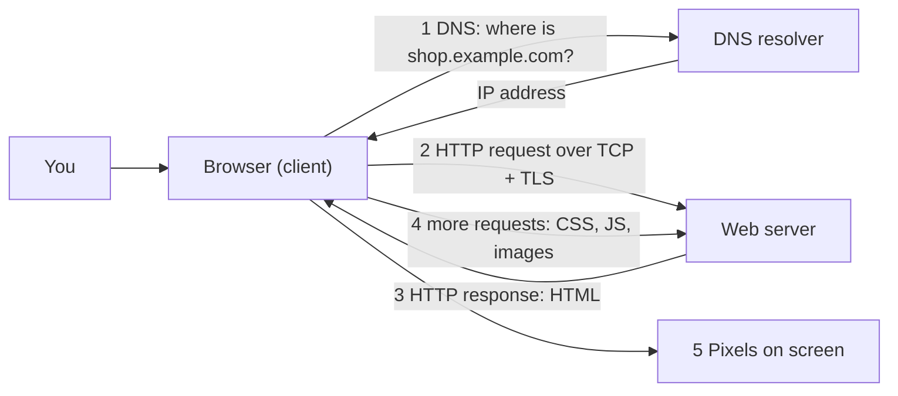
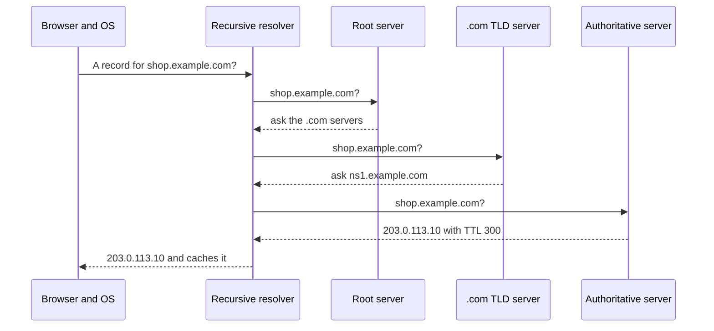
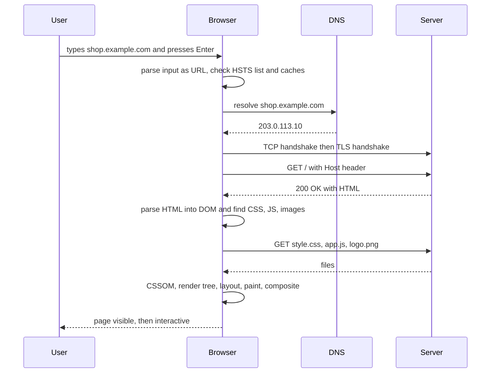
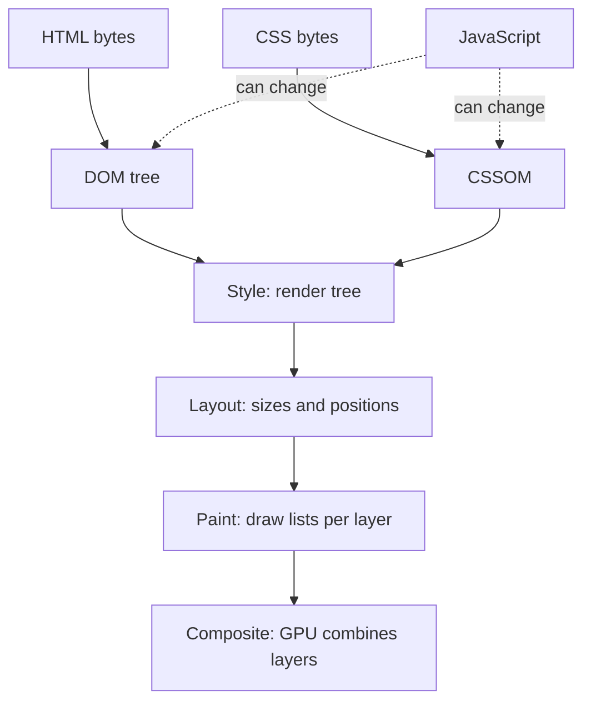
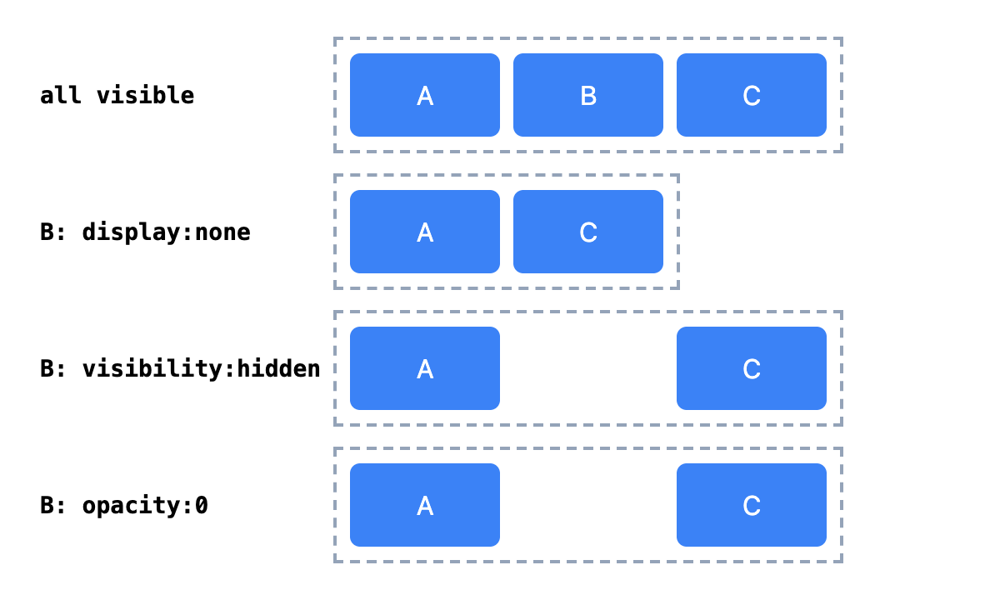
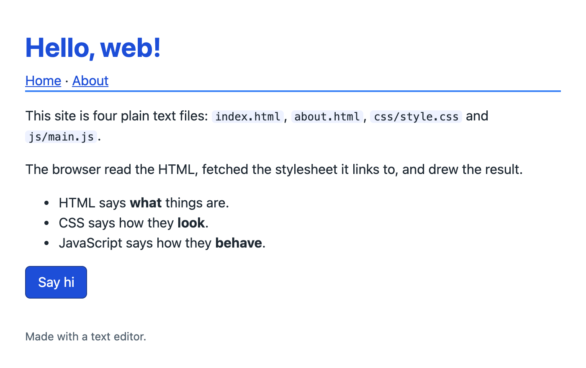
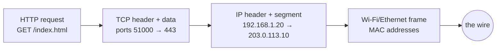

# Chapter 1 — How the Web Works

Before you write a single tag, it helps to know what actually happens between "I type an address" and "pixels appear". This chapter follows one page from a server's disk to your screen: the URL that names it, the DNS lookup that finds the server, the HTTP conversation that delivers it, and the browser pipeline that turns text into a picture. It ends with your first real page and a sensible folder layout for a small site.

**What you'll learn**

| # | Topic | You will be able to… |
|---|---|---|
| 1.1 | The web in one picture | explain client, server, browser, and the jobs of HTML, CSS and JavaScript |
| 1.2 | URLs | take a URL apart and predict how a relative link resolves |
| 1.3 | DNS | describe how a name like `example.com` becomes an IP address |
| 1.4 | Connections: TCP, TLS, HTTP versions | say what HTTPS protects and how HTTP/1.1, /2 and /3 differ |
| 1.5 | HTTP basics | read a raw request and response: methods, status codes, headers, caching |
| 1.6 | "What happens when you type a URL?" | give the classic interview answer end to end |
| 1.7 | The rendering pipeline | walk through parse → DOM/CSSOM → render tree → layout → paint → composite |
| 1.8 | Browser DevTools | use the Elements, Console, Network and Performance panels |
| 1.9 | Your first page and file structure | build, open and serve a small multi-page site |
| 1.10 | Networking fundamentals | explain OSI vs TCP/IP layers, TCP vs UDP vs QUIC, ports, IPv4/IPv6, NAT, more DNS records, firewalls, proxies and VPNs |

Every example lives in [`code/`](code/). The `.mjs` files run with Node 24 (`node code/01_url_parts.mjs`); the ones that need a DOM use jsdom, and two drive real headless Chrome. Outputs below are copied from real runs.

---

## 1.1 The web in one picture

### What it is
The **Internet** is the global network of connected computers and the low-level rules (IP, TCP, UDP) that move data between them. The **World Wide Web** is one service running on top of it: documents and apps identified by URLs, fetched with HTTP, and written in HTML. Email, online games and SSH also use the Internet but are not "the web".

Tim Berners-Lee proposed the web at CERN in 1989 and the first website went live in 1991. Three ideas from that design still hold everything up: **URLs** to name things, **HTTP** to fetch them, and **HTML** to describe them and link them together.

Analogy: the Internet is the road network; the web is one delivery company using those roads. The URL is the delivery address, HTTP is the order form, and HTML is the parcel.

### The roles

| Term | Meaning | Example |
|---|---|---|
| **Client** | The program that asks for something | Your browser, a phone app, `curl` |
| **Server** | A program (and the machine running it) that answers requests | nginx, a Node.js app, a CDN edge node |
| **User agent** | The spec's name for the program acting for the user — usually the browser | Chrome, Firefox, Safari, a screen reader + browser |
| **Resource** | Anything a URL points at | An HTML page, an image, a JSON response |
| **Browser engine** | The part of a browser that parses and draws pages | Blink (Chrome, Edge, Opera), Gecko (Firefox), WebKit (Safari) |
| **JavaScript engine** | The part that runs JS | V8 (Chrome, Node.js), SpiderMonkey (Firefox), JavaScriptCore (Safari) |



### The three languages of the front end

| Language | Its job | If it were a house |
|---|---|---|
| **HTML** (HyperText Markup Language) | Structure and meaning: "this is a heading, this is a list, this is a button" | The walls, rooms and doors |
| **CSS** (Cascading Style Sheets) | Presentation: colour, spacing, layout, animation | Paint, furniture, lighting |
| **JavaScript** | Behaviour: react to clicks, fetch data, change the page | Electricity and plumbing |

Keeping them separate is not just tidiness. A screen reader, a search engine and a "reader mode" all use the HTML alone; a well-structured page stays usable even if the CSS fails to load or JavaScript is switched off. This idea is called **progressive enhancement**: start with working HTML, then layer CSS and JS on top.

### Who defines the rules
- **HTML** and the DOM are maintained as a "living standard" by the **WHATWG** (Web Hypertext Application Technology Working Group) at html.spec.whatwg.org. There is no "HTML6" coming; the standard is updated continuously and "HTML5" is just a historical label.
- **CSS** is specified by the **W3C** CSS Working Group as separate modules (Flexbox, Grid, Colour…).
- **HTTP** is defined by the **IETF** in RFCs (Requests for Comments).
- **JavaScript** is standardised as **ECMAScript** by Ecma TC39 (see the [JavaScript book](../../../javascript/)).
- **Accessibility** guidelines (WCAG) come from the W3C's Web Accessibility Initiative (see [Chapter 3](../03-semantic-html-and-accessibility/README.md)).

**Baseline** is a label (shown on MDN and web.dev) for web features that work in all major browsers: *newly available* once the last of the core browsers — Chrome, Edge, Firefox and Safari, on desktop and mobile — ships it, and *widely available* 30 months after that. This book uses it whenever browser support matters.

### Self-check
1. Is email part of the web? → No. It uses the Internet but not HTTP/HTML/URLs as its core protocol.
2. Which language would you change to move a sidebar from the left to the right? → CSS.
3. What is a user agent? → The software acting on the user's behalf, normally the browser.

---

## 1.2 URLs — the address of everything

### What it is
A **URL** (Uniform Resource Locator) is a string that says *how* to reach a resource and *where* it is. Every link, image, stylesheet and API call you write in HTML is a URL.

### How it works — the parts
`https://user@shop.example.com:8443/books/html.html?lang=en&page=2#reviews`

| Part | In the example | Meaning |
|---|---|---|
| Scheme | `https:` | Which protocol to use (`http`, `https`, `mailto`, `tel`, `file`, `data`…) |
| Userinfo | `user@` | Rare, mostly legacy; never put passwords here |
| Host | `shop.example.com` | Domain name (or IP address) of the server |
| Port | `:8443` | Which "door" on the server; omitted = the scheme's default (80 for http, 443 for https) |
| Path | `/books/html.html` | Which resource on that server |
| Query | `?lang=en&page=2` | Extra `name=value` parameters, separated by `&` |
| Fragment | `#reviews` | A spot *inside* the page (usually an element `id`); never sent to the server |

The **origin** is scheme + host + port (`https://shop.example.com:8443`). It matters a lot for security: browsers isolate pages by origin (the *same-origin policy*), which you will meet again with cookies, `fetch` and CORS in the JavaScript book.

Node implements the same WHATWG URL Standard that browsers follow, so we can explore URLs in Node:

```js
// code/01_url_parts.mjs
const u = new URL('https://user@shop.example.com:8443/books/html.html?lang=en&page=2#reviews');
for (const k of ['href', 'protocol', 'username', 'hostname', 'port', 'origin', 'pathname', 'search', 'hash'])
  console.log(k.padEnd(9), u[k]);
console.log('lang    =', u.searchParams.get('lang'), '| page =', u.searchParams.get('page'));

// Relative URLs are resolved against the page's own URL (the "base").
const base = 'https://shop.example.com/books/html.html';
for (const rel of ['css.html', './img/cover.png', '../about.html', '/cart', '?page=3', '#top', '//cdn.example.net/a.js'])
  console.log(rel.padEnd(24), '->', new URL(rel, base).href);

// Special characters are percent-encoded; default ports disappear.
console.log(new URL('https://example.com:443/my file.html?q=café').href);
```

Output:
```
href      https://user@shop.example.com:8443/books/html.html?lang=en&page=2#reviews
protocol  https:
username  user
hostname  shop.example.com
port      8443
origin    https://shop.example.com:8443
pathname  /books/html.html
search    ?lang=en&page=2
hash      #reviews
lang    = en | page = 2
css.html                 -> https://shop.example.com/books/css.html
./img/cover.png          -> https://shop.example.com/books/img/cover.png
../about.html            -> https://shop.example.com/about.html
/cart                    -> https://shop.example.com/cart
?page=3                  -> https://shop.example.com/books/html.html?page=3
#top                     -> https://shop.example.com/books/html.html#top
//cdn.example.net/a.js   -> https://cdn.example.net/a.js
https://example.com/my%20file.html?q=caf%C3%A9
```

### Absolute vs relative URLs

| Kind | Looks like | Resolves to | Use for |
|---|---|---|---|
| Absolute | `https://other.site/page` | Exactly that | Links to other sites |
| Document-relative | `css.html`, `./img/a.png`, `../about.html` | Relative to the current page's folder | Files next to the page |
| Root-relative | `/cart` | Same origin, from the site root | Links inside a site served from a domain root |
| Scheme-relative | `//cdn.example.net/a.js` | Same scheme as the page | Legacy; just write `https://` today |
| Query / fragment only | `?page=3`, `#top` | Same page with a new query or jump target | Pagination, in-page links |

`.` means "this folder", `..` means "the parent folder". Relative links are what make a site movable: the same files work on your laptop, a staging server and production.

### Common mistakes
- Using Windows-style backslashes (`img\cat.png`) — URLs always use `/`.
- Root-relative links (`/css/style.css`) when opening files directly from disk: `/` then means the root of your *disk*, not your project. Use a local server (§1.9) or document-relative paths.
- Putting secrets or personal data in the query string — URLs end up in logs, history and `Referer` headers.
- Forgetting that the fragment is client-side only: the server never sees `#reviews`.

### Self-check
1. What is the origin of `http://example.com/a/b?c#d`? → `http://example.com` (port 80 implied).
2. On page `https://site.com/docs/intro/start.html`, where does `../api.html` go? → `https://site.com/docs/api.html`.
3. Does changing only the fragment trigger a new HTTP request? → No, the browser just scrolls to the target.

### TL;DR
A URL = scheme + host + port + path + query + fragment. Origin = scheme + host + port. Relative URLs resolve against the current page's URL.

---

## 1.3 DNS — turning names into addresses

### What it is
Computers route traffic by **IP address** (for example `203.0.113.10` in IPv4 or `2001:db8::10` in IPv6 — both from ranges reserved for documentation). People prefer names. The **Domain Name System (DNS)** is the Internet's distributed phone book that maps names to addresses.

### How it works
1. The browser checks its own cache, then asks the operating system, which checks its cache and the local `hosts` file (`/etc/hosts` on macOS/Linux).
2. If still unknown, the OS asks a **recursive resolver** — usually run by your ISP, company, or a public service such as 1.1.1.1 or 8.8.8.8.
3. The resolver walks the hierarchy from the right of the name: a **root server** says who runs `.com`; the **TLD (top-level domain) server** for `.com` says who is authoritative for `example.com`; the **authoritative name server** returns the actual record.
4. Every answer carries a **TTL** (time to live, in seconds). The resolver, OS and browser cache it for that long, so most lookups finish in a few milliseconds without leaving your machine or network.



### Record types you will meet

| Record | Maps | Example use |
|---|---|---|
| `A` | name → IPv4 address | `shop.example.com → 203.0.113.10` |
| `AAAA` | name → IPv6 address | same, for IPv6 |
| `CNAME` | name → another name (an alias) | `www.example.com → example.netlify.app` |
| `MX` | domain → mail servers | where email for `@example.com` goes |
| `TXT` | arbitrary text | domain ownership checks, SPF/DKIM email settings |
| `NS` | domain → its authoritative name servers | delegation |

Classic DNS travels over UDP port 53, unencrypted. Newer variants, **DNS over HTTPS (DoH)** and **DNS over TLS (DoT)**, encrypt lookups; most browsers can use DoH.

### Real-world examples
- When you "point a domain" at GitHub Pages, Netlify or Vercel, you add an `A` or `CNAME` record at your registrar.
- A **CDN** (content delivery network) such as Cloudflare or Akamai often answers DNS with the IP of the edge server nearest to you, so the same name leads to different machines in different countries (see [CDN in the system-design notes](../../../system-design-patterns/modules/08-api-and-edge/README.md)).
- Changing DNS "takes time to propagate" because old answers stay cached until their TTL expires.

### Self-check
1. Where does a lookup go after the browser and OS caches miss? → To the recursive resolver.
2. Which record makes `www` an alias for another hostname? → `CNAME`.
3. Why lower the TTL a day before moving a site to a new server? → So caches forget the old IP quickly after the switch.

---

## 1.4 Connections: TCP, TLS and the HTTP versions

### What it is
Once the browser has an IP address it needs a reliable, private channel to talk over.

- **TCP** (Transmission Control Protocol) gives an ordered, reliable byte stream. Opening it costs one round trip (the *three-way handshake*: SYN, SYN-ACK, ACK).
- **TLS** (Transport Layer Security) encrypts that stream and proves the server's identity with a **certificate** signed by a certificate authority. TLS 1.3 (2018) needs one extra round trip for a new connection. `https://` is simply HTTP carried inside TLS.
- **HTTP** is the request/response language spoken inside the channel.

### Why HTTPS matters
HTTPS gives three guarantees: **confidentiality** (others on the Wi-Fi cannot read your data), **integrity** (nobody can inject ads or malware into the page on the way) and **authentication** (you are really talking to `bank.com`). Browsers mark plain-HTTP pages "Not secure", many modern features (service workers, geolocation, camera, clipboard) only work in **secure contexts** (HTTPS or `localhost`), and free certificates from Let's Encrypt removed the cost excuse.

### HTTP versions compared

| Version | Year (current RFC) | Transport | Key idea | Practical effect |
|---|---|---|---|---|
| HTTP/1.1 | 1997 (RFC 9112, 2022) | TCP | Text messages, persistent connections | One request at a time per connection; browsers open ~6 connections per host |
| HTTP/2 | 2015 (RFC 9113, 2022) | TCP | Binary framing, **multiplexing** many requests on one connection, header compression | Many small files are cheap; one lost packet still stalls every stream (TCP head-of-line blocking) |
| HTTP/3 | 2022 (RFC 9114) | **QUIC** over UDP | Streams handled independently; TLS 1.3 built in | Faster set-up, better on lossy mobile networks, connections survive network changes |

The *meaning* of HTTP — methods, status codes, headers — is shared by all versions (RFC 9110, "HTTP Semantics"). You write the same HTML regardless; the server and browser negotiate the version.

### Self-check
1. What does TLS add on top of TCP? → Encryption, integrity and server authentication.
2. Name one thing HTTP/2 fixed from HTTP/1.1. → Many requests share one connection (multiplexing).
3. What does HTTP/3 run on? → QUIC, over UDP.

---

## 1.5 HTTP basics — requests and responses

### What it is
HTTP (HyperText Transfer Protocol) is a **request/response** protocol: the client sends a request, the server sends back exactly one response. It is **stateless** — each request stands alone, so anything the server must remember between requests (who is logged in, what is in your cart) is carried by cookies, tokens or URLs.

### How it works — anatomy
A **request** has: a *method* + *path* + *version* on the first line, then *headers* (`Name: value`), a blank line, and an optional *body*. A **response** has: *version* + *status code* + *reason*, headers, a blank line, and the body.

The script below starts a tiny server on your own machine and talks to it with a raw TCP socket, so you see the exact bytes (HTTP/1.1 is plain text; HTTP/2 and /3 carry the same information in binary frames).

```js
// code/02_http_exchange.mjs (key parts)
function send(res, status, headers, body = '') {
  res.sendDate = false;                                  // no Date header -> identical output on every run
  res.writeHead(status, { ...headers, 'Content-Length': Buffer.byteLength(body) });
  res.end(body);
}
const server = http.createServer((req, res) => {
  if (req.url === '/') send(res, 200, { 'Content-Type': 'text/html; charset=utf-8', 'Cache-Control': 'max-age=60' },
                            '<!DOCTYPE html><title>Hi</title><h1>Hello</h1>');
  else if (req.url === '/old') send(res, 301, { Location: '/' });
  else send(res, 404, { 'Content-Type': 'text/plain' }, 'Not found');
});
// ... raw(path) opens a socket and writes:
//   `GET ${path} HTTP/1.1\r\nHost: localhost\r\nAccept: text/html\r\nConnection: close\r\n\r\n`
await raw('/'); await raw('/old'); await raw('/missing');
```

Output:
```
>>> REQUEST
GET / HTTP/1.1
Host: localhost
Accept: text/html
Connection: close
<<< RESPONSE
HTTP/1.1 200 OK
Content-Type: text/html; charset=utf-8
Cache-Control: max-age=60
Content-Length: 46
Connection: close

<!DOCTYPE html><title>Hi</title><h1>Hello</h1>

>>> REQUEST
GET /old HTTP/1.1
Host: localhost
Accept: text/html
Connection: close
<<< RESPONSE
HTTP/1.1 301 Moved Permanently
Location: /
Content-Length: 0
Connection: close

>>> REQUEST
GET /missing HTTP/1.1
Host: localhost
Accept: text/html
Connection: close
<<< RESPONSE
HTTP/1.1 404 Not Found
Content-Type: text/plain
Content-Length: 9
Connection: close

Not found
```

What each part shows:
- `Host` is mandatory in HTTP/1.1 — one IP address can serve many websites, and this header says which one you want.
- `Content-Type: text/html; charset=utf-8` is how the browser knows the bytes are HTML and how to decode them. The browser trusts this header, not the `.html` file extension.
- `301` plus `Location` is a redirect: a browser would immediately request `/` instead.
- The fragment (`#...`) never appears in a request line.

### Methods

| Method | Purpose | Safe? (no side effects) | Idempotent? (repeat = same result) | Sent by plain HTML? |
|---|---|---|---|---|
| `GET` | Read a resource | Yes | Yes | Links, images, forms with `method="get"` |
| `HEAD` | Like GET, headers only | Yes | Yes | No |
| `POST` | Create / submit / trigger an action | No | No | Forms with `method="post"` |
| `PUT` | Replace a resource | No | Yes | No (use `fetch`) |
| `PATCH` | Partially update | No | Not necessarily | No |
| `DELETE` | Remove | No | Yes | No |
| `OPTIONS` | Ask what is allowed (used in CORS preflight) | Yes | Yes | No |

HTML itself can only send `GET` and `POST` (links and forms, [Chapter 5](../05-tables-and-forms/README.md)); JavaScript's `fetch` can send any method.

### Status codes

| Class | Meaning | Codes you should know |
|---|---|---|
| 1xx | Informational | `103 Early Hints` |
| 2xx | Success | `200 OK`, `201 Created`, `204 No Content` |
| 3xx | Redirection | `301 Moved Permanently`, `302 Found`, `304 Not Modified`, `307`/`308` (redirects that keep the method) |
| 4xx | Client error | `400 Bad Request`, `401 Unauthorized` (not logged in), `403 Forbidden` (logged in, not allowed), `404 Not Found`, `429 Too Many Requests` |
| 5xx | Server error | `500 Internal Server Error`, `502 Bad Gateway`, `503 Service Unavailable` |

### Headers worth recognising

| Header | Direction | What it does |
|---|---|---|
| `Host` | request | Which site on this server |
| `User-Agent` | request | Identifies the browser |
| `Accept`, `Accept-Language`, `Accept-Encoding` | request | Preferred formats, languages, compression (gzip, br, zstd) |
| `Cookie` / `Set-Cookie` | request / response | Carry small pieces of state; the server sets, the browser sends back |
| `Content-Type`, `Content-Length`, `Content-Encoding` | both | What the body is, how big, how compressed |
| `Location` | response | Where a redirect points |
| `Cache-Control`, `ETag`, `Last-Modified` | response | Caching rules and validators |
| `Content-Security-Policy`, `Strict-Transport-Security` | response | Security policies (which scripts may run; always use HTTPS) |

### Caching in one paragraph
Downloading the same stylesheet on every page would be slow, so responses can be cached. `Cache-Control: max-age=60` lets the browser reuse the copy for 60 seconds without asking. After that it can *revalidate*: send `If-None-Match: <etag>` and get a tiny `304 Not Modified` if nothing changed. Sites commonly put a content hash in file names (`app.3f9a2c.css`) and cache those for a year, while the HTML itself is cached briefly or revalidated every time. More in [Chapter 14](../14-performance-seo-interview-and-cheatsheet/README.md) and the [caching module](../../../system-design-patterns/modules/04-caching/README.md).

### Common mistakes
- Changing data with a `GET` link such as `<a href="/delete?id=5">`: crawlers and link-prefetchers follow GETs.
- Serving HTML with the wrong `Content-Type` (for example `text/plain`) — the browser will show the source code.
- Confusing `401` (who are you?) with `403` (I know who you are, and no).

### Self-check
1. Which header lets one IP host many sites? → `Host`.
2. What does `304` mean and when do you see it? → Not Modified; when revalidating a cached copy that is still current.
3. Why is HTTP called stateless? → The server treats every request independently; state must travel in cookies, tokens or URLs.
4. Which methods can a plain HTML form send? → `GET` and `POST`.

---

## 1.6 "What happens when you type a URL and press Enter?"

This is one of the most common web interview questions because it checks the whole chapter at once.



### In the interview
**30-second answer:** "The browser decides whether I typed a URL or a search, then resolves the host name to an IP via its caches and DNS. It opens a TCP connection and does a TLS handshake for HTTPS (or uses QUIC for HTTP/3), sends a GET request with headers such as Host and cookies, and gets back a response — maybe a redirect, ideally 200 with HTML. It parses the HTML into the DOM while fetching the CSS, JavaScript and images it discovers, builds the CSSOM, combines them into a render tree, computes layout, paints and composites layers to the screen. Scripts may then run and make the page interactive."

- *How could you make that faster?* → Fewer round trips (HTTP/2 or /3, CDN near users, keep-alive, `preconnect`), smaller and cacheable assets, no render-blocking CSS/JS beyond what is needed ([Chapter 14](../14-performance-seo-interview-and-cheatsheet/README.md)).
- *What is HSTS?* → `Strict-Transport-Security` tells the browser to always use HTTPS for that site, so it upgrades `http://` itself without ever sending an insecure request.
- *Where can caching short-circuit this?* → DNS caches, the browser's HTTP cache (no request at all under `max-age`), a service worker, a CDN edge cache.

---

## 1.7 The browser rendering pipeline

### What it is
The **rendering pipeline** (also called the *critical rendering path* when we talk about the first view) is the sequence of steps a browser engine uses to turn HTML and CSS bytes into pixels:



Understanding it explains many rules in later chapters: why CSS goes in `<head>`, why scripts get `defer`, why animating `transform` is smooth but animating `width` is not.

### Step 1 — Parsing HTML into the DOM
The bytes are decoded to characters (using the `charset`), split into **tokens** (start tags, end tags, text, comments) and fed to a **tree builder**. The result is the **DOM** (Document Object Model): a tree of objects — *nodes* — that JavaScript can read and change. HTML parsing is defined precisely by the WHATWG spec, including what to do with broken markup, so every modern browser builds the same tree from the same input. It never "fails": it recovers.

jsdom implements the same algorithm, so we can watch it fix a sloppy document:

```js
// code/03_parse_dom.mjs (key parts)
const body = `<title>Parsing demo</title>
<p>First paragraph
<p>Second <b>bold <i>both</b> italic?</i>
<table><tr><td>cell</td></tr></table>`;
const std = new JSDOM('<!DOCTYPE html>\n' + body).window.document;
console.log('Mode:', std.compatMode, '(CSS1Compat = standards mode)');
show(std.documentElement);                        // prints the tree, one node per line
console.log('\nSerialized back:\n' + std.body.innerHTML);
const quirks = new JSDOM(body).window.document;   // same markup, no doctype
console.log('Is the <table> inside the 2nd <p>?  standards:', !!std.querySelector('p > table'),
            '| quirks:', !!quirks.querySelector('p > table'));
```

Output:
```
Mode: CSS1Compat (CSS1Compat = standards mode)
Source had no <html>, <head>, <body>, </p> or <tbody> — the parser added them:

html
  head
    title
      "Parsing demo"
  body
    p
      "First paragraph"
    p
      "Second"
      b
        "bold"
        i
          "both"
      i
        "italic?"
    table
      tbody
        tr
          td
            "cell"

Serialized back:
<p>First paragraph
</p><p>Second <b>bold <i>both</i></b><i> italic?</i>
</p><table><tbody><tr><td>cell</td></tr></tbody></table>

Without <!DOCTYPE html> -> mode: BackCompat (BackCompat = quirks mode)
Is the <table> inside the 2nd <p>?  standards: false | quirks: true
```

What happened:
1. `<html>`, `<head>` and `<body>` were created automatically; `<title>` went into the head.
2. A new `<p>` closed the previous one — paragraphs cannot nest.
3. The mis-nested `<b><i></b></i>` was repaired by closing `<i>` and reopening a fresh `<i>` after `</b>` (the spec's "adoption agency algorithm").
4. A `<tbody>` was inserted into the table. (This is why CSS like `table > tr` never matches.)
5. Without `<!DOCTYPE html>` the page is in **quirks mode**, which imitates 1990s browser bugs — here, a table does *not* close the paragraph. Always start with the doctype ([Chapter 2](../02-html-structure-and-text/README.md)).

Relying on error recovery is still bad practice: the fixed-up tree may not be what you meant. Validate your HTML (§2.10).

**Scripts and parsing.** A plain `<script src>` is *parser-blocking*: the parser stops, downloads and runs the script (which might call `document.write`), then continues. Two attributes change that:

| Script tag | Downloads | Runs | Order kept? | Use for |
|---|---|---|---|---|
| `<script src>` | blocks parsing | immediately | yes | Rarely needed today |
| `<script src defer>` | in parallel | after parsing finishes, before `DOMContentLoaded` | yes | Most page scripts |
| `<script src async>` | in parallel | as soon as downloaded (pauses parser briefly) | no | Independent scripts, e.g. analytics |
| `<script type="module">` | in parallel | deferred by default | yes | Modern ES-module code |

Browsers also run a **preload scanner** that reads ahead in the raw HTML and starts downloading CSS, scripts and images early, even while the main parser is blocked.

### Step 2 — Parsing CSS into the CSSOM
CSS from `<link rel="stylesheet">`, `<style>` blocks and `style=""` attributes is parsed into the **CSSOM** (CSS Object Model): the rules, their selectors and declarations. CSS is **render-blocking**: the browser will not paint the page until it has the stylesheets in `<head>`, because painting unstyled content and then restyling it would cause a "flash of unstyled content" (FOUC). That is why stylesheets belong in the head and should be small.

### Step 3 — Style and the render tree
The browser matches every DOM element against the CSS rules and computes its final value for every property (**computed style**; the cascade and specificity that decide this are covered in [Chapter 6](../06-css-fundamentals/README.md)). Elements that produce boxes form the **render tree** (Chrome calls it the *layout tree*). What gets left out:

- elements with `display: none`, and everything inside them;
- things that never render: `<head>`, `<script>`, `<meta>`, `<link>`.

`visibility: hidden` and `opacity: 0` elements *stay* in the tree: they are invisible but still take up space.

```js
// code/04_render_tree.mjs (key parts)
const html = `... <style>
  .hidden { display: none; }  .ghost { visibility: hidden; }  .faded { opacity: 0; }  p { color: #333; }
</style> ... <h1>Title</h1> <p>Normal paragraph</p> <p class="hidden">...</p>
  <p class="ghost">...</p> <p class="faded">...</p> <script>/* ... */</script> ...`;
for (const rule of document.styleSheets[0].cssRules) console.log('  ' + rule.cssText);   // the CSSOM
for (const el of document.body.children) {
  const cs = window.getComputedStyle(el);
  const inTree = cs.display !== 'none';
  const visible = inTree && cs.visibility !== 'hidden' && cs.opacity !== '0';
  // ... print one row per element
}
```

Output:
```
CSSOM rules:
  .hidden { display: none; }
  .ghost { visibility: hidden; }
  .faded { opacity: 0; }
  p { color: rgb(51, 51, 51); }

Element           display  visibility  in render tree?  painted visibly?
<h1>               block    visible     true             true
<p>                block    visible     true             true
<p .hidden>        none     visible     false            false
<p .ghost>         block    hidden      true             false
<p .faded>         block    visible     true             false
<script>           none     visible     false            false
```

Notice the CSSOM stores `#333` as `rgb(51, 51, 51)` — it holds parsed values, not your text. Here is the same idea in real Chrome ([`code/render-tree.html`](code/render-tree.html)):


*Figure 1.1 — `display: none` removes B's box entirely; `visibility: hidden` and `opacity: 0` keep its space.*

| Technique | Takes space? | Clickable? | Read by screen readers? |
|---|---|---|---|
| `display: none` | No | No | No |
| `visibility: hidden` | Yes | No | No |
| `opacity: 0` | Yes | **Yes** | **Yes** |
| `hidden` attribute | No (it applies `display: none`) | No | No |

### Step 4 — Layout
**Layout** (Firefox says *reflow*) computes the exact position and size of every box in pixels, starting from the viewport width: percentages, `em`s, flex and grid rules all become concrete numbers. Changing anything geometric later — width, font size, adding content — can force layout again for part or all of the page.

### Step 5 — Paint
**Paint** turns each box into drawing instructions: backgrounds, borders, text, shadows, images, in the correct stacking order. The page may be split into several **layers** (for example for a fixed header, a video, or an element with `will-change: transform`), and each is painted separately. The instructions are then *rasterised* into pixels, often on the GPU.

### Step 6 — Composite
**Compositing** stacks the layers on the screen in the right order. Changes to `transform` and `opacity` can often be handled here alone — no new layout or paint — which is why they animate smoothly at 60 frames per second or more ([Chapter 12](../12-transitions-transforms-and-animation/README.md)).

### What a change costs

| You change | Layout | Paint | Composite | Example |
|---|---|---|---|---|
| `width`, `height`, `margin`, `top`, font size, content | yes | yes | yes | Expanding an accordion |
| `color`, `background-color`, `box-shadow` | no | yes | yes | Hover colour |
| `transform`, `opacity` | no | no | yes | Sliding a drawer |

### Events you can observe
- `DOMContentLoaded` — the HTML is fully parsed and deferred scripts have run (images may still be loading).
- `load` — everything, including images and iframes, has loaded.
- First Contentful Paint, Largest Contentful Paint — performance milestones measured in DevTools and Lighthouse ([Chapter 14](../14-performance-seo-interview-and-cheatsheet/README.md)).

### Common mistakes
- Putting `<script>` tags without `defer` in `<head>` — nothing renders until they download and run.
- Hiding content with `opacity: 0` and forgetting that it is still clickable and read aloud.
- Reading a layout value (`offsetHeight`) right after changing styles in a loop — forcing layout again and again ("layout thrashing").

### In the interview
**30-second answer:** "The browser parses HTML into the DOM and CSS into the CSSOM, combines them into a render tree of visible boxes, runs layout to get geometry, paints each layer, and composites the layers on the GPU. CSS is render-blocking and classic scripts are parser-blocking, so I keep critical CSS small and load scripts with `defer` or as modules. For animation I prefer `transform` and `opacity` because they skip layout and paint."

- *Difference between `display:none` and `visibility:hidden`?* → The first removes the box from the render tree and frees its space; the second keeps the space but draws nothing.
- *`defer` vs `async`?* → Both download in parallel; `defer` runs in document order after parsing, `async` runs whenever it arrives, in any order.
- *What is a reflow?* → Recomputing layout because geometry changed; it is expensive on large pages.

### Self-check
1. Name the six stages in order. → Parse HTML → DOM; parse CSS → CSSOM; style/render tree; layout; paint; composite.
2. Is `<head>` in the render tree? → No.
3. Why is CSS render-blocking? → To avoid painting unstyled content and immediately repainting it.
4. What does the parser do with a `<p>` inside a `<p>`? → It closes the first paragraph.

### TL;DR
HTML → DOM, CSS → CSSOM, both → render tree → layout → paint → composite. CSS blocks rendering; classic scripts block parsing; `defer`/modules fix that. `transform` and `opacity` changes are the cheapest.

---

## 1.8 Browser DevTools

### What it is
Every desktop browser ships **developer tools** — panels that show the DOM, styles, network traffic and performance of the page you are on. Open them with **F12**, **Ctrl+Shift+I** (Windows/Linux) or **Cmd+Option+I** (macOS), or right-click an element → *Inspect*.

### The panels you will use (Chrome names; Firefox and Safari are similar)

| Panel | What it shows | Use it to… |
|---|---|---|
| **Elements** (Firefox: Inspector) | The live DOM (not your source file) + the CSS rules applied to the selected element, with crossed-out overridden declarations, the box model diagram and computed values | Find why a style is not applied, try CSS changes live, see flex/grid overlays |
| **Console** | Errors, warnings, `console.log` output; a JavaScript prompt | Spot failing scripts, test expressions (`$0` = selected element) |
| **Sources** (Firefox: Debugger) | All loaded files; breakpoints | Step through JavaScript |
| **Network** | Every request: status, type, size, timing waterfall, headers | Find 404s, slow files, check caching and `Content-Type` |
| **Performance** | A recorded timeline of parsing, scripting, style, layout, paint | Find what makes the page slow or janky |
| **Lighthouse** | Automated audits for performance, accessibility, SEO, best practices | A quick report card ([Chapter 14](../14-performance-seo-interview-and-cheatsheet/README.md)) |
| **Application** (Firefox: Storage) | Cookies, local storage, service workers, cache | Debug state and offline behaviour |
| **Accessibility** pane / tree | The accessibility tree, roles, names, contrast | [Chapter 3](../03-semantic-html-and-accessibility/README.md) |

Also useful: the **device toolbar** (Ctrl/Cmd+Shift+M) to simulate phone screens and slow networks, and "Rendering" options such as paint flashing and emulating `prefers-color-scheme: dark`.

### Seeing what the Network panel sees
The next script serves the first-page site (§1.9) over HTTP, opens it in real headless Chrome and prints each response, like the Network panel's list. It then checks computed style and clicks the button, as you would in the Elements panel and on the page:

```js
// code/05_what_the_browser_fetched.mjs (key parts)
const server = http.createServer(/* serves files from site/ with the right Content-Type, 404 otherwise */);
const browser = await puppeteer.launch({ executablePath: '/Applications/Google Chrome.app/Contents/MacOS/Google Chrome', headless: 'new' });
const page = await browser.newPage();
page.on('response', r => lines.push(`${r.status()}  ${r.request().resourceType().padEnd(10)} ${r.url().replace(origin, '').padEnd(15)} ${r.headers()['content-type'] ?? ''}`));
await page.goto(origin + '/index.html', { waitUntil: 'networkidle0' });
// ... print lines, then:
console.log('\nAfter load:', await page.evaluate(() => ({
  title: document.title,
  elements: document.querySelectorAll('*').length,
  h1Color: getComputedStyle(document.querySelector('h1')).color,   // proves the CSS was applied
})));
await page.click('#hi');                                             // proves the JavaScript runs
console.log('After clicking "Say hi":', await page.$eval('#msg', el => el.textContent));
```

Output:
```
status type       path            content-type
200  document   /index.html     text/html; charset=utf-8
200  stylesheet /css/style.css  text/css
200  script     /js/main.js     text/javascript
404  other      /favicon.ico    

After load: { title: 'My First Page', elements: 31, h1Color: 'rgb(29, 78, 216)' }
After clicking "Say hi": Hi! JavaScript ran.
```

One HTML request led to two more that the parser discovered. The `404` for `/favicon.ico` is the browser automatically asking for a tab icon; add `<link rel="icon" href="...">` (Chapter 2) to control it.

### Common mistakes
- Editing styles in DevTools and forgetting they vanish on reload — copy the change back to your CSS file.
- Reading the Elements panel as if it were your source: it shows the DOM *after* parsing fixes and JavaScript changes. Use "View Page Source" (Ctrl/Cmd+U) for the original.
- Debugging caching with "Disable cache" still ticked (it only applies while DevTools is open).

### Self-check
1. Where do you see which CSS rule was overridden? → Elements → Styles (overridden declarations are struck through).
2. How do you check a file's status code and `Content-Type`? → Network panel, click the request → Headers.
3. Why might the Elements panel differ from View Source? → It shows the live DOM after parsing fixes and script changes.

---

## 1.9 Your first page and file structure

### How it works
1. Create a folder for the site and a file called `index.html`. Web servers return `index.html` when a URL names a folder (`https://site.com/` → `/index.html`), so it is the conventional home page.
2. Type the page in any plain-text editor (VS Code is the common choice; a word processor is not — it adds formatting).
3. Open it: double-click it (the browser shows a `file://` URL), or better, run a tiny local server so URLs behave as they will in production, e.g. `npx serve .` or `python3 -m http.server 8000`, then visit `http://localhost:8000/`.
4. Edit, save, reload. Use DevTools to see what the browser made of it.

Here is the complete first page; every line is explained in Chapter 2.

```html
<!-- code/site/index.html -->
<!DOCTYPE html>
<html lang="en">
<head>
  <meta charset="utf-8">
  <meta name="viewport" content="width=device-width, initial-scale=1">
  <title>My First Page</title>
  <link rel="stylesheet" href="css/style.css">
</head>
<body>
  <header>
    <h1>Hello, web!</h1>
    <nav><a href="index.html">Home</a> · <a href="about.html">About</a></nav>
  </header>
  <main>
    <p>This site is four plain text files: <code>index.html</code>, <code>about.html</code>, <code>css/style.css</code> and <code>js/main.js</code>.</p>
    <p>The browser read the HTML, fetched the stylesheet it links to, and drew the result.</p>
    <ul>
      <li>HTML says <strong>what</strong> things are.</li>
      <li>CSS says how they <strong>look</strong>.</li>
      <li>JavaScript says how they <strong>behave</strong>.</li>
    </ul>
    <button type="button" id="hi">Say hi</button>
    <output id="msg"></output>
  </main>
  <footer><small>Made with a text editor.</small></footer>
  <script src="js/main.js"></script>
</body>
</html>
```

```css
/* code/site/css/style.css (excerpt) */
body   { font-family: system-ui, sans-serif; max-width: 40rem; margin: 2rem auto; padding: 0 1rem; line-height: 1.5; color: #1f2933; }
header { border-bottom: 2px solid #3b82f6; margin-bottom: 1rem; }
h1     { color: #1d4ed8; margin: 0 0 .25rem; }
button { font: inherit; padding: .4rem .9rem; border-radius: 6px; border: 1px solid #1e3a8a; background: #1d4ed8; color: white; }
```

```js
// code/site/js/main.js
document.getElementById('hi').addEventListener('click', () => {
  document.getElementById('msg').textContent = 'Hi! JavaScript ran.';
});
```


*Figure 1.2 — `code/site/index.html` in Chrome.*

The script tag sits at the end of `<body>`, so the button exists when it runs. (An equally good choice is `<script src="js/main.js" defer>` in the head.)

### A sensible file structure

```
my-site/
├── index.html          home page  →  /
├── about.html          →  /about.html
├── blog/
│   └── index.html      →  /blog/
├── css/
│   └── style.css
├── js/
│   └── main.js
├── img/
│   ├── logo.svg
│   └── hero.avif
└── favicon.ico
```

| Rule | Why |
|---|---|
| Lower-case names, words separated by hyphens (`contact-us.html`) | URLs are case-sensitive on most servers; spaces become `%20`; hyphens read well and are what search engines expect |
| One folder per asset type (`css/`, `js/`, `img/`) — or per feature in larger projects | Easy to find, easy to set cache rules |
| `index.html` in every folder that should be a "page" | Clean URLs such as `/blog/` |
| Document-relative links between pages | The site works from any folder or domain |
| Keep source and generated files apart once you add build tools (`src/` → `dist/`) | You never edit generated output by hand |

### Real-world examples
Static sites like this are deployed by uploading the folder to GitHub Pages, Netlify, Cloudflare Pages or an S3 bucket behind a CDN. Frameworks (React, Next.js, Astro) generate the same kind of HTML, CSS and JS files; the browser still receives exactly what this chapter describes.

### Common mistakes
- Saving as `index.html.txt` (hidden extensions on Windows/macOS).
- Linking `href="CSS/Style.css"` when the file is `css/style.css` — works on a case-insensitive laptop, breaks on a Linux server.
- Missing `<!DOCTYPE html>` or `<meta charset="utf-8">`: quirks mode and garbled accents.

### Self-check
1. Why is the home page called `index.html`? → Servers return it by default for a folder URL.
2. Why prefer a local server over double-clicking? → Root-relative URLs, `fetch`, modules and some APIs behave differently or fail on `file://`.
3. Why is the script at the end of `<body>` (or `defer`)? → So parsing is not blocked and the elements it uses already exist.

---

## 1.10 Networking fundamentals

### What it is
Sections 1.3–1.5 followed one request from name to page. This section steps down one level and names the machinery underneath: the **layers** that split the job of moving data, the two transport protocols (**TCP** and **UDP**) and their modern mix (**QUIC**), how addresses work (**IPv4, IPv6, NAT**), and the boxes that sit in the path (**firewalls, proxies, VPNs**). You do not need this to write HTML, but interviewers ask it, and it explains everyday puzzles such as "why does my laptop have the address `192.168.1.20` when the website sees a different one?".

Analogy: sending a parcel. You write a letter (the application data), put it in an envelope with the flat number (the **port**), the post office adds the street address (the **IP address**), and a van moves it along one road at a time (the **link**). Each layer only cares about its own label.

### How it works — the layer models

A **protocol** is an agreed set of rules for a conversation. Networking stacks protocols in **layers**: each layer uses the one below and serves the one above, and each wraps the data in its own header (**encapsulation**). There are two famous layer models:

| OSI model (7 layers, a teaching model, ISO 7498) | TCP/IP model (4 layers, what the Internet actually runs, RFC 1122) | Examples | Unit of data |
|---|---|---|---|
| 7 Application · 6 Presentation · 5 Session | **Application** | HTTP, DNS, TLS\*, SSH, SMTP | message |
| 4 Transport | **Transport** | TCP, UDP, QUIC | segment / datagram |
| 3 Network | **Internet** | IP (v4, v6), ICMP (`ping`) | packet |
| 2 Data link · 1 Physical | **Link** | Ethernet, Wi-Fi, fibre, radio | frame / bits |

\*TLS sits awkwardly between transport and application; people call it "layer 4.5" or put it in OSI layer 6.



When engineers say "a layer-4 load balancer" they mean one that looks only at IP addresses and ports; "layer 7" means it reads HTTP (URLs, headers, cookies). See [Load Balancing](../../../system-design-patterns/modules/06-scaling/README.md#load-balancing) and [Reverse Proxy](../../../system-design-patterns/modules/08-api-and-edge/README.md#reverse-proxy) in the system-design notes.

### How it works — ports and sockets
An IP address finds the **machine**; a **port** (a number 0–65535) finds the **program** on it. A **socket** is one end of a conversation: IP + port + protocol. Servers listen on **well-known ports**; clients get a random **ephemeral port** from the OS (the demo below shows `61804`).

| Port | Service | Port | Service |
|---|---|---|---|
| 22 | SSH | 443 | HTTPS (TCP), HTTP/3 (UDP) |
| 25 / 587 | SMTP (mail between servers / from clients) | 3306 / 5432 | MySQL / PostgreSQL |
| 53 | DNS (UDP, TCP for large answers) | 6379 | Redis |
| 80 | HTTP | 8080 / 3000 / 5173 | common dev-server choices |

### How it works — TCP vs UDP vs QUIC

| | **TCP** (RFC 9293) | **UDP** (RFC 768) | **QUIC** (RFC 9000) |
|---|---|---|---|
| Connection set-up | 3-way handshake (1 round trip), then TLS | none — just send | 1 round trip including TLS 1.3; 0-RTT on resume |
| Delivery | reliable, ordered, retransmits lost data | best effort: may lose, duplicate or reorder | reliable and ordered **per stream** |
| Shape of data | one **byte stream**, no message boundaries | separate **datagrams**, boundaries kept | many independent streams in one connection |
| Flow / congestion control | yes | no (the app must be polite) | yes |
| Head-of-line blocking | one lost packet stalls everything behind it | none | only the stream that lost the packet waits |
| Used by | HTTP/1.1, HTTP/2, SSH, databases, email | DNS, video calls, games, VoIP, DHCP | HTTP/3 |

Why do games and video calls use UDP? A voice sample that arrives late is useless — better to skip it than to stall the call waiting for a retransmission. QUIC runs **on top of UDP** for a practical reason: routers and firewalls everywhere already pass UDP, while a brand-new transport protocol would be blocked. QUIC then re-implements reliability and encryption itself, and its connection IDs let a download survive moving from Wi-Fi to 4G.

### How it works — addresses: IPv4, IPv6, NAT
- **IPv4** (RFC 791): 32-bit addresses written as four numbers, `203.0.113.10` — about 4.3 billion in total, which ran out (the last big regional pools were exhausted between 2011 and 2019).
- **IPv6** (RFC 8200): 128-bit addresses in hex groups, `2001:db8::10` (`::` means "a run of zeros") — enough that every device can have its own public address. IPv6 also drops header checksums and in-network fragmentation, and makes auto-configuration standard. Both run side by side today (**dual stack**); a browser that has both tries IPv6 and IPv4 almost in parallel ("Happy Eyeballs", RFC 8305) and uses whichever connects first.
- **CIDR notation** `10.0.0.0/8` means "the first 8 bits are fixed" — a range of 2^24 addresses. It is how subnets and firewall rules are written.
- **Private ranges** (RFC 1918): `10.0.0.0/8`, `172.16.0.0/12`, `192.168.0.0/16` are never routed on the public Internet; any home or office can reuse them. `127.0.0.1` / `::1` is **loopback** — this machine.
- **NAT** (network address translation) is how a house full of private addresses shares one public IPv4 address. The router rewrites the source of each outgoing packet to *its* public IP and a fresh port, remembers the mapping, and rewrites replies back. Side effect: nobody outside can start a connection to a device inside unless a mapping exists — which is why peer-to-peer video calls need tricks (STUN/TURN, used by WebRTC).
- **Unicast** = to one host; **broadcast** = to every host on the local network (IPv4 only); **multicast** = to a subscribed group; **anycast** = one address announced from many places, and routing delivers you to the nearest — how public DNS resolvers and CDNs answer from a nearby city.
- **LAN** = the local network in one building; **WAN** = networks joined across distance (the Internet is the biggest WAN).

### How it works — DNS records beyond the basics
§1.3 covered `A`, `AAAA`, `CNAME`, `MX`, `TXT` and `NS`. Four more show up in real set-ups: **`SOA`** (start of authority: the zone's primary server and timers), **`PTR`** (reverse lookup: IP → name, used by mail servers to check senders), **`SRV`** (service → host + port, e.g. for SIP or some databases), and **`CAA`** (which certificate authorities may issue certificates for the domain). A `CNAME` cannot sit at the bare domain (`example.com`) alongside other records, so DNS hosts offer non-standard "ALIAS/ANAME" flattening for that case.

### How it works — firewalls, proxies and VPNs
- A **firewall** filters traffic by rules. A *packet filter* matches addresses, ports and protocols ("allow TCP 443 from anywhere, allow 22 only from 10.0.0.0/8, deny the rest"). A *stateful* firewall also tracks connections, so replies to traffic you started are let back in automatically. Cloud **security groups** are stateful firewalls. A **WAF** (web application firewall) works at layer 7 and inspects HTTP for attacks such as SQL injection.
- A **forward proxy** acts for **clients**: a company proxy that all employee traffic goes through (filtering, caching, logging). A **reverse proxy** acts for **servers**: nginx, a load balancer or a CDN in front of your app, which ends TLS, caches and spreads load. From the browser's side a reverse proxy *is* "the server".
- A **VPN** (virtual private network) wraps your packets in an encrypted tunnel to another network so you behave as if you were plugged in there. **Remote-access VPNs** connect a laptop to the office; **site-to-site VPNs** join two offices or an office and a cloud network. Common protocols: **IPsec**, **WireGuard** (small, modern), and TLS-based VPNs such as OpenVPN. A VPN hides your traffic from the local Wi-Fi, not from the VPN provider.

### Seeing it: [`code/06_network_basics.mjs`](code/06_network_basics.mjs)
The script uses only the loopback interface: it resolves `localhost`, sends three writes over TCP and three datagrams over UDP, checks addresses against a firewall-style allow-list (`net.BlockList`), and simulates a NAT table.

```text
localhost -> ::1 (IPv6), 127.0.0.1 (IPv4)
isIPv4("203.0.113.10") = true | isIPv6("2001:db8::10") = true
TCP server listening on 127.0.0.1:61803
TCP server sees client 127.0.0.1:61804 (ephemeral port picked by the OS)
TCP bytes received      : "one|two|three|" (in order, as one stream)
UDP datagrams received  : ["one","two","three"] (boundaries kept; on a real network some could be lost or reordered)
firewall: 192.168.1.20  private=true  -> ALLOW (admin port 22)
firewall: 10.4.5.6      private=true  -> ALLOW (admin port 22)
firewall: 172.20.0.1    private=true  -> ALLOW (admin port 22)
firewall: 203.0.113.10  private=false -> DENY
firewall: 8.8.8.8       private=false -> DENY
NAT out: 192.168.1.10:51000 -> 203.0.113.5:40001
NAT out: 192.168.1.11:51000 -> 203.0.113.5:40002
NAT in : reply to :40001     -> 192.168.1.10:51000
NAT in : packet to :40999    -> DROP (no mapping: unsolicited inbound traffic)
all assertions passed
```

Notice that TCP handed the server `one|two|three|` as a single stream — the `|` separators are there because TCP itself keeps no message boundaries, so every protocol on top (HTTP included) must mark where messages end (`Content-Length`, chunked encoding, frames). UDP delivered three separate messages. Port numbers change on every run.

### Common mistakes
- "UDP is unreliable, so never use it" → it is the right choice when late data is worthless (live media, games) or when the app adds its own reliability (QUIC, DNS retries).
- Treating TCP reads as messages → one `send` can arrive split across reads, or several can arrive together; always frame your messages.
- Thinking your laptop's `192.168.x.x` address is what servers see → they see the router's public address after NAT.
- Opening a database port (5432, 6379) to `0.0.0.0/0` in a cloud security group → allow only the app servers' subnet.
- Assuming a VPN makes you anonymous → the VPN operator sees everything the Wi-Fi provider used to.

### In the interview
**30-second answer — TCP vs UDP:** "TCP is connection-based: a handshake, then a reliable, ordered byte stream with flow and congestion control — used by HTTP/1.1 and /2, databases and SSH. UDP just sends independent datagrams with no guarantees and no set-up cost — used by DNS, games and video calls where speed beats completeness. QUIC builds reliable, encrypted, multiplexed streams on top of UDP and powers HTTP/3."

- *OSI vs TCP/IP?* → OSI is a 7-layer teaching model; TCP/IP is the 4-layer model the Internet runs (application, transport, internet, link).
- *Why IPv6?* → IPv4's 32-bit space ran out; NAT stretched it at the cost of end-to-end reachability. IPv6's 128 bits give every device a public address.
- *Forward vs reverse proxy?* → Forward acts for clients (egress filtering); reverse acts for servers (TLS termination, load balancing, caching).

### Self-check
1. Which layer does a port belong to? → Transport (TCP/UDP).
2. Why does HTTP/3 run over UDP rather than a new protocol? → Middleboxes already pass UDP; QUIC adds reliability and TLS itself.
3. What does a home router's NAT table map? → Public IP:port ↔ private IP:port of each outgoing connection.
4. Which CIDR ranges are private IPv4? → `10/8`, `172.16/12`, `192.168/16`.
5. Stateful vs packet-filter firewall? → Stateful tracks connections and lets replies back in automatically.

### TL;DR
Data travels down the layers (application → transport → IP → link), each adding a header. TCP = reliable ordered stream after a handshake; UDP = fast independent datagrams; QUIC = TCP-like reliability plus TLS over UDP (HTTP/3). IPv4 is 32-bit and stretched by NAT and private ranges; IPv6 is 128-bit. Firewalls filter by address/port/state, reverse proxies front servers, VPNs tunnel you into another network.

Sources: RFC 1122 (Internet host layers), RFC 9293 (TCP), RFC 768 (UDP), RFC 9000 (QUIC), RFC 791 / RFC 8200 (IPv4 / IPv6), RFC 1918 (private addresses), RFC 8305 (Happy Eyeballs), RFC 1035 (DNS), Node.js docs for [`net`](https://nodejs.org/api/net.html) and [`dgram`](https://nodejs.org/api/dgram.html).

---

## Chapter 1 TL;DR

- The **web** runs on the Internet: **URLs** name resources, **HTTP** fetches them, **HTML** describes them; CSS styles, JavaScript adds behaviour.
- **URL** = scheme://host:port/path?query#fragment; **origin** = scheme + host + port; relative URLs resolve against the page URL.
- **DNS** maps names to IPs through resolver → root → TLD → authoritative servers, with TTL-based caching.
- Connections use **TCP + TLS** (HTTPS) or **QUIC** (HTTP/3). HTTPS gives confidentiality, integrity and authentication.
- **HTTP** is stateless request/response: method + path + headers → status + headers + body. Know GET/POST, 2xx/3xx/4xx/5xx, `Content-Type`, `Cache-Control`.
- **Rendering**: HTML → DOM, CSS → CSSOM → render tree → layout → paint → composite. The parser always recovers from bad markup; the doctype keeps you out of quirks mode.
- CSS is render-blocking; classic scripts are parser-blocking; use `defer` or modules.
- **DevTools** show the live DOM, applied styles, network traffic and performance — use them constantly.
- A site is a folder of text files; `index.html` is the default page; lower-case, hyphenated names and relative links keep it portable.
- **Networking**: layers (application → transport → IP → link); **TCP** = reliable ordered stream, **UDP** = independent datagrams, **QUIC** = reliable encrypted streams over UDP (HTTP/3); IPv4 (32-bit, stretched by **NAT** and private ranges) vs IPv6 (128-bit); firewalls filter, reverse proxies front servers, VPNs tunnel.

Next: [Chapter 2 — HTML Structure and Text](../02-html-structure-and-text/README.md).
