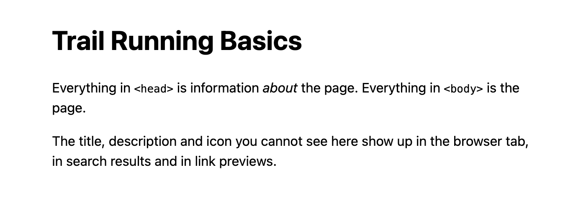
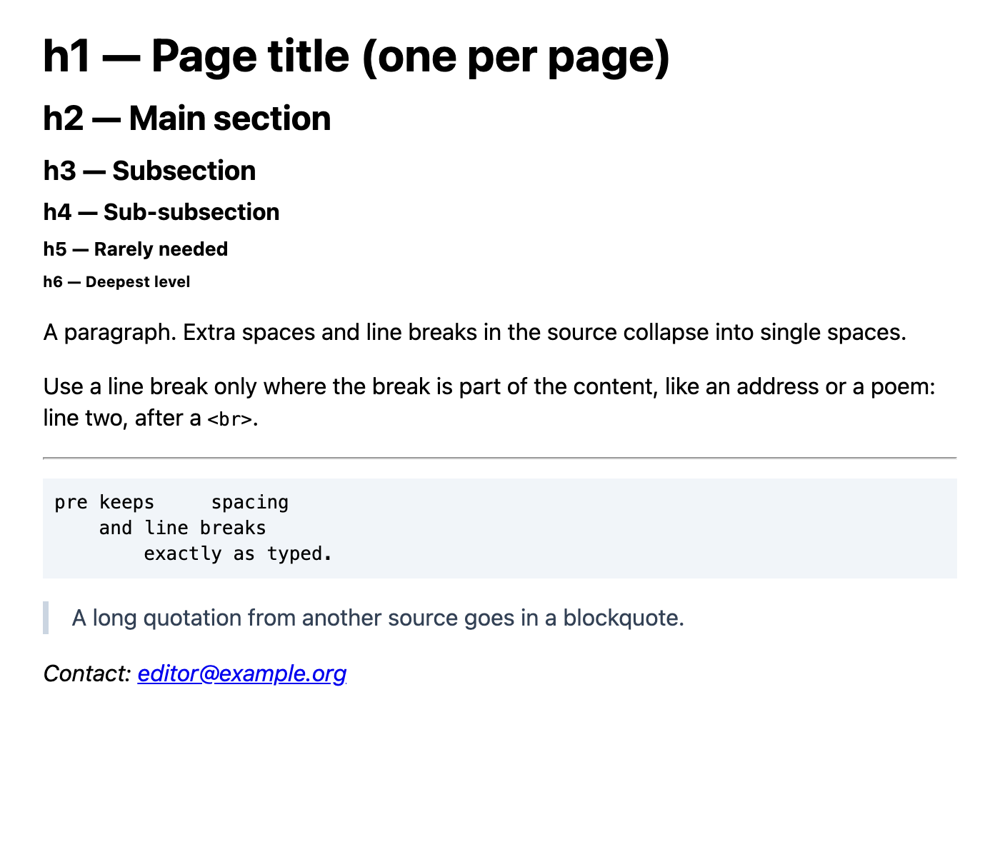
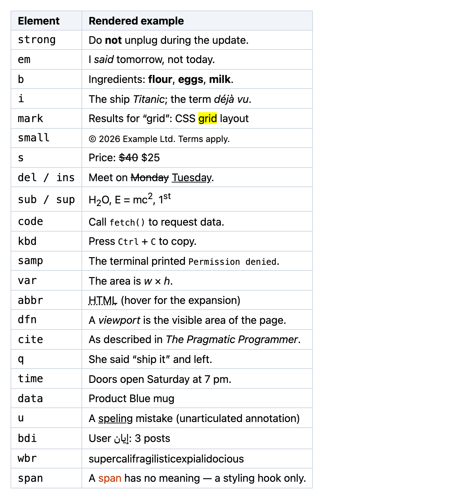
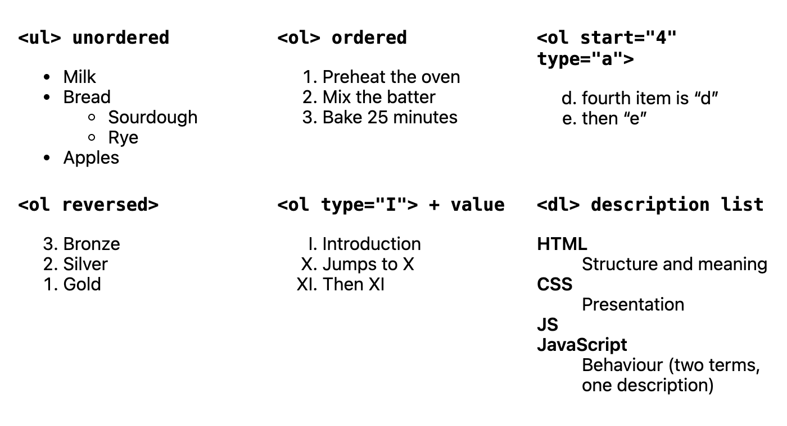
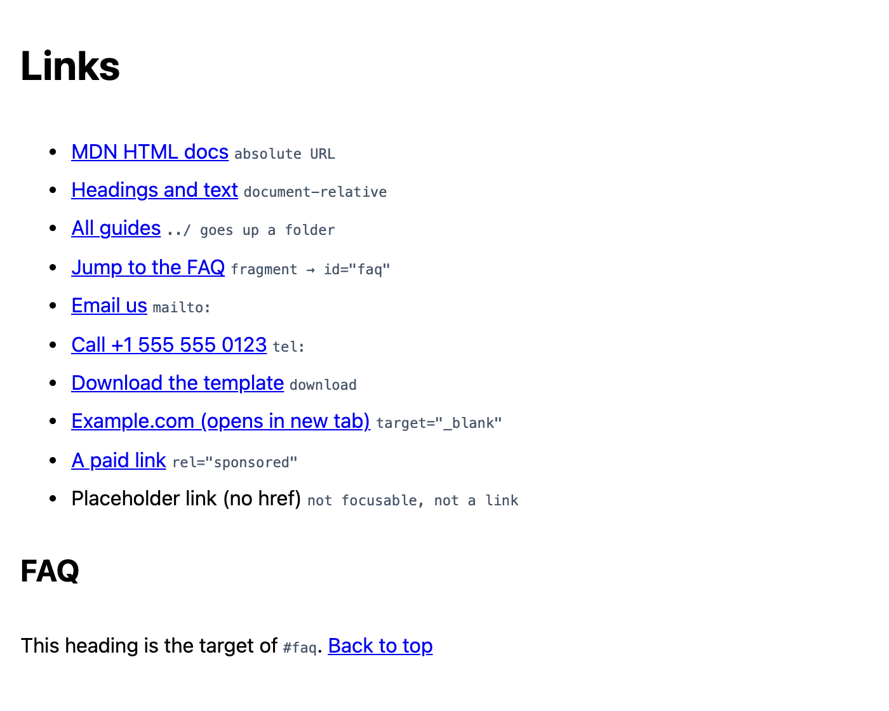
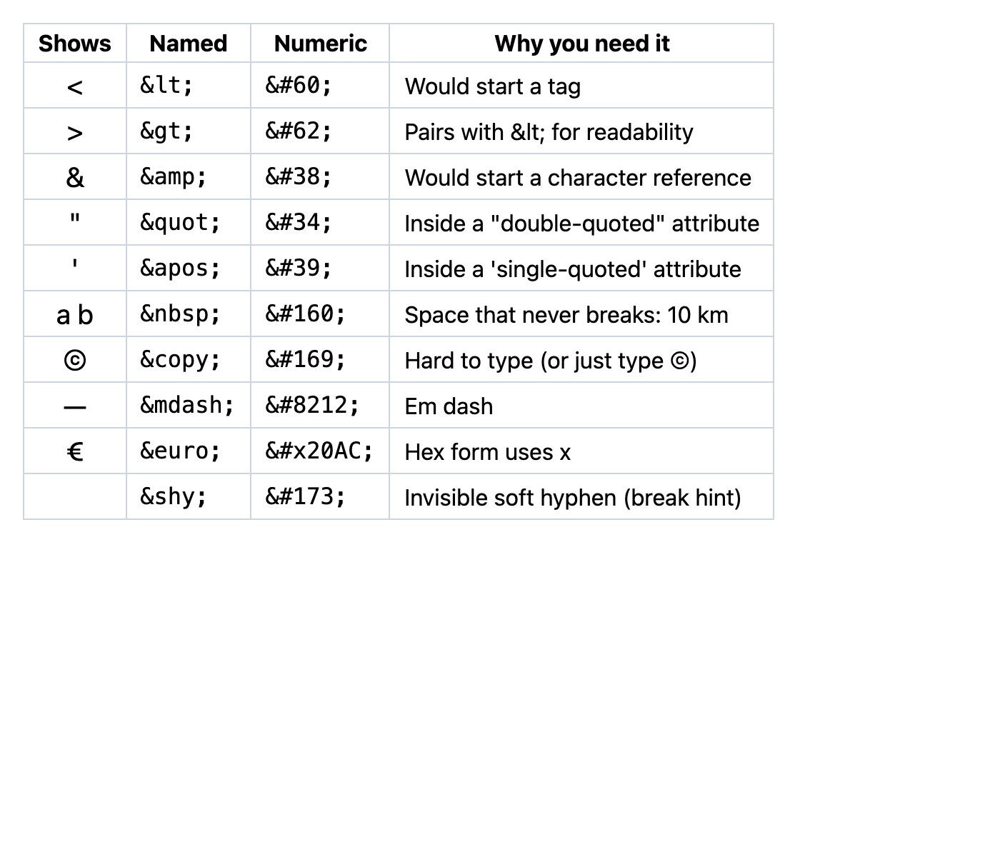
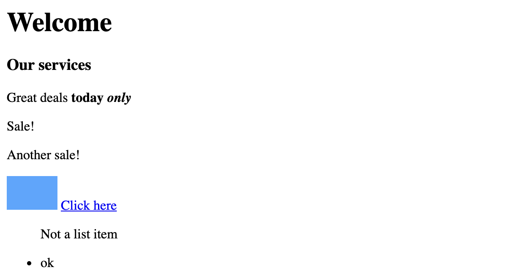

# Chapter 2 — HTML Structure and Text

HTML is the skeleton of every page. This chapter teaches the grammar of the language (elements, attributes, nesting), the fixed structure every document needs, the `<head>` metadata that browsers, search engines and social networks read, and the elements you use for text: headings, paragraphs, inline meaning, lists and links. It closes with character references, comments and validation — how to check that what you wrote is what you meant.

**What you'll learn**

| # | Topic | You will be able to… |
|---|---|---|
| 2.1 | Elements, tags and attributes | read and write any HTML element correctly, including void and boolean ones |
| 2.2 | Document structure and the doctype | write a valid page skeleton from memory |
| 2.3 | The `<head>`: charset, viewport, title, description, links | choose the right metadata for every page |
| 2.4 | Headings | build a heading hierarchy that works for people, screen readers and search |
| 2.5 | Paragraphs and text blocks | use `p`, `br`, `hr`, `pre`, `blockquote`, `address` and understand whitespace |
| 2.6 | Text-level semantics | pick between `strong`/`b`, `em`/`i`, `mark`, `code`, `time`… |
| 2.7 | Lists | use `ul`, `ol` (with `start`, `reversed`, `type`), nested lists and `dl` |
| 2.8 | Links | write absolute, relative, fragment, `mailto:`/`tel:` and download links; use `target` and `rel` safely |
| 2.9 | Character references and comments | escape `<`, `&` and quotes; comment your markup |
| 2.10 | Validation | find mistakes the browser silently repairs |

Examples are in [`code/`](code/). Each `.html` file is shown as a screenshot from headless Chrome; the `.mjs` scripts parse those same files with jsdom (`node code/01_head.mjs`).

---

## 2.1 Elements, tags and attributes

### What it is
HTML (HyperText Markup Language) **marks up** plain text: you wrap pieces of content in **tags** to say what each piece *is*.

```html
<a href="https://example.com" title="Opens the example site">Visit Example</a>
```

| Piece | In the example |
|---|---|
| Start tag | `<a href="https://example.com" title="Opens the example site">` |
| Element name | `a` |
| Attributes (name = value) | `href` = `https://example.com`, `title` = `Opens the example site` |
| Content | `Visit Example` |
| End tag | `</a>` |

- An **element** = start tag + content + end tag (`<p>Hello</p>`). Elements nest to form a tree (the DOM, [Chapter 1](../01-how-the-web-works/README.md)).
- An **attribute** adds information to an element: `name="value"`. Quote values (double quotes are the convention); names are case-insensitive, but write them in lower case.
- **Void elements** have no content and no end tag: `area`, `base`, `br`, `col`, `embed`, `hr`, `img`, `input`, `link`, `meta`, `source`, `track`, `wbr`. A trailing slash (`<br />`) is allowed and ignored — it is a habit from XHTML, not required.
- **Boolean attributes** are true when present, false when absent: `<input disabled>`, `<ol reversed>`. `disabled="false"` still means *disabled* — the value is irrelevant.
- **Nesting** must be proper: close inner elements before outer ones (`<b><i>…</i></b>`, not `<b><i>…</b></i>`).

Analogy: tags are labels on moving boxes ("kitchen — fragile"). The contents are the same; the labels tell everyone how to treat them.

### Global attributes (usable on any element)

| Attribute | Purpose |
|---|---|
| `id` | Unique identifier in the page: link target (`#id`), label/ARIA references, JS hook |
| `class` | Space-separated names for CSS and JS; many elements can share one |
| `style` | Inline CSS (avoid except for quick tests or dynamic values) |
| `title` | Advisory tooltip text; not reliably shown on touch or read by screen readers — never put essential info only here |
| `lang` | Language of the content (`en`, `fr-CA`) — affects pronunciation, hyphenation, fonts, translation |
| `dir` | Text direction: `ltr`, `rtl`, `auto` |
| `hidden` | Not rendered (acts like `display: none`) |
| `tabindex` | Focus order control ([Chapter 3](../03-semantic-html-and-accessibility/README.md)) |
| `data-*` | Your own data for scripts: `data-product-id="42"` → `el.dataset.productId` |
| `inert` | Makes a subtree unfocusable and unclickable (e.g. content behind a modal) |
| `translate`, `spellcheck`, `contenteditable` | Translation hints, spell-check, in-place editing |

### Block-level and inline — how elements flow
By default some elements start on a new line and take the full width (**block**: `p`, `h1`, `ul`, `div`, `section`), while others sit inside a line of text (**inline**: `a`, `strong`, `em`, `span`, `code`). This is purely a *default CSS `display` value* ([Chapter 7](../07-box-model-and-layout-basics/README.md)); the spec itself groups elements into **content categories** — *flow content* (almost everything in `body`) and *phrasing content* (text and inline-level markup). Each element has a **content model** saying what it may contain: a `<p>` may only contain phrasing content, so a `<div>` or `<ul>` inside a `<p>` is invalid (the parser actually closes the `<p>` first). An `<a>` is *transparent*: it may wrap blocks (a whole card) as long as it contains no other interactive element.

`<div>` (block) and `<span>` (inline) are the generic containers: they mean nothing and exist only as hooks for CSS and JS. Use them when no meaningful element fits.

### Common mistakes
- Unquoted attribute values with spaces: `class=big red` gives class `big` and a stray attribute `red`.
- Repeating an `id` — ids must be unique; use `class` for groups.
- Writing `<br></br>` or `</img>` — void elements have no end tag.
- Choosing elements for their default look ("I need bold, so `<h3>`"). Choose for meaning; CSS handles looks.

### Self-check
1. Is `<input required="no">` required? → Yes — boolean attributes are on whenever present.
2. What is the difference between an element and a tag? → A tag is the `<p>` / `</p>` text; the element is the whole thing including content (and the DOM node it becomes).
3. Can a `<p>` contain a `<ul>`? → No; the parser would close the paragraph before the list.

---

## 2.2 Document structure and the doctype

### What it is
Every HTML document has the same outer shape:

```html
<!DOCTYPE html>
<html lang="en">
  <head>  <!-- information ABOUT the page: not displayed -->
  </head>
  <body>  <!-- the page itself: everything the user sees -->
  </body>
</html>
```

| Part | Role |
|---|---|
| `<!DOCTYPE html>` | Must be first. Switches the browser to **standards mode**; without it you get **quirks mode**, which emulates old browser bugs (Chapter 1 showed a table ending up *inside* a paragraph). It is case-insensitive and is not an element. |
| `<html lang="en">` | The **root element**. `lang` tells screen readers which voice/pronunciation to use, lets browsers offer translation and hyphenate correctly. It is also a WCAG requirement (3.1.1 Language of Page). |
| `<head>` | Metadata: character set, title, viewport, links to CSS, scripts, icons, social previews. |
| `<body>` | Content. |

The `html`, `head` and `body` tags are technically optional (the parser creates the elements anyway), but always write them — explicit structure is easier to read and tools expect it.

The whole skeleton, with a realistic head, is [`code/skeleton.html`](code/skeleton.html):

```html
<!DOCTYPE html>
<!-- The doctype above switches the browser to standards mode. This is an HTML comment. -->
<html lang="en">
<head>
  <meta charset="utf-8">
  <meta name="viewport" content="width=device-width, initial-scale=1">
  <title>Trail Running Basics — Mountain Club</title>
  <meta name="description" content="A beginner's guide to trail running: shoes, pacing, safety and the five trails our club runs every week.">
  <link rel="icon" href="data:image/svg+xml,<svg ...><circle ... fill='%23f97316'/></svg>">
  <link rel="canonical" href="https://club.example.org/guides/trail-running">
  <meta name="theme-color" content="#f97316">
  <meta property="og:title" content="Trail Running Basics">
  <meta property="og:image" content="https://club.example.org/img/trail-card.jpg">
  <style> body { font-family: system-ui, sans-serif; max-width: 36rem; margin: 1.5rem auto; padding: 0 1rem; line-height: 1.5; } </style>
</head>
<body>
  <h1>Trail Running Basics</h1>
  <p>Everything in <code>&lt;head&gt;</code> is information <em>about</em> the page. Everything in <code>&lt;body&gt;</code> is the page.</p>
  <p>The title, description and icon you cannot see here show up in the browser tab, in search results and in link previews.</p>
</body>
</html>
```


*Figure 2.1 — Only the `<body>` is drawn. The head's work shows up elsewhere: the tab title and icon, search snippets, link previews.*

Older doctypes such as `<!DOCTYPE HTML PUBLIC "-//W3C//DTD HTML 4.01//EN" ...>` mostly still trigger standards (or "almost standards") mode — though a few legacy ones, such as HTML 4.01 Transitional without its URL, switch on quirks mode — so there is no reason to write them today.

### Self-check
1. What happens without a doctype? → Quirks mode: legacy layout behaviour you do not want.
2. Why set `lang` on `<html>`? → Correct screen-reader pronunciation, translation, hyphenation; WCAG 3.1.1.
3. Where does the `<title>` appear? → Tab/window title, bookmarks, history, search result headline — not in the page body.

---

## 2.3 The `<head>`: metadata that matters

### How it works
The browser reads the head top to bottom before rendering. Order matters for two items: `charset` must come first, and render-blocking CSS should be early so it downloads early.

The script below parses `skeleton.html` and prints what a browser, a search engine or a social network would learn from it:

```js
// code/01_head.mjs
const source = fs.readFileSync('skeleton.html');
const { window } = new JSDOM(source, { url: 'https://club.example.org/guides/trail-running' });
const doc = window.document;
console.log('doctype   :', `<!DOCTYPE ${doc.doctype?.name}>`, '->', doc.compatMode);
console.log('lang      :', doc.documentElement.lang);
console.log('charset   :', doc.characterSet, `(declared at byte ${source.indexOf('charset')} — must be within the first 1024)`);
console.log('title     :', doc.title);
for (const m of doc.head.querySelectorAll('meta[name], meta[property]'))
  console.log('meta      :', (m.name || m.getAttribute('property')).padEnd(12), '=', m.content.slice(0, 60));
for (const l of doc.head.querySelectorAll('link'))
  console.log('link      :', l.rel.padEnd(12), '->', l.href.slice(0, 60));
// ... comments and head children
```

Output:
```
doctype   : <!DOCTYPE html> -> CSS1Compat
lang      : en
charset   : UTF-8 (declared at byte 140 — must be within the first 1024)
title     : Trail Running Basics — Mountain Club
meta      : viewport     = width=device-width, initial-scale=1
meta      : description  = A beginner's guide to trail running: shoes, pacing, safety a
meta      : theme-color  = #f97316
meta      : og:title     = Trail Running Basics
meta      : og:image     = https://club.example.org/img/trail-card.jpg
link      : icon         -> data:image/svg+xml,<svg xmlns='http://www.w3.org/2000/svg' v
link      : canonical    -> https://club.example.org/guides/trail-running
comments  : [
  'The doctype above switches the browser to standards mode. This is an HTML comment.'
]
head children: meta, meta, title, meta, link, link, meta, meta, meta, style
```

### The essential head elements

| Element | Example | Why |
|---|---|---|
| `<meta charset="utf-8">` | — | Tells the browser how to turn bytes into characters. Must appear within the **first 1024 bytes**. UTF-8 is the only encoding you should use; without it accented letters and emoji can turn into garbage ("café"). An HTTP `Content-Type: …; charset=` header overrides it. |
| `<meta name="viewport">` | `content="width=device-width, initial-scale=1"` | Without it, phones pretend the screen is ~980 px wide and shrink the page. This line makes CSS pixels match the device width — the foundation of responsive design ([Chapter 10](../10-responsive-design/README.md)). Do **not** add `maximum-scale=1` or `user-scalable=no`: blocking zoom fails WCAG 1.4.4 (Resize Text). |
| `<title>` | `Trail Running Basics — Mountain Club` | Required. Unique and descriptive per page, most specific part first. It is the first thing a screen reader announces and the headline in search results. |
| `<meta name="description">` | one or two sentences | Often used as the search-result snippet (search engines may choose other text). Snippets are usually cut at about 150–160 characters. Not a ranking trick; it is a sales pitch for the click. |
| `<link rel="stylesheet">` | `href="css/style.css"` | Loads CSS (render-blocking). |
| `<script src defer>` / `type="module"` | `src="js/app.js"` | Loads JS without blocking the parser (Chapter 1). |
| `<link rel="icon">` | `.ico`, `.png` or `.svg` | The tab icon (favicon). Add `rel="apple-touch-icon"` for iOS home screens. |
| `<link rel="canonical">` | full URL | Tells search engines the preferred URL when the same content is reachable at several addresses. |
| Open Graph / Twitter Card metas | `property="og:title"`, `og:description`, `og:image` | Control the preview card when the link is shared on social networks and chat apps. |
| `<meta name="theme-color">` | `#f97316` | Tints the browser UI on some mobile browsers. |
| `<meta name="robots">` | `content="noindex"` | Keeps a page out of search results. |
| `<base href>` | `href="/docs/"` | Changes the base for *all* relative URLs on the page. Rarely a good idea — it surprises people. |
| `<link rel="preload">`, `rel="preconnect"` | fonts, hero image, CDN origin | Performance hints ([Chapter 14](../14-performance-seo-interview-and-cheatsheet/README.md)). |

A useful habit is a **template** you copy for every new page: doctype, `lang`, charset, viewport, title, description, stylesheet, deferred script.

### Common mistakes
- `<meta charset>` placed after a long comment or `<title>` with non-ASCII characters — it may fall outside the first 1024 bytes.
- The same `<title>` ("Home") on every page — useless in tabs, bookmarks and search results.
- Putting visible content in the head: the parser moves it into the body anyway.
- Disabling zoom in the viewport tag.

### Self-check
1. Which head element must come first, and why? → `<meta charset>`, because the browser needs the encoding before interpreting the rest (within 1024 bytes).
2. What breaks on a phone without the viewport meta? → The page lays out at ~980 px and is shrunk, so text is tiny.
3. Is the meta description visible on the page? → No; it may appear in search snippets.

---

## 2.4 Headings

### What it is
`<h1>`…`<h6>` are section headings, `h1` the most important. Together they form the page's **outline** — its table of contents.

### Why it matters
- **Screen-reader users** navigate by headings: in WebAIM's screen-reader user surveys, a large majority say that jumping through the headings is the first thing they do to find information on a long page. A clean hierarchy is the fastest way through your content ([Chapter 3](../03-semantic-html-and-accessibility/README.md)).
- **Everyone** skims headings before reading.
- **Search engines** use headings to understand what each part of a page is about.


*Figure 2.2 — `code/text-blocks.html`: the six heading levels at their default sizes, then the block text elements from §2.5.*

### Rules that work
1. **One `<h1>` per page** describing the page (usually close to the `<title>`). The spec allows more, but a single `h1` is the clear best practice.
2. **Don't skip levels going down**: after `h2`, the next subheading is `h3`, not `h4`. Going back up any number of levels is fine (`h4` → `h2`).
3. **Choose the level by structure, never by size.** Want a small `h2`? Style it with CSS.
4. **Don't use headings for non-headings** (a big bold slogan is a `<p>` with a class).
5. A heading plus a subtitle/tagline: wrap them in `<hgroup>` — `<hgroup><h1>Title</h1><p>Tagline</p></hgroup>` — so the tagline is not a fake heading.

**There is no "document outline algorithm".** Older HTML5 drafts described one in which every `<section>` restarted heading levels, so each section could use its own `h1`. No browser or screen reader ever implemented it, and the WHATWG removed it from the spec in 2022. Heading levels are simply what the numbers say.

### Common mistakes
- Using `<h4>` because it "looks right" — a screen reader announces "heading level 4" and users assume there are missing sections.
- Several `h1`s in a template (logo *and* page title).
- Headings made from `<div class="title">` — they look like headings but do not appear in any heading list.

### Self-check
1. After an `h2`, may the next heading be an `h4`? → Not for a subsection (skip). Use `h3`.
2. After an `h4`, may the next heading be an `h2`? → Yes — it starts a new major section.
3. Does wrapping content in `<section>` change heading levels? → No; there is no outline algorithm.

---

## 2.5 Paragraphs, whitespace and text blocks

### What it is
| Element | Meaning | Notes |
|---|---|---|
| `<p>` | A paragraph | The workhorse. Don't use empty `<p>`s for spacing — use CSS `margin`. |
| `<br>` | A line break that is part of the content | Addresses, poems, song lyrics. Never for layout spacing. |
| `<hr>` | A thematic break between paragraphs (topic change, scene change) | Drawn as a line; screen readers may announce a separator. For a purely decorative line, use a CSS border. |
| `<pre>` | Preformatted text: whitespace and line breaks kept, monospace font | Code blocks (`<pre><code>…</code></pre>`), ASCII art |
| `<blockquote>` | A long quotation from another source | Optional `cite="URL"` attribute (not shown); put the visible attribution outside or in a `<figcaption>` |
| `<address>` | Contact information for the nearest `<article>` or the whole page | Not for any postal address in text |
| `<div>` | Generic block container, no meaning | Use when nothing else fits |

### Whitespace collapsing
In normal text, HTML **collapses whitespace**: any run of spaces, tabs and newlines becomes a single space, and leading/trailing whitespace in a line is dropped. That is why the paragraph in Figure 2.2 shows single spaces even though the source has many. You can indent your HTML freely. To keep whitespace, use `<pre>` or the CSS `white-space` property; to force a space that never breaks a line, use `&nbsp;` (§2.9).

### Self-check
1. How do you add space between two paragraphs? → CSS `margin`, not `<br>` or empty paragraphs.
2. When is `<br>` correct? → When the line break is part of the content itself (poem, address).
3. Why do five spaces in your source show as one? → Whitespace collapsing.

---

## 2.6 Text-level semantics

### What it is
Inline elements that say what a *phrase* is. Browsers give most of them a default look (bold, italic, monospace), but the look is secondary: choose by meaning, then style with CSS.


*Figure 2.3 — `code/inline-semantics.html`: every common text-level element with its default rendering.*

| Element | Means | Use for | Not for |
|---|---|---|---|
| `<strong>` | Strong importance, seriousness or urgency | Warnings, key facts | Headings, general "make it bold" |
| `<em>` | Stress emphasis that changes the meaning of the sentence | "I *said* tomorrow" | Titles, foreign words |
| `<b>` | Draw attention without extra importance | Keywords, product names in a review, lead sentence | Importance (use `strong`) |
| `<i>` | Different voice or mood | Technical terms, foreign phrases (`<i lang="fr">`), ship names, thoughts | Emphasis (use `em`), icons |
| `<mark>` | Highlighted because of relevance to the current context | Search matches | General highlighting for style |
| `<small>` | Side comments, fine print | Copyright, legal notes | Making text small for design |
| `<s>` | No longer accurate or relevant | Old price | Document edits (use `del`) |
| `<del>` / `<ins>` | Removed / added text in an edit | Change tracking; optional `datetime`, `cite` | — |
| `<sub>` / `<sup>` | Subscript / superscript required by typography | H₂O, footnote markers, 1st | Pure visual offsets |
| `<code>` | A fragment of computer code | Inline code; blocks in `<pre><code>` | — |
| `<kbd>` | User input (keys, commands to type) | <kbd>Ctrl</kbd>+<kbd>C</kbd> | — |
| `<samp>` | Sample output from a program | Error messages | — |
| `<var>` | A variable in maths or programming | *x*, *w* × *h* | — |
| `<abbr>` | Abbreviation or acronym; `title` gives the expansion | First use of "HTML" — but also write the expansion in the text once, since `title` is not reliably exposed | — |
| `<dfn>` | The defining instance of a term | Where a term is first defined | Every later mention |
| `<cite>` | Title of a creative work | Books, films, papers | People's names |
| `<q>` | Short inline quotation; browser adds quotation marks | "She said *ship it*" | Long quotes (`blockquote`) |
| `<time>` | A date/time with a machine-readable `datetime` | `<time datetime="2026-10-03T19:00">Saturday at 7 pm</time>` | — |
| `<data>` | Content with a machine-readable `value` | Product IDs, numbers | Dates (use `time`) |
| `<u>` | Unarticulated, non-textual annotation | Spelling-error squiggles, Chinese proper-name marks | Links look alike — avoid in normal text |
| `<bdi>` | Isolate text whose direction is unknown | User names that may be Arabic/Hebrew in an LTR page | — |
| `<wbr>` | A place where a long word *may* break | Long URLs, compound words | — |
| `<span>` | Nothing — a styling/scripting hook | When no element above fits | — |

### Why it matters
Semantics feed machines: `<time datetime>` lets calendars and search engines read dates; `<code>` gets monospace in reader modes; `<abbr>`, `<dfn>` and `lang` help translation and screen readers. Note that most screen readers **do not** announce `<strong>` or `<em>` by default, so never rely on them alone to convey critical information — say it in words too ("Warning: …").

### Common mistakes
- Using `<i>` for icons (`<i class="icon-star">`): it is a legacy habit from icon fonts; use `<span aria-hidden="true">` or an SVG.
- Wrapping whole paragraphs in `<strong>`: if everything is important, nothing is.
- `<cite>` around a person's name.

### Self-check
1. `<b>` or `<strong>` for "Warning: this deletes your account"? → `<strong>` (importance).
2. How do you mark a date so machines can read it? → `<time datetime="2026-10-03">…</time>`.
3. Which element shows keyboard keys? → `<kbd>`.

---

## 2.7 Lists

### What it is

| Element | Use when | Items |
|---|---|---|
| `<ul>` | Order doesn't matter (shopping list, nav links, features) | `<li>` |
| `<ol>` | Order matters (steps, rankings, legal clauses) | `<li>` |
| `<dl>` | Name–value groups (glossary, metadata, FAQ) | `<dt>` term(s) + `<dd>` description(s); groups may be wrapped in a `<div>` for styling |
| `<menu>` | A toolbar of commands | Semantically the same as `<ul>` |

`<ol>` attributes:

| Attribute | Effect |
|---|---|
| `start="4"` | First number is 4 |
| `reversed` | Counts down |
| `type="1 | a | A | i | I"` | Numbering style (use it only when the style is part of the meaning, e.g. legal clause "(a)"; otherwise CSS `list-style-type`) |
| `<li value="10">` | Sets this item's number; later items continue from it |

```html
<!-- code/lists.html (excerpt) -->
<ul>
  <li>Milk</li>
  <li>Bread
    <ul><li>Sourdough</li><li>Rye</li></ul>   <!-- nested list goes INSIDE the <li> -->
  </li>
  <li>Apples</li>
</ul>
<ol start="4" type="a"> <li>fourth item is "d"</li> <li>then "e"</li> </ol>
<ol reversed> <li>Bronze</li> <li>Silver</li> <li>Gold</li> </ol>
<ol type="I"> <li>Introduction</li> <li value="10">Jumps to X</li> <li>Then XI</li> </ol>
<dl>
  <dt>HTML</dt><dd>Structure and meaning</dd>
  <dt>CSS</dt><dd>Presentation</dd>
  <dt>JS</dt><dt>JavaScript</dt><dd>Behaviour (two terms, one description)</dd>
</dl>
```


*Figure 2.4 — `code/lists.html` in Chrome.*

### Why it matters
Screen readers announce "list, 3 items" and let users jump between lists and items, so a real list tells users how much is coming. Navigation menus are usually `<nav><ul>…</ul></nav>`.

### Common mistakes
- Putting anything other than `<li>` directly inside `<ul>`/`<ol>` (a `<p>` or `<div>`) — invalid, and the list semantics break.
- Nesting a sub-list as a sibling of `<li>` instead of inside one.
- Faking lists with `<br>` and "•" characters.
- Removing bullets with `list-style: none` — fine visually, but Safari/VoiceOver then stops announcing it as a list; add `role="list"` to the `<ul>` if the count matters.

### Self-check
1. Recipe steps: `ul` or `ol`? → `ol`.
2. Where does a nested list go? → Inside the parent `<li>`.
3. What pairs make up a `<dl>`? → `<dt>` terms and `<dd>` descriptions.

---

## 2.8 Links

### What it is
`<a href="…">` — the *anchor* element — is the "hyper" in hypertext. Its content (text, image, even a whole card) becomes clickable and keyboard-focusable, and activating it navigates to the `href` URL.

```html
<!-- code/links.html (excerpt) -->
<a href="https://developer.mozilla.org/en-US/docs/Web/HTML">MDN HTML docs</a>        <!-- absolute -->
<a href="text-blocks.html">Headings and text</a>                                      <!-- document-relative -->
<a href="../index.html">All guides</a>                                                <!-- up one folder -->
<a href="#faq">Jump to the FAQ</a>                                                    <!-- fragment: element with id="faq" -->
<a href="mailto:help@example.org?subject=Question">Email us</a>
<a href="tel:+15555550123">Call +1 555 555 0123</a>
<a href="skeleton.html" download="page-template.html">Download the template</a>
<a href="https://example.com/" target="_blank" rel="noopener noreferrer">Example.com (opens in new tab)</a>
<a href="https://example.com/sponsor" rel="sponsored">A paid link</a>
<a>Placeholder link (no href)</a>
...
<h2 id="faq">FAQ</h2>
```


*Figure 2.5 — `code/links.html`. The `<a>` without `href` is not styled or focusable as a link.*

The next script opens the same file as if it lived at `https://club.example.org/guides/html/links.html` and shows how each `href` resolves:

```js
// code/02_links.mjs (key parts)
const { window } = new JSDOM(fs.readFileSync('links.html'), { url: 'https://club.example.org/guides/html/links.html' });
const doc = window.document;
console.log('attribute vs property:', doc.querySelector('a[href="text-blocks.html"]').getAttribute('href'), '->',
            doc.querySelector('a[href="text-blocks.html"]').href, '\n');
for (const a of doc.querySelectorAll('a')) {
  // prints text, the resolved a.href, protocol, target, rel, download, and same-page jumps
}
```

Output:
```
attribute vs property: text-blocks.html -> https://club.example.org/guides/html/text-blocks.html 

MDN HTML docs              https://developer.mozilla.org/en-US/docs/Web/HTML       https:
Headings and text          https://club.example.org/guides/html/text-blocks.html   https:
All guides                 https://club.example.org/guides/index.html              https:
Jump to the FAQ            https://club.example.org/guides/html/links.html#faq     https: same-page jump to #faq
Email us                   mailto:help@example.org?subject=Question                mailto:
Call +1 555 555 0123       tel:+15555550123                                        tel:
Download the template      https://club.example.org/guides/html/skeleton.html      https: download=page-template.html
Example.com (opens in new  https://example.com/                                    https: target=_blank rel=noopener noreferrer
A paid link                https://example.com/sponsor                             https: rel=sponsored
Placeholder link (no href) (no href: not in document.links = false)
Back to top                https://club.example.org/guides/html/links.html#top     https: same-page jump to #top
```

The `href` *attribute* holds what you typed; the `.href` *property* is the fully resolved URL (see [§1.2](../01-how-the-web-works/README.md) for the resolution rules).

### Link attributes

| Attribute | What it does | Notes |
|---|---|---|
| `href` | Destination URL | Without it, `<a>` is a placeholder: not a link, not focusable |
| `target="_blank"` | Open in a new tab/window | Other values: `_self` (default), `_parent`, `_top`, or a named window |
| `rel` | Relationship of the target to this page | Space-separated list, see below |
| `download` | Download instead of navigate; value = suggested file name | Only for same-origin, `blob:` or `data:` URLs |
| `hreflang`, `type` | Hints about the target's language / MIME type | Advisory |
| `referrerpolicy` | How much of this page's URL to send in `Referer` | e.g. `no-referrer` |
| `ping` | URLs to notify when the link is followed | Tracking; not supported in every browser |

| `rel` value | Meaning |
|---|---|
| `noopener` | The new page gets no `window.opener` reference, so it cannot redirect your tab ("reverse tabnabbing"). Modern browsers apply this automatically to `target="_blank"`; writing it explicitly is harmless. |
| `noreferrer` | Also don't send the `Referer` header (implies `noopener`) |
| `nofollow` | "I don't vouch for this link" — search engines treat it as a hint |
| `sponsored` | Paid or affiliate link (search engines ask you to mark these) |
| `ugc` | User-generated content link (comments, forum posts) |
| `external`, `author`, `license`, `next`, `prev` | Descriptive relations |

### Opening new tabs — should you?
Mostly no. Users can choose to open a new tab themselves; forcing one breaks the Back button and can disorient screen-reader and mobile users. Reasonable exceptions: links that would interrupt a form or a playing video, and help pages beside a task. When you do it, say so in the link text ("(opens in new tab)") or with an icon that has a text alternative.

### Links vs buttons
- A **link** goes somewhere (a URL). Keyboard: Enter.
- A **button** does something on this page (submit, open a menu, toggle). Keyboard: Enter or Space.

`<a href="#" onclick="…">` pretends to be a button: it adds `#` to the URL, scrolls to the top without JS, and screen readers announce "link". Use `<button type="button">` ([Chapter 3](../03-semantic-html-and-accessibility/README.md)).

### Writing good link text
Link text must make sense out of context — screen-reader users often pull up a list of all links. "Click here", "read more" and bare URLs are meaningless in that list. Write "Download the 2026 price list (PDF, 2 MB)" instead of "Click here to download". This is WCAG 2.4.4 (Link Purpose (In Context)).

### Real-world examples
- "Skip to main content" links at the top of big sites are fragment links (`href="#main"`) — [Chapter 3](../03-semantic-html-and-accessibility/README.md).
- GitHub and MDN give every heading an `id` so you can link straight to a section.
- Shops use `tel:` links so mobile users can call with one tap.

### Common mistakes
- Links with no text (only an icon) — they have no accessible name.
- `href="www.example.com"` without `https://` — treated as a *relative* path (`/current/www.example.com`).
- Two links next to each other going to the same place (image + title of a card) — noisy for keyboard and screen-reader users; wrap both in one link.

### In the interview
**30-second answer:** "An anchor with an `href` navigates to a URL — absolute, relative, fragment or another scheme like `mailto:`. I keep link text meaningful out of context, avoid `href="#"` for actions because those should be buttons, and use `target="_blank"` sparingly. `rel` describes the relationship: `noopener`/`noreferrer` for security and privacy, `nofollow`/`sponsored`/`ugc` for search engines."

- *Why was `rel="noopener"` needed with `target="_blank"`?* → The opened page could use `window.opener.location` to swap your tab for a phishing page. Browsers now imply `noopener` for `_blank`.
- *Link or button for "Add to cart"?* → Button: it performs an action on the current page.
- *What does `download` do on a cross-origin URL?* → It is ignored; the browser navigates normally.

### Self-check
1. What does `href="#faq"` do? → Scrolls to the element with `id="faq"` on the same page (no request).
2. Why is "click here" bad link text? → It is meaningless out of context, e.g. in a screen reader's link list (WCAG 2.4.4).
3. Is `<a>` without `href` keyboard-focusable? → No.

---

## 2.9 Character references and comments

### What it is
Some characters have special meaning in HTML: `<` starts a tag and `&` starts a **character reference**. To show them as text you write a reference instead:

- **Named**: `&lt;` `&gt;` `&amp;` `&quot;` `&nbsp;` `&copy;`
- **Decimal**: `&#60;` (the Unicode code point in decimal)
- **Hexadecimal**: `&#x3C;`

People often call them "entities" (strictly, *named character references*).


*Figure 2.6 — `code/entities.html`: what each reference renders as.*

With `<meta charset="utf-8">` you can type almost any character directly (©, —, €, é, emoji). You only *need* references for:

| Character | Where | Reference |
|---|---|---|
| `<` | In text | `&lt;` |
| `&` | In text or attributes, when followed by something that looks like a reference | `&amp;` (always escaping it is simplest) |
| `"` / `'` | Inside an attribute quoted with the same character | `&quot;` / `&#39;` |
| Invisible characters | Non-breaking space, soft hyphen, zero-width characters | `&nbsp;`, `&shy;`, `&#8203;` — references make them visible in your source |

```js
// code/03_entities.mjs
import '../../../../tools_dom.mjs';
const p = document.createElement('p');
p.innerHTML = 'Fish &amp; chips &lt;b&gt; &copy; &#169; &#xA9; 10&nbsp;km &mdash; café';
console.log('textContent :', JSON.stringify(p.textContent));
console.log('nbsp code   :', p.textContent.codePointAt(p.textContent.indexOf('km') - 1).toString(16));
console.log('innerHTML   :', p.innerHTML);
const q = document.createElement('p');
q.textContent = ' & "quotes"';     // text, not HTML
console.log('\nescaped     :', q.innerHTML);
console.log('elements    :', q.children.length, '(the tag became text, not an element)');
const r = document.createElement('p');
r.innerHTML = 'AT&T, R&D, a&b=1';
console.log('\nbare &      :', r.textContent);
const s = document.createElement('div');
s.innerHTML = '<p>price&copy=1</p><a href="?a=1&copy=2">x</a>';
console.log('in text     :', s.querySelector('p').textContent, '| in href:', s.querySelector('a').getAttribute('href'));
```

Output:
```
textContent : "Fish & chips <b> © © © 10 km — café"
nbsp code   : a0
innerHTML   : Fish &amp; chips &lt;b&gt; © © © 10&nbsp;km — café

escaped     : &lt;img src=x onerror=alert(1)&gt; &amp; "quotes"
elements    : 0 (the tag became text, not an element)

bare &      : AT&T, R&D, a&b=1
in text     : price©=1 | in href: ?a=1&copy=2
```

What it shows:
1. The parser **decodes** references into ordinary characters; `&copy;`, `&#169;` and `&#xA9;` are the same `©`.
2. `&nbsp;` is the real character U+00A0 (code `a0`), not a space; use it to keep "10 km" or "Mr. Smith" on one line.
3. When serialising, the browser escapes `&`, `<`, `>` and non-breaking spaces again.
4. Setting `textContent` is safe: markup becomes text. Building HTML strings from user input and assigning them to `innerHTML` is how **cross-site scripting (XSS)** happens — covered in the JavaScript book.
5. A bare `&` usually survives, but it is fragile: about a hundred legacy names such as `&copy` are decoded even *without* a semicolon, so the text `price&copy=1` shows as `price©=1`. (Inside attributes the parser has a special rule that leaves `&copy=` alone, which is why most query strings survive.) Writing `&amp;` removes all doubt.

### Comments
```html
<!-- This is a comment. It can span
     several lines. It is not displayed. -->
```
Comments stay in the DOM as comment nodes (the `01_head.mjs` output above found one) and are **visible to anyone** with View Source — never put passwords, internal URLs or rude notes in them. They cannot be nested, and `--` inside a comment is best avoided. Build tools usually strip them from production HTML.

### Self-check
1. How do you display the text `<br>` on a page? → `&lt;br&gt;` (or set it with `textContent`).
2. Is `&#169;` the same as `&copy;`? → Yes, both are ©.
3. Can users see HTML comments? → Yes, in the page source.

---

## 2.10 Validation

### The problem it solves
Browsers never show HTML errors. They silently repair them ([Chapter 1](../01-how-the-web-works/README.md)) — so a broken page often *looks* fine to you while behaving differently for screen readers, search engines, other browsers, or your CSS and JavaScript.

Here is a page with a dozen problems ([`code/broken.html`](code/broken.html)):

```html
<html>
<head>
<title>Broken page</title>
</head>
<body>
<h1>Welcome</h1>
<h3>Our services</h3>
<p>Great deals <b>today <i>only</b></i>
<p id="promo">Sale!</p>
<p id="promo">Another sale!</p>

<a href="#" onclick="go()">Click here</a>
<ul><p>Not a list item</p><li>ok</li></ul>
<h1>Also welcome</h1>
</body>
</html>
```


*Figure 2.7 — It renders without complaint. Nothing on screen tells you about the 12 problems below.*

### How it works — checking
1. **The W3C Nu HTML Checker** (validator.w3.org/nu) is the reference validator: paste code, upload a file or give a URL. It reports **parse errors** (bad nesting, stray end tags) and **content-model errors** (a `<p>` inside a `<ul>`, duplicate ids, missing required attributes such as `alt`).
2. **Editor and build tools**: VS Code extensions, `html-validate` or `vnu` (the Nu checker's command-line version) in CI.
3. **Accessibility checkers** (axe, Lighthouse, WAVE — [Chapter 3](../03-semantic-html-and-accessibility/README.md)) catch semantic issues validators don't: empty links, poor contrast.

To make the idea concrete, [`code/04_validate.mjs`](code/04_validate.mjs) is a tiny checker that parses a file with jsdom and looks for a dozen of the most common problems:

```js
// code/04_validate.mjs (key parts)
if (!/^\s*<!doctype html>/i.test(src)) problems.push('missing <!DOCTYPE html> -> quirks mode');
if (!doc.documentElement.hasAttribute('lang')) problems.push('<html> has no lang attribute');
const charset = src.search(/<meta[^>]+charset/i);
if (charset < 0 || charset > 1024) problems.push('no <meta charset> in the first 1024 bytes');
// ... viewport, title, number of h1s, heading-level jumps, duplicate ids, img without alt,
// ... href="#" / javascript: links, vague link text, non-<li> children of lists, <b><i></b> mis-nesting
lint('skeleton.html');
lint('broken.html');
```

Output:
```
skeleton.html: OK
broken.html: 12 problem(s)
  - missing <!DOCTYPE html> -> quirks mode
  - <html> has no lang attribute
  - no <meta charset> in the first 1024 bytes
  - no viewport meta (page will not scale on phones)
  - 2 <h1> elements (aim for exactly one)
  - heading jumps from h1 to h3: "Our services"
  - duplicate id="promo"
  -  without alt
  - fake link "Click here" (use <button>)
  - vague link text "Click here"
  - <p> directly inside <ul>
  - mis-nested tags <b><i>...</b> (parser repaired it)
```

Some of these are validity errors (duplicate id, `<p>` in `<ul>`, missing `alt`, missing doctype/title), others are best-practice or accessibility warnings (heading jumps, two `h1`s, vague link text). A real validator plus an accessibility checker covers both.

### Trade-offs
Validation is not the goal in itself — a page can be valid and still inaccessible or confusing. But valid HTML is predictable across browsers and tools, and most validator errors point at real bugs. Treat errors as bugs and warnings as review items.

### In the interview
**30-second answer:** "Browsers are forgiving: the HTML parser repairs almost any markup, so errors are invisible. That is exactly why I validate — the repaired DOM may not be what I meant, and assistive technology, crawlers and my CSS selectors all see the repaired tree. I use the Nu HTML Checker or html-validate in CI, plus axe or Lighthouse for accessibility."

- *Name three common validation errors.* → Duplicate ids, block elements inside `<p>`, missing `alt` on `` (also: bad nesting, non-`li` children in lists).
- *Does invalid HTML affect SEO?* → Not directly as a ranking factor, but broken structure can hide content, headings or links from crawlers.

### Self-check
1. Why won't the browser tell you about invalid HTML? → The spec requires it to recover silently.
2. Which tool is the official validator? → The W3C Nu HTML Checker.
3. Does a valid page guarantee accessibility? → No — add accessibility testing.

---

## Chapter 2 TL;DR

- **Elements** = tags + content; attributes add information; void elements have no end tag; boolean attributes are on when present. Nest properly.
- Every page: `<!DOCTYPE html>` → `<html lang>` → `<head>` (charset first, viewport, unique `<title>`, description, CSS, deferred JS, icon, canonical, social tags) → `<body>`.
- **Headings** build the outline: one `h1`, don't skip levels, choose by structure not size. There is no outline algorithm for `<section>`.
- **Text blocks**: `p` for paragraphs, `br` only for meaningful breaks, `pre` keeps whitespace, `blockquote` for long quotes; whitespace otherwise collapses.
- **Inline semantics**: `strong` (importance) vs `b` (attention), `em` (stress) vs `i` (other voice), plus `mark`, `code`, `kbd`, `time`, `abbr`, `cite`, `q`… `span`/`div` have no meaning.
- **Lists**: `ul` unordered, `ol` ordered (`start`, `reversed`, `type`, `value`), `dl` for name–value pairs; nested lists go inside `li`.
- **Links**: resolve like URLs; meaningful text; `href="#"` actions should be buttons; `target="_blank"` sparingly (implies `noopener`); `rel` for security, privacy and SEO hints.
- **References**: escape `<` and `&` (`&lt;`, `&amp;`), `&nbsp;` for non-breaking space; `textContent` is safe, raw `innerHTML` is an XSS risk. Comments are public.
- **Validate**: browsers silently repair errors; use the Nu checker/html-validate plus accessibility tools.

Next: [Chapter 3 — Semantic HTML and Accessibility](../03-semantic-html-and-accessibility/README.md).
