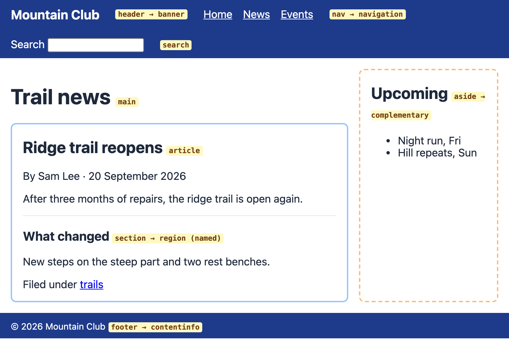
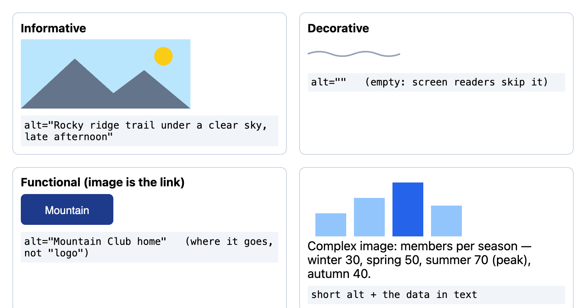
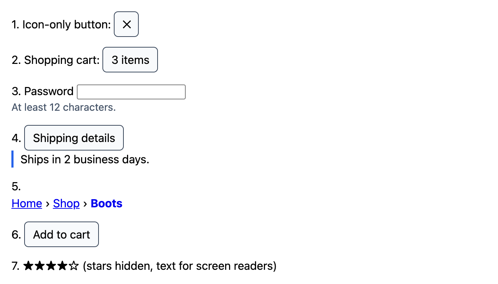
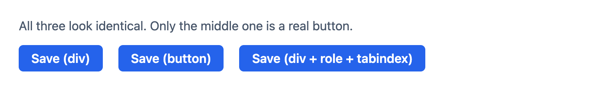
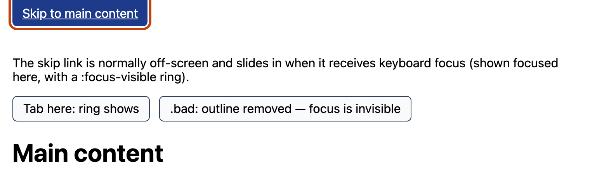
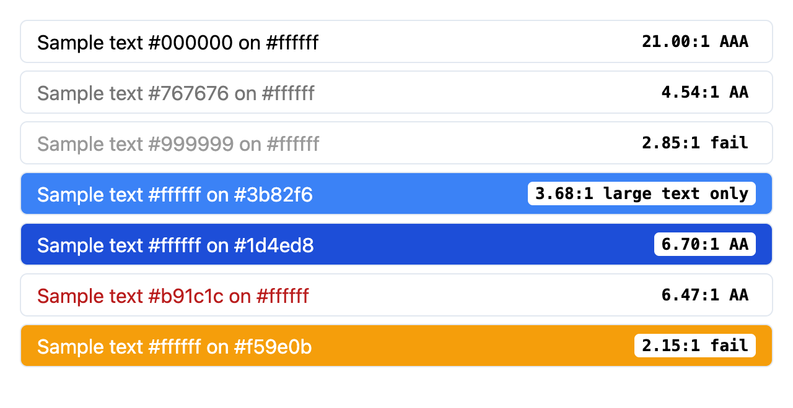

# Chapter 3 — Semantic HTML and Accessibility

A page can look perfect and still be unusable for someone who navigates with a keyboard, listens through a screen reader, zooms to 400 %, or cannot tell red from green. **Accessibility** (often shortened to *a11y*: "a", 11 letters, "y") means building pages that work for all of them — and the single most effective tool for it is **semantic HTML**: using the element whose meaning matches the content. This chapter shows how browsers turn your markup into an *accessibility tree*, how landmarks, headings, alt text, ARIA, focus management and form labels feed that tree, what WCAG 2.2 requires, and how to test.

**What you'll learn**

| # | Topic | You will be able to… |
|---|---|---|
| 3.1 | Why semantics and accessibility | explain who benefits, what goes wrong most often, and the legal picture |
| 3.2 | Landmarks | structure a page with `header`, `nav`, `main`, `article`, `section`, `aside`, `footer`, `search` |
| 3.3 | Headings and outline | produce a heading outline screen-reader users can navigate |
| 3.4 | The accessibility tree | describe role, name, state and value, and how the name is computed |
| 3.5 | Alt text | write the right `alt` for informative, decorative, functional and complex images |
| 3.6 | ARIA | apply the first rule of ARIA and use labels, descriptions, states and live regions correctly |
| 3.7 | Keyboard and focus | keep everything reachable, visible and in order; build skip links; manage focus |
| 3.8 | Accessible forms | label, group, describe and report errors for form fields |
| 3.9 | WCAG 2.2 | use POUR, the A/AA/AAA levels, the new 2.2 criteria and the contrast formula |
| 3.10 | Testing tools | combine automated checkers, a keyboard test and a screen reader |

Code is in [`code/`](code/). The `.html` files are shown as screenshots. Most scripts open those files in **real headless Chrome** (via `puppeteer-core`, helper [`code/a11y_lib.mjs`](code/a11y_lib.mjs)) and print Chrome's own accessibility tree — the same data a screen reader receives. `06_mini_audit.mjs` uses jsdom and `dom-accessibility-api`.

---

## 3.1 Why semantics and accessibility

### What it is
**Semantic HTML** means choosing elements for what content *is* — a `<button>` for a button, `<nav>` for navigation, `<h2>` for a section heading — rather than for how it looks. **Accessibility** means people with disabilities can perceive, understand, navigate and interact with the page. The two are linked because browsers expose the semantics of your HTML to **assistive technologies** (AT): screen readers, screen magnifiers, voice control, switch devices, braille displays.

Analogy: semantic HTML is the signage in a building. Sighted visitors may find the exit by looking around; a blind visitor depends on the signs being real (braille, announced floors). A `<div>` styled to look like a button is a painted-on door.

### Who benefits

| Group | Examples | What they rely on |
|---|---|---|
| Blind and low-vision users | Screen readers (JAWS, NVDA, VoiceOver, TalkBack), magnifiers, high zoom | Roles and names, headings, alt text, contrast, reflow |
| Motor impairments | Keyboard only, switch access, voice control ("click Submit") | Focusable controls, visible focus, big targets, visible labels that match names |
| Deaf and hard of hearing | Captions, transcripts | Media alternatives ([Chapter 4](../04-images-media-and-embeds/README.md)) |
| Cognitive and learning disabilities | Clear language, consistent layout, no time pressure | Predictable structure, clear errors, no memory tests |
| Everyone, sometimes ("situational") | Broken arm, bright sunlight, noisy train, slow network, old age | All of the above |

The World Health Organization estimates that about 1.3 billion people — roughly one in six — live with a significant disability.

### Why it matters
- **It is mostly not happening.** The WebAIM Million survey of the top one million home pages (February 2026) found detectable WCAG failures on 95.9 % of them, about 56 errors per page. Six problem types made up 96 % of errors: low-contrast text (83.9 % of pages), missing image alt text, missing form labels, empty links, empty buttons, and missing page language. Every one of those is fixed with the basics in this chapter; §3.10 builds a small checker for exactly those six.
- **It is often the law.** The US ADA and Section 508, the European Accessibility Act (applying since 28 June 2025) and similar laws elsewhere require accessible digital services, usually by reference to WCAG level AA.
- **It is better engineering.** Semantic HTML gives you keyboard support, focus handling and screen-reader output *for free*; it also improves SEO, reader modes, voice assistants, automated testing (Testing Library queries by role — see the React book), and code readability.

### Self-check
1. What is assistive technology? → Software/hardware that helps people with disabilities use computers: screen readers, magnifiers, switch devices, voice control.
2. What is the most common accessibility failure on the web? → Low-contrast text.
3. Why does semantic HTML help accessibility? → Browsers expose its built-in roles, names, states and keyboard behaviour to assistive technology automatically.

---

## 3.2 Landmarks

### What it is
**Landmarks** are the big regions of a page — banner, navigation, main content, sidebar, footer. Screen-reader users can list them and jump straight to one (e.g. NVDA's `D` key, VoiceOver's rotor), the way a sighted user glances at a layout. HTML's **sectioning elements** create landmarks automatically:

| Element | Landmark role (ARIA) | Rules |
|---|---|---|
| `<header>` | `banner` — only when it is *not* inside `article`, `aside`, `main`, `nav` or `section` | Site header: logo, site nav, search. Inside an article it is just that article's header. |
| `<nav>` | `navigation` | Major navigation blocks only (not every group of links). With several, label each: `aria-label="Main"`, `"Breadcrumb"` |
| `<search>` | `search` | Wraps a search/filter form. Baseline 2023, widely available since April 2026. (Before it existed: `<form role="search">`.) |
| `<main>` | `main` | The primary content, **one visible per page**; target of the skip link |
| `<aside>` | `complementary` | Related but separable content: sidebar, related links, pull quote |
| `<footer>` | `contentinfo` — only when not inside `article`, `aside`, `main`, `nav` or `section` | Site footer: copyright, contact, legal links |
| `<section>` | `region` — **only if it has an accessible name** (`aria-labelledby` pointing at its heading) | A thematic group with its own heading |
| `<form>` | `form` — only if it has an accessible name | |
| `<article>` | `article` (a document structure role, not a landmark) | A self-contained piece that would make sense on its own: blog post, product card, comment, news story |

`<section>` vs `<article>` vs `<div>`:
- **article** — could be syndicated or reused elsewhere by itself (a post, a comment, a card).
- **section** — a chunk of something bigger that has its own heading (a chapter, a tab panel, "Reviews" on a product page).
- **div** — no meaning; just a wrapper for layout or styling. When unsure between `section` and `div`, ask "would this appear in a table of contents?" If not, use `div`.

### Example
[`code/landmarks.html`](code/landmarks.html) is a small news page. The yellow tags are visual labels for this book (marked `aria-hidden="true"` so they don't pollute the names):

```html
<a class="skip" href="#main">Skip to main content</a>
<header>
  <a class="logo" href="/">Mountain Club</a>
  <nav aria-label="Main">
    <ul>
      <li><a href="/">Home</a></li>
      <li><a href="/news" aria-current="page">News</a></li>
      <li><a href="/events">Events</a></li>
    </ul>
  </nav>
  <search>
    <form action="/search"><label for="q">Search</label> <input id="q" name="q" type="search"></form>
  </search>
</header>
<div class="wrap">
  <main id="main">
    <h1>Trail news</h1>
    <article>
      <header>
        <h2>Ridge trail reopens</h2>
        <p>By Sam Lee · <time datetime="2026-09-20">20 September 2026</time></p>
      </header>
      <p>After three months of repairs, the ridge trail is open again.</p>
      <section aria-labelledby="h-what">
        <h3 id="h-what">What changed</h3>
        <p>New steps on the steep part and two rest benches.</p>
      </section>
      <footer><p>Filed under <a href="/tags/trails">trails</a></p></footer>
    </article>
  </main>
  <aside aria-labelledby="h-side">
    <h2 id="h-side">Upcoming</h2>
    <ul><li>Night run, Fri</li><li>Hill repeats, Sun</li></ul>
  </aside>
</div>
<footer><small>© 2026 Mountain Club</small></footer>
```


*Figure 3.1 — `code/landmarks.html`. The layout is CSS; the landmarks come from the elements.*

Now the same page as Chrome's accessibility tree ([`code/01_landmarks_tree.mjs`](code/01_landmarks_tree.mjs)):

```js
import { openPage, printTree, fullTree } from './a11y_lib.mjs';
const { browser, page } = await openPage('landmarks.html');
printTree(await fullTree(page), { skipRoles: ['StaticText', 'generic', 'none', 'InlineTextBox', 'LineBreak', 'ListMarker', 'LabelText', 'listitem', 'time'] });
const outline = await page.$$eval('h1,h2,h3,h4,h5,h6', hs => hs.map(h => '  '.repeat(+h.tagName[1] - 1) + h.tagName.toLowerCase() + ' ' + h.firstChild.textContent.trim()));
console.log('\nHeading outline:\n' + outline.join('\n'));
```

Output:
```
RootWebArea "Trail news — Mountain Club"
  link "Skip to main content"
  banner
    link "Mountain Club"
    navigation "Main"
      list
        link "Home"
        link "News"
        link "Events"
    search
      form
        searchbox "Search"
  main
    heading "Trail news"  level=1
    article
      sectionheader
        heading "Ridge trail reopens"  level=2
      region "What changed"
        heading "What changed"  level=3
      sectionfooter
        link "trails"
  complementary "Upcoming"
    heading "Upcoming"  level=2
    list
  contentinfo

Heading outline:
h1 Trail news
  h2 Ridge trail reopens
    h3 What changed
  h2 Upcoming
```

Notice:
1. The top-level `<header>` became `banner` and the top-level `<footer>` became `contentinfo`; the article's own header and footer did *not* (Chrome calls them `sectionheader`/`sectionfooter`, which are not landmarks).
2. `<section>` became a `region` landmark because `aria-labelledby` gave it a name; `<aside>` got its name "Upcoming" the same way.
3. The `<nav>` is announced as "Main navigation" thanks to `aria-label`; `aria-current="page"` tells users which link is the current page.
4. Everything except the skip link sits inside a landmark — a good rule to aim for, so nothing is "orphaned" outside the regions users jump between.

### Common mistakes
- "Div soup": a page built only from `<div class="header">`, `<div class="nav">` — zero landmarks.
- Several `<main>` elements, or none.
- Wrapping every block in `<section>` "because HTML5" — sections without headings add noise, not structure.
- Several unlabelled `<nav>`s: users hear "navigation, navigation, navigation".

### Real-world examples
GOV.UK, the BBC and GitHub use exactly this skeleton: skip link → `header` (banner) with `nav` → `main` → `footer` (contentinfo). Try it: open a site, turn on VoiceOver (Cmd+F5 on macOS) and open the rotor (Ctrl+Option+U) → Landmarks.

### Self-check
1. Which element makes the `main` landmark, and how many per page? → `<main>`, one visible.
2. When is `<section>` a landmark? → Only when it has an accessible name (e.g. `aria-labelledby` its heading).
3. Is a `<header>` inside an `<article>` a banner? → No.
4. `<article>` or `<section>` for a product card in a grid? → `<article>` — it stands on its own.

---

## 3.3 Headings and the outline

Headings are the other main navigation tool: screen-reader users press `H` (NVDA/JAWS) or use the rotor to jump heading to heading, or pull up a list of all headings as a table of contents. The outline printed above is exactly that list. The rules from [§2.4](../02-html-structure-and-text/README.md) apply: one `h1`, don't skip levels going down, choose levels by structure, and remember that `<section>` does not reset levels (the old "outline algorithm" was never implemented and has been removed from the spec).

Two accessibility-specific points:
- Each landmark region usually starts with a heading, which is why naming a `section` or `aside` with `aria-labelledby` pointing at its heading is so common.
- If a region has no visible heading (a site's main nav, for example), give it a label with `aria-label` instead of adding a fake heading.

### Self-check
1. How do screen-reader users skim a page? → By landmarks and by headings (and by links/form fields lists).
2. Does starting a new `<article>` reset heading levels? → No; levels are what the numbers say.

---

## 3.4 The accessibility tree

### What it is
Alongside the DOM, browsers build an **accessibility tree**: a simplified tree containing only what matters to assistive technology, exposed through the operating system's accessibility API (UI Automation on Windows, NSAccessibility on macOS, AT-SPI on Linux). Screen readers never read your HTML; they read this tree.

Each node has:

| Property | Question it answers | From |
|---|---|---|
| **Role** | What is it? (button, link, heading, textbox, checkbox, navigation…) | The element's implicit role, or an ARIA `role` |
| **Name** | What is it called? ("Save", "Search", "Close") | Content, `<label>`, `alt`, `aria-label`, `aria-labelledby`… |
| **Description** | Extra help text | `aria-describedby`, sometimes `title` |
| **State / properties** | What condition is it in? (checked, expanded, disabled, invalid, required, level 2, current page) | Native attributes (`checked`, `disabled`, `required`) or ARIA states |
| **Value** | Current value of a field, slider or progress bar | The control's value |

A screen reader turns that into speech such as: *"Email, edit text, required, invalid entry, We only use it for your receipt."*

### How the accessible name is computed
The W3C *Accessible Name and Description Computation* spec defines an order of precedence. Simplified, the first of these that yields text wins:

1. `aria-labelledby` — text of the referenced element(s), in order (can combine several ids).
2. `aria-label` — a string on the element.
3. The native labelling mechanism: `<label>` for form fields, `alt` for images, `<caption>` for tables, `<legend>` for fieldsets, `<figcaption>` for figures.
4. The element's content, for roles that allow "name from content" (buttons, links, headings, cells…).
5. `title` (and, for inputs, `placeholder`) as a last resort.

Hidden content (`display: none`, `hidden`, `aria-hidden="true"`) is left out — unless you reference it directly with `aria-labelledby`.

The examples in [`code/aria.html`](code/aria.html) (discussed in §3.6) show each rule; here is what Chrome computed ([`code/03_names_and_states.mjs`](code/03_names_and_states.mjs)):

```
--- aria.html
RootWebArea "ARIA patterns"
  StaticText "1. Icon-only button:"
  button "Close"
    StaticText "✕"
  StaticText "2."
  StaticText "Shopping cart"
  StaticText ":"
  button "Shopping cart 3 items"
  StaticText "3."
  StaticText "Password"
  textbox "Password"  description="At least 12 characters."
  StaticText "At least 12 characters."
  StaticText "4."
  button "Shipping details"  expanded=true
  StaticText "Ships in 2 business days."
  StaticText "5."
  navigation "Breadcrumb"
    link "Home"
    StaticText "›"
    link "Shop"
    StaticText "›"
    link "Boots"
  StaticText "6."
  button "Add to cart"
  status
  StaticText "7."
  StaticText "Rated 4 out of 5"
  StaticText "(stars hidden, text for screen readers)"

after clicking "Shipping details" and "Add to cart": {
  expanded: 'false',
  panelHidden: true,
  status: 'Added. Cart has 4 items.'
}
```

- The "✕" button's name is **"Close"** (`aria-label` beat the content).
- The cart button's name combines two elements via `aria-labelledby`: **"Shopping cart 3 items"**.
- The password field's name comes from its `<label>`; its **description** comes from `aria-describedby`.
- The stars were hidden with `aria-hidden="true"`, so only the visually hidden text "Rated 4 out of 5" is in the tree.

### Inspecting it yourself
Chrome DevTools → Elements → **Accessibility** pane (or enable the full-page accessibility tree view); Firefox DevTools → **Accessibility** panel; Safari → Elements → Node → Accessibility. These show role, name, and states for any element.

### In the interview
**30-second answer:** "Browsers derive an accessibility tree from the DOM — each node has a role, an accessible name, maybe a description, states and a value — and expose it to screen readers through OS accessibility APIs. Native elements fill this in correctly by default; ARIA can override or add to it. The name comes, in order, from `aria-labelledby`, `aria-label`, native labels like `<label>` or `alt`, the content, and finally `title` or placeholder."

- *Does CSS affect the accessibility tree?* → Yes: `display: none` and `visibility: hidden` remove nodes; generated content (`::before` text) can become part of names; `opacity: 0` does not hide anything.
- *Can a screen reader see a `<div>` with a click handler as a button?* → No; it has no role, no name-as-button, and is not focusable (demonstrated in §3.7).

### Self-check
1. Name the four main things a node in the accessibility tree has. → Role, name, state(s)/properties, value (plus description).
2. A button has text "✕" and `aria-label="Close"`. What is its name? → "Close".
3. Where do screen readers get their information from? → The accessibility tree via the OS accessibility API, not the raw HTML.

---

## 3.5 Alt text

### What it is
The `alt` attribute gives an image its **text alternative**: what a screen reader speaks, what search engines index, and what shows if the image fails to load. It is WCAG success criterion 1.1.1 (Non-text Content, level A) and one of the six most common failures.

### How to decide — ask "what is this image *for*?"

| Ask in order | If yes → |
|---|---|
| 1. Is it purely decorative, or does nearby text already say the same thing? | `alt=""` (empty — the image is ignored) |
| 2. Is it the content of a link or button? | Describe the **destination or action** ("Mountain Club home", "Search") |
| 3. Is it complex (chart, diagram, map)? | A short `alt` naming it, plus the full information in nearby text or a `<figcaption>` |
| 4. Is it an image of text? | `alt` repeats the text — better still, use real text styled with CSS |
| 5. Otherwise (a photo or illustration that carries meaning) | Describe what matters about it **in this context**, briefly |


*Figure 3.2 — `code/alt-text.html`: the four most common cases.*

```html
       <!-- informative -->
                                                         <!-- decorative -->
<a href="/"></a>                           <!-- functional -->
<figure>                                                                                  <!-- complex -->
  
  <figcaption>Complex image: members per season — winter 30, spring 50, summer 70 (peak), autumn 40.</figcaption>
</figure>
```

Chrome's view of those images (from `03_names_and_states.mjs`):
```
--- alt-text.html (images only)
image "Rocky ridge trail under a clear sky, late afternoon"
image "Mountain Club home"  (inside link "Mountain Club home")
image "Bar chart of club members per season"
decorative  in tree? false
```
The empty-alt image is gone from the tree entirely — exactly what you want for decoration. The linked image gives its name to the link.

### Rules of thumb
- **Missing `alt`** is different from **empty `alt`**. Missing: screen readers may read the file name ("IMG underscore 2041 dot jpg"). Empty: the image is skipped.
- Don't start with "Image of…" or "Picture of…" — the role already says "image". (Do say "Photo", "Illustration", "Screenshot" when the *type* matters.)
- Keep it short (a sentence or so); describe what matters **in this context**. The same photo of a person might be "Dr. Ana Ruiz" on a staff page and "Ana Ruiz holding the award trophy" in a news story.
- Don't repeat the caption or adjacent text word for word; if the text already says it, use `alt=""`.
- Icons next to visible text ("🗑 Delete") are decorative; icon-only buttons need a name on the button (`aria-label`), not just on the icon.
- CSS background images have no alt: never put meaningful content in them.
- Inline `<svg>` needs `role="img"` plus `aria-label` (or a `<title>` child) when it is informative, `aria-hidden="true"` when decorative ([Chapter 4](../04-images-media-and-embeds/README.md)).

### Self-check
1. A decorative divider image: what `alt`? → `alt=""`.
2. A magnifying-glass image that is the only content of a search button? → `alt="Search"` (the action).
3. What is the difference between no `alt` and `alt=""`? → No alt = screen readers may announce the file name; empty = image ignored.

---

## 3.6 ARIA

### What it is
**WAI-ARIA** (Web Accessibility Initiative — Accessible Rich Internet Applications) is a set of HTML attributes that change or add to what the accessibility tree says about an element:

- **Roles** — `role="button"`, `role="tablist"`, `role="dialog"`, `role="alert"`…
- **Properties** — mostly stable facts: `aria-label`, `aria-labelledby`, `aria-describedby`, `aria-controls`, `aria-required`, `aria-haspopup`…
- **States** — things that change with interaction: `aria-expanded`, `aria-checked`, `aria-pressed`, `aria-selected`, `aria-invalid`, `aria-disabled`, `aria-current`, `aria-hidden`…

The crucial fact: **ARIA only changes what is announced. It adds no behaviour** — no focusability, no keyboard handling, no styling. `role="button"` on a `<div>` makes a screen reader *say* "button"; you still have to make it focusable and respond to Enter and Space yourself.

### The first rule of ARIA (and the other four)
The W3C "Using ARIA" note sets five rules. In short:

1. **Use native HTML first.** If an element or attribute with the meaning and behaviour you need exists (`<button>`, `<a href>`, `<input type="checkbox">`, `<details>`, `<dialog>`, `required`, `disabled`), use it instead of re-creating it with ARIA.
2. **Don't change native semantics** unless you really must (`<h2 role="tab">` is wrong; put a `<button role="tab">` inside the `<h2>` or restructure).
3. **Every interactive ARIA control must work with the keyboard.**
4. **Never put `role="presentation"`/`"none"` or `aria-hidden="true"` on a focusable element** — users would tab to something that "doesn't exist".
5. **Every interactive element must have an accessible name.**

A popular summary: *no ARIA is better than bad ARIA*. WebAIM's surveys consistently find that home pages *with* ARIA have more detected errors on average than pages without it — usually because it is used to patch div-based widgets instead of using native elements.

### Useful ARIA — the patterns in `aria.html`


*Figure 3.3 — `code/aria.html`. Visually ordinary — the differences are all in the accessibility tree shown in §3.4.*

```html
<!-- 1. Name an icon-only control -->
<button type="button" aria-label="Close">✕</button>

<!-- 2. Build a name from visible text elsewhere (ids, in order) -->
<span id="cart-h">Shopping cart</span>:
<button type="button" aria-labelledby="cart-h cart-n"><span id="cart-n">3 items</span></button>

<!-- 3. Add help text as a description -->
<label for="pw">Password</label> <input id="pw" type="password" aria-describedby="pw-hint">
<div id="pw-hint">At least 12 characters.</div>

<!-- 4. Disclosure: state that JavaScript keeps in sync -->
<button type="button" aria-expanded="true" aria-controls="panel" id="toggle">Shipping details</button>
<div id="panel">Ships in 2 business days.</div>

<!-- 5. Mark the current item in a set of links -->
<nav aria-label="Breadcrumb"> … <a href="/shop/boots" aria-current="page">Boots</a></nav>

<!-- 6. Live region: announce changes without moving focus -->
<button type="button" id="add">Add to cart</button> <span role="status" id="live"></span>

<!-- 7. Hide decoration, provide a text equivalent -->
<span aria-hidden="true">★★★★☆</span><span class="visually-hidden">Rated 4 out of 5</span>
```

```js
// the only JavaScript: keep aria-expanded true to the UI, and write into the live region
t.addEventListener('click', () => { const open = t.getAttribute('aria-expanded') === 'true';
  t.setAttribute('aria-expanded', String(!open)); p.hidden = open; });
document.getElementById('add').addEventListener('click', () => { live.textContent = 'Added. Cart has 4 items.'; });
```

| Attribute | Use when | Watch out |
|---|---|---|
| `aria-label` | No visible text exists (icon buttons, several `<nav>`s) | Not translated by some translation tools; voice-control users can't see it — prefer visible text when possible |
| `aria-labelledby` | Visible text elsewhere already names it | Takes ids; overrides everything else |
| `aria-describedby` | Hints, format rules, error messages | Read after the name, sometimes after a pause |
| `aria-expanded` | Buttons that show/hide something (menus, accordions) | Must be updated by your script |
| `aria-current` | Current page/step/date in a set | Values: `page`, `step`, `location`, `date`, `time`, `true` |
| `aria-hidden="true"` | Decorative or duplicated content | Hides the whole subtree; never on focusable things |
| `aria-live` / `role="status"` / `role="alert"` | Content that changes without a page load (toasts, counters, errors) | The region must **exist before** the text changes; `status` = polite (waits), `alert` = assertive (interrupts) — use `alert` sparingly |
| `aria-invalid`, `aria-required` | Form errors / required fields when native attributes don't fit | Native `required` already implies `aria-required` |

The **visually-hidden** pattern (often a `.visually-hidden` or `.sr-only` class) hides text on screen but keeps it in the accessibility tree:

```css
.visually-hidden { position: absolute; width: 1px; height: 1px; overflow: hidden;
                   clip-path: inset(50%); white-space: nowrap; }
```

### When not to use it
- To re-create a native control (`<div role="checkbox">` instead of `<input type="checkbox">`).
- To "fix" a heading structure (`<div role="heading" aria-level="2">`) when you can edit the HTML.
- `aria-label` on a `<div>` or `<span>` with no role: many screen readers ignore names on generic elements.
- `role="application"` — it switches off the screen reader's normal reading keys; almost never appropriate.

### In the interview
**30-second answer:** "ARIA lets me set roles, states and properties in the accessibility tree when HTML alone can't express something — like `aria-expanded` on a disclosure button, `aria-live` regions, or naming an icon button. But the first rule of ARIA is to use native HTML when it exists, because ARIA only changes semantics: it adds no focus, keyboard or behaviour. A `<button>` gives me all of that for free."

- *`aria-label` vs `aria-labelledby`?* → `aria-label` is a string on the element; `aria-labelledby` points at other elements' visible text (and wins if both exist).
- *`role="status"` vs `role="alert"`?* → Both are live regions; status is polite (announced when the user is idle), alert is assertive (interrupts) — for urgent errors only.
- *What does `aria-hidden="true"` do?* → Removes the element and its descendants from the accessibility tree; it doesn't hide it visually or stop focus.

### Self-check
1. Does `role="button"` make a `<div>` keyboard accessible? → No — it only changes the announced role.
2. How do you announce "Saved" after an AJAX save without moving focus? → Update the text of an existing `role="status"` (polite live region).
3. What is the first rule of ARIA? → Use a native HTML element/attribute with the needed semantics and behaviour instead of ARIA whenever possible.

---

## 3.7 Keyboard and focus

### What it is
Many people never use a mouse: keyboard-only users, screen-reader users (screen readers are keyboard-driven), switch and voice users whose tools emulate keys. **Focus** is the element that receives keyboard input; **Tab** moves focus forward, **Shift+Tab** backwards, **Enter** activates links and buttons, **Space** activates buttons and toggles checkboxes, **arrow keys** move within composite widgets (radio groups, menus, tabs, selects), **Escape** closes dialogs and popups.

WCAG requires that everything work from a keyboard (2.1.1), with no keyboard traps (2.1.2), in a logical order (2.4.3), with a visible focus indicator (2.4.7) that is not hidden behind sticky headers (2.4.11, new in 2.2).

### The div-button problem, measured
[`code/div-vs-button.html`](code/div-vs-button.html) has three controls that look identical:

```html
<div class="btn" onclick="save()">Save (div)</div>
<button class="btn" type="button" onclick="save()">Save (button)</button>
<div class="btn" role="button" tabindex="0" onclick="save()">Save (div + role + tabindex)</div>
<p id="out" role="status"></p>
```


*Figure 3.4 — Pixel-identical. The screenshot cannot tell you which one works.*

[`code/02_div_vs_button.mjs`](code/02_div_vs_button.mjs) asks Chrome, then presses keys like a keyboard user:

```js
printTree(await fullTree(page));
for (let i = 1; i <= 4; i++) { await page.keyboard.press('Tab'); /* print document.activeElement */ }
// focus the <button>, press Enter, then Space; focus the role=button div, press Enter; print the status text
```

Output:
```
Accessibility tree:
RootWebArea "div vs button"
  StaticText "All three look identical. Only the middle one is a real button."
  StaticText "Save (div)"
  button "Save (button)"
  button "Save (div + role + tabindex)"
  status

Pressing Tab 4 times:
  Tab 1 -> Save (button)
  Tab 2 -> Save (div + role + tabindex)
  Tab 3 -> (body — focus left the page)
  Tab 4 -> Save (button)

button     + Enter: status = "Saved!"

button     + Space: status = "Saved!"

div + role + Enter: status = ""
```

What this proves:
1. The plain `<div>` is **just text** to a screen reader and can **never be reached** with Tab.
2. The `<button>` is announced as a button, is focusable, and works with **both Enter and Space** — all for free.
3. The `div` with `role` and `tabindex` is announced and focusable, but **pressing Enter does nothing**: `onclick` on a div only fires for pointer clicks (mouse, touch, pen), never for keys. To finish it you'd need a `keydown` handler for Enter *and* Space, disabled-state handling, and form-submission behaviour. Or you could just use `<button>`.

### `tabindex`

| Value | Effect | Use |
|---|---|---|
| (none) | Natively interactive elements (`a[href]`, `button`, `input`, `select`, `textarea`, `summary`…) are focusable in DOM order | Default — keep DOM order = visual order |
| `tabindex="0"` | Adds a non-interactive element to the Tab order at its DOM position | Custom widgets (with a role and keyboard handlers), scrollable regions |
| `tabindex="-1"` | Focusable by script (`el.focus()`) or link target, but not by Tab | Skip-link targets, headings you move focus to, items inside roving-focus widgets, dialog containers |
| `tabindex="1"` or more | Jumps ahead of everything else in the Tab order | **Never** — it breaks the natural order and is nearly impossible to maintain |

Also keep the **DOM order equal to the visual order**: CSS `order`, `flex-direction: row-reverse`, grid placement and absolute positioning move boxes visually but not in the Tab sequence ([Chapters 8–9](../08-flexbox/README.md)).

### Visible focus
Browsers draw a focus ring by default. The most common way to break keyboard access is `outline: none` in a reset stylesheet. Instead, style it with **`:focus-visible`**, which matches when the browser decides a focus indicator is useful (keyboard navigation) but not for mouse clicks on buttons:

```css
:focus-visible { outline: 3px solid #c2410c; outline-offset: 2px; }
.bad:focus { outline: none; }     /* never do this without a replacement */
```

For the ring itself, aim for at least 3:1 contrast against the background (non-text contrast, 1.4.11) — the dark orange here is about 5:1 on white, whereas a light amber would be around 2:1.

### Skip links
Keyboard users would otherwise have to Tab through the whole header on every page. A **skip link** is the first focusable element and jumps to `<main>`:

```html
<a class="skip" href="#main">Skip to main content</a>
...
<main id="main" tabindex="-1">…</main>
```
```css
.skip { position: absolute; left: 1rem; top: -3rem; }   /* off-screen until focused */
.skip:focus { top: 0; }
```


*Figure 3.5 — `code/focus.html` with the skip link focused (the page focuses it on load for this screenshot). Without focus it is off-screen.*

The skip link satisfies WCAG 2.4.1 (Bypass Blocks); landmarks and headings help too.

### Managing focus in dynamic UIs
- **Opening a dialog**: move focus into it; keep Tab inside it while open; Escape closes; return focus to the button that opened it. The native `<dialog>` element opened with `showModal()` makes the rest of the page inert and handles Escape for you.
- **`inert` attribute**: makes a whole subtree unfocusable and hidden from AT — for content behind a custom modal or an off-canvas menu.
- **Single-page app navigation**: after a route change, move focus to the new page's `<h1>` (with `tabindex="-1"`) or announce the change; otherwise screen-reader users don't know anything happened (see the React book).
- **Deleting the focused item**: move focus to a sensible neighbour, not the top of the page.
- **Target size**: WCAG 2.2 (2.5.8, AA) asks for pointer targets of at least **24×24 CSS pixels** (or enough spacing around smaller ones).

### Common mistakes
- `outline: none` with no replacement.
- Clickable `div`s and `span`s; links used as buttons and vice versa.
- Positive `tabindex`.
- Custom dropdowns that can't be opened with the keyboard or trap focus.
- Hover-only menus that never open on focus.

### In the interview
**30-second answer:** "Everything interactive must be reachable and operable by keyboard, in a logical order, with a visible focus indicator. Native elements give me that; I only use `tabindex=0` for genuine custom widgets and `-1` for programmatic focus targets, never positive values. I style focus with `:focus-visible` instead of removing outlines, add a skip link, and manage focus explicitly for dialogs and route changes."

- *Why not `tabindex="5"`?* → It pulls the element ahead of all `tabindex=0`/native elements, creating an order that no longer matches the page.
- *`:focus` vs `:focus-visible`?* → `:focus` matches any focus; `:focus-visible` matches when the browser heuristics say a visible indicator is needed, typically keyboard focus.
- *How do you test keyboard access?* → Unplug the mouse: Tab through the whole page, operate every control, open and close every popup, and watch where focus goes.

### Self-check
1. Which keys activate a `<button>`? A link? → Button: Enter and Space. Link: Enter.
2. What does `tabindex="-1"` do? → Makes an element focusable by script or fragment navigation but not by Tab.
3. Why is `onclick` on a `<div>` not enough, even with `role="button"` and `tabindex="0"`? → Keyboard activation (Enter/Space) doesn't fire `click` on a div; you must add key handling.

---

## 3.8 Accessible forms

Forms are where accessibility failures cost the most — a user who can't identify a field cannot sign up, pay or apply. Full form coverage is in [Chapter 5](../05-tables-and-forms/README.md); these are the accessibility essentials.


*Figure 3.6 — `code/form-a11y.html`.*

```html
<label for="name">Full name <span aria-hidden="true">*</span></label>
<input id="name" type="text" name="name" autocomplete="name" required>

<label for="email">Email <span aria-hidden="true">*</span></label>
<p class="hint" id="email-hint">We only use it for your receipt.</p>
<input id="email" type="email" name="email" autocomplete="email" required
       aria-invalid="true" aria-describedby="email-hint email-err" value="sam@">
<p class="error" id="email-err">Error: enter an email like name@example.com</p>

<fieldset>
  <legend>Delivery speed</legend>
  <input type="radio" id="std" name="speed" checked><label for="std">Standard</label>
  <input type="radio" id="exp" name="speed"><label for="exp">Express</label>
</fieldset>

Don't: <input type="text" placeholder="Phone number">   <!-- placeholder only, no label -->
```

What Chrome exposes ([`code/04_form_tree.mjs`](code/04_form_tree.mjs)):

```
RootWebArea "Accessible form"
  form
    textbox "Full name"  required=true
    textbox "Email"  required=true invalid="true" value="sam@" description="We only use it for your receipt. Error: enter an email like name@example.com"
    group "Delivery speed"
      Legend
      radio "Standard"  checked=true
      radio "Express"  checked=false
    textbox "Phone number"
    button "Place order"

After typing into the placeholder-only field, the visible hint is gone: { value: '555', placeholderShown: false }
```

The rules behind that output:
1. **Every field has a `<label>`** tied by `for`/`id` (or by wrapping the input). The label becomes the name *and* enlarges the click target — clicking "Standard" checks the radio.
2. **Group related controls** (radio buttons, checkboxes, address parts) in `<fieldset>` with a `<legend>`; the legend names the group ("Delivery speed, grouping").
3. **Hints and errors** are linked with `aria-describedby` so they are read with the field; `aria-invalid="true"` marks the error state. Error text should say what is wrong and how to fix it, and should not rely on colour alone (the word "Error:" and the thicker border help — WCAG 1.4.1 Use of Color, 3.3.1 Error Identification, 3.3.3 Error Suggestion).
4. **Required**: use the native `required` attribute (exposed as `required=true`); a visual `*` is decorative for AT (`aria-hidden`) because the state is already announced — explain the asterisk once at the top of the form.
5. **Placeholders are not labels.** Chrome falls back to the placeholder as a name, but the hint vanishes as soon as the user types (see the output), placeholder text is usually low-contrast, and some AT ignores it.
6. **`autocomplete`** tokens (`name`, `email`, `street-address`, `one-time-code`…) let browsers and password managers fill fields — WCAG 1.3.5 (Identify Input Purpose), and a big help for users with motor or memory impairments. WCAG 2.2 adds 3.3.7 Redundant Entry (don't make people type the same information twice) and 3.3.8 Accessible Authentication (don't block password managers or paste; no memory/puzzle tests without an alternative).
7. On submit with errors, move focus to an error summary or the first invalid field.

### Self-check
1. Two ways to associate a label with an input? → `<label for="id">` + `id` on the input, or wrap the input inside the `<label>`.
2. How do you name a group of radio buttons? → `<fieldset>` with a `<legend>`.
3. Why isn't a placeholder a label? → It disappears on input, is often low contrast, and isn't reliably announced.

---

## 3.9 WCAG 2.2

### What it is
The **Web Content Accessibility Guidelines** (WCAG) from the W3C are the international standard that laws and contracts point to. **WCAG 2.2** became a W3C Recommendation on 5 October 2023. It is backwards compatible: a page that meets 2.2 also meets 2.1 and 2.0.

Structure:
- **4 principles — POUR**: content must be **Perceivable**, **Operable**, **Understandable**, **Robust**.
- **13 guidelines** under those principles (e.g. 1.1 Text Alternatives, 2.1 Keyboard Accessible, 3.3 Input Assistance).
- **Success criteria** — testable statements, numbered like `1.4.3`, each at a **level**:
  - **A** — the minimum; without it some users are completely blocked.
  - **AA** — the usual target for laws and company policies. "Conform to WCAG 2.2 AA" means meeting every A and AA criterion.
  - **AAA** — enhanced; not recommended as a blanket requirement for whole sites because some criteria cannot be met for all content.

### Criteria you will meet most often

| Principle | SC | Level | In plain words |
|---|---|---|---|
| Perceivable | 1.1.1 Non-text Content | A | Images, icons and controls have text alternatives (§3.5) |
| | 1.3.1 Info and Relationships | A | Structure shown visually is in the markup too: headings, lists, labels, tables |
| | 1.3.5 Identify Input Purpose | AA | Personal-data fields use `autocomplete` |
| | 1.4.1 Use of Color | A | Colour is not the only way information is shown |
| | 1.4.3 Contrast (Minimum) | AA | Text contrast ≥ 4.5:1 (large text ≥ 3:1) |
| | 1.4.4 Resize Text | AA | Works at 200 % text size |
| | 1.4.10 Reflow | AA | Usable at 320 CSS px wide (400 % zoom) without horizontal scrolling |
| | 1.4.11 Non-text Contrast | AA | UI parts and meaningful graphics (borders of inputs, focus rings, icons) ≥ 3:1 |
| Operable | 2.1.1 Keyboard | A | Everything works from a keyboard |
| | 2.1.2 No Keyboard Trap | A | Focus can always move away |
| | 2.4.1 Bypass Blocks | A | Skip links / landmarks |
| | 2.4.2 Page Titled | A | Descriptive `<title>` |
| | 2.4.3 Focus Order | A | Logical Tab order |
| | 2.4.4 Link Purpose (In Context) | A | Link text makes sense |
| | 2.4.6 Headings and Labels | AA | Headings and labels describe their topic or purpose |
| | 2.4.7 Focus Visible | AA | A visible focus indicator |
| Understandable | 3.1.1 Language of Page | A | `<html lang>` |
| | 3.3.1 Error Identification | A | Errors are described in text |
| | 3.3.2 Labels or Instructions | A | Inputs have labels/instructions |
| Robust | 4.1.2 Name, Role, Value | A | Every UI component exposes a correct name, role and state (§3.4) |
| | 4.1.3 Status Messages | AA | Status messages are announced without moving focus (live regions) |

### What's new in WCAG 2.2
Nine new success criteria:

| SC | Level | Requirement |
|---|---|---|
| 2.4.11 Focus Not Obscured (Minimum) | AA | A focused element is not entirely hidden by sticky headers, cookie banners, etc. |
| 2.4.12 Focus Not Obscured (Enhanced) | AAA | …not hidden at all |
| 2.4.13 Focus Appearance | AAA | The focus indicator is big enough and has enough contrast |
| 2.5.7 Dragging Movements | AA | Anything done by dragging can also be done with single clicks/taps |
| 2.5.8 Target Size (Minimum) | AA | Pointer targets at least 24×24 CSS px (or enough spacing) |
| 3.2.6 Consistent Help | A | Help links/contact info appear in the same place across pages |
| 3.3.7 Redundant Entry | A | Don't ask for the same information twice in a process |
| 3.3.8 Accessible Authentication (Minimum) | AA | No cognitive tests (remembering, transcribing, puzzles) to log in unless an alternative or aid exists — allow paste and password managers |
| 3.3.9 Accessible Authentication (Enhanced) | AAA | Stricter version (no object/image recognition exceptions) |

And one removal: **4.1.1 Parsing** is obsolete — browsers and AT now handle markup errors consistently (the parsing algorithm from Chapter 1), so it no longer needs a criterion. Validation remains good practice (§2.10).

### Colour contrast — the formula
Contrast ratio compares the **relative luminance** (perceived brightness, from 0 = black to 1 = white) of text and background:

1. Convert each sRGB channel from 0–255 to 0–1 and undo the gamma curve: `c ≤ 0.04045 ? c/12.92 : ((c+0.055)/1.055)^2.4`.
2. Luminance `L = 0.2126 R + 0.7152 G + 0.0722 B` — green counts most because our eyes are most sensitive to it.
3. Ratio = `(L_lighter + 0.05) / (L_darker + 0.05)`, from 1:1 (same colour) to 21:1 (black on white).

| Level | Normal text | Large text (≥ 24 px, or ≥ 18.66 px bold) | UI components & graphics |
|---|---|---|---|
| AA | 4.5:1 | 3:1 | 3:1 (1.4.11) |
| AAA | 7:1 | 4.5:1 | — |

```js
// code/contrast_lib.mjs
export function luminance(hex) {
  const [r, g, b] = hex.replace('#', '').match(/../g).map(h => parseInt(h, 16) / 255)
    .map(c => (c <= 0.04045 ? c / 12.92 : ((c + 0.055) / 1.055) ** 2.4));   // undo sRGB gamma
  return 0.2126 * r + 0.7152 * g + 0.0722 * b;                           // green looks brightest to the eye
}
export function contrast(fg, bg) {
  const [a, b] = [luminance(fg), luminance(bg)].sort((x, y) => y - x);
  return (a + 0.05) / (b + 0.05);
}
```

`code/05_contrast.mjs` output:
```
pair                     ratio   normal text   large text / UI
black on white           21.00:1 pass AA       pass AA | AAA ok
mid grey on white        4.54:1  pass AA       pass AA 
one step lighter         4.48:1  FAIL          pass AA 
light grey placeholder   2.85:1  FAIL          FAIL 
white on blue-500        3.68:1  FAIL          pass AA 
white on blue-700        6.70:1  pass AA       pass AA 
error red on white       6.47:1  pass AA       pass AA 
white on amber           2.15:1  FAIL          FAIL 
```


*Figure 3.7 — `code/contrast.html` computes each ratio in the browser with the same formula.*

Lessons from the numbers: `#767676` is the lightest grey that passes AA on white (4.54:1); one step lighter fails. White text on a mid-blue (`#3b82f6`, a very common button colour) fails for normal text — this book's own Chapter 1 page originally used it and was switched to the darker `#1d4ed8`. White on amber/yellow almost always fails. The ratio thresholds are strict: 4.49:1 is a fail. DevTools' colour picker shows the ratio and AA/AAA lines as you adjust a colour.

### Self-check
1. What does POUR stand for? → Perceivable, Operable, Understandable, Robust.
2. Which level do most laws require? → AA.
3. Minimum contrast for 16 px body text at AA? → 4.5:1.
4. Name two criteria new in 2.2. → Target Size (Minimum) 2.5.8, Focus Not Obscured (Minimum) 2.4.11 (also Dragging Movements, Consistent Help, Redundant Entry, Accessible Authentication).
5. Which criterion was removed in 2.2? → 4.1.1 Parsing.

---

## 3.10 Testing tools

### How it works — three layers
1. **Automated checkers** find the mechanical problems quickly: missing alt, missing labels, contrast, empty links/buttons, invalid ARIA, missing `lang`. They cannot judge whether alt text is *good*, whether focus order makes sense, or whether a custom widget is usable — only part of the problems can be detected automatically (estimates range from roughly a third of WCAG success criteria to just over half of real-world issues by volume).
2. **Manual keyboard testing** — no tools needed.
3. **Screen-reader testing** — hear what users hear.

| Tool | Type | Notes |
|---|---|---|
| **axe DevTools** / **axe-core** (Deque) | Browser extension; JS library for CI (Playwright, Cypress, Jest via `jest-axe`) | The engine behind many other tools; designed for no false positives |
| **Lighthouse** | Built into Chrome DevTools | Accessibility score uses a subset of axe rules; also performance/SEO ([Chapter 14](../14-performance-seo-interview-and-cheatsheet/README.md)) |
| **WAVE** (WebAIM) | Extension / website | Shows icons on the page itself — good for learning |
| **DevTools Accessibility pane** | Chrome/Firefox/Safari | Inspect role, name, states; Firefox can simulate colour-vision deficiencies and show Tab order |
| **W3C Nu checker / html-validate** | Validators | Structural errors (§2.10) |
| **eslint-plugin-jsx-a11y**, **Testing Library** `getByRole` | Dev-time | Catch issues in React code; tests that query by role double as accessibility tests |

| Screen reader | Platform | Cost | Start / key tips |
|---|---|---|---|
| **NVDA** | Windows | Free (open source) | `Insert` or `CapsLock` is the NVDA key; `H` next heading, `D` next landmark, `Tab` next focusable |
| **JAWS** | Windows | Commercial | Similar single-key navigation; widely used in workplaces |
| **VoiceOver** | macOS, iOS | Built in | macOS: Cmd+F5 to toggle; VO = Ctrl+Option; VO+U opens the rotor (headings, landmarks, links) |
| **TalkBack** | Android | Built in | Swipe right/left to move; double-tap to activate |
| **Narrator** | Windows | Built in | Basic testing |

Test with the common pairings: NVDA or JAWS with Chrome/Firefox/Edge, VoiceOver with Safari.

### A 5-minute keyboard test
1. Click the address bar, then press Tab repeatedly. Is the first stop a skip link? Does it work?
2. Can you **see** focus at every step? Is it ever hidden behind a sticky header?
3. Does the order follow the visual layout?
4. Can you operate every control (Enter/Space/arrows), open and close every menu and dialog (Escape), and never get stuck?
5. Zoom to 200 % and 400 %: does anything overlap or require horizontal scrolling?

### A mini automated audit
To see how automated tools work, [`code/06_mini_audit.mjs`](code/06_mini_audit.mjs) implements a handful of axe-style rules — including checks for all six WebAIM Million top failures — using jsdom and `dom-accessibility-api` (a JavaScript implementation of the accessible-name spec, the same library Testing Library uses). It runs against a deliberately bad sign-up form:


*Figure 3.8 — `code/bad-a11y.html`. Looks usable — with a mouse and good eyesight.*

```js
// code/06_mini_audit.mjs (key parts)
import { computeAccessibleName, getRole } from 'dom-accessibility-api';
import { contrast } from './contrast_lib.mjs';
// ...
for (const el of doc.querySelectorAll(interactive)) {
  const name = computeAccessibleName(el);
  const role = getRole(el) ?? `${el.type} field`;          // <input type=password> has no ARIA role
  if (el.closest('[aria-hidden="true"]')) { add('aria-hidden-focus', '4.1.2', el, 'focusable element inside aria-hidden'); continue; }
  if (!name.trim() && el.placeholder) add('label', '3.3.2', el, `only a placeholder ("${el.placeholder}"), no label`);
  else if (!name.trim()) add('accessible-name', '4.1.2', el, `${role} has no accessible name`);
  if (el.tabIndex > 0) add('tabindex', '2.4.3', el, `tabindex="${el.tabIndex}" breaks the natural focus order`);
  if (el.matches('[role=button]:not([tabindex])')) add('focusable-role', '2.1.1', el, 'role="button" but not keyboard-focusable');
}
// ... plus: html lang, empty headings, img alt, broken aria-describedby/labelledby ids, orphan labels, inline-colour contrast
```

Output:
```
bad-a11y.html: 12 issue(s)
rule                 WCAG    element / problem
html-has-lang        3.1.1   <html> no lang attribute
empty-heading        BP      <h1> heading has no text
image-alt            1.1.1    missing alt (use alt="" if decorative)
label                3.3.2   <input> only a placeholder ("Email"), no label
accessible-name      4.1.2   <input> password field has no accessible name
tabindex             2.4.3   <button> tabindex="3" breaks the natural focus order
focusable-role       2.1.1   <div> role="button" but not keyboard-focusable
aria-hidden-focus    4.1.2   <a> focusable element inside aria-hidden
accessible-name      4.1.2   <input> checkbox has no accessible name
aria-valid-ref       4.1.2   <input> references missing id "tos-text"
orphan-label         1.3.1   <label> "I accept the terms" is not tied to any control
color-contrast       1.4.3   <p> #aaaaaa on #ffffff is 2.32:1 (needs 4.5:1)

form-a11y.html: 1 issue(s)
rule                 WCAG    element / problem
label                3.3.2   <input> only a placeholder ("Phone number"), no label
```

(`BP` = best practice rather than a specific success criterion.) The good form's only finding is the "Don't" example we put in on purpose. Note what the tool **cannot** know: whether "🔍" is a good name for the search button (a screen reader may say "magnifying glass tilted left"), whether the alt texts are meaningful, or whether the Tab order matches the layout. That is what the keyboard and screen-reader passes are for. In real projects, use axe-core rather than hand-written rules.

### In the interview
**30-second answer:** "I layer it: automated checks with axe or Lighthouse in development and CI catch things like missing labels, alt text and contrast; then a manual keyboard pass for focus order, visibility and traps; then a screen-reader pass — VoiceOver with Safari, NVDA with Chrome or Firefox — on key flows. Automation only finds part of the issues, so the manual steps are not optional."

- *Can Lighthouse give 100 and the page still be inaccessible?* → Yes; it checks a subset of rules and nothing about meaning, order or usability.
- *How do you keep regressions out?* → axe-core in component/end-to-end tests, lint rules, role-based queries in tests, and accessibility in the definition of done.

### Self-check
1. Name one thing automated tools can't check. → Quality of alt text; logical focus order; whether a custom widget is actually usable.
2. Which free screen reader runs on Windows? → NVDA.
3. How do you open VoiceOver's list of headings and landmarks? → VO+U (Ctrl+Option+U), the rotor.

---

## Chapter 3 TL;DR

- **Semantic HTML is the foundation of accessibility**: native elements come with roles, names, states, focus and keyboard behaviour that assistive technology understands.
- **Landmarks**: top-level `header` → banner, `nav` → navigation (label multiples), `search`, one `main`, `aside` → complementary, top-level `footer` → contentinfo; `section` is a region only when named; `article` = self-contained.
- **Headings** form the navigable outline; no outline algorithm exists.
- **Accessibility tree** = role + name + description + states + value; names come from `aria-labelledby` → `aria-label` → native label/`alt` → content → `title`/placeholder.
- **Alt text**: describe purpose in context; `alt=""` for decoration; describe the destination for linked images; give complex images a text equivalent.
- **ARIA**: first rule — use native HTML. ARIA changes semantics only, never behaviour. Use it for names (`aria-label`/`labelledby`), descriptions, states (`aria-expanded`, `aria-current`, `aria-invalid`), live regions (`role="status"`), and hiding decoration (`aria-hidden`).
- **Keyboard**: everything reachable and operable; DOM order = visual order; `tabindex` 0 / -1 only; `:focus-visible` rings with ≥ 3:1 contrast; skip link; manage focus for dialogs and route changes; targets ≥ 24×24 px.
- **Forms**: real `<label>`s, `fieldset`/`legend` for groups, `aria-describedby` for hints and errors, `aria-invalid`, native `required`, `autocomplete`; placeholders are not labels.
- **WCAG 2.2 AA** is the usual target: POUR, 13 guidelines, A/AA/AAA; contrast 4.5:1 text, 3:1 large text and UI; nine new criteria, 4.1.1 removed.
- **Test in layers**: axe/Lighthouse/WAVE → keyboard pass → screen reader (NVDA, JAWS, VoiceOver, TalkBack).

Next: [Chapter 4 — Images, Media and Embeds](../04-images-media-and-embeds/README.md).
