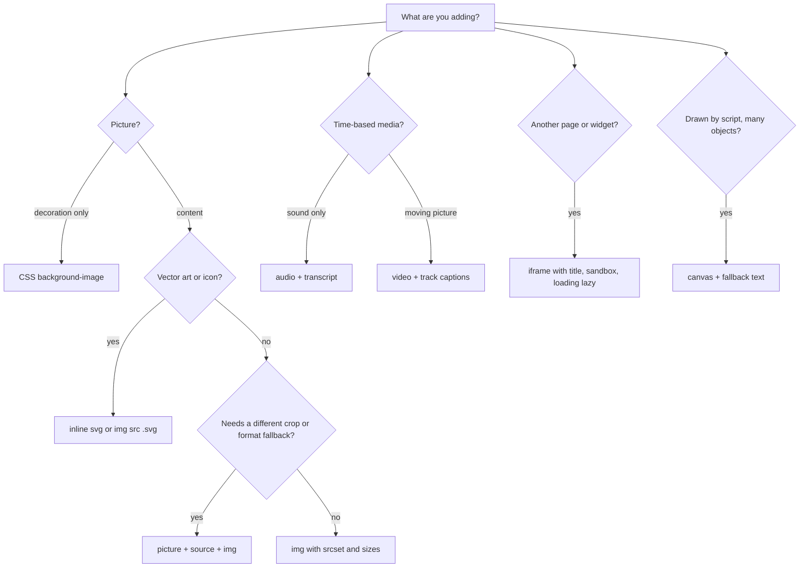

# Chapter 4 — Images, Media and Embeds

Text alone rarely makes a website. Product photos, logos, charts, podcasts, tutorial videos, maps and payment widgets are all "media": content that is not plain text and usually lives in its own file. HTML has a small set of elements for them — ``, `<picture>`, `<figure>`, `<audio>`, `<video>`, `<track>`, `<iframe>`, `<svg>` and `<canvas>` — and each comes with rules about accessibility, performance and security that beginners often miss.

Media is also where most of a page's weight is. Images alone are typically the largest share of the bytes on a page, and the biggest image above the fold is very often the element that decides how fast the page *feels* (the **Largest Contentful Paint**, LCP — covered in [Chapter 14](../14-performance-seo-interview-and-cheatsheet/README.md)). So this chapter is as much about "which file does the browser download, and when" as about markup.

**What you'll learn**

1. The `` element: `src`, `alt`, `width`/`height`, and how to write alt text.
2. Image formats — JPEG, PNG, GIF, WebP, AVIF, SVG — and how to choose (with real file sizes).
3. Responsive images: `srcset` with `x` and `w` descriptors, `sizes`, and `<picture>` for art direction and format switching.
4. Loading hints: `loading="lazy"`, `decoding`, `fetchpriority`.
5. `<figure>` and `<figcaption>`.
6. `<audio>`, `<video>`, `<source>` and `<track>` (captions with WebVTT).
7. `<iframe>`: embedding other pages safely with `sandbox`, `allow`, `title`, `srcdoc`.
8. SVG basics: coordinates, `viewBox`, shapes, paths, icons with `currentColor`.
9. `<canvas>`: drawing with JavaScript, and when to prefer SVG.

**How the examples work.** Every example is a real file in [`code/`](code/). No example touches the network: all pictures, the audio beep and the video clip were generated locally by [`code/make_assets.py`](code/make_assets.py) (Python + Pillow) and [`code/make_video.mjs`](code/make_video.mjs) (headless Chrome records an animated canvas). Screenshots in `img/` were taken with headless Chrome at a 900 CSS-pixel-wide window and a device pixel ratio of 2 (a "Retina"-style screen). The two Node scripts (`format_sizes.mjs`, `srcset_pick.mjs`) print the outputs shown below.

---

## 4.1 The `` element

### What it is
`` embeds a picture into the page. It is a **void element** (no closing tag, no content) and a **replaced element**: the browser replaces the element's box with an external resource, the image file, whose content CSS cannot style from the inside.

Analogy: `` is a picture frame nailed into the text. The HTML decides where the frame goes and what the caption card says (`alt`); the file decides what is inside.

### Why it matters
- Images carry meaning (a chart, a product, a diagram). People who cannot see them — screen-reader users, people on slow connections where images fail, search engines — only get the `alt` text.
- Images without known dimensions make the page jump while it loads (**layout shift**), which annoys users and hurts the Core Web Vital CLS.

### How it works
The essential attributes:

| Attribute | Required? | What it does |
|---|---|---|
| `src` | yes | URL of the image file (relative like `media/a.jpg` or absolute like `https://…`). |
| `alt` | yes, in practice | Text alternative. Shown when the image fails, read by screen readers, indexed by search engines. `alt=""` marks the image as decorative. |
| `width`, `height` | strongly recommended | The image's intrinsic size in CSS pixels, **without units** (`width="800"`). Lets the browser reserve space before the file arrives. |
| `srcset`, `sizes` | optional | Candidate files for different screens (4.3). |
| `loading`, `decoding`, `fetchpriority` | optional | Loading hints (4.4). |

Steps the browser follows:

1. The HTML parser meets `` and (unless it is lazy) starts downloading `src` right away — even before CSS is ready. A separate "preload scanner" finds images early.
2. From `width`/`height` the browser computes an **aspect ratio** (its built-in stylesheet effectively applies `aspect-ratio: auto <width> / <height>`), so it can reserve a box of the right shape even if CSS makes the image fluid.
3. When the bytes arrive, the image is decoded and painted into the reserved box.
4. If the file fails, the browser shows a broken-image indicator plus the `alt` text.

The standard CSS to make images shrink with their container but never stretch:

```css
img { max-width: 100%; height: auto; }   /* fluid width, height follows the aspect ratio */
```

`height: auto` matters: without it, the HTML `height="533"` would keep the image 533 px tall while the width shrinks, squashing it.

```html
<!-- code/01_img_basics.html (excerpt) -->
<figure>
  
  <figcaption>Figure 1 — JPEG, 800x533. width/height reserve the space before it loads.</figcaption>
</figure>

   <!-- decorative duplicate -->

<!-- three images whose file is missing -->


```


*Figure 4.1 — The bottom row shows what alt text is for: when the file is missing, only the first image still communicates anything.*

### Writing alt text — a decision list
1. **Does the image carry information?** Describe the *information*, not the pixels. For a chart: `alt="Revenue rose 12% in Q3"`, not `alt="bar chart"`.
2. **Is it a link or button with no other text?** Describe the *action/destination*: a magnifier icon inside a search button → `alt="Search"`.
3. **Is it purely decorative** (a flourish, a background texture) **or does it repeat nearby text?** Use `alt=""` (empty, not missing). Screen readers then skip it. Even better, put pure decoration in CSS (`background-image`).
4. **Is it complex** (a detailed diagram)? Give a short `alt` and put the full description in the surrounding text or a `<figcaption>`.
5. Never start with "image of" / "picture of" — screen readers already announce "image".

Missing `alt` is different from empty `alt`. With no `alt`, many screen readers fall back to reading the file name ("image one two three dot jpg"). Accessibility rules for images are covered in more depth in [Chapter 3](../03-semantic-html-and-accessibility/README.md).

### Common mistakes
- Omitting `width`/`height` → content jumps down when the image loads.
- Putting units in the attributes (`width="800px"`). The attributes take plain integers; units belong in CSS.
- Using CSS to set `width` but forgetting `height: auto` → distorted images.
- Keyword-stuffed or file-name alt text.
- Serving a 4000-px-wide camera photo into a 300-px slot (fixed by 4.3).

### In the interview
**30-second answer:** "`` is a void, replaced element. `src` and `alt` are required in practice; `alt` should convey the image's purpose, and be empty for decorative images. Always set `width` and `height` so the browser knows the aspect ratio and reserves space, preventing layout shift, and use `max-width: 100%; height: auto` in CSS for fluid images."

- *Q: What's the difference between `alt=""` and no alt?* A: Empty alt says "decorative, skip it"; missing alt is an error, and assistive tech may read the URL instead.
- *Q: Do width/height attributes stop an image being responsive?* A: No. CSS `max-width:100%; height:auto` overrides the displayed size; the attributes still supply the aspect ratio.
- *Q: CSS background image or ``?* A: `` for content (it has alt, is indexable, can be responsive with srcset); CSS backgrounds for decoration.

### Self-check
1. Which two attributes prevent layout shift? → `width` and `height`.
2. A company logo that links to the home page — alt text? → The destination/name, e.g. `alt="Acme home"`.
3. Why is `height: auto` needed with `max-width: 100%`? → So the height scales with the width instead of staying at the HTML height.

### TL;DR
`` every time; meaningful alt for content, `alt=""` for decoration; fluid with `max-width:100%; height:auto`.

---

## 4.2 Image formats — JPEG, PNG, GIF, WebP, AVIF, SVG

### What it is
An **image format** is the way pixels (or shapes) are stored in a file. **Raster** formats store a grid of pixels (JPEG, PNG, GIF, WebP, AVIF). **Vector** formats store drawing instructions — "circle here, radius 40" — so they scale to any size without blur (SVG).

Two more terms:
- **Lossy compression** throws away detail the eye is unlikely to notice to make files much smaller (JPEG, lossy WebP, AVIF).
- **Lossless compression** keeps every pixel exactly (PNG, GIF, lossless WebP/AVIF).

### Comparison table

| Format | Type | Compression | Transparency | Animation | Best for | Browser support |
|---|---|---|---|---|---|---|
| **JPEG** (`.jpg`) | raster | lossy | no | no | photos, when you need one universal format | everywhere |
| **PNG** | raster | lossless | yes (alpha) | no (APNG exists) | screenshots, UI, logos with transparency, sharp text | everywhere |
| **GIF** | raster | lossless, 256 colours max | 1-bit (on/off) | yes | legacy animations — prefer video or WebP/AVIF | everywhere |
| **WebP** | raster | lossy or lossless | yes | yes | general replacement for JPEG/PNG | all modern browsers (Safari since 2020) |
| **AVIF** | raster | lossy or lossless | yes | yes | smallest files for photos; HDR/wide colour | Baseline 2024 (widely available since July 2026) |
| **SVG** | vector | text (XML) | yes | yes (CSS/SMIL) | icons, logos, illustrations, simple charts | everywhere |

"Baseline" is the web.dev/MDN label for features that work in the current versions of Chrome, Edge, Firefox and Safari.

### Real numbers
The same 800×533 picture was saved in four formats by `make_assets.py` (JPEG quality 80, WebP quality 80, AVIF quality 60, PNG optimised) — once as a flat graphic and once with photo-like grain added.

```js
// code/format_sizes.mjs
import { statSync } from 'fs';
for (const stem of ['hills-800', 'photo-800']) {
  const png = statSync(`media/${stem}.png`).size;
  console.log(`${stem}  (${stem.startsWith('hills') ? 'flat graphic' : 'photo-like grain'})`);
  for (const ext of ['png', 'jpg', 'webp', 'avif']) {
    const kb = statSync(`media/${stem}.${ext}`).size / 1024;
    const vsPng = ((kb * 1024) / png * 100).toFixed(0);
    console.log(`  ${ext.padEnd(5)} ${kb.toFixed(1).padStart(7)} KB   ${vsPng.padStart(4)}% of PNG`);
  }
}
```

Output:
```
hills-800  (flat graphic)
  png       8.8 KB    100% of PNG
  jpg      19.1 KB    216% of PNG
  webp      7.4 KB     84% of PNG
  avif      4.3 KB     48% of PNG
photo-800  (photo-like grain)
  png     508.2 KB    100% of PNG
  jpg     106.8 KB     21% of PNG
  webp    106.3 KB     21% of PNG
  avif     73.7 KB     14% of PNG
```


*Figure 4.2 — Visually identical at this size; the byte counts are not.*

What the numbers teach:
1. **The content decides the winner.** For a flat graphic, lossless PNG (8.8 KB) beats lossy JPEG (19.1 KB) — JPEG wastes bytes on its block artefacts around sharp edges. For a photo, PNG is 5× bigger than JPEG.
2. **AVIF was smallest in both cases**, WebP was roughly equal to or better than the older format. Exact savings vary per image and per quality setting, so measure your own images.
3. For vector-like artwork, SVG is often smaller still and perfectly sharp at any size (4.8).

### How to choose (quick rules)
1. Icon, logo, illustration with flat colours → **SVG**.
2. Photo → **AVIF** (or WebP) with a **JPEG** fallback through `<picture>` (4.3).
3. Screenshot or graphic needing transparency / exact pixels → **PNG** or lossless WebP.
4. Short animation → a muted, looping `<video>` (MP4/WebM) is usually far smaller than a GIF.

### Common mistakes
- Saving a photo as PNG "for quality" — huge files with no visible benefit.
- Saving a logo as JPEG — fuzzy edges and no transparency.
- Using only AVIF with no fallback when you must support old devices.
- Re-compressing an already-compressed JPEG many times (quality degrades each time).

### Real-world examples
Image CDNs (Cloudinary, imgix, Cloudflare Images, Next.js `<Image>`) inspect the browser's `Accept` request header and serve AVIF or WebP automatically when supported, falling back to JPEG.

### Self-check
1. Which formats support transparency? → PNG, GIF (1-bit), WebP, AVIF, SVG — not JPEG.
2. Why was PNG smaller than JPEG for the flat graphic? → Lossless compression is very efficient on large areas of identical colour; JPEG is designed for smooth photographic detail.
3. What replaces an animated GIF today? → A muted, looping, autoplaying `<video>` (or animated WebP/AVIF).

### TL;DR
SVG for vectors, AVIF/WebP with JPEG fallback for photos, PNG for pixel-exact graphics; measure — content type changes which format wins.

---

## 4.3 Responsive images — `srcset`, `sizes` and `<picture>`

### The problem it solves
A phone at 360 CSS px wide does not need the 1600-px hero image a large desktop monitor needs. But a phone with a device pixel ratio (DPR) of 3 — three physical pixels per CSS pixel — *does* need more pixels than its CSS width suggests to look sharp. One `src` can't be right for everyone. Two separate problems:

1. **Resolution switching** — same picture, different sizes. The browser should download the smallest file that still looks sharp. (`srcset` + `sizes` on ``.)
2. **Art direction** — a *different crop or picture* for different layouts (e.g. a wide landscape on desktop, a tight square crop on phones). You decide, not the browser. (`<picture>` + `<source media>`.)

A third, related need is **format switching**: serve AVIF/WebP to browsers that support them, JPEG to the rest (`<picture>` + `<source type>`).

Terms:
- **CSS pixel** — the unit CSS lengths use; roughly the size of a pixel on a traditional 96-dpi screen.
- **Device pixel ratio (DPR)** — physical pixels per CSS pixel (`window.devicePixelRatio`): 1 on older monitors, 2 on Retina laptops, often 3 on phones.

### How it works — density descriptors (`x`)
For an image with a **fixed display size**, list files by pixel density:

```html

```

On a DPR-1 screen the browser takes the `1x` file; on DPR 2 or more, the `2x`. `src` remains the fallback for very old browsers.

### How it works — width descriptors (`w`) + `sizes`
For an image whose **display size changes with the layout**, describe each file's real pixel width with `w`, and tell the browser how wide the image will be displayed with `sizes`:

```html

```

The browser's algorithm, step by step:
1. **Evaluate `sizes`** left to right. Each entry is `(media condition) length`; the first matching condition wins; the last entry (no condition) is the default. Result: the **slot width** in CSS px. (`vw` = 1% of the viewport width.)
2. **Why does it need `sizes` at all?** The browser picks the image while it is still downloading the HTML, *before* CSS is loaded, so it cannot know the layout. `sizes` is your promise about the layout. Without `sizes`, a `w`-descriptor `srcset` assumes `100vw`.
3. **Compute each candidate's density**: file width ÷ slot width. `800w` in a 400-px slot = 2x.
4. **Pick** a candidate whose density is at least the screen's DPR — typically the smallest one that is sharp enough. The spec deliberately lets browsers deviate (for example, reusing a larger file already in cache, or saving data on a slow connection).

A small Node program that models this rule for three viewports and three DPRs:

```js
// code/srcset_pick.mjs (key part)
const srcset = 'hills-400.jpg 400w, hills-800.jpg 800w, hills-1600.jpg 1600w';
const sizes = '(max-width: 600px) 100vw, (max-width: 1000px) 50vw, 400px';

function slotWidth(sizesAttr, viewport) {       // first matching media condition wins
  for (const part of sizesAttr.split(',').map(s => s.trim())) {
    const m = part.match(/^\((max|min)-width:\s*(\d+)px\)\s+(.+)$/);
    const length = m ? m[3] : part;
    const ok = !m || (m[1] === 'max' ? viewport <= +m[2] : viewport >= +m[2]);
    if (ok) return length.endsWith('vw') ? (parseFloat(length) / 100) * viewport : parseFloat(length);
  }
}
function pick(viewport, dpr) {
  const slot = slotWidth(sizes, viewport);
  const withDensity = candidates.map(c => ({ ...c, density: c.w / slot })).sort((a, b) => a.w - b.w);
  const chosen = withDensity.find(c => c.density >= dpr) ?? withDensity.at(-1);
  return { slot, needed: slot * dpr, chosen };
}
```

Output:
```
sizes = "(max-width: 600px) 100vw, (max-width: 1000px) 50vw, 400px"
viewport  dpr  slot(CSS px)  needs(px)  chosen
     360  1x           360        360  hills-400.jpg
     360  2x           360        720  hills-800.jpg
     360  3x           360       1080  hills-1600.jpg
     768  1x           384        384  hills-400.jpg
     768  2x           384        768  hills-800.jpg
     768  3x           384       1152  hills-1600.jpg
    1280  1x           400        400  hills-400.jpg
    1280  2x           400        800  hills-800.jpg
    1280  3x           400       1200  hills-1600.jpg
```

Notice the biggest file goes to the *phone* with DPR 3, not to the desktop — the number of physical pixels, not the screen size, decides.

### How it works — `<picture>`
`<picture>` wraps one `` and any number of `<source>` elements. The browser walks the sources **in order** and uses the **first** one whose `media` matches and whose `type` it supports; if none match, it uses the ``. The `` is always required: it is the element that is actually displayed, and it carries `alt`, `width`, `height`, `loading` for all sources. (When an art-directed crop has a different shape, you can also put `width`/`height` on that `<source>` so the browser reserves the right aspect ratio.)

```html
<!-- code/03_responsive_images.html (excerpt) -->
<picture>
  <!-- art direction: narrow screens get a square crop -->
  <source media="(max-width: 600px)" srcset="media/hills-square-600.jpg">
  <!-- format switching: best format the browser can decode -->
  <source type="image/avif" srcset="media/hills-800.avif">
  <source type="image/webp" srcset="media/hills-800.webp">
  
</picture>
```

The demo page prints `img.currentSrc` — the file the browser actually chose — under each image:


*Figure 4.3 — At 900 px wide and DPR 2. A: slot 300 px × 2 = 600 px needed → the 800w file. B: DPR 2 → the `2x` file. C: no media match, AVIF supported → the AVIF.*


*Figure 4.4 — The same page at 420 px wide. Only `<picture>` (C) changed its crop, because `(max-width: 600px)` now matches; A and B still pick by pixel density.*

### Trade-offs

| Need | Use | Who decides? |
|---|---|---|
| Fixed-size image, sharp on high-DPR screens | `srcset` with `1x, 2x` | browser |
| Fluid image, many screen sizes | `srcset` with `w` + `sizes` | browser |
| Different crop/composition per layout | `<picture>` + `<source media>` | you |
| Modern format with fallback | `<picture>` + `<source type>` | browser (by support) |

### Common mistakes
- **`w` descriptors without `sizes`** — the browser assumes the image is 100vw and downloads files far too big for small slots.
- `sizes` that lie about the layout (e.g. `sizes="100vw"` for a sidebar thumbnail).
- Putting `alt` on `<source>` — it belongs on the `` only.
- Using `<picture>` just to switch resolution — plain `srcset` is enough and lets the browser choose smarter.
- Mixing `x` and `w` descriptors in one `srcset` (invalid).

### When not to use it
Small icons and SVGs don't need `srcset` — vectors are sharp at any size. For background images use CSS `image-set()` instead (see [Chapter 10](../10-responsive-design/README.md)).

### In the interview
**30-second answer:** "`srcset` lists candidate files; with `x` descriptors for fixed-size images, with `w` descriptors plus `sizes` for fluid ones. `sizes` tells the browser the display width before CSS loads, the browser divides each file's width by that to get its density, then picks one dense enough for the device pixel ratio. `<picture>` is for when *I* must control the choice — art direction with `media`, or format fallbacks with `type`; its `` child is mandatory and carries alt and dimensions."

- *Q: Why can't the browser just measure the layout?* A: Image downloads start during HTML parsing, before CSS and layout exist; waiting would delay every image.
- *Q: With `<picture>`, which source is used if two match?* A: The first one in source order.
- *Q: How do you check which file was chosen?* A: `img.currentSrc` in the console, or the Network panel in DevTools.

### Self-check
1. Viewport 768 px, DPR 2, `sizes="(max-width: 1000px) 50vw, 400px"` — slot and needed pixels? → 384 CSS px; 768 device px → pick the 800w file.
2. Where do `alt` and `width`/`height` go in a `<picture>`? → On the ``.
3. What happens without `sizes` when `srcset` uses `w`? → The slot is assumed to be `100vw`.

### TL;DR
`x` for fixed size, `w` + honest `sizes` for fluid size, `<picture>` only when you need art direction or format fallback; `currentSrc` shows the winner.

---

## 4.4 Loading hints — `loading`, `decoding`, `fetchpriority`

### What they are
Three attributes that change *when* and *how urgently* an image is fetched or decoded. They are hints: the page works without them, but loads faster with them.

| Attribute | Values | Effect |
|---|---|---|
| `loading` | `eager` (default), `lazy` | `lazy` defers fetching until the image is near the viewport. Also works on `<iframe>`. |
| `fetchpriority` | `high`, `low`, `auto` (default) | Raises or lowers the download priority relative to other images. Baseline since Oct 2024. |
| `decoding` | `sync`, `async`, `auto` (default) | Whether decoding the image may be done off the main rendering step. Rarely needed. |

Native lazy loading for images and iframes has been Baseline since December 2023 (Firefox 121 was the last engine to add it for iframes; images worked everywhere earlier), so JavaScript lazy-loading libraries are no longer needed for the basic case.

### How it works
1. The browser checks each `loading="lazy"` element's distance to the viewport. Browsers use a generous margin (on the order of a screen or more), so images normally arrive before the user scrolls to them.
2. Lazy images do **not** delay the window `load` event, because they may never be fetched.
3. Lazy loading only happens when scripting is enabled (a privacy measure: otherwise scroll position could be tracked through image requests).
4. `fetchpriority="high"` moves the image up the download queue — useful for the one image that is the page's LCP element.

```html
<!-- code/04_lazy_loading.html (excerpt) -->
                                   <!-- above the fold -->
                <!-- 3000 px lower -->

<script>
  addEventListener('load', () => {
    report.textContent = 'after the load event:\n' + [...document.images]
      .map(i => `${i.id.padEnd(6)} ${(i.getAttribute('loading') || '(none)').padEnd(6)} ${i.naturalWidth ? 'LOADED' : 'not loaded yet'}`)
      .join('\n');
  });
</script>
```


*Figure 4.5 — When the page finished loading, only the hero had been downloaded; the two lazy images (~660 KB together) were never fetched because nobody scrolled to them.*

### Common mistakes
- **Lazy-loading the hero / LCP image.** It then waits until layout is known, delaying the most important paint. Never put `loading="lazy"` on above-the-fold images.
- Lazy images without `width`/`height` — they start as 0×0, so the page jumps when they arrive, and the browser can misjudge which ones are near the viewport.
- Putting `fetchpriority="high"` on many images: if everything is high priority, nothing is.

### Self-check
1. Which image on a product page should get `fetchpriority="high"`? → The main product photo above the fold (usually the LCP element).
2. Does a lazy image block the `load` event? → No.
3. What else can take `loading="lazy"`? → `<iframe>`.

### TL;DR
`loading="lazy"` for below-the-fold images and iframes, never for the hero; `fetchpriority="high"` on the single most important image; always give dimensions.

---

## 4.5 `<figure>` and `<figcaption>`

### What it is
`<figure>` groups **self-contained content that is referenced from the main text** — an image, a diagram, a code listing, a quotation, a table — and `<figcaption>` (first or last child) gives it a caption. The caption becomes the figure's accessible name.

Test for "self-contained": could you move it to an appendix or the side of the page, with the text saying "see Figure 3", without breaking the flow? Then it's a figure.

```html
<figure>
  
  <figcaption>Figure 1 — JPEG, 800x533.</figcaption>
</figure>
```

(Rendered in Figure 4.1 above.)

### Caption vs alt
They do different jobs. The **alt** *replaces* the image for people who can't see it; the **caption** *adds* context for everyone. Don't copy one into the other — a screen reader would read the same sentence twice. If the caption already fully describes the image, a short alt is fine.

### Common mistakes
- Wrapping *every* image in `<figure>` (decorative images and inline icons are not figures).
- Using a `<p>` or `<div class="caption">` instead of `<figcaption>` — the association is lost for assistive technology.

### TL;DR
`<figure>` = referenced, movable content; `<figcaption>` = its visible caption; alt and caption complement, not duplicate.

---

## 4.6 Audio and video — `<audio>`, `<video>`, `<source>`, `<track>`

### What it is
`<audio>` and `<video>` play media natively in the browser — no plugins. Both are **media elements** with the same JavaScript API (`play()`, `pause()`, `currentTime`, `volume`, events like `play`, `ended`, `timeupdate`).

### How it works
1. The browser reads the `<source>` children **in order** and picks the first whose `type` (MIME type, optionally with codecs) it can play. (Safari 17.4+ may pick the best supported one instead of the first.) Or use a single `src` attribute on the element.
2. Content inside the element other than `<source>`/`<track>` (for example a download link) is **fallback** for browsers that don't support the element at all — not for unsupported formats.
3. `<track>` elements attach timed text files in **WebVTT** format (`.vtt`) — captions, subtitles, descriptions, chapters.
4. Without `controls`, the element shows no UI; you would have to build your own buttons with the JS API.

Key attributes:

| Attribute | Element | Meaning |
|---|---|---|
| `controls` | both | Show the browser's built-in play/pause/volume/seek UI. |
| `autoplay` | both | Try to start immediately. Browsers block autoplay **with sound**; muted autoplay is generally allowed. |
| `muted` | both | Start muted (needed for autoplay to be allowed). |
| `loop` | both | Restart at the end. |
| `preload` | both | Hint: `none` (fetch nothing until play), `metadata` (duration/dimensions only), `auto` (may download all). |
| `poster` | video | Image shown before playback starts. |
| `playsinline` | video | On iPhone, play inside the page instead of going full-screen. |
| `width`/`height` | video | Reserve space (like ``). |

`<track>` attributes: `kind` (`subtitles` default, `captions`, `descriptions`, `chapters`, `metadata`), `src`, `srclang`, `label` (shown in the captions menu), `default` (turn on by default).

**Captions vs subtitles.** *Subtitles* translate dialogue for viewers who can hear but don't know the language. *Captions* are for viewers who can't hear the audio: they include dialogue **and** meaningful sounds ("[door slams]").

A WebVTT file is plain text:

```
WEBVTT

00:00:00.000 --> 00:00:01.400
The sun rises on the left.

00:00:01.400 --> 00:00:03.000
[soft wind] It drifts to the right.
```

```html
<!-- code/05_audio_video.html (excerpt) -->
<audio controls preload="metadata">
  <source src="media/tone.wav" type="audio/wav">
  <p>Your browser cannot play this audio. <a href="media/tone.wav">Download the WAV</a>.</p>
</audio>

<video controls preload="none" poster="media/poster.jpg" width="640" height="360">
  <source src="media/clip.webm" type="video/webm">
  <track kind="captions" src="media/captions.vtt" srclang="en" label="English" default>
  <p>Your browser cannot play this video. <a href="media/clip.webm">Download it</a>.</p>
</video>
```

The second video in the demo is seeked to 2.0 s by script and shows the matching cue. One practical gotcha surfaced here: browsers refuse to load `<track>` files when the page is opened from `file://` (text tracks must be same-origin or served with CORS), so the demo adds the same cues with the TextTrack API — `video.addTextTrack('captions', 'English', 'en').addCue(new VTTCue(1.4, 3.0, '…'))`. Served over `http://`, the `<track>` element works as written.

![Screenshot: an audio player; a video showing its poster frame; a second video paused at 0:02 showing the caption "[soft wind] It drifts to the right."](img/05_audio_video.png)

*Figure 4.6 — Native controls, a poster before playback, and a caption cue at t = 2 s.*

### Formats in practice

| Container | Typical codecs | Support |
|---|---|---|
| MP4 | H.264 video + AAC audio | every browser — the safest single choice |
| WebM | VP9 or AV1 video + Opus audio | Chrome, Edge, Firefox, Safari (14.1+ on macOS, 17.4+ on iOS) |
| MP4 | AV1 or HEVC (H.265) | varies by browser and hardware — always provide a fallback |
| MP3 / AAC / Opus / WAV | audio | MP3 and AAC everywhere; WAV is uncompressed (large) |

List the smallest well-supported format first and MP4/H.264 last as the universal fallback. Declare `type` so the browser can skip formats without downloading them.

### Accessibility and UX checklist
- Captions for every video with speech (WCAG 2.2 success criterion 1.2.2); a transcript for audio-only content (1.2.1).
- Don't autoplay with sound; if something moves for more than 5 seconds, users must be able to pause it (2.2.2).
- Give `<video>` a `poster` and dimensions so the page doesn't jump.
- For big sites, video is usually served by a streaming service using **adaptive bitrate** (HLS or DASH, which switch quality with bandwidth) via Media Source Extensions — `<video src="file.mp4">` downloads one fixed-quality file.

### Common mistakes
- `autoplay` without `muted` and wondering why it doesn't play.
- Thinking the fallback paragraph appears when the *format* is unsupported (it doesn't — it's for browsers without `<video>`).
- Serving a 50 MB unoptimised video file as a "background video".
- `preload="auto"` on a page with many videos — wastes bandwidth.

### Real-world examples
Social feeds replace GIFs with `<video autoplay muted loop playsinline>` because the MP4 is typically a fraction of the GIF size. YouTube and Netflix use `<video>` with Media Source Extensions for adaptive streaming.

### In the interview
**30-second answer:** "`<video>`/`<audio>` with `controls`, multiple `<source>` elements with `type` so the browser picks a format it can play, and `<track kind="captions">` with a WebVTT file for accessibility. Autoplay only works muted; add `playsinline` for iOS. For large video, use adaptive streaming (HLS/DASH) instead of one big file."

- *Q: Captions vs subtitles?* A: Captions include non-speech sounds for deaf/hard-of-hearing users; subtitles translate dialogue.
- *Q: Why does my `autoplay` video not start?* A: Browser autoplay policies block audible autoplay; add `muted` (and `playsinline` on iOS).

### Self-check
1. Which attribute shows an image before playback? → `poster`.
2. What file format do `<track>` files use? → WebVTT (`.vtt`, starting with the line `WEBVTT`).
3. What does `preload="none"` do? → Nothing is fetched until the user presses play.

### TL;DR
Native media elements + `controls` + ordered `<source type>` list + `<track>` captions; muted for autoplay; stream big video adaptively.

---

## 4.7 Embedding other pages — `<iframe>`

### What it is
An `<iframe>` (inline frame) displays **another complete HTML document** inside a rectangle of your page. The embedded page has its own DOM, its own CSS and JavaScript, and — if it comes from another origin — the browser's **same-origin policy** keeps it and your page from reading each other. (An **origin** is scheme + host + port, e.g. `https://example.com:443`.)

Typical uses: YouTube/Vimeo players, maps, payment fields (Stripe, Adyen host card inputs in iframes so card numbers never touch your page), social posts, ads, code playgrounds.

### Why it matters
You are putting someone else's code inside your page. Iframes are also the tool attackers use for **clickjacking** — loading *your* site invisibly inside theirs and tricking users into clicking. Both directions need security controls.

### How it works — key attributes

| Attribute | Purpose |
|---|---|
| `src` | URL of the embedded document. |
| `srcdoc` | Inline HTML to use instead of `src` (handy for previews and sandboxed user content). |
| `title` | **Required for accessibility**: screen readers announce it so users know what the frame contains. |
| `width`, `height` | Size (default 300×150). |
| `loading="lazy"` | Defer loading off-screen frames — a big win for heavy embeds like videos and maps. |
| `sandbox` | Apply extra restrictions (below). |
| `allow` | Permissions policy: which powerful features the frame may use, e.g. `allow="fullscreen; camera; geolocation"`. |
| `referrerpolicy` | How much of your URL to send as the `Referer` header, e.g. `no-referrer`. |

**`sandbox`.** An empty `sandbox` attribute turns *everything* off: no scripts, no forms, no pop-ups, no top-level navigation, and the content is treated as a unique **opaque origin** (so it can't read cookies/storage of its real origin). You then add back only what the embed needs, with tokens such as `allow-scripts`, `allow-forms`, `allow-popups`, `allow-same-origin`, `allow-modals`, `allow-downloads`, `allow-top-navigation-by-user-activation`.

> Warning: `allow-scripts` together with `allow-same-origin` on a document from **your own origin** lets its script reach into the parent and remove the sandbox attribute — the sandbox becomes meaningless. Use that combination only for content from a different origin.

The demo loads the same small document (via `srcdoc`) into three frames. Its script writes "allowed" if it ran and then tries to read the parent page's title:

```html
<!-- code/06_iframe.html (excerpt) -->
<iframe class="widget" title="Widget without sandbox"></iframe>
<iframe class="widget" sandbox title="Widget, fully sandboxed"></iframe>
<iframe class="widget" sandbox="allow-scripts" title="Widget, scripts only"></iframe>

<!-- inside each frame -->
<script>
  document.querySelector('#js span').textContent = 'allowed (set by JS)';
  let parentTitle;
  try { parentTitle = window.parent.document.title; }
  catch (e) { parentTitle = 'blocked (' + e.name + ')'; }
</script>
```


*Figure 4.7 — `srcdoc` content shares the parent's origin, so without a sandbox it can read the parent. `sandbox` blocks scripts entirely; `allow-scripts` lets them run but, without `allow-same-origin`, in an opaque origin — so touching the parent throws `SecurityError`.*

### The other direction: stopping others from framing *you*
Your server decides whether other sites may embed your pages, using HTTP response headers:
- `Content-Security-Policy: frame-ancestors 'self'` (modern; can list allowed sites), or
- the older `X-Frame-Options: DENY` / `SAMEORIGIN`.

Banks and login pages send these to prevent clickjacking. That is also why embedding some sites in an iframe simply shows an error.

### `<embed>` and `<object>`
Older elements for plugin content (Flash, Java applets — both gone). Today they are mostly used for PDFs, and even then an `<iframe>` or a plain link is usually better. Don't use them for new work.

### Common mistakes
- No `title` on the iframe.
- Heavy third-party embeds (video, maps, chat widgets) loaded eagerly — each can pull in megabytes of scripts. Use `loading="lazy"` or a "click to load" placeholder ("facade").
- `sandbox="allow-scripts allow-same-origin"` on same-origin, untrusted content.
- Using iframes for your own page layout (a 1990s pattern) — breaks URLs, history, accessibility.

### In the interview
**30-second answer:** "An iframe embeds another document with its own browsing context; cross-origin frames are isolated by the same-origin policy. I always add a `title`, lazy-load off-screen embeds, and restrict untrusted content with `sandbox`, adding only the tokens needed, and `allow` for permissions. To stop my site being framed — clickjacking — I send `Content-Security-Policy: frame-ancestors`."

- *Q: What does an empty `sandbox` do?* A: Blocks scripts, forms, pop-ups, top navigation, plugins and gives an opaque origin.
- *Q: Why do payment providers use iframes?* A: The card field lives on their origin, so the merchant's page (and any malicious script on it) cannot read the card number, which also reduces the merchant's PCI compliance scope.

### Self-check
1. Which attribute is needed for screen readers? → `title`.
2. Which header stops other sites framing your page? → `Content-Security-Policy: frame-ancestors` (or `X-Frame-Options`).
3. Which two sandbox tokens should not be combined for same-origin untrusted content? → `allow-scripts` + `allow-same-origin`.

### TL;DR
`<iframe title loading="lazy">`, `sandbox` with the fewest tokens, `allow` for permissions; protect your own pages with `frame-ancestors`.

---

## 4.8 SVG basics

### What it is
**SVG (Scalable Vector Graphics)** is an XML language for 2-D vector drawings. Because it describes shapes, not pixels, it stays razor-sharp at any zoom and is usually tiny for icons and logos. SVG can be written **inline** in HTML (then it is part of the DOM — CSS and JS can style and animate each shape), referenced as a file with ``, or used in CSS (`background-image: url(x.svg)`).

### How it works
1. **Coordinate system.** `viewBox="minX minY width height"` defines the drawing's internal coordinates. `viewBox="0 0 200 120"` means x runs 0→200 and y runs 0→120, **y pointing down**. The `width`/`height` attributes (or CSS) set the displayed size; the viewBox is scaled to fit (preserving aspect ratio by default).
2. **Shapes.** `<rect x y width height rx>`, `<circle cx cy r>`, `<ellipse>`, `<line x1 y1 x2 y2>`, `<polyline>`/`<polygon points="x,y x,y …">`, `<text>`.
3. **Paths.** `<path d="…">` is the general shape: `M x y` move to, `L` line to, `H`/`V` horizontal/vertical line, `C` cubic Bézier curve, `Q` quadratic curve, `T` smooth continuation of a quadratic, `A` arc, `Z` close. Upper-case = absolute coordinates, lower-case = relative.
4. **Painting.** `fill` (inside colour), `stroke` (outline colour), `stroke-width`. These are also CSS properties, so they can live in a stylesheet.
5. **Reuse.** Define an icon once with `<symbol id="…" viewBox="…">`, then place copies with `<use href="#id"/>`.
6. **`currentColor`.** `fill="currentColor"` or `stroke="currentColor"` makes the icon take the text colour of its context, so one icon works on a green button and a red one.

```html
<!-- code/07_svg.html (excerpt) -->
<svg width="200" height="120" viewBox="0 0 200 120" role="img" aria-labelledby="t1">
  <title id="t1">Basic SVG shapes</title>
  <rect x="10" y="10" width="60" height="40" rx="6" fill="#6c5ce7"/>
  <circle cx="110" cy="30" r="20" fill="#fdcb6e" stroke="#e17055" stroke-width="4"/>
  <line x1="150" y1="10" x2="190" y2="50" stroke="#2d3436" stroke-width="3"/>
  <polygon points="10,110 40,70 70,110" fill="#00b894"/>
  <path d="M90 80 Q 120 40 150 80 T 190 80" fill="none" stroke="#0984e3" stroke-width="3"/>
</svg>

<!-- same viewBox, half the display size: still sharp -->
<svg width="100" height="60" viewBox="0 0 200 120" aria-hidden="true">…</svg>

<!-- icon sprite + currentColor -->
<svg width="0" height="0" style="position:absolute">
  <symbol id="check" viewBox="0 0 24 24">
    <path d="M4 12l5 5L20 6" fill="none" stroke="currentColor" stroke-width="3"/></symbol>
</svg>
<button><svg class="icon" aria-hidden="true"><use href="#check"/></svg>Save</button>


```


*Figure 4.8 — Shapes and a path; the same drawing scaled down; one icon definition coloured by each button's `color` via `currentColor`; an SVG file used as an ``.*

### Inline SVG vs ``

| | Inline `<svg>` | `` / CSS background |
|---|---|---|
| Style parts with page CSS / animate with JS | yes | no (it's a closed image) |
| `currentColor` follows the text colour | yes | no |
| Cached separately by the browser | no (part of the HTML) | yes |
| Scripts inside the SVG run | yes — so never inline untrusted SVG | no (scripts and external resources are disabled) |
| Accessibility | `role="img"` + `<title>`/`aria-label`, or `aria-hidden="true"` if decorative | `alt` like any image |

### Common mistakes
- Forgetting `viewBox` → the drawing doesn't scale; it gets cropped.
- Icons inside buttons without hiding them (`aria-hidden="true"`) *and* without text → buttons with no accessible name.
- Inlining user-uploaded SVG — it can contain `<script>` (an XSS risk). Serve user SVGs through `` or sanitise them.
- Exported SVGs from design tools full of editor metadata; run them through an optimiser such as SVGO.

### Self-check
1. What does `viewBox="0 0 24 24"` mean? → The drawing uses a 24×24 coordinate space, scaled to whatever display size is set.
2. How does one icon change colour per button? → Use `fill`/`stroke="currentColor"` and set CSS `color` on the button.
3. Which way does the y-axis point in SVG? → Down.

### TL;DR
SVG = sharp, small, styleable vectors; always set `viewBox`; `symbol` + `use` + `currentColor` for icon systems; never inline untrusted SVG.

---

## 4.9 `<canvas>` — an introduction

### What it is
`<canvas>` is a blank bitmap that JavaScript paints into, pixel by pixel, through a drawing API — the 2D context (`getContext('2d')`) or WebGL/WebGPU for 3-D. Once drawn, the canvas remembers only **pixels**, not shapes: there's no DOM element for "bar 3", so to change something you redraw.

Analogy: SVG is a stack of cut-out paper shapes you can move individually; canvas is a painting — to move the sun you paint over the whole thing again.

### How it works
1. The `width`/`height` **attributes** set the size of the drawing buffer in pixels (default 300×150). CSS width/height only stretch that buffer on screen, which blurs it.
2. On high-DPR screens, make the buffer `devicePixelRatio` times bigger, keep the CSS size, and `ctx.scale(dpr, dpr)` so you can keep drawing in CSS-pixel coordinates.
3. Draw with methods like `fillRect`, `strokeRect`, `beginPath/moveTo/lineTo/arc/fill/stroke`, `fillText`, `drawImage`, after setting properties like `fillStyle`, `strokeStyle`, `font`, `textAlign`.
4. For animation, clear and redraw inside `requestAnimationFrame` (that's how `make_video.mjs` drew the clip for 4.6).

```html
<!-- code/08_canvas.html (excerpt) -->
<canvas id="chart" width="420" height="220" role="img"
        aria-label="Bar chart of visits: Mon 12, Tue 19, Wed 7, Thu 15, Fri 22">
  Visits: Mon 12, Tue 19, Wed 7, Thu 15, Fri 22.
</canvas>
<script>
  const data = { Mon: 12, Tue: 19, Wed: 7, Thu: 15, Fri: 22 };
  const canvas = document.getElementById('chart');
  const dpr = window.devicePixelRatio || 1;                 // sharp on high-DPI screens
  canvas.style.width = canvas.width + 'px'; canvas.style.height = canvas.height + 'px';
  canvas.width *= dpr; canvas.height *= dpr;
  const ctx = canvas.getContext('2d');
  ctx.scale(dpr, dpr);

  const max = Math.max(...Object.values(data)), barW = 50, gap = 25, base = 190;
  ctx.font = '13px system-ui'; ctx.textAlign = 'center';
  Object.entries(data).forEach(([day, v], i) => {
    const x = 30 + i * (barW + gap), h = (v / max) * 150;
    ctx.fillStyle = '#6c5ce7'; ctx.fillRect(x, base - h, barW, h);
    ctx.fillStyle = '#222';
    ctx.fillText(v, x + barW / 2, base - h - 6);
    ctx.fillText(day, x + barW / 2, base + 18);
  });
  ctx.beginPath(); ctx.moveTo(20, base); ctx.lineTo(410, base); ctx.stroke();
</script>
```


*Figure 4.9 — A bar chart painted with the 2D context. The canvas's text content and `aria-label` give the same data to assistive technology, which cannot "see" the pixels.*

### Canvas vs SVG

| | SVG | Canvas |
|---|---|---|
| Model | retained: each shape is a DOM node | immediate: only pixels remain |
| Scales without blur | yes | no — redraw at the new size |
| Events per shape (click a bar) | yes, native | you do hit-testing yourself |
| Accessibility | text and titles are real content | none built in — add fallback text / `aria-label` / a data table |
| Performance sweet spot | up to a few thousand elements | many thousands of objects, pixel effects, games, real-time charts |
| Examples | icons, logos, charts in D3 | games, image editors, Figma-style editors, big-data plots |

### Common mistakes
- Sizing the canvas with CSS only → blurry, stretched drawing.
- Forgetting fallback content / accessible text for meaningful drawings.
- Drawing text-heavy UI on canvas that would be simpler and more accessible as HTML.

### Self-check
1. Default canvas size? → 300×150.
2. Why multiply the buffer by `devicePixelRatio`? → So one canvas pixel maps to one physical pixel on high-DPR screens.
3. Canvas or SVG for a clickable map of 50 regions? → SVG: each region is an element with its own events and accessible name.

### TL;DR
Canvas is a JS-painted bitmap: fast for lots of pixels and animation, but no DOM, no built-in accessibility; set buffer size via attributes × DPR.

---

## 4.10 Choosing the right element



---

## Chapter interview round-up

1. **How do you make images responsive?** CSS `max-width:100%; height:auto`; `srcset` (`x` or `w` + `sizes`) to serve the right file; `<picture>` for art direction/format fallback; `width`/`height` to avoid layout shift.
2. **How do you improve image loading performance?** Right format (AVIF/WebP), right size (srcset), compress, lazy-load below the fold, `fetchpriority="high"` for the LCP image, dimensions to avoid CLS, a CDN.
3. **When is `alt=""` correct?** For decorative images and images whose information is already in adjacent text.
4. **How would you embed an untrusted HTML snippet?** In an iframe with `sandbox` (no `allow-same-origin`), possibly via `srcdoc`, or sanitise it.
5. **SVG vs PNG for a logo?** SVG: sharp at any size, usually smaller, styleable; PNG only if the artwork is too complex for vectors.
6. **Canvas vs SVG for a chart?** SVG for typical dashboards (accessible, interactive per element); canvas for tens of thousands of points or real-time updates.

---

## Chapter TL;DR

- ``: meaningful alt, empty alt for decoration, dimensions to prevent layout shift, fluid via `max-width:100%; height:auto`.
- Formats: SVG for vectors; AVIF/WebP (JPEG fallback) for photos; PNG for pixel-exact graphics; video instead of GIF. Measure — content type changes the winner.
- `srcset` + `sizes` lets the browser choose by device pixels; `<picture>` lets *you* choose by layout (`media`) or format (`type`).
- `loading="lazy"` below the fold, never on the hero; `fetchpriority="high"` for the LCP image.
- `<figure>`/`<figcaption>` for referenced, self-contained content.
- `<video>`/`<audio>` with `controls`, ordered `<source type>`s, WebVTT `<track>` captions; autoplay only when muted.
- `<iframe>`: `title`, `loading="lazy"`, minimal `sandbox` tokens, `allow`; defend your own pages with `frame-ancestors`.
- SVG: `viewBox`, shapes and paths, `symbol`/`use`, `currentColor`; never inline untrusted SVG.
- `<canvas>`: script-painted pixels, scale by `devicePixelRatio`, provide accessible fallback.

Next: [Chapter 5 — Tables and Forms](../05-tables-and-forms/README.md).
