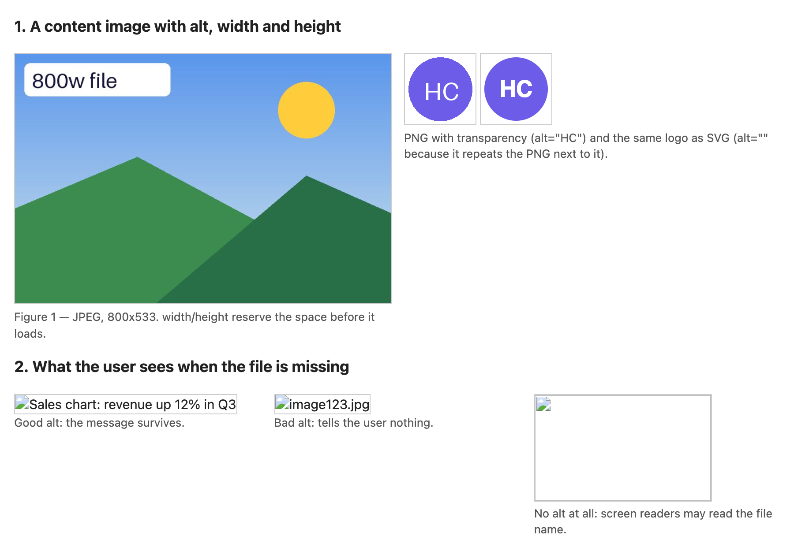
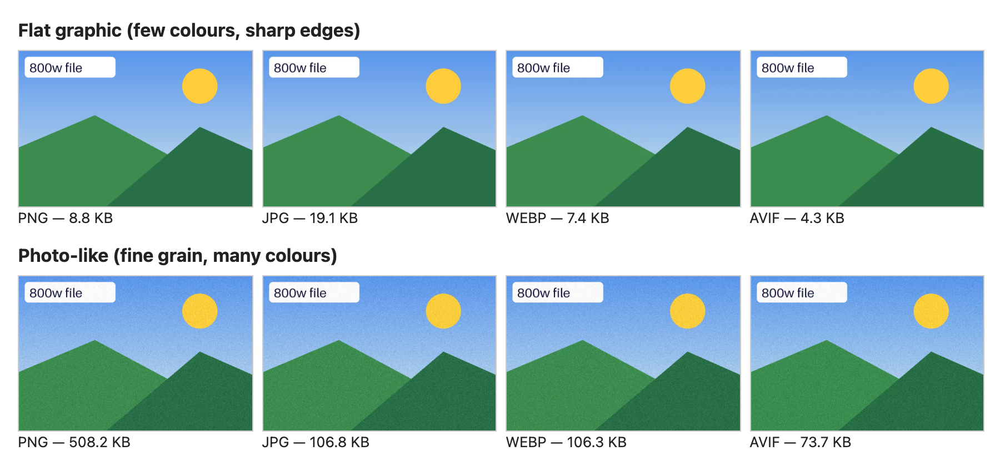
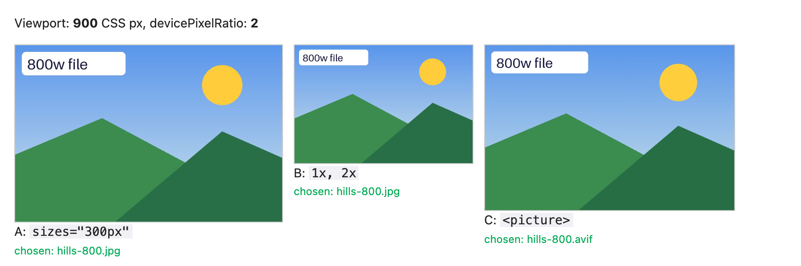
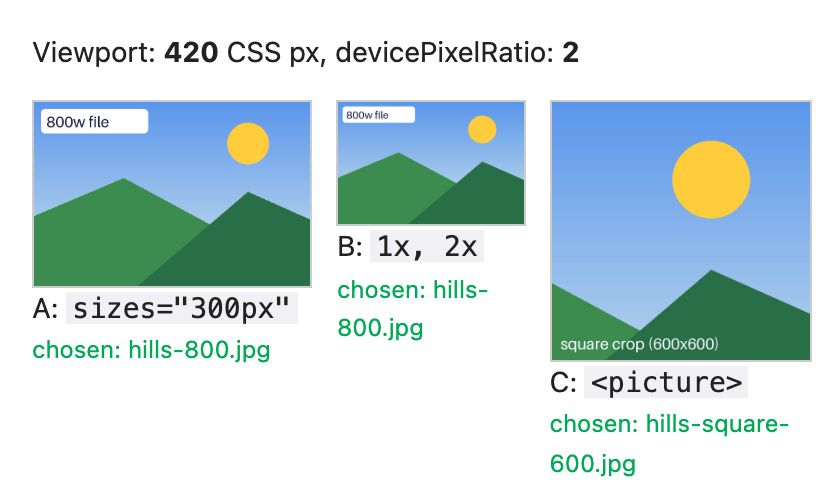
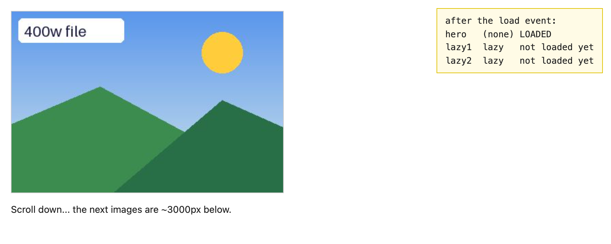
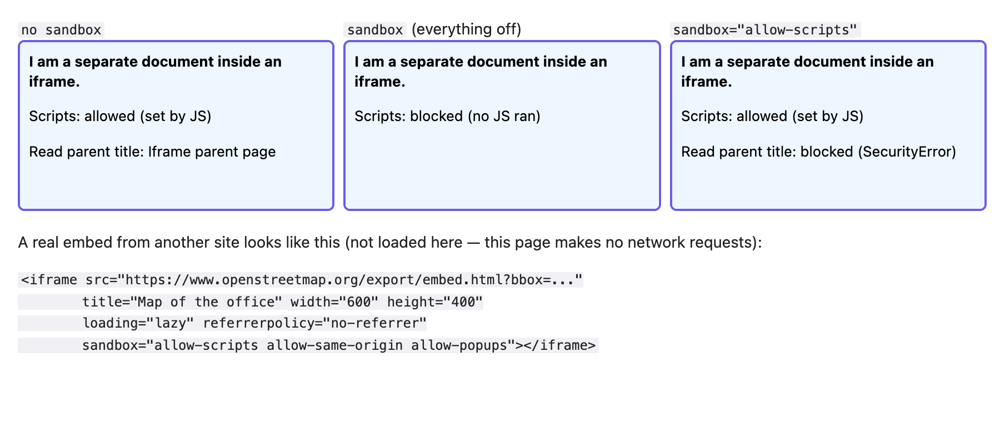
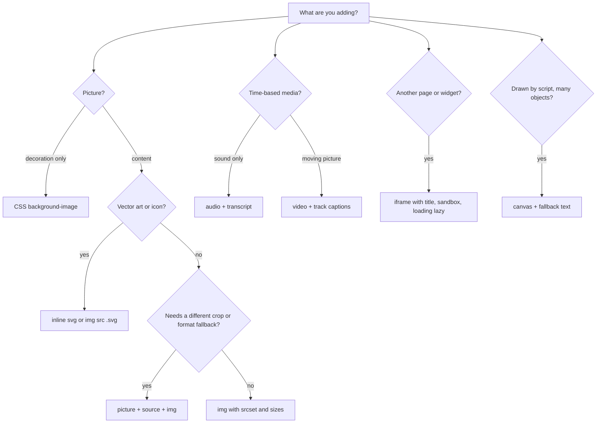

# Chapter 4 — Images, Media and Embeds

Photos, logos, charts, podcasts, videos, maps and payment widgets (self-contained interactive components, often from another company) are "media": non-text content, usually in its own file. HTML's elements for them — ``, `<picture>`, `<figure>`, `<audio>`, `<video>`, `<track>`, `<iframe>` (a window showing another page), `<svg>` (vector drawings) and `<canvas>` (a JavaScript drawing surface) — each carry accessibility, performance and security rules beginners miss.

Media is also most of a page's weight (download size): images are typically the largest share of bytes, and the biggest image above the fold (visible without scrolling) often decides how fast the page *feels* — the **Largest Contentful Paint** (LCP, [Chapter 14](../14-performance-seo-interview-and-cheatsheet/README.md)). So this chapter is as much about "which file is downloaded, and when" as about markup.

**In this chapter:** 4.1 `` · 4.2 Image formats (with real file sizes) · 4.3 Responsive images: `srcset`, `sizes`, `<picture>` · 4.4 Loading hints · 4.5 `<figure>` · 4.6 Audio and video, WebVTT captions · 4.7 `<iframe>` and `sandbox` · 4.8 SVG basics · 4.9 `<canvas>` · 4.10 Choosing the right element.

**How the examples work.** Every example is a real file in [`code/`](code/), with no network access: pictures, the audio beep and the video were generated by [`code/make_assets.py`](code/make_assets.py) (Python + Pillow, an image library) and [`code/make_video.mjs`](code/make_video.mjs) (headless Chrome records an animated canvas). Screenshots are headless Chrome at 900 CSS px wide and device pixel ratio 2 (a "Retina"-style high-density screen; terms defined in §4.3). `format_sizes.mjs` and `srcset_pick.mjs` print the outputs shown.

---

## 4.1 The `` element

### What it is
`` embeds a picture. It is a **void element** (no closing tag or content) and a **replaced element**: its box is replaced by an external resource (the image file) whose content CSS cannot style from inside.

### Why it matters
- Images carry meaning (a chart, a product). Screen-reader users, people whose images failed on a slow connection, and search engines get only the `alt` text.
- Images without known dimensions make the page jump as they load (**layout shift**), hurting the Core Web Vital **CLS** (Core Web Vitals = Google's three headline page-experience metrics; CLS, Cumulative Layout Shift, scores how much content jumps).

### How it works

| Attribute | Required? | What it does |
|---|---|---|
| `src` | yes | Image URL (relative `media/a.jpg` or absolute `https://…`). |
| `alt` | yes, in practice | Text alternative: shown on failure, read by screen readers, indexed by search. `alt=""` = decorative. |
| `width`, `height` | strongly recommended | Intrinsic (natural) size in CSS pixels, **no units** (`width="800"`). Lets the browser reserve space before the file arrives. |
| `srcset`, `sizes` | optional | Candidate files for different screens (4.3). |
| `loading`, `decoding`, `fetchpriority` | optional | Loading hints (4.4). |

1. The parser meets `` and (unless lazy) starts downloading immediately — even before CSS is ready; the **preload scanner** (a fast look-ahead over raw HTML) finds images early.
2. From `width`/`height` the browser derives the **aspect ratio** (width ÷ height; its built-in stylesheet effectively applies `aspect-ratio: auto <width> / <height>`), so it reserves a correctly shaped box even when CSS makes the image fluid.
3. Bytes arrive, are decoded (decompressed to raw pixels) and painted into the box.
4. On failure the browser shows a broken-image indicator plus the `alt` text.

Standard CSS so images shrink with their container but never stretch:

```css
img { max-width: 100%; height: auto; }   /* fluid width, height follows the aspect ratio */
```

`height: auto` matters: without it the HTML `height="533"` keeps the image 533 px tall while the width shrinks, squashing it. The attributes don't stop an image being responsive — CSS overrides the displayed size; the attributes still supply the ratio.

```html
<!-- code/01_img_basics.html (excerpt) -->
<figure>
  
  <figcaption>Figure 1 — JPEG, 800x533. width/height reserve the space before it loads.</figcaption>
</figure>

   <!-- decorative duplicate -->

<!-- three images whose file is missing -->


```



*Figure 4.1 — When the file is missing, only the first broken image still communicates anything.*

### Writing alt text — a decision list
The full decision list is in [§3.5](../03-semantic-html-and-accessibility/README.md#35-alt-text). The essentials: describe the *information*, not the pixels (`alt="Revenue rose 12% in Q3"`, not `"bar chart"`); for a linked/button image describe the action or destination (magnifier in a search button → `alt="Search"`; a logo linking home → `alt="Acme home"`); decorative or repeating nearby text → `alt=""` (empty, not missing — missing makes many screen readers read the file name), or better, put decoration in CSS `background-image`; complex images get a short alt plus full text nearby; never start with "image of".

### Common mistakes
- Omitting `width`/`height` → content jumps when the image loads.
- Units in the attributes (`width="800px"`) — they take plain integers.
- CSS `width` without `height: auto` → distorted images.
- Keyword-stuffed or file-name alt text.
- A 4000-px camera photo in a 300-px slot (fixed by 4.3).

### In the interview
**30-second answer:** "`` is a void, replaced element. `src` and `alt` are required in practice; `alt` conveys the image's purpose and is empty for decoration. Always set `width` and `height` so the browser knows the aspect ratio and reserves space, preventing layout shift, and use `max-width: 100%; height: auto` for fluid images."

- *`alt=""` vs no alt?* → Empty says "decorative, skip it"; missing is an error, and assistive tech may read the URL.
- *CSS background image or ``?* → `` for content (alt, indexable, responsive via srcset); backgrounds for decoration.

---

## 4.2 Image formats — JPEG, PNG, GIF, WebP, AVIF, SVG

### What it is
**Raster** formats store a grid of pixels (JPEG, PNG, GIF, WebP, AVIF). **Vector** formats store drawing instructions ("circle here, radius 40"), so they scale without blur (SVG). **Lossy compression** discards detail the eye is unlikely to notice for much smaller files (JPEG, lossy WebP, AVIF); **lossless** keeps every pixel exactly (PNG, GIF, lossless WebP/AVIF).

### Comparison table

| Format | Type | Compression | Transparency | Animation | Best for | Browser support |
|---|---|---|---|---|---|---|
| **JPEG** (`.jpg`) | raster | lossy | no | no | photos, as the one universal format | everywhere |
| **PNG** | raster | lossless | yes (alpha channel: per-pixel see-through level) | no (APNG, animated PNG, exists) | screenshots, UI, logos with transparency, sharp text | everywhere |
| **GIF** | raster | lossless, 256 colours max | 1-bit (on/off) | yes | legacy animations — prefer video or WebP/AVIF | everywhere |
| **WebP** | raster | lossy or lossless | yes | yes | general JPEG/PNG replacement | all modern browsers (Safari since 2020) |
| **AVIF** | raster | lossy or lossless | yes | yes | smallest photo files; HDR (high dynamic range)/wide colour | Baseline 2024 (widely available since July 2026) |
| **SVG** | vector | text (XML, a tag-based format like HTML) | yes | yes (CSS/SMIL, SVG's own animation tags) | icons, logos, illustrations, simple charts | everywhere |

("Baseline" = works in current Chrome, Edge, Firefox and Safari — §1.1.)

### Real numbers
`make_assets.py` saved the same 800×533 picture in four formats (JPEG q80, WebP q80, AVIF q60, optimised PNG) — once as a flat graphic, once with photo-like grain. [`code/format_sizes.mjs`](code/format_sizes.mjs) prints the sizes:

```
hills-800  (flat graphic)
  png       8.8 KB    100% of PNG
  jpg      19.1 KB    216% of PNG
  webp      7.4 KB     84% of PNG
  avif      4.3 KB     48% of PNG
photo-800  (photo-like grain)
  png     508.2 KB    100% of PNG
  jpg     106.8 KB     21% of PNG
  webp    106.3 KB     21% of PNG
  avif     73.7 KB     14% of PNG
```



*Figure 4.2 — Visually identical at this size; the byte counts are not.*

1. **Content decides the winner.** For a flat graphic, lossless PNG (8.8 KB) beats JPEG (19.1 KB): lossless compression is very efficient on large same-colour areas, while JPEG (which compresses in 8×8-pixel blocks) wastes bytes on blocky artefacts around sharp edges. For a photo, PNG is 5× bigger than JPEG.
2. **AVIF was smallest in both cases**; WebP roughly equal or better than the older format. Savings vary per image and quality — measure your own.
3. Vector-like artwork as SVG is often smaller still and sharp at any size (4.8).

### How to choose (quick rules)
1. Icon, logo, flat illustration → **SVG**.
2. Photo → **AVIF** (or WebP) with a **JPEG** fallback via `<picture>` (4.3).
3. Screenshot or graphic needing transparency / exact pixels → **PNG** or lossless WebP.
4. Short animation → a muted, looping `<video>` (MP4/WebM) is usually far smaller than a GIF (or animated WebP/AVIF).

### Common mistakes
- Photos as PNG "for quality" — huge files, no visible benefit.
- Logos as JPEG — fuzzy edges, no transparency.
- AVIF with no fallback when old devices matter.
- Re-compressing a JPEG repeatedly (quality degrades each time).

### Real-world examples
Image CDNs (content delivery networks that store copies worldwide and convert images on the fly — Cloudinary, imgix, Cloudflare Images, Next.js `<Image>`; [System Design Fundamentals](../../../system-design-patterns/modules/00-system-design-fundamentals/README.md)) read the browser's `Accept` header (the file types it understands) and serve AVIF or WebP when supported, else JPEG.

---

## 4.3 Responsive images — `srcset`, `sizes` and `<picture>`

### The problem it solves
A 360-px phone doesn't need the 1600-px hero (top-of-page banner) a desktop does — but a phone with three physical pixels per CSS pixel *does* need more pixels than its CSS width suggests. One `src` can't fit everyone. Three needs:

1. **Resolution switching** — same picture, different sizes; the browser downloads the smallest file that's still sharp (`srcset` + `sizes` on ``).
2. **Art direction** — a *different crop or picture* per layout (wide landscape on desktop, tight square on phones); you decide (`<picture>` + `<source media>`).
3. **Format switching** — AVIF/WebP where supported, JPEG elsewhere (`<picture>` + `<source type>`).

- **CSS pixel** — the unit CSS lengths use; roughly one pixel of a traditional 96-dpi screen.
- **Device pixel ratio (DPR)** — physical pixels per CSS pixel (`window.devicePixelRatio`): 1 on older monitors, 2 on Retina laptops, often 3 on phones.

### How it works — density descriptors (`x`)
For a **fixed display size**, list files by density:

```html

```

DPR 1 takes `1x`; DPR 2+ takes `2x`; `src` is the fallback for very old browsers.

### How it works — width descriptors (`w`) + `sizes`
For a size that **changes with the layout**, give each file's real pixel width with `w`, and the displayed width with `sizes`:

```html

```

1. **Evaluate `sizes`** left to right: each entry is `(media condition) length` (a media condition tests the screen, e.g. `(max-width: 600px)` = viewport at most 600 px wide); the first match wins; the last, condition-less entry is the default. Result: the **slot width** in CSS px (`vw` = 1 % of the **viewport**, the visible window area).
2. **Why `sizes`?** The browser picks the image while still downloading the HTML, *before* CSS and layout exist — waiting would delay every image. `sizes` is your promise about the layout; without it, a `w` srcset assumes `100vw`.
3. **Each candidate's density** = file width ÷ slot width (`800w` in a 400-px slot = 2x).
4. **Pick** a candidate with density ≥ DPR — typically the smallest sharp-enough one. The spec lets browsers deviate (e.g. reuse a larger cached file, or save data on a slow connection).

[`code/srcset_pick.mjs`](code/srcset_pick.mjs) models this rule (first matching `sizes` entry → slot; smallest candidate with `w / slot ≥ dpr`, else the largest):

```
sizes = "(max-width: 600px) 100vw, (max-width: 1000px) 50vw, 400px"
viewport  dpr  slot(CSS px)  needs(px)  chosen
     360  1x           360        360  hills-400.jpg
     360  2x           360        720  hills-800.jpg
     360  3x           360       1080  hills-1600.jpg
     768  1x           384        384  hills-400.jpg
     768  2x           384        768  hills-800.jpg
     768  3x           384       1152  hills-1600.jpg
    1280  1x           400        400  hills-400.jpg
    1280  2x           400        800  hills-800.jpg
    1280  3x           400       1200  hills-1600.jpg
```

The biggest file goes to the DPR-3 *phone*, not the desktop — physical pixels, not screen size, decide.

### How it works — `<picture>`
`<picture>` wraps any number of `<source>`s and one ``. The browser walks sources **in order** and uses the **first** whose `media` matches and whose `type` it supports; else the ``. The `` is always required: it's what is displayed, and it carries `alt`, `width`, `height`, `loading` for all sources. (An art-directed crop of a different shape can carry its own `width`/`height` on the `<source>`.)

```html
<!-- code/03_responsive_images.html (excerpt) -->
<picture>
  <!-- art direction: narrow screens get a square crop -->
  <source media="(max-width: 600px)" srcset="media/hills-square-600.jpg">
  <!-- format switching: best format the browser can decode -->
  <source type="image/avif" srcset="media/hills-800.avif">
  <source type="image/webp" srcset="media/hills-800.webp">
  
</picture>
```

The demo prints `img.currentSrc` — the file actually chosen (also visible in DevTools' Network panel):



*Figure 4.3 — 900 px wide, DPR 2. A: slot 300 px × 2 = 600 px needed → the 800w file. B: DPR 2 → the `2x` file. C: no media match, AVIF supported → AVIF.*



*Figure 4.4 — At 420 px only `<picture>` (C) changed crop, because `(max-width: 600px)` now matches; A and B still pick by density.*

### Trade-offs

| Need | Use | Who decides? |
|---|---|---|
| Fixed-size image, sharp on high-DPR screens | `srcset` with `1x, 2x` | browser |
| Fluid image, many screen sizes | `srcset` with `w` + `sizes` | browser |
| Different crop/composition per layout | `<picture>` + `<source media>` | you |
| Modern format with fallback | `<picture>` + `<source type>` | browser (by support) |

### Common mistakes
- **`w` descriptors without `sizes`** — assumed 100vw, so far-too-big files for small slots.
- `sizes` that lie (`sizes="100vw"` for a sidebar thumbnail).
- `alt` on `<source>` — it belongs on the ``.
- `<picture>` just for resolution switching — plain `srcset` lets the browser choose smarter.
- Mixing `x` and `w` in one `srcset` (invalid).

### When not to use it
Icons and SVGs don't need `srcset` (vectors are always sharp). For background images use CSS `image-set()` ([Chapter 10](../10-responsive-design/README.md)).

### In the interview
**30-second answer:** "`srcset` lists candidate files: `x` descriptors for fixed-size images, `w` descriptors plus `sizes` for fluid ones. `sizes` gives the display width before CSS loads; the browser divides each file's width by it to get density and picks one dense enough for the device pixel ratio. `<picture>` is for when *I* control the choice — art direction with `media`, format fallbacks with `type`; its `` child is mandatory and carries alt and dimensions. If two sources match, the first wins."

### Self-check
1. Viewport 768 px, DPR 2, `sizes="(max-width: 1000px) 50vw, 400px"` — slot and needed pixels? → 384 CSS px; 768 device px → the 800w file.

---

## 4.4 Loading hints — `loading`, `decoding`, `fetchpriority`

### What they are
Hints that change *when* and *how urgently* an image is fetched or decoded — the page works without them, loads faster with them.

| Attribute | Values | Effect |
|---|---|---|
| `loading` | `eager` (default), `lazy` | `lazy` defers fetching until near the viewport. Also works on `<iframe>`. |
| `fetchpriority` | `high`, `low`, `auto` (default) | Raises/lowers download priority relative to other images. Baseline since Oct 2024. |
| `decoding` | `sync`, `async`, `auto` (default) | Whether decoding may happen off the main rendering step (not holding up drawing the rest). Rarely needed. |

Native lazy loading for images and iframes has been Baseline since December 2023 (Firefox 121 was last, for iframes; images worked everywhere earlier) — no JS library needed for the basic case.

### How it works
1. Browsers check each lazy element's distance to the viewport with a generous margin (a screen or more), so images normally arrive before the user scrolls to them.
2. Lazy images do **not** delay the window `load` event (they may never be fetched).
3. Lazy loading happens only with JavaScript enabled — a privacy measure, since otherwise image requests would reveal scroll position even with JS off.
4. `fetchpriority="high"` moves an image up the download queue — for the one image that is the page's LCP element (e.g. the main product photo).

```html
<!-- code/04_lazy_loading.html (excerpt) -->
                                   <!-- above the fold -->
                <!-- 3000 px lower -->

<script>
  addEventListener('load', () => {
    report.textContent = 'after the load event:\n' + [...document.images]
      .map(i => `${i.id.padEnd(6)} ${(i.getAttribute('loading') || '(none)').padEnd(6)} ${i.naturalWidth ? 'LOADED' : 'not loaded yet'}`)
      .join('\n');
  });
</script>
```



*Figure 4.5 — At `load`, only the hero was downloaded; the two lazy images (~660 KB) were never fetched.*

### Common mistakes
- **Lazy-loading the hero / LCP image** — it waits for layout, delaying the most important paint. Never lazy-load above the fold.
- Lazy images without `width`/`height` — they start 0×0, the page jumps, and the browser misjudges which are near the viewport.
- `fetchpriority="high"` on many images: if everything is high, nothing is.

---

## 4.5 `<figure>` and `<figcaption>`

### What it is
`<figure>` groups **self-contained content referenced from the main text** — image, diagram, code listing, quotation, table — and `<figcaption>` (first or last child) captions it; the caption becomes the figure's accessible name. Test: could it move to an appendix with the text saying "see Figure 3"? Then it's a figure. (Example markup in §4.1.)

### Caption vs alt
The **alt** *replaces* the image for people who can't see it; the **caption** *adds* context for everyone. Don't copy one into the other (a screen reader reads it twice). If the caption fully describes the image, a short alt is fine.

### Common mistakes
- Wrapping *every* image in `<figure>` (decorative images and icons aren't figures).
- A `<p>` or `<div class="caption">` instead of `<figcaption>` — the association is lost for assistive technology.

---

## 4.6 Audio and video — `<audio>`, `<video>`, `<source>`, `<track>`

### What it is
`<audio>` and `<video>` play media natively — no plugins (add-ons like the old Flash player). Both are **media elements** sharing one JavaScript API: `play()`, `pause()`, `currentTime`, `volume`, events like `play`, `ended`, `timeupdate`.

### How it works
1. The browser reads `<source>` children **in order** and picks the first whose `type` (MIME type such as `video/webm`, optionally with codecs — the compression methods inside) it can play. (Safari 17.4+ may pick the best supported one instead.) Or use one `src` attribute.
2. Other content inside the element (e.g. a download link) is **fallback** for browsers without the element at all — *not* for unsupported formats.
3. `<track>` attaches timed text files in **WebVTT** (`.vtt`, first line `WEBVTT`) — captions, subtitles, descriptions, chapters.
4. Without `controls` there is no UI; you'd build your own with the JS API.

| Attribute | Element | Meaning |
|---|---|---|
| `controls` | both | Built-in play/pause/volume/seek UI. |
| `autoplay` | both | Try to start immediately. Browsers block autoplay **with sound**; muted autoplay is generally allowed. |
| `muted` | both | Start muted (needed for autoplay). |
| `loop` | both | Restart at the end. |
| `preload` | both | `none` (nothing until play), `metadata` (duration/dimensions only), `auto` (may download all). |
| `poster` | video | Image shown before playback. |
| `playsinline` | video | On iPhone, play in the page instead of full-screen. |
| `width`/`height` | video | Reserve space (like ``). |

`<track>` attributes: `kind` (`subtitles` default, `captions`, `descriptions`, `chapters`, `metadata`), `src`, `srclang`, `label` (shown in the captions menu), `default`.

**Captions vs subtitles.** *Subtitles* translate dialogue for hearing viewers who don't know the language. *Captions* serve viewers who can't hear: dialogue **and** meaningful sounds ("[door slams]").

```
WEBVTT

00:00:00.000 --> 00:00:01.400
The sun rises on the left.

00:00:01.400 --> 00:00:03.000
[soft wind] It drifts to the right.
```

```html
<!-- code/05_audio_video.html (excerpt) -->
<audio controls preload="metadata">
  <source src="media/tone.wav" type="audio/wav">
  <p>Your browser cannot play this audio. <a href="media/tone.wav">Download the WAV</a>.</p>
</audio>

<video controls preload="none" poster="media/poster.jpg" width="640" height="360">
  <source src="media/clip.webm" type="video/webm">
  <track kind="captions" src="media/captions.vtt" srclang="en" label="English" default>
  <p>Your browser cannot play this video. <a href="media/clip.webm">Download it</a>.</p>
</video>
```

A second demo video is seeked to 2.0 s by script and shows the matching cue. Gotcha: browsers refuse `<track>` files on `file://` pages (text tracks must be same-origin or served with CORS — headers by which a server lets other origins read its files), so the demo adds the same cues (timed caption lines) with the TextTrack API — `video.addTextTrack('captions', 'English', 'en').addCue(new VTTCue(1.4, 3.0, '…'))`. Over `http://` the `<track>` works as written.

![Screenshot: an audio player; a video showing its poster frame; a second video paused at 0:02 showing the caption "[soft wind] It drifts to the right."](img/05_audio_video.png)

*Figure 4.6 — Native controls, a poster before playback, and a caption cue at t = 2 s.*

### Formats in practice
A **container** (MP4, WebM) wraps separately compressed video and audio streams, each with its own **codec** (coder–decoder).

| Container | Typical codecs | Support |
|---|---|---|
| MP4 | H.264 video + AAC audio | every browser — the safest single choice |
| WebM | VP9 or AV1 video + Opus audio | Chrome, Edge, Firefox, Safari (14.1+ on macOS, 17.4+ on iOS) |
| MP4 | AV1 or HEVC (H.265) | varies by browser and hardware — always provide a fallback |
| MP3 / AAC / Opus / WAV | audio | MP3 and AAC everywhere; WAV is uncompressed (large) |

List the smallest well-supported format first, MP4/H.264 last as the universal fallback, and always declare `type` so the browser skips formats without downloading them.

### Accessibility and UX checklist
- Captions for every video with speech (WCAG 2.2 SC 1.2.2); a transcript for audio-only (1.2.1).
- No autoplay with sound; anything moving for more than 5 seconds must be pausable (2.2.2).
- `poster` and dimensions on `<video>` so the page doesn't jump.
- Big sites stream with **adaptive bitrate** (HLS or DASH switch quality with bandwidth) via Media Source Extensions (an API letting JS feed video data into `<video>` piece by piece) — `<video src="file.mp4">` downloads one fixed-quality file. YouTube and Netflix work this way.

### Common mistakes
- `autoplay` without `muted` (and `playsinline` on iOS) — browser autoplay policies block it.
- Expecting the fallback paragraph for an unsupported *format*.
- A 50 MB unoptimised "background video"; `preload="auto"` on a page of many videos.

### Real-world examples
Social feeds replace GIFs with `<video autoplay muted loop playsinline>` — the MP4 is typically a fraction of the GIF size.

### In the interview
**30-second answer:** "`<video>`/`<audio>` with `controls`, multiple `<source>`s with `type` so the browser picks a playable format, and `<track kind="captions">` with WebVTT for accessibility. Autoplay only works muted; add `playsinline` for iOS. For large video, use adaptive streaming (HLS/DASH), not one big file."

---

## 4.7 Embedding other pages — `<iframe>`

### What it is
An `<iframe>` (inline frame) shows **another complete HTML document** in a rectangle of your page, with its own DOM, CSS, JS and **browsing context** (its own document, history, scripts). If it's from another **origin** (scheme + host + port), the **same-origin policy** stops the two pages reading each other's data.

Uses: YouTube/Vimeo players, maps, payment fields (Stripe, Adyen host card inputs in iframes so card numbers never touch your page), social posts, ads, code playgrounds.

### Why it matters
You're putting someone else's code in your page — and iframes are how attackers do **clickjacking**: loading *your* site invisibly inside theirs to trick users into clicking. Both directions need controls.

### How it works — key attributes

| Attribute | Purpose |
|---|---|
| `src` | URL of the embedded document. |
| `srcdoc` | Inline HTML instead of `src` (previews, sandboxed user content). |
| `title` | **Required for accessibility**: announced so users know what the frame contains. |
| `width`, `height` | Size (default 300×150). |
| `loading="lazy"` | Defer off-screen frames — a big win for video and map embeds. |
| `sandbox` | Extra restrictions (below). |
| `allow` | Permissions policy: which powerful features the frame may use, e.g. `allow="fullscreen; camera; geolocation"`. |
| `referrerpolicy` | How much of your URL to send as `Referer`, e.g. `no-referrer`. |

**`sandbox`.** An empty `sandbox` turns *everything* off — scripts, forms, pop-ups, plugins, top-level navigation (changing the whole tab's address) — and gives the content a unique **opaque origin** (so it can't read its real origin's cookies/storage). Add back only what's needed: `allow-scripts`, `allow-forms`, `allow-popups`, `allow-same-origin`, `allow-modals`, `allow-downloads`, `allow-top-navigation-by-user-activation`.

> Warning: `allow-scripts` + `allow-same-origin` on a document from **your own origin** lets its script reach into the parent and remove the sandbox — the sandbox becomes meaningless. Use that pair only for content from a different origin.

The demo loads one small document (via `srcdoc`) into three frames; its script writes "allowed" if it ran, then tries to read the parent's title:

```html
<!-- code/06_iframe.html (excerpt) -->
<iframe class="widget" title="Widget without sandbox"></iframe>
<iframe class="widget" sandbox title="Widget, fully sandboxed"></iframe>
<iframe class="widget" sandbox="allow-scripts" title="Widget, scripts only"></iframe>

<!-- inside each frame -->
<script>
  document.querySelector('#js span').textContent = 'allowed (set by JS)';
  let parentTitle;
  try { parentTitle = window.parent.document.title; }
  catch (e) { parentTitle = 'blocked (' + e.name + ')'; }
</script>
```



*Figure 4.7 — `srcdoc` content shares the parent's origin, so unsandboxed it reads the parent. `sandbox` blocks scripts; `allow-scripts` lets them run in an opaque origin (no `allow-same-origin`), so touching the parent throws `SecurityError`.*

### The other direction: stopping others from framing *you*
Your server decides who may embed your pages via HTTP response headers:
- `Content-Security-Policy: frame-ancestors 'self'` (modern; can list allowed sites), or
- the older `X-Frame-Options: DENY` / `SAMEORIGIN`.

Banks and login pages send these against clickjacking — which is why some sites show an error inside an iframe.

### `<embed>` and `<object>`
Old elements for plugin content (Flash, Java applets — both gone). Today mostly used for PDFs, where an `<iframe>` or plain link is usually better. Don't use them for new work.

### Common mistakes
- No `title`.
- Heavy third-party embeds (video, maps, chat) loaded eagerly — each can pull megabytes of script. Use `loading="lazy"` or a "click to load" placeholder (**facade**).
- `sandbox="allow-scripts allow-same-origin"` on same-origin untrusted content.
- Iframes for your own page layout (a 1990s pattern) — breaks URLs, history, accessibility.

### In the interview
**30-second answer:** "An iframe embeds another document with its own browsing context; cross-origin frames are isolated by the same-origin policy. I always add a `title`, lazy-load off-screen embeds, restrict untrusted content with `sandbox` plus only the needed tokens, and use `allow` for permissions. To stop my site being framed — clickjacking — I send `Content-Security-Policy: frame-ancestors`."

- *Why do payment providers use iframes?* → The card field lives on their origin, so the merchant page (and any malicious script on it) can't read the card number — which also shrinks the merchant's PCI DSS scope (the card industry's security standard; less card data touched, fewer rules apply).

---

## 4.8 SVG basics

### What it is
**SVG (Scalable Vector Graphics)** is an XML language for 2-D vector drawings: shapes, not pixels, so razor-sharp at any zoom and tiny for icons and logos. Use it **inline** (part of the DOM — CSS and JS can style and animate each shape), as a file via ``, or in CSS (`background-image: url(x.svg)`).

### How it works
1. **Coordinates.** `viewBox="minX minY width height"` defines internal coordinates: `viewBox="0 0 200 120"` → x 0→200, y 0→120, **y pointing down**. `width`/`height` (or CSS) set the displayed size; the viewBox scales to fit (preserving aspect ratio by default).
2. **Shapes.** `<rect x y width height rx>`, `<circle cx cy r>`, `<ellipse>`, `<line x1 y1 x2 y2>`, `<polyline>`/`<polygon points="x,y x,y …">`, `<text>`.
3. **Paths.** `<path d="…">`: `M x y` move, `L` line, `H`/`V` horizontal/vertical line, `C` cubic Bézier (a smooth curve shaped by two "pull" points), `Q` quadratic (one pull point), `T` smooth quadratic continuation, `A` arc, `Z` close. Upper-case = absolute, lower-case = relative.
4. **Painting.** `fill`, `stroke`, `stroke-width` — also CSS properties.
5. **Reuse.** Define once with `<symbol id="…" viewBox="…">`, place copies with `<use href="#id"/>`.
6. **`currentColor`.** `fill`/`stroke="currentColor"` takes the surrounding text colour, so one icon works on a green button and a red one (set CSS `color` on each).

```html
<!-- code/07_svg.html (excerpt) -->
<svg width="200" height="120" viewBox="0 0 200 120" role="img" aria-labelledby="t1">
  <title id="t1">Basic SVG shapes</title>
  <rect x="10" y="10" width="60" height="40" rx="6" fill="#6c5ce7"/>
  <circle cx="110" cy="30" r="20" fill="#fdcb6e" stroke="#e17055" stroke-width="4"/>
  <line x1="150" y1="10" x2="190" y2="50" stroke="#2d3436" stroke-width="3"/>
  <polygon points="10,110 40,70 70,110" fill="#00b894"/>
  <path d="M90 80 Q 120 40 150 80 T 190 80" fill="none" stroke="#0984e3" stroke-width="3"/>
</svg>

<!-- same viewBox, half the display size: still sharp -->
<svg width="100" height="60" viewBox="0 0 200 120" aria-hidden="true">…</svg>

<!-- icon sprite + currentColor -->
<svg width="0" height="0" style="position:absolute">
  <symbol id="check" viewBox="0 0 24 24">
    <path d="M4 12l5 5L20 6" fill="none" stroke="currentColor" stroke-width="3"/></symbol>
</svg>
<button><svg class="icon" aria-hidden="true"><use href="#check"/></svg>Save</button>


```


*Figure 4.8 — Shapes and a path; the same drawing scaled down; one icon coloured per button via `currentColor`; an SVG file as ``.*

### Inline SVG vs ``

| | Inline `<svg>` | `` / CSS background |
|---|---|---|
| Style parts with page CSS / animate with JS | yes | no (a closed image) |
| `currentColor` follows the text colour | yes | no |
| Cached separately | no (part of the HTML) | yes |
| Scripts inside the SVG run | yes — never inline untrusted SVG | no (scripts and external resources disabled) |
| Accessibility | `role="img"` + `<title>`/`aria-label`, or `aria-hidden="true"` if decorative | `alt` like any image |

### Common mistakes
- No `viewBox` → the drawing gets cropped instead of scaling.
- Icon-only buttons whose icon is neither hidden nor accompanied by text → no accessible name.
- Inlining user-uploaded SVG — it can contain `<script>` (an **XSS**, cross-site scripting, risk). Serve it through `` or sanitise it.
- Design-tool exports full of editor metadata — run them through an optimiser such as SVGO.

---

## 4.9 `<canvas>` — an introduction

### What it is
`<canvas>` is a blank bitmap that JavaScript paints via a drawing API — the 2D context (`getContext('2d')`) or WebGL/WebGPU (GPU-accelerated, for 3-D). Afterwards it holds only **pixels**, not shapes: there's no DOM node for "bar 3", so to change something you redraw.

### How it works
1. The `width`/`height` **attributes** size the drawing buffer (default 300×150). CSS sizes only stretch it on screen, blurring it.
2. On high-DPR screens, make the buffer `devicePixelRatio` times bigger, keep the CSS size, and `ctx.scale(dpr, dpr)` to keep drawing in CSS-pixel coordinates — one canvas pixel per physical pixel.
3. Draw with `fillRect`, `strokeRect`, `beginPath/moveTo/lineTo/arc/fill/stroke`, `fillText`, `drawImage`, after setting `fillStyle`, `strokeStyle`, `font`, `textAlign`.
4. Animate by clearing and redrawing in `requestAnimationFrame` (calls your code just before each screen refresh) — how `make_video.mjs` drew the 4.6 clip.

```html
<!-- code/08_canvas.html (excerpt) -->
<canvas id="chart" width="420" height="220" role="img"
        aria-label="Bar chart of visits: Mon 12, Tue 19, Wed 7, Thu 15, Fri 22">
  Visits: Mon 12, Tue 19, Wed 7, Thu 15, Fri 22.
</canvas>
<script>
  const data = { Mon: 12, Tue: 19, Wed: 7, Thu: 15, Fri: 22 };
  const canvas = document.getElementById('chart');
  const dpr = window.devicePixelRatio || 1;                 // sharp on high-DPI screens
  canvas.style.width = canvas.width + 'px'; canvas.style.height = canvas.height + 'px';
  canvas.width *= dpr; canvas.height *= dpr;
  const ctx = canvas.getContext('2d');
  ctx.scale(dpr, dpr);

  const max = Math.max(...Object.values(data)), barW = 50, gap = 25, base = 190;
  ctx.font = '13px system-ui'; ctx.textAlign = 'center';
  Object.entries(data).forEach(([day, v], i) => {
    const x = 30 + i * (barW + gap), h = (v / max) * 150;
    ctx.fillStyle = '#6c5ce7'; ctx.fillRect(x, base - h, barW, h);
    ctx.fillStyle = '#222';
    ctx.fillText(v, x + barW / 2, base - h - 6);
    ctx.fillText(day, x + barW / 2, base + 18);
  });
  ctx.beginPath(); ctx.moveTo(20, base); ctx.lineTo(410, base); ctx.stroke();
</script>
```


*Figure 4.9 — Painted with the 2D context. The fallback text and `aria-label` give assistive technology the data it cannot "see".*

### Canvas vs SVG

| | SVG | Canvas |
|---|---|---|
| Model | retained (browser keeps every shape as a DOM node) | immediate (draw and forget; only pixels remain) |
| Scales without blur | yes | no — redraw at the new size |
| Events per shape (click a bar) | native | you do hit-testing (which shape is under the pointer) |
| Accessibility | text and titles are real content | none built in — add fallback text / `aria-label` / a data table |
| Performance sweet spot | up to a few thousand elements | many thousands of objects, pixel effects, games, real-time charts |
| Examples | icons, logos, D3 charts, a clickable 50-region map | games, image editors, Figma-style editors, big-data plots |

### Common mistakes
- Sizing with CSS only → blurry, stretched drawing.
- No fallback/accessible text for meaningful drawings.
- Text-heavy UI on canvas that would be simpler and more accessible as HTML.

---

## 4.10 Choosing the right element



---

## Chapter interview round-up

1. **How do you make images responsive?** CSS `max-width:100%; height:auto`; `srcset` (`x` or `w` + `sizes`); `<picture>` for art direction/format fallback; `width`/`height` against layout shift.
2. **How do you improve image loading performance?** Right format (AVIF/WebP), right size (srcset), compression, lazy-load below the fold, `fetchpriority="high"` for the LCP image, dimensions to avoid CLS, a CDN.
3. **When is `alt=""` correct?** Decorative images and images whose information is already in adjacent text.
4. **How would you embed an untrusted HTML snippet?** An iframe with `sandbox` (no `allow-same-origin`), possibly via `srcdoc`, or sanitise it.
5. **SVG vs PNG for a logo?** SVG: sharp at any size, usually smaller, styleable; PNG only if too complex for vectors.
6. **Canvas vs SVG for a chart?** SVG for typical dashboards (accessible, per-element interaction); canvas for tens of thousands of points or real-time updates.

---

## Chapter TL;DR

- ``: meaningful alt, empty alt for decoration, dimensions prevent layout shift, fluid via `max-width:100%; height:auto`.
- Formats: SVG for vectors; AVIF/WebP (JPEG fallback) for photos; PNG for pixel-exact graphics; video instead of GIF. Measure — content type changes the winner.
- `srcset` + honest `sizes` lets the browser choose by device pixels; `<picture>` lets *you* choose by layout (`media`) or format (`type`); `currentSrc` shows the winner.
- `loading="lazy"` below the fold, never on the hero; `fetchpriority="high"` for the LCP image.
- `<figure>`/`<figcaption>` for referenced, self-contained content; alt and caption complement, not duplicate.
- `<video>`/`<audio>` with `controls`, ordered `<source type>`s, WebVTT `<track>` captions; autoplay only when muted; stream big video adaptively.
- `<iframe>`: `title`, `loading="lazy"`, minimal `sandbox` tokens, `allow`; defend your own pages with `frame-ancestors`.
- SVG: `viewBox`, shapes and paths, `symbol`/`use`, `currentColor`; never inline untrusted SVG.
- `<canvas>`: script-painted pixels, buffer = attributes × `devicePixelRatio`, provide accessible fallback.

Next: [Chapter 5 — Tables and Forms](../05-tables-and-forms/README.md).
