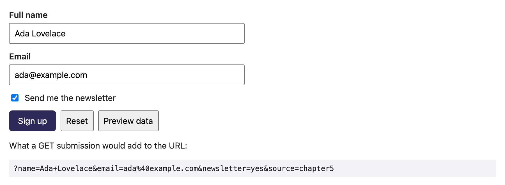
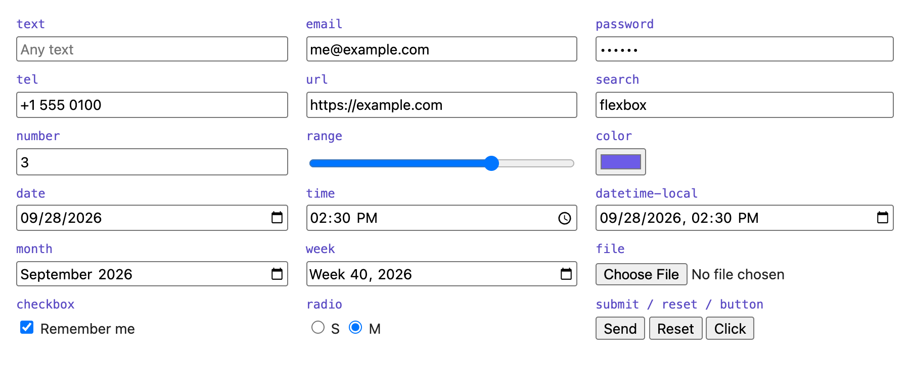
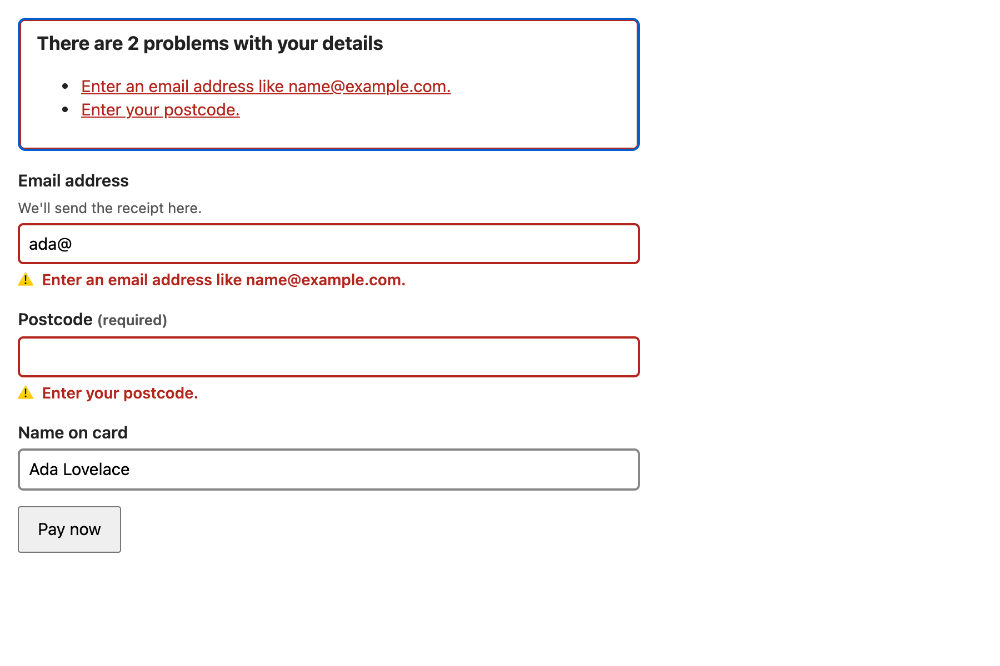

# Chapter 5 — Tables and Forms

Tables and forms are where HTML *structure* matters most. A table is a set of relationships ("this 135 is North's revenue in Q2") that screen readers announce cell by cell. A form is a contract with a server about which named values get sent, how and when — plus a built-in validation engine (the browser's own checker that rejects bad input before sending) most developers under-use. Get them right and keyboard support, autofill (the browser filling saved details), mobile keyboards, validation messages and accessibility come almost free; get them wrong (a `<div>` "button", an unlabelled input, an error shown only in red) and no JavaScript fully repairs it.

**In this chapter:** 5.1 Table semantics · 5.2 How a form works (`action`, `method`, `name`, labels, buttons) · 5.3 Input types · 5.4 `select`, `datalist`, `textarea`, `fieldset`, `output`, `progress`, `meter` · 5.5 Built-in validation, `:user-invalid` and the Constraint Validation API · 5.6 `autocomplete` · 5.7 Accessible error messages.

Every example is a file in [`code/`](code/). HTML files were screenshotted in headless Chrome (900 CSS px wide); the Node scripts (`table_headers.mjs`, `form_data.mjs`, `constraint_api.mjs`) run under jsdom and print the outputs shown.

---

## 5.1 Table semantics

### What it is
A **data table** is a grid where each **data cell** (`<td>`) is described by one or more **header cells** (`<th>`) — column header, row header or both. The elements exist so software can compute that relationship, the way your eyes go up to the column heading and left to the row heading.

### Why it matters
A screen-reader user entering "135" hears "Q2, North, 135" — without header markup, just "135". Structure also lets browsers repeat `<thead>` on printed pages and CSS style header rows/columns with plain selectors ([Chapter 6](../06-css-fundamentals/README.md)).

### How it works — the elements

| Element | Role |
|---|---|
| `<table>` | The table. |
| `<caption>` | The table's title and accessible name. First child of `<table>`. |
| `<colgroup>` / `<col>` | Describe columns; only `background`, `border`, `width`, `visibility: collapse` apply to them. |
| `<thead>` | Header row(s). |
| `<tbody>` | Body rows; several allowed to group rows; inserted automatically if omitted. |
| `<tfoot>` | Footer/summary rows (totals). |
| `<tr>` | A row. |
| `<th>` | Header cell. `scope="col"`, `"row"`, `"colgroup"` or `"rowgroup"` says which cells it describes. |
| `<td>` | Data cell. |
| `colspan` / `rowspan` | Span several columns/rows. |
| `headers="id1 id2"` | On a `<td>`: explicit ids of its header cells, for irregular tables where `scope` isn't enough. |

Steps: (1) `<caption>` with units; (2) column headings in `<thead>` as `<th scope="col">`; (3) a row-naming first cell as `<th scope="row">`; (4) totals in `<tfoot>`; (5) two-level headings: `colspan`/`rowspan` with `scope="colgroup"`/`"rowgroup"`. `colgroup` refers to a column group, so declare groups with `<colgroup>`; `rowgroup` refers to the enclosing `<thead>`/`<tbody>`/`<tfoot>`. Truly irregular tables: `id` + `headers`; (6) CSS: `border-collapse: collapse`, right-aligned numbers, `font-variant-numeric: tabular-nums` (equal-width digits so columns line up).

```html
<!-- code/01_table.html (first table) -->
<table>
  <caption>Quarterly revenue by region (USD thousands)</caption>
  <colgroup><col><col><col class="highlight"><col></colgroup>
  <thead>
    <tr><th scope="col">Region</th><th scope="col">Q1</th><th scope="col">Q2</th><th scope="col">Q3</th></tr>
  </thead>
  <tbody>
    <tr><th scope="row">North</th><td class="num">120</td><td class="num">135</td><td class="num">150</td></tr>
    <tr><th scope="row">South</th><td class="num">98</td><td class="num">102</td><td class="num">97</td></tr>
    <tr><th scope="row">West</th><td class="num">143</td><td class="num">160</td><td class="num">171</td></tr>
  </tbody>
  <tfoot>
    <tr><th scope="row">Total</th><td>361</td><td>397</td><td>418</td></tr>
  </tfoot>
</table>
```

```css
table { border-collapse: collapse; }
caption { caption-side: top; text-align: left; font-weight: 700; }
th, td { border: 1px solid #c8c8d8; padding: 6px 10px; }
tbody tr:nth-child(even) td { background: #f8f8fc; }        /* zebra stripes */
td.num, tfoot td { text-align: right; font-variant-numeric: tabular-nums; }
col.highlight { background: #fff6d6; }                      /* whole Q2 column */
```

The second table has two header levels:

```html
<colgroup span="2"></colgroup>   <!-- Term + Course -->
<colgroup span="2"></colgroup>   <!-- the column group that "Students" spans -->
<thead>
  <tr><th rowspan="2" scope="col">Term</th><th rowspan="2" scope="col">Course</th>
      <th colspan="2" scope="colgroup">Students</th></tr>
  <tr><th scope="col">Enrolled</th><th scope="col">Completed</th></tr>
</thead>
<tbody>
  <tr><th rowspan="2" scope="rowgroup">Spring</th><th scope="row">HTML</th><td>40</td><td>35</td></tr>
  <tr><th scope="row">CSS</th><td>32</td><td>30</td></tr>
</tbody>
<tbody> … Autumn … </tbody>
```


*Figure 5.1 — Two data tables. The highlighted column comes from a single `<col class="highlight">`.*

### What assistive technology computes
[`code/table_headers.mjs`](code/table_headers.mjs) rebuilds each grid (accounting for spans) and, for every data cell, collects the `<th>`s above it with `scope` `col`/`colgroup` and to its left with `row`/`rowgroup` — a simplified form of the HTML standard's "assigning header cells" algorithm. Output (abridged):
```
Table: Quarterly revenue by region (USD thousands)
   120  <- Q1 / North
   135  <- Q2 / North
   150  <- Q3 / North
    98  <- Q1 / South
   ...
Table: Course enrolment (two-level headers)
    40  <- Students / Enrolled / Spring / HTML
    35  <- Students / Completed / Spring / HTML
    32  <- Students / Enrolled / Spring / CSS
    30  <- Students / Completed / Spring / CSS
    52  <- Students / Enrolled / Autumn / HTML
    41  <- Students / Completed / Autumn / HTML
    45  <- Students / Enrolled / Autumn / CSS
    44  <- Students / Completed / Autumn / CSS
```

That is roughly what a screen reader speaks entering each cell.

### Responsive tables
Keep the table a table and scroll it inside a labelled, focusable region (so keyboard users can scroll):

```html
<div role="region" aria-labelledby="cap1" tabindex="0" style="overflow-x: auto">
  <table><caption id="cap1">…</caption>…</table>
</div>
```

Changing `display` on table elements (e.g. `display: block` to stack cells) has historically made some browsers drop table semantics — test with a screen reader if you do.

### When not to use it
**Never for page layout** — use Grid or Flexbox ([Chapter 8](../08-flexbox/README.md), [Chapter 9](../09-grid/README.md)). On an inherited layout table, `role="presentation"` tells assistive technology to ignore its table semantics.

### Common mistakes
- `<td><b>…</b></td>` instead of `<th>`.
- No `<caption>` (or an unconnected heading outside the table).
- The obsolete `summary` attribute — explain in the caption or nearby text.
- Empty spacing cells; merged cells "because it looks nicer" (each merge makes navigation harder).
- `<table>` for card lists or form layout.

### In the interview
**30-second answer:** "Tables are for tabular data only. I give them a `<caption>`, use `<thead>/<tbody>/<tfoot>`, mark headers with `<th>` and `scope` (`col`/`row`, or `colgroup`/`rowgroup` for spanning headers), and fall back to `id`/`headers` for irregular tables, so screen readers announce the right headers per cell. On small screens I wrap the table in a scrollable, focusable region rather than changing its display."

- *When do you need `headers`?* → When a cell's headers aren't regularly in its row/column, e.g. irregular multi-level tables.
- *`border-collapse: collapse` vs `separate`?* → Collapse merges adjacent borders into one line; separate (default) draws each cell's border with `border-spacing` between.

---

## 5.2 How a form works — `action`, `method`, `name`

### What it is
A `<form>` collects input and **submits** it: it builds name/value pairs from its controls (`<input>`, `<select>`, `<textarea>`, `<button>`; `<output>` is never submitted) and sends them as an HTTP request ([Chapter 1](../01-how-the-web-works/README.md)).

### How it works — submission step by step
1. The user presses a submit button, or **Enter** in a text field (*implicit submission*).
2. The browser runs **constraint validation** (5.5); if anything is invalid it stops, shows a message and focuses the first invalid control.
3. A `submit` event fires; JS can `event.preventDefault()` and handle it itself (e.g. with `fetch`).
4. The browser builds the **form data set** from *successful controls*:
   - the control has a **`name`** (no name → not sent);
   - it is not **disabled** (disabled → not sent; `readonly` → sent);
   - checkboxes and radios only if **checked** (value defaults to `"on"` without `value`);
   - `<select multiple>` sends one pair per selected option;
   - only the submit button actually used is included (if named).
5. It encodes the data using `enctype` (e.g. space → `+`, `@` → `%40`) and sends it to `action` using `method`:
   - `method="get"` (default): data in the URL query string — `/signup?name=Ada+Lovelace&email=ada%40example.com`. Bookmarkable, cacheable and meant to be idempotent (repeating it has the same effect as once — [System Design Fundamentals](../../../system-design-patterns/modules/00-system-design-fundamentals/README.md)) — right for searches and filters, wrong for passwords or anything that changes data.
   - `method="post"`: data in the request body. For anything that creates/changes something or is private.
   - `method="dialog"`: inside a `<dialog>`, closes it instead of sending.
6. `enctype` (POST only): `application/x-www-form-urlencoded` (default), `multipart/form-data` (**required for file uploads**), `text/plain` (debugging only).
7. The browser navigates to the server's response (unless JS prevented it).

Also: `action` defaults to the current URL; `target` works like a link's; `novalidate` turns off step 2's built-in UI; a button can override the form with `formaction`, `formmethod`, `formenctype`, `formnovalidate`, `formtarget`; a control *outside* the form joins it with `form="formId"`.

### Labels
Every control needs a **label**, connected explicitly or by wrapping:

```html
<label for="name">Full name</label>          <!-- explicit: for = the input's id -->
<input id="name" name="name">

<label>Email <input type="email" name="email"></label>   <!-- implicit: wrap the input -->
```

A real `<label>` gives the accessible name (read on focus), a bigger click target, and lets voice-control users say "click Email". A `placeholder` is **not** a label: it disappears on typing, usually has poor contrast and isn't reliably announced ([§3.8](../03-semantic-html-and-accessibility/README.md)).

### Buttons
`<button>` has three types, and **the default inside a form is `submit`**:

| `type` | Does |
|---|---|
| `submit` (default) | Submits the form. |
| `reset` | Resets every control to its initial value (rarely wanted — clicked by accident). |
| `button` | Nothing by itself — for JavaScript actions. |

A "Show password" or "Add row" button without `type="button"` submits the form when clicked — a classic bug (the page "refreshes").

```html
<!-- code/02_form_basics.html (excerpt) -->
<form action="02_form_basics.html" method="get">
  <label for="name">Full name</label>
  <input id="name" name="name" autocomplete="name" value="Ada Lovelace">
  <label>Email <input type="email" name="email" autocomplete="email" value="ada@example.com"></label>
  <label><input type="checkbox" name="newsletter" value="yes" checked> Send me the newsletter</label>
  <input type="hidden" name="source" value="chapter5">
  <button type="submit">Sign up</button>
  <button type="reset">Reset</button>
  <button type="button" id="preview">Preview data</button>
</form>
<script>
  const form = document.querySelector('form');
  const show = () => result.textContent = '?' + new URLSearchParams(new FormData(form));
  show();
  preview.addEventListener('click', show);
</script>
```



*Figure 5.2 — `FormData` + `URLSearchParams` produce exactly the query string a GET submission would send.*

### Exactly what gets sent
[`code/form_data.mjs`](code/form_data.mjs) puts every tricky case in one form and prints `new FormData(form)`, `getAll("skills")` and the GET URL:

```html
<input name="name" value="Ada Lovelace">
<input name="email" type="email" value="ada@example.com">
<input name="nick">                                   <!-- empty text: still sent, as "" -->
<input type="checkbox" name="newsletter" value="yes" checked>
<input type="checkbox" name="terms" value="yes">       <!-- unchecked: NOT sent -->
<input type="radio" name="plan" value="free">
<input type="radio" name="plan" value="pro" checked>
<select name="skills" multiple> <option selected>HTML</option><option selected>CSS</option><option>JS</option> </select>
<input name="coupon" value="SAVE10" disabled>          <!-- disabled: NOT sent -->
<input name="country" value="IN" readonly>             <!-- readonly: sent -->
<input value="no name attribute">                      <!-- no name: NOT sent -->
<input type="hidden" name="source" value="ch5">
<textarea name="bio">Hi &amp; bye</textarea>
```

Output:
```
FormData entries:
  name       = "Ada Lovelace"
  email      = "ada@example.com"
  nick       = ""
  newsletter = "yes"
  plan       = "pro"
  skills     = "HTML"
  skills     = "CSS"
  country    = "IN"
  source     = "ch5"
  bio        = "Hi & bye"

data.getAll("skills") = [ 'HTML', 'CSS' ]

GET URL:
  http://localhost/signup?name=Ada+Lovelace&email=ada%40example.com&nick=&newsletter=yes&plan=pro&skills=HTML&skills=CSS&country=IN&source=ch5&bio=Hi+%26+bye
```

(`http://localhost` is jsdom's pretend address.) The unchecked checkbox, disabled field and unnamed input are absent — so server-side, **"checkbox missing" means "unchecked"**; code expecting `terms=no` never sees it.

### Security notes
- Client-side anything (validation, `readonly`, hidden fields, `disabled`) is **not security** — anyone can edit the request. The server must validate everything again.
- Never send passwords or personal data with GET — URLs land in history, server logs and `Referer` headers.
- POST forms that change data need server-side **CSRF** protection (cross-site request forgery: another site secretly makes your browser submit a form to a site you're logged into); defences are secret per-form tokens or `SameSite` cookies, which the browser won't send on requests started by other sites ([JavaScript book](../../../javascript/chapters/14-browser-apis-and-security/README.md)).

### In the interview
**30-second answer:** "A form submits its *successful controls* — named, enabled, and for checkboxes/radios, checked — to `action` using `method`. GET puts data in the URL (searches, filters); POST in the body (changes, private data); file uploads need `multipart/form-data`. Every control needs a `<label>`; buttons default to `type=submit`, so non-submit buttons need `type=button`. Server-side validation is mandatory."

- *What isn't submitted?* → Unnamed, disabled, unchecked controls, unselected options, buttons other than the one used, `<output>`.
- *Disabled vs readonly?* → Disabled: not focusable, not submitted, not validated. Readonly: focusable, submitted, not editable, not validated.
- *How do you submit via JS without reloading?* → Listen for `submit`, `preventDefault()`, send `new FormData(form)` with `fetch`. To trigger submission from code use `form.requestSubmit()` — it runs validation and fires `submit`; `form.submit()` skips both.

---

## 5.3 Input types

### What it is
`type` changes the control's UI, validation and — on phones — the on-screen keyboard. Unknown types fall back to `text`, so a specific type is never worse.



*Figure 5.3 — Chrome on macOS (`code/03_input_types.html`); other browsers draw them differently.*

| Type | Use for | Built-in validation | Mobile keyboard / UI |
|---|---|---|---|
| `text` | any single-line text | — | normal |
| `email` | email address | `typeMismatch` if not `x@y` shaped; `multiple` allows a comma list | `@` key visible |
| `password` | secrets | — | masked; password managers engage |
| `tel` | phone numbers | **none** (formats vary worldwide — add `pattern` if needed) | phone keypad |
| `url` | web addresses | `typeMismatch` without a scheme like `https:` | `/` and `.com` keys |
| `search` | search boxes | — | "search" enter key; may show a clear button |
| `number` | real quantities (count, age) | `min`, `max`, `step`, `badInput` | numeric keypad, spin buttons |
| `range` | imprecise values (volume) | always a value within range | slider |
| `color` | colour pick | value always `#rrggbb` | colour picker |
| `date`, `time`, `datetime-local` | dates/times | `min`, `max`, `step` | native pickers; value `YYYY-MM-DD`, `HH:MM`, `YYYY-MM-DDTHH:MM` |
| `month`, `week` | months/weeks | same | **not supported in desktop Firefox and Safari** — text box |
| `checkbox` | independent yes/no | `required` = must be checked | — |
| `radio` | one choice from a group (same `name`) | `required` on any one = must pick one | arrow keys move within the group |
| `file` | uploads | `accept` filters the picker (not enforced); `multiple` | camera/photos on phones (`capture`) |
| `hidden` | data the user doesn't see | — | not rendered (trivially editable — not secret) |
| `submit`, `reset`, `button`, `image` | buttons (prefer `<button>`, which can contain HTML) | — | — |

- **`type="number"` only for numbers you'd do maths on.** Card numbers, postcodes, IDs are *strings of digits*: `type="text" inputmode="numeric"` (maybe `pattern="[0-9]*"`). `number` drops leading zeros, accepts `e`, and scroll-wheels change it. A 6-digit one-time code: `type="text" inputmode="numeric" autocomplete="one-time-code"`.
- A date's **display** follows the user's locale (language-and-region, `09/28/2026` in the US), but its **value** is always ISO `2026-09-28`.

### `inputmode` and `enterkeyhint`
`inputmode` picks the virtual keyboard **without** changing validation: `text`, `numeric`, `decimal`, `tel`, `email`, `url`, `search`, `none`. `enterkeyhint` labels the Enter key: `enter`, `done`, `go`, `next`, `previous`, `search`, `send`.

### Other common input attributes
`placeholder` (hint, not label), `value`, `required`, `readonly`, `disabled`, `autofocus` (sparingly — can disorient screen-reader users), `size`, `list` (→ `<datalist>`), `multiple`, `accept`, `spellcheck`, `autocapitalize`.

---

## 5.4 Choosing and grouping — `select`, `datalist`, `textarea`, `fieldset`, `output`, `progress`, `meter`

```html
<!-- code/04_select_textarea_fieldset.html (excerpt) -->
<label>Country
  <select name="country" autocomplete="country">
    <option value="">-- choose --</option>
    <optgroup label="Europe"><option value="DE">Germany</option><option value="FR">France</option></optgroup>
    <optgroup label="Asia"><option value="IN" selected>India</option><option value="JP">Japan</option></optgroup>
  </select>
</label>

<select name="skills" multiple size="4"> … </select>

<input name="browser" list="browsers" value="Fire">
<datalist id="browsers"><option value="Chrome"><option value="Firefox"><option value="Safari"><option value="Edge"></datalist>

<textarea name="message" rows="4" maxlength="200">Hello!
Line two keeps its line break.</textarea>

<fieldset>
  <legend>Delivery speed</legend>
  <label><input type="radio" name="speed" value="standard" checked> Standard (free)</label>
  <label><input type="radio" name="speed" value="express"> Express (+$5)</label>
</fieldset>
<fieldset disabled> <legend>Gift options (disabled fieldset)</legend> … </fieldset>

<progress max="100" value="70">70%</progress>
<meter min="0" max="100" low="60" high="85" optimum="20" value="91">91%</meter>
<input type="number" id="qty" name="qty" value="3"> x $12 = <output name="total" for="qty">$36</output>
```


*Figure 5.4 — The disabled fieldset disables every control inside; the meter is red because 91 is above `high` and far from `optimum`.*

| Element | What it is | Key details |
|---|---|---|
| `<select>` | dropdown of fixed options | Each `<option>` has a `value` (sent) and text (shown). A first option `value=""` + `required` forces a real choice. `<optgroup label>` groups options. |
| `<select multiple>` | list box, several choices | Hard to use (Ctrl/Cmd-click); for more than a few options, checkboxes are friendlier. |
| `<datalist>` | **suggestions** for an `<input list>` | User may still type anything — autocomplete, not restriction (a select restricts). |
| `<textarea>` | multi-line text | Initial value is its **content** (between the tags, not a `value` attribute); `rows`/`cols`; `maxlength`; line breaks preserved. CSS `resize` controls the drag handle. |
| `<fieldset>` + `<legend>` | groups related controls | Legend announced with each control ("Delivery speed, Standard, radio button"). Use for every radio and checkbox group (ARIA alternative: `role="radiogroup"`/`"group"` + `aria-labelledby`). `disabled` on the fieldset disables (and unsubmits) everything inside. |
| `<output>` | result of a calculation | `for` lists the inputs it depends on; an implicit live region, so updates can be announced. Not submitted. |
| `<progress>` | completion of a task | `value`/`max`; omit `value` for an indeterminate ("busy") bar. |
| `<meter>` | a measurement within a known range | `min`, `max`, `low`, `high`, `optimum` set the colour (good/average/bad). Disk usage, ratings, password strength — not task progress. |

### Common mistakes
- Radios without `<fieldset>`/`<legend>` → the question is never announced.
- Radios of one group with different `name`s → they don't exclude each other.
- `<select>` for 2–3 options (radios show all choices, one click fewer), or for 200 countries without type-ahead (a **combobox** — text box + filtered suggestions — may be better).
- `<progress>` for a static measurement (use `<meter>`).

---

## 5.5 Built-in validation and the Constraint Validation API

### What it is
Browsers validate forms with no JavaScript: you declare **constraints** with attributes; on submit the browser checks them, blocks submission on failure, shows a message by the first failing control, and exposes the result to CSS and JS.

### The constraint attributes → the validity flag they set

| Attribute | Applies to | Fails when | `validity` flag |
|---|---|---|---|
| `required` | most inputs, select, textarea | empty / unchecked / nothing selected | `valueMissing` |
| `type="email"`, `type="url"` | input | not shaped like an email/URL | `typeMismatch` |
| `pattern="regex"` | text-like inputs | doesn't match the **whole** regex (regular expression; implicitly anchored `^…$`) | `patternMismatch` |
| `minlength` / `maxlength` | text-like, textarea | shorter / longer — **only checked after the user edits the value** | `tooShort` / `tooLong` |
| `min` / `max` | number, range, date/time | below / above | `rangeUnderflow` / `rangeOverflow` |
| `step` | number, range, date/time | not a multiple of `step` from the base (`min`, else initial `value`, else 0) | `stepMismatch` |
| (the browser) | number, date… | unparsable input | `badInput` |
| `setCustomValidity("msg")` | any | message non-empty | `customError` |

Empty optional fields skip every check except `required` — an empty `pattern` field is valid. Controls that are `disabled`, `readonly`, `type="hidden"`, or inside a `<datalist>` are **barred from constraint validation** (`willValidate === false`) — so a required field in `<fieldset disabled>` never blocks submit.

### Styling states: `:invalid` vs `:user-invalid`
`:invalid`/`:valid` (pseudo-classes — selectors matching a state) apply *immediately*, so required fields load red — hostile. `:user-invalid`/`:user-valid` match only **after the user interacts with the field or tries to submit**. Baseline 2023 (all major engines since November 2023; widely available since May 2026).

```css
input:user-invalid { border-color: #c0392b; background: #fdeeee; }
input:user-valid   { border-color: #1e8449; }
```

### The JavaScript API
Each control has:
- `validity` — a `ValidityState` with the flags above plus `valid`.
- `validationMessage` — the browser's localised message (empty when valid).
- `willValidate` — whether it takes part in validation.
- `checkValidity()` — returns a boolean; fires `invalid` on failure.
- `reportValidity()` — same, plus shows the message bubble.
- `setCustomValidity(msg)` — your own rule; **clear it with `''`** when valid, or the field stays invalid forever.

Forms have `checkValidity()`, `reportValidity()` and `requestSubmit()`.

Chrome demo: a sign-up form with bad values, one custom rule (passwords must match), then `form.requestSubmit()` (exactly like clicking submit):

```html
<!-- code/05_validation.html (excerpt) -->
<input name="username" required pattern="[a-z0-9]{3,12}" value="Ada!">
<input name="email" type="email" required value="ada@">
<input name="age" type="number" min="18" max="120" value="16">
<input name="site" type="url" value="https://ada.dev">
<input name="pw" type="password" required minlength="8" value="correcthorse">
<input name="pw2" type="password" required value="correcthors">
<input name="coupon" pattern=".{6}" placeholder="optional">
<input name="terms" type="checkbox" required>
<script>
  function checkMatch() {
    form.pw2.setCustomValidity(form.pw2.value === form.pw.value ? '' : 'Passwords do not match.');
  }
  form.pw.addEventListener('input', checkMatch);
  form.pw2.addEventListener('input', checkMatch);
  checkMatch();
  form.requestSubmit();
</script>
```


*Figure 5.5 — Chrome blocked submission, focused the first invalid field and showed its bubble; after the attempt, `:user-invalid` (red) and `:user-valid` (green) apply. The empty optional coupon is valid.*

The same API under jsdom ([`code/constraint_api.mjs`](code/constraint_api.mjs)) — seven inputs, then `d` is fixed, given a custom error and cleared, and `form.checkValidity()` is called with a capturing `invalid` listener (`invalid` doesn't bubble):

```html
<input id="a" required>
<input id="b" type="email" value="not-an-email">
<input id="c" type="number" min="1" max="5" value="9">
<input id="d" pattern="[A-Z]{3}" value="abc">
<input id="e" pattern="[A-Z]{3}" value="">
<input id="f" required disabled>
<input id="g" minlength="5" value="ab">
```

Output:
```
a: willValidate=true valid=false valueMissing
b: willValidate=true valid=false typeMismatch
c: willValidate=true valid=false rangeOverflow
d: willValidate=true valid=false patternMismatch
e: willValidate=true valid=true -
f: willValidate=false valid=true -
g: willValidate=true valid=true -

after d.value = "ABC":            d: willValidate=true valid=true -
after setCustomValidity("..."):   d: willValidate=true valid=false customError | That code is already taken.
after setCustomValidity(""):      d: willValidate=true valid=true -

form.checkValidity() = false | invalid events fired: 3
```

1. `e` — empty optional field with `pattern` is **valid**.
2. `f` — disabled required field is barred (`willValidate=false`); Chrome agrees.
3. `g` — `minlength` isn't enforced on a value set in HTML or by script; `tooShort` appears only after the user types.

### Trade-offs: built-in bubbles vs custom messages

| | Built-in UI | `novalidate` + your own messages (5.7) |
|---|---|---|
| Effort | zero | moderate |
| Message wording | generic, browser-controlled, browser-language | your words, specific ("Postcode must be 5 digits") |
| Styling | bubble can't be styled | full control |
| Shows all errors at once | no — one at a time | yes (error summary) |
| Accessibility | acceptable; bubbles vanish quickly | best, if done as in 5.7 |

Most production design systems (a company's shared UI component library) use `novalidate` with custom messages, **but keep the constraint attributes and API underneath** (`checkValidity()` still works with `novalidate`).

### Common mistakes
- Not resetting `setCustomValidity('')` → never valid.
- `pattern` duplicating `type="email"`, or too strict for real names ("O'Brien", "José", single-letter surnames).
- Client validation as security; styling `:invalid` so forms load red.

### In the interview
**30-second answer:** "HTML has declarative constraints — `required`, `type`, `pattern`, `min/max/step`, `minlength/maxlength` — checked on submit and exposed through `validity` flags, `validationMessage`, `checkValidity()`/`reportValidity()`, and `setCustomValidity()` for custom rules. I style with `:user-invalid` so errors show only after interaction. Client-side validation is UX; the server must re-validate."

- *`checkValidity` vs `reportValidity`?* → Both return a boolean and fire `invalid`; `reportValidity` also shows the message.
- *"Confirm password"?* → On input, `setCustomValidity(match ? '' : 'Passwords do not match.')`.

---

## 5.6 `autocomplete` — help the browser fill the form

### What it is
`autocomplete` tells browsers and password managers **what a field means** via standard tokens so they fill it correctly. WCAG 2.2 SC 1.3.5 *Identify Input Purpose* (AA; [Chapter 3](../03-semantic-html-and-accessibility/README.md)) requires it on fields collecting information about the user.

| Field | Token |
|---|---|
| Full name / given / family | `name`, `given-name`, `family-name` |
| Email, phone | `email`, `tel` |
| Username | `username` |
| Login password | `current-password` |
| Sign-up / change password | `new-password` (triggers strong-password suggestions) |
| SMS one-time code | `one-time-code` |
| Address | `street-address`, `address-line1`, `address-level2` (city), `postal-code`, `country` / `country-name` |
| Card | `cc-name`, `cc-number`, `cc-exp`, `cc-csc` (expiry, 3–4 digit security code) |
| Birthday | `bday` |
| Turn off (e.g. searching other people's names) | `off` |

Tokens can take a section prefix (`shipping street-address`, `billing postal-code`).

### Why it matters
Autofill turns a 2-minute checkout into seconds, reduces typos, and helps people with motor or memory disabilities. Password managers rely on `current-password` vs `new-password` to tell sign-in from sign-up (offering to generate/save). WCAG 2.2's 3.3.7 *Redundant Entry* (don't make people retype information from the same process) is helped by autofill and "same as shipping" checkboxes.

### Common mistakes
- `autocomplete="off"` on logins "for security" — pushes users to weaker, reused passwords; browsers often ignore it for passwords anyway.
- Splitting phones or dates into many boxes autofill can't fill.
- Blocking paste in password fields (hurts password managers; against WCAG 2.2's 3.3.8 *Accessible Authentication*).

---

## 5.7 Accessible error messages

### The problem it solves
Built-in bubbles appear one at a time and vanish; colour alone fails colour-blind users; an error far from its field isn't announced on focus. WCAG requires errors **identified in text** (3.3.1), **labels or instructions** (3.3.2), and **suggested** fixes when known (3.3.3).

### How it works — the pattern
Popularised by the UK government's GOV.UK Design System:

1. `novalidate` on the form so you control the messages; still use constraint attributes and `checkValidity()`.
2. On submit, check every field. For each failure:
   - `aria-invalid="true"` (screen readers say "invalid entry");
   - a specific message in an element next to the field;
   - linked via `aria-describedby="help-id error-id"`, so it's read after the label on focus.
3. An **error summary** at the top: heading with the count + links to each field (`href="#fieldId"`).
4. **Move focus to the summary** (`tabindex="-1"`, focusable by script but not in the Tab order) so it's announced immediately.
5. Not colour alone: an icon or the word "Error", red text at sufficient contrast.
6. Remove `aria-invalid` and the message as soon as the field is fixed; keep the user's input.

```html
<!-- code/06_accessible_errors.html (excerpt) -->
<form id="f" novalidate>
  <div id="summary" tabindex="-1" hidden>
    <h2>There are 2 problems with your details</h2>
    <ul></ul>
  </div>
  <div class="field">
    <label for="email">Email address</label>
    <span class="help" id="email-help">We'll send the receipt here.</span>
    <input id="email" name="email" type="email" required autocomplete="email"
           aria-describedby="email-help email-err" value="ada@">
    <span class="error" id="email-err"></span>
  </div>
  <div class="field">
    <label for="zip">Postcode <span class="help">(required)</span></label>
    <input id="zip" name="zip" required autocomplete="postal-code" inputmode="numeric"
           pattern="[0-9]{5}" aria-describedby="zip-err" value="">
    <span class="error" id="zip-err"></span>
  </div>
  …
</form>
<script>
  const messages = {
    email: v => v.valueMissing ? 'Enter your email address.' : 'Enter an email address like name@example.com.',
    zip:   v => v.valueMissing ? 'Enter your postcode.' : 'Postcode must be 5 digits.',
    name:  v => 'Enter the name shown on your card.',
  };
  form.addEventListener('submit', e => {
    e.preventDefault();
    const problems = [];
    for (const input of form.querySelectorAll('input')) {
      const err = document.getElementById(input.id + '-err');
      if (input.checkValidity()) { input.removeAttribute('aria-invalid'); err.textContent = ''; }
      else {
        const msg = messages[input.name](input.validity);
        input.setAttribute('aria-invalid', 'true');
        err.textContent = msg;
        problems.push(`<li><a href="#${input.id}">${msg}</a></li>`);
      }
    }
    summary.hidden = problems.length === 0;
    summary.querySelector('ul').innerHTML = problems.join('');
    if (problems.length) summary.focus();
  });
</script>
```



*Figure 5.6 — After one failed submit: summary focused, each error has icon + text by its field, messages say how to fix.*

### Good error messages
Say what's wrong **and how to fix it** ("Postcode must be 5 digits", not "Invalid input"), in the label's words, without codes or blame. Validate on submit (optionally on `blur` — field loses focus — or, after the first submit, on `input`), not on every keystroke while typing.

### Common mistakes
- Error text not programmatically associated (no `aria-describedby`); only a red border.
- Clearing the whole form on error.
- Disabling submit until valid — users can't discover *why*. Let them submit and explain.

### In the interview
**30-second answer:** "I use `novalidate` with the constraint API; on submit I mark each bad field with `aria-invalid`, show a specific text message beside it linked via `aria-describedby`, render an error summary with links at the top and move focus to it. Never colour alone, and keep the user's input."

---

## Chapter TL;DR

- Tables are for data: `caption`, `thead`/`tbody`/`tfoot`, `th scope`, `headers` for complex cases; never for layout; scroll wide tables in a focusable region.
- A form sends **named, enabled, checked** controls to `action` via `method`; GET for reads, POST for changes, multipart for files.
- Every control needs a real `<label>`; group radios/checkboxes with `fieldset` + `legend`; buttons default to submit.
- Most specific `type`; `inputmode` for keyboards; `number` only for numeric quantities.
- Built-in validation: `required`, `type`, `pattern`, `min/max/step`, `minlength/maxlength` → `validity`; `setCustomValidity` (and clear it); `:user-invalid` for styling.
- `autocomplete` tokens on personal-data fields; don't block paste or autofill.
- Accessible errors: `aria-invalid`, text messages via `aria-describedby`, focused error summary, never colour alone — and always validate on the server.

Next: [Chapter 6 — CSS Fundamentals](../06-css-fundamentals/README.md).
