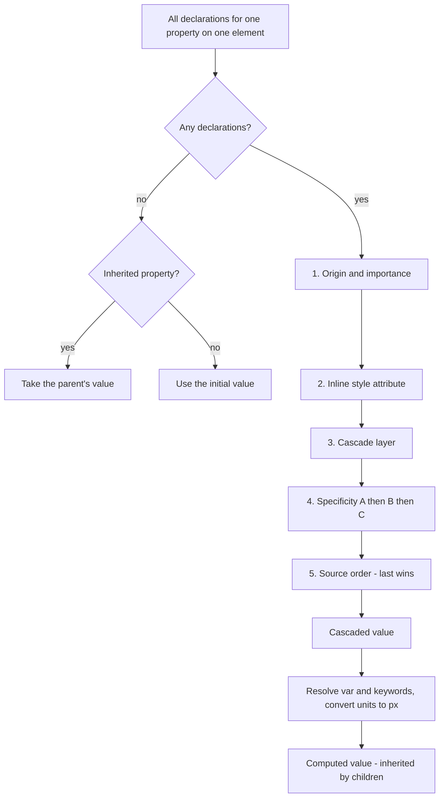

# Chapter 6 — CSS Fundamentals

HTML says *what* things are; **CSS (Cascading Style Sheets)** says how they look: colours, fonts, spacing, layout, animation. This chapter covers the machinery every later CSS chapter relies on — how rules are written and attached, how selectors pick elements, and above all how the browser decides which of several competing rules wins. Most "CSS is broken" moments are really misunderstandings of three ideas: **specificity**, **the cascade** and **inheritance**. After this chapter you should be able to predict the winner of any rule conflict on paper — and prove it with the scripts here.

**What you'll learn**

1. CSS syntax and the three ways to add CSS to a page.
2. Every kind of selector: type, class, ID, universal, attribute (all 7 forms), combinators, selector lists.
3. Pseudo-classes (structural, state, logical `:is()`/`:where()`/`:not()`/`:has()`) and pseudo-elements (`::before`, `::after`, `::first-letter`, `::marker`, …).
4. Specificity — scored by hand in a worked table, and computed by a small Node program.
5. The cascade: origins, `!important`, inline styles, cascade layers, source order — with a program that models it.
6. Inheritance and the keywords `inherit`, `initial`, `unset`, `revert`.
7. Units: `px`, `em`, `rem`, `%`, `vw`/`vh` (and the new `dvh` family), `ch`.
8. Colours: named, hex, `rgb()`, `hsl()`, `oklch()`, alpha, `currentColor`, `color-mix()`.
9. Custom properties (CSS variables).

All examples are in [`code/`](code/). The HTML pages were screenshotted in headless Chrome (900 CSS px wide); several print the values the browser actually computed (via `getComputedStyle`) right on the page. `specificity.mjs` and `cascade.mjs` are plain Node programs.

---

## 6.1 Syntax and adding CSS to a page

### What it is
A stylesheet is a list of **rules**. Each rule has a **selector** (which elements) and a **declaration block** (what to do to them). Each **declaration** is a **property**, a colon, a **value**, and a semicolon.

```css
/*  selector      declaration block                        */
   h1          {  color: navy;   font-size: 2rem;  }
/*                property value  property  value          */
```

Other syntax pieces:
- **Comments** are `/* … */` (there are no `//` comments in CSS).
- **At-rules** start with `@`: `@media` (conditions), `@import` (load another sheet), `@font-face`, `@keyframes`, `@layer`, `@supports`, `@container`.
- CSS is forgiving: an **invalid declaration is ignored** (not the whole rule), and an unknown selector in a list invalidates the whole rule — the basis of progressive enhancement (older browsers skip what they don't understand).
- Property names and keywords are case-insensitive; class names, IDs and attribute values follow the document's case rules (case-sensitive in HTML).

### Three ways to add CSS

| Method | How | Use for | Drawbacks |
|---|---|---|---|
| **External** | `<link rel="stylesheet" href="styles.css">` in `<head>` | real sites | one extra request (but cached and shared by every page) |
| **Internal** | `<style>…</style>` in `<head>` | single pages, demos, critical above-the-fold CSS | not cached separately, repeated per page |
| **Inline** | `style="color: red"` on an element | one-off values set by JavaScript, emails | beats selectors (hard to override), no media queries or pseudo-classes, clutters HTML |

`@import url(other.css);` inside a stylesheet also works, but it makes the browser discover the second file only after downloading the first — a slow chain. Prefer several `<link>`s or a build tool that bundles files.

Stylesheets in `<head>` are **render-blocking**: the browser won't paint until it has them, which prevents a flash of unstyled content but means large CSS files delay the first paint ([Chapter 14](../14-performance-seo-interview-and-cheatsheet/README.md)).

```html
<!-- code/01_adding_css.html (excerpt) -->
<head>
  <link rel="stylesheet" href="01_styles.css">          <!-- 1. external -->
  <style>
    .internal { background: #eafbea; border-color: #2e9d49; }   /* 2. internal */
  </style>
</head>
<body>
  <div class="box external">1. Styled by an external file</div>
  <div class="box internal">2. Styled by an internal &lt;style&gt; element</div>
  <div class="box" style="background: #fff3e0; border-color: #e67e22;">3. Inline style</div>
  <div class="box external" style="border-style: dashed;">External class + inline style</div>
</body>
```


*Figure 6.1 — Styles from all sources combine; the last box gets its colours from the external file and only its border style from the inline attribute.*

### TL;DR
Rule = selector + `{ property: value; }`. Use external stylesheets; inline styles only when you must. Invalid declarations are skipped, not fatal.

---

## 6.2 Selectors

### What it is
A **selector** is a pattern that matches elements in the DOM. The browser tests each rule's selector against elements to decide where declarations apply.

### Basic selectors

| Selector | Example | Matches |
|---|---|---|
| Type (element) | `p` | every `<p>` |
| Class | `.card` | every element whose `class` list contains `card` |
| ID | `#main` | the element with `id="main"` (IDs should be unique per page) |
| Universal | `*` | every element |
| Compound (no space) | `button.primary` | a `<button>` that also has class `primary` |
| Selector list | `h1, h2, h3` | any of them (one invalid selector in the list drops the whole rule, except inside `:is()`/`:where()`, which are "forgiving") |

### Attribute selectors — all seven forms

| Selector | Matches when the attribute… | Example use |
|---|---|---|
| `[attr]` | exists (any value) | `a[title]`, `input[required]` |
| `[attr="v"]` | equals `v` exactly | `input[type="email"]` |
| `[attr~="v"]` | is a space-separated list containing the word `v` | `[data-tags~="new"]` |
| `[attr\|="v"]` | is exactly `v` or starts with `v-` | `[lang\|="en"]` matches `en`, `en-GB` |
| `[attr^="v"]` | starts with `v` | `a[href^="https"]` |
| `[attr$="v"]` | ends with `v` | `a[href$=".pdf"]` |
| `[attr*="v"]` | contains `v` anywhere | `a[href*="example"]` |

Add ` i` before `]` to compare case-insensitively: `a[href$=".pdf" i]` also matches `CV.PDF`.

### Combinators — relationships between elements

| Combinator | Example | Matches |
|---|---|---|
| Descendant (space) | `nav a` | an `a` anywhere inside a `nav`, at any depth |
| Child `>` | `ul > li` | an `li` that is a **direct** child of a `ul` |
| Next sibling `+` | `h2 + p` | the `p` **immediately** after an `h2` (same parent) |
| Subsequent siblings `~` | `h2 ~ p` | **every** `p` after an `h2` (same parent) |

Selectors are matched **right to left** by browsers: for `nav a`, the engine finds every `a` and then checks for a `nav` ancestor. That's why the rightmost part (the **key selector**) matters most for performance — though for normal pages selector speed is rarely a real problem.

The demo page applies one yellow highlight to whatever each selector matches:


*Figure 6.2 — `code/02_selectors.html`. Compare "div span" (child and grandchild both match) with "div > span" (only the direct child), and "h3 + p" (one paragraph) with "h3 ~ p" (every later paragraph, skipping the span, never the paragraph before).*

### Common mistakes
- Writing `.nav .active` (descendant) when you meant `.nav.active` (the same element has both classes).
- Styling by ID everywhere — IDs are extremely specific (6.4), making later overrides painful.
- Long chains like `body div.container ul li a` — fragile (breaks when HTML changes) and highly specific. Prefer one meaningful class.
- Forgetting that `+` and `~` only look at *later* siblings with the *same parent*.

### Self-check
1. Select PDF links regardless of case? → `a[href$=".pdf" i]`.
2. `.menu li` vs `.menu > li` for a nested menu list? → The first matches items at every nesting level; the second only the top-level items.
3. Style the paragraph immediately after each heading? → `h2 + p`.

### TL;DR
Types, classes, IDs, `*`, 7 attribute forms, 4 combinators, comma lists. Prefer classes; keep selectors short.

---

## 6.3 Pseudo-classes and pseudo-elements

### What they are
- A **pseudo-class** (one colon, `:hover`) selects elements in a particular **state or position** that isn't expressed by a simple attribute — being hovered, being the first child, being checked.
- A **pseudo-element** (two colons, `::before`) selects a **part** of an element, or creates a box that isn't in the HTML — the first letter, the list bullet, generated content.

The old single-colon forms `:before`, `:after`, `:first-line`, `:first-letter` still work for backwards compatibility; new code uses `::`.

### Pseudo-classes by family

| Family | Pseudo-classes | Notes |
|---|---|---|
| User action | `:hover`, `:active`, `:focus`, `:focus-visible`, `:focus-within` | `:focus-visible` matches only when the browser thinks a focus ring is needed (keyboard use), so you can remove rings for mouse clicks without hurting keyboard users. Link order rule: `:link`, `:visited`, `:hover`, `:active` ("LVHA"). |
| Links | `:link`, `:visited`, `:any-link`, `:target` | `:visited` is restricted to a few colour properties for privacy. `:target` = the element whose id is in the URL `#fragment`. |
| Structural | `:first-child`, `:last-child`, `:only-child`, `:nth-child(An+B)`, `:nth-last-child()`, `:first-of-type`, `:nth-of-type()`, `:only-of-type`, `:empty`, `:root` | `An+B`: `odd` = `2n+1`, `even` = `2n`, `3n` = every third, `-n+3` = first three. `:nth-child(2 of .item)` counts only elements matching `.item`. |
| Form state | `:checked`, `:disabled`, `:enabled`, `:required`, `:optional`, `:valid`, `:invalid`, `:user-valid`, `:user-invalid`, `:in-range`, `:out-of-range`, `:placeholder-shown`, `:read-only`, `:default`, `:indeterminate` | See [Chapter 5](../05-tables-and-forms/README.md). |
| Logical | `:not(list)`, `:is(list)`, `:where(list)`, `:has(relative list)` | `:is()` and `:where()` shorten long lists (`:is(h1,h2,h3) a`); they differ only in specificity (6.4). `:has()` matches an element **based on what it contains or what follows it** — the long-awaited "parent selector" (Baseline since December 2023, widely available since June 2026). |
| Other | `:lang(en)`, `:dir(rtl)`, `:defined`, `:fullscreen`, `:modal`, `:popover-open` | |

`:nth-child` vs `:nth-of-type`: `li:nth-child(2)` means "an `li` that is the 2nd child of its parent" (fails if the 2nd child is not an `li`), while `span:nth-of-type(2)` means "the 2nd `span` among its siblings", ignoring other element types.

### Pseudo-elements

| Pseudo-element | Selects / creates |
|---|---|
| `::before`, `::after` | a generated child box at the start/end of the element's content. **Only exists if `content` is set** (`content: ""` for a purely decorative box). Replaced elements such as `` and most `<input>` types don't render them. |
| `::first-letter` | the first letter of a block (drop caps) |
| `::first-line` | the first **rendered** line — changes as the width changes |
| `::marker` | a list item's bullet or number |
| `::placeholder` | an input's placeholder text |
| `::selection` | text the user has highlighted |
| `::file-selector-button` | the button of `<input type="file">` |
| `::backdrop` | the layer behind a modal `<dialog>` or full-screen element |

Content added with `::before`/`::after` is visual decoration: screen readers may or may not read it and users can't select it, so never put essential information there.

```css
/* code/03_pseudo.html (excerpt) */
#p-odd li:nth-child(odd)            { background: #ffe066; }
#p-of  li:nth-child(2 of .item)     { background: #ffe066; }
#p-not li:not(.skip)                { background: #ffe066; }
#p-has .card:has(img)               { background: #ffe066; }
#p-checked input:checked + label    { background: #ffe066; }

.quote::before { content: "\201C"; }             /* opening curly quote */
.quote::after  { content: "\201D"; }
.required::after { content: " *"; color: #c0392b; }
a.ext[href^="http"]::after { content: " \2197"; }  /* arrow after external links */
.dropcap::first-letter { font-size: 2.6em; float: left; line-height: 1; }
.firstline::first-line { font-weight: 700; }
ol.fancy li::marker { color: #e67e22; }
input.ph::placeholder { color: #9b59b6; font-style: italic; }
.sel::selection { background: #2d2a5a; color: #fff; }
```


*Figure 6.3 — `code/03_pseudo.html`. Note the `:empty` row: the `<li>` containing only a space is **not** matched — whitespace counts as content in current browsers.*

### Common mistakes
- `::before` with no `content` → nothing appears.
- `li:first-child` when the first child is a `<div>` → nothing matches (use `:first-of-type` or restructure).
- Removing focus outlines with `:focus { outline: none }` → keyboard users are lost. Style `:focus-visible` instead.
- Putting real text (prices, labels) in `content:`.

### In the interview
**30-second answer:** "Pseudo-classes select elements by state or position — `:hover`, `:focus-visible`, `:nth-child`, `:checked`, `:has()`. Pseudo-elements style a part of an element or generate content — `::before`/`::after` need `content`, plus `::first-letter`, `::marker`, `::placeholder`, `::selection`. `:has()` lets a parent be styled by its contents, and `:is()`/`:where()` group selectors, differing only in specificity."

- *Q: `:nth-child(2)` vs `:nth-of-type(2)`?* A: The first counts all siblings, the second only siblings of the same element type.
- *Q: How would you style a card differently when it contains an image, without JavaScript?* A: `.card:has(img) { … }`.

### Self-check
1. Select every third row starting from the first? → `tr:nth-child(3n+1)`.
2. Why doesn't `img::after` work? → `` is a replaced element; its content comes from the image file, so there is nowhere to insert generated boxes.
3. Highlight a form group that contains an invalid input? → `.group:has(:user-invalid)`.

### TL;DR
`:` = state/position, `::` = part/generated box. Structural (`nth-child`), state (`:checked`), logical (`:is/:where/:not/:has`); `::before/::after` need `content`.

---

## 6.4 Specificity

### What it is
When several rules set the **same property on the same element**, and they come from the same origin and layer, the browser compares their selectors' **specificity** — a measure of how *targeted* each selector is. The more specific selector wins, regardless of source order. Only when specificity ties does the later rule win.

Analogy: specificity is like a three-digit score read left to right, but with **no carrying**: a thousand points in the second digit can never add up to one point in the first.

### How it works — the score (A, B, C)
Count the parts of a selector into three columns:

| Column | Counts | Examples |
|---|---|---|
| **A** | ID selectors | `#main` |
| **B** | class selectors, attribute selectors, pseudo-classes | `.btn`, `[type="text"]`, `:hover`, `:nth-child(2)` |
| **C** | type selectors and pseudo-elements | `p`, `li`, `::before` |
| (nothing) | universal `*`, combinators (` `, `>`, `+`, `~`), `:where(…)` | |

Special rules:
1. `:is(…)`, `:not(…)` and `:has(…)` add the specificity of their **most specific argument** — even if a less specific argument is the one that matched.
2. `:where(…)` always adds **zero** — perfect for low-priority defaults in libraries and resets.
3. `:nth-child(An+B of S)` counts as one pseudo-class **plus** the most specific selector in `S`.
4. Compare A first; only if equal compare B; only if equal compare C. **No carrying:** `(0,11,0)` loses to `(1,0,0)`.
5. Inline `style=""` isn't scored with selectors — it beats any selector (6.5). `!important` beats both (6.5).
6. Repeating a class (`.btn.btn`) really does add specificity — sometimes used as a deliberate override hack.

### Worked scoring table
Work each selector left to right, putting every simple selector into its column:

| Selector | A (IDs) | B (classes, attrs, pseudo-classes) | C (types, pseudo-elements) | Score |
|---|---|---|---|---|
| `*` | – | – | – | (0,0,0) |
| `li` | – | – | `li` | (0,0,1) |
| `ul > li + li` | – | – | `ul` `li` `li` | (0,0,3) |
| `.nav` | – | `.nav` | – | (0,1,0) |
| `a:hover` | – | `:hover` | `a` | (0,1,1) |
| `input[type="email"]` | – | `[type="email"]` | `input` | (0,1,1) |
| `p::first-line` | – | – | `p` `::first-line` | (0,0,2) |
| `.nav a.active` | – | `.nav` `.active` | `a` | (0,2,1) |
| `#main .card p` | `#main` | `.card` | `p` | (1,1,1) |
| `#main #sidebar` | `#main` `#sidebar` | – | – | (2,0,0) |
| `:is(#a, .b, p) span` | `#a` (max arg) | – | `span` | (1,0,1) |
| `:where(#a, .b, p) span` | – | – | `span` | (0,0,1) |
| `button:not(.primary, [disabled])` | – | `.primary` (max arg — tie, either counts 1) | `button` | (0,1,1) |
| `.card:has(> img)` | – | `.card` | `img` (from the argument) | (0,1,1) |
| `li:nth-child(2n+1 of .item)` | – | `:nth-child` + `.item` | `li` | (0,2,1) |
| `html body div#app main.content article.post > p:first-child::first-letter` | `#app` | `.content` `.post` `:first-child` | `html` `body` `div` `main` `article` `p` `::first-letter` | (1,3,7) |

### The calculator
`specificity_lib.mjs` implements these rules in about 70 lines (a scanner that walks the selector character by character, recursing into `:is()`/`:not()`/`:has()`), and `specificity.mjs` prints the scores and **checks each against the hand-computed value from the table above**:

```js
// code/specificity_lib.mjs (core loop, abridged)
export function specificity(selector) {
  let s = [0, 0, 0];
  // ... walk the string:
  //   '#name'  -> s += [1,0,0]      '.name' or '[...]' -> s += [0,1,0]
  //   '::name' or legacy ':before' etc.               -> s += [0,0,1]
  //   ':where(...)'                                   -> nothing
  //   ':is(...)', ':not(...)', ':has(...)'            -> s += max(specificity of each argument)
  //   ':nth-child(An+B of S)'                         -> s += [0,1,0] + max(specificity of S)
  //   any other ':pseudo-class'                       -> s += [0,1,0]
  //   'name' (type selector)                          -> s += [0,0,1]
  //   '*', spaces, '>', '+', '~'                      -> nothing
  return s;
}
export const compare = (x, y) => x[0] - y[0] || x[1] - y[1] || x[2] - y[2];
```

Output of `node specificity.mjs` (no `MISMATCH` markers means every computed score equals the hand-computed one):
```
selector                                                                     (A,B,C)
*                                                                            (0,0,0)
li                                                                           (0,0,1)
ul li                                                                        (0,0,2)
ul > li + li                                                                 (0,0,3)
.nav                                                                         (0,1,0)
a:hover                                                                      (0,1,1)
input[type="email"]                                                          (0,1,1)
p::first-line                                                                (0,0,2)
p:first-line                                                                 (0,0,2)
.nav a.active                                                                (0,2,1)
#main                                                                        (1,0,0)
#main .card p                                                                (1,1,1)
#main #sidebar                                                               (2,0,0)
:is(#a, .b, p) span                                                          (1,0,1)
:where(#a, .b, p) span                                                       (0,0,1)
button:not(.primary, [disabled])                                             (0,1,1)
.card:has(> img)                                                             (0,1,1)
li:nth-child(2n+1 of .item)                                                  (0,2,1)
html body div#app main.content article.post > p:first-child::first-letter    (1,3,7)

Winner order for <nav id="top" class="nav"><a class="active">…</a></nav> (highest first):
  1. #top a                   (1,0,1)
  2. a:is(.active, #x)        (1,0,1)
  3. nav a.active             (0,1,2)
  4. .nav a                   (0,1,1)
  5. :where(#top) a.active    (0,1,1)
  6. a                        (0,0,1)
```

In the last list, the two `(1,0,1)` selectors tie, so whichever appears **later in the stylesheet** would win; `a:is(.active, #x)` scores an ID even though the link matched through `.active`.

### Seeing it in the browser
Each box in `04_specificity.html` has competing rules; a script prints the colour Chrome actually computed:

```css
/* code/04_specificity.html (excerpt) */
#c1 p      { color: gray; }    /* (1,0,1) */
#c1 .lead  { color: green; }   /* (1,1,0) */
#c1 #intro { color: blue; }    /* (2,0,0)  <- wins */

#c3 .a.b.c.d.e.f.g.h.i.j.k { color: green; }  /* (1,11,0) */
#c3 #x                      { color: blue; }   /* (2,0,0)  <- wins: A is compared first */

#c6 :is(#nope, .z) { color: blue; }  /* (2,0,0) -- counts #nope although .z matched */
#c6 .z.z.z         { color: green; } /* (1,3,0) */
```


*Figure 6.4 — Every prediction confirmed by `getComputedStyle`. Each rule is prefixed with its case id (`#c1 …`) so cases don't interfere; that prefix adds `(1,0,0)` to every selector in a case without changing who wins.*

### Trade-offs — keeping specificity low
High specificity forces ever-higher specificity to override it: a "specificity war" ending in `!important` everywhere. Strategies:
- Style with **single classes** (`.card-title`), as in BEM or utility CSS ([Chapter 13](../13-modern-css-and-architecture/README.md)).
- Avoid IDs in selectors (use them for anchors and JS hooks).
- Wrap defaults in `:where()` so anything can override them.
- Use **cascade layers** (`@layer`) to order whole groups of rules regardless of specificity (6.5).

### In the interview
**30-second answer:** "Specificity is a three-part score — IDs, then classes/attributes/pseudo-classes, then types/pseudo-elements — compared column by column with no carrying, so one ID beats any number of classes. `:is`, `:not` and `:has` take their most specific argument; `:where` is zero; `*` and combinators are zero. Equal scores fall back to source order; inline styles and `!important` sit above specificity in the cascade."

- *Q: Does `.a.a` beat `.a`?* A: Yes, (0,2,0) vs (0,1,0).
- *Q: Score of `#nav ul li a:hover`?* A: (1,1,3).
- *Q: How do you write a reset that anything can override?* A: `:where(ul, ol) { margin: 0 }` → specificity (0,0,0); or put it in an early `@layer`.

### Self-check
1. Score `ul#menu > li.item:not(.disabled) a[href]`. → A: `#menu` = 1; B: `.item`, `.disabled` (from `:not`), `[href]` = 3; C: `ul`, `li`, `a` = 3 → (1,3,3).
2. Which wins: `div div div div p` or `.text`? → `.text` (0,1,0) beats (0,0,5).
3. Specificity of `:where(.x) .y`? → (0,1,0).

### TL;DR
(IDs, classes/attrs/pseudo-classes, types/pseudo-elements), compared left to right, no carrying; `:is/:not/:has` = max argument, `:where` = 0; keep it low with single classes.

---

## 6.5 The cascade and origins

### What it is
The **cascade** is the algorithm that picks one value when several declarations try to set the same property on the same element. Specificity is only one of its steps. Following CSS Cascading and Inheritance Level 5, declarations are compared by these criteria **in order**, stopping at the first difference:

1. **Origin and importance** — where the declaration came from, and whether it's `!important`.
2. **Context** — shadow DOM encapsulation (beyond this chapter).
3. **Element-attached styles** — a `style=""` attribute beats rules from stylesheets.
4. **Cascade layers** — which `@layer` the rule is in.
5. **Specificity** (6.4).
6. **Order of appearance** — the later declaration wins.

### Origins
- **User-agent** styles — the browser's built-in stylesheet (why `<h1>` is big and bold and `<a>` is blue).
- **User** styles — set by the person using the browser (accessibility settings, extensions).
- **Author** styles — yours.

Precedence, strongest first:

| Rank | Declarations |
|---|---|
| 1 | CSS transitions (while running) |
| 2 | `!important` user-agent |
| 3 | `!important` user |
| 4 | `!important` author |
| 5 | CSS animations (while running) |
| 6 | normal author |
| 7 | normal user |
| 8 | normal user-agent |

The reversal for `!important` is deliberate: normally your CSS beats the user's, but a user who marks something `!important` (for example, large text for low vision) beats you.

### Cascade layers (`@layer`)
Layers let you order **groups** of rules explicitly, so a low-priority group can never win by accident of specificity:

```css
@layer reset, base, components;          /* order declared up front: later = stronger */
@layer reset      { #l1 p   { color: gray; } }
@layer components { .card p { color: teal; } }
p.note { color: navy; }                  /* unlayered: stronger than every layer */
```

For **normal** declarations: later layers beat earlier ones, and **unlayered styles beat all layers**. For **`!important`** declarations it flips: earlier layers win, and layered `!important` beats unlayered `!important`. `@layer` has been Baseline since 2022; architecture patterns with layers are in [Chapter 13](../13-modern-css-and-architecture/README.md).

### A model of the cascade
`cascade.mjs` turns criteria 1, 3, 4, 5 and 6 into a sort key and sorts the competing declarations for `<p id="intro" class="lead" style="color: purple">`:

```js
// code/cascade.mjs (key part)
const ORIGIN_RANK = {
  'normal ua': 1, 'normal user': 2, 'normal author': 3,
  'important author': 5, 'important user': 6, 'important ua': 7,
};
function layerRank(decl, layerOrder) {
  const n = layerOrder.length;
  const pos = decl.layer ? layerOrder.indexOf(decl.layer) : n;     // unlayered = "last layer"
  return decl.important ? n - pos : pos;                           // !important flips the order
}
function key(decl, layerOrder) {
  const origin = ORIGIN_RANK[`${decl.important ? 'important' : 'normal'} ${decl.origin}`];
  const attached = decl.inline ? 1 : 0;
  const spec = decl.inline ? [0, 0, 0] : specificity(decl.selector);
  return [origin, attached, layerRank(decl, layerOrder), ...spec, decl.order];
}
```

Output (the key is `origin.attached.layer.A.B.C.order`; bigger wins, compared left to right):
```
A. Specificity decides (same origin, no layers):
  WIN color: blue     #intro                 [author]  key=3.0.0.1.0.0.1
      color: green    .lead                  [author]  key=3.0.0.0.1.0.2
      color: black    p                      [author]  key=3.0.0.0.0.1.0

B. Equal specificity -> the later rule wins:
  WIN color: orange   .lead                  [author]  key=3.0.0.0.1.0.1
      color: green    .lead                  [author]  key=3.0.0.0.1.0.0

C. Inline style beats any selector; !important beats inline:
  WIN color: red      p                      [author, !important]  key=5.0.0.0.0.1.2
      color: purple   style=""               [author]  key=3.1.0.0.0.0.1
      color: blue     #intro                 [author]  key=3.0.0.1.0.0.0

D. Origins: the browser default loses to author CSS, but user !important beats everything else:
  WIN color: yellow   p                      [user, !important]  key=6.0.0.0.0.1.2
      color: blue     #intro                 [author, !important]  key=5.0.0.1.0.0.1
      color: canvastext p                      [ua]  key=1.0.0.0.0.1.0

E. Layers (@layer reset, base, components): unlayered wins even with lower specificity:
  WIN color: navy     p                      [author]  key=3.0.3.0.0.1.2
      color: teal     .lead                  [author, @layer components]  key=3.0.2.0.1.0.1
      color: gray     #intro                 [author, @layer reset]  key=3.0.0.1.0.0.0

F. ...but with !important the layer order flips: the earliest layer wins:
  WIN color: gray     p                      [author, !important, @layer reset]  key=5.0.3.0.0.1.0
      color: teal     #intro                 [author, !important, @layer components]  key=5.0.1.1.0.0.1
      color: navy     #intro                 [author, !important]  key=5.0.0.1.0.0.2
```

Case E is confirmed in the browser in Figure 6.5 below (first box: navy).

### `!important` — when (not) to use it
`!important` jumps a declaration into a higher band of the cascade. Legitimate uses: utility classes that must always apply (`.hidden { display: none !important }`), overriding third-party inline styles you can't edit, user stylesheets. Everywhere else it's a sign of a specificity problem, and the only way to beat it is *another* `!important`.

### Common mistakes
- Believing "the last rule always wins" — only among equal origin, layer and specificity.
- Fighting a library's styles with ever-longer selectors instead of putting the library in a lower `@layer`.
- Forgetting that the browser's own stylesheet exists (margins on `body`, `h1`, `ul`…) — hence resets/normalize ([Chapter 13](../13-modern-css-and-architecture/README.md)).

### In the interview
**30-second answer:** "The cascade picks a winner by comparing origin and importance first — user-agent, user, author, with `!important` reversing that order — then inline style attributes, then cascade layers (later layers win, unlayered beats layered, reversed for `!important`), then specificity, then source order. So specificity only matters between rules in the same origin and layer."

- *Q: Why can't my `#id` rule beat a Bootstrap class?* A: It can unless the class uses `!important`; a common real cause is load order or a layer.
- *Q: Where would you put a third-party CSS library?* A: `@import url(lib.css) layer(vendor);` or wrap it in an early layer so your unlayered or later-layer rules win without specificity tricks.

### TL;DR
Origin & importance → inline → layer → specificity → order. `!important` reverses origins and layers. Use layers, not `!important`, to control priority.

---

## 6.6 Inheritance

### What it is
Some properties pass their value from parent to child automatically — **inherited properties**. Most **text** properties inherit (`color`, `font-*`, `line-height`, `letter-spacing`, `text-align`, `visibility`, `cursor`, `list-style`); most **box** properties don't (`margin`, `padding`, `border`, `background`, `width`, `display`, `position`). Each property's definition in the spec (and on MDN) says "Inherited: yes/no".

Inheritance only applies when **no declaration** for that property matched the element — any matching rule, however weak, beats an inherited value. That's why `a { color: blue }` from the browser's own stylesheet beats `body { color: red }` for links.

Analogy: inherited properties are the family's language — children speak it unless taught otherwise; borders are the parents' coats — not handed down.

### The global keywords (valid for every property)

| Keyword | Meaning |
|---|---|
| `inherit` | Use the parent's computed value — even for a normally non-inherited property. |
| `initial` | Use the property's **initial value from the spec** (e.g. `display: initial` is `inline`, `color: initial` is `canvastext` — usually black). |
| `unset` | Acts as `inherit` for inherited properties and `initial` for the rest — "as if no rule matched". |
| `revert` | Roll back to what the **previous origin** would give — for author styles, usually the browser's default (`display: revert` on a `<div>` gives `block`, not `inline`). |
| `revert-layer` | Roll back to the value from the previous cascade layer. |

`all: unset` (or `all: revert`) applies a keyword to every property at once — handy to strip a `<button>`'s default look before restyling it.

```css
/* code/05_cascade_inheritance.html (excerpt) */
.parent { color: #b03a2e; font-style: italic; border: 2px solid #b03a2e; padding: 6px; }

.kw .inherit { border: inherit; }            /* copies the parent's border */
.kw .initial { color: initial; }             /* spec default: black */
.kw .unset   { color: unset; border: unset; }/* color inherits, border resets */
.kw .block        { display: block; }
.kw .block.revert { display: revert; }       /* back to the browser default for <b>: inline */

.fonts .fixed { font: inherit; }             /* form controls don't inherit font by default */
```


*Figure 6.5 — Inheritance and the global keywords. Last row: the browser's stylesheet gives form controls their own font, so they ignore the page font until you add `font: inherit` — one of the first lines in most CSS resets.*

### Self-check
1. Does `padding` inherit? → No.
2. `color: unset` on a child of a red parent? → Red (color is inherited, so `unset` = `inherit`).
3. Why doesn't `body { color: red }` make links red? → The UA stylesheet has a rule matching `a`; a matching rule beats inheritance.

### TL;DR
Text properties inherit, box properties don't; any matching rule beats inheritance; `inherit`/`initial`/`unset`/`revert` control it explicitly.

---

## 6.7 Units

### What it is
CSS lengths are **absolute** (fixed size) or **relative** (depend on something else: the font, the parent, the viewport). Relative units are what make layouts adapt to user settings and screen sizes.

| Unit | Relative to | Typical use |
|---|---|---|
| `px` | the CSS pixel (1/96 inch at arm's length; not a device pixel) | borders, shadows, small fixed details |
| `em` | the element's own `font-size` — **except in `font-size` itself, where it's the parent's** | padding/margins that scale with the text, e.g. buttons |
| `rem` | the root (`<html>`) font-size — 16px by default | font sizes and spacing across the site |
| `%` | depends on the property: `width`, `padding`, `margin` (**including top/bottom**) → containing block's **width**; `height` → containing block's height; `font-size` → parent font-size | fluid widths |
| `vw` / `vh` | 1% of the viewport width / height | full-screen sections, fluid type |
| `svh` / `lvh` / `dvh` | small / large / dynamic viewport height (accounts for mobile browser toolbars; Baseline 2022) | `min-height: 100dvh` hero sections |
| `vmin` / `vmax` | the smaller / larger of `vw`, `vh` | square elements that fit any orientation |
| `ch` | width of the "0" glyph of the current font | text measure (`max-width: 65ch`), input widths |
| `ex`, `lh`, `rlh`, `cqw`… | x-height, line height, container query width… | specialised |
| `cm`, `mm`, `in`, `pt`, `pc` | physical units (1in = 96px) | print stylesheets |

```css
/* code/06_units.html (excerpt) */
html { font-size: 16px; }                 /* 1rem = 16px */
body { font-size: 14px; }
.em  li { font-size: 1.2em; }             /* 1.2 x parent -> compounds when nested */
.rem li { font-size: 1.2rem; }            /* always 1.2 x 16 = 19.2px */
.btn { font-size: 20px; padding: 0.5em 1em; }   /* em = own font-size */
.outer { width: 400px; }
.pct   { width: 50%; padding-top: 10%; }  /* both relative to the parent's WIDTH */
.vw { width: 50vw; }
.measure { max-width: 40ch; }
```


*Figure 6.6 — Values computed by Chrome and printed by the page's script.*

Worked arithmetic from the figure:
1. **em compounding:** body 14px → level 1 = 14 × 1.2 = **16.8px** → level 2 = 16.8 × 1.2 = **20.16px** → level 3 = 20.16 × 1.2 = **24.192px**. With `rem` every level is 16 × 1.2 = **19.2px**.
2. **em in padding:** the button's own font-size is 20px → 0.5em = **10px**, 1em = **20px**.
3. **%:** 50% of a 400px parent = **200px** wide; `padding-top: 10%` is 10% of the parent's *width* = **40px** (not of its height).
4. **vw:** 50vw of a 900px viewport = **450px**.
5. **ch:** 40 × the width of "0" in 14px system-ui ≈ **352.7px**.

### Why `rem` for font sizes
If a user sets their browser's default font size to 20px for readability, everything in `rem` (and `em`) scales with it; sizes in `px` ignore the setting. This only works if you **don't set the root font-size in `px`** (the demo does, just to make the arithmetic exact) — leave it alone or use a percentage. The common practice: `rem` for type and spacing, `em` for component-internal spacing that should track its own text, `px` for hairlines, `%`/`fr`/`vw` for layout.

### Common mistakes
- Nested `em` font sizes snowballing (or shrinking) unexpectedly.
- `height: 100vh` on mobile hiding content behind the browser toolbar — use `100dvh` (or `svh`).
- `width: 100vw` causing a horizontal scrollbar on desktops, because `vw` includes the vertical scrollbar's width — use `width: 100%`.
- Expecting `padding-top: 50%` to be half the parent's height (it's half the width — historically used for aspect-ratio boxes, now replaced by `aspect-ratio`).
- Setting `html { font-size: 62.5% }` tricks and then forgetting to reset body text — harmless but confusing; plain `rem` math (1rem = 16px) is fine.

### In the interview
**30-second answer:** "`px` is fixed; `em` is relative to the element's font-size (the parent's when used in font-size, so it compounds); `rem` is relative to the root font-size, so it respects user settings without compounding; `%` depends on the property — widths and even vertical padding are relative to the containing block's width; `vw`/`vh` are viewport percentages, with `dvh`/`svh` fixing mobile toolbars; `ch` is handy for line length."

### Self-check
1. Parent 20px, child `font-size: 1.5em; padding: 1em` — child padding? → Child font-size 30px, so padding 30px.
2. `margin-top: 10%` inside a 600×300 box? → 60px (10% of the width).
3. A readable line length? → Around 45–75 characters, e.g. `max-width: 65ch`.

### TL;DR
`rem` for type/spacing, `em` for component-relative spacing, `%` for fluid widths (vertical padding uses width!), `dvh` for mobile full height, `ch` for measure, `px` for hairlines.

---

## 6.8 Colours

### What it is
A **colour value** in CSS can be written in several notations; most of them describe the same **sRGB** colours, and newer ones (`oklch()`, `oklab()`, `color()`) reach wider-gamut colours on modern displays.

| Notation | Example | Notes |
|---|---|---|
| Named | `rebeccapurple`, `tomato` | ~150 names; plus `transparent` and `currentColor` |
| Hex | `#663399`, short `#639`, with alpha `#66339980`, `#6398` | two hex digits per channel (00–ff); 4th pair = alpha |
| `rgb()` | `rgb(102 51 153)`, `rgb(102 51 153 / 50%)` | modern space-separated syntax with `/ alpha`; legacy `rgba(102, 51, 153, 0.5)` still works (`rgba` is now an alias of `rgb`) |
| `hsl()` | `hsl(270 50% 40%)` | hue angle (0 red, 120 green, 240 blue), saturation, lightness — easy to tweak by hand |
| `oklch()` | `oklch(44% 0.16 303)` | **L**ightness (0–100%), **C**hroma (colourfulness, ~0–0.4), **H**ue angle. Perceptually uniform: equal L *looks* equally light across hues. Baseline since 2023. |
| `color-mix()` | `color-mix(in oklch, #663399 50%, white)` | mixes two colours in a chosen colour space. Baseline since 2023. |
| `currentColor` | `border: 2px solid currentColor` | the element's current `color` value — keeps borders, SVG icons and text in sync |

```html
<!-- code/07_colors.html (excerpt) -->
<div class="sw" style="background: rebeccapurple">rebeccapurple</div>
<div class="sw" style="background: #663399">#663399</div>
<div class="sw" style="background: rgb(102 51 153)">rgb(102 51 153)</div>
<div class="sw" style="background: hsl(270 50% 40%)">hsl(270 50% 40%)</div>
<div class="sw" style="background: oklch(44.03% 0.1603 303.37)">oklch(…)</div>
…
<div class="sw" style="background: hsl(60 100% 50%)">hsl yellow</div>   <!-- … and 4 more hues -->
<div class="sw" style="background: oklch(70% 0.15 100)">oklch yellow</div>
…
<div class="sw" style="background: color-mix(in srgb, red, blue)">srgb red+blue</div>
<div class="sw" style="background: color-mix(in oklch, red, blue)">oklch red+blue</div>
<button class="btn">currentColor border</button>
```


*Figure 6.7 — The HSL row claims one lightness (50%) but yellow looks far brighter than blue; the OKLCH row really is evenly light. Mixing red and blue in sRGB gives a darker purple than mixing in OKLCH.*

### Why OKLCH matters
Design systems generate palettes ("brand-100 … brand-900") by changing lightness. In HSL, the same lightness step gives visibly uneven results across hues, so text contrast becomes unpredictable. In OKLCH, lightness is perceptual, so a palette built by varying L behaves consistently — and adjusting one number to lighten or darken a colour is easy to reason about. Contrast requirements (WCAG) are covered in [Chapter 11](../11-typography-color-and-visual-effects/README.md).

### Common mistakes
- Mixing old and new syntax: `rgb(102, 51, 153 / 50%)` is invalid (commas *or* spaces with `/`, not both).
- Using opacity (`opacity: 0.5`) when you meant a translucent background — `opacity` fades the element's text and children too; use an alpha colour instead.
- Hard-coding the same colour in dozens of places instead of a custom property (6.9).

### Self-check
1. Hex for 50%-transparent black? → `#00000080` (0x80 = 128 ≈ 50%).
2. What does `currentColor` resolve to? → The element's computed `color`.
3. Why is `oklch` better than `hsl` for palettes? → Its lightness is perceptually uniform across hues.

### TL;DR
Hex/`rgb()`/`hsl()` for everyday sRGB; `oklch()` for predictable palettes; `/ alpha` for transparency; `currentColor` and `color-mix()` to derive colours.

---

## 6.9 Custom properties (CSS variables)

### What it is
A **custom property** is a property you name yourself, starting with two dashes (`--brand: #5b4bc4;`), whose value you read with `var(--brand)`. Unlike preprocessor variables (Sass `$brand`), custom properties are **live**: they follow the cascade and inheritance, can be changed per element, per media query or by JavaScript at runtime, and every use updates instantly.

### How it works
1. **Declare** on a selector — commonly `:root` (the `<html>` element) so the value is inherited everywhere.
2. **Use** with `var(--name)` or `var(--name, fallback)`; the fallback applies if the property isn't defined.
3. Custom properties **inherit** by default, so redefining one on an element changes it for that element and all its descendants — the basis of theming and component variants.
4. They're case-sensitive (`--Brand` ≠ `--brand`) and can hold any token sequence; the value is only checked when substituted.
5. If the substituted value is invalid for the property (e.g. `color: var(--space)` where `--space: 12px`), the declaration becomes **invalid at computed-value time**: the property behaves as `unset` — it does **not** fall back to an earlier `color` declaration.
6. JavaScript reads them with `getComputedStyle(el).getPropertyValue('--x')` and writes them with `el.style.setProperty('--x', value)`.
7. Combine with `calc()`: `padding: calc(var(--space) * 2)`.

```css
/* code/08_custom_properties.html (excerpt) */
:root { --brand: #5b4bc4; --radius: 8px; --space: 12px; --surface: #fff; --text: #222; }
[data-theme="dark"] { --surface: #1e1b3a; --text: #eceaff; --brand: #a99cff; }

.panel { background: var(--surface); color: var(--text); padding: var(--space); }
.card  { border: 2px solid var(--brand); border-radius: var(--radius); padding: var(--space); }
.card h3 { color: var(--brand); }
.card.danger   { --brand: #c0392b; }                        /* local override */
.card.fallback { border-color: var(--not-defined, orange); }
.card.big      { padding: calc(var(--space) * 2); }
.card.bad      { color: var(--space); }                     /* invalid -> inherits */
```

```js
card.style.setProperty('--brand', '#0a7d55');                       // write
getComputedStyle(document.documentElement).getPropertyValue('--radius'); // read -> "8px"
```


*Figure 6.8 — One set of rules, many looks: the dark panel only redefines the variables, and the danger card's local `--brand` wins in both themes.*

### Trade-offs

| | Custom properties | Preprocessor variables (Sass) |
|---|---|---|
| When resolved | at runtime in the browser | at build time — gone from the output CSS |
| Cascade/inheritance, per-element values | yes | no |
| Change from JS / media queries | yes | no |
| Use in selectors or media query conditions | no | yes |
| Type checking | none by default; `@property` can register a type and initial value (Baseline 2024), which also makes them animatable | compile errors |

### Common mistakes
- Forgetting the `--` or the `var()`: `color: --brand` does nothing.
- Expecting a fallback to trigger when the variable *is* defined but has an unsuitable value (fallbacks only cover *undefined*).
- Defining theme variables on a component instead of `:root` and wondering why other components don't see them (inheritance flows down only).
- Using a variable inside a media query condition (`@media (min-width: var(--bp))`) — not allowed.

### In the interview
**30-second answer:** "Custom properties are author-defined properties like `--brand` used with `var(--brand, fallback)`. They cascade and inherit, so I define tokens on `:root`, override them on a theme attribute or component class, and change them from JS with `setProperty`. Unlike Sass variables they exist at runtime. An invalid substitution makes the declaration behave like `unset`."

- *Q: How do you implement dark mode with them?* A: Define colour tokens on `:root`, redefine them under `@media (prefers-color-scheme: dark)` or `[data-theme="dark"]`, and use only the tokens in components (see [Chapter 13](../13-modern-css-and-architecture/README.md)).

### Self-check
1. `var(--gap, 1rem)` when `--gap` is defined as `2rem`? → `2rem`.
2. Where do you declare global tokens? → `:root`.
3. Can a custom property be used in a selector? → No.

### TL;DR
`--name: value` + `var(--name, fallback)`; they cascade and inherit, so tokens on `:root` + overrides = themes and variants; editable from JS.

---

## 6.10 How it all fits together



---

## Chapter interview round-up

1. **Explain the cascade.** Origin & importance → inline → layers → specificity → order; `!important` reverses origins and layers.
2. **Calculate specificity of `.nav > li:first-child a:hover`.** (0,3,2).
3. **`:is()` vs `:where()`?** Same matching; `:is` takes its most specific argument's specificity, `:where` is zero.
4. **`em` vs `rem`?** `em` follows the element's (or, for font-size, the parent's) font size and compounds; `rem` follows the root.
5. **Which properties inherit?** Mostly text properties (`color`, `font`, `line-height`); box properties don't.
6. **`initial` vs `unset` vs `revert`?** Spec default / inherit-or-initial / browser default (previous origin).
7. **Why custom properties over Sass variables?** Runtime, cascading, per-element, JS-accessible — enables theming.
8. **Pseudo-class vs pseudo-element?** State/position (`:hover`) vs part/generated content (`::before`).

---

## Chapter TL;DR

- Rule = selector + declarations; external stylesheets; inline only when necessary.
- Selectors: type, class, ID, `*`, 7 attribute forms (with `i` flag), combinators (space, `>`, `+`, `~`), lists.
- Pseudo-classes select states/positions (incl. `:is`, `:where`, `:not`, `:has`); pseudo-elements select parts (`::before` needs `content`).
- Specificity = (IDs, classes/attrs/pseudo-classes, types/pseudo-elements), compared without carrying; `:where` = 0, `:is/:not/:has` = max argument.
- Cascade order: origin & importance → inline → layer → specificity → source order.
- Text properties inherit; `inherit`, `initial`, `unset`, `revert` override the default behaviour.
- Units: `rem` for type, `em` for local scaling, `%` of the containing block (vertical padding uses width), `dvh` for mobile, `ch` for measure.
- Colours: hex/`rgb`/`hsl`, `oklch` for uniform palettes, `/ alpha`, `currentColor`, `color-mix()`.
- Custom properties cascade and inherit — the foundation of themes.

Next: [Chapter 7 — The Box Model and Layout Basics](../07-box-model-and-layout-basics/README.md).
