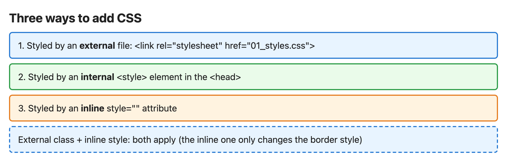
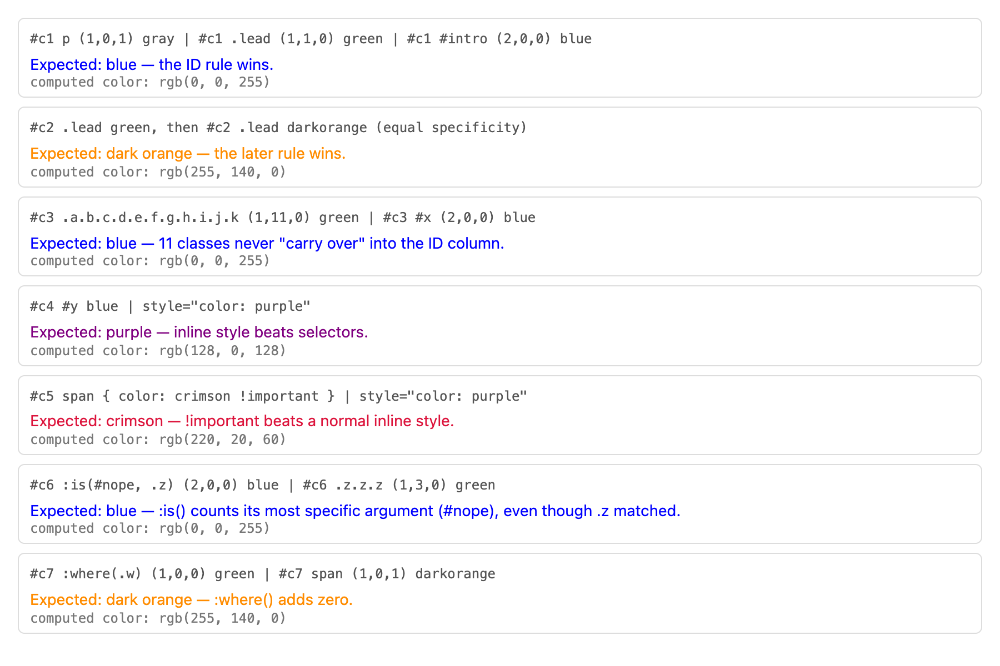
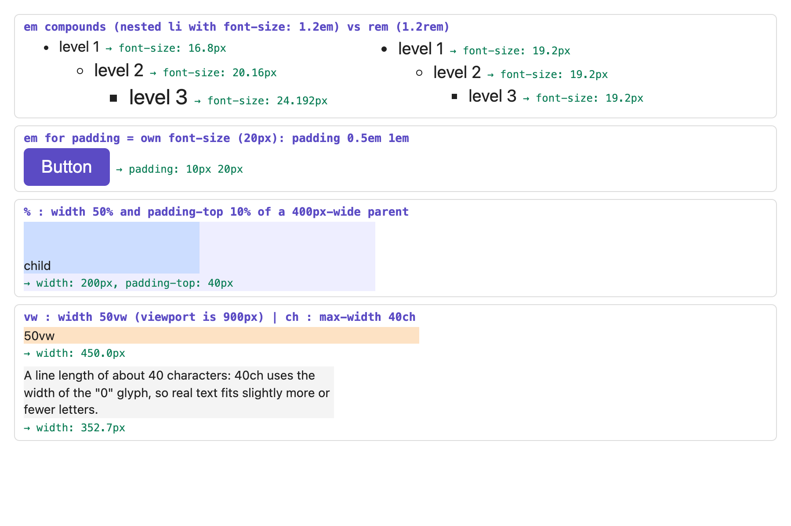
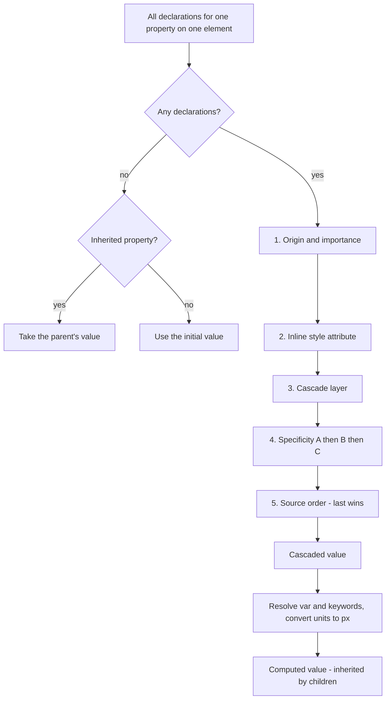

# Chapter 6 — CSS Fundamentals

HTML says *what* things are; **CSS (Cascading Style Sheets)** says how they look: colours, fonts, spacing, layout, animation. This chapter covers the machinery every later chapter relies on — how rules are written and attached, how **selectors** (patterns naming the elements a rule applies to) pick elements, and above all how the browser decides which competing rule wins. Most "CSS is broken" moments are misunderstandings of **specificity**, **the cascade** and **inheritance**; after this chapter you should predict any conflict's winner on paper — and prove it with the scripts here.

**In this chapter:** 6.1 Syntax and the three ways to add CSS · 6.2 Selectors (all 7 attribute forms, combinators) · 6.3 Pseudo-classes and pseudo-elements · 6.4 Specificity (by hand and by program) · 6.5 The cascade: origins, `!important`, inline, layers, order · 6.6 Inheritance and `inherit`/`initial`/`unset`/`revert` · 6.7 Units · 6.8 Colours · 6.9 Custom properties.

All examples are in [`code/`](code/). HTML pages were screenshotted in headless Chrome (900 CSS px wide); several print the values Chrome computed (via `getComputedStyle`, which returns an element's final style values). `specificity.mjs` and `cascade.mjs` are plain Node programs.

---

## 6.1 Syntax and adding CSS to a page

### What it is
A stylesheet is a list of **rules**: a **selector** (which elements) + a **declaration block** (what to do). Each **declaration** is **property**: **value**;.

```css
/*  selector      declaration block                        */
   h1          {  color: navy;   font-size: 2rem;  }
/*                property value  property  value          */
```

- **Comments** are `/* … */` (no `//` comments).
- **At-rules** start with `@`: `@media` (conditions), `@import` (load another sheet), `@font-face` (load a font), `@keyframes` (define an animation), `@layer`, `@supports` ("only if the browser supports this"), `@container` (conditions on a container's size).
- CSS is forgiving: an **invalid declaration is ignored** (not the whole rule), while an unknown selector in a list invalidates the whole rule. Skipping what it doesn't understand is what makes **progressive enhancement** work (a baseline for all browsers, extras newer ones use).
- Property names and keywords are case-insensitive; class names, IDs and attribute values are case-sensitive in HTML.

### Three ways to add CSS

| Method | How | Use for | Drawbacks |
|---|---|---|---|
| **External** | `<link rel="stylesheet" href="styles.css">` in `<head>` | real sites | one extra request (but cached and shared by every page) |
| **Internal** | `<style>…</style>` in `<head>` | single pages, demos, critical above-the-fold CSS (styles for what's visible before scrolling) | not cached separately, repeated per page |
| **Inline** | `style="color: red"` on an element | one-off values set by JavaScript, emails | beats selectors (hard to override), no media queries (Chapter 10) or pseudo-classes (§6.3), clutters HTML |

`@import url(other.css);` works, but the browser discovers the second file only after downloading the first — a slow chain. Prefer several `<link>`s or a build tool that bundles files.

Stylesheets in `<head>` are **render-blocking**: no paint until they arrive — preventing a flash of unstyled content, but large CSS delays first paint ([Chapter 14](../14-performance-seo-interview-and-cheatsheet/README.md)).




*Figure 6.1 — `code/01_adding_css.html`: an external `01_styles.css`, an internal `<style>`, an inline `style`, and a box with an external class plus inline `border-style: dashed`. Styles from all sources combine; the last box takes colours from the external file and only its border style from the inline attribute.*

---

## 6.2 Selectors

### What it is
A **selector** is a pattern matched against elements in the DOM ([Chapter 1](../01-how-the-web-works/README.md)) to decide where declarations apply.

### Basic selectors

| Selector | Example | Matches |
|---|---|---|
| Type (element) | `p` | every `<p>` |
| Class | `.card` | every element whose `class` list contains `card` |
| ID | `#main` | the element with `id="main"` (unique per page) |
| Universal | `*` | every element |
| Compound (no space) | `button.primary` | a `<button>` that also has class `primary` |
| Selector list | `h1, h2, h3` | any of them (one invalid selector drops the whole rule, except inside the "forgiving" `:is()`/`:where()`) |

### Attribute selectors — all seven forms

| Selector | Matches when the attribute… | Example use |
|---|---|---|
| `[attr]` | exists (any value) | `a[title]`, `input[required]` |
| `[attr="v"]` | equals `v` exactly | `input[type="email"]` |
| `[attr~="v"]` | is a space-separated list containing the word `v` | `[data-tags~="new"]` |
| `[attr\|="v"]` | is exactly `v` or starts with `v-` | `[lang\|="en"]` matches `en`, `en-GB` |
| `[attr^="v"]` | starts with `v` | `a[href^="https"]` |
| `[attr$="v"]` | ends with `v` | `a[href$=".pdf"]` |
| `[attr*="v"]` | contains `v` anywhere | `a[href*="example"]` |

Add ` i` before `]` for case-insensitive comparison: `a[href$=".pdf" i]` also matches `CV.PDF`.

### Combinators — relationships between elements

| Combinator | Example | Matches |
|---|---|---|
| Descendant (space) | `nav a` | an `a` anywhere inside a `nav`, at any depth |
| Child `>` | `ul > li` | an `li` that is a **direct** child of a `ul` |
| Next sibling `+` | `h2 + p` | the `p` **immediately** after an `h2` (same parent) |
| Subsequent siblings `~` | `h2 ~ p` | **every** `p` after an `h2` (same parent) |

So for a nested menu, `.menu li` matches items at every level, `.menu > li` only top-level ones. Browsers match **right to left**: for `nav a` they find every `a`, then look for a `nav` ancestor — so the rightmost part (the **key selector**) matters most for performance, though selector speed is rarely a real problem.


*Figure 6.2 — `code/02_selectors.html`: one yellow highlight per selector. "div span" matches child and grandchild, "div > span" only the direct child; "h3 + p" one paragraph, "h3 ~ p" every later paragraph (skipping the span, never the one before).*

### Common mistakes
- `.nav .active` (descendant) when you meant `.nav.active` (same element, both classes).
- Styling by ID — extremely specific (6.4), painful to override.
- Long chains like `body div.container ul li a` — fragile and highly specific; prefer one meaningful class.
- Forgetting `+` and `~` only look at *later* siblings with the *same parent*.

---

## 6.3 Pseudo-classes and pseudo-elements

### What they are
- A **pseudo-class** (one colon, `:hover`) selects elements in a **state or position** not expressed by an attribute — hovered, first child, checked.
- A **pseudo-element** (two colons, `::before`) selects a **part** of an element or creates a box not in the HTML — first letter, list bullet, generated content.

Legacy single-colon `:before`, `:after`, `:first-line`, `:first-letter` still work; new code uses `::`.

### Pseudo-classes by family

| Family | Pseudo-classes | Notes |
|---|---|---|
| User action | `:hover`, `:active`, `:focus`, `:focus-visible`, `:focus-within` | `:focus-visible` matches only when the browser thinks a focus ring is needed (keyboard use), so you can drop rings for mouse clicks without hurting keyboard users. Link order: `:link`, `:visited`, `:hover`, `:active` ("LVHA"). |
| Links | `:link`, `:visited`, `:any-link`, `:target` | `:visited` is restricted to a few colour properties for privacy. `:target` = the element whose id is the URL `#fragment`. |
| Structural | `:first-child`, `:last-child`, `:only-child`, `:nth-child(An+B)`, `:nth-last-child()`, `:first-of-type`, `:nth-of-type()`, `:only-of-type`, `:empty`, `:root` | `An+B`: `odd` = `2n+1`, `even` = `2n`, `3n` every third, `3n+1` every third from the first, `-n+3` first three. `:nth-child(2 of .item)` counts only `.item` elements. |
| Form state | `:checked`, `:disabled`, `:enabled`, `:required`, `:optional`, `:valid`, `:invalid`, `:user-valid`, `:user-invalid`, `:in-range`, `:out-of-range`, `:placeholder-shown`, `:read-only`, `:default`, `:indeterminate` | See [Chapter 5](../05-tables-and-forms/README.md). |
| Logical | `:not(list)`, `:is(list)`, `:where(list)`, `:has(relative list)` | `:is()`/`:where()` shorten lists (`:is(h1,h2,h3) a`) and differ only in specificity (6.4). `:has()` matches an element **by what it contains or what follows it** — the "parent selector" (Baseline since December 2023, widely available since June 2026); e.g. `.group:has(:user-invalid)`. |
| Other | `:lang(en)`, `:dir(rtl)`, `:defined`, `:fullscreen`, `:modal`, `:popover-open` | |

`li:nth-child(2)` = "an `li` that is its parent's 2nd child" (fails if the 2nd child isn't an `li`); `span:nth-of-type(2)` = "the 2nd `span` among its siblings", ignoring other types.

### Pseudo-elements

| Pseudo-element | Selects / creates |
|---|---|
| `::before`, `::after` | a generated child box at the start/end of the content. **Only exists if `content` is set** (`content: ""` for a decorative box). Replaced elements (content from outside CSS, e.g. `` and most `<input>` types) don't render them — there's nowhere to insert the box. |
| `::first-letter` | first letter of a block (drop caps) |
| `::first-line` | the first **rendered** line — changes with width |
| `::marker` | a list item's bullet or number |
| `::placeholder` | an input's placeholder text |
| `::selection` | text the user has highlighted |
| `::file-selector-button` | the button of `<input type="file">` |
| `::backdrop` | the layer behind a modal `<dialog>` or full-screen element |

*Generated content* (`::before`/`::after`) is decoration: screen readers may or may not read it and users can't select it — never put essential information there.

```css
/* code/03_pseudo.html (excerpt) */
#p-odd li:nth-child(odd)            { background: #ffe066; }
#p-of  li:nth-child(2 of .item)     { background: #ffe066; }
#p-not li:not(.skip)                { background: #ffe066; }
#p-has .card:has(img)               { background: #ffe066; }
#p-checked input:checked + label    { background: #ffe066; }

.quote::before { content: "\201C"; }             /* opening curly quote */
.quote::after  { content: "\201D"; }
.required::after { content: " *"; color: #c0392b; }
a.ext[href^="http"]::after { content: " \2197"; }  /* arrow after external links */
.dropcap::first-letter { font-size: 2.6em; float: left; line-height: 1; }
.firstline::first-line { font-weight: 700; }
ol.fancy li::marker { color: #e67e22; }
input.ph::placeholder { color: #9b59b6; font-style: italic; }
.sel::selection { background: #2d2a5a; color: #fff; }
```


*Figure 6.3 — `code/03_pseudo.html`. In the `:empty` row the `<li>` containing only a space is **not** matched — whitespace counts as content in current browsers.*

### Common mistakes
- `::before` with no `content` → nothing appears.
- `li:first-child` when the first child is a `<div>` → no match (use `:first-of-type`).
- `:focus { outline: none }` → keyboard users are lost; style `:focus-visible`.
- Real text (prices, labels) in `content:`.

### In the interview
**30-second answer:** "Pseudo-classes select by state or position — `:hover`, `:focus-visible`, `:nth-child`, `:checked`, `:has()`. Pseudo-elements style a part or generate content — `::before`/`::after` need `content`, plus `::first-letter`, `::marker`, `::placeholder`, `::selection`. `:has()` lets a parent be styled by its contents (`.card:has(img)`, no JS), and `:is()`/`:where()` group selectors, differing only in specificity."

---

## 6.4 Specificity

### What it is
When rules from the same origin and layer (§6.5) set the **same property on the same element**, the browser compares their selectors' **specificity** — how *targeted* each is. The more specific wins regardless of source order; only on a tie does the later rule win.

### How it works — the score (A, B, C)

| Column | Counts | Examples |
|---|---|---|
| **A** | ID selectors | `#main` |
| **B** | class selectors, attribute selectors, pseudo-classes | `.btn`, `[type="text"]`, `:hover`, `:nth-child(2)` |
| **C** | type selectors and pseudo-elements | `p`, `li`, `::before` |
| (nothing) | universal `*`, combinators (` `, `>`, `+`, `~`), `:where(…)` | |

1. `:is(…)`, `:not(…)` and `:has(…)` add their **most specific argument** — even if a less specific argument matched.
2. `:where(…)` always adds **zero** — ideal for library defaults and resets.
3. `:nth-child(An+B of S)` = one pseudo-class **plus** the most specific selector in `S`.
4. Compare A, then B, then C. **No carrying** (like a three-digit score where digits never overflow): `(0,11,0)` loses to `(1,0,0)`.
5. Inline `style=""` isn't scored — it beats any selector; `!important` beats both (6.5).
6. Repeating a class (`.btn.btn`, (0,2,0)) really adds specificity — a deliberate override hack.

### Worked scoring table

| Selector | A (IDs) | B (classes, attrs, pseudo-classes) | C (types, pseudo-elements) | Score |
|---|---|---|---|---|
| `*` | – | – | – | (0,0,0) |
| `li` | – | – | `li` | (0,0,1) |
| `ul > li + li` | – | – | `ul` `li` `li` | (0,0,3) |
| `.nav` | – | `.nav` | – | (0,1,0) |
| `a:hover` | – | `:hover` | `a` | (0,1,1) |
| `input[type="email"]` | – | `[type="email"]` | `input` | (0,1,1) |
| `p::first-line` | – | – | `p` `::first-line` | (0,0,2) |
| `.nav a.active` | – | `.nav` `.active` | `a` | (0,2,1) |
| `#main .card p` | `#main` | `.card` | `p` | (1,1,1) |
| `#main #sidebar` | `#main` `#sidebar` | – | – | (2,0,0) |
| `:is(#a, .b, p) span` | `#a` (max arg) | – | `span` | (1,0,1) |
| `:where(#a, .b, p) span` | – | – | `span` | (0,0,1) |
| `button:not(.primary, [disabled])` | – | `.primary` (max arg — tie, either counts 1) | `button` | (0,1,1) |
| `.card:has(> img)` | – | `.card` | `img` (from the argument) | (0,1,1) |
| `li:nth-child(2n+1 of .item)` | – | `:nth-child` + `.item` | `li` | (0,2,1) |
| `html body div#app main.content article.post > p:first-child::first-letter` | `#app` | `.content` `.post` `:first-child` | `html` `body` `div` `main` `article` `p` `::first-letter` | (1,3,7) |

### The calculator
[`code/specificity_lib.mjs`](code/specificity_lib.mjs) implements these rules in ~70 lines (a scanner walking the selector character by character, recursing into `:is()`/`:not()`/`:has()`; `compare = (x, y) => x[0] - y[0] || x[1] - y[1] || x[2] - y[2]`). `node specificity.mjs` scores every selector in the table above (plus `ul li` (0,0,2), legacy `p:first-line` (0,0,2), `#main` (1,0,0)) with no `MISMATCH` against the hand values, then ranks rules for one link:

```
Winner order for <nav id="top" class="nav"><a class="active">…</a></nav> (highest first):
  1. #top a                   (1,0,1)
  2. a:is(.active, #x)        (1,0,1)
  3. nav a.active             (0,1,2)
  4. .nav a                   (0,1,1)
  5. :where(#top) a.active    (0,1,1)
  6. a                        (0,0,1)
```

The two `(1,0,1)` selectors tie, so the **later** one in the stylesheet would win; `a:is(.active, #x)` scores an ID even though the link matched via `.active`.

### Seeing it in the browser
Each box in `04_specificity.html` has competing rules; a script prints Chrome's computed colour:

```css
/* code/04_specificity.html (excerpt) */
#c1 p      { color: gray; }    /* (1,0,1) */
#c1 .lead  { color: green; }   /* (1,1,0) */
#c1 #intro { color: blue; }    /* (2,0,0)  <- wins */

#c3 .a.b.c.d.e.f.g.h.i.j.k { color: green; }  /* (1,11,0) */
#c3 #x                      { color: blue; }   /* (2,0,0)  <- wins: A is compared first */

#c6 :is(#nope, .z) { color: blue; }  /* (2,0,0) -- counts #nope although .z matched */
#c6 .z.z.z         { color: green; } /* (1,3,0) */
```



*Figure 6.4 — Every prediction confirmed by `getComputedStyle`. The `#c1 …` case prefix adds `(1,0,0)` to every selector in a case without changing who wins.*

### Trade-offs — keeping specificity low
High specificity forces ever-higher specificity to override it — a "specificity war" ending in `!important` everywhere. Instead:
- Style with **single classes** (`.card-title`), as in BEM (`block__element--modifier` naming) or utility CSS (tiny one-purpose classes like `.mt-4`; [Chapter 13](../13-modern-css-and-architecture/README.md)).
- Avoid IDs in selectors (keep them for link targets and JS hooks).
- Wrap defaults in `:where()` so anything can override them.
- Use **cascade layers** (`@layer`) to order whole groups regardless of specificity (6.5).

### In the interview
**30-second answer:** "Specificity is a three-part score — IDs, then classes/attributes/pseudo-classes, then types/pseudo-elements — compared column by column with no carrying, so one ID beats any number of classes. `:is`, `:not` and `:has` take their most specific argument; `:where`, `*` and combinators are zero. Equal scores fall back to source order; inline styles and `!important` sit above specificity in the cascade."

- *Score of `#nav ul li a:hover`?* → (1,1,3). *`.nav > li:first-child a:hover`?* → (0,3,2).
- *`div div div div p` vs `.text`?* → `.text` (0,1,0) beats (0,0,5).
- *`ul#menu > li.item:not(.disabled) a[href]`?* → A `#menu`; B `.item`, `.disabled`, `[href]`; C `ul`, `li`, `a` → (1,3,3).
- *A reset anything can override?* → `:where(ul, ol) { margin: 0 }` (0,0,0), or an early `@layer`. (`:where(.x) .y` = (0,1,0).)

---

## 6.5 The cascade and origins

### What it is
The **cascade** is the algorithm that picks one value when several declarations set the same property on the same element. Per CSS Cascading and Inheritance Level 5, criteria are compared **in order**, stopping at the first difference:

1. **Origin and importance** — where the declaration came from, and whether it's `!important`.
2. **Context** — shadow DOM encapsulation (a component's private, sealed-off DOM and styles; beyond this chapter).
3. **Element-attached styles** — a `style=""` attribute beats stylesheet rules.
4. **Cascade layers** — which `@layer` the rule is in.
5. **Specificity** (6.4).
6. **Order of appearance** — later wins.

### Origins
- **User-agent** — the browser's built-in stylesheet (why `<h1>` is big and `<a>` blue).
- **User** — set by the person (accessibility settings, extensions).
- **Author** — yours.

| Rank | Declarations (strongest first) |
|---|---|
| 1 | CSS transitions (Chapter 12), while running |
| 2 | `!important` user-agent |
| 3 | `!important` user |
| 4 | `!important` author |
| 5 | CSS animations, while running |
| 6 | normal author |
| 7 | normal user |
| 8 | normal user-agent |

The `!important` reversal is deliberate: normally your CSS beats the user's, but a user's `!important` (e.g. large text for low vision) beats you.

### Cascade layers (`@layer`)
Layers order **groups** of rules explicitly, so a low-priority group never wins by accident of specificity:

```css
@layer reset, base, components;          /* order declared up front: later = stronger */
@layer reset      { #l1 p   { color: gray; } }
@layer components { .card p { color: teal; } }
p.note { color: navy; }                  /* unlayered: stronger than every layer */
```

**Normal** declarations: later layers beat earlier ones; **unlayered beats all layers**. **`!important`** flips it: earlier layers win, and layered `!important` beats unlayered `!important`. Baseline since 2022; layer architecture in [Chapter 13](../13-modern-css-and-architecture/README.md).

### A model of the cascade
[`code/cascade.mjs`](code/cascade.mjs) turns criteria 1, 3, 4, 5 and 6 into a sort key — origin rank (normal ua 1, user 2, author 3; important author 5, user 6, ua 7), inline flag, layer rank (unlayered = after the last layer; reversed for `!important`), specificity, source order — and sorts competing declarations for `<p id="intro" class="lead" style="color: purple">`. The key reads `origin.attached.layer.A.B.C.order`; bigger wins, left to right:

```
A. Specificity decides (same origin, no layers):
  WIN color: blue     #intro                 [author]  key=3.0.0.1.0.0.1
      color: green    .lead                  [author]  key=3.0.0.0.1.0.2
      color: black    p                      [author]  key=3.0.0.0.0.1.0

B. Equal specificity -> the later rule wins:
  WIN color: orange   .lead                  [author]  key=3.0.0.0.1.0.1
      color: green    .lead                  [author]  key=3.0.0.0.1.0.0

C. Inline style beats any selector; !important beats inline:
  WIN color: red      p                      [author, !important]  key=5.0.0.0.0.1.2
      color: purple   style=""               [author]  key=3.1.0.0.0.0.1
      color: blue     #intro                 [author]  key=3.0.0.1.0.0.0

D. Origins: the browser default loses to author CSS, but user !important beats everything else:
  WIN color: yellow   p                      [user, !important]  key=6.0.0.0.0.1.2
      color: blue     #intro                 [author, !important]  key=5.0.0.1.0.0.1
      color: canvastext p                      [ua]  key=1.0.0.0.0.1.0

E. Layers (@layer reset, base, components): unlayered wins even with lower specificity:
  WIN color: navy     p                      [author]  key=3.0.3.0.0.1.2
      color: teal     .lead                  [author, @layer components]  key=3.0.2.0.1.0.1
      color: gray     #intro                 [author, @layer reset]  key=3.0.0.1.0.0.0

F. ...but with !important the layer order flips: the earliest layer wins:
  WIN color: gray     p                      [author, !important, @layer reset]  key=5.0.3.0.0.1.0
      color: teal     #intro                 [author, !important, @layer components]  key=5.0.1.1.0.0.1
      color: navy     #intro                 [author, !important]  key=5.0.0.1.0.0.2
```

Case E is confirmed in the browser in Figure 6.5 (first box: navy).

### `!important` — when (not) to use it
Legitimate: utility classes that must always apply (`.hidden { display: none !important }`), overriding third-party inline styles you can't edit, user stylesheets. Elsewhere it signals a specificity problem — and only another `!important` beats it.

### Common mistakes
- "The last rule always wins" — only among equal origin, layer and specificity.
- Fighting a library with longer selectors instead of putting it in a lower `@layer`.
- Forgetting the browser's own stylesheet (margins on `body`, `h1`, `ul`…) — hence resets/normalize (normalize.css makes defaults consistent rather than removing them; [Chapter 13](../13-modern-css-and-architecture/README.md)).

### In the interview
**30-second answer:** "The cascade compares origin and importance first — user-agent, user, author, with `!important` reversing that order — then inline style attributes, then cascade layers (later wins, unlayered beats layered, reversed for `!important`), then specificity, then source order. So specificity only matters within the same origin and layer."

- *Why can't my `#id` rule beat a Bootstrap class?* → It can unless the class uses `!important`; the real cause is often load order or a layer.
- *Where do you put a third-party library?* → `@import url(lib.css) layer(vendor);` or an early layer, so your rules win without specificity tricks.

---

## 6.6 Inheritance

### What it is
**Inherited properties** pass their value from parent to child. Most **text** properties inherit (`color`, `font-*`, `line-height`, `letter-spacing`, `text-align`, `visibility`, `cursor`, `list-style`); most **box** properties don't (`margin`, `padding`, `border`, `background`, `width`, `display`, `position`). Each property's spec/MDN entry says "Inherited: yes/no".

Inheritance applies only when **no declaration** matched the element — any matching rule, however weak, beats an inherited value. So the browser's `a { color: blue }` beats `body { color: red }` for links.

### The global keywords (valid for every property)

| Keyword | Meaning |
|---|---|
| `inherit` | Use the parent's computed value (post-cascade, units resolved) — even for non-inherited properties. |
| `initial` | The property's **initial value from the spec** (`display: initial` is `inline`, `color: initial` is `canvastext` — usually black). |
| `unset` | `inherit` for inherited properties, `initial` for the rest — "as if no rule matched" (so `color: unset` under a red parent is red). |
| `revert` | Roll back to the **previous origin's** value — for author styles, usually the browser default (`display: revert` on a `<div>` gives `block`, not `inline`). |
| `revert-layer` | Roll back to the previous cascade layer's value. |

`all: unset` (or `all: revert`) applies a keyword to every property — handy to strip a `<button>`'s default look.

```css
/* code/05_cascade_inheritance.html (excerpt) */
.parent { color: #b03a2e; font-style: italic; border: 2px solid #b03a2e; padding: 6px; }

.kw .inherit { border: inherit; }            /* copies the parent's border */
.kw .initial { color: initial; }             /* spec default: black */
.kw .unset   { color: unset; border: unset; }/* color inherits, border resets */
.kw .block        { display: block; }
.kw .block.revert { display: revert; }       /* back to the browser default for <b>: inline */

.fonts .fixed { font: inherit; }             /* form controls don't inherit font by default */
```


*Figure 6.5 — Inheritance and the global keywords. Last row: the browser gives form controls their own font, so they ignore the page font until `font: inherit` — one of the first lines in most resets.*

---

## 6.7 Units

### What it is
Lengths are **absolute** (fixed) or **relative** (to the font, parent or viewport). Relative units make layouts adapt to user settings and screens.

| Unit | Relative to | Typical use |
|---|---|---|
| `px` | the CSS pixel (1/96 inch at arm's length; not a device pixel) | borders, shadows, small fixed details |
| `em` | the element's own `font-size` — **except in `font-size` itself, where it's the parent's** | padding/margins scaling with the text, e.g. buttons |
| `rem` | the root (`<html>`) font-size — 16px by default | font sizes and spacing site-wide |
| `%` | per property: `width`, `padding`, `margin` (**including top/bottom**) → containing block's (usually the parent's content box, Chapter 7) **width**; `height` → its height; `font-size` → parent font-size | fluid widths |
| `vw` / `vh` | 1% of the viewport width / height | full-screen sections, fluid type |
| `svh` / `lvh` / `dvh` | small / large / dynamic viewport height (accounts for mobile toolbars; Baseline 2022) | `min-height: 100dvh` hero sections |
| `vmin` / `vmax` | the smaller / larger of `vw`, `vh` | squares that fit any orientation |
| `ch` | width of the "0" glyph of the current font | line length, e.g. `max-width: 65ch` (45–75 characters is readable); input widths |
| `ex`, `lh`, `rlh`, `cqw`… | x-height, line height, container query width (Chapter 10)… | specialised |
| `cm`, `mm`, `in`, `pt`, `pc` | physical units (1in = 96px) | print stylesheets |

```css
/* code/06_units.html (excerpt) */
html { font-size: 16px; }                 /* 1rem = 16px */
body { font-size: 14px; }
.em  li { font-size: 1.2em; }             /* 1.2 x parent -> compounds when nested */
.rem li { font-size: 1.2rem; }            /* always 1.2 x 16 = 19.2px */
.btn { font-size: 20px; padding: 0.5em 1em; }   /* em = own font-size */
.outer { width: 400px; }
.pct   { width: 50%; padding-top: 10%; }  /* both relative to the parent's WIDTH */
.vw { width: 50vw; }
.measure { max-width: 40ch; }
```



*Figure 6.6 — Values computed by Chrome and printed by the page.*

1. **em compounding:** body 14px → 14 × 1.2 = **16.8px** → × 1.2 = **20.16px** → × 1.2 = **24.192px**. With `rem` every level is 16 × 1.2 = **19.2px**.
2. **em in padding:** the button's own font-size is 20px → 0.5em = **10px**, 1em = **20px**. (Parent 20px, child `font-size: 1.5em; padding: 1em` → child is 30px, padding 30px.)
3. **%:** 50% of a 400px parent = **200px**; `padding-top: 10%` = 10% of the parent's *width* = **40px**.
4. **vw:** 50vw of a 900px viewport = **450px**.
5. **ch:** 40 × the "0" width in 14px system-ui ≈ **352.7px**.

### Why `rem` for font sizes
If a user raises the browser default to 20px, `rem` and `em` sizes scale; `px` ignores it — but only if you **don't set the root font-size in `px`** (the demo does just for exact arithmetic). Common practice: `rem` for type and spacing, `em` for component spacing that tracks its own text, `px` for hairlines (1px borders), `%`/`fr` (grid fraction, Chapter 9)/`vw` for layout.

### Common mistakes
- Nested `em` font sizes snowballing or shrinking.
- `height: 100vh` on mobile hiding content behind the toolbar — use `100dvh` (or `svh`).
- `width: 100vw` causing a horizontal scrollbar on desktop (`vw` includes the scrollbar) — use `100%`.
- Expecting `padding-top: 50%` to be half the parent's *height* — it's half the width (the old aspect-ratio-box trick, now replaced by `aspect-ratio`).
- `html { font-size: 62.5% }` tricks — harmless but confusing; plain 1rem = 16px math is fine.

### In the interview
**30-second answer:** "`px` is fixed; `em` is relative to the element's font-size (the parent's when used in font-size, so it compounds); `rem` is relative to the root, respecting user settings without compounding; `%` depends on the property — widths and even vertical padding use the containing block's width; `vw`/`vh` are viewport percentages, with `dvh`/`svh` fixing mobile toolbars; `ch` is handy for line length."

---

## 6.8 Colours

### What it is
Most notations describe the same **sRGB** colours (the standard range of ordinary screens); newer ones (`oklch()`, `oklab()`, `color()`) reach wider-gamut colours (a *gamut* is the set of colours a screen can show) on modern displays.

| Notation | Example | Notes |
|---|---|---|
| Named | `rebeccapurple`, `tomato` | ~150 names; plus `transparent` and `currentColor` |
| Hex | `#663399`, short `#639`, with alpha `#66339980`, `#6398` | two hex digits per channel (00–ff); 4th pair = alpha (opacity) — so 50 % black is `#00000080` (0x80 = 128) |
| `rgb()` | `rgb(102 51 153)`, `rgb(102 51 153 / 50%)` | modern space-separated syntax with `/ alpha`; legacy `rgba(102, 51, 153, 0.5)` still works (`rgba` is now an alias) |
| `hsl()` | `hsl(270 50% 40%)` | hue angle (0 red, 120 green, 240 blue), saturation (vivid vs grey), lightness — easy to tweak by hand |
| `oklch()` | `oklch(44% 0.16 303)` | **L**ightness (0–100%), **C**hroma (colourfulness, ~0–0.4), **H**ue. Perceptually uniform: equal L *looks* equally light across hues. Baseline since 2023. |
| `color-mix()` | `color-mix(in oklch, #663399 50%, white)` | mixes two colours in a chosen colour space (which changes how the blend looks). Baseline since 2023. |
| `currentColor` | `border: 2px solid currentColor` | the element's computed `color` — keeps borders, SVG icons and text in sync |

```html
<!-- code/07_colors.html (excerpt) -->
<div class="sw" style="background: rebeccapurple">rebeccapurple</div>
<div class="sw" style="background: #663399">#663399</div>
<div class="sw" style="background: rgb(102 51 153)">rgb(102 51 153)</div>
<div class="sw" style="background: hsl(270 50% 40%)">hsl(270 50% 40%)</div>
<div class="sw" style="background: oklch(44.03% 0.1603 303.37)">oklch(…)</div>
…
<div class="sw" style="background: hsl(60 100% 50%)">hsl yellow</div>   <!-- … and 4 more hues -->
<div class="sw" style="background: oklch(70% 0.15 100)">oklch yellow</div>
…
<div class="sw" style="background: color-mix(in srgb, red, blue)">srgb red+blue</div>
<div class="sw" style="background: color-mix(in oklch, red, blue)">oklch red+blue</div>
<button class="btn">currentColor border</button>
```


*Figure 6.7 — The HSL row claims one lightness (50%) but yellow looks far brighter than blue; the OKLCH row really is evenly light. Mixing red and blue in sRGB gives a darker purple than in OKLCH.*

### Why OKLCH matters
Design systems generate palettes ("brand-100 … brand-900") by varying lightness. In HSL the same step gives visibly uneven results across hues, so text contrast becomes unpredictable; in OKLCH lightness is perceptual, so the palette behaves consistently and one number lightens or darkens predictably. Contrast requirements (WCAG) are in [Chapter 11](../11-typography-color-and-visual-effects/README.md).

### Common mistakes
- Mixing syntaxes: `rgb(102, 51, 153 / 50%)` is invalid (commas *or* spaces with `/`).
- `opacity: 0.5` when you meant a translucent background — `opacity` fades text and children too; use an alpha colour.
- The same colour hard-coded in dozens of places instead of a custom property (6.9).

---

## 6.9 Custom properties (CSS variables)

### What it is
A **custom property** is a self-named property starting with `--` (`--brand: #5b4bc4;`), read with `var(--brand)`. Unlike preprocessor variables (Sass's `$brand`, compiled away before publishing), custom properties are **live**: they cascade and inherit, can change per element, per media query or from JavaScript at runtime, and every use updates instantly.

### How it works
1. **Declare** on a selector — usually `:root` (the `<html>` element) so it's inherited everywhere.
2. **Use** with `var(--name)` or `var(--name, fallback)`; the fallback applies only if the property is **undefined** (`var(--gap, 1rem)` with `--gap: 2rem` gives `2rem`).
3. They **inherit**, so redefining one on an element changes it for that subtree — the basis of theming (swapping a whole colour set, e.g. light/dark) and component variants.
4. Case-sensitive (`--Brand` ≠ `--brand`); any token sequence is allowed, checked only when substituted.
5. If the substituted value is invalid for the property (`color: var(--space)` where `--space: 12px`), the declaration is **invalid at computed-value time**: it behaves as `unset` — it does **not** fall back to an earlier `color` declaration.
6. JS reads with `getComputedStyle(el).getPropertyValue('--x')`, writes with `el.style.setProperty('--x', value)`.
7. Combine with `calc()`: `padding: calc(var(--space) * 2)`.

```css
/* code/08_custom_properties.html (excerpt) */
:root { --brand: #5b4bc4; --radius: 8px; --space: 12px; --surface: #fff; --text: #222; }
[data-theme="dark"] { --surface: #1e1b3a; --text: #eceaff; --brand: #a99cff; }

.panel { background: var(--surface); color: var(--text); padding: var(--space); }
.card  { border: 2px solid var(--brand); border-radius: var(--radius); padding: var(--space); }
.card h3 { color: var(--brand); }
.card.danger   { --brand: #c0392b; }                        /* local override */
.card.fallback { border-color: var(--not-defined, orange); }
.card.big      { padding: calc(var(--space) * 2); }
.card.bad      { color: var(--space); }                     /* invalid -> inherits */
```

```js
card.style.setProperty('--brand', '#0a7d55');                       // write
getComputedStyle(document.documentElement).getPropertyValue('--radius'); // read -> "8px"
```


*Figure 6.8 — One set of rules, many looks: the dark panel only redefines the variables; the danger card's local `--brand` wins in both themes.*

### Trade-offs

| | Custom properties | Preprocessor variables (Sass) |
|---|---|---|
| When resolved | runtime, in the browser | build time — gone from the output CSS |
| Cascade/inheritance, per-element values | yes | no |
| Change from JS / media queries | yes | no |
| Use in selectors or media query conditions | no | yes |
| Type checking | none by default; `@property` registers a type and initial value (Baseline 2024), which also makes them animatable | compile errors |

### Common mistakes
- Forgetting `--` or `var()`: `color: --brand` does nothing.
- Expecting the fallback when the variable *is* defined but unsuitable.
- Theme variables on a component instead of `:root` (inheritance flows down only).
- A variable in a media query condition (`@media (min-width: var(--bp))`) — not allowed.

### In the interview
**30-second answer:** "Custom properties are author-defined properties like `--brand` used via `var(--brand, fallback)`. They cascade and inherit, so I define tokens (named design values: brand colour, spacing) on `:root`, override them on a theme attribute or component class, and change them from JS with `setProperty`. Unlike Sass variables they exist at runtime — which enables theming. An invalid substitution behaves like `unset`."

- *Dark mode with them?* → Colour tokens on `:root`, redefined under `@media (prefers-color-scheme: dark)` (matches a dark system setting) or `[data-theme="dark"]`; components use only tokens ([Chapter 13](../13-modern-css-and-architecture/README.md)).

---

## 6.10 How it all fits together



---

## Chapter TL;DR

- Rule = selector + declarations; external stylesheets; inline only when necessary; invalid declarations are skipped, not fatal.
- Selectors: type, class, ID, `*`, 7 attribute forms (with `i` flag), combinators (space, `>`, `+`, `~`), lists. Prefer single classes.
- Pseudo-classes = states/positions (incl. `:is`, `:where`, `:not`, `:has`); pseudo-elements = parts (`::before` needs `content`).
- Specificity = (IDs, classes/attrs/pseudo-classes, types/pseudo-elements), no carrying; `:where` = 0, `:is/:not/:has` = max argument.
- Cascade: origin & importance → inline → layer → specificity → source order; `!important` reverses origins and layers. Use layers, not `!important`.
- Text properties inherit, box properties don't; any matching rule beats inheritance; `inherit`/`initial`/`unset`/`revert` (spec default vs inherit-or-initial vs previous origin).
- Units: `rem` for type, `em` for local scaling, `%` of the containing block (vertical padding uses width), `dvh` for mobile, `ch` for measure, `px` for hairlines.
- Colours: hex/`rgb`/`hsl`, `oklch` for uniform palettes, `/ alpha`, `currentColor`, `color-mix()`.
- Custom properties cascade and inherit — the foundation of themes.

Next: [Chapter 7 — The Box Model and Layout Basics](../07-box-model-and-layout-basics/README.md).
