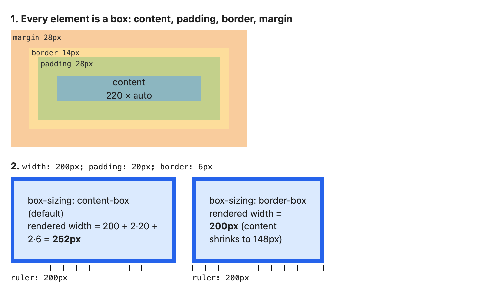
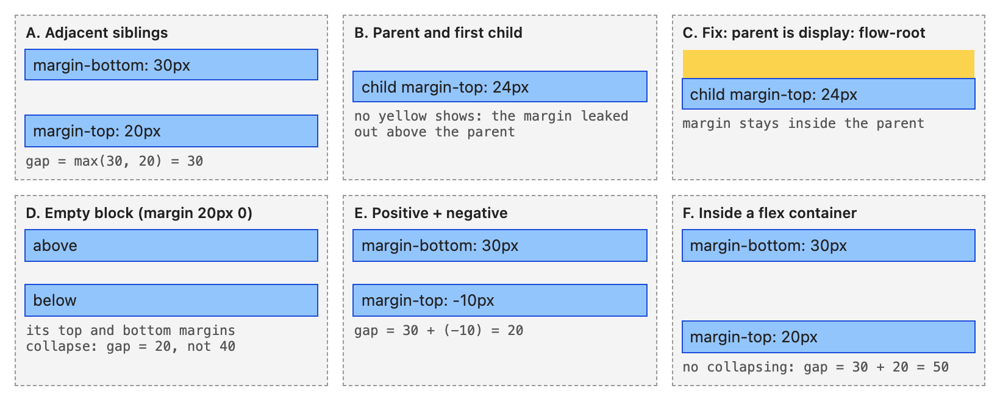
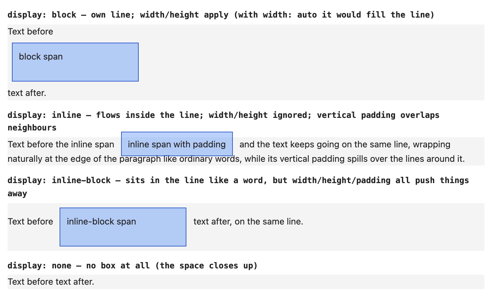
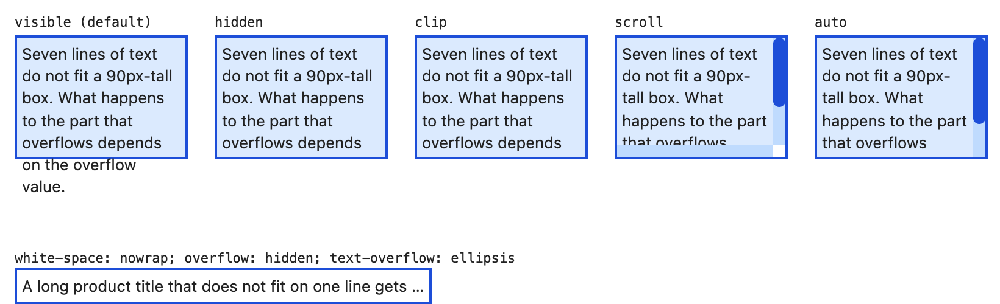
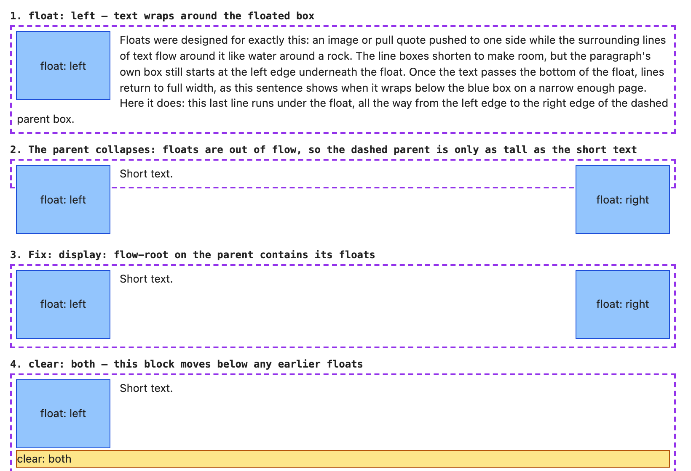

# Chapter 7 — The Box Model and Layout Basics

[Chapter 6](../06-css-fundamentals/README.md) decided *which* declarations apply; this chapter decides *where the element ends up*. Everything on a page is a rectangle — a **box** — and layout sizes and places those boxes. Before Flexbox ([Chapter 8](../08-flexbox/README.md), one row or column) and Grid ([Chapter 9](../09-grid/README.md), rows *and* columns) make sense, you need the rules they build on: box sizing, default flow, `position`, overflow, and who is painted on top.

**In this chapter:** 7.1 The box model · 7.2 `box-sizing` · 7.3 Margin collapsing · 7.4 `display` · 7.5 Normal flow and formatting contexts (BFC) · 7.6 Positioning · 7.7 Overflow and ellipsis · 7.8 `z-index` and stacking contexts · 7.9 Floats (legacy).

Every example is a page in [`code/`](code/) with a screenshot in [`img/`](img/); outlines and labels are drawn by the example CSS. The `.mjs` scripts open the pages in headless Chrome via `puppeteer-core` and print sizes measured with `getBoundingClientRect()` (an element's on-screen position and size) — every number here is measured. Run one with `node code/02_margin_collapse.mjs`.

> **Tip — outlines are your layout debugger.** An `outline` is drawn around a box but takes no space, so `* { outline: 1px solid rgb(255 0 0 / .3) }` shows every box without changing the layout (a `border` would).

---

## 7.1 The box model

### What it is
The **CSS box model**: every element generates a rectangular box of four nested areas, inside out:

| Area | What it is | Set with | Takes the element's background? |
|---|---|---|---|
| **Content** | Where text, images and child boxes go | `width`, `height` (and `min-`/`max-`) | Yes |
| **Padding** | Space between content and border | `padding`, `padding-top`… | Yes |
| **Border** | A line (or image) around the padding | `border`, `border-width`, `border-style`, `border-color` | Drawn on top of the background |
| **Margin** | Empty space *outside* the border that pushes other boxes away | `margin`, `margin-left`… | No — always transparent |

Each area's outer edge has a spec name: **content box**, **padding box**, **border box**, **margin box**.



*Figure 7.1 — [`code/01_box_model.html`](code/01_box_model.html), coloured like the DevTools box-model panel (Elements → Computed); content and padding come from two background layers clipped to `content-box` and `padding-box`.*

### How the size is calculated
With the default `box-sizing: content-box`, `width`/`height` set the **content box only**:

```
rendered width  = width  + padding-left + padding-right + border-left + border-right
space taken     = rendered width + margin-left + margin-right
```

So `width: 200px; padding: 20px; border: 6px solid` = 200 + 2×20 + 2×6 = **252px** on screen (and `width: 300px; padding: 10px 20px; border: 2px` = **344px**) — the surprise `box-sizing` (7.2) fixes.

### Shorthands — the clock rule
`margin`, `padding`, `border-width` take 1–4 values **clockwise from the top**:

| Written | Top | Right | Bottom | Left |
|---|---|---|---|---|
| `margin: 10px` | 10 | 10 | 10 | 10 |
| `margin: 10px 20px` | 10 | 20 | 10 | 20 |
| `margin: 10px 20px 30px` | 10 | 20 | 30 | 20 |
| `margin: 10px 20px 30px 40px` | 10 | 20 | 30 | 40 |

`border: 2px solid #333` sets width, style and colour on all sides; the style is required — `border: 2px #333` draws nothing (default style `none`). **Logical properties** like `margin-block` (top + bottom in horizontal text) and `padding-inline` follow the writing direction ([Chapter 13](../13-modern-css-and-architecture/README.md)).

### Sizing rules worth knowing
- **`width: auto`** (default) on a block = "fill the **containing block** (the rectangle a box is sized and positioned against — normally the parent's content box; §7.6) minus my margins, borders and padding". *Not* `width: 100%`, which ignores margins and can overflow.
- **`height: auto`** = as tall as the content. A percentage height works only if the parent has a definite height; otherwise it acts as `auto`.
- **Percentages for padding and margin — even top/bottom — use the containing block's *width*** (so `padding-top: 10%` in a 600×200 parent is 60px). Hence the old `padding-top: 56.25%` 16:9 trick (today: `aspect-ratio: 16 / 9`).
- **`min-width` / `max-width`** clamp: `max-width: 65ch` for readable text; `min-height: 100vh` for a full-screen section that can still grow. On conflict, `min-*` wins.
- **Intrinsic sizes**: `min-content` (as narrow as the longest word allows), `max-content` (as wide as the content wants, no wrapping), `fit-content` (max-content, capped at the available space) — reused as flex and grid track sizes (a *track* is a grid row or column).
- **Margins can be negative**; **padding cannot**.
- **`margin: auto`** on a block with a set width splits the leftover horizontal space — the classic `margin: 0 auto` centring.

### Border vs outline vs box-shadow

| | Takes space? | Per side? | Follows `border-radius`? | Typical use |
|---|---|---|---|---|
| `border` | Yes | Yes | Yes | Visible frames, dividers |
| `outline` | No (drawn outside the border box) | No | Yes in current browsers | Focus rings ([Chapter 3](../03-semantic-html-and-accessibility/README.md)), debugging |
| `box-shadow` | No | No (but can be offset) | Yes | Elevation (a raised-card look), fake borders that don't shift layout |

### Common mistakes
- `width: 100%` *and* padding on a content-box element → overflows by padding + border.
- `height: 100%` expecting to fill the screen when the parent's height is `auto`.
- `border: 1px red` with no style → nothing shows.

---

## 7.2 `box-sizing`

### What it is
`box-sizing` decides *which box* `width` and `height` describe:

| Value | `width` means… | Padding and border… |
|---|---|---|
| `content-box` (default) | the content box | are **added** on top |
| `border-box` | the border box | are **taken out of** the width; content shrinks (`width: 250px; padding: 25px; border: 5px` → 190px content) |

### The problem it solves
Designers think in outer sizes ("the sidebar is 300px"). With content-box, 20px padding secretly makes it 340px and the two-column layout breaks; with border-box, 300px stays 300px. Measured by [`code/01_box_sizing.mjs`](code/01_box_sizing.mjs) for Figure 7.1's boxes (`width: 200px; padding: 20px; border: 6px`):

```
content-box  width property 200px  content 200px  on screen (border box) 252px
border-box   width property 200px  content 148px  on screen (border box) 200px
```

`withPage` in [`code/measure.mjs`](code/measure.mjs) is a ten-line helper (launch Chrome, open the file, run a function in the page, close). The three DOM measurements you'll use most:

| API | Returns |
|---|---|
| `el.getBoundingClientRect()` | Border box position and size on screen (includes transforms and fractional pixels such as 12.5) |
| `el.offsetWidth` / `offsetHeight` | Border box size, rounded to an integer, ignores transforms |
| `el.clientWidth` / `clientHeight` | Padding box size minus any scrollbar |

### The universal reset
Almost every modern stylesheet and CSS reset ([Chapter 13](../13-modern-css-and-architecture/README.md)) starts with:

```css
*, *::before, *::after { box-sizing: border-box; }
```

`box-sizing` isn't inherited, so the rule targets every element and pseudo-element directly (`*` alone doesn't match pseudo-elements). A variant — `html { box-sizing: border-box }` + `*, *::before, *::after { box-sizing: inherit }` — lets a third-party widget opt its whole subtree back into content-box.

Browser defaults already give many form controls border-box (in Chrome, `<input>`, `<select>`, `<button>`, `<textarea>`), and browsers differ — another reason to set it everywhere so a `div` and an `input` with equal `width` line up.

### When not to use it
No real downside. One edge: if padding + border exceed the width (`width: 20px; padding: 20px`), content can't go below zero, so the box grows beyond `width`.

### In the interview
**30-second answer:** "Every element is a box of content, padding, border and margin. By default `width` sets only the content, so padding and border are added — 200 wide plus 20 padding plus 6 border is 252. With `box-sizing: border-box`, `width` includes padding and border, so the box stays 200 and the content shrinks. Most projects apply border-box to everything in the reset because it matches how designs are measured. Margin is never included in either model."

- *Is `box-sizing` inherited?* → No, hence the `*` selector (or the `inherit` pattern).

---

## 7.3 Margin collapsing

### What it is
In normal block layout, when two **vertical** margins touch with nothing between, they **collapse** into one margin the size of the *larger*, not the sum. Horizontal margins never collapse. It was designed for text — paragraphs with `margin: 1em 0` should be 1em apart, not 2em — and is behind most "why is there a gap / where did my margin go?" questions.

### How it works — the three situations
1. **Adjacent siblings**: one block's bottom margin and the next's top margin collapse.
2. **Parent and first/last child**: if no border, padding, inline content or clearance (space added by `clear`, §7.9) separates a parent from its first child, the child's top margin collapses *through* the parent — appearing **outside** it. Same for the last child's bottom margin (parent height `auto`).
3. **Empty blocks**: a block with no content, padding, border or height has its own top and bottom margins collapse together.

| Margins meeting | Result |
|---|---|
| All positive (30, 20) | The largest: **30** |
| Positive and negative (30, −10) | Largest positive + most negative: **20** |
| All negative (−10, −25) | The most negative: **−25** |



*Figure 7.2 — [`code/02_margin_collapse.html`](code/02_margin_collapse.html). In case B no yellow shows: the 24px margin sits above the parent and the child fills it exactly.*

Measured gaps ([`code/02_margin_collapse.mjs`](code/02_margin_collapse.mjs): gap = next box's top − previous box's bottom; inset = child top − parent top):

```
A siblings 30 / 20           -> 30px
B child top inside parent    -> 0px
C same with flow-root parent -> 24px
D across empty block 20/20   -> 20px
E 30 / -10                   -> 20px
F flex column 30 / 20        -> 50px
```

### What stops margins collapsing
- Anything **between** them: parent padding or border (even `padding-top: 1px`), inline content, a `clear`ed float.
- The parent starting a new **block formatting context** (7.5): `display: flow-root`, `overflow` other than `visible`/`clip`, `inline-block`, floats, absolute positioning.
- **Flex and grid**: margins of flex/grid items never collapse (case F; 40 + 25 in a grid = 65). Hence vertical stacks built with `display: flex; flex-direction: column; gap` or `display: grid; gap` — `gap` never collapses.
- Floated and absolutely positioned boxes never collapse with anything.

### Common mistakes
- A card's first heading `margin-top` moving the *whole card* (parent-child collapse). Fix: `display: flow-root` or padding on the card, or drop the child's top margin.
- `margin-bottom: 20px` on every item plus `margin-top: 20px` on the next, expecting 40px.
- "Fixing" collapse with `overflow: hidden` — works (new BFC) but clips shadows and focus rings. Prefer `flow-root`.

### Real-world examples
Design systems (and the "Every Layout" book's *Stack*) avoid the topic by setting margins in **one direction only** — `.stack > * + * { margin-block-start: 1rem }` — or using `gap`.

### In the interview
**30-second answer:** "Vertical margins between blocks in normal flow collapse to the larger — 30 and 20 give 30, not 50. It happens between siblings, between a parent and its first or last child when nothing separates them, and on empty blocks; negative margins are added to the largest positive. It doesn't happen in flex or grid, for floats or absolutely positioned boxes, or when padding, a border or a new BFC like `display: flow-root` separates them."

---

## 7.4 `display`

### What it is
`display` answers two questions:
- **Outer display type** — how the box joins its parent's layout: **block** (own line) or **inline** (within a line of text).
- **Inner display type** — how it lays out its *children*: **flow**, **flex**, **grid**, **table**…

Every keyword is a combination; since 2023 all major browsers (Baseline) accept the explicit **two-value syntax**:

| Keyword | Two-value form | Outer | Children laid out as |
|---|---|---|---|
| `block` | `block flow` | block | normal flow |
| `inline` | `inline flow` | inline | normal flow (inline) |
| `inline-block` | `inline flow-root` | inline | flow, in its own formatting context |
| `flow-root` | `block flow-root` | block | flow, in its own formatting context |
| `flex` | `block flex` | block | flex ([Ch. 8](../08-flexbox/README.md)) |
| `inline-flex` | `inline flex` | inline | flex |
| `grid` / `inline-grid` | `block grid` / `inline grid` | block / inline | grid ([Ch. 9](../09-grid/README.md)) |
| `list-item` | `block flow list-item` | block | flow, plus a `::marker` |
| `table`, `table-row`, `table-cell` | — | — | table layout (what `<table>` uses) |

Two keywords generate **no box of their own**:
- `display: none` — the element and subtree produce no boxes: no space, not painted, not in the accessibility tree, not focusable (unlike `visibility: hidden` / `opacity: 0`, which keep space — [§1.7](../01-how-the-web-works/README.md)). For content screen readers still need, use a visually-hidden class ([Chapter 3](../03-semantic-html-and-accessibility/README.md)).
- `display: contents` — the element's own box disappears but its **children** lay out as if they were the grandparent's — handy to let a wrapper's items join a parent's flex/grid. Caution: browsers historically dropped the element's semantics from the accessibility tree (a `<ul>` stopped being announced as a list); most engines fixed the common cases, but test with a screen reader and avoid it on buttons and interactive elements.

### Block vs inline vs inline-block

| Behaviour | `block` | `inline` | `inline-block` |
|---|---|---|---|
| Starts on a new line | Yes | No | No |
| Default width | Fills the container | Its content | Its content (shrink-to-fit) |
| `width` / `height` | Respected | **Ignored** | Respected |
| Horizontal padding/border/margin | Push neighbours | Push neighbours | Push neighbours |
| Vertical padding/border | Push neighbours | **Painted but don't move lines** (overlap) | Push neighbours |
| Vertical margin | Applies (may collapse) | **Ignored** | Applies (never collapses) |
| Default for | `div`, `p`, `h1`–`h6`, `ul`, `section`, `form` | `span`, `a`, `strong`, `em`, `code` | nothing by default; `button`, `input`, `img` behave similarly |



*Figure 7.3 — [`code/03_display.html`](code/03_display.html). Every span has `width: 180px; height: 40px; padding: 10px; margin: 8px`; only `display` differs.*

```
block         rendered 200 x 60  height of its <p>: 121
inline        rendered 176 x 37  height of its <p>: 45
inline-block  rendered 200 x 60  height of its <p>: 76
none          rendered   0 x  0  height of its <p>: 22
```

*Output of [`code/03_display.mjs`](code/03_display.mjs).* The inline span ignores `width` (176px is text + padding) and its paragraph stays two ordinary lines (45px) despite 10px vertical padding; the inline-block keeps 200×60 and the line grows.

Block/inline defaults are only the **user-agent stylesheet** (the browser's built-in CSS); HTML defines content models, not layout ([Chapter 2](../02-html-structure-and-text/README.md)) — a `<span>` with `display: block` is still phrasing content.

### Replaced elements
``, `<video>`, `<iframe>`, `<input>` are **replaced elements**: content from outside CSS, an **intrinsic size**, inline-level yet accepting `width`/`height`. Classic surprise: an `` in a `div` leaves a small gap below because, as an inline box, it sits on the text **baseline** leaving room for descenders (the tails of g, p, y). Fix: `img { display: block }` (common in resets) or `vertical-align: middle`.

### Common mistakes
- `width` on an `<a>`/`<span>` with no effect → make it `inline-block` or `block` (an `<a>` that must be 44px tall within text: `inline-block` or `inline-flex`).
- `margin-top` on an inline link → ignored.
- `inline-block` rows of cards fighting the whitespace gap (spaces between tags render as a space). Use flex or grid with `gap`.

---

## 7.5 Normal flow and formatting contexts

### What it is
**Normal flow** is the layout with no layout CSS:

1. **Block-level boxes** stack in the **block direction** (top to bottom in English), each on a new line, filling the width if `width: auto`.
2. **Inline-level boxes** (text, `span`, `a`, images) sit side by side in the **inline direction** and wrap into **line boxes** (one per line of text).
3. Vertical margins between blocks collapse (7.3).
4. A block's height grows to fit its content.

"Block/inline direction" replace "vertical/horizontal" because they rotate with the writing mode: in vertical Japanese text, blocks stack horizontally (right to left) and lines run top to bottom — hence names like `margin-block` and `inline-size`.

### Formatting contexts
A **formatting context** is a region where one set of layout rules governs the children:

| Context | Created by | Children laid out by |
|---|---|---|
| **Block formatting context (BFC)** | root `<html>`, `display: flow-root`, `inline-block`, floats, `position: absolute/fixed`, `overflow` other than `visible`/`clip`, table cells, flex/grid items, `contain: layout/paint` (a hint isolating an element's layout/painting), multi-column containers | block and inline flow |
| **Inline formatting context (IFC)** | a block containing only inline-level content | line boxes |
| **Flex formatting context** | `display: flex / inline-flex` | flexbox ([Ch. 8](../08-flexbox/README.md)) |
| **Grid formatting context** | `display: grid / inline-grid` | grid ([Ch. 9](../09-grid/README.md)) |

A new **BFC** is a sealed room:
- child margins don't collapse through its edges (7.3),
- it **contains its floats** — its height includes them (7.9),
- it doesn't overlap outside floats; it sits beside them.

`display: flow-root` exists *only* to create a BFC with no side effects, replacing the old `overflow: hidden` and "clearfix" hacks (§7.9); supported in every current browser.

### Centring in normal flow

| Goal | Normal-flow technique |
|---|---|
| Centre inline content horizontally | `text-align: center` on the parent |
| Centre a block with a known or max width | `max-width: 40rem; margin-inline: auto` |
| Centre a block's children vertically | `align-content: center` on the block itself (plain blocks since 2024 — Baseline newly available) |
| Centre anything both ways | `display: grid; place-items: center` ([Chapter 9](../09-grid/README.md)) |

---

## 7.6 Positioning

### What it is
`position` moves a box away from its normal-flow spot using the **inset properties** `top`, `right`, `bottom`, `left` (shorthand `inset`, same clock rule as `margin`). A **positioned element** is any with `position` other than `static`; the rectangle its offsets and percentages refer to is its **containing block**.

| Value | Stays in flow (keeps its space)? | Offsets measured from | Scrolls with the page? | Typical use |
|---|---|---|---|---|
| `static` (default) | Yes | — insets ignored | Yes | Everything |
| `relative` | **Yes** — original space kept; neighbours don't move | Its own normal position | Yes | Small nudges; anchor for absolute children |
| `absolute` | **No** | Nearest **positioned ancestor's** padding box (else the initial containing block) | Yes, with that ancestor | Badges, dropdowns, overlays in a card |
| `fixed` | No | The **viewport** | **No** — stays put | Cookie bars, chat buttons, old-style fixed headers |
| `sticky` | Yes | Its nearest **scrolling ancestor** (scrollport — the visible window of a scrollable box) | Scrolls until the threshold, then sticks | Table headers, section headings, sidebars |


*Figure 7.4 — [`code/04_positioning.html`](code/04_positioning.html). The dashed grey rectangle is the space the relative box still reserves; the absolute box overlaps the static box because it left the flow.*

```css
.container { position: relative; }                        /* becomes the containing block for .abs */
.rel  { position: relative; top: 14px; left: 30px; }        /* nudged; space kept */
.abs  { position: absolute; top: 10px; right: 10px; }       /* pinned to the container's corner */
.scroller { height: 180px; overflow: auto; }
.scroller h4 { position: sticky; top: 0; }                  /* sticks to the scroll box's top */
.fixed { position: fixed; right: 12px; bottom: 12px; }      /* glued to the viewport */
```

Measured by [`code/04_positioning.mjs`](code/04_positioning.mjs), including a 500px page scroll:

```
relative : moved 30px right, 14px down from its normal spot
absolute : 10px from container's right padding edge, 10px from its top
sticky   : heading top - scroller top = 0px after scrolling 90px (stays pinned)
fixed    : before scroll right/bottom gap = 12/12px, after scrolling 500px = 12/12px (glued to the viewport)
```

### How each one works

**`relative`** — laid out in flow, then shifted visually; neighbours still see the original position. Its main job today: being the **containing block** for absolute children, usually with no offsets.

**`absolute`**
1. Removed from flow — siblings close up.
2. The browser walks up to the first ancestor with `position` other than `static` (or with `transform`, `filter`, `perspective`, `contain: layout/paint`, or `will-change` of those); its **padding box** is the containing block — so `right: 0` in a parent with `padding: 20px` sits flush with the inner border edge, not 20px in. With none, the initial containing block (viewport-sized, anchored at the document top) is used.
3. Insets position the margin edges; with `width: auto` the box **shrinks to fit**.
4. Both `left` and `right` (or `inset: 0`) stretch it; `inset: 0; margin: auto` plus width and height centres it.

**`fixed`** — like absolute but against the **viewport**, so it doesn't scroll. Trap: an ancestor with `transform`, `filter`, `perspective`, `backdrop-filter`, `contain: paint` or `will-change: transform` becomes the containing block, and your "fixed" modal scrolls away. Hence modals rendered at the end of `<body>` (React "portals" render a component elsewhere in the DOM) — or better, native `<dialog>`, which uses the **top layer** (painted above the whole page) and escapes all this.

**`sticky`**
1. Behaves as `relative` until its scroll container scrolls it to the threshold (e.g. `top: 0`), then sticks.
2. It **never leaves its parent**: when the parent's bottom scrolls up, the sticky box is pushed away — "each heading sticks until the next section".
3. Needs at least one inset; without one it never sticks.
4. It sticks to the nearest **scroll container** (`overflow: auto/scroll/hidden`). A wrapper with `overflow: hidden` that isn't what actually scrolls captures it and it "doesn't work". `overflow: clip` (and `visible`) don't create scroll containers, so they're safe.

### Trade-offs

| Approach | Good for | Beware |
|---|---|---|
| Absolute positioning for layout | Overlays, badges, decorative bits | Overlap and clipped text as content grows or users zoom; not for main layout |
| Fixed headers/footers | Always-available controls | Covers content (use `scroll-padding-top` so same-page `#id` links don't hide under the header); eats small-screen space |
| Sticky | Headers that stay visible while scrolling | Silent failures from ancestor `overflow` or a parent exactly as tall as the sticky element |

### Common mistakes
- `position: absolute` with no positioned ancestor — jumps to the page corner. Add `position: relative` to the intended parent.
- `top: 50%; left: 50%` centring without `translate: -50% -50%` (offsets move the *top-left corner*). Prefer `inset: 0; margin: auto` or grid.
- Sticky in a parent only as tall as itself → no room to stick.
- `z-index` on a static element (7.8).

### In the interview
**30-second answer:** "`static` is normal flow. `relative` keeps the element's space and shifts it visually; mostly it's the reference for absolute children. `absolute` leaves the flow and positions against the nearest positioned ancestor's padding box. `fixed` positions against the viewport so it doesn't scroll — unless an ancestor has a transform or filter, which becomes the containing block. `sticky` is in flow until a threshold in its scroll container, then sticks, but only within its parent."

- *Sticky header not sticking?* → No `top`, an ancestor `overflow` that isn't the scroller, or a too-short parent.
- *`position: fixed` modal scrolling with the page?* → An ancestor has `transform`/`filter`/`will-change`; move it out, or use `<dialog>`.

---

## 7.7 Overflow

### What it is
**Overflow** is content that doesn't fit its box — a fixed `height`, or a long word or wide image exceeding `width`. `overflow` (or `overflow-x`/`overflow-y`) decides what happens:

| Value | Overflowing content | Scrollbars | Scrollable by script? | Creates a BFC / scroll container? |
|---|---|---|---|---|
| `visible` (default) | Spills out, paints over what follows | No | No | No |
| `hidden` | Clipped at the padding box | No | **Yes** (`el.scrollTop = …`, focus, anchor links) | Yes / yes |
| `clip` | Clipped | No | **No** | No / no |
| `scroll` | Clipped | **Always**, even if not needed (ugly on Windows) | Yes | Yes / yes |
| `auto` | Clipped | Only when needed | Yes | Yes / yes |



*Figure 7.5 — [`code/05_overflow.html`](code/05_overflow.html). Scrollbars are coloured with `::-webkit-scrollbar` for the screenshot; macOS normally uses overlay scrollbars that appear only while scrolling.*

[`code/05_overflow.mjs`](code/05_overflow.mjs) sets `scrollTop = 20` on each box and reads it back:

```
visible  clientHeight 98  scrollHeight 131  scrollTop after setting 20 -> 0
hidden   clientHeight 98  scrollHeight 135  scrollTop after setting 20 -> 20
clip     clientHeight 98  scrollHeight 131  scrollTop after setting 20 -> 0
scroll   clientHeight 88  scrollHeight 135  scrollTop after setting 20 -> 20
auto     clientHeight 98  scrollHeight 135  scrollTop after setting 20 -> 20
```

`hidden` boxes *can* still be scrolled programmatically (a keyboard user tabbing to an inner link scrolls them too); `clip` cannot. `scroll` spent 10px on an unneeded horizontal scrollbar (clientHeight 88). Scroll containers count bottom padding in the scrollable area (135 vs 131). `overflow: clip` reached Baseline in 2022.

### Useful companions
- **Single-line truncation** — all three required:
  ```css
  .title { white-space: nowrap; overflow: hidden; text-overflow: ellipsis; }
  ```
- **Multi-line truncation**: `display: -webkit-box; -webkit-box-orient: vertical; -webkit-line-clamp: 3; overflow: hidden;` — `-webkit-` prefixed (began as one engine's extension) but works everywhere.
- **Long words and URLs**: `overflow-wrap: anywhere` (or `break-word`).
- **Mixing axes**: if one axis is `visible` and the other isn't, `visible` computes to `auto` — use `clip` to clip one axis only.
- **`scrollbar-gutter: stable`** reserves scrollbar space so content doesn't jump.
- **`overscroll-behavior: contain`** stops scrolling in a modal or chat panel from "chaining" to the page behind once it reaches its end.

### Common mistakes
- `overflow: hidden` to fix a float/margin problem, later clipping focus outlines and shadows.
- `overflow: hidden` on `body`/`html` to lock scrolling, breaking `position: sticky` below.
- Truncating text users need with no way to see the rest (add a tooltip or expand control; keep the full text in the DOM for screen readers).

---

## 7.8 `z-index` and stacking contexts

### What it is
Overlapping boxes (negative margins, positioning, transforms, grid items sharing a cell) are drawn in a **stacking order** along the **z-axis** (pointing out of the screen). `z-index` sets an element's place on it, but only **within its stacking context** — a group painted as one unit. Think of each context as a sheet of paper: you can reorder drawings on a sheet, and reorder whole sheets, but a drawing can never slip between two other sheets, whatever its number.

### How it works
1. `z-index` applies to **positioned** elements and to **flex and grid items**; on a static block it does nothing.
2. Higher `z-index` in the **same** context paints in front; ties paint in DOM order (later in front).
3. A numeric `z-index` (even `0`) on a positioned or flex/grid item **creates a new stacking context** (`auto` paints at the same level as `0` but creates none).
4. Descendants' z-indexes are compared only with each other; outside, the group has its root's z-index.

Painting order within one context (back to front):

1. The context root's background and borders
2. Descendants with **negative** `z-index`
3. In-flow, non-positioned block boxes
4. Floats
5. Inline content
6. Positioned descendants with `z-index: auto` or `0`, in DOM order
7. Positioned descendants with **positive** `z-index`, lowest first

So a child with `z-index: -1` inside parent A (`z-index: 5`) can never go behind A's own background — A's background is always the back of its context.


*Figure 7.6 — [`code/06_stacking.html`](code/06_stacking.html).*

```css
/* demo 2 — the classic trap */
.parent  { position: absolute; z-index: 1; }     /* creates a stacking context */
.child   { position: absolute; z-index: 999; }   /* 999 only counts INSIDE .parent */
.sibling { position: absolute; z-index: 2; }     /* 2 > 1, so it covers .parent and everything in it */

/* demo 3 — isolation: isolate makes a stacking context without z-index */
.card.iso { isolation: isolate; }                /* the child's z-index: -1 now stays above the card's background */
```

[`code/06_stacking.mjs`](code/06_stacking.mjs) asks `document.elementFromPoint(x, y)` ("which element would get a click here?") where boxes overlap:

```
demo 1  where red, green and blue overlap -> r1
demo 2  where child (999) and sibling (2) overlap -> b2
demo 3  inside the yellow child, no isolation -> card
demo 3  inside the yellow child, isolation: isolate -> u2
```

### What creates a stacking context
- The root element (`<html>`)
- `position: relative`/`absolute` **with** `z-index` other than `auto`
- `position: fixed` or `sticky` (always)
- A flex or grid item with `z-index` other than `auto`
- `opacity` less than 1
- `transform`, `scale`, `rotate`, `translate`, `filter`, `backdrop-filter`, `perspective`, `clip-path`, `mask` (any value but `none`)
- `mix-blend-mode` other than `normal`
- `isolation: isolate`
- `will-change` naming any property above
- `contain: layout`, `paint`, `strict` or `content`; `container-type: size` or `inline-size`
- The **top layer** — an open modal `<dialog>`, a shown popover (`popover` attribute), a fullscreen element — paints above *everything*, whatever the z-indexes (so a modal beats a `z-index: 10000` header)

### Why it matters
"`z-index: 99999` and the dropdown is still behind the header" is almost always a stacking-context problem: an ancestor (a `transform` for an animation, `opacity: .99`) created a context whose own level is below the header's.

### How to debug and fix it
1. Walk up from the element that's "behind", looking for ancestors in the list above (Chrome/Edge DevTools → Layers panel, or Edge's 3D view, visualise contexts).
2. Compare the z-indexes of the **two ancestors that are siblings in a common context**, not the elements themselves.
3. Fix: raise that ancestor's z-index, remove the property that created the unwanted context, or move the overlay in the DOM (or into the top layer with `<dialog>`/`popover`).
4. Prevent: a small **z-index scale** in custom properties (`--z-dropdown: 100; --z-sticky: 200; --z-modal: 300;`) and `isolation: isolate` on components so internal z-indexes can't leak.

### In the interview
**30-second answer:** "`z-index` only orders elements within the same stacking context, and only on positioned or flex/grid items. A z-index on a positioned element, opacity below 1, transforms, filters and `isolation: isolate` create a new context, and everything inside is flattened into it — so a child with `z-index: 999` can't escape a parent with `z-index: 1` that sits below a sibling with `z-index: 2`. To debug I find the ancestors that are siblings in a common context and compare those."

---

## 7.9 Floats (legacy)

### What it is
`float: left`/`right` takes a box out of normal flow, pushes it to that side, and lets **inline content wrap around it** — designed for magazine-style images in articles. From roughly 2005 to 2015 floats were abused for whole page layouts with a pile of hacks; flexbox and grid replaced that. You still need floats to wrap text around a shape, and to read older code.



*Figure 7.7 — [`code/07_floats.html`](code/07_floats.html).*

### How it works
1. The float moves as far left (or right) as it can, at the vertical position it would have had.
2. Following blocks act as if it isn't there, but their **line boxes shorten** to avoid it, so text flows around.
3. Floats are out of flow, so the parent's auto height ignores them — it **collapses** if everything inside floats (demo 2).
4. **`clear: left | right | both`** makes a later block start below earlier floats (demo 4).
5. A parent establishing a **BFC** — best with **`display: flow-root`** — contains its floats (demo 3).

Measured parent heights (`padding: 6px`, 2px border; floats 80px tall with a 4px bottom margin), from [`code/07_floats.mjs`](code/07_floats.mjs):

```
w1  display: block      parent height 129.0625px
w2  display: block      parent height 34.84375px
w3  display: flow-root  parent height 100px
w4  display: flow-root  parent height 118.84375px
```

`w2` is one line of text plus padding and border; `w3`, identical content, contains the floats: 80 + 4 + 2×6 + 2×2 = **100px**.

### The clearfix (read it, don't write it)
Before `flow-root`, floats were contained with this pseudo-element hack, still seen in legacy and Bootstrap 3–era (2013) CSS:

```css
.clearfix::after { content: ""; display: table; clear: both; }
```

### When to use floats today

| Need | Use |
|---|---|
| Wrap text around an image or pull quote | **`float`** (optionally `shape-outside: circle(50%)` to wrap around a shape) |
| Columns, card rows, nav bars, sidebars | Flexbox or grid |
| Push one item right in a row | Flexbox `margin-left: auto` ([Chapter 8](../08-flexbox/README.md)) |

`float` is ignored on flex and grid items.

---

## Chapter 7 TL;DR

- **Box model**: content → padding → border → margin. Margin is transparent and outside; background covers content + padding (and under the border).
- **`box-sizing: border-box`** makes `width` include padding and border; put it on `*, *::before, *::after`. Content-box: 200 + 2×20 + 2×6 = 252.
- **Percent padding/margin** (even vertical) use the containing block's **width**. `width: auto` ≠ `100%`.
- **Margin collapsing**: vertical margins in block flow merge to the largest (positive + most negative if mixed); between siblings, parent/first-last child, empty blocks; never in flex/grid, for floats/absolute, or across padding/border/new BFC.
- **`display`**: outer (block/inline) + inner (flow/flow-root/flex/grid). Inline ignores width/height and vertical margins; inline-block keeps them. `none` removes the box; `contents` removes only the element's own box (check accessibility).
- **Normal flow**: blocks stack in the block direction, inlines wrap into line boxes. A **BFC** (`display: flow-root`) contains floats and stops margin collapse through its edges.
- **Position**: `relative` = shifted, space kept; `absolute` = out of flow, nearest positioned ancestor's padding box; `fixed` = viewport (unless an ancestor has transform/filter); `sticky` = in flow until its threshold in the nearest scroll container, never leaves its parent.
- **Overflow**: visible / hidden (script-scrollable) / clip (not scrollable, no BFC) / scroll (always bars) / auto (bars when needed). Ellipsis needs `nowrap + hidden + text-overflow`.
- **Stacking**: `z-index` works on positioned and flex/grid items, only within its **stacking context**; contexts come from z-index on positioned elements, opacity < 1, transforms, filters, `isolation: isolate`, fixed/sticky and more. The top layer beats everything.
- **Floats**: for wrapping text around images; contain with `flow-root`, escape with `clear`; don't build layouts with them.

Next: [Chapter 8 — Flexbox](../08-flexbox/README.md).
