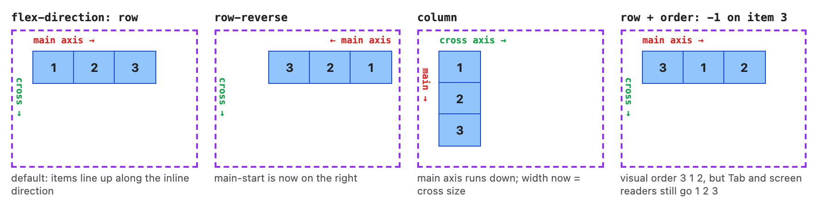

# Chapter 8 — Flexbox

Normal flow (the default layout you get with no layout CSS, [Chapter 7](../07-box-model-and-layout-basics/README.md)) stacks blocks and wraps text, and that's all it does. For years, putting three boxes side by side, making them equal height, or centring something vertically meant floats (boxes pushed to one side with text wrapping around them), tables or negative-margin hacks (workarounds that pull boxes into place with margins below zero). **Flexbox** (the CSS Flexible Box Layout module, a W3C Candidate Recommendation — a near-final stage of a web standard — supported in every browser for about a decade) solves the one-dimensional case (one direction at a time): lay out a set of items in a **row or a column**, share out the spare space, and align them. It is the tool for navbars (the row of navigation links at the top of a site), toolbars, button groups, cards, form rows and centring. For two-dimensional layouts (rows *and* columns at once) use Grid ([Chapter 9](../09-grid/README.md)).

**What you'll learn**

| # | Topic | You will be able to… |
|---|---|---|
| 8.1 | Container and items | turn on flexbox and know which properties go on which element |
| 8.2 | The two axes, direction and order | reason in "main axis / cross axis" instead of left/right/top/bottom |
| 8.3 | `flex-grow`, `flex-shrink`, `flex-basis` | calculate item sizes by hand — verified against Chrome to the pixel |
| 8.4 | The `flex` shorthand and minimum sizes | choose between `flex: 1`, `auto`, `none`; fix the `min-width: auto` overflow |
| 8.5 | Alignment | use `justify-content`, `align-items`, `align-self`, `align-content` and auto margins |
| 8.6 | Wrapping and `gap` | build rows that wrap, and know when wrapping flex should be grid instead |
| 8.7 | Common patterns | build a navbar, centring, equal-height cards, sticky footer (a footer that stays at the bottom of short pages), media object (image beside text), input group (a text box joined to a button) |
| 8.8 | Pitfalls, debugging and interview prep | recognise the classic flexbox bugs and explain flexbox in an interview |

Every example is a page in [`code/`](code/) with its screenshot in [`img/`](img/). Flex containers are drawn with a **dashed purple border**, items with a **solid blue outline**, and item widths printed in **red** are measured by the page itself after layout. The sizing maths is implemented step by step in [`code/flex_algorithm.mjs`](code/flex_algorithm.mjs) and checked against real headless Chrome (Chrome driven by a script, with no window) by [`code/03_flex_measure.mjs`](code/03_flex_measure.mjs).

---

## 8.1 Flex container and flex items

### What it is
Writing `display: flex` on an element makes it a **flex container**. Its **direct children** become **flex items** and are laid out by the flexbox rules instead of normal flow. Grandchildren are not affected — each level decides for itself.

```html
<nav class="toolbar">          <!-- flex container -->
  <a href="/">Home</a>         <!-- flex item -->
  <a href="/docs">Docs</a>     <!-- flex item -->
  <span>v2.1 <b>beta</b></span> <!-- flex item; the <b> inside is NOT an item -->
</nav>
```

```css
.toolbar { display: flex; }          /* block-level container (takes a full line) */
.badge   { display: inline-flex; }   /* inline-level container (sits in text) */
```

Even a bare run of text directly inside the container becomes an **anonymous flex item** (an item the browser creates for you, with no element of its own, so you cannot target it with CSS).

### Which properties go where

| On the **container** | On the **items** |
|---|---|
| `display: flex \| inline-flex` | `flex-grow`, `flex-shrink`, `flex-basis` (or shorthand `flex`) |
| `flex-direction` | `align-self` |
| `flex-wrap` (both via `flex-flow`) | `order` |
| `justify-content` | `margin` (including `auto`) |
| `align-items` | `min-width` / `min-height` (matters a lot, see 8.4) |
| `align-content` | |
| `gap`, `row-gap`, `column-gap` | |

### What changes for the children
- Items no longer care about `display: block`/`inline`: every item is "blockified" (a `<span>` item accepts width and height).
- `float` and `clear` are ignored on items; `vertical-align` has no effect.
- Margins of adjacent items **do not collapse** ([Chapter 7, §7.3](../07-box-model-and-layout-basics/README.md)).
- An item with `z-index` creates a stacking context (a group of boxes layered together as one unit) even without `position` ([§7.8](../07-box-model-and-layout-basics/README.md)).
- By default items sit in a row, are as wide as their content, may shrink but not grow, and **stretch** to the container's height.

### Self-check
1. `display: flex` on `<ul>` — are the `<a>` elements inside the `<li>`s flex items? → No, only the `<li>`s (direct children).
2. Which property turns a flex container inline? → `display: inline-flex` (or `display: inline flex`).

---

## 8.2 The two axes, `flex-direction` and `order`

### What it is
Flexbox never talks about "horizontal" and "vertical". It uses two **axes**:
- The **main axis** — the direction items are placed one after another. Its start and end are **main-start** and **main-end**.
- The **cross axis** — perpendicular (at a right angle) to it. **cross-start** / **cross-end**.

`flex-direction` sets the main axis:

| Value | Main axis (English, left-to-right text) | Cross axis |
|---|---|---|
| `row` (default) | left → right (follows the text direction; right → left in Arabic or Hebrew) | top → bottom |
| `row-reverse` | right → left | top → bottom |
| `column` | top → bottom | left → right |
| `column-reverse` | bottom → top | left → right |



*Figure 8.1 — [`code/01_axes.html`](code/01_axes.html). The red arrow is the main axis, the green one the cross axis; the labels are drawn with `::before`/`::after`.*

### Why it matters
Every alignment property is defined per axis: **`justify-content` works on the main axis; `align-items`, `align-self` and `align-content` work on the cross axis.** Switch `flex-direction` from `row` to `column` and `justify-content: center` now centres *vertically*. If you remember only one thing about flexbox, remember this.

### `order`
`order: <integer>` (default `0`) changes the **visual** position of an item: items are placed by ascending `order`, ties in source order. In the fourth demo, `order: -1` moves item 3 to the front.

### When not to use it (accessibility)
`order`, `row-reverse` and `column-reverse` change only what is *drawn*. The **Tab order (the order the Tab key moves through links and controls) and the screen-reader reading order still follow the DOM** (the element order in the HTML), so a keyboard user sees focus (the highlight on the element receiving keyboard input) jump around. WCAG 2.2 (the Web Content Accessibility Guidelines) success criteria 1.3.2 (Meaningful Sequence) and 2.4.3 (Focus Order) cover this ([Chapter 3](../03-semantic-html-and-accessibility/README.md)). Rules of thumb:
- Change the HTML order when the order means something; use `order` only for purely visual tweaks (e.g. an image before or after its text in alternating rows).
- The new CSS `reading-flow` property lets focus and reading order follow the visual flex/grid order, but as of 2026 it ships only in Chromium browsers (those built on Google's open-source engine: Chrome/Edge 137+) — not Baseline (the label for features that work in all major browsers), so don't rely on it.

### Self-check
1. With `flex-direction: column`, which property centres items horizontally? → `align-items: center` (horizontal is now the cross axis).
2. Does `row-reverse` change the Tab order? → No.
3. Items have `order` values 2, −1, 0, 0. Which is drawn first? → The one with −1, then the two 0s in source order, then 2.

---

## 8.3 `flex-grow`, `flex-shrink` and `flex-basis`

This is the part that makes flexbox "flexible" — and the part most people guess at. Let's calculate it properly.

### What it is
Each item has three sizing properties, always read **along the main axis** (width in a row, height in a column):

| Property | Meaning | Default |
|---|---|---|
| **`flex-basis`** | The item's starting size before free space is shared: a length (`200px`, `30%`), `0`, `content`, or `auto` (= use `width`/`height` if set, else the content size) | `auto` |
| **`flex-grow`** | How many *shares* of **positive free space** the item takes | `0` (don't grow) |
| **`flex-shrink`** | How strongly the item gives up space when there is **negative free space** (overflow), weighted by its basis | `1` (may shrink) |

**Free space** = container's inner main size − the sum of the items' flex base sizes (and margins, borders, padding) − gaps. Positive → the items can grow. Negative → they must shrink.

Analogy: a restaurant bill. `flex-basis` is what each person ordered. If the group has budget left over (positive free space), it is split by `flex-grow` "shares". If the bill is over budget (negative free space), each person pays back in proportion to `flex-shrink × what they ordered` — people who ordered more give back more.

### How it works — the algorithm, simplified
The CSS spec calls this "resolving the flexible lengths" (Flexbox Level 1, §9.7). For one line of items:

1. **Base sizes.** Work out each item's flex base size from `flex-basis`, then clamp it (force it inside the allowed range) by its `min-*`/`max-*` to get its *hypothetical* size (the size it would have before any growing or shrinking).
2. **Grow or shrink?** Sum the hypothetical sizes, gaps, margins, padding and borders. If less than the container, use `flex-grow`; otherwise use `flex-shrink`.
3. **Freeze inflexible items** — those whose factor is 0 — at their hypothetical size ("frozen" means the size is final and no longer changes in later rounds).
4. **Distribute** the remaining free space among the unfrozen items:
   - growing: `size = basis + free × grow / Σgrow`
   - shrinking: `size = basis − overflow × (shrink × basis) / Σ(shrink × basis)`
   - special case: if the unfrozen factors add up to **less than 1**, only that fraction of the free space is handed out.
5. **Clamp** each result to its `min-*`/`max-*`. If anything was clamped, **freeze** those items at the clamped size and go back to step 4 with the space that is left.
6. Stop when every item is frozen.


*Figure 8.2 — [`code/02_grow_shrink.html`](code/02_grow_shrink.html). Items have no padding or border, so each item's width is exactly its flex size. A small script at the bottom of the page reads each width with `getBoundingClientRect()` and writes it underneath — the labels are absolutely positioned children of the container, so they take no part in the layout they report on.*

### Worked example 1 — growing (G1)
Container 600px. Items: `flex: 1 1 100px`, `flex: 2 1 150px`, `flex: 1 1 50px`.

1. Base sizes 100 + 150 + 50 = 300. Free space = 600 − 300 = **+300** → grow.
2. Total grow shares = 1 + 2 + 1 = 4, so one share = 300 / 4 = 75px.
3. A = 100 + 1×75 = **175**; B = 150 + 2×75 = **300**; C = 50 + 1×75 = **125**. Total 600. ✓

Note that B ends up **300**, not "twice as wide as A" — `flex-grow` divides the *free space*, not the final widths. Only when all bases are 0 (next examples) do grow factors become width ratios.

### Worked example 2 — shrinking (G2)
Container 400px. Items: `flex: 0 1 300px`, `flex: 0 1 200px`, `flex: 0 2 100px`.

1. Bases 300 + 200 + 100 = 600. Free space = 400 − 600 = **−200** → shrink.
2. Scaled shrink factors (shrink × basis): A = 1×300 = 300, B = 1×200 = 200, C = 2×100 = 200. Sum = **700**.
3. A loses 200 × 300/700 = 85.714 → **214.286**. B loses 200 × 200/700 = 57.143 → **142.857**. C loses 200 × 200/700 = 57.143 → **42.857**.

C has *twice* the shrink factor of B yet loses the *same* amount, because its basis is half as big. Shrinking is weighted by size so small items don't get crushed to zero first.

### Worked example 3 — gaps (G3)
Same items as G1 with `gap: 20px`: two gaps take 40px first. Free space = 600 − 300 − 40 = 260 → one share = 65 → **165 / 280 / 115**.

### Worked example 4 — a max-width freezes an item (G4)
Container 600px, all items `flex: 1 1 0`, A has `max-width: 100px`.

1. Round 1: free space 600, each gets 200. A violates its max → clamped to 100 and **frozen**.
2. Round 2: free space 600 − 100 = 500 shared by B and C → **250** each.

Result **100 / 250 / 250** — not 100/200/200 with 100px left over. The loop in step 5 is why.

### Worked example 5 — factors below 1 (G7)
Container 600px, two items `flex: 0.25 1 100px`. Free space = 400. The factors add up to 0.5, so only half the free space (200) is handed out: each item gets 100 more → **200 / 200**, leaving 200px empty. (With `flex-grow: 1` each they would be 300 / 300.)

### Verified — the maths vs. Chrome
[`code/02_flex_math.mjs`](code/02_flex_math.mjs) runs the algorithm with logging (key part of [`flex_algorithm.mjs`](code/flex_algorithm.mjs)):

```js
if (growing) {
  const sum = open.reduce((s, i) => s + i.grow, 0);
  for (const i of open) i.target = i.basis + free * i.grow / sum;
} else {
  const sum = open.reduce((s, i) => s + i.shrink * i.basis, 0);          // scaled shrink factors
  for (const i of open) i.target = i.basis + free * (i.shrink * i.basis) / sum;   // free < 0 here
}
// ...then clamp to min/max, freeze violators, repeat
```

Output (G2 and G4):
```
== G2 shrink
  space used by hypothetical sizes = 300 + 200 + 100 = 600
  container = 400  ->  overflow, use flex-shrink
  round 1: free space = -200 shared by A, B, C
    A: 300 − 200 × (1×300)/700 = 214.286
    B: 200 − 200 × (1×200)/700 = 142.857
    C: 100 − 200 × (2×100)/700 = 42.857
  result: A=214.286  B=142.857  C=42.857

== G4 flex 1 1 0, A max 100
  space used by hypothetical sizes = 0 + 0 + 0 = 0
  container = 600  ->  free space, use flex-grow
  round 1: free space = 600 shared by A, B, C
    A: 0 + 600 × 1/3 = 200
    B: 0 + 600 × 1/3 = 200
    C: 0 + 600 × 1/3 = 200
    A violates its max -> clamped to 100
  round 2: free space = 500 shared by B, C
    B: 0 + 500 × 1/2 = 250
    C: 0 + 500 × 1/2 = 250
  result: A=100  B=250  C=250
```

Then [`code/03_flex_measure.mjs`](code/03_flex_measure.mjs) opens `02_grow_shrink.html` in headless Chrome, reads every item's `getBoundingClientRect().width`, and compares it with the algorithm. For G5 and G6 it first measures each item's content size (min-content — the narrowest it can be without overflowing, roughly its longest word — and max-content — its width with no line breaks at all) with a hidden clone (a copy of the element), because those cases depend on text width:

```
case   predicted (spec algorithm)            measured in Chrome                   diff
g1     175 / 300 / 125                       175 / 300 / 125                      0
g2     214.286 / 142.857 / 42.857            214.281 / 142.859 / 42.859           0.005
g3     165 / 280 / 115                       165 / 280 / 115                      0
g4     100 / 250 / 250                       100 / 250 / 250                      0
g5a    200 / 200 / 200                       200 / 200 / 200                      0
g5b    160.266 / 252.984 / 186.75            160.266 / 252.984 / 186.75           0
g6a    251.672 / 48.328                      251.672 / 48.328                     0
g6b    150 / 150                             150 / 150                            0
g7     200 / 200                             200 / 200                            0

content sizes used above (min-content / max-content):
  g5b 33.125 / 33.125  |  125.844 / 125.844  |  59.609 / 59.609
  g6a 251.672 / 251.672  |  6.625 / 6.625
```

Every case matches. The tiny G2 difference is not an error in the maths: Chrome stores layout positions in **1/64-pixel units**, so 214.2857… is stored as 13714/64 = 214.28125, and the rounding leftovers are pushed onto the neighbours so the three still add up to exactly 400.

### Common mistakes
- Expecting `flex-grow: 2` to make an item twice as wide as a `flex-grow: 1` sibling. Only true when their bases are equal (typically 0).
- Forgetting that padding and border count toward the base: an item with `flex: 1` (basis 0) and `padding: 0 40px` still ends up 80px wider than an unpadded sibling.
- Giving everything `flex-shrink: 0` and then wondering why the row overflows on phones.

### Self-check
1. Container 500px, items `flex: 1 1 100px` and `flex: 3 1 100px`. Widths? → free 300; shares 4 → 75 each → **175 and 325**.
2. Container 300px, items `flex: 0 1 200px` and `flex: 0 1 200px`. Widths? → overflow 100, equal scaled factors → **150 and 150**.
3. Container 300px, items `flex: 0 1 200px` and `flex: 0 3 200px`. Widths? → scaled 200 and 600 (sum 800); losses 25 and 75 → **175 and 125**.
4. Why did G4 give 250 to B and C instead of 200? → A was frozen at its max after round 1 and the leftover was redistributed.

---

## 8.4 The `flex` shorthand and minimum sizes

### The shorthand
Always prefer `flex` over the three longhands (the individual properties a shorthand stands for): it sets them together and has sensible defaults for the parts you omit (omitted `flex-shrink` → 1, omitted `flex-basis` → **0%**, not `auto`).

| You write | Means (grow shrink basis) | Behaviour | Typical use |
|---|---|---|---|
| *(nothing)* / `flex: initial` | `0 1 auto` | Content-sized, may shrink, won't grow | Default |
| `flex: 1` | `1 1 0%` | Ignore content size, share **all** space equally | Equal columns, "fill the rest" |
| `flex: 2` | `2 1 0%` | Twice the share of a `flex: 1` sibling | Proportional columns |
| `flex: auto` | `1 1 auto` | Start from content size, share the **leftover** equally | Nav tabs that grow but keep content differences |
| `flex: none` | `0 0 auto` | Rigid: never grows or shrinks | Icons, avatars (small user profile pictures), buttons |
| `flex: 200px` | `1 1 200px` | Start at 200px, grow/shrink from there | Wrapping card rows |
| `flex: 0 0 200px` | exactly that | Fixed 200px | Sidebars |

**G5 in Figure 8.2** shows the `flex: 1` vs `flex: auto` difference with the same three labels: `flex: 1` gives 200/200/200 regardless of text; `flex: auto` starts from the text widths (33.1, 125.8, 59.6) and adds an equal 127.1px to each, giving 160.3 / 253.0 / 186.8.

### `min-width: auto` — the hidden minimum
Flex items have `min-width: auto` (in a column, `min-height: auto`), and for flex items `auto` means **"never shrink below my min-content size"** — the width of the longest word, URL or unshrinkable child. This protects text from being crushed, but it is also the cause of the most common flexbox bug: *"my flex item overflows its container even though it has `flex: 1`"*.

**G6** shows it: two items with `flex: 1` in a 300px container should be 150/150, but the first contains an unbreakable URL whose min-content width is 251.672px. The browser refuses to go below that, so the second item gets only 48.328px and the text looks broken. The fix is one line:

```css
.item { flex: 1; min-width: 0; }            /* allow shrinking below content size */
/* plus a way to deal with the overflowing content: */
.item { overflow: hidden; text-overflow: ellipsis; white-space: nowrap; }  /* or overflow-wrap: anywhere */
```

Typical places this bites: a code block or table inside a flex column, a long file name in a list row, a chart inside a flex child, nested flex layouts where an inner item contains a wide `<pre>`. Making the item a scroll container (a box that clips and can scroll its content: `overflow: hidden`, `auto` or `scroll`) also removes the automatic minimum (`overflow: clip` does not — it isn't a scroll container).

### Self-check
1. What is the basis in `flex: 1`? → `0%`.
2. Two items with `flex: auto` and different text lengths — equal widths? → No; each gets its content width plus an equal share of the leftover.
3. A `flex: 1` sidebar containing a 900px-wide `<pre>` pushes the page wider than the screen. Fix? → `min-width: 0` on the flex item (and `overflow: auto` on the `<pre>`).

---

## 8.5 Alignment

### What it is
Once item sizes are known, there may still be **free space** — along the main axis (items don't fill the line) and on the cross axis (items shorter than the line). Alignment properties decide where that space goes. They come from the CSS Box Alignment module (the part of the CSS spec that defines these alignment properties), which Grid shares.


*Figure 8.3 — [`code/04_alignment.html`](code/04_alignment.html).*

### `justify-content` — main axis, on the container

| Value | Where the free space goes |
|---|---|
| `flex-start` (effectively the default, `normal`) | All at the end; items packed at main-start |
| `flex-end` | All at the start |
| `center` | Half on each side |
| `space-between` | Between items only; first and last touch the edges |
| `space-around` | Equal space around each item, so edges get **half** a gap |
| `space-evenly` | Equal gaps everywhere, edges included |

`start`/`end` also work (they follow the writing direction — left-to-right or right-to-left, depending on the language — rather than the flex direction, which matters only with `row-reverse`/`column-reverse`). `justify-content` does nothing if any item has `flex-grow` > 0 and there's no max-size limit — there is no free space left to distribute.

### `align-items` and `align-self` — cross axis, per line

| Value | Effect on each item |
|---|---|
| `stretch` (default — `normal` behaves like it) | Items fill the line's cross size — **only if** their cross size (`height` in a row) is `auto` |
| `flex-start` / `start` | Top of the line (in a row) |
| `flex-end` / `end` | Bottom |
| `center` | Middle |
| `baseline` | Items shifted so the **first line of text** in each shares one baseline (the invisible line letters sit on) — perfect for a label next to a big number or mixed font sizes |

`align-items` sets the default for all items; **`align-self`** on one item overrides it. There is **no `justify-self`** in flexbox — the main axis is shared, so you can't align one item alone on it. Use an **auto margin** instead.

### Auto margins
In flexbox, `margin: auto` absorbs free space *before* `justify-content` and in either axis:
- `margin-left: auto` (or `margin-inline-start: auto`) on an item pushes it — and everything after it — to the end. The classic "logo left, links left, Sign in far right".
- `margin-top: auto` on the last item in a column pushes it to the bottom (a card's button).
- `margin: auto` on the only item centres it both ways.

### `align-content` — distributing the lines
With `flex-wrap: wrap` there may be several **flex lines** (rows of items, when items wrap onto more than one row); `align-content` distributes them on the cross axis like `justify-content` does for items (`flex-start`, `center`, `space-between`, `space-around`, `space-evenly`, `stretch`). The default `normal` behaves as `stretch`: lines grow to fill the container. It has **no effect on a single-line (`nowrap`) container**.

### Common mistakes
- Trying `align-items: center` to centre items horizontally in a row (that's `justify-content`).
- Setting a `height` on items and wondering why `stretch` stopped working.
- Using `align-content` on a non-wrapping container.
- `justify-content: center` on a row that overflows: content spills off *both* sides and the left part can't be scrolled to. `justify-content: safe center` falls back to start when overflowing (Baseline since 2024 — Chrome 115, Firefox 63, Safari 17.6), or use `margin: auto` on the items, which never pushes content past the start edge.

### Self-check
1. Three items, `justify-content: space-between` — is there space before the first? → No.
2. How do you push only the last button of a toolbar to the right? → `margin-left: auto` on it.
3. Which property aligns the lines of a wrapping flex container? → `align-content`.

---

## 8.6 Wrapping and `gap`

### `flex-wrap`

| Value | Behaviour |
|---|---|
| `nowrap` (default) | One line. Items shrink (if allowed) and then **overflow** |
| `wrap` | New lines are added when the next item doesn't fit; lines stack along the cross axis |
| `wrap-reverse` | Same, but new lines go *above* (cross-start and cross-end swap) |

`flex-flow: row wrap` is the shorthand for `flex-direction` + `flex-wrap`.

Each line is sized **independently**: the grow/shrink maths of 8.3 runs once per line, on the items in that line. Items are placed into a line using their *hypothetical* sizes (basis clamped by min/max) — as many as fit, then a new line.

### `gap`
`gap: <row-gap> <column-gap>` (or `gap: 12px` for both) puts fixed space **between** items and between lines — never on the outer edges. It is not a margin, never collapses, and is subtracted before free space is shared (G3). `gap` in flexbox has been Baseline (working in all major browsers) since 2021; before that people used margins on items plus a negative margin on the container.


*Figure 8.4 — [`code/05_wrap_gap.html`](code/05_wrap_gap.html).*

[`code/05_wrap_gap.mjs`](code/05_wrap_gap.mjs) groups the cards by their top edge to count items per line, at two container widths:

```
container 640px (flex: 1 1 180px, gap 12px):
  line 1: 3 item(s), widths 205.33, 205.34, 205.33
  line 2: 3 item(s), widths 205.33, 205.34, 205.33
  line 3: 1 item(s), widths 640
container 400px (flex: 1 1 180px, gap 12px):
  line 1: 2 item(s), widths 194, 194
  line 2: 2 item(s), widths 194, 194
  line 3: 2 item(s), widths 194, 194
  line 4: 1 item(s), widths 400
nowrap + flex: 0 1 150px in 640px: 128, 128, 128, 128, 128
```

Check the first line by hand: 3 × 180 + 2 × 12 = 564 ≤ 640, but 4 × 180 + 3 × 12 = 756 > 640, so 3 fit. Free space 640 − 564 = 76 → +25.33 each → 205.33. The last card is alone on its line, so it takes all 640px. The shrink row: overflow 750 − 640 = 110, equal scaled factors → each loses 22 → 128.

### The "last row" problem — and when to switch to grid
A wrapping flex row is **content-out** (sizes are driven by the content): each line decides its own sizes, so items on a short last line grow wider than the ones above (the 640px card). That is great for tags or buttons of different lengths, and wrong for a uniform card grid. For equal columns that wrap, use Grid's `repeat(auto-fill, minmax(180px, 1fr))` ([Chapter 9](../09-grid/README.md)), which is **layout-in**: tracks (the rows and columns of a grid) are defined first and items drop into them. (A flex workaround is `flex-grow: 0` with a fixed basis, at the cost of an uneven right edge.)

### Self-check
1. Container 500px, items `flex: 1 1 150px`, `gap: 10px`. Items per line? → 3 (3×150 + 2×10 = 470 ≤ 500; 4 would need 630).
2. Does `gap` add space before the first item? → No, only between items and lines.
3. Why does the last card grow wider than the rest? → Each flex line distributes its own free space; a lone item gets all of it.

---

## 8.7 Common patterns


*Figure 8.5 — [`code/06_patterns.html`](code/06_patterns.html). Each flex container has a dashed purple outline.*

```css
/* 1. Navbar */
.nav       { display: flex; align-items: center; gap: 16px; }
.nav .push { margin-left: auto; }                     /* everything from here on goes right */

/* 2. Centre anything, both axes */
.center { display: flex; justify-content: center; align-items: center; }
/* (grid alternative: display: grid; place-items: center) */

/* 3. Equal-height cards with buttons aligned at the bottom */
.cards       { display: flex; gap: 12px; }             /* align-items: stretch -> equal heights */
.card        { flex: 1; display: flex; flex-direction: column; }
.card button { margin-top: auto; align-self: flex-start; }

/* 4. Sticky footer: footer at the bottom even when content is short */
body      { display: flex; flex-direction: column; min-height: 100dvh; }   /* demo uses 200px */
body main { flex: 1; }

/* 5. Media object: fixed image, flexible text */
.media         { display: flex; gap: 12px; align-items: flex-start; }
.media .avatar { flex: none; width: 56px; height: 56px; }
.media .body   { flex: 1; min-width: 0; }

/* 6. Input group */
.group       { display: flex; }
.group input { flex: 1; min-width: 0; }
```

Measured by [`code/06_patterns.mjs`](code/06_patterns.mjs):

```
navbar : gap nav-right-edge minus button-right-edge = 12px (the 12px padding)
centre : space left/right 144.65625 / 144.65625, top/bottom 39.90625 / 39.90625
cards  : heights 193.5, 193.5, 193.5; button bottoms 308.6875, 308.6875, 308.6875
footer : page bottom 464.1875, footer bottom 463.1875 (only the 1px border below it)
media  : avatar width 56px (flex: none, never shrinks)
input  : input 359.875px + button 68.125px = form 428px
```

Notes on each:
- **Navbar**: use a real `<nav>` with a list of links in production ([Chapter 3](../03-semantic-html-and-accessibility/README.md)); the `<ul>` becomes the flex container. Add `flex-wrap: wrap` or a menu button for narrow screens ([Chapter 10](../10-responsive-design/README.md)).
- **Centring**: works for unknown sizes on both axes — the thing that took hacks before flexbox. If the centred child can be taller than the container, prefer `margin: auto` on the child so it can't overflow off the top.
- **Cards**: equal heights come free from `align-items: stretch`; the column + `margin-top: auto` keeps buttons in one line. If you also need the *titles and paragraphs* aligned across cards, that is a job for `subgrid` (letting a nested grid reuse its parent's rows) ([Chapter 9](../09-grid/README.md)).
- **Sticky footer**: `100dvh` is the *dynamic* viewport height (the viewport is the visible browser area), which accounts for mobile browser toolbars; `100vh` can be too tall on phones ([Chapter 10](../10-responsive-design/README.md)).
- **Media object**: `flex: none` keeps the avatar from being squashed; `min-width: 0` lets long names truncate.
- **Input group**: `<input>` has a built-in default width (from its `size` attribute), so without `min-width: 0` it can refuse to shrink on small screens.

### Real-world examples
GitHub's repository header, most site navbars, Bootstrap 5's `.d-flex`/`.justify-content-between` utilities and Tailwind's `flex`, `items-center`, `justify-between`, `gap-4` classes (Bootstrap and Tailwind are popular CSS frameworks; their *utility classes* each apply one CSS property) all map one-to-one to the properties in this chapter.

---

## 8.8 Pitfalls, debugging, and interview prep

### Pitfalls at a glance

| Symptom | Cause | Fix |
|---|---|---|
| Item with `flex: 1` overflows / text doesn't truncate | `min-width: auto` = min-content | `min-width: 0` (and `overflow`/`text-overflow` on the content) |
| Image in a flex row is squashed | Images shrink like any item | `flex: none` or `flex-shrink: 0` on it |
| Image in a row becomes tall and distorted or overflows | `align-items: stretch` stretches images to the line height (a 100×50 image in a 300px-tall row became 600×300 in Chrome) | `align-self: flex-start` (or `center`) on the image |
| `align-items: stretch` has no effect | Item has an explicit `height` | Remove it or use `min-height` |
| `height: 100%` on an item's child doesn't work | Parent's height is not definite (not fixed in advance) | Make the item a flex container too, or use `flex: 1` down the chain |
| `justify-content` does nothing | An item has `flex-grow`, so no free space remains | Remove the grow, or use `max-width` |
| Last row of wrapped cards is wider | Per-line sizing | Use grid |
| Tab order doesn't match what users see | `order` / `*-reverse` | Change the HTML instead |
| Space appears between items that you didn't add | `justify-content: space-*` or leftover `margin` | Inspect in DevTools |

### Debugging with DevTools
Chrome, Edge and Firefox show a **flex badge** next to flex containers in the Elements panel of DevTools (the built-in developer tools, opened with F12). Clicking it overlays the container, items, free space and gaps; the **Flexbox editor** (icon next to `display: flex` in the Styles pane) lets you click through `justify-content`/`align-items` values. Firefox's Layout panel also explains *why* an item has its size: its base size, how much it grew or shrank, and whether a min/max clamp kicked in.

### In the interview
**30-second answer:** "Flexbox is one-dimensional layout. `display: flex` makes direct children flex items, placed along a main axis set by `flex-direction`; the cross axis is perpendicular. `justify-content` distributes space on the main axis, `align-items` and `align-self` align on the cross axis, and `align-content` distributes wrapped lines. Item sizes come from `flex-basis`, then positive free space is shared by `flex-grow` ratios and overflow is taken back in proportion to `flex-shrink` times the basis, with min/max clamps. `flex: 1` means `1 1 0%`, so items share all the space equally. The classic bug is `min-width: auto`, which stops items shrinking below their content — fix with `min-width: 0`."

Follow-ups:
- *What's the difference between `flex: 1` and `flex: auto`?* → Basis 0% vs basis auto: `flex: 1` ignores content size and splits everything; `flex: auto` keeps content differences and splits only the leftover (G5).
- *How is shrinking calculated?* → Overflow × (shrink × basis) / Σ(shrink × basis) — weighted by basis so small items don't vanish (G2: 214.29 / 142.86 / 42.86).
- *Flexbox or grid for a page layout?* → Grid for two-dimensional page structure and uniform card grids; flexbox inside components for rows of things whose size depends on content. They are often nested.
- *How do you centre a div?* → `display: flex; justify-content: center; align-items: center` on the parent, or `display: grid; place-items: center`.

### Self-check
1. An item in a row has `height: 50px`; the container is 200px tall with `align-items: stretch`. How tall is the item? → 50px — stretch only applies to `auto` cross sizes.
2. Which one-liner shrinks a flex item below its longest word? → `min-width: 0`.
3. What is `flex: none` in longhand? → `0 0 auto`.

---

## Chapter 8 TL;DR

- `display: flex` → direct children become **flex items**; no margin collapsing, floats ignored, items blockified.
- **Main axis** = `flex-direction` (`row` default). `justify-content` → main axis. `align-items` / `align-self` / `align-content` → cross axis. Swap direction and the meanings swap with it.
- `order` and `*-reverse` change only visuals, not Tab or reading order (`reading-flow` is Chromium-only, not Baseline).
- **Sizing**: start from `flex-basis`; positive free space split by `flex-grow` shares (`basis + free × grow/Σgrow`); overflow taken back by `flex-shrink × basis` weights; clamp to min/max, freeze, repeat. Verified: 175/300/125 (grow), 214.29/142.86/42.86 (shrink), 100/250/250 (max-width freeze). Chrome stores sizes in 1/64 px.
- **Shorthand**: `flex: 1` = `1 1 0%`, `auto` = `1 1 auto`, `none` = `0 0 auto`, default `0 1 auto`, `flex: 200px` = `1 1 200px`.
- **`min-width: auto`** = min-content for flex items → overflowing `flex: 1` items; fix with `min-width: 0`.
- **Auto margins** absorb free space: `margin-left: auto` pushes right, `margin-top: auto` pushes down, `margin: auto` centres.
- **Wrap + gap**: lines are sized independently; `gap` only between items; wrapped card grids with an even last row → use grid.
- **Patterns**: navbar, centring, equal-height cards with bottom-aligned buttons, sticky footer (`min-height: 100dvh` + `main { flex: 1 }`), media object, input group.

Next: [Chapter 9 — CSS Grid](../09-grid/README.md).
