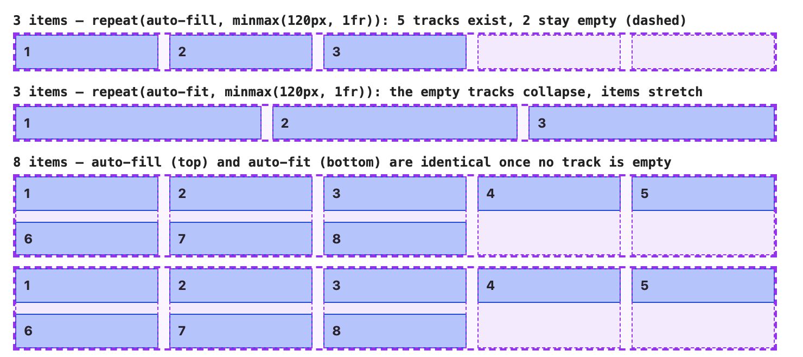
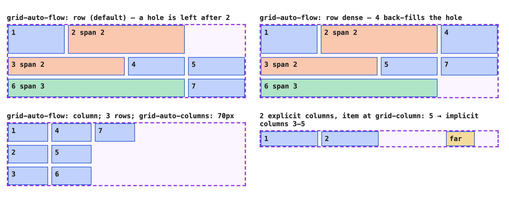
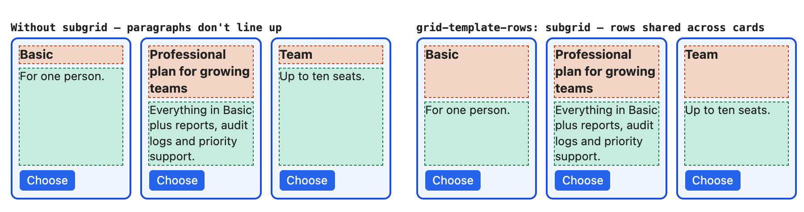
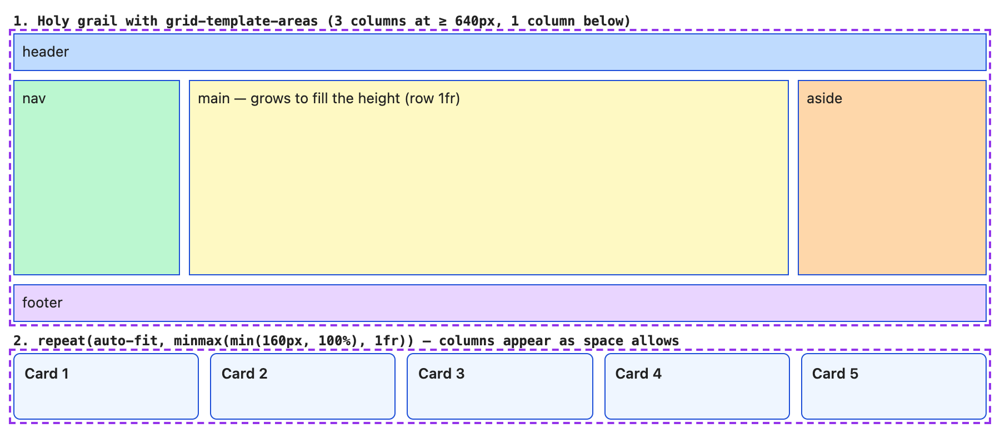
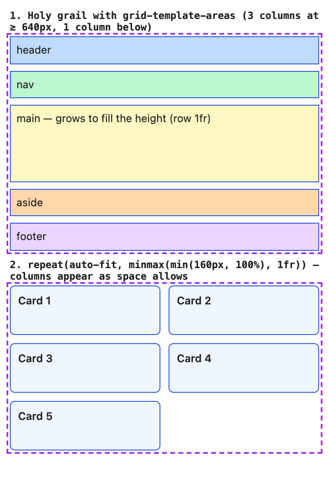

# Chapter 9 — CSS Grid

Flexbox ([Chapter 8](../08-flexbox/README.md)) arranges items along **one** axis and lets their content decide the sizes. **CSS Grid** is the other half of modern layout: you define **rows and columns at the same time**, then place items into the cells — or let the browser place them for you. It is the right tool for page structure, card galleries, dashboards, forms with aligned labels, and any design that a designer drew on a grid. Grid has worked in every major browser since 2017 (Baseline widely available); `subgrid`, added later, is Baseline since September 2023.

**What you'll learn**

| # | Topic | You will be able to… |
|---|---|---|
| 9.1 | Grid vocabulary | name lines, tracks, cells, areas and gaps, and turn a container into a grid |
| 9.2 | Defining tracks | size tracks with px, %, `fr`, `auto`, `min-content`, `max-content`, `fit-content()`, `minmax()` — and do the `fr` maths by hand |
| 9.3 | `repeat()`, `auto-fill` vs `auto-fit` | build a responsive grid with no media queries and predict its column count |
| 9.4 | Placing items | use line numbers, `span`, negative lines, named lines, `grid-template-areas` and overlap |
| 9.5 | The implicit grid and auto-placement | control extra rows/columns, `grid-auto-flow` and `dense` |
| 9.6 | Alignment | align items in cells and the whole grid in its container |
| 9.7 | Subgrid | line up content across sibling cards |
| 9.8 | Grid vs Flexbox | choose the right tool (and combine them) |
| 9.9 | Patterns | holy grail layout, responsive card grid, overlays |
| 9.10 | Debugging, pitfalls and interview prep | find and fix the common grid bugs |

As in Chapters 7 and 8, every example is a page in [`code/`](code/) with a screenshot in [`img/`](img/): grid containers have a **dashed purple border**, items a **solid blue outline**, **red badges** mark numbered grid lines and **red numbers** are track sizes the page read back from the browser. The `.mjs` scripts read `getComputedStyle(grid).gridTemplateColumns`, which returns the **resolved** track sizes in pixels — the browser's own answer — and compare it with the hand calculation.

---

## 9.1 Grid vocabulary

### What it is
`display: grid` (or `inline-grid`) makes an element a **grid container**; its direct children become **grid items**. The container defines an invisible grid:

| Term | Meaning |
|---|---|
| **Grid line** | A dividing line between tracks. Numbered from **1** at the start edge; also numbered backwards from **−1** at the end edge. A grid with 3 columns has 4 column lines. |
| **Track** | The space between two adjacent lines: a **column** or a **row**. |
| **Cell** | The intersection of one row and one column — the smallest unit. |
| **Grid area** | Any rectangle of cells bounded by four lines (can be named). |
| **Gutter / gap** | Space between tracks, set with `gap`, `row-gap`, `column-gap`. Gaps exist only *between* tracks, never at the edges. |
| **Explicit grid** | The tracks you declared with `grid-template-*`. |
| **Implicit grid** | Extra tracks the browser creates when items are placed outside the explicit grid, or when there are more items than cells. |

Analogy: a spreadsheet. The column and row dividers are the lines, a column is a track, a cell is a cell, and a merged range of cells is a grid area. Unlike a spreadsheet, you size the columns with maths (`fr`, `minmax`) and one item may span several cells.

### Grid behaviours to know up front
- As with flex items, grid items are blockified, `float` is ignored, margins don't collapse, and `z-index` works without `position` ([Chapter 7](../07-box-model-and-layout-basics/README.md)).
- Grid is **layout-in**: tracks are defined by the container and items fall into them. Flexbox is **content-out**: the items' sizes drive the layout. That difference drives the choice in 9.8.

### Self-check
1. How many column lines does `grid-template-columns: 1fr 1fr 1fr 1fr` create? → 5.
2. Which line is `-1`? → The last line (the end edge of the explicit grid).

---

## 9.2 Defining tracks

### What it is
`grid-template-columns` and `grid-template-rows` list the size of each track, separated by spaces. Values you can use per track:

| Value | Meaning |
|---|---|
| `200px`, `10rem`, `30%` | Fixed size (percent of the container's size) |
| **`fr`** | A **fraction of the leftover space** after fixed tracks and gaps are taken out |
| `auto` | As a maximum: content size, but stretches to fill leftover space when there are no `fr` tracks (with `align/justify-content: normal`). As a minimum: the item's automatic minimum size |
| `min-content` | As narrow as the content can get (longest word) |
| `max-content` | As wide as the content wants, no wrapping |
| `fit-content(150px)` | `max-content`, but capped at 150px (and at least `min-content`) |
| `minmax(min, max)` | Any size between a min and a max, e.g. `minmax(200px, 1fr)` |


*Figure 9.1 — [`code/01_tracks.html`](code/01_tracks.html). A script in the page reads `getComputedStyle(grid).gridTemplateColumns` and draws the line numbers and sizes; they are absolutely positioned, so they don't change the layout.*

### How `fr` is calculated
1. Start with the container's inner size (700px here).
2. Subtract every **fixed** track and every gap. For `200px 1fr 2fr` with `column-gap: 20px`: 700 − 200 − 2 × 20 = **460px** of free space.
3. Add up the `fr` values: 1 + 2 = 3, so **1fr = 460 / 3 = 153.33px**, 2fr = 306.67px.
4. (A track whose share would be smaller than its minimum — see below — is fixed at that minimum and the rest is re-split, like flexbox's freeze loop in [§8.3](../08-flexbox/README.md).)

[`code/01_tracks.mjs`](code/01_tracks.mjs) prints the declared value next to what Chrome resolved, then the hand calculation:

```js
const rule = [...document.styleSheets[0].cssRules].find(r => r.selectorText === '#' + g.id);
return `${g.id}  ${rule.style.gridTemplateColumns} -> ${getComputedStyle(g).gridTemplateColumns}`;
```

Output:
```
container content width: 700px
t1  200px 1fr 2fr                                        -> 200px 153.328px 306.672px
t2  auto min-content max-content fit-content(150px)      -> 349.672px 58.3594px 117.969px 150px
t3  1fr 1fr                                              -> 449.094px 242.906px
t4  minmax(0px, 1fr) minmax(0px, 1fr)                    -> 346px 346px

by hand, t1: 1fr = 460 / 3 = 153.333px, 2fr = 306.667px (Chrome stores 1/64 px: 153.328125, 306.671875)
```

The tiny differences are Chrome's 1/64-pixel layout units, exactly as in the flexbox chapter.

### `fr` vs `%`
`%` tracks are a share of the *whole* container and ignore gaps, so `50% 50%` plus a gap overflows. `fr` shares only what's left after gaps: `1fr 1fr` never overflows because of gaps.

### The `1fr` minimum trap (t3 vs t4)
`1fr` is shorthand for **`minmax(auto, 1fr)`**. The `auto` minimum means "never narrower than the item's min-content size". So in t3 a long unbreakable URL forces its column to 449px and the other gets the remaining 242.9px — the columns are not equal. It is the grid twin of flexbox's `min-width: auto` problem ([§8.4](../08-flexbox/README.md)).

Fix: `minmax(0, 1fr)` (t4) lets the track shrink below its content — the columns become exactly 346px each, and you handle the overflowing content with `overflow`, `overflow-wrap: anywhere` or `min-width: 0` on the item. Rule of thumb: for columns that **must** be equal (a dashboard, a code-and-preview split), write `repeat(3, minmax(0, 1fr))`.

### Common mistakes
- Using `%` tracks together with `gap` and getting a horizontal scrollbar.
- Expecting `1fr 1fr` to be equal whatever the content (see above).
- Forgetting that rows default to `auto` — a row only gets taller than its content if you give it a size or the container a height with `fr` rows.

### Self-check
1. Container 1000px, `grid-template-columns: 250px 1fr 1fr 1fr; column-gap: 10px`. Size of 1fr? → (1000 − 250 − 30) / 3 = **240px**.
2. What is `1fr` short for? → `minmax(auto, 1fr)`.
3. Which track value never grows beyond its content or a cap? → `fit-content(cap)`.

---

## 9.3 `repeat()`, `auto-fill` and `auto-fit`

### What it is
`repeat(count, tracks)` saves typing: `repeat(4, 1fr)` = `1fr 1fr 1fr 1fr`; `repeat(2, 100px 1fr)` = `100px 1fr 100px 1fr`.

Instead of a number, the count can be **`auto-fill`** or **`auto-fit`**: "as many tracks as fit". Combined with `minmax()` this gives a responsive grid with **no media queries** — often called the RAM pattern (**R**epeat, **A**uto, **M**inmax):

```css
.gallery { display: grid; gap: 10px;
           grid-template-columns: repeat(auto-fill, minmax(120px, 1fr)); }
```

### How it works
1. The browser computes how many tracks of the *minimum* size fit: **n = floor((width + gap) / (min + gap))**.
2. It creates n tracks, then the `1fr` maximum stretches them to share the leftover space.
3. Items are auto-placed into them; extra items wrap onto new rows.
4. The difference appears only when there are **fewer items than tracks**:
   - `auto-fill` keeps the empty tracks — items stay at their "one-column" width and space is reserved on the right.
   - `auto-fit` **collapses** empty tracks to 0 (and the gaps next to them), so the items stretch to fill the row.



*Figure 9.2 — [`code/02_auto_fill_fit.html`](code/02_auto_fill_fit.html). Every track, including empty ones, is outlined in dashed purple from the resolved track list.*

Output of [`code/02_auto_fill_fit.mjs`](code/02_auto_fill_fit.mjs):

```
container 700px, gap 10px, minmax(120px, 1fr):
  fill3  132px 132px 132px 132px 132px
  fit3   226.656px 226.672px 226.672px 0px 0px
  fill8  132px 132px 132px 132px 132px
  fit8   132px 132px 132px 132px 132px
container 400px, gap 10px, minmax(120px, 1fr):
  fill3  126.656px 126.672px 126.656px
  fit3   126.656px 126.672px 126.656px
  fill8  126.656px 126.672px 126.656px
  fit8   126.656px 126.672px 126.656px
by hand, 700px: n = floor(710 / 130) = 5, track = (700 - 40) / 5 = 132.000px
by hand, 400px: n = floor(410 / 130) = 3, track = (400 - 20) / 3 = 126.667px
by hand, auto-fit with 3 items at 700px: empty tracks and their gaps collapse -> (700 - 20) / 3 = 226.667px
```

Note `fit3`: the two collapsed tracks show up as `0px` in the resolved list.

### Which one to use

| Want | Use |
|---|---|
| Cards keep a consistent size even when there are only one or two | `auto-fill` |
| A few items should stretch to fill the row | `auto-fit` |

### Guarding the minimum on narrow screens
If the container gets narrower than the minimum (a 120px track on a 100px-wide phone column), the single track overflows. Write the minimum as `min(120px, 100%)` so it can never exceed the container: `repeat(auto-fit, minmax(min(160px, 100%), 1fr))` — used in 9.9.

### Self-check
1. Container 1000px, gap 20px, `repeat(auto-fill, minmax(200px, 1fr))`. How many columns and how wide? → floor(1020 / 220) = 4 columns of (1000 − 60) / 4 = **235px**.
2. Same, 2 items, `auto-fit`. Width of each? → Two tracks remain, (1000 − 20) / 2 = **490px**.
3. Can `auto-fill` be combined with a plain `1fr` (`repeat(auto-fill, 1fr)`)? → No — auto-repeat needs a definite size (a fixed length or a `minmax` with a fixed minimum) to know how many fit.

---

## 9.4 Placing items

By default each item goes into the next free cell (9.5). To put an item somewhere specific you name its **start and end lines** on each axis.

### Line-based placement

| Property | Example | Meaning |
|---|---|---|
| `grid-column-start` / `grid-column-end` | `1` / `3` | Start at column line 1, end at line 3 (2 columns wide) |
| `grid-column` (shorthand) | `1 / 3` | Same |
| `span n` | `grid-column: span 2` | 2 tracks wide, starting wherever auto-placement puts it |
| Negative lines | `grid-column: 1 / -1` | From the first to the **last** line: full width |
| `grid-row` | `1 / span 2` | Start at row line 1, 2 rows tall |
| `grid-area` (4 values) | `3 / 2 / 4 / 5` | **row-start / column-start / row-end / column-end** (anticlockwise from the top, unlike `margin`) |


*Figure 9.3 — [`code/03_placement.html`](code/03_placement.html).*

```css
#lines    { grid-template-columns: repeat(4, 1fr); grid-template-rows: repeat(3, 50px); gap: 8px; }
#lines .a { grid-column: 1 / 3; }
#lines .b { grid-column: 3 / -1; grid-row: 1 / span 2; }
#lines .c { grid-column: span 2; }            /* only a span: auto-placed into the first free spot */
#lines .d { grid-area: 3 / 2 / 4 / 5; }
```

[`code/03_placement.mjs`](code/03_placement.mjs) maps each item's rectangle back to line numbers:

```
a: columns 1 -> 3, rows 1 -> 2
b: columns 3 -> 5, rows 1 -> 3
c: columns 1 -> 3, rows 2 -> 3
d: columns 2 -> 5, rows 3 -> 4
```

`-1` resolved to line 5 (the last line of a 4-column grid). Note: negative numbers count from the end of the **explicit** grid only, so `1 / -1` doesn't reach into implicit columns.

### Named lines
You can name lines in square brackets and place by name — useful in big layouts where numbers change:

```css
.layout { grid-template-columns: [full-start] 1fr [content-start] minmax(0, 60rem) [content-end] 1fr [full-end]; }
.layout > *      { grid-column: content; }   /* "content" = content-start / content-end */
.layout > .bleed { grid-column: full; }      /* a full-width image or banner */
```

This "full-bleed" layout keeps text in a readable centre column while chosen elements run edge to edge.

### `grid-template-areas`
The most readable way to build page layouts: draw the layout as ASCII art, one string per row, then assign items to areas by name.

```css
#areas { grid-template-columns: 110px 1fr;
         grid-template-rows: 36px 90px 30px;
         grid-template-areas:
           "header  header"
           "sidebar main"
           "footer  footer"; }
.h { grid-area: header; } .s { grid-area: sidebar; } .m { grid-area: main; } .f { grid-area: footer; }
```

Rules:
- Every string must have the same number of cells.
- A name repeated in adjacent cells makes one area; each area must be a **rectangle** (no L-shapes).
- A `.` (or several dots, `...`) marks an empty cell.
- Named areas automatically create named lines `header-start`/`header-end`, so `grid-column: header` also works.
- Rearranging the layout at a breakpoint is just rewriting the strings (9.9).

### Overlap
Two items may occupy the same cells. Later items paint on top; `z-index` changes that (it works on grid items without `position`). Demo C puts an image and a caption in `grid-area: 1 / 1` and aligns the caption to the bottom-left with `align-self: end; justify-self: start` — a hero banner with no `position: absolute`, so the container still grows with its content.

### Accessibility note
As with flexbox `order`, visual placement doesn't change DOM order: keyboard and screen-reader users follow the source ([§8.2](../08-flexbox/README.md)). Keep source order logical; don't use placement to reorder meaningful content.

### Self-check
1. Make an item span the full width regardless of column count. → `grid-column: 1 / -1`.
2. What does `grid-area: 2 / 1 / 4 / 3` mean? → Rows 2 to 4 (2 rows), columns 1 to 3 (2 columns).
3. Is this area template valid: `"a a" "a b"`? → No — area `a` would be L-shaped.

---

## 9.5 The implicit grid and auto-placement

### What it is
When there are more items than explicit cells, or an item is placed at a line beyond the explicit grid, the browser adds **implicit tracks**. Their sizes come from **`grid-auto-rows`** and **`grid-auto-columns`** (default `auto`).

**Auto-placement** fills cells in order. `grid-auto-flow` sets how:

| Value | Behaviour |
|---|---|
| `row` (default) | Fill each row left to right, then add rows |
| `column` | Fill each column top to bottom, then add columns |
| `row dense` / `column dense` | Also go **back** to fill earlier holes with later items that fit |



*Figure 9.4 — [`code/04_implicit.html`](code/04_implicit.html). Orange items span 2 columns, green spans 3.*

```css
.flow   { grid-template-columns: repeat(4, 1fr); grid-template-rows: 50px; grid-auto-rows: 32px; }
.dense  { grid-auto-flow: row dense; }
.by-col { grid-template-rows: repeat(3, 32px); grid-auto-flow: column; grid-auto-columns: 70px; }
.outside      { grid-template-columns: repeat(2, 100px); grid-auto-columns: 50px; }
.outside .far { grid-column: 5; }
```

Output of [`code/04_implicit.mjs`](code/04_implicit.mjs) (`r2c3` = row 2, column 3):

```
row      columns: 99px 99px 99px 99px                        rows: 50px 32px 32px
         placement: 1@r1c1 2@r1c2 3@r2c1 4@r2c3 5@r2c4 6@r3c1 7@r3c4
dense    columns: 99px 99px 99px 99px                        rows: 50px 32px 32px
         placement: 1@r1c1 2@r1c2 3@r2c1 4@r1c4 5@r2c3 6@r3c1 7@r2c4
bycol    columns: 70px 70px 70px                             rows: 32px 32px 32px
         placement: 1@r1c1 2@r2c1 3@r3c1 4@r1c2 5@r2c2 6@r3c2 7@r1c3
outside  columns: 100px 100px 50px 50px 50px                 rows: 26px
         placement: 1@r1c1 2@r1c2 far@r1c5
```

Read it like this:
- **row**: item 3 needs two columns; only column 4 is free in row 1, so it moves to row 2, leaving **r1c4 empty**. Only row 1 is explicit (50px); rows 2–3 are implicit (32px from `grid-auto-rows`).
- **dense**: item 4 (1 column) goes back and fills r1c4. The items are now drawn **out of source order**.
- **bycol**: three explicit rows, columns created as needed at 70px.
- **outside**: placing an item at column line 5 creates implicit columns 3, 4 and 5 at 50px each.

### Useful settings
- `grid-auto-rows: minmax(100px, auto)` — rows at least 100px, but grow with content. The standard for card grids.
- `dense` is fine for image galleries where order doesn't matter; avoid it where reading or tab order does — the visual order no longer matches the DOM.

### Self-check
1. `grid-template-columns: repeat(3, 1fr)` and 7 items, no rows declared. How many rows, and how are they sized? → 3 implicit rows, sized by `grid-auto-rows` (default `auto` = content).
2. What does `dense` risk? → Visual order differing from DOM/focus order.

---

## 9.6 Alignment

Grid uses the same Box Alignment properties as flexbox, but here **both axes have a `justify-*` and an `align-*`**, because items sit in two-dimensional cells:
- **inline axis** (row direction, left→right in English) → `justify-*`
- **block axis** (column direction, top→bottom) → `align-*`

| Property | On | Aligns | Default |
|---|---|---|---|
| `justify-items` / `align-items` | container | every item **inside its cell** | `stretch` (unless the item has a set size or an aspect ratio, e.g. images → `start`) |
| `justify-self` / `align-self` | item | one item inside its cell | inherits from `*-items` |
| `justify-content` / `align-content` | container | the **whole grid of tracks** inside the container, when the tracks are smaller than it | `normal` (tracks packed at the start; `auto` tracks stretch to fill) |
| `place-items`, `place-self`, `place-content` | — | shorthands: `align` value first, then `justify` | — |


*Figure 9.5 — [`code/05_alignment.html`](code/05_alignment.html). The light-purple rectangles are the cells (painted with background gradients), so you can see each item's position inside its cell.*

Key points:
- `place-items: center` on a grid is the shortest centring recipe in CSS: `display: grid; place-items: center`.
- **`*-content` only does something when there is free space** — tracks with fixed sizes smaller than the container. With `fr` tracks there's no free space and it has no effect.
- `space-between` / `space-around` / `space-evenly` in `*-content` **widen the effective gaps**; items spanning several tracks get bigger too.
- Auto margins work in grid as well: `margin-left: auto` pushes an item to the end of its cell.

### Self-check
1. Centre one item inside its cell without affecting others. → `place-self: center` on that item.
2. Why does `justify-content: center` do nothing on `grid-template-columns: 1fr 1fr`? → `fr` tracks use up all the space; nothing is left to distribute.
3. What order do values in `place-items: end start` follow? → `align-items: end`, `justify-items: start`.

---

## 9.7 Subgrid

### The problem it solves
A grid item that is itself a grid has its *own* independent tracks. Three pricing cards side by side each lay out title, text and button, but card 2's longer title pushes its text lower — the rows don't line up across cards. Before subgrid, fixes involved fixed heights or JavaScript.

### What it is
`grid-template-rows: subgrid` (or `grid-template-columns: subgrid`) on a grid item that spans several tracks of its parent tells it: **don't create your own tracks on this axis — reuse the parent's tracks I'm sitting on**. The children of the card then take part in the parent's row sizing, so the tallest title in *any* card sets the title row height for *all* cards. Subgrid is defined in CSS Grid Level 2 and has been **Baseline since September 2023** (Firefox 71, Safari 16, Chrome/Edge 117); by 2026 it is "widely available".



*Figure 9.6 — [`code/06_subgrid.html`](code/06_subgrid.html). Orange dashed = title, green dashed = paragraph.*

```css
.sub       { display: grid; grid-template-columns: repeat(3, 1fr);
             grid-template-rows: auto auto auto; row-gap: 10px; }  /* the parent owns 3 rows */
.sub .card { display: grid; grid-row: span 3;                       /* each card covers all 3 */
             grid-template-rows: subgrid; row-gap: 6px; }           /* ...and reuses them */
```

Measured by [`code/06_subgrid.mjs`](code/06_subgrid.mjs) (top edge of each paragraph and link):

```
plain  <p> tops: 76.9, 114.7, 76.9    link tops: 190.9, 190.9, 190.9
sub    <p> tops: 114.7, 114.7, 114.7  link tops: 190.9, 190.9, 190.9
```

Without subgrid the links happen to align (each card's middle row is `1fr` and the cards stretch to equal height), but the paragraphs don't. With subgrid every row is shared.

### Details
- The subgrid item must **span** the parent tracks it wants to share (`grid-row: span 3`).
- A subgrid inherits the parent's gaps but may override them (`row-gap: 6px` above).
- You can subgrid one axis and define your own tracks on the other.
- Line names from the parent are available inside the subgrid.
- Typical uses: card rows, forms where labels and inputs in separate `<fieldset>`s must align, a list whose items have several aligned columns (a `<ul>` of rows with `grid-template-columns: subgrid`).

### Self-check
1. What must a subgrid item do besides `grid-template-rows: subgrid`? → Span the parent's rows it wants to use.
2. Can a subgrid have a different gap? → Yes, it can override the inherited gap.

---

## 9.8 Grid vs Flexbox

| Question | Flexbox | Grid |
|---|---|---|
| Dimensions | One — a row **or** a column | Two — rows **and** columns |
| Who decides sizes? | **Content-out**: items' content and flex factors | **Layout-in**: the container's track definitions |
| Items in different rows line up in columns? | No — each flex line is independent | Yes — that's the point |
| Wrapping | Each line sizes itself; a lonely last item stretches | Items drop into the same columns; last row keeps the column width |
| Overlapping items | Needs negative margins or positioning | Place two items in the same cell |
| Gaps | `gap` | `gap` |
| Reordering | `order`, `*-reverse` | Line/area placement, `order`, `dense` |
| Typical jobs | Navbars, toolbars, button groups, tags, media objects, centring one thing, "push the last item right" | Page layouts, galleries, card grids, dashboards, form layouts, anything designed on a grid |
| Aligning content across siblings | Not possible | `subgrid` |

Rules of thumb:
1. **Is the layout driven by the content (a row of things of different sizes)?** → Flexbox.
2. **Do things need to line up in both directions, or do you know the track sizes up front?** → Grid.
3. **Use both**: grid for the page and the card gallery, flexbox inside each card's footer to space its buttons. They nest freely.

### In the interview
**30-second answer:** "Flexbox is one-dimensional and content-out: items sit in a row or column and share space based on their content and flex factors. Grid is two-dimensional and layout-in: I define rows and columns and place items into them, so things align across rows. I use grid for page structure and card grids — for example `repeat(auto-fill, minmax(200px, 1fr))` for a responsive gallery — and flexbox for components like navbars and button groups. They're often nested."

- *Can you make a responsive grid without media queries?* → Yes: `repeat(auto-fit | auto-fill, minmax(min(200px, 100%), 1fr))`.
- *Difference between auto-fill and auto-fit?* → Only visible when items don't fill a row: auto-fill keeps empty tracks, auto-fit collapses them so items stretch.
- *Why are my `1fr` columns unequal?* → `1fr` has an `auto` minimum (content size); use `minmax(0, 1fr)`.

---

## 9.9 Patterns

### Holy grail layout (header, nav, main, aside, footer)

```css
/* mobile first: one column, in source order */
.page { display: grid; gap: 8px; min-height: 100dvh;           /* demo uses 260px */
        grid-template-areas: "header" "nav" "main" "aside" "footer";
        grid-template-rows: auto auto 1fr auto auto; }
.page > header { grid-area: header; }  .page > nav    { grid-area: nav; }
.page > main   { grid-area: main; }    .page > aside  { grid-area: aside; }
.page > footer { grid-area: footer; }

/* three columns when there's room */
@media (min-width: 640px) {
  .page { grid-template-columns: 150px 1fr 170px;
          grid-template-rows: auto 1fr auto;
          grid-template-areas:
            "header header header"
            "nav    main   aside"
            "footer footer footer"; }
}
```

The `1fr` row makes `main` take all spare height, so the footer sits at the bottom of the screen (the sticky footer of [§8.7](../08-flexbox/README.md), done with grid). Media queries are covered in [Chapter 10](../10-responsive-design/README.md).

### Responsive card grid (RAM)

```css
.cards { display: grid; gap: 10px;
         grid-template-columns: repeat(auto-fit, minmax(min(160px, 100%), 1fr)); }
```





*Figure 9.7 — [`code/07_patterns.html`](code/07_patterns.html) screenshotted at 900px and 400px wide.*

[`code/07_patterns.mjs`](code/07_patterns.mjs) loads the page at both widths:

```
viewport 900px
  holy grail: 150px 540px 170px
  cards     : 167.188px 167.203px 167.203px 167.203px 167.188px
viewport 400px
  holy grail: 376px
  cards     : 183px 183px
```

At 900px the container is 876px: 876 − 150 − 170 − 2 × 8 = 540 for `main`; the cards fit floor(886 / 170) = 5 columns. At 400px the media query no longer matches (one 376px column) and only 2 card columns fit. Card 5 keeps the column width on its own row — the thing flex-wrap couldn't do ([§8.6](../08-flexbox/README.md)).

### Other patterns worth knowing

| Pattern | Grid recipe |
|---|---|
| Centre anything | `display: grid; place-items: center` |
| Overlay / hero caption | Image and caption both `grid-area: 1 / 1`; align the caption with `align-self`/`justify-self` |
| Full-bleed article | Named lines `[full-start] 1fr [content-start] minmax(0, 60rem) [content-end] 1fr [full-end]` (9.4) |
| Form with aligned labels | `grid-template-columns: max-content 1fr` on the form, one label + input per row |
| Sidebar that collapses | `grid-template-columns: fit-content(250px) minmax(0, 1fr)` |
| 12-column design system grid | `repeat(12, minmax(0, 1fr))` + `grid-column: span 4` on items |

### Masonry: not yet
Pinterest-style "masonry" (items packed into columns of uneven height) is being standardised in CSS Grid Level 3 under the name **`display: grid-lanes`**. As of 2026 it has shipped in Safari (26.4) and is behind flags in Chrome and Firefox — not Baseline. Use CSS multi-column (`columns: 3`) or a JavaScript library, and wrap any experiment in `@supports (display: grid-lanes)`.

---

## 9.10 Debugging, pitfalls and interview prep

### Debugging
All major browsers show a **grid badge** beside grid containers in the Elements/Inspector panel. Toggling it overlays line numbers (positive and negative), track sizes, gaps and area names — the same information our red badges draw. Firefox's grid inspector pioneered this and is still the most detailed.

### Pitfalls at a glance

| Symptom | Cause | Fix |
|---|---|---|
| `1fr` columns are unequal / grid overflows on mobile | `1fr` = `minmax(auto, 1fr)`; long words, `<pre>`, images or tables set the minimum | `minmax(0, 1fr)`; `min-width: 0` or `overflow` on the item |
| Horizontal scrollbar with `%` columns | `%` tracks ignore gaps | Use `fr` |
| Single auto-fill column overflows narrow screens | Minimum larger than the container | `minmax(min(200px, 100%), 1fr)` |
| Item lands in an unexpected extra row/column | Placed beyond the explicit grid → implicit tracks; or a typo in an area name (unknown names create implicit lines) | Check line numbers in DevTools; spell area names consistently |
| `grid-template-areas` ignored | Strings have different cell counts or a non-rectangular area — the whole declaration is invalid | Fix the ASCII art |
| An image doesn't fill its cell | Items with an aspect ratio (images, video) treat the default alignment as `start`, not `stretch` — checked in Chrome: a 100×50 image in a 200×300 cell stays 100×50 | `width: 100%; height: 100%; object-fit: cover` ([Chapter 11](../11-typography-color-and-visual-effects/README.md)) |
| `justify-content` does nothing | `fr` tracks leave no free space | Use fixed tracks, or align items instead |
| Tab order jumps around | `dense`, placement or `order` moved items visually | Keep DOM order = visual order |

### In the interview
**30-second answer:** "Grid is two-dimensional layout. On the container I define tracks with `grid-template-columns` and `-rows` using lengths, `fr` for fractions of leftover space, `minmax`, and `repeat` — `repeat(auto-fill, minmax(200px, 1fr))` gives a responsive grid with no media queries. Items are auto-placed into cells, or placed by line numbers, spans or named `grid-template-areas`. Extra items create implicit tracks sized by `grid-auto-rows`. Alignment uses `justify-*` for the inline axis and `align-*` for the block axis, and `subgrid` lets nested grids share the parent's tracks so cards line up."

Follow-ups:
- *How is `fr` calculated?* → Container size minus fixed tracks and gaps, divided by the total of the `fr` values; tracks whose share is below their minimum are fixed and the rest re-split. 700 − 200 − 40 = 460 → 1fr = 153.33.
- *auto-fill vs auto-fit?* → Same until there are too few items; then auto-fill keeps empty tracks, auto-fit collapses them.
- *How would you build a layout that reorders at a breakpoint?* → Named areas, rewritten in a media query — while keeping DOM order sensible for keyboard and screen-reader users.
- *What is subgrid for?* → Aligning the insides of sibling components (card titles, form labels) to shared tracks.

### Self-check
1. `grid-template-columns: repeat(3, 1fr)` overflows on mobile because of a wide table. Two fixes? → `repeat(3, minmax(0, 1fr))` and let the table scroll (`overflow-x: auto` on a wrapper); or fewer columns at small widths.
2. Which property sizes rows that you did not declare? → `grid-auto-rows`.
3. Shortest way to centre a child in both axes? → `display: grid; place-items: center` on the parent.

---

## Chapter 9 TL;DR

- **Grid** = two-dimensional, layout-in. `display: grid` → direct children are items. Vocabulary: lines (1…n+1, and −1 backwards), tracks, cells, areas, gaps; explicit vs implicit grid.
- **Tracks**: px/%/`fr`/`auto`/`min-content`/`max-content`/`fit-content()`/`minmax()`. **`fr` = share of space left after fixed tracks and gaps** (700 − 200 − 40 = 460 → 153.33 / 306.67, verified). `1fr` = `minmax(auto, 1fr)` → use `minmax(0, 1fr)` for truly equal columns.
- **RAM**: `repeat(auto-fill|auto-fit, minmax(min(X, 100%), 1fr))`; n = floor((W + gap) / (X + gap)). auto-fill keeps empty tracks, auto-fit collapses them.
- **Placement**: `grid-column: 1 / 3`, `span 2`, `1 / -1` (full width), `grid-area: row-start / col-start / row-end / col-end`, named lines, and `grid-template-areas` ASCII art (rectangles only, `.` = empty). Items can overlap in one cell.
- **Implicit grid**: `grid-auto-rows/columns` size extra tracks; `grid-auto-flow: row | column | dense` (dense breaks visual/DOM order).
- **Alignment**: `justify-*` = inline axis, `align-*` = block axis; `*-items`/`*-self` inside cells, `*-content` for the whole grid when tracks leave free space; `place-*` shorthands; `place-items: center` centres.
- **Subgrid** (Baseline since Sept 2023): `grid-template-rows: subgrid` on a spanning item reuses the parent's tracks so card internals align.
- **Grid vs Flexbox**: grid for page structure and uniform grids; flexbox for content-sized rows inside components; nest them.
- **Masonry** (`display: grid-lanes`) is Safari-only in 2026 — not Baseline.

Next: [Chapter 10 — Responsive Design](../10-responsive-design/README.md).
