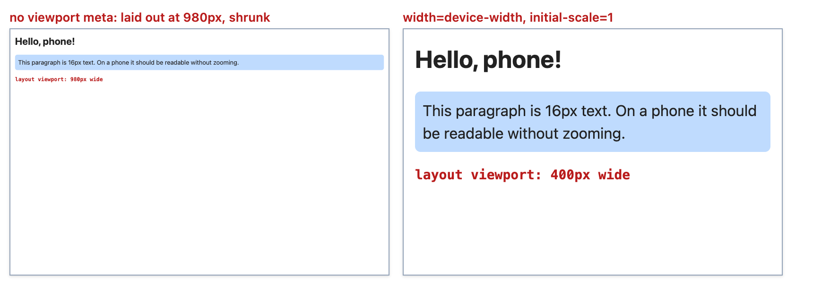
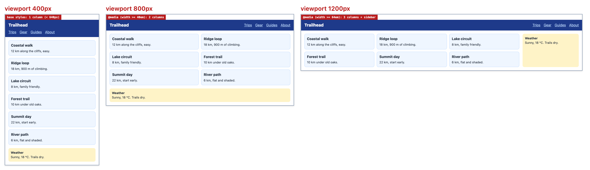
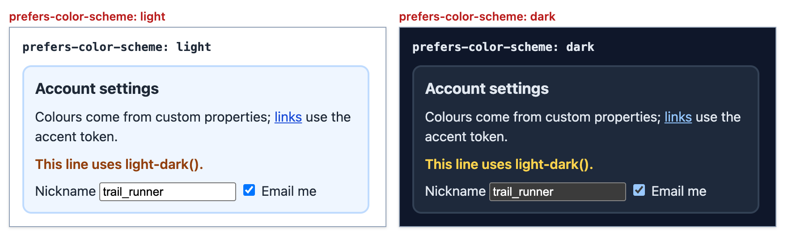
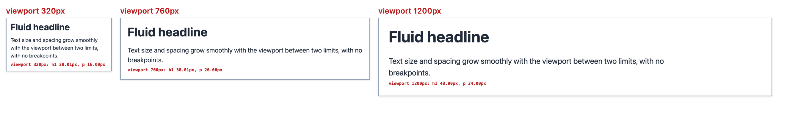
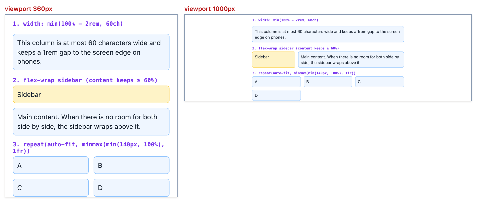
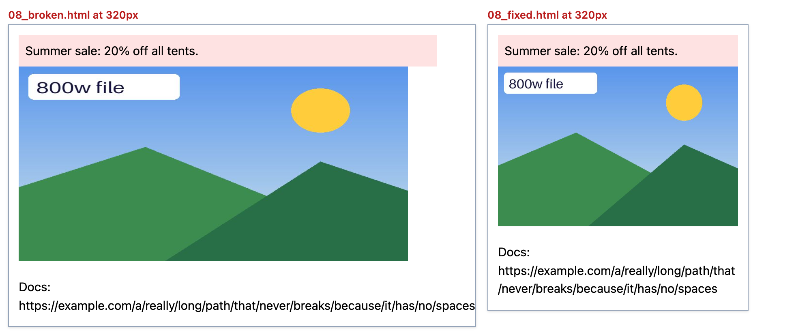

# Chapter 10 — Responsive Design

The same page is opened on a 360px phone, a sideways tablet, a 1440px laptop and a 2560px monitor — by people who may have enlarged their default font, zoomed to 200 %, switched to dark mode, or asked the OS to reduce motion (animation can cause dizziness or nausea). **Responsive design** builds *one* page that works in all of those situations, instead of a separate "mobile site". Chapters 7–9 gave the layout tools; this chapter makes layouts **adapt**.

**In this chapter:** 10.1 What responsive design is · 10.2 The viewport meta tag and viewport units · 10.3 Media queries · 10.4 Mobile-first in practice · 10.5 User-preference queries · 10.6 Container queries · 10.7 Fluid typography with `clamp()` · 10.8 Responsive images recap and `image-set()` · 10.9 Intrinsic layouts · 10.10 Testing.

Every example is a page in [`code/`](code/). Screenshots in [`img/`](img/) were made in headless Chrome by [`code/make_figures.mjs`](code/make_figures.mjs); the `NN_*.mjs` scripts print what the browser computed (matching queries, resolved grid columns, font sizes) using [`code/measure.mjs`](code/measure.mjs) — as in [Chapters 7–9](../09-grid/README.md), plus **viewport width**, **phone emulation** and **OS-preference emulation** (dark mode, high contrast…). Many screenshots are "contact sheets": one page at several widths, with the width in red above each.

---

## 10.1 What responsive design is

### What it is
A **responsive** page rearranges and resizes itself to fit the **viewport** (the visible browser area) and the user's settings. Ethan Marcotte coined the term in 2010, with three ingredients:

| Ingredient | Meaning | Today's tools |
|---|---|---|
| **Fluid grids** | Widths in relative units (%, `fr`, `vw`) instead of fixed pixels | Flexbox, Grid, `min()`/`max()`/`clamp()` |
| **Flexible media** | Images and videos shrink with their container | `max-width: 100%; height: auto`, `srcset`, `aspect-ratio` |
| **Media queries** | CSS that applies only under conditions ("at least 640px wide") | `@media`, and now `@container` |

### Why it matters
- Most web traffic is from phones; a page needing sideways scrolling or pinch-zoom loses readers.
- Google indexes the mobile version first ("mobile-first indexing"), so a broken mobile layout hurts discovery ([Chapter 14](../14-performance-seo-interview-and-cheatsheet/README.md)).
- WCAG 2.2 requires content to **reflow** (rewrap into a narrow column without sideways scrolling) at 320 CSS px and survive 200 % text zoom ([§10.10](#1010-testing-responsive-design), [Chapter 3](../03-semantic-html-and-accessibility/README.md)).

### Mobile-first vs desktop-first

| | **Mobile-first** | **Desktop-first** |
|---|---|---|
| Base CSS (no query) | The phone layout | The desktop layout |
| Queries use | `min-width` / `width >=` — *add* features as space grows | `max-width` / `width <` — *undo* features as space shrinks |
| Small devices download/parse | only the rules they need, plus harmless overrides | desktop rules, then overrides to undo them |
| Design pressure | Forces deciding what matters most first | Tends to cram a big design into a small screen |

Mobile-first is the default because the single-column phone layout is simplest — normal flow already stacks — and every larger layout is an enhancement (**progressive enhancement**: start with what works everywhere, then add).

**Responsive vs adaptive:** an **adaptive** site switches between a few fixed-width layouts; a **responsive** one is fluid *between* breakpoints — modern practice, with fewer breakpoints thanks to intrinsic layouts (10.9) and container queries (10.6).

---

## 10.2 The viewport meta tag and viewport units

### What it is
```html
<meta name="viewport" content="width=device-width, initial-scale=1">
```
This `<head>` line ([Chapter 2](../02-html-structure-and-text/README.md)) tells a mobile browser: "lay the page out at the device's width in CSS pixels, at 100 % zoom".

### The problem it solves
When the iPhone launched (2007), sites were designed for ~1000px desktops, so mobile browsers **pretend** to be wide: without the tag they lay out in a **layout viewport** of about **980px**, then zoom out to fit. A responsive page then never sees its phone media queries fire.

A **CSS pixel** isn't a hardware pixel: at **device pixel ratio** (DPR) 3, each CSS pixel is 3×3 physical pixels; `width=device-width` = as many CSS pixels as the screen is wide (e.g. 390 on a typical modern phone).

### Proof
[`code/01_no_viewport.html`](code/01_no_viewport.html) and [`code/01_viewport.html`](code/01_viewport.html) differ only by the tag. [`code/01_viewport.mjs`](code/01_viewport.mjs) opens both on an emulated 400px phone (Puppeteer's `isMobile: true` makes Chrome honour the tag like a real phone):

```
01_no_viewport.html  layout 980px, visible 980px, scale 0.408, font-size 16px
01_viewport.html     layout 400px, visible 400px, scale 1, font-size 16px
```

Without the tag the page is scaled by 400 / 980 ≈ 0.408 — "16px" text is really about **6.5px**.



*Figure 10.1 — The same page on a 400px phone, without and with the viewport meta tag.*

### The values

| Key | Typical value | Notes |
|---|---|---|
| `width` | `device-width` | Layout viewport = screen width in CSS px. A number (`width=600`) is rarely right. |
| `initial-scale` | `1` | Start at 100 % zoom; also stops iOS changing zoom on rotation. |
| `maximum-scale`, `user-scalable=no` | **don't** | Blocking zoom fails WCAG 1.4.4 (Resize text); iOS Safari has ignored `user-scalable=no` since iOS 10 for this reason. |
| `viewport-fit` | `cover` | Notched phones (camera cut-out); then pad with `env(safe-area-inset-*)` (browser-supplied unsafe-edge sizes). |

### Viewport units
`vw`/`vh` are 1 % of the viewport ([Chapter 6](../06-css-fundamentals/README.md)). On phones the height **changes** as the address bar slides, so CSS Values 4 added three variants (Baseline since December 2022):

| Unit | 1% of… | Behaviour on a phone |
|---|---|---|
| `svh` / `svw` (small) | the viewport with toolbars **shown** | never too tall; may leave a gap when toolbars hide |
| `lvh` / `lvw` (large) | the viewport with toolbars **hidden** | may be hidden behind toolbars at first |
| `dvh` / `dvw` (dynamic) | the viewport **right now** | follows the toolbars; can cause relayout while scrolling |
| `vh` / `vw` (classic) | in practice the **large** viewport on mobile | why `height: 100vh` "overflows" on phones |

Use `min-height: 100svh` (always fits) or `100dvh` (tracks the toolbar) for full-screen heroes and the [§8.7](../08-flexbox/README.md) sticky footer; `vw` for fluid type (10.7), never alone — it ignores zoom settings. On desktop all four heights are equal. Also: `vi`/`vb` (inline/block direction), `vmin`/`vmax`.

### Common mistakes
- Forgetting the tag: every phone breakpoint silently fails.
- Disabling zoom "to feel like an app" — an accessibility failure.
- `width: 100vw` with a vertical scrollbar: on desktop `100vw` *includes* the scrollbar, so the element is ~15px too wide → sideways scrolling. Use `width: 100%`.

---

## 10.3 Media queries

### What it is
A **media query** is a condition about the device or environment; rules inside `@media (condition) { … }` apply only while it's true, re-evaluated live (rotation, resize).

```css
@media screen and (width >= 40em) { .cards { grid-template-columns: repeat(2, 1fr); } }
```

Media queries add no specificity; normal cascade rules apply ([Chapter 6](../06-css-fundamentals/README.md)) — so mobile-first queries go **after** the base rules they override (equal specificity → later wins).

### Where you can use them

| Place | Example |
|---|---|
| CSS at-rule | `@media (width >= 40em) { … }` |
| `<link>` | `<link rel="stylesheet" href="print.css" media="print">` — still downloaded, but not render-blocking when it doesn't match |
| `@import` | `@import url(wide.css) (width >= 64em);` |
| `<source>` in `<picture>` | `<source media="(width >= 800px)" srcset="wide.jpg">` ([Chapter 4](../04-images-media-and-embeds/README.md)) |
| JavaScript | `matchMedia('(width >= 64em)')` |

### Anatomy
1. **Media type** (optional): `all` (default), `screen`, `print`. Others (`tv`, `handheld`…) are deprecated.
2. **Media features** in parentheses: `(width >= 40em)`, `(orientation: landscape)`, `(hover: hover)`.
3. **Logic**: `and`; comma = **or**; `not` negates a whole query (or, in Level 4 syntax, a condition: `not (hover: hover)`); `only` is a legacy guard — harmless, unneeded.

### Media features you'll actually use

| Feature | Values / example | Use |
|---|---|---|
| `width` (+ `min-`/`max-`) | `(width >= 40em)` | Layout breakpoints (viewport width) |
| `height` | `(height < 500px)` | Short landscape phones: shrink sticky headers |
| `orientation` | `portrait` \| `landscape` | Rarely needed — width says more |
| `aspect-ratio` | `(aspect-ratio >= 16/9)` | Full-screen media layouts |
| `hover` / `any-hover` | `hover` \| `none` | Show hover-reveal UI only when the *primary* (or *any*) pointer can hover |
| `pointer` / `any-pointer` | `fine` \| `coarse` \| `none` | Larger tap targets for touch (`coarse`) |
| `resolution` | `(resolution >= 2x)` | High-DPR assets (prefer `srcset`/`image-set()`) |
| `prefers-color-scheme` | `light` \| `dark` | Dark mode (10.5) |
| `prefers-reduced-motion` | `reduce` \| `no-preference` | Tone down animation (10.5, [Chapter 12](../12-transitions-transforms-and-animation/README.md)) |
| `prefers-contrast` | `more` \| `less` \| `custom` \| `no-preference` | Stronger borders/colours |
| `forced-colors` | `active` \| `none` | Windows High Contrast / contrast themes |
| `print` (type) | `@media print` | Hide nav, show link URLs, black on white |

### Range syntax (Media Queries Level 4)
Comparison operators replace `min-`/`max-`. Baseline since March 2023, *widely available* since September 2025 (Chrome 104, Firefox 102, Safari 16.4).

| Old | Range syntax |
|---|---|
| `(min-width: 640px)` | `(width >= 640px)` |
| `(max-width: 639.98px)` | `(width < 640px)` |
| `(min-width: 640px) and (max-width: 1023.98px)` | `(640px <= width < 1024px)` |

Why `.98`? With `max-width: 639px` and `min-width: 640px`, a 639.5px window (possible with zoom or fractional DPR) matches **neither**; range syntax's `<` removes the gap.

### `em` or `px` for breakpoints?
In media queries `em`/`rem` are always relative to the **browser's default font size** (normally 16px), *not* your `html { font-size }` (even `62.5%`). So `40em` = 640px by default, but 800px for a user with a 20px default — the layout goes single-column earlier, exactly what large-text users need. Both units work; `em` ties breakpoints to text size.

### Choosing breakpoints
Let the **content** decide — widen the window until it looks wrong and add a breakpoint *there*; device lists go stale. Aim for two or three layout breakpoints plus intrinsic techniques (10.9) and container queries (10.6). Reference: Tailwind `sm 640 · md 768 · lg 1024 · xl 1280 · 2xl 1536`; Bootstrap 5 `576 · 768 · 992 · 1200 · 1400`.

### Media queries in JavaScript
`window.matchMedia(query)` returns a `MediaQueryList` with `.matches` and a `change` event — for behaviour CSS can't express (swap a component, pause a carousel). Don't listen to `resize` and compare `innerWidth`; `change` fires only when the answer flips (`addListener()` is the deprecated older form).

```js
const desktop = matchMedia('(width >= 64em)');
desktop.addEventListener('change', e => console.log(e.matches ? 'desktop' : 'not desktop'));
```

10.4's output shows it: resizing 400 → 900 → 1100 → 1300 → 700 fired exactly **two** events.

### Common mistakes
- Mixing desktop-first `max-width` and mobile-first `min-width` queries — overlaps and gaps. Pick one direction.
- A media query **before** the base rule it should override.
- `(hover: hover)` alone to guess "desktop": touchscreen laptops and phones with mice exist.
- Breakpoints for specific devices ("iPhone 15") instead of content.

---

## 10.4 Mobile-first in practice

### The page
[`code/02_mobile_first.html`](code/02_mobile_first.html) is a small travel page: base styles are the phone layout; two `min-width`-style queries add columns. The red badge (a `::after` whose `content` each query overrides) shows the active rule set.

```css
/* Base = phone: single column; normal flow + grid gap does the stacking */
.layout { display: grid; gap: 14px; padding: 14px; }
.cards  { display: grid; gap: 10px; }

@media (width >= 40em) {                       /* 640px: tablets, small laptops */
  header { display: flex; justify-content: space-between; align-items: center; }
  .cards { grid-template-columns: repeat(2, 1fr); }
}
@media (width >= 64em) {                       /* 1024px: sidebar appears */
  .layout { grid-template-columns: 1fr 240px; max-width: 1200px; margin-inline: auto; }
  .cards  { grid-template-columns: repeat(3, 1fr); }
}
```



*Figure 10.2 — One page, three widths. The HTML never changes; only which rules apply.*

[`code/02_media_queries.mjs`](code/02_media_queries.mjs) — matching queries and the resolved card grid:

```
 400px  (width >= 40em) no   (width >= 64em) no   cards: 372px
 800px  (width >= 40em) yes  (width >= 64em) no   cards: 381px 381px
1200px  (width >= 40em) yes  (width >= 64em) yes  cards: 299.328px 299.328px 299.344px
matchMedia events: [ 'change -> desktop at 1100px', 'change -> not desktop at 700px' ]
```

By hand at 1200px: 1200 − 2 × 14 padding = 1172; − 240 sidebar − 14 gap = 918 for `.cards`; − 2 × 10 gaps = 898; ÷ 3 = **299.33px**. ✓

### Why it works
- **Normal flow** is already mobile-first: blocks stack, so the base CSS barely lays out.
- Each query **adds** a layout; nothing is "undone".
- **DOM order** (header, cards, aside) is the reading order at every width, so keyboard and screen-reader users get the same sequence ([Chapter 3](../03-semantic-html-and-accessibility/README.md)). Visual reordering with `order` or grid placement breaks that.

### Responsive navigation (common pattern)
At phone width a long nav usually becomes a **menu button**: a real `<button aria-expanded="false" aria-controls="menu">` (telling screen readers whether the menu is open and what it controls) toggling the list with a few lines of JS, or the Popover API (`popover` attribute, Baseline since January 2025) for a no-JS disclosure. With few links, the demo's flex-wrap nav is simplest.

### Responsive tables
Data tables can't reflow into one column without losing meaning. Wrap them in a scroll container — `<div class="table-wrap" tabindex="0" role="region" aria-label="Prices">` with `.table-wrap { overflow-x: auto; }`; WCAG allows two-dimensional scrolling for data tables ([Chapter 5](../05-tables-and-forms/README.md)).

---

## 10.5 User-preference media queries

### What it is
OS settings for dark theme, reduced motion or more contrast are exposed to CSS by the **user-preference media features** (Media Queries Level 5):

| Feature | Baseline | Typical use |
|---|---|---|
| `prefers-color-scheme: dark` | widely available (2020) | Dark theme |
| `prefers-reduced-motion: reduce` | widely available (2020) | Remove or soften animation — [Chapter 12](../12-transitions-transforms-and-animation/README.md) |
| `prefers-contrast: more` | widely available (2022) | Solid borders, stronger colours |
| `forced-colors: active` | widely available (2022) | Windows contrast themes replace your colours: let system colours win, keep visible borders/focus on custom controls (system colours like `CanvasText`, `ButtonText`), don't rely on background images for meaning |
| `prefers-reduced-transparency` | **not** Baseline (Chromium only) | Remove frosted-glass effects |
| `prefers-reduced-data` | not supported anywhere yet | — |

### Dark mode — the essentials
1. **Declare support**: `<meta name="color-scheme" content="light dark">` and/or `:root { color-scheme: light dark; }`. The browser then themes its **own** UI — default background and text colour, form controls, scrollbars — even with no other dark CSS, and avoids a white flash. (`color-scheme`: Baseline 2022.)
2. **Colour tokens** (named values like `--bg`) as custom properties ([§6.9](../06-css-fundamentals/README.md)), light values first.
3. **Override the tokens** in `@media (prefers-color-scheme: dark)`; components use only tokens.
4. One-off values: `light-dark(lightValue, darkValue)` picks by the element's **used colour scheme** (what `color-scheme` and the user's setting finally decide) — no media query, but `color-scheme: light dark` must be set. Baseline since May 2024 (newly available).

```css
:root { color-scheme: light dark;
        --bg: #ffffff; --text: #1f2937; --card: #eff6ff; --accent: #1d4ed8; --border: #bfdbfe; }
@media (prefers-color-scheme: dark) {
  :root { --bg: #0f172a; --text: #e2e8f0; --card: #1e293b; --accent: #93c5fd; --border: #334155; }
}
@media (prefers-contrast: more) { :root { --border: currentColor; } }

body  { background: var(--bg); color: var(--text); }
.note { color: light-dark(#92400e, #fcd34d); }
```



*Figure 10.3 — [`code/03_preferences.html`](code/03_preferences.html) under emulated light and dark. Nobody styled the input and checkbox — `color-scheme` made the browser draw dark versions. Reproduce the dark shot with `node tools_web_shot.mjs chapters/10-responsive-design/code/03_preferences.html out.png 420 --dark`.*

[`code/03_preferences.mjs`](code/03_preferences.mjs) reads computed colours under three emulated settings:

```
light (default)        bg rgb(255, 255, 255)  text rgb(31, 41, 55)  card border rgb(191, 219, 254)  note rgb(146, 64, 14)  <input> bg rgb(255, 255, 255)
dark                   bg rgb(15, 23, 42)  text rgb(226, 232, 240)  card border rgb(51, 65, 85)  note rgb(252, 211, 77)  <input> bg rgb(59, 59, 59)
light + more contrast  bg rgb(255, 255, 255)  text rgb(31, 41, 55)  card border rgb(31, 41, 55)  note rgb(146, 64, 14)  <input> bg rgb(255, 255, 255)
```

With more contrast the border became the text colour (`currentColor`); `rgb(59, 59, 59)` is Chrome's built-in dark control colour. Gotcha: headless Chrome follows the **computer's** theme when nothing is emulated, so on a dark-mode Mac a `color-scheme: light dark` page screenshots dark — `measure.mjs` emulates `light` explicitly.

### Letting users override
A theme toggle sets `data-theme="dark"` on `<html>` and stores the choice; tokens are defined for `[data-theme="dark"]` too, and the media query applies only when no choice was made (`:root:not([data-theme="light"])`). Full architecture, with `color-scheme` per theme: [Chapter 13](../13-modern-css-and-architecture/README.md).

### Designing a dark theme well
- Don't invert: dark greys/navies (pure `#000` with pure white text causes halation — a glowing halo around letters), lighter accents, contrast re-checked ≥ 4.5:1 ([Chapter 11](../11-typography-color-and-visual-effects/README.md)).
- Shadows barely show on dark backgrounds — show elevation with slightly lighter surfaces.
- Dim very bright photos (`filter: brightness(.9)`) or supply dark versions with `<picture><source media="(prefers-color-scheme: dark)" …>`.

### Reduced motion in one rule
```css
@media (prefers-reduced-motion: reduce) {
  *, *::before, *::after { animation-duration: 0.01ms !important; animation-iteration-count: 1 !important;
                           transition-duration: 0.01ms !important; scroll-behavior: auto !important; }
}
```
A common blunt reset; [§12.9](../12-transitions-transforms-and-animation/README.md) covers the gentler "motion only when allowed" pattern and WCAG's requirements.

---

## 10.6 Container queries

### What it is
A **container query** (`@container`) styles an element by the size of an **ancestor container** instead of the viewport. Baseline since February 2023, **widely available** since August 2025 (Chrome 105, Firefox 110, Safari 16).

### The problem it solves
A product card sits in a wide main column, a narrow sidebar and a two-up grid — on one screen. A media query only knows the *viewport*, so it can't tell them apart; you used to hand-add modifier classes (`.card--compact`). With container queries the card adapts to the space **it is given** ("how big is my box?", not "how big is the room?").

### How it works
1. Mark an ancestor as a **size container**: `container-type: inline-size` (width only — the usual choice) or `size` (both axes; then the container can't get its height from content, so give it one). Shorthand `container: name / type` adds an optional **name**.
2. Write rules in `@container [name] (condition) { … }`; they apply to **descendants** of the matching container.
3. For each element the browser finds the **nearest ancestor** container (with that name, if given) and tests **its** content-box size.
4. A container can't style *itself* by its own query (circular), so the demo puts the container on a wrapper (`.card-slot`) and styles the `.product` inside.

```css
.card-slot { container: card / inline-size; }       /* name "card", measured inline */

.product    { display: grid; gap: 8px; }             /* base: picture above text */
.product h3 { font-size: clamp(15px, 3cqi + 8px, 24px); }

@container card (width >= 400px) { .product { grid-template-columns: 160px 1fr; } }
@container card (width >= 600px) { .product { grid-template-columns: 240px 1fr; padding: 16px; } }
```


*Figure 10.4 — [`code/04_container_queries.html`](code/04_container_queries.html). Dashed purple = containers; each card prints its container width. Same component, same viewport, three layouts.*

Output of [`code/04_container_queries.mjs`](code/04_container_queries.mjs):

```
viewport 1000px
  Trail shoes   container 744px  columns 240px 456px    h3 24px      ::after none
  Rain jacket   container 366px  columns 346px          h3 18.98px   ::after " ★ featured"
  Head torch    container 366px  columns 346px          h3 18.98px   ::after none
  Water bottle  container 220px  columns 200px          h3 15px      ::after none
viewport 700px
  Trail shoes   container 444px  columns 160px 256px    h3 21.32px   ::after none
  Rain jacket   container 216px  columns 196px          h3 15px      ::after " ★ featured"
  Head torch    container 216px  columns 196px          h3 15px      ::after none
  Water bottle  container 220px  columns 200px          h3 15px      ::after none
```

The sidebar card (220px) is identical at both widths, while "Trail shoes" switches from the ≥600px to the ≥400px layout — impossible with a media query.

### Container query units

| Unit | 1% of the query container's… |
|---|---|
| `cqw` / `cqh` | width / height |
| `cqi` / `cqb` | inline size / block size (writing-mode aware — prefer these; a 500px container → `10cqi` = 50px) |
| `cqmin` / `cqmax` | smaller / larger of the two |

With no suitable container they fall back to **small viewport** units (`svw`/`svh`/`svi`…). Check: `clamp(15px, 3cqi + 8px, 24px)` in 366px = 3 × 3.66 + 8 = **18.98px** ✓; in 220px = 14.6 → clamped to **15px** ✓; in 744px = 30.3 → capped at **24px** ✓.

### Style queries
`@container style(--featured: yes)` tests a **custom property's computed value** on the nearest container instead of its size; every element is a style container, so no `container-type` is needed. In the demo `.featured { --featured: yes; }` turns "Rain jacket" yellow with a star — a design-token switch with no modifier class. **Baseline since May 2026** (newly available: Chrome 111, Safari 18, Firefox 151), custom properties only (`style(display: flex)` is unsupported) — treat as an enhancement for now.

### Other container queries (not Baseline)
`scroll-state()` queries ("is this sticky header stuck?", "is this carousel item snapped?") are Chromium-only (Chrome 133+).

### Container queries vs media queries

| Use a **media query** for… | Use a **container query** for… |
|---|---|
| Page-level layout (how many columns the page has) | Components that appear in different-sized slots |
| User preferences (`prefers-*`), print, pointer type | A card/widget's internal layout |
| Anything about the device | Text/spacing relative to the component (`cqi`) |

They combine: media queries shape the page; container queries let each piece adapt to the space it got.

### Common mistakes
- `container-type` on the element you want to restyle — it only restyles **descendants**.
- `container-type: size` without an explicit height: collapses to 0, because size containment (sizing the box as if empty) ignores its content.
- `inline-size` containment means the container's **width** can't depend on its children — inside a shrink-to-fit parent (a `flex: none` item, inline-block, float) it may collapse. Give it width from outside (grid track, block flow, `flex: 1`).
- An unnamed `@container (width > 400px)` matches the **nearest** size container of any name — name containers in design systems.

### Fallback for older browsers
```css
@supports not (container-type: inline-size) { .product { /* a sensible single layout */ } }
```
`@supports (feature: value)` is a **feature query**: rules apply only if the browser understands the declaration. Needed now only for old devices.

### In the interview
**30-second answer:** "Media queries respond to the viewport; container queries respond to an ancestor I declared a container with `container-type: inline-size`. That makes components portable: the same card stacks in a sidebar and sits side-by-side in the main column on one screen. A container can't query itself, so I put it on a wrapper, and use `cqi` for sizes relative to it. Size queries are Baseline since 2023; style queries on custom properties became Baseline in 2026."

- *Why not `container-type: size` by default?* → Size containment stops its size depending on content; for height that usually collapses it to 0. `inline-size` only removes the width dependency.
- *Drop media queries?* → No: page layout and user preferences still belong to media queries.

---

## 10.7 Fluid typography with `clamp()`

### What it is
**Fluid typography** makes font sizes (and often spacing) change **smoothly** with the viewport between a minimum and maximum, instead of jumping at breakpoints. The tool is `clamp(MIN, PREFERRED, MAX)` = `max(MIN, min(VAL, MAX))` — Baseline since 2020, with `min()` and `max()`.

### How to derive the formula
Goal: **16px at a 320px viewport** → **24px at 1200px**.

1. **Slope** = Δsize / Δviewport = (24 − 16) / (1200 − 320) = 8/880 = 0.00909 → **0.909vw** (1vw = 1 % of the viewport).
2. **Intercept** (size at 0px) = 16 − 0.00909 × 320 = 13.09px = **0.818rem**.
3. Preferred value `0.818rem + 0.909vw`, clamped to `1rem … 1.5rem`:

```css
:root {
  --step-0: clamp(1rem, 0.818rem + 0.909vw, 1.5rem);      /* 16px → 24px  */
  --step-3: clamp(1.75rem, 1.296rem + 2.273vw, 3rem);     /* 28px → 48px  */
  --space:  clamp(0.75rem, 0.341rem + 2.045vw, 1.875rem); /* 12px → 30px  */
}
p  { font-size: var(--step-0); }
h1 { font-size: var(--step-3); }
```

(Another: 18px at 400px → 22px at 1400px: slope 4/1000 = 0.4vw, intercept 16.4px → `clamp(1.125rem, 1.025rem + 0.4vw, 1.375rem)`.)

[`code/05_fluid_type.mjs`](code/05_fluid_type.mjs) compares Chrome's computed sizes with the formula:

```
slope = 0.909vw, intercept = 13.091px = 0.818rem
  280px  p 16.00px (by hand 16.00)   h1 28.00px
  320px  p 16.00px (by hand 16.00)   h1 28.01px
  600px  p 18.54px (by hand 18.55)   h1 34.37px
  900px  p 21.27px (by hand 21.27)   h1 41.19px
 1200px  p 24.00px (by hand 24.00)   h1 48.00px
 1600px  p 24.00px (by hand 24.00)   h1 48.00px
default font 20px, viewport 1000px, rem + vw (ours)  -> 25.45px
default font 20px, viewport 1000px, vw only (bad)    -> 16px
```

The 0.01px differences come from rounding coefficients to three decimals.



*Figure 10.5 — [`code/05_fluid_type.html`](code/05_fluid_type.html) at three widths, printing its own computed sizes.*

### Why the `rem` part is essential (accessibility)
The last two lines emulate a user with a 20px **default font size**: `rem + vw` grows to 25.45px (0.818 × 20 + 9.09); pure `vw` stays **16px** — ignoring the setting and not growing with page zoom as users expect. WCAG 2.2 SC 1.4.4 (Resize text) needs text to scale to 200 %: keep a `rem` term in the preferred value, `MIN`/`MAX` in `rem`, and MAX/MIN at or below about 2.5 so zoom still enlarges text meaningfully. (`clamp(1rem, 2vw, 1.5rem)` works, but between its limits it ignores the user's setting.)

### Type scales
A **modular scale** is font sizes related by one multiplier (each step = previous × ratio, e.g. 1.2 "minor third" on small screens, 1.333 "perfect fourth" on large). Fluid type interpolates each step linearly between its small- and large-screen size — what `--step-0 … --step-5` token sets from generators like Utopia do. The same works for spacing (`--space`).

### Common mistakes
- `font-size: 4vw` alone — unreadable on phones, huge on monitors, ignores user settings.
- `clamp(16px, …, 24px)` — px limits ignore the user's default; prefer `rem`.
- Forgetting `line-height`: large headings need a smaller unitless line-height (a plain multiplier, 1.1–1.2), body ~1.5 ([Chapter 11](../11-typography-color-and-visual-effects/README.md)).

---

## 10.8 Responsive images recap (and `image-set()`)

Full coverage in [§4.3](../04-images-media-and-embeds/README.md#43-responsive-images--srcset-sizes-and-picture): `img { max-width: 100%; height: auto }` plus `width`/`height` attributes (no layout shift); `srcset` with `w` + `sizes` (browser picks by slot width and DPR) or `1x`/`2x` (fixed size, sharper on high-DPR); `<picture>` + `<source media>` for **art direction** (a different crop per width) or `<source type>` for a newer format with fallback; `aspect-ratio` to hold a box's shape before content loads.

### `image-set()` for CSS background images
`srcset` only works on ``. For **background images** use `image-set()` — Baseline since September 2023, widely available since March 2026 (older Safari needed `-webkit-image-set()`):

```css
.hero {
  background-image: url("media/hills-400.jpg");                  /* fallback */
  background-image: image-set("media/hills-400.jpg" 1x,
                              "media/hills-800.jpg" 2x);
  background-size: cover;
}
```

Candidates can also be chosen by format: `image-set("a.avif" type("image/avif"), "a.jpg" type("image/jpeg"))`. [`code/06_image_set.mjs`](code/06_image_set.mjs) loads [`code/06_image_set.html`](code/06_image_set.html) at three pixel ratios and logs the network:

```
devicePixelRatio 1: downloaded hills-400.jpg
devicePixelRatio 2: downloaded hills-800.jpg
devicePixelRatio 3: downloaded hills-800.jpg
```

Only **one** file per screen. A background image is decoration: meaningful pictures need `` (the demo's `role="img"` + `aria-label` exist only because it demonstrates a decorative technique).

---

## 10.9 Intrinsic layouts — responsive without breakpoints

### What it is
**Intrinsic design** (Jen Simmons' term) lets the browser's layout algorithms respond to available space themselves, using `min()`, `max()`, `clamp()`, `flex-wrap`, `auto-fit` and `minmax()`. Fewer breakpoints → fewer awkward in-between widths, and components that work in any container.

### Three patterns
[`code/07_intrinsic.html`](code/07_intrinsic.html) — no `@media` anywhere:

```css
/* 1. Readable centred column: at most 60ch, and never touching the screen edges */
.wrapper { width: min(100% - 2rem, 60ch); margin-inline: auto; }

/* 2. Sidebar that wraps when the content would get narrower than 60% */
.with-sidebar          { display: flex; flex-wrap: wrap; gap: 10px; }
.with-sidebar > .side  { flex: 1 1 150px; }                     /* wants ~150px */
.with-sidebar > .content { flex: 999 1 0; min-inline-size: 60%; } /* takes the rest */

/* 3. Card grid: as many ≥140px columns as fit (Chapter 9 §9.3) */
.grid { display: grid; gap: 10px; grid-template-columns: repeat(auto-fit, minmax(min(140px, 100%), 1fr)); }
```

Pattern 2: the content's huge `flex-grow` (999) takes almost all free space, keeping the sidebar near 150px. When the line can't hold `150px + gap + 60%`, flex-wrap moves the sidebar to its own full-width line — a "breakpoint" chosen by content, working in any container.



*Figure 10.6 — The same page at 360px and 1000px.*

[`code/07_intrinsic.mjs`](code/07_intrinsic.mjs):

```
 360px  wrapper 328.0px | sidebar wrapped above content | grid 2 column(s)
 480px  wrapper 448.0px | sidebar beside content (150.3px + 287.7px) | grid 3 column(s)
1000px  wrapper 529.1px | sidebar beside content (150.3px + 368.8px) | grid 3 column(s)
```

By hand at 480px: wrapper = min(480 − 32, 60ch ≈ 529px) = 448px; the line needs 150 + 10 + 0.6 × 448 = 428.8 ≤ 448, so the sidebar stays beside; free 448 − 10 − 150 = 288 shared 1 : 999 → sidebar 150.3px ✓. At 360px the wrapper is 328px and the line would need 356.8px, so it wraps ✓.

### Other intrinsic tools
- `flex-wrap: wrap` + `flex: 1 1 12rem` — a button row that becomes a column when needed ([Chapter 8](../08-flexbox/README.md)).
- `max-inline-size: 65ch` on text — the **measure** (line length) that reads best ([Chapter 11](../11-typography-color-and-visual-effects/README.md)).
- `aspect-ratio` placeholders + `object-fit: cover` ([Chapter 11](../11-typography-color-and-visual-effects/README.md)).

### When not to use it
When the design genuinely changes structure (a sidebar becoming a bottom tab bar), a media query states that intent more clearly than a flex trick.

---

## 10.10 Testing responsive design

### What to test

| Check | How | Pass criterion |
|---|---|---|
| No sideways scrolling | Resize from 320px to 1920px+ | `scrollWidth ≤ clientWidth` at every width (except data tables, maps, etc.) |
| **Reflow** (WCAG 2.2 SC 1.4.10, AA) | View at 320 CSS px wide (= 1280px at 400 % zoom) | All content and functions with vertical scrolling only |
| **Resize text** (SC 1.4.4, AA) | Browser zoom 200 %; also raise the default font size | No clipped or overlapping text |
| **Text spacing** (SC 1.4.12, AA) | Line-height 1.5, paragraph spacing 2em, letter 0.12em, word 0.16em | Nothing clipped — avoid fixed heights on text boxes |
| **Target size** (SC 2.5.8, AA, new in 2.2) | Inspect tap targets | At least 24 × 24 CSS px (or enough spacing) |
| Orientation (SC 1.3.4) | Rotate the device | Works in both, unless essential |
| Touch vs mouse | Real phone; `(hover: none)` | Nothing reachable *only* on hover |
| Preferences | Emulate dark, reduced motion, forced colours | Readable, no lost UI |

### Tools
- **DevTools device mode**: Chrome/Edge and Firefox Ctrl/Cmd+Shift+M; Safari Responsive Design Mode (Develop menu). Drag the width slowly to find breaking widths. Chrome's Rendering panel emulates `prefers-color-scheme`, `prefers-reduced-motion`, `forced-colors` and more; Elements shows a `container` badge for inspecting container queries.
- **Real devices**: emulators don't reproduce touch precision, the dynamic toolbar (`dvh`), the on-screen keyboard or real CPU speed. Test at least one Android phone and one iPhone via remote debugging (Chrome `chrome://inspect`, Safari Web Inspector).
- **Automated screenshots and checks** in CI with Puppeteer or Playwright, like this chapter's scripts.

### An automated overflow test
[`code/08_overflow_check.mjs`](code/08_overflow_check.mjs) opens pages at 320/768/1280px, compares `scrollWidth` with the viewport's `clientWidth`, and lists elements whose `getBoundingClientRect().right` sticks out (or whose content overflows its box):

```
08_broken.html         320px  OVERFLOW (page is 575px wide): div.promo, img, p
```
Every other page/width combination (`02_mobile_first`, `08_fixed`, and `08_broken` at 768/1280px) reports `ok`.



*Figure 10.7 — The three most common causes of sideways scrolling on phones, and their one-line fixes.*

| Bug in [`08_broken.html`](code/08_broken.html) | Fix in [`08_fixed.html`](code/08_fixed.html) |
|---|---|
| `.promo { width: 500px }` | `max-width: 500px` — fixed widths are the #1 cause |
| `` with no CSS | `img { max-width: 100%; height: auto; }` |
| Long URL with no break opportunities | `overflow-wrap: anywhere` (or `break-word`) on text containers |

Other culprits: `100vw` widths (10.2), `1fr` grid columns that can't shrink below a long word (`minmax(0, 1fr)`, [§9.10](../09-grid/README.md)), flex items with `min-width: auto` ([Chapter 8](../08-flexbox/README.md)), `<pre>` blocks and wide tables (wrap in `overflow-x: auto`).

### In the interview
**30-second answer:** "I build mobile-first: base CSS is the single-column phone layout and `min-width` queries add columns where the content needs them. The viewport meta tag makes phones lay out at device width. Intrinsic techniques — flex-wrap, `repeat(auto-fit, minmax())`, `clamp()` fluid type with a `rem` term — keep breakpoints few, and container queries handle components in different-sized slots. I respect `prefers-color-scheme` with `color-scheme`, and `prefers-reduced-motion`. Images use `srcset`/`sizes`. I test in device mode, on real phones, at 320px and 200 % zoom for WCAG reflow."

- *Why does `100vh` misbehave on mobile?* → It equals the large viewport (toolbars hidden), so with toolbars visible the bottom is cut off. Use `svh` or `dvh`.
- *How do you pick breakpoints?* → Where the content breaks, not device widths; `em` so they follow the user's font size.
- *How do you avoid horizontal scrolling?* → No fixed widths (`max-width`), flexible media, `overflow-wrap`, `minmax(0,1fr)`, and an automated check at 320px.
- *What can't DevTools device mode emulate well?* → Real touch, dynamic toolbars/`dvh`, the on-screen keyboard, real performance.

---

## Chapter 10 TL;DR

- **Responsive** = fluid layout + flexible media + conditional CSS. Build **mobile-first**: base CSS is the phone layout; `(width >= …)` queries add columns.
- **`<meta name="viewport" content="width=device-width, initial-scale=1">`** — without it phones lay out at ~980px and shrink (scale 0.408 on a 400px phone). Never disable zoom.
- **Viewport units**: `svh` (toolbars shown), `lvh` (hidden), `dvh` (live); `vh` ≈ `lvh` on phones; `100vw` includes the scrollbar.
- **Media queries**: type + features + `and` / `,` / `not`. Range syntax `(640px <= width < 1024px)` is widely available and removes boundary gaps. `em` in queries = browser default font size. JS: `matchMedia(q)` + `change` event.
- **Preferences**: `prefers-color-scheme` + `color-scheme: light dark` (themes form controls too) + token overrides; `light-dark()` (Baseline 2024); `prefers-contrast`, `forced-colors`, `prefers-reduced-motion`.
- **Container queries** (widely available since Aug 2025): `container: name / inline-size` on a wrapper, `@container name (width >= 400px)` for descendants, `cqi` units. Style queries on custom properties: Baseline 2026. Scroll-state queries: Chromium only.
- **Fluid type**: `clamp(MIN, a·rem + b·vw, MAX)`; slope = Δsize/Δviewport, intercept = size − slope × viewport; keep a `rem` term so user settings and zoom work (vw-only stayed 16px with a 20px default).
- **Images**: `max-width: 100%`, `srcset`/`sizes`, `<picture>`; `image-set()` for backgrounds (one file per DPR).
- **Intrinsic layouts**: `min(100% - 2rem, 60ch)`, flex-wrap sidebar, `repeat(auto-fit, minmax(min(X,100%),1fr))` — breakpoints chosen by content.
- **Test**: 320px reflow, 200 % zoom, text spacing, 24px targets, real devices, dark/reduced motion, automated overflow checks.

Next: [Chapter 11 — Typography, Colour and Visual Effects](../11-typography-color-and-visual-effects/README.md).
