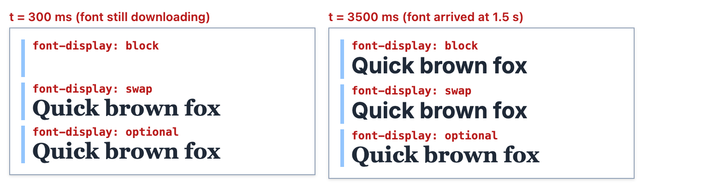

# Chapter 11 — Typography, Colour and Visual Effects

Layout decides *where* boxes go; this chapter is about how they *look*. Most of a web page is text, so typography — the choice of fonts, sizes, line spacing and line length — does more for readability than any other styling. Then come colour and contrast (which decide whether some readers can read at all), and the decorative toolkit: backgrounds and gradients, borders and rounded corners, shadows, filters, blend modes and image fitting. Each has a performance or accessibility side that is easy to miss.

**What you'll learn**

| # | Topic | You will be able to… |
|---|---|---|
| 11.1 | Fonts | write font stacks, load web fonts with `@font-face`, and use a variable font |
| 11.2 | Loading fonts well | choose a `font-display` value, preload, subset and self-host fonts |
| 11.3 | Text properties | set size, line-height, spacing, decoration, wrapping, truncation and numerals |
| 11.4 | Colour and contrast | compute a WCAG contrast ratio and derive palettes with `color-mix()` and relative colours |
| 11.5 | Backgrounds and gradients | layer images and linear/radial/conic gradients, and size/position them |
| 11.6 | Borders, radius and outlines | draw any border, rounded or elliptical corner, and a proper outline |
| 11.7 | Shadows | build elevation with `box-shadow`, use `text-shadow` and `drop-shadow()` |
| 11.8 | Filters, blend modes, clipping and masks | apply `filter`, `backdrop-filter`, `mix-blend-mode`, `clip-path` and `mask` |
| 11.9 | `object-fit` and `object-position` | fit images and video into any box without distortion |

As in Chapters 7–10, every example is a page in [`code/`](code/), its screenshot in [`img/`](img/) is made by [`code/make_figures.mjs`](code/make_figures.mjs), and the `NN_*.mjs` scripts use [`code/measure.mjs`](code/measure.mjs) (a copy of [Chapter 10's helper](../10-responsive-design/README.md)) to read back what Chrome computed — font load status, contrast ratios, even individual **pixel colours** from a screenshot, to check the maths of gradients and blend modes. The one web font used, **Inter**, is in [`code/media/`](code/media/) with its SIL Open Font License.

---

## 11.1 Fonts

### What it is
A **font family** is a designed set of letter shapes (**glyphs**), usually in several **weights** (thin → black) and **styles** (normal, italic). CSS picks one with `font-family` and the related properties:

```css
body {
  font-family: "Inter", system-ui, -apple-system, "Segoe UI", Roboto, sans-serif;
  font-size: 1rem;           /* 16px by default */
  font-weight: 400;          /* 100–900; normal = 400, bold = 700 */
  font-style: normal;        /* italic | oblique */
  line-height: 1.5;
}
/* shorthand: [style] [variant] [weight] [stretch] size[/line-height] family  (size and family required) */
h1 { font: italic 700 2rem/1.2 Georgia, serif; }
```

### Font stacks and generic families
`font-family` is a **fallback list**. For every character the browser tries each family in order and uses the first one that is available *and* has that glyph. Always end with a **generic family**, which every browser maps to something installed:

| Generic | Looks like | Typical mapping |
|---|---|---|
| `serif` | strokes with small "feet" | Times New Roman |
| `sans-serif` | no feet | Helvetica / Arial |
| `monospace` | every character equally wide | Menlo, Consolas, Courier |
| `system-ui` | the operating system's UI font | San Francisco (Apple), Segoe UI (Windows), Roboto (Android) |
| `cursive`, `fantasy` | script / decorative | varies wildly — avoid for body text |
| `ui-serif`, `ui-sans-serif`, `ui-monospace`, `ui-rounded` | the OS's UI variants | only some platforms (Apple mainly) |

A **system font stack** (`system-ui, …, sans-serif`) costs zero downloads and looks native — GitHub and many design systems use one. Family names with spaces should be quoted; generic names must *not* be quoted (`"serif"` means a font literally named "serif").


*Figure 11.1 — [`code/01_fonts.html`](code/01_fonts.html): generic families on this Mac, one variable font file at seven weights, and real vs synthesized italic.*

### `@font-face`: using your own font
```css
@font-face {
  font-family: "Inter Var";                                  /* the name YOU choose */
  src: url("media/inter-latin-wght-normal.woff2") format("woff2");
  font-weight: 100 900;                                      /* this file covers a range */
  font-style: normal;
  font-display: swap;                                        /* 11.2 */
}
.inter { font-family: "Inter Var", system-ui, sans-serif; }
```

How it works:
1. `@font-face` only *declares* a font; nothing downloads yet.
2. When the browser lays out text that needs that family (with a matching weight/style), it **downloads the file** — lazily.
3. For each weight/style request, the browser picks the `@font-face` rule whose descriptors (`font-weight`, `font-style`, `font-stretch`) match best. With static fonts you write one rule per file (Regular 400, Bold 700, Italic…) all sharing one `font-family` name.
4. If no face matches a requested bold or italic, the browser **synthesizes** one: it smears the glyphs for bold and slants them for italic. `font-synthesis: none` turns this off (see the last sample in Figure 11.1 — it stays upright instead of faking italic).

### Font formats

| Format | Use |
|---|---|
| **WOFF2** | The only one you need today: compressed with Brotli, supported by every current browser |
| WOFF | Older compressed format; only for very old browsers |
| TTF / OTF | Desktop formats; larger; avoid on the web |
| EOT, SVG fonts | Obsolete |

### Variable fonts
A **variable font** stores one or more **axes** of variation in a single file, so every weight between 100 and 900 (not just the nine standard steps) comes from one download. Registered axes and the CSS properties that drive them:

| Axis tag | Meaning | Prefer this property |
|---|---|---|
| `wght` | weight | `font-weight: 550` |
| `wdth` | width | `font-stretch: 85%` |
| `ital` | italic on/off | `font-style: italic` |
| `slnt` | slant angle | `font-style: oblique 10deg` |
| `opsz` | optical size (shapes tuned for small vs large text) | `font-optical-sizing: auto` (default) |

`font-variation-settings: "wght" 650, "GRAD" 50` sets axes directly — needed for **custom axes** (uppercase tags such as `GRAD`, grade) but it overrides the higher-level properties and isn't inherited in a composable way, so use the normal properties where one exists. Variable fonts are Baseline widely available (2018).

[`code/01_fonts.mjs`](code/01_fonts.mjs) confirms the one file serves the whole range and really changes the outlines:

```
Inter Var weight=100 900 status=loaded display=swap
document.fonts.check("700 22px Inter Var"): true
"Hamburgefonstiv" at 40px, width by weight -> 100: 307.5px, 400: 325.2px, 700: 340.5px, 900: 353.5px
font-synthesis on the last sample: none
```

("Hamburgefonstiv" is a classic type-testing word that contains most letter shapes.) Heavier weights are wider — these are genuinely different glyphs, not a smeared regular.

### Trade-offs

| Option | + | − |
|---|---|---|
| System font stack | 0 bytes, instant, native feel | Looks different on each OS; less brand identity |
| One variable web font | Any weight from one file (~50 KB here for Latin) | One larger file; must manage loading (11.2) |
| Several static web fonts | Each file small | Every extra weight/style is another request |

### Common mistakes
- No generic family at the end — if the web font fails, you get the browser default (often Times).
- Asking for `font-weight: 600` when only 400 and 700 files exist — the browser picks 700 (the nearest heavier face); `font-weight: bold` on a family with no bold face → faux bold.
- Loading five weights "just in case". Check which weights the design actually uses.
- Quoting generic names: `font-family: "sans-serif"` is a (missing) font called sans-serif.

### Self-check
1. Why end a stack with `sans-serif`? → It always resolves to an installed font.
2. What does `font-weight: 100 900` inside `@font-face` mean? → This one file supports every weight in that range (a variable font).
3. What is faux bold and how do you prevent it? → Browser-synthesized bold when no bold face exists; provide the face or set `font-synthesis: none`.

---

## 11.2 Loading fonts well: `font-display`, preload, subsetting

### The problem it solves
A web font is a separate download that usually starts **late** — only after HTML and CSS are parsed and the browser knows the text needs it. Meanwhile the browser must decide what to show. Two historical failure modes:

- **FOIT** (Flash Of Invisible Text): text is hidden until the font arrives. On a slow network, readers stare at blank space.
- **FOUT** (Flash Of Unstyled Text): text shows in a fallback font, then **swaps** — the reflow may shift content (hurting **CLS**, Cumulative Layout Shift, a Core Web Vital — [Chapter 14](../14-performance-seo-interview-and-cheatsheet/README.md)).

### `font-display`
The `font-display` descriptor chooses the trade-off by setting two periods (CSS Fonts Level 4; Baseline widely available):

1. **Block period** — text is drawn invisibly while the font loads.
2. **Swap period** — text is drawn in the fallback; if the font arrives, it swaps in.
3. **Failure period** — too late: keep the fallback for this page.

| Value | Block period | Swap period | Use for |
|---|---|---|---|
| `auto` | browser decides (usually like `block`) | | — |
| `block` | short (spec suggests 3 s) | infinite | icon fonts, where fallback glyphs would be wrong |
| `swap` | extremely short (≈0–100 ms) | infinite | brand/heading fonts that must appear |
| `fallback` | extremely short | short (≈3 s) | body text: use the font only if it comes quickly |
| `optional` | extremely short (≈100 ms) | **none** | body text where stability matters most; the font is used from cache on later pages |

[`code/02_font_display.html`](code/02_font_display.html) declares the same font three times with `block`, `swap` and `optional` (a Georgia fallback so you can *see* which is in use). [`code/02_font_display.mjs`](code/02_font_display.mjs) intercepts the network and delays every font download by 1.5 seconds (timings are machine-dependent):

```
t≈301ms  F-block=loading  F-swap=loading  F-optional=loading
t≈3503ms  F-block=loaded  F-swap=loaded  F-optional=loaded
  .block     drawn with: Menlo, Inter (web font)
  .swap      drawn with: Menlo, Inter (web font)
  .optional  drawn with: Georgia, Menlo
```

(Menlo is the monospace font of the red `<code>` labels.) The last line is the interesting one: the `optional` font **did** finish downloading, but its window had closed, so the paragraph stays in Georgia for this page view.



*Figure 11.2 — FOIT vs FOUT vs "no swap", captured by delaying the font download.*

### Making fonts arrive sooner

| Technique | How | Why |
|---|---|---|
| **Preload** the critical font | `<link rel="preload" href="/fonts/inter.woff2" as="font" type="font/woff2" crossorigin>` | Starts the download while HTML is parsed instead of after CSS. Font requests are always CORS-mode, so `crossorigin` is required even for same-origin files — without it the preload is wasted. Preload only 1–2 fonts. |
| **Self-host** | Serve the files from your own domain | No extra DNS/TLS connection; no third-party privacy question (in January 2022 the Munich Regional Court — LG München I, case 3 O 17493/20 — held that loading Google-hosted fonts sent visitors' IP addresses to Google without consent, breaching the GDPR, and awarded the visitor €100) |
| **Subset** | Keep only the characters you need; declare `unicode-range: U+0000-00FF, …` | The Inter file here is only the Latin subset (48 KB). Browsers download a `unicode-range` face only if the page uses one of those characters. |
| **Match the fallback's metrics** | `@font-face { font-family: "Inter Fallback"; src: local("Arial"); size-adjust: 107%; }` | The swap then barely moves text, reducing CLS. `size-adjust` works in all current browsers (Safari since 17); `ascent-override`/`descent-override` are not yet supported in Safari. |
| **Fewer files** | One variable font instead of 4–6 static ones | Fewer requests |
| **Cache** | Long `Cache-Control` max-age with hashed file names | Later pages are instant |

### From JavaScript
The **CSS Font Loading API** (`document.fonts`) exposes each face (`status: "unloaded" | "loading" | "loaded" | "error"`), `document.fonts.load('700 1em Inter')` to start a load, and `document.fonts.ready` (a promise) — which the chapter scripts await before measuring.

### In the interview
**30-second answer:** "Web fonts load late, so text either goes invisible (FOIT) or shows a fallback then swaps (FOUT) and can shift layout. I choose `font-display`: `swap` for brand text, `optional` or `fallback` for body text, `block` only for icon fonts. I self-host WOFF2, subset with `unicode-range`, preload the one or two critical files with `crossorigin`, use a variable font instead of many weights, and tune the fallback with `size-adjust` to reduce CLS."

Follow-ups:
- *Why does font preload need `crossorigin`?* → Fonts are fetched in CORS mode; a preload without it doesn't match the real request, so the font downloads twice.
- *When is `optional` better than `swap`?* → When layout stability matters more than showing the brand font on the first view; the font is cached and used on the next page.

### Self-check
1. What does a user see at 300 ms with `font-display: block` on a slow network? → Invisible text (up to about 3 s).
2. Which value never swaps after the first ~100 ms? → `optional`.
3. Name two ways to reduce font-related layout shift. → `font-display: optional`; metric-matched fallback with `size-adjust`; preloading.

---

## 11.3 Text properties

### The essentials

| Property | Example | Notes |
|---|---|---|
| `font-size` | `1.125rem` | Use `rem` for text so user settings work ([Chapter 6](../06-css-fundamentals/README.md)); fluid sizes with `clamp()` ([§10.7](../10-responsive-design/README.md)) |
| `line-height` | `1.5` | **Unitless** (see below). Body 1.4–1.6, headings 1.1–1.25 |
| `letter-spacing` | `0.08em` | Small positive values for ALL-CAPS labels; slightly negative for large headings |
| `word-spacing` | `0.1em` | Rarely needed |
| `text-align` | `start` \| `end` \| `center` \| `justify` | `start`/`end` follow writing direction; avoid `justify` without hyphenation (rivers of space) |
| `text-transform` | `uppercase` \| `capitalize` | Keep real capitals in the HTML if they matter; screen readers read the source text |
| `text-indent` | `2em` | First-line indent (books) |
| `text-decoration` | `underline wavy red` | Longhands: `-line`, `-style` (solid/double/dotted/dashed/wavy), `-color`, `-thickness` |
| `text-underline-offset` | `0.2em` | Moves the underline away from descenders |
| `white-space` | `nowrap` \| `pre` \| `pre-wrap` | Controls collapsing of spaces and wrapping |
| `overflow-wrap` | `anywhere` \| `break-word` | Break a long word/URL only if it would overflow ([§10.10](../10-responsive-design/README.md)) |
| `word-break` | `break-all` | Break between any letters — harsh; mainly for CJK or code |
| `hyphens` | `auto` | Dictionary hyphenation; needs a `lang` attribute; Baseline since 2023 |
| `text-wrap` | `balance` \| `pretty` | Better line breaking (below) |
| `font-variant-numeric` | `tabular-nums` | Equal-width digits for tables and prices |
| `max-inline-size` | `65ch` | The **measure** — line length |


*Figure 11.3 — [`code/03_text.html`](code/03_text.html).*

### Why `line-height` should be unitless
[`code/03_text.mjs`](code/03_text.mjs) puts a 32px child inside a 16px parent with `line-height: 1.5` and `1.5em`:

```
line-height: 1.5   -> child (32px) line box 48px
line-height: 1.5em -> child (32px) computed 24px, line box 24px  (text taller than its line!)
proportional-nums width of "1" 6.73px, of "8" 9.36px
tabular-nums      width of "1" 9.22px, of "8" 9.22px
.caps letter-spacing computed: 0.96px (0.08em of 12px)
.balance text-wrap: balance
```

A unitless value is inherited as a **factor** and re-multiplied by each element's own font size (32 × 1.5 = 48px). A length (`em`, `px`, `%`) is computed **once** on the parent (16 × 1.5 = 24px) and that fixed pixel value is inherited — so bigger text overlaps its neighbours. The same output proves `tabular-nums`: every digit becomes 9.22px wide, so columns of numbers line up.

### Line length (the measure)
Comfortable reading needs roughly **45–75 characters per line** (a classic typographic rule of thumb). `max-inline-size: 65ch` (the `ch` unit ≈ the width of "0") keeps paragraphs in that range at any screen size.

### Better line breaking: `text-wrap`
- `text-wrap: balance` makes all lines of a short block about equally long — no single orphaned word under a long headline. Browsers only balance short blocks (a handful of lines) because it is expensive. **Baseline since May 2024.**
- `text-wrap: pretty` uses a slower algorithm for paragraphs that mainly avoids a very short last line. Supported in Chrome and Safari 26 but not Firefox — **not Baseline**; harmless to add as an enhancement.

### Truncation
```css
/* One line with "…" — all three are required */
.title { white-space: nowrap; overflow: hidden; text-overflow: ellipsis; }

/* N lines with "…" — the prefixed syntax is the one that works in every browser */
.desc { display: -webkit-box; -webkit-box-orient: vertical; -webkit-line-clamp: 2; overflow: hidden; }
```
The unprefixed `line-clamp` property is specified but not yet implemented by browsers; the `-webkit-` version above is interoperable. Truncation hides content from sighted users only — make sure the full text is reachable (a details page, or a `title`/tooltip is **not** enough for touch and keyboard users).

A common trap, visible while building Figure 11.3: in a `1fr` grid column, a `nowrap` line makes the **column** grow to fit the text, so no ellipsis appears. The fix is `minmax(0, 1fr)` ([§9.10](../09-grid/README.md)) or `min-width: 0` on the flex/grid item.

### Common mistakes
- `line-height` in `px` on `body` — every heading inherits the same fixed spacing.
- Light grey, thin, small text — fails contrast (11.4) and is hard to read.
- Centre-aligning long paragraphs — ragged left edges are hard to scan.
- All-caps paragraphs; `text-transform: uppercase` on long text.
- Removing link underlines in body text: colour alone must not be the only way to identify a link (WCAG 1.4.1) unless the colour contrast with the surrounding text is at least 3:1 *and* there's another cue on hover/focus.

### Self-check
1. Parent 20px, `line-height: 1.2em`; child 40px. Child's line-height? → 24px (computed on the parent and inherited) — too tight. With `1.2`: 48px.
2. Three properties needed for a one-line ellipsis? → `white-space: nowrap`, `overflow: hidden`, `text-overflow: ellipsis`.
3. What does `font-variant-numeric: tabular-nums` do? → Makes all digits the same width so numbers align in columns.

---

## 11.4 Colour and contrast

[Chapter 6 §6.8](../06-css-fundamentals/README.md) introduced colour notations (hex, `rgb()`, `hsl()`, `oklch()`, alpha, `currentColor`). This section is about choosing colours people can read, and deriving palettes from one brand colour.

### Contrast ratio — what it is
WCAG defines **contrast ratio** between two colours as `(L1 + 0.05) / (L2 + 0.05)`, where L1 is the **relative luminance** of the lighter colour and L2 of the darker. It runs from **1:1** (same colour) to **21:1** (black on white).

### How it is computed
[`code/contrast.mjs`](code/contrast.mjs):

```js
// 1. sRGB channel 0-255 -> 0-1 -> linear light (undo the gamma curve)
export const lin = c => { c /= 255; return c <= 0.04045 ? c / 12.92 : ((c + 0.055) / 1.055) ** 2.4; };
// 2. relative luminance: green counts most, blue least (how human eyes weigh them)
export const luminance = ([r, g, b]) => 0.2126 * lin(r) + 0.7152 * lin(g) + 0.0722 * lin(b);
// 3. ratio of the lighter to the darker, each + 0.05 (for screen flare)
export const ratio = (a, b) => { const [hi, lo] = [luminance(a), luminance(b)].sort((x, y) => y - x); return (hi + 0.05) / (lo + 0.05); };
```

(The printed WCAG 2.0 formula uses 0.03928 as the threshold; newer text corrects it to 0.04045 — for 8-bit colours both give identical results.)

### The thresholds (WCAG 2.2)

| Criterion | Level | Minimum ratio |
|---|---|---|
| 1.4.3 Contrast (normal text) | AA | **4.5:1** |
| 1.4.3 Large text (≥ 24px, or ≥ 18.66px bold) | AA | **3:1** |
| 1.4.6 Enhanced contrast | AAA | 7:1 (large: 4.5:1) |
| 1.4.11 Non-text contrast (icons, input borders, focus rings, chart lines) | AA | **3:1** against adjacent colours |

Logos and purely decorative or disabled elements are exempt. See [Chapter 3 §3.9](../03-semantic-html-and-accessibility/README.md) for the rest of WCAG.

Output of [`code/04_contrast.mjs`](code/04_contrast.mjs) — first by the formula, then using colours the browser computed from [`code/04_contrast.html`](code/04_contrast.html) (the page runs the same formula and prints the result on each swatch):

```
#000000 on #ffffff: 21.00:1  AAA
#767676 on #ffffff: 4.54:1  AA
#777777 on #ffffff: 4.48:1  large/UI only
#1d4ed8 on #ffffff: 6.70:1  AA
#ffffff on #3b82f6: 3.68:1  large/UI only
#e2e8f0 on #0f172a: 14.48:1  AAA
#fcd34d on #ffffff: 1.44:1  FAIL
#fff on var(--brand)                         -> rgb(255, 255, 255) on oklch(0.55 0.2 260)  = 5.02:1 AA
#fff on color-mix(in oklch, brand 70%, black) -> rgb(255, 255, 255) on oklch(0.385 0.14 260)  = 10.04:1 AAA
brand on oklch(from brand 95% 0.03 h)        -> oklch(0.55 0.2 260) on oklch(0.95 0.03 260)  = 4.32:1 large/UI only
#000 on oklch(from brand l c calc(h + 180))  -> rgb(0, 0, 0) on oklch(0.55 0.2 80)  = 4.25:1 large/UI only
```

(Four of the browser rows, identical to the formula rows above them, are omitted.) Things worth noticing:
- **#767676** is the lightest grey that passes AA on white; one step lighter (#777777) fails.
- White on a typical "blue-500" button (#3b82f6) is only 3.68:1 — fine for large bold text, **not** for normal-size labels. Many design systems use a darker shade for button backgrounds for this reason.
- Yellow text on white is nearly invisible (1.44:1).
- The last row: the complementary colour has the **same** OKLCH lightness (55%) as the brand, yet black on it gives 4.25:1 while white on the brand gives 5.02:1. OKLCH lightness is perceptual but it is *not* the WCAG luminance; always check the actual pair.


*Figure 11.4 — Contrast computed inside the page from the browser's own colours.*

### Deriving colours: `color-mix()` and relative colour syntax
Instead of hard-coding every shade, derive them from one token:

```css
:root { --brand: oklch(55% 0.2 260); }
.darker     { background: color-mix(in oklch, var(--brand) 70%, black); }   /* 70% brand, 30% black */
.tint       { background: oklch(from var(--brand) 95% 0.03 h); }           /* keep hue, set L and C */
.complement { background: oklch(from var(--brand) l c calc(h + 180)); }    /* rotate the hue */
.faded      { background: rgb(from var(--brand) r g b / 50%); }            /* same colour, half opacity */
```

- `color-mix(in <space>, A p%, B)` — Baseline since 2023. Mixing in `oklch` or `oklab` gives more even results than `srgb`.
- **Relative colour syntax** `<fn>(from <colour> …)` exposes the source's channels as keywords (`l c h`, `r g b`, `h s l`, `alpha`) that you can keep, replace or compute with `calc()`. Baseline since September 2024 (newly available).

### Other colour tools
- `currentColor` — the element's `color` value; great for icons and borders that follow text colour.
- `accent-color: #1d4ed8` — tints checkboxes, radios, range sliders and progress bars. Not yet Baseline (Chrome for Android lacks it), but it degrades gracefully.
- `color-scheme` and `light-dark()` — [§10.5](../10-responsive-design/README.md).

### Accessibility beyond ratios
- **Never use colour alone** to carry meaning (WCAG 1.4.1): add an icon, text or pattern to "red = error", and underline links in text.
- About 1 in 12 men has some form of colour-vision deficiency; red/green pairs are the classic problem. DevTools (Rendering → Emulate vision deficiencies) simulates them.
- **APCA**, a newer perceptual contrast method, is being explored for the future WCAG 3; it is not a requirement today. WCAG 2.2's ratio is what audits and laws reference.

### In the interview
**30-second answer:** "WCAG contrast is (L1 + 0.05)/(L2 + 0.05) using relative luminance; AA needs 4.5:1 for body text, 3:1 for large text and for UI components like input borders and focus rings. I check real pairs with DevTools or a script — lightness in HSL or even OKLCH doesn't guarantee it — and I never rely on colour alone. For palettes I define a brand token in OKLCH and derive shades with `color-mix()` or relative colour syntax."

### Self-check
1. Minimum AA ratio for a 14px grey caption? → 4.5:1.
2. For a 3px input border against white? → 3:1 (non-text contrast).
3. What does `oklch(from var(--c) l c calc(h + 180))` produce? → The same lightness and chroma with the hue rotated 180° (the complement).

---

## 11.5 Backgrounds and gradients

### The background properties

| Property | Values | Notes |
|---|---|---|
| `background-color` | any colour | Painted under all image layers; always set one as a fallback under images |
| `background-image` | `url()`, gradients, `image-set()` | Comma-separated **layers**; the **first is on top** |
| `background-repeat` | `repeat` \| `no-repeat` \| `repeat-x` \| `space` \| `round` | Default `repeat` |
| `background-position` | `center`, `right 10px bottom 10px`, `30% 70%` | Where the image sits |
| `background-size` | `auto` \| `cover` \| `contain` \| `200px 100px` | `cover` fills and crops; `contain` fits entirely |
| `background-origin` | `padding-box` \| `border-box` \| `content-box` | Box that positions the image |
| `background-clip` | `border-box` \| `padding-box` \| `content-box` \| `text` | Box where painting stops |
| `background-attachment` | `scroll` \| `fixed` \| `local` | `fixed` is ignored on iOS and is not Baseline; it also costs repaint performance |
| `background` | shorthand | `url(a.jpg) center / cover no-repeat, #e0f2fe` — `size` goes after `position` with a `/` |

### Gradients
A **gradient** is an image generated by the browser — no download, crisp at any size, animatable only indirectly.

| Function | Shape | Example |
|---|---|---|
| `linear-gradient()` | along a line | `linear-gradient(135deg, #f59e0b, #ef4444 50%, #7c3aed)` |
| `radial-gradient()` | circles/ellipses from a point | `radial-gradient(circle at 30% 30%, #fff 0 8%, #60a5fa 40%, #1e3a8a)` |
| `conic-gradient()` | around a point (like a clock hand) | `conic-gradient(#3b82f6 0 40%, #22c55e 0 70%, #f59e0b 0)` — a pie chart |
| `repeating-*-gradient()` | the pattern repeats | `repeating-linear-gradient(45deg, #fde68a 0 10px, #f59e0b 10px 20px)` — stripes |

**Colour stops** are `colour [position] [position]`. Two stops at the same position make a **hard edge** (no blending), and a position of `0` after a larger one means "same as the previous stop" — that's how the conic pie chart gets sharp slices. Direction: `to right`, `to top left`, or an angle (`0deg` = up, `90deg` = right).


*Figure 11.5 — [`code/05_backgrounds.html`](code/05_backgrounds.html).*

### Interpolation colour space
By default gradients blend in **sRGB**, which makes complementary colours pass through a muddy grey. Since June 2024 (Baseline) you can pick the space: `linear-gradient(in oklch to right, blue, yellow)`. [`code/05_backgrounds.mjs`](code/05_backgrounds.mjs) screenshots the page and reads the pixel in the middle:

```
.srgb   at  50%: rgb(128, 128, 127)
.oklch  at  50%: rgb(0, 208, 188)
.hard   at  49%: rgb(34, 197, 94)
.hard   at  51%: rgb(229, 231, 235)
```

The sRGB midpoint of blue (0, 0, 255) and yellow (255, 255, 0) is exactly grey (128, 128, 127); in OKLCH the hue travels around the colour wheel instead, through a vivid teal. The two `.hard` samples, 2% apart, are the two pure stop colours — no blend.

### Multiple backgrounds — a real use
Text over photos needs contrast. Put a gradient layer **above** the image:

```css
.hero {
  background:
    linear-gradient(to top, rgb(0 0 0 / .75), transparent 60%),   /* layer 1: on top */
    url("hero.jpg") center / cover no-repeat;                     /* layer 2: below */
  color: #fff;
}
```

### Gradient text
```css
.gradient-text { background: linear-gradient(90deg, #2563eb, #db2777);
                 -webkit-background-clip: text; background-clip: text; color: transparent; }
```
Write both lines: web-features still lists unprefixed `background-clip: text` as not Baseline. Check contrast at the gradient's lightest point, and keep a solid `color` fallback in forced-colours mode.

### Common mistakes
- Putting the gradient layer **after** the image — it ends up underneath and invisible.
- No `background-color` under a photo: if the image fails, white text sits on white.
- Meaningful images as CSS backgrounds — no `alt`, not announced; use `` ([Chapter 4](../04-images-media-and-embeds/README.md)).
- Huge background photos on mobile — use `image-set()` ([§10.8](../10-responsive-design/README.md)).

### Self-check
1. In `background: url(a.png), url(b.png)`, which is on top? → `a.png` (first layer).
2. How do you draw a 50/50 hard split? → `linear-gradient(to right, green 50%, grey 50%)`.
3. Why does blue→yellow look grey in the middle by default? → Interpolation in sRGB averages the channels; use `in oklch`.

---

## 11.6 Borders, radius and outlines

### Borders
`border: <width> <style> <colour>` on all sides, or per side (`border-left`), or per aspect (`border-width: 1px 2px`). **The style is required** — its initial value is `none` ([Chapter 7](../07-box-model-and-layout-basics/README.md)). Styles: `solid`, `dashed`, `dotted`, `double`, `groove`, `ridge`, `inset`, `outset`, `hidden`, `none`. Borders take up layout space (they're part of the box model). `border-image` can slice an image into a border — rarely used.

### `border-radius`
Rounds the corners of the **border box** (and clips the background with it):

| Value | Result |
|---|---|
| `8px` | all four corners |
| `24px 0 24px 0` | top-left, top-right, bottom-right, bottom-left (clockwise) |
| `50%` on a square | a circle (`aspect-ratio: 1` keeps it square) |
| `999px` | a **pill**: a very large radius is reduced to fit, so the ends are exact semicircles at any height |
| `50% / 30%` | **elliptical** corners: horizontal radii / vertical radii |

Percentages are relative to the box's own width (horizontal radius) and height (vertical radius). When adjacent radii would overlap, the browser scales all radii down proportionally. (The `corner-shape` property for squircles and bevels is Chromium-only in 2026.)


*Figure 11.6 — [`code/06_borders_shadows.html`](code/06_borders_shadows.html).*

### Outline vs border vs ring

| | `border` | `outline` | `box-shadow: 0 0 0 4px` ("ring") |
|---|---|---|---|
| Takes layout space | **yes** | no | no |
| Per-side control | yes | no | no |
| Follows `border-radius` | yes | yes (all current browsers since 2023) | yes |
| Offset | — | `outline-offset` (can be negative) | via extra layers |
| Shown in forced-colours mode | yes | **yes** | **no** (shadows are removed) |
| Main use | structure, dividers | **focus indicators** | decorative rings |

[`code/06_borders_shadows.mjs`](code/06_borders_shadows.mjs) confirms that only borders change the layout size (every box has `height: 80px`):

```
.styles   layout box 206x88  border-left 8px  outline none       shadow none
.outline  layout box 206x84  border-left 2px  outline 3px +4px   shadow none
.ring     layout box 206x80  border-left 0px  outline none       shadow rgb(147, 197, 253) 0px 0px 0px 4px
.elev3    layout box 206x80  border-left 0px  outline none       shadow rgba(0, 0, 0, 0.1) 0px 4px 6px -1px, rgba(0,
.ellipse  border-top-left-radius: 50% 30%
```

This is why focus styles use `outline`: `:focus-visible { outline: 3px solid #2563eb; outline-offset: 2px; }` doesn't shift the layout, and still shows in Windows contrast themes. Never remove the outline without a replacement ([Chapter 3 §3.7](../03-semantic-html-and-accessibility/README.md)). A popular pattern is a transparent outline plus a box-shadow ring, so forced-colours mode still gets the outline.

### Self-check
1. Why doesn't `border: 2px #333` show? → No style; the default `none` wins.
2. How do you make a pill button at any height? → `border-radius: 999px` (or any value ≥ half the height).
3. Which focus indicator survives forced-colours mode? → `outline` (not `box-shadow`).

---

## 11.7 Shadows

### `box-shadow`
```css
box-shadow: [inset] <offset-x> <offset-y> [<blur>] [<spread>] <colour>, … ;
```

| Part | Effect |
|---|---|
| offset-x / offset-y | Moves the shadow right/down (negative = left/up) — implies the light direction |
| blur | Softness; 0 = hard edge |
| spread | Grows (positive) or shrinks (negative) the shadow before blurring |
| `inset` | Draws inside the box (pressed/sunken look) |
| multiple, comma-separated | First one on top; layer a tight dark shadow and a large soft one for realistic depth |

**Elevation** systems (Material Design, most component libraries) express how "high" a surface floats with a set of increasingly large, soft, offset shadows:

```css
.elev1 { box-shadow: 0 1px 2px rgb(0 0 0 / .12), 0 1px 3px rgb(0 0 0 / .08); }
.elev3 { box-shadow: 0 4px 6px -1px rgb(0 0 0 / .1), 0 10px 20px -5px rgb(0 0 0 / .15); }
```

The negative spread keeps the large soft shadow from peeking out at the sides. Shadows don't affect layout and are painted outside the box (so `overflow: hidden` on a **parent** clips them).

### `text-shadow`
`text-shadow: <x> <y> [<blur>] <colour>, …` — no spread, no inset. Use for legibility on busy images (a soft dark halo) or for display effects; keep body text shadow-free.

### `filter: drop-shadow()`
`box-shadow` follows the **box** (a rectangle, or its rounded corners). `filter: drop-shadow(x y blur colour)` follows the element's actual **alpha shape** — the star in Figure 11.6 gets a star-shaped shadow. It has no spread or inset, and costs more to render.

### Performance
Large blurred shadows are expensive to paint; **animating** `box-shadow` repaints every frame. To animate elevation, put the bigger shadow on a pseudo-element and animate its `opacity` instead ([Chapter 12](../12-transitions-transforms-and-animation/README.md)).

### Self-check
1. What does a negative spread do? → Shrinks the shadow before blur, so it doesn't extend beyond the box's sides.
2. Shadow for a transparent PNG logo that follows its outline? → `filter: drop-shadow(…)`.

---

## 11.8 Filters, blend modes, clipping and masks


*Figure 11.7 — [`code/07_filters_blend.html`](code/07_filters_blend.html).*

### `filter`
Applies image-processing functions to an element **and everything inside it**, in the order written:

| Function | Example | Effect |
|---|---|---|
| `blur()` | `blur(3px)` | Gaussian blur |
| `brightness()` | `brightness(1.4)` | < 1 darker, > 1 brighter |
| `contrast()` | `contrast(1.8)` | |
| `grayscale()` | `grayscale(1)` | 0–1 (or %) |
| `hue-rotate()` | `hue-rotate(120deg)` | Rotates hues |
| `invert()` | `invert(1)` | |
| `opacity()` | `opacity(.5)` | Like the `opacity` property |
| `saturate()` | `saturate(3)` | |
| `sepia()` | `sepia(1)` | |
| `drop-shadow()` | 11.7 | |
| `url(#svgFilter)` | | Any SVG filter |

Baseline widely available since 2016. Uses: greyscale logos that gain colour on hover, dimming images in dark mode, disabled states.

### `backdrop-filter`
Filters whatever is **behind** the element (the element must be at least partly transparent to see it) — the "frosted glass" of macOS and iOS panels: `background: rgb(255 255 255 / .3); backdrop-filter: blur(6px) saturate(1.4);`. Baseline since September 2024 (Safari 18 dropped the `-webkit-` prefix requirement). Check text contrast against the *worst* background that can appear behind it, and provide a more opaque fallback for `prefers-reduced-transparency` where supported.

### Blend modes
- `mix-blend-mode` — how the element's pixels combine with the content **behind** it.
- `background-blend-mode` — how an element's **own background layers** (images, gradients, colour) combine with each other; used for duotone images.
- `isolation: isolate` — creates a new stacking context so blending stays inside a group ([§7.8](../07-box-model-and-layout-basics/README.md)).

Main modes, per colour channel with values 0–1 (a = top, b = backdrop): `multiply` = a·b (always darker; white disappears), `screen` = 1 − (1−a)(1−b) (always lighter; black disappears), `overlay`, `darken`/`lighten`, `difference` = |a − b|, `luminosity`/`color`/`hue`/`saturation` (mix HSL-like components). [`code/07_filters_blend.mjs`](code/07_filters_blend.mjs) blends #ef4444 over a sky blue and compares the screenshot pixel with the formula:

```
multiply   by hand rgb(94, 40, 63)  browser rgb(94, 40, 63)
screen     by hand rgb(245, 178, 240)  browser rgb(245, 178, 240)
difference by hand rgb(139, 82, 167)  browser rgb(139, 82, 167)
```

### Clipping and masking
- `clip-path` hides everything outside a shape: `circle(40% at 50% 50%)`, `ellipse()`, `inset(10px round 8px)`, `polygon(0 0, 100% 0, 100% 75%, 0 100%)`, `path("…")`, or an SVG `url(#clip)`. The shape is hard-edged; clicks outside it pass through. Baseline since 2021 (animatable between shapes with the same number of points).
- `mask-image` uses an image's **alpha** (or luminance) as a soft mask: `mask-image: linear-gradient(to right, #000 40%, transparent)` fades an element out. Unprefixed masks are Baseline since December 2023.

### Side effects to remember
A `filter`, `backdrop-filter`, `mix-blend-mode`, `clip-path`, `mask` or `opacity < 1` **creates a stacking context** ([§7.8](../07-box-model-and-layout-basics/README.md)); a non-`none` `filter` or `backdrop-filter` also becomes the **containing block for `position: fixed` descendants** — a "fixed" header inside a filtered parent scrolls with it. Filters and backdrop filters are GPU work; large blurred areas on low-end phones can drop frames.

### Self-check
1. Which blend mode makes white disappear? → `multiply`.
2. What's the difference between `filter` and `backdrop-filter`? → `filter` changes the element itself; `backdrop-filter` changes what shows through it.
3. Why might `position: fixed` stop working inside a card? → An ancestor has `filter`/`transform`/`backdrop-filter`, which becomes the containing block.

---

## 11.9 `object-fit` and `object-position`

### What it is
For **replaced elements** — ``, `<video>`, `<canvas>`, `<iframe>` content — `object-fit` decides how the content fills the element's box when their aspect ratios differ. It's the `background-size` of images. Baseline widely available (2020).

| Value | Scale factor | Result |
|---|---|---|
| `fill` (default) | separate x and y | Stretched to the box — **distorted** |
| `contain` | min(box/content) per axis | Whole image visible, **letterboxed** |
| `cover` | max(box/content) per axis | Box completely filled, overflow **cropped** |
| `none` | 1 | Natural size, centred, cropped |
| `scale-down` | the smaller of `none` and `contain` | Never enlarges |

`object-position` (default `50% 50%`) chooses which part stays visible when cropping or where the letterboxed image sits — like `background-position`.


*Figure 11.8 — [`code/08_object_fit.html`](code/08_object_fit.html). Dashed purple = the element's box; the checkerboard shows any empty space.*

Output of [`code/08_object_fit.mjs`](code/08_object_fit.mjs), with the maths done by hand from the natural size the browser reports:

```
fill         box 150×150  natural 800×533  object-fit fill       object-position 50% 50%
...
cover-right  box 150×150  natural 800×533  object-fit cover      object-position 90% 50%

contain: scale = min(150/800, 150/533) = 0.1875 -> drawn 150×99.94 (bars above and below)
cover:   scale = max(150/800, 150/533) = 0.2814 -> drawn 225.14×150, 75.14px cropped horizontally
object-position 90% 50% on cover: image x offset = (150 - 225.14) × 0.9 = -67.63px
scale-down: the smaller of none (scale 1) and contain (0.1875) -> same as contain here
```

A percentage position means "align that percentage point of the image with the same percentage point of the box", so the offset is (box − image) × percentage — the same rule as `background-position`.

### Real-world use
- **Card thumbnails / avatars** of unpredictable shape: `width: 100%; aspect-ratio: 4 / 3; object-fit: cover;` (and `border-radius: 50%` for avatars).
- **Product photos** that must not be cropped: `object-fit: contain` with a neutral background.
- **Hero video**: `<video autoplay muted loop playsinline>` with `object-fit: cover` to fill a full-width banner.
- **Grid cells**: images inside grid cells don't stretch by default ([§9.10](../09-grid/README.md)); `width: 100%; height: 100%; object-fit: cover` fills them.
- When cropping could cut off the subject (faces), set `object-position` per image, e.g. with an inline `style="object-position: 30% 20%"` from a CMS focal point.

### Common mistakes
- Setting only `width` on an `` and expecting `object-fit` to do anything — the box must have both dimensions (via `height` or `aspect-ratio`) that differ from the image's ratio.
- Using `object-fit` on a `<div>` — it only applies to replaced elements; use `background-size` there.
- Cropping important content (text in images) with `cover`.

### Self-check
1. An 800×400 image in a 200×200 box with `cover`: drawn size? → scale = max(0.25, 0.5) = 0.5 → 400×200, 200px cropped horizontally.
2. Same with `contain`? → scale 0.25 → 200×100, 50px bars above and below.
3. `object-position: 0% 50%` keeps which part? → The left edge (vertically centred).

---

## Chapter 11 TL;DR

- **Fonts**: stacks end with a generic family; `system-ui` stack = 0 bytes. `@font-face` + **WOFF2**; one **variable font** (`font-weight: 100 900`) replaces many files — heavier weights really are different glyphs (307.5 → 353.5px wide). Missing faces are **synthesized** unless `font-synthesis: none`.
- **Loading**: `font-display` — `block` (invisible ≤3 s), `swap` (fallback then swap), `fallback` (short swap window), `optional` (≈100 ms, then never — verified: loaded but not used). Preload 1–2 critical fonts **with `crossorigin`**, self-host, subset with `unicode-range`, match fallback metrics with `size-adjust`.
- **Text**: `rem` sizes; **unitless `line-height`** (a length is computed once and inherited — 24px for 32px text); measure 45–75ch; `text-wrap: balance` (Baseline 2024), `pretty` (not Baseline); ellipsis = nowrap + hidden + `text-overflow`; multi-line = `-webkit-line-clamp`; `tabular-nums` for numbers; `hyphens: auto` needs `lang`.
- **Contrast**: (L1+0.05)/(L2+0.05); AA 4.5:1 text, 3:1 large text and UI parts; AAA 7:1. #767676 is the lightest AA grey on white. Never colour alone. Derive shades with `color-mix(in oklch, …)` and relative colours `oklch(from var(--c) l c h)` (Baseline 2024) — and still check each pair.
- **Backgrounds**: layers, first on top; `cover`/`contain`; gradients linear/radial/conic/repeating, hard stops, `in oklch` avoids grey midpoints (measured grey (128,128,127) vs teal).
- **Borders**: style required; `border-radius` %, `999px` pills, `a / b` ellipses. Focus = `outline` (no layout, survives forced colours); rings = `box-shadow: 0 0 0 Npx`.
- **Shadows**: `[inset] x y blur spread colour`, layered for elevation; `text-shadow`; `drop-shadow()` follows alpha. Don't animate shadows directly.
- **Effects**: `filter` (itself), `backdrop-filter` (behind; Baseline 2024), `mix-blend-mode` (multiply = a·b, screen, difference — pixel-verified), `background-blend-mode`, `isolation`, `clip-path`, `mask-image`. They create stacking contexts; filters also capture `position: fixed`.
- **`object-fit`**: fill / contain (min scale) / cover (max scale) / none / scale-down + `object-position` — for img/video in fixed-ratio boxes.

Next: [Chapter 12 — Transitions, Transforms and Animation](../12-transitions-transforms-and-animation/README.md).
