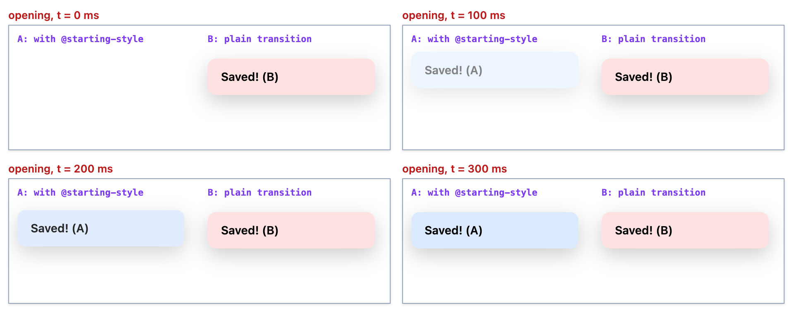
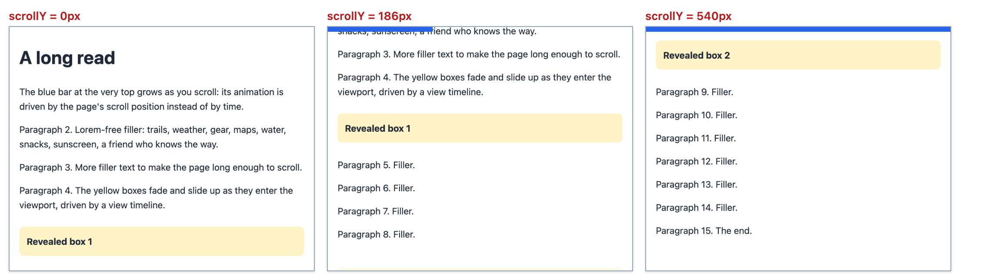

# Chapter 12 — Transitions, Transforms and Animation

Motion, used well, explains what just happened: a menu slides out of the button that opened it, a card grows into the detail view, a spinner says "working". Used badly it distracts, makes some people physically ill, and makes pages janky (**jank** is visible stutter: the browser misses frames, so motion jumps instead of flowing). CSS gives you three tools — **transforms** (move, rotate, scale an element without touching layout), **transitions** (animate a change from one state to another) and **keyframe animations** (a timeline of states) — plus newer ones for entering/leaving elements, whole-page **view transitions** and **scroll-driven** animation. This chapter explains each, shows how the browser computes every in-between frame, and ends with performance and **accessibility** (making pages usable by people with disabilities, including those who use keyboards, screen readers or motion settings) rules.

**What you'll learn**

| # | Topic | You will be able to… |
|---|---|---|
| 12.1 | Transitions | animate state changes and know which properties can be animated |
| 12.2 | Timing functions | read and write `ease`, `cubic-bezier()`, `steps()` and `linear()` — and compute them by hand |
| 12.3 | 2D transforms | translate, rotate, scale, skew; `transform-origin`; order of functions; individual properties |
| 12.4 | 3D transforms | use `perspective`, `preserve-3d` and `backface-visibility` for a card flip |
| 12.5 | Keyframe animations | write `@keyframes` and every `animation-*` property, especially `fill-mode` |
| 12.6 | The Web Animations API | control animations from JavaScript (`element.animate()`, `getAnimations()`) |
| 12.7 | Performance | explain why `transform`/`opacity` are cheap and `left`/`width` are not — with measurements |
| 12.8 | Enter and exit animations | animate from `display: none` with `@starting-style` and `allow-discrete` |
| 12.9 | Reduced motion and accessibility | honour `prefers-reduced-motion` and the WCAG motion rules |
| 12.10 | View transitions | morph between two states of the DOM (the page's live tree of elements) (and between pages) |
| 12.11 | Scroll-driven animations | link an animation to scroll position — and know it isn't Baseline |

**How the figures and numbers were made.** Every example is a page in [`code/`](code/). Animations are hard to show on paper, so [`code/make_figures.mjs`](code/make_figures.mjs) makes **filmstrips**: it pauses every animation on the page with the Web Animations API (an **API**, application programming interface, is a set of functions one program offers to another; this one lets JavaScript control animations) (CSS transitions and animations are exposed as `CSSTransition` / `CSSAnimation` objects in `document.getAnimations()`), sets their `currentTime` to an exact moment, and screenshots — so each frame shows exactly t = 0, 200, 400 … ms, with no timing luck. The same trick, in [`code/anim.mjs`](code/anim.mjs), lets the `NN_*.mjs` scripts (`.mjs` = a JavaScript module file, run here with Node.js, which drives a **headless** Chrome — a real browser with no visible window — through the Puppeteer library) read **computed values mid-animation** (the final, resolved value the browser actually uses for a property) and compare them with the maths. Screenshots and measurements use [`code/measure.mjs`](code/measure.mjs), a copy of [Chapter 10's helper](../10-responsive-design/README.md).

```js
// code/anim.mjs — freeze every animation at the same moment
export const seek = (page, ms) => page.evaluate(ms => {
  for (const a of document.getAnimations()) { a.pause(); a.currentTime = ms; }
  return new Promise(r => requestAnimationFrame(() => requestAnimationFrame(r)));   // let the frame render
}, ms);
```

---

## 12.1 Transitions

### What it is
A **transition** tells the browser: "when this property's value changes, don't jump — move smoothly from the old value to the new one over this time". Something else changes the value (a `:hover` or `:focus-visible` rule — pseudo-classes that match while the pointer is over the element or it has keyboard focus — a class added by JavaScript, a media query, i.e. an `@media` rule that applies only under conditions like screen width); the transition only animates the change.

```css
.button {
  background: #2563eb;
  transition: background-color 200ms ease-out, translate 150ms ease-out;
}
.button:hover { background: #1d4ed8; translate: 0 -2px; }
```

### How it works
1. The browser computes the element's style before and after the change.
2. For each property listed in `transition-property` whose value changed **and can be interpolated** (the browser can compute sensible in-between values, as with 10px → 20px), it creates a transition from the old to the new value.
3. On each **frame** (one redraw of the screen, typically 60 per second) it computes *progress* = timing-function(elapsed / duration) and sets the property to old + (new − old) × progress.
4. If the value changes again mid-way (mouse leaves early), the running transition is replaced by one starting from the **current** value. Reversing a half-finished transition is also **shortened** proportionally, so un-hovering after 50ms doesn't take the full duration.

### The properties

| Longhand | Example | Meaning |
|---|---|---|
| `transition-property` | `opacity, translate` \| `all` | What to animate (`all` = every animatable property — convenient but can animate things you didn't intend) |
| `transition-duration` | `200ms` | How long (default `0s` = no transition) |
| `transition-timing-function` | `ease-out` | Speed curve (12.2); default `ease` |
| `transition-delay` | `100ms` | Wait before starting (negative = start part-way through) |
| `transition-behavior` | `allow-discrete` | Also transition **discrete** properties like `display` (12.8) |
| `transition` | `opacity 200ms ease-out 50ms` | Shorthand; first time = duration, second = delay; comma-separate several |

### What can be animated
- **Interpolable** values: lengths, percentages, numbers, colours, transforms, shadows, gradients' colour stops (not the whole gradient in most browsers), `grid-template-columns` track sizes (Baseline since 2022), `clip-path` shapes with the same number of points…
- **Discrete** properties (`display`, `visibility`, `font-family`, `position`…) can't be in-betweened. Normally they just flip; with `transition-behavior: allow-discrete` they flip at 50% of the time — except `display`/`content-visibility`, which stay visible for the whole transition (12.8).
- **`auto`** is not interpolable: `height: 0 → auto` jumps. Chromium's (Chromium is the open-source browser engine behind Chrome, Edge and Opera) new `interpolate-size: allow-keywords` / `calc-size()` fix this but are **not Baseline**; portable alternatives are animating `grid-template-rows: 0fr → 1fr` on a wrapper, or measuring the height in JS (JavaScript).

> **Key term — Baseline:** a label used by MDN and web.dev for web features that work in the current versions of all the major browsers (Chrome, Edge, Firefox and Safari, desktop and mobile). *Newly available* means the last of those browsers has just shipped it; *widely available* means it has been everywhere for 30 months, so most users' browsers have it. "Not Baseline" means at least one major browser is missing it, so you need a fallback.

### Events
These are **events** — named notifications the browser sends that JavaScript can listen for with `addEventListener`. `transitionrun`, `transitionstart` (after the delay), `transitionend` (once **per property**), `transitioncancel` (interrupted). Filter by `event.propertyName` so a `transitionend` of `background-color` doesn't close your menu early.

### Common mistakes
- Putting `transition` only in the `:hover` rule — then there is a transition *into* hover but the change back is instant. Put it on the base rule.
- `transition: all 300ms` on elements whose layout properties change — animates widths and paddings you never meant to (and expensively, 12.7).
- Expecting a transition when the element is **added** to the page or goes from `display: none` — there is no "before" style, so nothing animates. That's what `@starting-style` solves (12.8).
- Durations too long: UI (user interface) feedback feels right around **100–300ms**; larger movements up to ~500ms.

### Self-check
1. Where should `transition` be declared for hover-in and hover-out to animate? → On the base (non-hover) rule.
2. Why doesn't `height: 0 → auto` animate? → `auto` isn't an interpolable value (use the grid `0fr → 1fr` trick, JS, or `interpolate-size` where supported).
3. How many `transitionend` events does `transition: opacity .2s, translate .2s` fire? → Two, one per property.

---

## 12.2 Timing functions (easing)

### What it is
A **timing function** (or *easing*) maps **time progress** (0 → 1) to **output progress** (usually 0 → 1). Linear motion looks mechanical; real objects accelerate and decelerate. CSS offers four kinds:

| Function | Shape | Typical use |
|---|---|---|
| `linear` | straight line | spinners, progress, colour cycling |
| `ease` (default) | quick start, long gentle stop | general purpose |
| `ease-in` | slow start, fast end | things **leaving** the screen |
| `ease-out` | fast start, slow end | things **entering** or responding to input (feels snappy) |
| `ease-in-out` | slow–fast–slow | moving between two on-screen positions |
| `cubic-bezier(x1, y1, x2, y2)` | any smooth curve; y may go outside 0–1 for overshoot | brand motion, "back" effects |
| `steps(n, jump-start \| jump-end \| jump-none \| jump-both)` | n discrete jumps | sprite sheets (one image holding every frame), typewriter, ticking clocks |
| `linear(0, 0.36 30%, 1 45%, …)` | straight lines through points you list | bounces and springs approximated with many points (Baseline since December 2023) |

The keywords are shortcuts: `ease` = `cubic-bezier(.25, .1, .25, 1)`, `ease-in` = `(.42, 0, 1, 1)`, `ease-out` = `(0, 0, .58, 1)`, `ease-in-out` = `(.42, 0, .58, 1)`; `step-start` = `steps(1, jump-start)`, `step-end` = `steps(1, jump-end)`.


*Figure 12.1 — [`code/02_curves.html`](code/02_curves.html) draws each curve by animating a probe element with that easing, pausing it at 101 moments, and reading the computed value back — so these are Chrome's curves, not drawings of them. The dashed line is 100%.*

### How a cubic Bézier is computed
A `cubic-bezier(x1, y1, x2, y2)` is a curve from (0, 0) to (1, 1) with two control points. Both coordinates are functions of a curve parameter *s*:
`x(s) = 3·x1·s·(1−s)² + 3·x2·s²·(1−s) + s³` and the same for `y` with `y1`, `y2`.
To evaluate the easing at time *t*, the browser must **solve x(s) = t** for *s* (x must stay within 0–1 so there is one answer), then return y(s). [`code/01_timing.mjs`](code/01_timing.mjs) does exactly that with **bisection** (guess the middle of the range, keep whichever half contains the answer, repeat until close enough) and compares with the browser.

### The proof: a race
[`code/01_timing.html`](code/01_timing.html) transitions eight balls by 160px over 1000ms, each with a different timing function:


*Figure 12.2 — Filmstrip made by pausing all eight transitions and seeking them to each time.*

```
progress (0 = start, 1 = end) at t =        0ms   200ms   400ms   600ms   800ms  1000ms
linear          browser       0.000   0.200   0.400   0.600   0.800   1.000
                our maths     0.000   0.200   0.400   0.600   0.800   1.000
ease            browser       0.000   0.295   0.683   0.885   0.976   1.000
                our maths     0.000   0.295   0.683   0.885   0.976   1.000
ease-in         browser       0.000   0.062   0.215   0.429   0.692   1.000
                our maths     0.000   0.062   0.215   0.429   0.692   1.000
ease-out        browser       0.000   0.308   0.571   0.785   0.938   1.000
                our maths     0.000   0.308   0.571   0.785   0.938   1.000
ease-in-out     browser       0.000   0.082   0.332   0.668   0.918   1.000
                our maths     0.000   0.082   0.332   0.668   0.918   1.000
back-out        browser       0.000   0.703   1.030   1.097   1.042   1.000
                our maths     0.000   0.703   1.030   1.097   1.042   1.000
steps(4)        browser       0.000   0.000   0.250   0.500   0.750   1.000
                our maths     0.000   0.000   0.250   0.500   0.750   1.000
linear(bounce)  browser       0.000   0.240   0.787   0.900   0.960   1.000
                our maths     0.000   0.240   0.787   0.900   0.960   1.000
```

Our straight-from-the-formula numbers match Chrome to three decimals. Things to read off the table:
- `ease` has already covered 68% of the distance at 40% of the time — that's why it feels quick.
- `back-out` = `cubic-bezier(.34, 1.56, .64, 1)`: y1 = 1.56 > 1, so progress goes past 1 (109.7% at 600ms) and settles back — an overshoot.
- `steps(4)` uses `jump-end` by default: the value changes at the *end* of each quarter, so at 200ms it's still 0.
- `linear(0, 0.36 30%, 1 45%, 0.8 55%, …)`: between listed points progress is interpolated linearly; at 600ms (between 55% → 0.8 and 65% → 1) it's 0.9.

### Choosing
- Entering / responding to the user: `ease-out` (or a custom `cubic-bezier(.2, .8, .2, 1)`-style curve).
- Leaving: `ease-in`, and shorter than the entrance.
- On-screen moves: `ease-in-out`.
- Continuous rotation: `linear`.
- Design systems (a team's shared set of reusable styles and components) define a few named easing/duration **tokens** (design decisions stored as named variables) (`--ease-out`, `--dur-fast: 150ms`) and use only those.

### Self-check
1. Which keyword makes an element start fast and land gently? → `ease-out`.
2. Why can `y1` be 1.56 but `x1` must be within 0–1? → x is time, which must move forward and map to a single progress value; y is output, which may overshoot.
3. `steps(2)` over 1s: value at 0.6s? → 0.5 (jump-end: jumps at 0.5s and 1s).

---

## 12.3 2D transforms

### What it is
The `transform` property changes where an element is **painted** (drawn as pixels) — moved, rotated, scaled, skewed — **without changing its layout box** (the rectangle of space the element occupies when the page is arranged). Neighbours don't move; the space it occupied in the flow stays reserved. That's what makes transforms ideal for animation.

| Function | Example | Effect |
|---|---|---|
| `translate(x, y)` / `translateX()` / `translateY()` | `translate(40px, 20px)` | Move; `%` is relative to the element's **own** size — `translate(-50%, -50%)` centres an element on a point |
| `rotate(angle)` | `rotate(30deg)`, `0.25turn` | Clockwise rotation |
| `scale(sx, sy)` | `scale(1.4, 0.6)` | Resize (1 = unchanged; negative flips) |
| `skew(ax, ay)` / `skewX()` | `skewX(-20deg)` | Slant |
| `matrix(a, b, c, d, e, f)` | — | The general form everything above reduces to (six numbers encoding the whole transform) |

`transform-origin` (default `50% 50%` — the centre) is the fixed point for rotate, scale and skew.


*Figure 12.3 — [`code/03_transforms.html`](code/03_transforms.html). Red dots mark the transform origin.*

### Order matters
`transform: translate(60px, 0) rotate(45deg)` and `rotate(45deg) translate(60px, 0)` differ (F and G above). Two equivalent ways to think about it:
- Read **right to left** as operations on the element: F = first rotate, then move right 60px.
- Or read **left to right** as moving the **coordinate system**: G = rotate the axes 45°, then move 60px along the *rotated* x-axis — diagonally.

[`code/03_transforms.mjs`](code/03_transforms.mjs) prints the layout box (unchanged for all of them), the painted **bounding box** (the smallest upright rectangle that encloses the drawn shape) and the resolved matrix:

```
A t1: layout 50,30 90x50 | painted bbox 90,50 90x50 | transform matrix(1, 0, 0, 1, 40, 20)
B t2: layout 50,30 90x50 | painted bbox 43.5,10.8 102.9x88.3 | transform matrix(0.866025, 0.5, -0.5, 0.866025, 0, 0)
C t3: layout 50,30 90x50 | painted bbox 32,40 126x30 | transform matrix(1.4, 0, 0, 0.6, 0, 0)
D t4: layout 50,30 90x50 | painted bbox 40.9,30 108.2x50 | transform matrix(1, 0, -0.36397, 1, 0, 0)
E t5: layout 50,30 90x50 | painted bbox 25,30 102.9x88.3 | transform matrix(0.866025, 0.5, -0.5, 0.866025, 0, 0)
F t6: layout 50,30 90x50 | painted bbox 105.5,5.5 99x99 | transform matrix(0.707107, 0.707107, -0.707107, 0.707107, 60, 0)
G t7: layout 50,30 90x50 | painted bbox 87.9,47.9 99x99 | transform matrix(0.707107, 0.707107, -0.707107, 0.707107, 42.4264, 42.4264)
H t8: layout 50,30 90x50 | painted bbox 55.1,22 119.8x85.9 | transform none
H individual properties: translate 20px 10px, rotate 15deg, scale 1.2 (transform stays none)
```

Check B by hand (cos and sin are the trigonometry functions that give the horizontal and vertical share of a length tilted by an angle): a 90×50 box rotated 30° has a bounding box 90·cos30° + 50·sin30° = 77.9 + 25 = **102.9** wide and 90·sin30° + 50·cos30° = 45 + 43.3 = **88.3** tall ✓. In a `matrix(a, b, c, d, e, f)`, (a, b, c, d) = (cos θ, sin θ, −sin θ, cos θ) for a rotation, and (e, f) is the translation: G's is 60·cos45° = **42.43** in both x and y — the 60px move along the rotated axis ✓. B and E share a matrix; only `transform-origin` differs.

### Individual transform properties
`translate`, `rotate` and `scale` are also **separate properties** (Baseline since 2022, widely available). They are applied in a fixed order — translate, then rotate, then scale, then `transform` — so the order-of-functions surprise can't happen, and each can be transitioned or animated **independently** (a hover `scale` doesn't clobber an animation's `translate`). They don't show up in `transform`, as H's `transform none` shows. This chapter's pages use them wherever possible.

### Side effects
- A transform other than `none` creates a **stacking context** (a self-contained group whose children are layered by `z-index` only among themselves) and becomes the **containing block** (the box that positioned descendants measure their offsets from) for `position: fixed` and `absolute` descendants ([§7.6, §7.8](../07-box-model-and-layout-basics/README.md)).
- Transforms don't apply to non-replaced **inline** boxes (a plain `<span>`; "non-replaced" means its content is the page's own text, unlike an `` whose content comes from an external file); make it `inline-block`.
- Scaling text up can look blurry mid-animation on some GPUs (graphics processing units — the chip specialised in drawing pixels); prefer animating to a crisp final state.
- `getBoundingClientRect()` (a JavaScript method that reports an element's on-screen rectangle) returns the **painted** box (transform included); `offsetWidth`/`offsetLeft` the layout box.

### Self-check
1. Does `translate: 0 -4px` on hover move the elements below? → No — transforms don't affect layout.
2. How do you centre an absolutely positioned element of unknown size? → `top: 50%; left: 50%; translate: -50% -50%;` (or grid/flex centring).
3. `rotate(90deg) translateX(100px)` moves the element which way? → Down (the x-axis now points down).

---

## 12.4 3D transforms

### What it is
3D transforms add a **z-axis** pointing toward the viewer: `translateZ()`, `rotateX()`, `rotateY()`, `rotate3d()`, `scale3d()`, `matrix3d()`, and the `rotate: y 60deg` form of the individual property. To look 3D they need **perspective**.

| Property | On | Meaning |
|---|---|---|
| `perspective: 600px` | the **parent** (scene) | Distance from the viewer to the z = 0 plane; smaller = stronger distortion. All children share one vanishing point (the spot where receding lines meet). |
| `perspective()` function | the element's own `transform` | Per-element perspective (each has its own vanishing point) |
| `perspective-origin` | the parent | Where the viewer's eye is (default centre) |
| `transform-style: preserve-3d` | a parent whose children should stay in 3D | Otherwise children are flattened into its plane |
| `backface-visibility: hidden` | a face | Hide the element when its back faces the viewer |


*Figure 12.4 — [`code/04_3d.html`](code/04_3d.html).*

### The flip card, step by step
```css
.scene { perspective: 600px; }                                   /* 1. give the scene depth */
.card  { position: relative; transform-style: preserve-3d;        /* 2. keep both faces in 3D */
         transition: rotate 600ms ease-in-out; }
.face  { position: absolute; inset: 0; backface-visibility: hidden; }   /* 3. hide a face pointing away */
.back  { rotate: y 180deg; }                                      /* 4. the back starts facing away */
.scene:hover .card, .card.flipped { rotate: y 180deg; }           /* 5. flip the whole card */
```
Past 90° the front face points away (hidden) and the back face — pre-rotated 180° — now points at the viewer. In a real component, flip on a **button** press (toggle `.flipped`), not only on hover, so keyboard and touch users can use it.

### Things that flatten 3D
Some properties force an element to render its children into a flat image, breaking `preserve-3d`: `overflow` other than `visible`, `opacity < 1`, `filter`, `clip-path`, `mask`, `mix-blend-mode`, `isolation: isolate`. If your cube collapses, look for one of these on the `preserve-3d` element.

### Self-check
1. Perspective on the parent vs the `perspective()` function? → Parent: one shared vanishing point for all children; function: each element gets its own.
2. Why add `backface-visibility: hidden` to both faces? → So each face disappears when turned away, letting the other show.

---

## 12.5 Keyframe animations

### What it is
A **keyframe animation** runs through a named sequence of states, independent of any state change — it can start on load, loop forever, alternate and be delayed.

```css
@keyframes bounce {
  0%, 100% { translate: 0 -12px; animation-timing-function: ease-in; }   /* falling: speed up   */
  50%      { translate: 0 12px;  animation-timing-function: ease-out; }  /* rising: slow down   */
}
.ball { animation: bounce 1000ms infinite; }

@keyframes spin { to { rotate: 1turn; } }        /* missing "from" = the element's own current value */
.spinner { animation: spin 1s linear infinite; }
```

### The `animation-*` properties

| Longhand | Values | Notes |
|---|---|---|
| `animation-name` | `bounce` | The `@keyframes` name |
| `animation-duration` | `1s` | One iteration |
| `animation-timing-function` | `ease`… | Applies **between each pair of keyframes**, not across the whole animation; can be overridden per keyframe (as in `bounce`) |
| `animation-delay` | `500ms`, `-250ms` | A **negative** delay starts part-way through — handy for staggering many spinners |
| `animation-iteration-count` | `3`, `infinite`, `0.5` | |
| `animation-direction` | `normal` \| `reverse` \| `alternate` \| `alternate-reverse` | `alternate` plays every other iteration backwards |
| `animation-fill-mode` | `none` \| `forwards` \| `backwards` \| `both` | What applies **before** (during the delay) and **after** the animation |
| `animation-play-state` | `running` \| `paused` | Pause/resume from CSS |
| `animation-composition` | `replace` \| `add` \| `accumulate` | How it combines with the underlying value (Baseline 2023) |
| `animation-timeline` | `auto` \| `scroll()` \| `view()` | Drive it by scroll instead of time (12.11) |
| `animation` | `bounce 1s ease-in-out 200ms infinite alternate both` | Shorthand; first time = duration, second = delay |

Keyframe rules: `from` = `0%`, `to` = `100%`; a missing 0% or 100% uses the element's normal value; the same percentage can be listed together (`0%, 100%`); `!important` inside keyframes is ignored. While running, animation values beat normal declarations but lose to `!important` ones ([§6.5](../06-css-fundamentals/README.md)).

### The proof: values mid-animation
[`code/05_keyframes.html`](code/05_keyframes.html) runs a bounce, a spinner, an alternating slide and four copies of a colour animation (`red → green`, 500ms, **after a 500ms delay**) with different fill modes. [`code/05_keyframes.mjs`](code/05_keyframes.mjs) seeks them all to chosen times:

```
t=   0ms bounce 0px -12px spin 0deg     slide 0px       | fill none=grey (own style), forwards=grey (own style), backwards=red, both=red
t= 250ms bounce 0px -4.43144px spin 90deg    slide 20.6659px | fill none=grey (own style), forwards=grey (own style), backwards=red, both=red
t= 499ms bounce 0px 11.9179px spin 179.64deg slide 79.7241px | fill none=grey (own style), forwards=grey (own style), backwards=red, both=red
t= 750ms bounce 0px -4.43144px spin 270deg   slide 139.334px | fill none=#796538, forwards=#796538, backwards=#796538, both=#796538
t=1000ms bounce 0px -12px spin 0deg     slide 160px     | fill none=grey (own style), forwards=green, backwards=grey (own style), both=green
t=1500ms bounce 0px 12px  spin 180deg   slide 80px      | fill none=grey (own style), forwards=green, backwards=grey (own style), both=green
events on .fm.both (restarted): animationstart after ~500ms, animationend after ~1000ms
```

Reading it:
- **Bounce at 250ms**: the 0% → 50% segment lasts 500ms with `ease-in`; 250ms is half of it; ease-in(0.5) = 0.315; −12 + 24 × 0.315 = **−4.43px** ✓. At 750ms the 50% → 100% segment uses `ease-out`: 12 − 24 × 0.685 = **−4.43px** ✓ — per-keyframe easing in action.
- **Slide** (`ease-in-out`, alternate): 250ms → ease-in-out(0.25) = 0.129 × 160 = **20.67px** ✓; at 1500ms the second iteration runs backwards, half-way → **80px** ✓.
- **fill-mode** — the most misunderstood property:

| Mode | During the delay (0–500ms) | After the end (≥ 1000ms) |
|---|---|---|
| `none` | element's own style (grey) | own style (grey) |
| `forwards` | own style | **last keyframe** (green) |
| `backwards` | **first keyframe** (red) | own style |
| `both` | first keyframe | last keyframe |

- At 750ms, all four show **#796538**, the halfway mix of #dc2626 and #16a34a: (220 + 22)/2 = 121 = 0x79, (38 + 163)/2 ≈ 101 = 0x65, (38 + 74)/2 = 56 = 0x38. Legacy `rgb`/hex colours are interpolated in sRGB (the standard colour space of the web). **Hex** is short for hexadecimal, base-16 counting with digits 0–9 and a–f, where `0x79` means 7 × 16 + 9 = 121.


*Figure 12.5 — Filmstrip of [`code/05_keyframes.html`](code/05_keyframes.html).*

### Events
`animationstart` (after the delay), `animationiteration` (each loop), `animationend`, `animationcancel`. The last line of the output shows `animationstart` after the 500ms delay and `animationend` at 1000ms.

### Transition or animation?

| Use a **transition** when… | Use a **keyframe animation** when… |
|---|---|
| Animating between two states triggered by a change (hover, class, open/closed) | It must run by itself (on load, looping, attention-seeking) |
| Only a start and an end | You need intermediate steps |
| Should reverse naturally when the state flips back | You need iteration, direction, delay choreography |

### Self-check
1. An element fades in after a 1s delay but is visible during the delay. Fix? → `animation-fill-mode: backwards` (or `both`) so the 0% keyframe applies during the delay.
2. `animation: pulse 2s 500ms` — which is the delay? → `500ms` (the second time value).
3. Does `animation-timing-function` span the whole animation? → No, each keyframe-to-keyframe segment.

---

## 12.6 The Web Animations API (WAAPI)

### What it is
The **Web Animations API** is the JavaScript interface to the same animation engine that runs CSS transitions and animations (Baseline widely available since 2020–2023). `element.animate(keyframes, options)` creates an animation; every animation, CSS or JS, is an `Animation` object you can pause, seek, speed up, reverse and await (a **Promise** is a JavaScript object standing for a result that arrives later; `await` pauses the code until it does).

```js
const anim = box.animate(
  [{ translate: '0 0', opacity: 1 }, { translate: '200px 0', opacity: 0.5 }],   // keyframes
  { duration: 400, easing: 'ease-out', fill: 'forwards' });                     // options
anim.pause(); anim.currentTime = 200;        // scrub
anim.playbackRate = 2; anim.play();          // double speed
await anim.finished;                         // a Promise
anim.reverse();
document.getAnimations();                    // every running animation, CSS ones included
```

Output of [`code/11_waapi.mjs`](code/11_waapi.mjs) (page: [`code/11_waapi.html`](code/11_waapi.html)):

```
created: playState=running, listed by document.getAnimations(): true
paused at 200ms: translate=136.929px, opacity=0.658
finished: currentTime=400ms (the remaining 200ms took ~100ms of real time at 2x), playState=finished
fill: forwards keeps the end: translate=200px
after reverse(): translate=none  (back at the start; fill: forwards doesn't hold the START value)
```

ease-out(0.5) = 0.685 → 200 × 0.685 = 136.9px and opacity 1 − 0.5 × 0.685 = 0.658 ✓.

### When to use it
- Values known only at runtime (animate from a clicked element's position — the FLIP technique in 12.7).
- Sequencing with promises (`await a.finished; b.play()`), scrubbing with a slider, syncing with media.
- Testing and screenshots — exactly how this chapter's figures were made.

Prefer CSS for simple, **declarative** (you describe the result, not the steps) states; WAAPI over hand-written `requestAnimationFrame` loops (`requestAnimationFrame` runs your function just before the next frame is drawn), because WAAPI animations of `transform`/`opacity` can run on the compositor (the browser part that assembles finished layers into the final image, 12.7) and are cancellable and inspectable in DevTools' (the developer tools built into the browser, opened with F12) Animations panel.

`anim.commitStyles()` writes the current animated values into the element's `style` attribute — useful before `cancel()` if you want to keep the end state without `fill: forwards` (fills keep an animation alive forever).

---

## 12.7 Performance: animate `transform` and `opacity`

### How the browser renders a frame
Recall the pipeline from [Chapter 1](../01-how-the-web-works/README.md): **style → layout → paint → composite**. Each animation frame redoes the pipeline from the first stage the changed property affects:

> **Key term — the rendering pipeline:** **style** works out which CSS rules apply to each element; **layout** computes every box's size and position; **paint** draws the boxes' pixels (text, colours, shadows) into layers; **composite** stacks those layers into the final screen image, often on the GPU. Most of this runs on the **main thread** — the single line of work that also runs your JavaScript — so expensive layout competes with your code, while compositing can happen on a separate **compositor thread** (a thread is an independent sequence of work the computer runs alongside others).

| Property changed | Needs | Examples | Cost |
|---|---|---|---|
| Geometry | style → **layout** → paint → composite | `width`, `height`, `top`/`left`, `margin`, `padding`, `font-size` | Highest: the element *and possibly everything around it* is re-laid out |
| Appearance | style → **paint** → composite | `color`, `background`, `box-shadow`, `border-radius`, `outline` | Medium: pixels re-drawn |
| **Compositor-only** | (style) → **composite** | `transform` (and `translate`/`rotate`/`scale`), `opacity`, often `filter` | Lowest: the GPU moves/fades an already painted layer; the main thread can even be busy |

At 60 frames per second (fps) a frame has about **16.7ms**; on a 120 Hz screen (one that refreshes 120 times a second), 8.3ms. Layout of a big page can take several ms by itself, so layout animations drop frames ("jank").

### Measured
[`code/06_performance.mjs`](code/06_performance.mjs) runs four 1-second animations of the same box in [`code/06_performance.html`](code/06_performance.html) and reads Chrome's internal counters (`page.metrics()`; a "style recalc" is one run of the style stage):

```
move-left       layouts  60   style recalcs  61   layout time 1.8ms
grow-width      layouts  60   style recalcs  61   layout time 1.8ms
move-transform  layouts   1   style recalcs   5   layout time 0.0ms
fade            layouts   1   style recalcs   5   layout time 0.0ms
```

Animating `left` or `width` ran layout on **every frame** (about 60 in one second); `transform` and `opacity` needed **one** layout in total — the compositor animated them without the main thread. (Counts and times are machine-dependent — the counts vary by ±1 between runs. Layout time is tiny here because the page is tiny; on a real page each of those 60 layouts could cost milliseconds.)

### Techniques
- **Move with `translate`, not `top`/`left`; resize with `scale`, not `width`/`height`; fade with `opacity`.**
- **Expensive paints**: animate the `opacity` of a pseudo-element that already has the big shadow, instead of animating `box-shadow`.
- **FLIP** (First, Last, Invert, Play) for layout changes: measure the element's **F**irst position, apply the layout change, measure the **L**ast position, **I**nvert with a transform so it *looks* like it hasn't moved, then **P**lay a transform animation back to none. The layout happens once; the motion is a cheap transform. View transitions (12.10) automate this idea.
- **`will-change: transform`** hints that an element will animate, so the browser can promote it to its own **layer** (a separately painted image the compositor can move or fade without repainting) ahead of time. Use it sparingly and temporarily (add before, remove after): every layer costs GPU memory, and `will-change` also creates a stacking context.
- **`contain: layout paint`** (promises the browser that the element's insides don't affect the outside) / `content-visibility` (lets the browser skip rendering off-screen content) limit how far layout and paint spread ([Chapter 14](../14-performance-seo-interview-and-cheatsheet/README.md)).
- **Measure**: DevTools Performance panel (look for purple Layout and green Paint blocks per frame), "Paint flashing" and "Layer borders" in the Rendering panel, and the Animations panel to slow animations down.

### In the interview
**30-second answer:** "Each frame the browser does style, layout, paint and composite. Animating layout properties like `left` or `width` re-runs layout and paint every frame — I measured about 60 layouts per second for a `left` animation. `transform` and `opacity` can be handled by the compositor on the GPU, so I animate those — translate instead of top/left, scale instead of width — and use FLIP when a layout change must look animated. `will-change` sparingly, and I check the Performance panel for long frames."

Follow-ups:
- *Is `filter` compositor-only?* → Often in Chromium, but a blur can be expensive; test.
- *Why can a transform animation keep running when JavaScript is busy?* → It runs on the compositor thread, independent of the main thread.
- *Downside of `will-change` everywhere?* → Too many layers → memory pressure, can make things slower; also creates stacking contexts.

### Self-check
1. Which properties are generally compositor-only? → `transform` (incl. `translate`/`rotate`/`scale`) and `opacity`.
2. How do you animate a card's expansion from a grid into a detail view cheaply? → FLIP (or a view transition).
3. What does 16.7ms represent? → The time budget per frame at 60 fps.

---

## 12.8 Enter and exit animations: `@starting-style` and `allow-discrete`

### The problem it solves
Dialogs, popovers (small panels that float above the page, opened with the `popover` attribute), toasts (brief pop-up notifications that disappear on their own) and menus usually go from `display: none` to visible. That breaks transitions twice:
1. **Entering**: an element that wasn't rendered has no "before" style, so there's nothing to transition *from* — it just appears.
2. **Exiting**: `display` flips to `none` immediately, so the fade-out never gets to be seen.

### The tools
- **`@starting-style { … }`** defines the style to transition **from** when an element is first rendered (or goes from `display: none` to shown). Baseline since August 2024.
- **`transition-behavior: allow-discrete`** (or the keyword in the shorthand) lets discrete properties take part in a transition. For `display`, the browser keeps the element displayed for the whole exit transition and flips to `none` at the end. `transition-behavior` is Baseline since August 2024, but actually transitioning **`display`** is supported in Chrome and Safari, not yet Firefox, and the **`overlay`** property (keeps a closing popover/dialog in the **top layer** — a special layer the browser draws above everything else on the page) is Chromium-only. The good news: where unsupported, the element simply closes without the exit fade — safe **progressive enhancement** (build something that works everywhere, then add extras that only capable browsers use).

```css
#a { opacity: 0; translate: 0 -16px;                           /* closed look = exit end state */
     transition: opacity 300ms ease-out, translate 300ms ease-out,
                 display 300ms allow-discrete, overlay 300ms allow-discrete; }
#a:popover-open { opacity: 1; translate: 0 0; }                /* open look */
@starting-style { #a:popover-open { opacity: 0; translate: 0 -16px; } }   /* enter starts here */
```

[`code/07_starting_style.html`](code/07_starting_style.html) has popover **A** (as above) and **B** (the same transition without `@starting-style` or `allow-discrete`). [`code/07_starting_style.mjs`](code/07_starting_style.mjs) opens and closes both, freezing any transitions at 100ms:

```
opening, 100ms: A: display block opacity 0.49  transitions running: opacity+translate   |   B: display block opacity 1.00  transitions running: none
opened        : A: display block opacity 1.00  transitions running: none   |   B: display block opacity 1.00  transitions running: none
closing, 100ms: A: display block opacity 0.51  transitions running: display+opacity+overlay+translate   |   B: display none  opacity 0.00  transitions running: none
closed        : A: display none  opacity 0.00  transitions running: none   |   B: display none  opacity 0.00  transitions running: none
```

B never animates: no transition runs on open (no starting style) and it is `display: none` immediately on close. A fades in from the `@starting-style` values, and while closing stays `display: block` with a running `display` transition until the fade ends.



*Figure 12.6 — A (blue) animates in; B (red) just appears.*

### Where you'll use it
`<dialog>` (`[open]` and `::backdrop`), `[popover]` (`:popover-open`), elements added with JavaScript (toasts, list items), `<details>` content, and anything toggled with `display` or the `hidden` attribute. For `<dialog>` also transition `::backdrop` (the full-screen layer drawn behind a modal dialog) the same way.

### Self-check
1. Why doesn't a plain transition play when an element goes from `display: none` to `block`? → There's no previous rendered style to transition from; `@starting-style` provides one.
2. What does `allow-discrete` do for `display` on exit? → Keeps the element displayed until the transition ends, then flips to `none`.

---

## 12.9 Reduced motion and accessibility

### Why it matters
For people with **vestibular disorders** (inner-ear balance problems), large movement on screen — parallax, zooming, spinning, sliding panels — can trigger dizziness, nausea and headaches. Others find motion distracting (ADHD — attention-deficit/hyperactivity disorder — and cognitive disabilities). Every major OS (operating system) has a setting: macOS/iOS "Reduce motion", Windows "Animation effects" off, Android "Remove animations". Browsers expose it as `prefers-reduced-motion: reduce` (Baseline widely available).

### The WCAG rules

**WCAG** (Web Content Accessibility Guidelines) is the international accessibility standard. Each rule (a "success criterion") has a level: **A** is the minimum, **AA** the usual legal and contractual target, **AAA** the strictest.

| Criterion | Level | Requirement |
|---|---|---|
| 2.2.2 Pause, Stop, Hide | A | Moving, blinking or scrolling content that starts automatically, lasts **more than 5 seconds** and is shown with other content must be pausable/stoppable (carousels — rotating slide panels — marquees, animated backgrounds) |
| 2.3.1 Three Flashes or Below Threshold | A | Nothing flashes more than **3 times per second** (seizure risk) |
| 2.3.3 Animation from Interactions | AAA | Motion triggered by interaction can be disabled unless essential |

### Two patterns
[`code/08_reduced_motion.html`](code/08_reduced_motion.html):

```css
/* 1. Motion only when allowed: big movement is ADDED for users with no preference */
@keyframes slide-in { from { translate: -60px 0; opacity: 0; } }
@media (prefers-reduced-motion: no-preference) {
  .card { animation: slide-in 600ms ease-out both; }
  html  { scroll-behavior: smooth; }
}

/* 2. Replace, don't remove: a loading spinner must still say "busy" */
@keyframes pulse { 50% { opacity: .35; } }
.spinner { animation: spin 800ms linear infinite; }
@media (prefers-reduced-motion: reduce) { .spinner { animation: pulse 2s ease-in-out infinite; } }
```

[`code/08_reduced_motion.mjs`](code/08_reduced_motion.mjs) emulates both settings:

```
prefers-reduced-motion: no-preference -> card animation: slide-in spinner: spin 0.8s   scroll-behavior: smooth   running animations: 2
prefers-reduced-motion: reduce        -> card animation: none     spinner: pulse 2s   scroll-behavior: auto   running animations: 1
```

**Reduced motion ≠ no motion.** Fades, colour changes and small scale changes are usually fine; it's large translation, zoom, rotation, **parallax** (layers moving at different speeds as you scroll, faking depth) and **scroll-jacking** (a page overriding the normal speed or direction of scrolling) that cause harm. The blunt global reset in [§10.5](../10-responsive-design/README.md) (durations → 0.01ms) is a reasonable safety net — `0.01ms` rather than `0` so `animationend`/`transitionend` still fire for code that waits for them — but designing each animation's reduced version is better.

In JavaScript: `matchMedia('(prefers-reduced-motion: reduce)').matches` (`matchMedia` tests a media query from script) before starting WAAPI animations, smooth `scrollIntoView`, or auto-playing video.

### Other rules of thumb
- Autoplaying carousels need a visible pause button (2.2.2) — and usually shouldn't autoplay at all.
- Don't make essential information available only through motion.
- Keep focus behaviour intact during animations: don't move focus into an element that's still invisible.

### Self-check
1. What does `@media (prefers-reduced-motion: no-preference)` achieve? → Motion is opt-in: only users who haven't asked for less get it.
2. Why `0.01ms` instead of `0` in the global reset? → So animation/transition end events still fire.
3. A hero background video loops for 30s. Which criterion applies? → 2.2.2 Pause, Stop, Hide — provide a pause control.

---

## 12.10 View transitions

### What it is
A **view transition** animates between two **states of the page** — before and after a DOM update, or (cross-document) between two pages. You don't write the in-between frames: the browser takes a **snapshot** (a picture) of the old state, lets you update the DOM, snapshots the new state, and animates from one to the other — cross-fading the page and **morphing** any element you've given a `view-transition-name`. It is FLIP (12.7) done for you.

### Support (verified September 2026)

| Feature | Status |
|---|---|
| Same-document: `document.startViewTransition()`, `view-transition-name`, the `::view-transition-*` pseudo-elements | **Baseline newly available since October 2025** (Chrome 111, Safari 18, Firefox 144) |
| `view-transition-class` (style many groups with one selector) | Baseline since October 2025 |
| View transition **types** (`startViewTransition({ update, types: ['forward'] })`, `:active-view-transition-type()`) | Baseline since January 2026 |
| **Cross-document** (MPA — multi-page application, a site where each link loads a new HTML page) view transitions: `@view-transition { navigation: auto; }` | **Not Baseline**: Chrome 126+, Safari 18.2+, not Firefox yet |

### How it works (same-document)
1. You call `document.startViewTransition(updateCallback)`.
2. The browser captures the **old** state: a screenshot of the page (`root`) and one of each element with a `view-transition-name` (names must be unique on the page).
3. It runs your callback (the function you passed in; it may be **async**, meaning it can wait for things like network requests before finishing) to change the DOM, then captures the **new** state.
4. It builds a pseudo-element tree over the page:
   ```
   ::view-transition
   └─ ::view-transition-group(item-2)        ← animates size and position old → new
      └─ ::view-transition-image-pair(item-2)
         ├─ ::view-transition-old(item-2)     ← old snapshot, fades out
         └─ ::view-transition-new(item-2)     ← new live view, fades in
   ```
5. It animates the tree with ordinary CSS animations (default 250ms `ease`), then removes it. The page underneath already shows the new state.

```js
const update = () => items.classList.toggle('list');
toggle.addEventListener('click', () => {
  if (!document.startViewTransition) return update();     // no support: just update
  document.startViewTransition(update);
});
```
```css
.item:nth-child(1) { view-transition-name: item-1; }       /* one unique name per morphing element */
.item { view-transition-class: item; }
::view-transition-group(*.item) { animation-duration: 500ms; animation-timing-function: ease-in-out; }
::view-transition-old(*.item), ::view-transition-new(*.item) { height: 100%; }   /* see below */
@media (prefers-reduced-motion: reduce) {
  ::view-transition-group(*), ::view-transition-old(*), ::view-transition-new(*) { animation: none !important; }
}
```


*Figure 12.7 — [`code/09_view_transition.html`](code/09_view_transition.html) switching from grid to list, frozen at five moments via `document.getAnimations()`.*

[`code/09_view_transition.mjs`](code/09_view_transition.mjs) starts the transition, waits for `transition.ready` (the pseudo-elements exist), pauses everything and inspects it:

```
20 animations while the transition runs:
  ::view-transition-group(item-1) -ua-view-transition-group-anim-item-1 500ms
  ::view-transition-group(root) -ua-view-transition-group-anim-root 250ms
  ::view-transition-new(item-1) -ua-mix-blend-mode-plus-lighter 500ms
  ::view-transition-new(item-1) -ua-view-transition-fade-in 500ms
  ::view-transition-new(root) -ua-mix-blend-mode-plus-lighter 250ms
  ::view-transition-new(root) -ua-view-transition-fade-in 250ms
  ::view-transition-old(item-1) -ua-mix-blend-mode-plus-lighter 500ms
  ::view-transition-old(item-1) -ua-view-transition-fade-out 500ms
  ::view-transition-old(root) -ua-mix-blend-mode-plus-lighter 250ms
  ::view-transition-old(root) -ua-view-transition-fade-out 250ms
  … and the same for item-2 and item-3
t=  0ms ::view-transition-group(item-2): width 100.0px, height 70.0px, transform matrix(1, 0, 0, 1, 120, 54)
t=250ms ::view-transition-group(item-2): width 215.0px, height 53.0px, transform matrix(1, 0, 0, 1, 65, 75)
t=500ms ::view-transition-group(item-2): width 330.0px, height 36.0px, transform matrix(1, 0, 0, 1, 10, 96)
```

The `-ua-…` names are Chrome's built-in keyframes. The group of "Two" morphs from a 100×70 box at (120, 54) to a 330×36 row at (10, 96); at the half-way point (`ease-in-out`(0.5) = 0.5) every value is exactly the average — 215 = (100 + 330)/2 ✓. The `root` group keeps the default 250ms because our rule only targeted `*.item`.

**Aspect-ratio tip:** by default the old and new snapshots keep their own aspect ratios at the group's width; when a tall box turns into a short row they overflow and look smeared mid-way. `height: 100%` on `::view-transition-old/new` makes both stretch to the group, which is what Figure 12.7 uses.

### Cross-document view transitions
For multi-page sites, both pages opt in with `@view-transition { navigation: auto; }` and share `view-transition-name`s; a **same-origin** navigation (to a page with the same scheme, host and port, e.g. both on `https://example.com`) then animates without any JavaScript. Chrome and Safari only in 2026 — browsers without support just navigate normally, so it is safe to add.

### Pitfalls
- Duplicate `view-transition-name`s on the page abort the transition.
- While a transition runs, the page underneath doesn't receive clicks (the pseudo-element overlay is on top) — keep transitions short.
- Snapshots are images: text inside a morphing element stretches during the morph; cross-fade handles most cases.
- Always keep the no-support path (`if (!document.startViewTransition) return update();`).

### Self-check
1. What does `view-transition-name` do? → Captures that element separately so it morphs from its old to its new size/position instead of being part of the page cross-fade.
2. Which pseudo-element would you style to change the morph duration? → `::view-transition-group(name)` (or `(*.class)`).
3. Are cross-document view transitions Baseline? → No (Chrome and Safari only in 2026).

---

## 12.11 Scroll-driven animations

### What it is
A **scroll-driven animation** replaces the time-based timeline with a **scroll timeline**: the animation's progress follows how far a container has scrolled (`scroll()`) or how far an element has travelled through the **viewport** (the visible area of the browser window) (`view()`). Reading-progress bars, reveal-on-scroll effects and parallax without JavaScript scroll listeners (functions that run on every scroll event) — and they can run off the main thread.

**Support: not Baseline.** Chrome 115+ and Safari 26+ support it; Firefox has it only behind a flag (a hidden experimental setting users must switch on) (September 2026). Always wrap it in `@supports (animation-timeline: scroll())` (a **feature query**: the rules inside apply only if the browser understands that declaration) and make sure the page works without it.

```css
/* Reading progress bar */
@keyframes grow { from { scale: 0 1; } to { scale: 1 1; } }
.progress { transform-origin: 0 50%; animation: grow linear both; animation-timeline: scroll(root block); }

/* Reveal an element as it enters the viewport */
@keyframes fade-up { from { opacity: 0; translate: 0 40px; } to { opacity: 1; translate: 0 0; } }
.reveal { animation: fade-up linear both; animation-timeline: view(); animation-range: entry 0% entry 100%; }
```

| Piece | Meaning |
|---|---|
| `scroll(<scroller> <axis>)` | Anonymous scroll timeline: `nearest` (default), `root` or `self`; axis `block` (default), `inline`, `x`, `y` |
| `view(<axis> <inset>)` | Timeline of the element's own visibility in its scrollport (the visible window of a scrolling box) |
| `animation-range` | Which part of the timeline maps to 0–100%: `entry`, `exit`, `contain`, `cover` + percentages |
| `scroll-timeline-name` / `view-timeline-name` | Named timelines, usable by other elements (with `timeline-scope`) |
| Duration | Ignored/`auto` — scroll distance replaces time; use `linear` easing so progress tracks scroll 1:1 |

[`code/10_scroll_driven.mjs`](code/10_scroll_driven.mjs) scrolls [`code/10_scroll_driven.html`](code/10_scroll_driven.html) (a 400px-tall viewport) and reads the progress bar and the second reveal box:

```
CSS.supports("animation-timeline: scroll()") = true
scrollY   0px (  0% of 540px): bar scale 0 1       #r2 top  562px (height 48) opacity 0.00 translate 0px 40px
scrollY 135px ( 25% of 540px): bar scale 0.25 1    #r2 top  427px (height 48) opacity 0.00 translate 0px 40px
scrollY 186px ( 34% of 540px): bar scale 0.344444 1 #r2 top  376px (height 48) opacity 0.50 translate 0px 20.1042px
scrollY 270px ( 50% of 540px): bar scale 0.5 1     #r2 top  292px (height 48) opacity 1.00 translate 0px
scrollY 540px (100% of 540px): bar scale 1         #r2 top   22px (height 48) opacity 1.00 translate 0px
```

The bar's scale equals the scroll fraction exactly (186 / 540 = 0.344). The box's `entry` range runs from "top edge touches the viewport bottom" (top = 400px) to "fully inside" (top = 400 − 48 = 352px). At top = 376px it is half-way through → opacity ≈ 0.50 and translate ≈ 20px ✓.



*Figure 12.8 — The progress bar at three scroll positions.*

### Cautions
- Respect reduced motion: big parallax or slide-ins inside `@media (prefers-reduced-motion: no-preference)` (the demo disables the reveal under `reduce`).
- Don't hide content until it scrolls into view if it might never animate (unsupported browser, print, "find in page"): the `@supports` wrapper in the demo keeps content visible by default.
- Scroll-jacking (taking over the scroll speed) is still a bad idea; scroll-driven animations should *follow* scrolling, not replace it.

---

## Chapter 12 TL;DR

- **Transitions** animate a *change*: `transition: prop duration easing delay`; on the base rule; interpolable values only (not `auto`); `transitionend` per property; reversal is shortened.
- **Timing functions**: `ease` (default), `ease-in` (leaving), `ease-out` (entering), `ease-in-out`, `cubic-bezier()` (x ∈ 0–1, y may overshoot), `steps(n)` (jump-end by default), `linear(points)` (Baseline 2023). Our bisection solver matched Chrome to 3 decimals for every curve.
- **2D transforms** move the *painted* box, not the layout box (layout stayed 50,30 90×50 for all eight). Order matters (read right to left); `transform-origin`; `%` translate = own size; individual `translate`/`rotate`/`scale` (Baseline 2022) are applied in a fixed order and animate independently. Transforms create stacking contexts and containing blocks.
- **3D**: `perspective` on the parent, `transform-style: preserve-3d`, `backface-visibility: hidden` → flip cards; `overflow`, `opacity < 1`, `filter` flatten 3D.
- **Keyframes**: `@keyframes` + `animation: name duration easing delay count direction fill-mode`; easing applies per segment; **fill-mode** = what shows during the delay (backwards) and after the end (forwards); negative delays start mid-way.
- **WAAPI**: `el.animate()`, `pause()`, `currentTime`, `playbackRate`, `reverse()`, `await anim.finished`, `document.getAnimations()` (includes CSS animations — how this chapter's filmstrips were frozen).
- **Performance**: animate `transform` and `opacity` (≈1 layout per animation) — not `left`/`width` (≈60 layouts per second, measured). FLIP for layout changes; `will-change` sparingly.
- **Enter/exit**: `@starting-style` (Baseline 2024) for the "from" style; `transition-behavior: allow-discrete` + `display`/`overlay` keep an element visible while it animates out (display transitions: Chrome/Safari; overlay: Chromium).
- **Reduced motion**: `@media (prefers-reduced-motion: no-preference)` to opt motion in; replace rather than remove; WCAG 2.2.2 (pause > 5s auto motion), 2.3.1 (≤ 3 flashes/s), 2.3.3 (AAA).
- **View transitions**: `document.startViewTransition(update)` + `view-transition-name` → snapshot, update, morph via `::view-transition-group/old/new`; same-document Baseline since Oct 2025; cross-document Chrome/Safari only.
- **Scroll-driven animations**: `animation-timeline: scroll()` / `view()` + `animation-range`; **not Baseline** (no Firefox) → wrap in `@supports`, keep content visible without it.

Next: [Chapter 13 — Modern CSS and Architecture](../13-modern-css-and-architecture/README.md).
