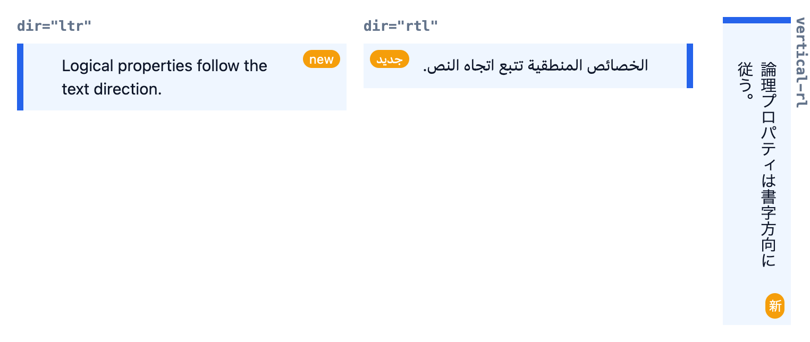
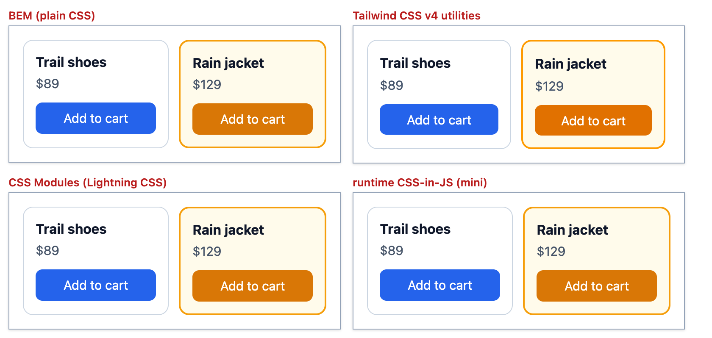

# Chapter 13 — Modern CSS and Architecture

Until about 2022, writing CSS for a big site meant reaching for tools: Sass (a language that adds extra features to CSS and is compiled — translated by a program — into plain CSS) for nesting and variables, strict naming conventions so styles didn't collide, and JavaScript for anything like "style the parent when a child is checked". Browsers have since caught up. Nesting, the `:has()` "parent" selector, cascade layers, `@scope`, logical properties and `light-dark()` are all built in, and together they change how you organise stylesheets (the files of CSS rules for a site). This chapter covers each new feature, then the bigger question every team faces: **how do you structure CSS so that it stays maintainable as a project grows?** We compare the four main answers (BEM naming, utility-first with Tailwind CSS, CSS Modules and CSS-in-JS), look at Sass and resets, and finish with a complete theming system.

**What you'll learn**

| # | Topic | You will be able to… |
|---|---|---|
| 13.1 | Native nesting | nest rules without Sass and know exactly what `&` means (and where it differs from Sass) |
| 13.2 | `:is()` and `:where()` | shorten selector lists, use forgiving parsing, and control specificity with them |
| 13.3 | `:has()` | style an element based on its children, siblings or state, without JavaScript |
| 13.4 | Cascade layers | order whole groups of CSS (`reset`, `vendor`, `components`, `utilities`) and tame third-party CSS |
| 13.5 | `@scope` | limit styles to a subtree, with a lower boundary ("donut scope") and proximity |
| 13.6 | Logical properties | write direction-independent CSS that works for right-to-left and vertical text |
| 13.7 | Why CSS needs an architecture; BEM | name the problems and apply the BEM convention |
| 13.8 | Utility-first and Tailwind CSS v4 | explain utility CSS and read what a real Tailwind build produces |
| 13.9 | CSS Modules | explain build-time scoping and read the generated class map |
| 13.10 | CSS-in-JS | explain how runtime CSS-in-JS works, its costs, and the zero-runtime alternatives |
| 13.11 | Choosing an approach | compare the four approaches and pick one for a given project |
| 13.12 | Preprocessors (Sass) and PostCSS | know what Sass adds and which parts native CSS now covers |
| 13.13 | Resets and normalize | explain what a reset does, line by line, and why it belongs in a low layer |
| 13.14 | Theming and dark mode | build light/dark/brand themes from design tokens and `light-dark()` with a no-flash toggle |

**How the numbers and figures were made.** Every example is a page in [`code/`](code/). Each `NN_*.mjs` script (a JavaScript module run with Node.js) opens its page in real **headless** Chrome 154 (a full browser running without a visible window, controlled by a script) (through [`code/measure.mjs`](code/measure.mjs), a copy of [Chapter 10's helper](../10-responsive-design/README.md)) and prints what the browser computed — `getComputedStyle()` (the JavaScript call that returns an element's final, resolved CSS values), bounding boxes (the rectangle an element occupies on screen), and the CSSOM (the browser's object model of the stylesheet). The Tailwind example is a real Tailwind CSS v4.3 build, and the CSS Modules example is compiled by Lightning CSS (a fast CSS compiler, 13.12), the same compiler many **bundlers** use (a bundler is a build tool that gathers a project's many source files and outputs a few optimised files for the browser). [`code/make_figures.mjs`](code/make_figures.mjs) takes the screenshots. Support data comes from the **web-features** dataset (the source of MDN's — Mozilla's web developer documentation — and caniuse's — a site of browser-support tables — "Baseline" badges), checked in September 2026.

> **Baseline, briefly** ([Chapter 10](../10-responsive-design/README.md) has more). A feature is **Baseline "newly available"** once it works in the current Chrome, Edge, Firefox and Safari (desktop and mobile), and **"widely available"** 30 months after that. Newly available features are safe for most audiences; for older devices, check your own analytics (the statistics your site collects about its visitors, including their browsers) or provide a fallback (an alternative that still works when the feature is missing).

---

## 13.1 Native CSS nesting

### What it is
**Nesting** lets you write a rule inside another rule, so the inner selector is relative to the outer one. It's like writing a street address as "Paris → Rue de Rivoli → No. 10" instead of repeating "Paris" on every line. Sass has offered this since 2006; browsers now do it natively: **Baseline newly available since December 2023** (Chrome 120, Firefox 117, Safari 17.2) and **widely available since June 2026**.

### Why it matters
Without nesting you repeat the parent selector for every child, hover state and media query, and related rules drift apart in the file. Nesting keeps one component's styles in one block. Because it's native (built into the browser), there's no **build step** (a program that transforms your source files before they are served) and DevTools (the browser's built-in developer tools) shows the nested rule as you wrote it.

### How it works
1. Inside a style rule, you can write declarations **and** further rules.
2. A nested selector with no `&` is treated as a **descendant** of the parent: `.title {}` inside `.card {}` means `.card .title`.
3. `&` (the **nesting selector**) stands for the parent's matched elements. Its position decides the relationship: `&:hover` (same element, no space), `& > p` (child), `.dark-page &` (the parent is *inside* `.dark-page`).
4. A nested selector may start with a **combinator** (the symbol that relates two selectors: a space for descendant, `>` for child, `+` for next sibling, `~` for any later sibling): `> p` means `& > p`.
5. Conditional **at-rules** (CSS statements that start with `@`; these ones apply their contents only under a condition) (`@media`, `@supports`, `@container`, `@layer`, `@scope`) can be nested too; their declarations apply to the parent selector.
6. `&` behaves like **`:is(<parent selector list>)`**. That has one important consequence for specificity (see below).

> **Key term — specificity:** the score the browser uses to decide which of two conflicting rules wins. It is written as three numbers (A,B,C): A counts ID selectors (`#main`), B counts classes, attributes and pseudo-classes (`.card`, `[type]`, `:hover`), C counts element names and pseudo-elements (`p`, `::before`). Compare A first, then B, then C — so (1,0,0) beats (0,3,0). If the scores tie, the rule that comes later in the file wins.

[`code/01_nesting.html`](code/01_nesting.html):

```css
.card {
  padding: 16px;
  border: 2px solid #cbd5e1;

  .title { font-size: 20px; margin: 0; }          /* = .card .title (descendant)        */
  > p { margin: 4px 0 0; color: #334155; }         /* = .card > p (relative selector)    */
  &:hover { border-color: #2563eb; }               /* = .card:hover (no space)           */
  &.featured { border-color: #f59e0b; }            /* = .card.featured (same element)    */
  .dark-page & { background: #0f172a; }            /* = .dark-page .card (& at the end)  */
  @media (width >= 600px) { padding: 24px; }       /* nested at-rule: applies to .card   */
  &__body { color: red; }                          /* NOT Sass: no string joining        */
}

/* & behaves like :is() -> the parent list's HIGHEST specificity is used */
#main, .sidebar {
  .link { color: crimson; }                         /* = :is(#main, .sidebar) .link  (1,1,0) */
}
.sidebar .link.plain { color: green; }              /* (0,3,0) -- still loses!               */
```

[`code/01_nesting.mjs`](code/01_nesting.mjs) walks the CSSOM (the browser's parsed stylesheet) and reads computed styles at two **viewport** (the visible area of the browser window) widths.

Output:
```
CSSOM tree (selectorText of each rule):
body
.card
  & .title
  & > p
  &:hover
  &.featured
  .dark-page &
  @media (width >= 600px)
    CSSNestedDeclarations
#main, .sidebar
  & .link
.sidebar .link.plain

Was the "&__body" rule kept? false

viewport 500px: .card padding 16px, border rgb(245, 158, 11), background rgb(15, 23, 42)
  .title font-size 20px   .card__body color rgb(0, 0, 0) (not red)   .sidebar .link color rgb(220, 20, 60)

viewport 700px: .card padding 24px, border rgb(245, 158, 11), background rgb(15, 23, 42)
  .title font-size 20px   .card__body color rgb(0, 0, 0) (not red)   .sidebar .link color rgb(220, 20, 60)
```

What the output proves:
- The browser stores `.title` as `& .title` and `> p` as `& > p`: an implicit `&` plus a space (descendant) is added in front.
- The nested `@media` holds a `CSSNestedDeclarations` object — the bare `padding: 24px` is treated as if it were inside `& { … }`. Padding is 16px at 500px and 24px at 700px.
- **`&__body` was thrown away.** In Sass, `&__body` glues text together to make `.card__body`. Native CSS works on selectors, not strings, so this never produces `.card__body`; Chrome discards the rule, and the element stays black. This is the #1 surprise when moving BEM-style (BEM is a class-naming convention, 13.7) Sass to native nesting.
- The sidebar link is **crimson**, although `.sidebar .link.plain` (0,3,0) looks more specific. The nested rule is really `:is(#main, .sidebar) .link`, and `:is()` takes the specificity of its most specific argument — `#main` — giving (1,1,0), even though the element matched via `.sidebar`.

### Compiling nesting away for old browsers
If you must support browsers older than late 2023, a build tool can **lower** (flatten) nesting. [`code/01_nesting_lower.mjs`](code/01_nesting_lower.mjs) asks Lightning CSS to target Chrome 100:

Output:
```css
.card {
  padding: 16px;
}

.card .title {
  font-size: 20px;
}
/* ... .card:hover, .dark-page .card ... */

@media (min-width: 600px) {
  .card {
    padding: 24px;
  }
}

:is(#main, .sidebar) .link {
  color: #dc143c;
}
```

The compiler writes `:is(#main, .sidebar) .link` — the same meaning the browser gives native nesting (Sass would instead write `#main .link, .sidebar .link`, two selectors with *different* specificities). It also rewrote the range media query (an `@media` condition written with comparison operators like `>=`) `(width >= 600px)` into the older `min-width` form.

### Common mistakes
- Porting Sass `&__title` or `&-large` and wondering why nothing applies.
- **Nesting too deep.** `.page .main .card .body .title a` in nested form is just as fragile as when written flat. Keep nesting to 2–3 levels: states (`&:hover`), children you own, and media/container queries.
- Forgetting that a nested selector list inherits the `:is()` specificity of the *whole* parent list.

### In the interview
**30-second answer:** "CSS now supports nesting natively — Baseline since late 2023. A nested selector is relative to its parent; `&` represents the parent and behaves like `:is()` of the parent list, so it takes the highest specificity in that list. Unlike Sass it doesn't concatenate strings, so `&__title` doesn't work. I use it for states, owned children and nested media queries, and keep it shallow."

- *Q: Is `.a { .b {} }` a child or a descendant selector?* A: Descendant (`.a .b`); write `> .b` for a child.
- *Q: What does `.x & {}` inside `.card` mean?* A: A `.card` that is inside `.x`.

### Self-check
1. What does `& + &` mean inside `.item {}`? → An `.item` immediately following another `.item`.
2. Why might a nested rule under `#nav, .menu` beat a rule you think is more specific? → `&` = `:is(#nav, .menu)`, so an ID's weight counts even for `.menu` matches.
3. Does native nesting need a build tool? → No; only to support pre-2023 browsers (lowering).

---

## 13.2 `:is()` and `:where()`

### What it is
Both take a **selector list** and match any element that matches one of the selectors in it — a "one of these" shortcut. They differ only in **specificity**: `:is()` counts as its **most specific argument**; `:where()` always counts as **zero**. Both are Baseline widely available (since 2021). [Chapter 6](../06-css-fundamentals/README.md#64-specificity) introduced the specificity rules; here we use them as architecture tools.

### Why it matters
1. **Shorter selectors.** `:is(article, section, aside) :is(h1, h2, h3)` replaces nine comma-separated selectors.
2. **Forgiving parsing.** In a normal selector list, one invalid or unknown selector makes the browser drop the **whole rule**. Inside `:is()`/`:where()`, bad entries are just ignored.
3. **Specificity control.** `:where()` lets you write defaults (resets, library styles) that anything can override; `:is()` lets you raise specificity when you need to.

### Proof
[`code/02_is_where.html`](code/02_is_where.html):

```css
:is(article, section, aside) :is(h1, h2, h3) { color: rebeccapurple; }

:is(.promo, :unknown-thing) { font-weight: 700; }            /* forgiving   */
.promo, :unknown-thing { text-decoration: underline; }       /* NOT forgiving */

:where(.content) a  { color: gray; }        /* (0,0,1)                       */
a                   { color: teal; }        /* (0,0,1), later -> wins        */
:is(#nav, .content) b { color: gray; }      /* (1,0,1)                       */
.content b.hot      { color: teal; }        /* (0,2,1) -> loses              */
```

[`code/02_is_where.mjs`](code/02_is_where.mjs) reads the computed styles and, for comparison, scores the selectors with [Chapter 6's specificity calculator](../06-css-fundamentals/code/specificity_lib.mjs):

Output:
```
h2 inside article color      rgb(102, 51, 153) (rebeccapurple = rgb(102, 51, 153))
.promo font-weight           700   <- forgiving :is() kept the rule
.promo text-decoration-line  none   <- plain list with one bad selector was dropped
:where(.content) a vs a      rgb(0, 128, 128) (teal = rgb(0, 128, 128))
:is(#nav,.content) b vs .content b.hot rgb(128, 128, 128) (gray = rgb(128, 128, 128))

Rules the browser kept: body  |  :is(article, section, aside) :is(h1, h2, h3)  |  :is(.promo)  |  :where(.content) a  |  a  |  :is(#nav, .content) b  |  .content b.hot

Specificity (A,B,C):
  :is(article, section, aside) :is(h1, h2, h3)   (0,0,2)
  :where(.content) a                             (0,0,1)
  a                                              (0,0,1)
  :is(#nav, .content) b                          (1,0,1)
  .content b.hot                                 (0,2,1)
```

Notice what Chrome kept: `:is(.promo)` — it silently removed `:unknown-thing` — while `.promo, :unknown-thing` is **missing** from the list of kept rules. And `:is(#nav, .content) b` wins with an ID's weight even though there is no `#nav` on the page.

### Where each is used

| Use | Pick | Example |
|---|---|---|
| Reset / library defaults that must be easy to override | `:where()` | `:where(ul, ol)[role="list"] { list-style: none }` |
| Shortening a long list without changing priorities much | `:is()` | `:is(h1,h2,h3):hover` |
| Using a new pseudo-class safely next to old ones | either (forgiving) | `:is(:focus-visible, .focus)` |
| Deliberately raising a selector's weight | `:is()` with an ID or class | `.btn:is(#_, .btn)` (a hack — prefer layers, 13.4) |

### Common mistakes
- Using `:is()` in a library's defaults: an argument like `#app` makes every selector inside it hard to override. Use `:where()`.
- Expecting pseudo-elements (parts of an element that CSS can style as if they were separate, like `::before` and `::after`) inside: `:is(::before)` never matches — pseudo-elements aren't allowed in these lists.

### Self-check
1. Specificity of `:where(#a) .b`? → (0,1,0).
2. Specificity of `:is(p, .x, #y)`? → (1,0,0), whichever argument matched.
3. Why is `:is()` safer than a plain list when using a new pseudo-class? → An unsupported selector inside it is ignored instead of dropping the entire rule.

---

## 13.3 `:has()` — the relational ("parent") selector

### What it is
`A:has(B)` matches an element **A** if selector **B**, evaluated *relative to A*, matches something. With a descendant (`:has(img)`), it's the long-awaited **parent selector**; with `+` or `~` (`h3:has(+ .subtitle)`) it's a **previous-sibling** selector (siblings are elements that share the same parent). Baseline newly available since **December 2023** (Firefox 121 was last), widely available since June 2026. [Chapter 6](../06-css-fundamentals/README.md#63-pseudo-classes-and-pseudo-elements) showed the basic syntax.

### The problem it solves
CSS selectors used to look only **down and forward** in the document: you could style a child based on its parent, never the reverse. "Give the card a grid layout if it contains an image", "highlight the label whose radio is checked" or "lock page scrolling while a dialog is open" all needed JavaScript that added classes. `:has()` does them in CSS, and they stay in sync automatically.

### How it works
1. The argument is a **relative selector list**: each item implicitly starts at the `:has()` element (default combinator = descendant).
2. Specificity = the most specific argument, like `:is()`.
3. The browser re-evaluates it whenever the DOM (Document Object Model — the browser's live tree of the page's elements, which scripts can change) or state changes (checking a box, typing into an input, opening a dialog).
4. Restrictions: `:has()` can't be nested inside another `:has()`, and pseudo-elements can't be arguments.

[`code/03_has.html`](code/03_has.html) shows six patterns:

```css
.card:has(img)                 { display: grid; grid-template-columns: 64px 1fr; }  /* parent       */
.field:has(input:invalid)      { border-left-color: #dc2626; background: #fef2f2; } /* form state   */
h3:has(+ .subtitle)            { margin-bottom: 0; color: #7c3aed; }                /* prev sibling */
ul:has(> li:nth-child(4))      { columns: 2; }                                      /* quantity     */
label.opt:has(input:checked)   { background: #dbeafe; font-weight: 600; }           /* checked      */
html:has(dialog[open])         { overflow: hidden; }                                /* page-level   */
```


*Figure 13.1 — Each box's styling comes from a `:has()` rule; no JavaScript adds classes.*

[`code/03_has.mjs`](code/03_has.mjs) reads the computed styles, then changes state the way a user would (click "Yearly", fix the email, add a fourth list item, open the dialog) and reads them again.

Output:
```
.card with img display=grid, without img display=block
invalid field border=rgb(220, 38, 38), valid field border=rgb(203, 213, 225)
h3 followed by .subtitle margin-bottom=0px, lone h3 margin-bottom=8px
3-item list columns=auto, 5-item list columns=2
Monthly (checked) weight=600, Yearly weight=400
<html> overflow with dialog closed: visible

after: click "Yearly", fix the email, add a 4th <li>, showModal()
Monthly weight=400, Yearly weight=600
first field border=rgb(203, 213, 225)
first list columns=2
<html> overflow with dialog open: hidden

a:has(:has(b))  -> SyntaxError
p:has(::before)  -> SyntaxError
li:has(+ li)  -> valid
```

Every style followed the state change instantly, and the two forbidden forms are rejected by the selector parser (the part of the browser that reads selector text and turns it into a structure it can match).

### Trade-offs and performance
`:has()` asks the browser to look "up" the tree when something changes, which is more work than ordinary selectors. Engines optimise the common cases, and in normal use it is fine. Two habits keep it cheap:
- **Anchor it** to a specific element: `.card:has(img)` rather than `:has(img)` alone or `body:has(.x .y .z)` with long descendant chains.
- Avoid `*:has(...)` and very broad subjects on huge, constantly changing DOMs.

### When not to use it
- For *behaviour* (disabling a button, moving focus) — that's JavaScript's job; `:has()` only changes appearance.
- To style a form field with an error **the moment the page loads**: `:invalid` matches before the user has typed. Prefer `:user-invalid` (matches only after interaction) — `.field:has(:user-invalid)` ([Chapter 5](../05-tables-and-forms/README.md#57-accessible-error-messages)).

### Real-world examples
Selected table rows (`tr:has(input:checked)`), error-highlighting form groups, quantity queries (styles that change with how many children an element has), modal (a dialog that blocks the rest of the page until closed) scroll locking, and dimming siblings of a hovered item: `.list:has(.item:hover) .item:not(:hover) { opacity: .6 }`.

### In the interview
**30-second answer:** "`:has()` matches an element if the relative selector inside it matches — so `.card:has(img)` styles cards that contain an image. It works as a parent selector and, with `+`/`~`, a previous-sibling selector, and it reacts to state like `:checked` or `:invalid`. It's Baseline since late 2023. I anchor it to specific elements for performance and never use it for behaviour."

- *Q: How do you style a label whose checkbox is checked, with the input inside the label?* A: `label:has(input:checked)`.
- *Q: Specificity of `.card:has(> img, #hero)`?* A: (1,1,0): `.card` + the most specific argument `#hero`.

### Self-check
1. Select an `h2` immediately followed by a `p`. → `h2:has(+ p)`.
2. Select a `ul` with exactly 3 items. → `ul:has(> li:nth-child(3)):not(:has(> li:nth-child(4)))`.
3. Can you write `:has(:has(x))`? → No, it's a syntax error.

---

## 13.4 Cascade layers (`@layer`)

### What it is
A **cascade layer** is a named bucket of rules. You declare the order of the buckets once, and a rule in a later layer beats a rule in an earlier layer **no matter how specific either selector is**. Think of layers as floors of a building: anything on the 5th floor is above anything on the 2nd, however tall the furniture on the 2nd floor. Baseline since March 2022 and widely available since September 2024. [Chapter 6](../06-css-fundamentals/README.md#65-the-cascade-and-origins) placed layers in the cascade; this section is about using them to structure a project.

### The problem it solves
**Specificity wars.** A third-party library (code written by someone outside your team) ships `#app .btn.btn-primary`; to override it you write something even more specific, or `!important` (a flag on a declaration that makes it beat normal declarations), and the next person escalates again. Layers let you say, once, "vendor CSS is below my components, and utilities are above both".

### How it works
1. `@layer reset, vendor, base, components, utilities;` declares the order: **first = weakest**. Put this statement first, so the order doesn't depend on which file loads first.
2. Add rules with `@layer name { … }` (as many blocks as you like; they merge), or import a whole file into a layer: `@import url(x.css) layer(vendor);`.
3. When two declarations conflict, the cascade (the browser's algorithm for choosing a winner) compares **origin & importance → context → style attribute → layer → specificity → order**. Origin is who wrote the CSS (browser defaults, the user, or the page author); context is whether the rule comes from inside a shadow DOM (13.5); the style attribute is CSS written directly on an element (`style="…"`). The layer is compared **before** specificity.
4. **Unlayered** styles form an implicit final layer: they beat every named layer.
5. **`!important` reverses the order**: an `!important` declaration in an *earlier* layer beats one in a later layer, and layered `!important` beats unlayered `!important`. This lets a reset lock something down.
6. **`revert-layer`** as a value means "ignore this layer's value; use what the earlier layers produce".
7. Layers nest: `@layer components { @layer dialog { … } }` creates `components.dialog`.

[`code/04_layers.html`](code/04_layers.html) (with [`code/04_vendor.css`](code/04_vendor.css) standing in for a library):

```css
@layer reset, vendor, base, components, utilities;
@import url("04_vendor.css") layer(vendor);     /* #app .btn.btn-primary { background: #6b7280; ... } */

@layer components { .btn { background: #2563eb; border-radius: 8px; }  .card a { color: #7c3aed; } }
@layer utilities  { .text-red { color: #dc2626; }  .no-radius { border-radius: 0 !important; } }
@layer reset      { .keep-radius { border-radius: 999px !important; } }
p { color: #065f46; }                                         /* unlayered */
@layer utilities  { .plain-link { color: revert-layer; } }
@layer components { @layer dialog { .dlg { color: #b45309; } } }
```

[`code/04_layers.mjs`](code/04_layers.mjs) lists the layers from the CSSOM and reads who won each fight:

Output:
```
statement: reset, vendor, base, components, utilities
import:    04_vendor.css layer(vendor)
block:     reset
block:     base
block:     components
block:     utilities
block:     components.dialog

#app .btn.btn-primary (vendor, 1,2,0) vs .btn (components, 0,1,0):
   background rgb(37, 99, 235) (#2563eb = rgb(37, 99, 235)), radius 8px, padding-left 20px (vendor's, nobody overrode it)
.card a (components)                     color rgb(124, 58, 237)
.text-red (utilities) vs .card a         color rgb(220, 38, 38)
.plain-link { color: revert-layer }      color rgb(124, 58, 237)  <- back to the components value
unlayered p vs base body                 color rgb(6, 95, 70)
!important: utilities 0 vs reset 999px   radius 999px  <- earlier layer wins for !important
nested layer components.dialog          color rgb(180, 83, 9)
```

Read it line by line: a one-class selector in `components` beat an ID selector in `vendor`; the vendor's padding survived because nothing higher set padding (layers settle *conflicts*, they don't delete rules); `revert-layer` fell back to the components colour; and for `!important`, the **reset** layer won.

### A layer order for real projects

```css
@layer reset, tokens, vendor, base, layout, components, utilities, overrides;
```

| Layer | Holds | Why here |
|---|---|---|
| `reset` | the reset (13.13) | weakest: everything may override it |
| `tokens` | custom properties (CSS variables like `--brand`, 13.14) | declarations only, rarely conflicts |
| `vendor` | third-party CSS via `@import … layer(vendor)` | your own base styles should beat it |
| `base` | element defaults (`body`, `a`, `h1`) | |
| `layout` | page grids, containers | |
| `components` | cards, buttons, dialogs | |
| `utilities` | single-purpose classes (`.visually-hidden` — hidden on screen but still read by screen readers — `.text-center`) | must beat components |
| `overrides` | temporary fixes | explicit, easy to find and delete |

Tailwind CSS v4 itself emits `@layer theme, base, components, utilities;` (13.8), so its utilities slot neatly into this scheme.

### Common mistakes
- **Leaving your own CSS unlayered while the framework (a ready-made library that shapes how you build, such as Tailwind) is layered**: unlayered beats all layers, which may be what you want — or may make your stray rules impossible to override with utilities.
- **Order by accident**: the first time a layer name appears fixes its position. Without the up-front statement, a file loaded early can create layers in the wrong order.
- Expecting `!important` in a later layer to win — it's the reverse.
- `@import … layer()` must come before all other rules except `@charset` (declares the file's text encoding) and `@layer` statements, or the import is ignored.

### In the interview
**30-second answer:** "Cascade layers let me order groups of rules explicitly. The cascade compares layers before specificity, so a simple class in a later layer beats an ID selector in an earlier one. I declare the order once — reset, vendor, base, components, utilities — and import third-party CSS into a low layer. Unlayered styles beat all layers, and `!important` inverts the order."

- *Q: How do you override a library's high-specificity CSS without `!important`?* A: Import it into a low layer: `@import url(lib.css) layer(vendor);` and put your rules in a later layer or unlayered.
- *Q: What does `revert-layer` do?* A: Rolls the property back to the value from the previous layers (or earlier origins if none).

### Self-check
1. Layer order `a, b`. `#x p` in `a`, `p` in `b`. Which wins? → `p` in `b`.
2. `color: red !important` in `a` vs `color: blue !important` in `b`? → Red (earlier layer wins for important).
3. Unlayered `p { color: green }` vs `@layer b { #x p { color: blue } }`? → Green.

---

## 13.5 `@scope`

### What it is
`@scope (<root>) to (<limit>) { … }` applies rules only to elements **inside** a scope root and, optionally, **not inside** a lower boundary. The part between root and limit is often called a **donut scope**: the root is the ring, the limit is the hole. Inside, `:scope` means the root element itself.

**Status (September 2026): Baseline newly available since March 2026.** Chromium shipped `@scope` first (Chrome 118, 2023); web-features counts it as complete from Firefox 146 and Safari 26.4, the versions that finished the cross-browser set. Treat it as safe for current browsers; older browsers simply ignore the whole `@scope` block, so give unscoped fallbacks for anything essential.

### The problem it solves
- **Leaking into content**: a `.card img { border: … }` rule also hits images in user-generated content (text and images posted by site users, such as comments or rich-text articles) inside the card. BEM avoids this with long class names on every element; `@scope … to (.content)` does it with a boundary.
- **Proximity**: with nested themes (`.light` inside `.dark` inside `.light`), `.dark a` and `.light a` have the same specificity, so whichever comes later in the file wins — wrong for the innermost box. With `@scope`, when specificity is equal, the rule whose root is **nearest** (fewest steps up the tree) wins.

### How it works
1. Match the scope root(s) (`.card`).
2. Match the limit(s) (`.content`) inside each root; everything at or below a limit is excluded.
3. Apply the rules to elements between. Selectors inside are matched relative to the root; bare selectors like `img` act as descendants of `:scope`.
4. Specificity: the root selector adds **nothing** (unlike nesting); `:scope` adds (0,1,0) like a pseudo-class.
5. **Scoping proximity** is a new cascade step *after* specificity and *before* order of appearance.
6. `@scope { … }` **without a prelude** (the part between `@scope` and `{`, which names the root and limit) inside a `<style>` element scopes to that `<style>`'s parent element — handy for component-local styles in HTML.

[`code/05_scope.html`](code/05_scope.html):

```css
@scope (.card) to (.content) {
  :scope { background: #f8fafc; }          /* the .card itself                */
  img    { border: 3px solid #2563eb; }    /* card's images, not content's    */
  p      { font-weight: 600; color: #1d4ed8; }
}
@scope (.dark)  { a { color: #fbbf24; } :scope { background: #1e293b; color: #e2e8f0; } }
@scope (.light) { a { color: #1d4ed8; } :scope { background: #fff; color: #0f172a; } }
```
```html
<div id="inline">
  <style> @scope { :scope { outline: 2px dashed #16a34a; } b { color: #16a34a; } } </style>
  <b>styled by an inline, prelude-less @scope</b>
</div>
<b>same &lt;b&gt;, outside that div</b>
```


*Figure 13.2 — Donut scope (top), proximity with nested themes (middle), prelude-less inline scope (bottom).*

[`code/05_scope.mjs`](code/05_scope.mjs):

Output:
```
CSSScopeRule supported: true 
start=.card end=.content
start=.dark end=null
start=.light end=null

.card background rgb(248, 250, 252)
card's own img border 3px   img inside .content border 0px
card's own p  rgb(29, 78, 216) 600
p in .content rgb(15, 23, 42) 400

links: light rgb(29, 78, 216)   dark rgb(251, 191, 36)   light-inside-dark rgb(29, 78, 216)
(amber = rgb(251, 191, 36), blue = rgb(29, 78, 216))

inline @scope: <b> inside rgb(22, 163, 74), <b> outside rgb(15, 23, 42)
```

The hole works (the content's `img` and `p` are untouched), and the innermost **light** link is blue although the `.light` rule is *not* the last one in the file for every box — the nearest root decided. Without `@scope`, `.dark a` and `.light a` would tie on specificity and the later `.light a` would also colour the *dark* box's link blue.

### `@scope` vs the alternatives

| Need | Tool |
|---|---|
| Keep a component's styles from matching outside it | `@scope (.card)`, BEM names, CSS Modules |
| Stop styles at a nested region (slots, user content) | `@scope … to (…)` — only this does it natively |
| Nearest theme wins | `@scope` proximity (or custom properties, which inherit from the nearest ancestor anyway — 13.14) |
| Full isolation both ways (page CSS can't get in) | Shadow DOM (a hidden, separately styled DOM tree attached to an element) (web components — custom HTML elements you define with JavaScript) |

### Common mistakes
- Expecting `@scope` to block **inheritance** (some properties, such as `color` and `font`, pass their value from a parent element down to its children automatically): inherited properties (colour, font) still flow into the "hole"; only *selector matching* stops.
- Thinking the root adds specificity (`@scope (#main)` adds nothing to the rules inside).

### Self-check
1. What does `:scope` match inside `@scope (.card)`? → The `.card` element itself.
2. Two rules with equal specificity from `@scope (.a)` and `@scope (.b)`; the element is closer to `.b`. Which wins? → The `.b` rule (proximity), regardless of source order.
3. Is `@scope` Baseline? → Yes, newly available since March 2026.

---

## 13.6 Logical properties

### What it is
**Logical properties** describe boxes in terms of the **flow of text** instead of physical sides. The **inline** axis is the direction text runs in a line (left→right in English, right→left in Arabic, top→bottom in vertical Japanese). The **block** axis is the direction lines/paragraphs stack. `start`/`end` are the beginning and end of each axis. So `margin-inline-start` is the margin **before the text starts** — the left in English, the right in Arabic. Baseline widely available (since 2021).

### Why it matters
A site translated into Arabic, Hebrew, Persian or Urdu is displayed right-to-left (`dir="rtl"`; RTL for short, the opposite of LTR, left-to-right). With physical properties (`padding-left`, `border-left`, `left: 0`) every side needs flipping in a separate RTL stylesheet. With logical properties **one stylesheet works for both**, and also for vertical writing modes (the `writing-mode` property, used for text that runs top to bottom).

### The mapping

| Physical (horizontal LTR) | Logical |
|---|---|
| `width` / `height` | `inline-size` / `block-size` (also `min-`/`max-`) |
| `margin-left` / `margin-right` | `margin-inline-start` / `margin-inline-end` |
| `margin-top` / `margin-bottom` | `margin-block-start` / `margin-block-end` |
| `margin-left` + `margin-right` | `margin-inline: a b` (shorthand) |
| `padding-*`, `border-*` | `padding-inline`, `padding-block-start`, `border-inline-start`, … |
| `top` / `right` / `bottom` / `left` | `inset-block-start` / `inset-inline-end` / `inset-block-end` / `inset-inline-start` |
| `border-top-left-radius` | `border-start-start-radius` (block-start, inline-start) |
| `text-align: left` / `right` | `text-align: start` / `end` |
| `float: left` | `float: inline-start` |
| `overflow-x` / `overflow-y` | `overflow-inline` / `overflow-block` (newer — check support for your targets before relying on them) |

Units have logical versions too: `vi`/`vb` (viewport inline/block) and `cqi`/`cqb` for containers (elements marked as containers for container queries, which let children adapt to the container's size rather than the window's) ([Chapter 10](../10-responsive-design/README.md#106-container-queries)).

### Proof
[`code/06_logical.html`](code/06_logical.html) uses one rule set for three containers — `dir="ltr"`, `dir="rtl"` and `writing-mode: vertical-rl`:

```css
.note {
  inline-size: 220px;
  padding-inline-start: 36px;  padding-inline-end: 48px;  padding-block: 10px;
  border-inline-start: 6px solid #2563eb;
  margin-block-end: 12px;
  text-align: start;
}
.note .badge { position: absolute; inset-inline-end: 6px; inset-block-start: 6px; }
```



*Figure 13.3 — Same CSS, three writing directions. The accent bar is always at the "start" of the text.*

[`code/06_logical.mjs`](code/06_logical.mjs) measures which **physical** side received each value:

Output:
```
box  size(px)   36px padding  48px padding  6px border  12px margin  badge corner
ltr  310x64     Left          Right         Left        Bottom       right/top
rtl  310x42     Right         Left          Right       Bottom       left/top
vrl  64x290     Top           Bottom        Top         Left         right/bottom
```

In vertical-rl, lines run top→bottom (so the inline axis is vertical) and stack right→left (the block axis), so inline-start = **top**, inline-end = **bottom** and block-end = **left**. The sizes follow the same logic: in LTR and RTL the box is 310px **wide** (220 `inline-size` + 36 + 48 padding + 6 border), while the vertical box (given `inline-size: 200px`) is 290px **tall** (200 + 36 + 48 + 6). Every value moved with the text direction; no rule mentions left, right, top or bottom.

### When not to use it
- Things that are genuinely physical: a shadow cast downwards, a fixed "back to top" button in the bottom-right, an arrow that points right because the image does. Keep physical properties there.
- Don't mix `margin-left` and `margin-inline-start` on the same element; they are the same side in LTR and fight.

### Common mistakes
- Using `dir="rtl"` on `<html>` but hard-coded `left`/`right` in components.
- Icons that imply direction (→, "next") must be mirrored in RTL: `:dir(rtl) .icon-next { scale: -1 1; }` (`:dir()` is Baseline since 2023).

### Self-check
1. Logical equivalent of `padding-left: 1rem; padding-right: 1rem`? → `padding-inline: 1rem`.
2. In RTL, which physical side does `border-inline-end` draw? → Left.
3. What is `block-size` in horizontal writing? → Height.

---

## 13.7 Why CSS needs an architecture — and BEM

### The problems
CSS was designed for documents, and three of its core ideas hurt at application scale:

| Problem | What happens | Symptom |
|---|---|---|
| **Global namespace** (one shared pool of names) | Every selector can match anything on any page | Changing `.title` breaks a page you've never seen |
| **Specificity & order dependence** | Winners depend on selector weight and file order | Escalation: `!important`, `#id` hacks |
| **No dead-code detection** (dead code = code nothing uses any more) | You can't tell if a rule is still used | Stylesheets only ever grow ("append-only CSS") |
| **Implicit coupling** | Styles depend on DOM structure (`.nav ul li a`) | Moving markup breaks styles |

Every CSS architecture is a different answer to these. There are two families: **conventions** (rules humans follow, e.g. BEM, OOCSS, SMACSS, ITCSS, CUBE CSS) and **tooling** (build steps that enforce it: CSS Modules, CSS-in-JS, utility generators). Native features (layers, `@scope`, nesting) now help both.

### BEM — Block, Element, Modifier
**BEM** (from Yandex, a Russian search company, ~2009) is a naming convention that gives every styled thing a unique, flat class:
- **Block** — a standalone component: `.card`
- **Element** — a part that only makes sense inside its block: `.card__title` (double underscore)
- **Modifier** — a variant or state: `.card--featured`, `.card__button--disabled` (double hyphen)

[`code/07_bem.html`](code/07_bem.html):

```css
.card { width: 170px; padding: 14px; border: 1px solid #cbd5e1; border-radius: 12px; }
.card__title  { margin: 0; font-size: 16px; }
.card__price  { margin: 4px 0 12px; color: #475569; }
.card__button { width: 100%; background: #2563eb; color: #fff; /* … */ }
.card--featured { border: 2px solid #f59e0b; background: #fffbeb; }
.card--featured .card__button { background: #d97706; }
```
```html
<article class="card card--featured">
  <h3 class="card__title">Rain jacket</h3>
  <p class="card__price">$129</p>
  <button class="card__button">Add to cart</button>
</article>
```

**Why it works:** nearly every selector is a single class → specificity (0,1,0) everywhere, so order and weight stop mattering; names say where things belong; no dependence on tag names or nesting depth. **Rules:** no element-of-element names (`card__body__title` → just `card__title`); modifiers never appear alone (`class="card--featured"` without `card` is a bug); avoid styling by tag inside blocks.

### Other conventions in one line each
- **OOCSS** (Object-Oriented CSS, Nicole Sullivan, 2008): separate *structure* from *skin*, and *container* from *content* — reusable "objects" like `.media`.
- **SMACSS**: sort rules into Base, Layout, Module, State (`.is-open`), Theme.
- **ITCSS** (Inverted Triangle CSS): order files from generic/low-specificity to explicit/high-specificity (settings → tools → generic → elements → objects → components → utilities) — cascade layers (13.4) are now the native way to express this triangle.
- **CUBE CSS**: Composition, Utility, Block, Exception — lean on the cascade for most styling, add blocks only where needed, exceptions via data attributes.

### Trade-offs
BEM needs discipline and code review (teammates reading each change before it is merged) (nothing enforces the names), class names get long, and there's still one global namespace — two teams can both invent `.card`. That last problem is what tooling (13.9, 13.10) and `@scope` solve.

### Self-check
1. Name for a "large" variant of a `.btn`'s `icon` element? → `.btn__icon--large`.
2. Why does BEM avoid `.card h3`? → It couples styles to markup and raises specificity; use `.card__title`.

---

## 13.8 Utility-first CSS and Tailwind CSS v4

### What it is
**Utility-first** CSS provides many tiny single-purpose classes — `flex`, `p-4`, `text-slate-600`, `rounded-lg` — and you compose them **in the HTML** instead of writing new CSS for each component. **Tailwind CSS** is the dominant utility framework; **v4** (released January 2025; 4.3.3 used here) moved configuration into CSS and builds on modern features — cascade layers, `@property` (registers a custom property with a type so the browser can animate and validate it), `color-mix()` (blends two colours) and custom properties for every **design token** (a named design decision — a brand colour, a spacing step, a radius — stored as a variable so it is defined once and reused everywhere).

### Why teams choose it
- **CSS stops growing**: a new component reuses existing utilities, so the stylesheet size tracks the number of *distinct* utilities, not the number of components.
- **No naming** and no switching between files; deleting HTML deletes its styles (no dead CSS).
- **Constraints**: utilities come from a design scale (spacing multiples, a colour palette), which keeps UIs consistent.
- **Generated on demand**: the build scans your source files and emits only the classes you actually used.

### How a v4 build works
1. Your CSS entry file imports Tailwind and optionally defines design tokens in an `@theme` block.
2. The build scans source files for strings that look like class names (it doesn't run your code — class names must appear **complete** in the source).
3. For each recognised class it emits a rule into `@layer utilities`, plus the theme variables those rules use, the Preflight reset (Tailwind's own reset, 13.13) in `@layer base`, and `@property` registrations some utilities need.

[`code/08_tailwind.css`](code/08_tailwind.css) and part of [`code/08_tailwind.html`](code/08_tailwind.html):

```css
@import "tailwindcss" source(none);    /* don't auto-scan the folder ...        */
@source "./08_tailwind.html";           /* ... scan exactly this file             */

@theme {                                /* tokens -> CSS variables AND utilities */
  --color-brand: #2563eb;               /* enables bg-brand, text-brand, ...     */
  --color-brand-dark: #1d4ed8;
}
```
```html
<article class="w-[170px] rounded-xl border border-slate-300 bg-white p-3.5">
  <h3 class="text-base font-bold">Trail shoes</h3>
  <p class="mt-1 mb-3 text-slate-600">$89</p>
  <button class="w-full rounded-lg bg-brand p-2 text-white hover:bg-brand-dark">Add to cart</button>
</article>
```

(By default v4 detects sources automatically, skipping `.gitignore`d files — files listed in Git's ignore list, so not part of the project's version history; `source(none)` + `@source` just makes this example **deterministic**, giving the same output on every run.) [`code/08_tailwind_build.mjs`](code/08_tailwind_build.mjs) runs the real CLI (command-line interface — the program you run from a terminal) and inspects the output:

Output:
```
classes used in the HTML: 28
utility rules generated:   28
output: 7623 bytes (6513 minified)
top-level at-rules: layer properties | layer theme, base, components, utilities | layer theme  | layer base  | layer utilities  | property --tw-border-style | property --tw-leading ...
theme variables emitted: --color-amber-50 --color-amber-500 --color-amber-600 --color-amber-700 --color-slate-300 --color-slate-600 --color-slate-900 --color-white --color-brand --color-brand-dark

  .p-3\.5 {
    padding: calc(var(--spacing) * 3.5);
  }
  .bg-brand {
    background-color: var(--color-brand);
  }
  .w-\[170px\] {
    width: 170px;
  }
    .hover\:bg-brand-dark:hover {
      background-color: var(--color-brand-dark);
    }
```

What to notice:
- **Only what you use**: 28 classes in → 28 rules out, and only the 10 colour variables those classes reference (Tailwind's palette has hundreds). The whole stylesheet, including the reset, is about 6.5 KB before compression ("minified" in the output means whitespace and comments removed; compression such as gzip or Brotli then shrinks the file further for download).
- **Layers**: `@layer theme, base, components, utilities;` — utilities are the strongest layer, so a utility always beats a component class written in `components`, with no specificity games. Your own unlayered CSS beats all of them (13.4).
- **Spacing is a formula**: `p-3.5` = `calc(var(--spacing) * 3.5)` with `--spacing: 0.25rem` → 14px. Change one variable to rescale the whole UI.
- **Arbitrary values** in square brackets (`w-[170px]`) escape the scale when needed.
- **Variants** (prefixes that apply a utility only in a certain state or screen size): `hover:` wraps the rule in `@media (hover: hover)` (in the full output) so touch devices don't get "sticky hover" (a hover style that stays stuck after a tap); `md:` becomes `@media (width >= 48rem)`.



*Figure 13.4 — The same two cards built four ways (13.7–13.10). The pixels are the same; what differs is where styles live and how they're scoped.*

### Trade-offs
| Pro | Con |
|---|---|
| Tiny, bounded CSS; no dead code | Long `class` attributes; HTML harder to scan |
| No naming, no specificity fights | Repetition across markup unless you extract **components** (React/Vue — JavaScript UI libraries — components, or partials: reusable template snippets) |
| Design constraints built in | Learning the vocabulary; team must accept styling in markup |
| Easy to delete / refactor (restructure without changing behaviour) locally | Class names must be static strings (`bg-${color}-500` built at runtime — while the page runs — won't be found) |

### Common mistakes
- **Building class names dynamically** (`'text-' + color`): the scanner can't see them, so no CSS is generated. Map to full names: `{ red: 'text-red-600', blue: 'text-blue-600' }[color]`.
- Recreating BEM with `@apply` (a Tailwind directive that copies utilities into your own CSS rule) everywhere — you lose the benefits of both. Use it sparingly.
- Forgetting accessibility: utilities don't add `:focus-visible` styles for you (`focus-visible:ring-2` does).

### In the interview
**30-second answer:** "Utility-first CSS composes small single-purpose classes in the markup. Tailwind scans the source files and generates only the utilities used, into cascade layers, so CSS size stays bounded and there's no dead code or specificity war. The costs are verbose markup and a learning curve; you control repetition by extracting components, and class names must appear in full in the source."

### Self-check
1. Why does `className={'bg-' + c + '-500'}` fail? → The class never appears in full in the source, so the build doesn't generate it.
2. Where does v4 keep configuration? → In CSS, e.g. `@theme { --color-brand: … }`.
3. Which layer do Tailwind utilities live in? → `utilities`, the last of `theme, base, components, utilities`.

---

## 13.9 CSS Modules

### What it is
A **CSS Module** is an ordinary CSS file (named `*.module.css` by convention) whose class names are **local by default**: the build step swaps every class for a generated, collision-free name and gives JavaScript an object that maps your short names to the generated ones. You write `.title`; the page gets `.title_14He7q`; your component writes `className={styles.title}`. Supported out of the box by Vite, Next.js, webpack's css-loader, Parcel and others (popular build tools and frameworks for JavaScript apps).

### How it works
1. You import the file from a component: `import styles from './Card.module.css'`.
2. At build time the compiler parses the CSS and renames every class and `@keyframes` name using a pattern (file name, class name, hash — a short code computed from the file's contents, so different files get different codes).
3. It emits the renamed CSS into the bundle (the combined output file) and returns the **name map** as the module's default export (the main value other files receive when they `import` it).
4. `composes: other` adds another class's generated name to the export, so the element gets both classes.
5. `:global(...)` opts a selector out of renaming.

[`code/09_card.module.css`](code/09_card.module.css):

```css
.card   { width: 170px; padding: 14px; border: 1px solid #cbd5e1; border-radius: 12px; background: #fff; }
.title  { margin: 0; font-size: 16px; }
.button { width: 100%; background: #2563eb; /* … */ }
.featured { composes: card; border: 2px solid #f59e0b; background: #fffbeb; }
.featured .button { background: #d97706; }
:global(body) { font: 15px/1.4 system-ui, sans-serif; margin: 16px; display: flex; gap: 12px; }
```

[`code/09_css_modules.mjs`](code/09_css_modules.mjs) compiles it with Lightning CSS and renders the component HTML with the generated names (Figure 13.4, third panel):

Output:
```
import styles from "./card.module.css"  ->  styles = {
  button: 'button_14He7q',
  card: 'card_14He7q',
  featured: 'featured_14He7q card_14He7q',
  price: 'price_14He7q',
  title: 'title_14He7q'
}

Generated CSS (first rules):
.card_14He7q {
  background: #fff;
  border: 1px solid #cbd5e1;
  border-radius: 12px;
  width: 170px;
  padding: 14px;
}

.title_14He7q {
  margin: 0;
  font-size: 16px;
}

wrote 09_css_modules.out.css and 09_css_modules.html
```

The same `.title` in another module file gets a different hash, so the two can never collide. `styles.featured` contains **two** class names because of `composes`.

### Trade-offs
| Pro | Con |
|---|---|
| Real CSS (all features, DevTools, caching — the browser keeps a downloaded copy for reuse — as a static file) | Needs a build tool and JS imports |
| Zero runtime cost | Styling by props (the inputs a component receives) means toggling classes (`clsx(styles.btn, big && styles.big)`) |
| Scoping enforced by the tool, not discipline | Generated names are unreadable in production (the live site real users see) (fine in dev with a readable pattern) |
| Unused module files can be detected (no import → dead) | Unused classes *within* a file aren't removed automatically |

> **Don't confuse with "CSS module scripts"**: `import sheet from './x.css' with { type: 'css' }` gives you a `CSSStyleSheet` object (for shadow DOM). That's a different, newer browser feature — **not Baseline** (no Safari as of September 2026).

### Self-check
1. What does `import styles from './a.module.css'` give you? → An object mapping local class names to generated unique names.
2. How do you write a global rule inside a module? → `:global(.selector) { … }`.

---

## 13.10 CSS-in-JS

### What it is
**CSS-in-JS** means writing styles in JavaScript, next to the component, often computed from props. Two kinds exist:
- **Runtime** libraries (styled-components, Emotion): in the browser, while rendering, they **serialise** the style object (turn it into a string), hash it into a class name, and inject a rule into a `<style>` element.
- **Zero-runtime / compile-time** libraries (vanilla-extract, Linaria, Panda CSS, StyleX): you write styles in JS/TS (TypeScript — JavaScript with type annotations), but a build step extracts them to static CSS files, like CSS Modules.

### How runtime CSS-in-JS works — built in 25 lines
[`code/10_mini_css_in_js.js`](code/10_mini_css_in_js.js) is a toy version of the mechanism (not a real library):

```js
function css(styles) {
  const key = JSON.stringify(styles);
  if (cache.has(key)) return cache.get(key);          // same styles -> same class, inject once
  const cls = 'css-' + hash(key);                     // name derived from content
  sheet.insertRule(`.${cls}{${toCss(styles)}}`);      // + nested '&:hover' rules
  cache.set(key, cls);
  return cls;
}
// a component: styles depend on props
el.className = css({ border: featured ? '2px solid #f59e0b' : '1px solid #cbd5e1', /* … */ });
```

[`code/10_css_in_js.mjs`](code/10_css_in_js.mjs) renders two cards in jsdom (a JavaScript imitation of a browser's DOM that runs inside Node.js) (the fourth panel of Figure 13.4 is the same code in Chrome, [`code/10_css_in_js.html`](code/10_css_in_js.html)):

Output:
```
card 1 classes: css-1i6k3fq css-1qt5iag css-1d6s3yc css-11at6p7
card 2 classes: css-kegznd css-1qt5iag css-1d6s3yc css-n2x86t

rules injected at runtime (8):
  .css-1i6k3fq { width: 170px; padding: 14px; border-radius: 12px; border: 1px solid rgb(203, 213, 225); backgro
  .css-1qt5iag { margin: 0px; font-size: 16px; }
  ...
  .css-kegznd { width: 170px; padding: 14px; border-radius: 12px; border: 2px solid rgb(245, 158, 11); backgroun
  .css-n2x86t { width: 100%; padding: 8px; border: 0px; border-radius: 8px; background: rgb(217, 119, 6); color
  .css-n2x86t:hover { filter: brightness(0.9); }

progress bar rendered at 0..100%: 101 extra rules
with width: var(--pct) instead: 1 class (css-1gyb3r) + style="--pct: 42%"
```

What it shows:
- Identical styles share a class (`css-1qt5iag` for both titles) — the cache (a lookup table of results already computed) deduplicates.
- Different props produce **different classes** (the two card backgrounds and buttons).
- **The cost**: a style that depends on a continuously changing value (a progress bar) creates a new rule for every value — 101 rules — and the work of serialising, hashing and inserting happens **during rendering, on the main thread**. The fix every CSS-in-JS guide recommends is exactly the native one: one static rule with a custom property (`width: var(--pct)`) set inline.

### Trade-offs

| Pro | Con |
|---|---|
| Styles colocated with components; dynamic styles from props are natural | Runtime cost: JS bundle + style work during render (hurts INP/LCP, [Chapter 14](../14-performance-seo-interview-and-cheatsheet/README.md#143-core-web-vitals-lcp-inp-cls)) |
| Scoped automatically; dead styles die with the component | Server rendering needs extra setup to collect styles; a poor fit for **React Server Components** (runtime libraries have traditionally needed client components) |
| TypeScript types for style props (zero-runtime libs) | CSS can't be cached separately from JS (runtime libs) |

> **Key terms — INP, LCP, server rendering, React Server Components:** **LCP** (Largest Contentful Paint) and **INP** (Interaction to Next Paint) are two of Google's Core Web Vitals: how fast the main content appears, and how quickly the page reacts to clicks and key presses. **Server rendering** (SSR) means the server builds the page's HTML before sending it, instead of JavaScript building it in the browser. **React Server Components** (RSC) are React components that run only on the server and send no JavaScript to the browser; *client components* are the ones that also run in the browser.

The ecosystem has moved towards zero-runtime tools, CSS Modules and Tailwind. In March 2025 the styled-components maintainer announced **maintenance mode** (bug fixes only, no major new features) and said he would not recommend it for new projects, citing its poor fit with React Server Components. The library is still maintained, though: v6.4 (April 2026) added RSC-friendly theming through CSS custom properties and faster re-renders — so existing projects are safe, but the general advice for new work stands.

### Self-check
1. Why can runtime CSS-in-JS hurt responsiveness? → Styles are serialised/hashed/inserted on the main thread during render, and inserting rules triggers style recalculation.
2. What is "zero-runtime" CSS-in-JS? → Styles authored in JS but extracted to static CSS at build time.

---

## 13.11 Choosing an approach

| | BEM (plain CSS) | Utility-first (Tailwind) | CSS Modules | Runtime CSS-in-JS | Zero-runtime CSS-in-JS |
|---|---|---|---|---|---|
| Scoping | Convention | N/A (no custom selectors) | Build tool (renamed classes) | Generated classes | Build tool |
| Build step | Optional | Required | Required | No (runtime) | Required |
| Runtime cost | None | None | None | **Yes** | None |
| Dynamic styles | Classes / custom props | Classes / custom props | Classes / custom props | Props → styles | Variants / custom props |
| Dead-code removal | Manual | Automatic | Per file | Automatic | Automatic |
| CSS size growth | Grows with features | Plateaus | Grows with features | Grows with features | Grows / atomic (one class per declaration) (StyleX) plateaus |
| Works without a JS framework | Yes | Yes | Needs a bundler | No | Needs a bundler |
| Good fit | Content sites, CMS (content management system, e.g. WordPress) themes, small teams | Product UIs, design systems with fixed scale | React/Vue apps wanting "just CSS" | Legacy apps already using it | TS-heavy apps wanting typed styles |

Practical defaults in 2026:
1. **A content site / no framework** → plain CSS with layers, nesting, a BEM-like naming scheme or `@scope`, and tokens.
2. **A React/Vue/Svelte (another component framework) app** → Tailwind *or* CSS Modules (Svelte and Vue also scope `<style>` blocks per component natively) + design tokens as custom properties.
3. **Whatever you choose**: keep a reset and tokens in low layers, make dynamic values custom properties, and don't mix three approaches in one codebase (all the source code of a project).

### In the interview
**30-second answer:** "CSS's global namespace and specificity cause most maintenance pain. BEM solves it by convention with flat single-class names; CSS Modules by renaming classes at build time; utility-first by generating single-purpose classes so you rarely write new CSS; CSS-in-JS by generating classes from JS. I'd pick CSS Modules or Tailwind for a component app, plain CSS with layers and BEM or `@scope` for a content site, and avoid runtime CSS-in-JS in new projects because of its render-time cost and poor fit with server components."

- *Q: How would you migrate a big legacy stylesheet?* A: Wrap it in `@layer legacy` (low), write new components in a higher layer with the chosen approach, delete legacy rules as pages are migrated.

---

## 13.12 Preprocessors (Sass) and PostCSS

### What it is
A **preprocessor** is a language that compiles to CSS. **Sass** (with its SCSS syntax, a superset of CSS — every valid CSS file is also valid SCSS) is by far the most used; Less and Stylus are older alternatives. **PostCSS** is different: a tool that parses CSS into a tree and runs plugins (small add-on programs) on it (Autoprefixer adds **vendor prefixes** — browser-specific spellings such as `-webkit-` that older browsers needed; others lower new syntax). **Lightning CSS** is a fast all-in-one CSS compiler (lowering, prefixing, minifying — stripping spaces and comments to shrink the file — CSS Modules) written in Rust (a fast systems programming language) — used in 13.1 and 13.9.

### What Sass adds
[`code/11_sass_example.scss`](code/11_sass_example.scss) — **(Sass — not run: Sass isn't installed in this book's toolchain — the set of tools used to build and test it)**:

```scss
@use "sass:color";
@use "sass:math";
$brand: #2563eb;                       // compile-time variable
$sizes: (sm: 12px, md: 16px, lg: 20px);

@mixin focus-ring($c: $brand) { outline: 2px solid $c; outline-offset: 2px; }
%button-base { border: 0; font: inherit; }   // placeholder for @extend

.card {
  padding: math.div(24px, 2);          // -> 12px
  &__title { font-size: 20px; }        // -> .card__title (string joining)
  &--featured { border-color: color.adjust($brand, $lightness: -10%); }
}
.button {
  @extend %button-base;
  &:focus-visible { @include focus-ring; }
}
@each $name, $size in $sizes { .text-#{$name} { font-size: $size; } }   // generates 3 classes
```

Modern Sass notes: use the module system (`@use`/`@forward`, which loads each file once and keeps its names private unless shared) — `@import` is **deprecated** (still works but is scheduled for removal; don't use it in new code) since Dart Sass 1.80 (October 2024) and will be removed in Dart Sass 3.0; global functions like `darken()` are deprecated in favour of `color.adjust()`/`color.scale()`; **Dart Sass** is the only maintained implementation (LibSass and node-sass are deprecated).

### What native CSS now covers
[`code/11_native.html`](code/11_native.html) rewrites the Sass ideas in plain CSS, and [`code/11_native.mjs`](code/11_native.mjs) checks Chrome's results. (`oklch(L C H)` writes a colour as lightness, chroma — how vivid — and hue angle, in a colour space designed so equal number steps look like equal visual steps.)

```css
:root { --brand: #2563eb; --radius: 8px; }
.card {
  padding: calc(24px / 2);
  .card-title { font-size: 20px; }
  &.is-featured { border-color: oklch(from var(--brand) calc(l - 0.1) c h); }  /* relative colour */
}
.button {
  background: var(--brand);
  &:hover { background: color-mix(in oklch, var(--brand), black 15%); }
}
.theme-green { --brand: #16a34a; }     /* runtime re-theming */
```

Output:
```
padding: calc(24px / 2)                 -> 12px
border-color: oklch(from --brand l-0.1) -> oklch(0.44613 0.215194 262.885)
.button background (var(--brand))        -> rgb(37, 99, 235)
same rule under .theme-green             -> rgb(22, 163, 74)
hover: color-mix(in oklch, brand, black 15%) -> oklch(0.464211 0.182915 262.885)
```

| Sass feature | Native CSS today | Status (Sept 2026) |
|---|---|---|
| `$variables` | Custom properties `--x` — **live**, inherit, can change per element and at runtime (the green button above) | Widely available |
| Nesting | Native nesting (13.1) — no `&__` joining | Widely available |
| `math.div`, arithmetic | `calc()`, `min()`, `max()`, `clamp()`, `round()`, `mod()` | `calc` etc. widely; `round()/mod()/rem()` newly available (2024) |
| `darken()` / `color.adjust` | `color-mix()` (widely) and relative colour syntax (derive a new colour from an existing one) `oklch(from …)` (newly available, Sept 2024) | ✓ |
| Partials / `@use` | `@import` (blocks parallel loading — the browser can't fetch the imported file until it has read the first — avoid in production) or bundler concatenation (joining files into one); `@import … layer()` | ✓ |
| `@mixin` | CSS `@mixin`/`@apply` spec is still being designed | No browser |
| `@function` | Custom functions `@function --name()` | **Chromium only** (139+) |
| `@if` / `if()` | `if()` function | **Chromium only** (137+) |
| `@each` / loops generating classes | None — generate at build time (or use utilities) | — |
| `@extend` | None (and rarely a good idea: it rewrites selectors unpredictably) | — |

**Verdict.** For new projects, native CSS covers most daily Sass use; keep Sass if you rely on mixins, loops or an existing Sass design system. Whichever you use, a PostCSS/Lightning CSS step for prefixes and lowering is still common.

### Self-check
1. Why can't a Sass `$brand` be changed for one section at runtime? → It's replaced by its value at compile time; only custom properties exist in the browser.
2. Which Sass rule is deprecated and replaced by `@use`? → `@import`.

---

## 13.13 Resets and normalize

### What it is
Every browser applies a **user-agent stylesheet** (its default CSS): 8px body margin, margins on headings and paragraphs, bullets and 40px padding on lists, form controls with their own small font. A **reset** removes or neutralises these defaults so you start from a predictable base. Three generations:
1. **Hard resets** (Eric Meyer's reset, 2007/2011): zero out almost everything, including list styles and heading sizes — you must restyle all of it.
2. **normalize.css** (2012): keep useful defaults but make browsers **consistent** with each other and fix bugs.
3. **Modern minimal resets** (Andy Bell, Josh Comeau, and the resets built into frameworks such as Tailwind's Preflight): a dozen rules that fix today's real annoyances. Browsers are now consistent enough that normalizing matters less.

### A modern reset, line by line
[`code/12_reset.css`](code/12_reset.css) — in the lowest layer so anything can override it:

```css
@layer reset {
  *, *::before, *::after { box-sizing: border-box; }           /* width includes padding + border */
  * { margin: 0; }                                              /* add spacing on purpose */
  html { -webkit-text-size-adjust: none; text-size-adjust: none; }  /* no iOS text inflation */
  body { min-height: 100dvh; line-height: 1.5; -webkit-font-smoothing: antialiased; }
  img, picture, video, canvas, svg { display: block; max-width: 100%; }
  input, button, textarea, select { font: inherit; }           /* controls don't inherit fonts by default */
  p, h1, h2, h3, h4, h5, h6 { overflow-wrap: break-word; }     /* long URLs can't overflow */
  h1, h2, h3, h4, h5, h6 { text-wrap: balance; }
  p { text-wrap: pretty; }
  :where(ul, ol)[role="list"] { list-style: none; padding: 0; }
  @media (prefers-reduced-motion: reduce) {
    *, *::before, *::after { animation-duration: 0.01ms !important; transition-duration: 0.01ms !important; scroll-behavior: auto !important; }
  }
}
```

[`code/12_reset.mjs`](code/12_reset.mjs) loads [`code/12_reset.html`](code/12_reset.html) at 400px wide, measures, adds the reset, and measures again:

Output:
```
property                                 browser default            with reset
body margin                              8px                        0px
h1 margin-block                          21.44px 21.44px            0px 0px
h1 font-size                             32px                       32px
#box width (200px + padding + border)    250px                      200px
img display / rendered width             inline / 800px             block / 400px
button font                              13.3333px Arial            16px Times
ul list-style / padding-left             disc / 40px                none / 0px
p scrollWidth (overflow?)                606px of 384px             400px of 400px
```

Each row is one fix: margins gone; `box-sizing` makes a `width: 200px` box actually 200px ([Chapter 7](../07-box-model-and-layout-basics/README.md#72-box-sizing)); the 800px image no longer overflows a 400px screen; the button now uses the page font (here the default Times, since this demo sets no font — normally your `body` font); the list with `role="list"` lost its bullets; and the long URL wraps instead of overflowing (606px of content in a 384px box before). Heading sizes are untouched — this reset only removes *surprises*.

Why some lines are written that way:
- **`role="list"`**: Safari's VoiceOver (Apple's built-in **screen reader** — software that reads the page aloud for blind and low-vision users) stops announcing a list as a list when `list-style: none` is applied; adding `role="list"` restores it, and the reset only strips bullets from lists that carry it.
- **`:where()`** keeps that rule at low specificity (13.2); the **layer** keeps *all* of it below your styles (13.4).
- **`text-wrap: pretty`** is not Baseline (no Firefox as of September 2026) — harmless where unsupported. `text-size-adjust` is also non-standard/partial, hence both spellings (the `-webkit-` vendor-prefixed one and the standard one).
- **Never** put `outline: none` / `*:focus { outline: 0 }` in a reset — it removes the keyboard focus indicator (the outline that shows which element keyboard input will go to) ([Chapter 3](../03-semantic-html-and-accessibility/README.md#37-keyboard-and-focus)).

### Self-check
1. Why wrap a reset in `@layer reset`? → So every later style overrides it without specificity fights.
2. Why does the reset set `font: inherit` on buttons? → Form controls don't inherit font properties by default; they'd use the system's small UI font.

---

## 13.14 Theming and dark mode with custom properties

### What it is
A **theme** is a set of values (colours, radii, fonts, spacing) applied consistently across components. The modern way to build one is with **design tokens** stored as **custom properties**, organised in three tiers, plus `color-scheme` (tells the browser which light/dark modes the page supports) and `light-dark()` (picks one of two values depending on the active mode) for dark mode. [Chapter 10](../10-responsive-design/README.md#105-user-preference-media-queries) introduced `prefers-color-scheme` and the basic dark-mode steps; [Chapter 6](../06-css-fundamentals/README.md#69-custom-properties-css-variables) explained custom properties. This section puts them together into an architecture.

### The three tiers of tokens
| Tier | Example | Who uses it |
|---|---|---|
| **Primitive** (reference) tokens | `--blue-600: #2563eb` | Only the semantic tokens |
| **Semantic** (system) tokens | `--color-accent`, `--color-surface`, `--color-text` | Components |
| **Component** tokens (optional) | `--card-bg: var(--color-surface)` | One component; lets a single instance be tweaked |

Components never mention a raw colour. To add dark mode or a new brand you change **only semantic tokens**.

### How it works
1. `color-scheme: light dark` on `:root` (the document's root element, `<html>`) tells the browser the page supports both. The browser then themes its own UI (form controls, scrollbars, default background) and **`light-dark(a, b)` picks `a` or `b` based on the element's used colour scheme**. `light-dark()` is Baseline newly available since May 2024 (colours only; image values are newer still).
2. Each semantic token gets a light and dark value with `light-dark()` — no duplicated `@media` block.
3. A user choice **overrides** the OS preference by pinning `color-scheme`: `:root[data-theme="dark"] { color-scheme: dark }`. Because `light-dark()` follows `color-scheme`, every token switches automatically.
4. A tiny **blocking script in `<head>`** (one the browser must run before it continues rendering) reads the saved choice from `localStorage` (a small key–value store the browser keeps per site, which survives reloads) and sets `data-theme` (a custom `data-*` attribute) *before the first paint* (the first moment anything is drawn on screen), so there's no flash of the wrong theme (a small, justified exception to "don't block rendering", [Chapter 14](../14-performance-seo-interview-and-cheatsheet/README.md#142-render-blocking-resources)).
5. Other axes (brand, density, high contrast — a mode with stronger colour differences for low-vision users) are more attribute-scoped token overrides: `[data-brand="green"] { --color-accent: … }`. Custom properties inherit, so an override on any element re-themes its whole subtree.

[`code/13_theming.html`](code/13_theming.html) (key parts):

```html
<meta name="color-scheme" content="light dark">
<script>
  try { const t = localStorage.getItem('theme');
        if (t === 'light' || t === 'dark') document.documentElement.dataset.theme = t; } catch {}
</script>
```
```css
@layer tokens, base, components;
@layer tokens {
  :root {
    --blue-600: #2563eb;  --blue-300: #93c5fd;  --slate-900: #0f172a; /* … primitives */
    color-scheme: light dark;
    --color-bg:      light-dark(var(--slate-50), var(--slate-900));
    --color-surface: light-dark(#fff, var(--slate-800));
    --color-text:    light-dark(var(--slate-900), var(--slate-200));
    --color-accent:  light-dark(var(--blue-600), var(--blue-300));
  }
  :root[data-theme="light"] { color-scheme: light; }
  :root[data-theme="dark"]  { color-scheme: dark; }
  [data-brand="green"] { --color-accent: light-dark(#15803d, #86efac); }
}
@layer components {
  .card a { color: var(--color-accent); }
  .btn { background: var(--color-accent); color: var(--color-surface); }
}
```
```js
select.addEventListener('change', () => {
  if (select.value === 'system') delete root.dataset.theme; else root.dataset.theme = select.value;
  try { select.value === 'system' ? localStorage.removeItem('theme') : localStorage.setItem('theme', select.value); } catch {}
});
```


*Figure 13.5 — The same page with the setting on "System", under an emulated light and dark OS preference. The select box and page background are themed by `color-scheme` without any CSS for them.*

[`code/13_theming.mjs`](code/13_theming.mjs) tests every combination of OS preference × page setting, then reloads to test persistence:

Output:
```
OS pref  setting   page bg              text                 accent (link)        green-brand link
light    system    rgb(248, 250, 252)   rgb(15, 23, 42)      rgb(37, 99, 235)     rgb(21, 128, 61)     saved=null
light    light     rgb(248, 250, 252)   rgb(15, 23, 42)      rgb(37, 99, 235)     rgb(21, 128, 61)     saved=light
light    dark      rgb(15, 23, 42)      rgb(226, 232, 240)   rgb(147, 197, 253)   rgb(134, 239, 172)   saved=dark
dark     system    rgb(15, 23, 42)      rgb(226, 232, 240)   rgb(147, 197, 253)   rgb(134, 239, 172)   saved=null
dark     light     rgb(248, 250, 252)   rgb(15, 23, 42)      rgb(37, 99, 235)     rgb(21, 128, 61)     saved=light
dark     dark      rgb(15, 23, 42)      rgb(226, 232, 240)   rgb(147, 197, 253)   rgb(134, 239, 172)   saved=dark

after reload: data-theme=dark  body bg=rgb(15, 23, 42)  <select> shows "dark"
```

All six combinations are right: "system" follows the OS, an explicit choice wins over the OS, and the brand override keeps its own light/dark pair. After a reload the saved "dark" was applied by the head script before the page rendered.

### Going further
- **Typed tokens with `@property`** (Baseline newly available since July 2024): registering `@property --accent { syntax: '<color>'; inherits: true; initial-value: #2563eb; }` lets the browser *interpolate* the token (animate theme changes) and rejects invalid values.
- **Fallback for browsers without `light-dark()`**: define tokens in `:root` for light and override them inside `@media (prefers-color-scheme: dark)` and `[data-theme=dark]` — the Chapter 10 pattern.
- **Contrast**: check every token pair (text on bg, text on surface, accent on surface) at ≥ 4.5:1 (the contrast ratio — how much lighter one colour is than the other, from 1:1 for identical up to 21:1 for black on white — that WCAG requires for normal text) in *both* themes ([Chapter 11](../11-typography-color-and-visual-effects/README.md#114-colour-and-contrast)).
- **`contrast-color()`** (returns black or white for readable text on a given background) became Baseline in April 2026 — useful for user-chosen brand colours.

### Common mistakes
- Using `light-dark()` without `color-scheme` set → it always picks the light value.
- Components using primitive tokens (`var(--blue-600)`) directly — then dark mode needs component changes.
- Setting the theme in a `useEffect` (a React hook that runs after the component has rendered)/`DOMContentLoaded` (the event fired once the HTML has been parsed) handler → the page paints light, then flashes dark.
- Storing the theme only in a cookie (a small piece of data the browser stores and sends to the server with each request) read by JavaScript after load — same flash.

### In the interview
**30-second answer:** "I define primitive tokens, then semantic tokens like `--color-surface` that components use. For dark mode I set `color-scheme: light dark` and give each semantic token a `light-dark()` pair; a user override just pins `color-scheme` on the root via a `data-theme` attribute, saved in localStorage and applied by a tiny inline script in the head to avoid a flash. Extra themes are scoped token overrides, which work because custom properties inherit."

- *Q: Why does a `data-theme` override work without duplicating every token?* A: `light-dark()` follows the element's `color-scheme`, so changing that one property flips all tokens.
- *Q: How do you avoid the dark-mode flash?* A: Apply the saved theme synchronously in `<head>` before first paint (or render it server-side from a cookie).

### Self-check
1. What does `light-dark(#fff, #000)` return when `color-scheme` is `light dark` and the OS is dark? → `#000`.
2. Which tier of token should a button reference? → Semantic (`--color-accent`).
3. Why prefer `data-theme` on `<html>` over a class on `<body>`? → Tokens are defined on `:root`, and the head script can set it before `<body>` exists.

---

## Chapter 13 TL;DR

- **Nesting** (Baseline 2023): nested selectors are relative to the parent; `&` = parent, like `:is()` (highest specificity of the parent list); no `&__` string joining (Chrome dropped that rule); nested `@media` works; Lightning CSS can lower it for old browsers.
- **`:is()` / `:where()`**: "any of"; forgiving lists (unknown selectors ignored); `:is()` = max argument specificity, `:where()` = 0 → use `:where()` for resets and library defaults.
- **`:has()`** (Baseline 2023): parent / previous-sibling / state selector (`.card:has(img)`, `h3:has(+ .subtitle)`, `label:has(:checked)`, `html:has(dialog[open])`); no nesting of `:has()`; anchor it for performance.
- **`@layer`**: declare the order first; later layers win regardless of specificity (a class in `components` beat `#app .btn.btn-primary` in `vendor`); unlayered beats layers; `!important` flips; `revert-layer`; `@import … layer()`.
- **`@scope`** (Baseline March 2026): `@scope (.card) to (.content)` donut scope; `:scope`; proximity breaks specificity ties (nested themes); prelude-less `@scope` in inline `<style>`.
- **Logical properties**: `inline`/`block` + `start`/`end`; one stylesheet for LTR, RTL and vertical text (measured: every value moved with the text direction).
- **Architecture**: global namespace + specificity + dead code are the problems. **BEM** (`block__element--modifier`, flat single classes), **Tailwind v4** (generated utilities in `@layer utilities`, only what's used — 28 classes → 28 rules, ~6.5 KB), **CSS Modules** (build renames `.title` → `.title_14He7q`, `composes`), **CSS-in-JS** (runtime: hash + inject during render, 101 rules for 101 progress values; prefer zero-runtime or custom properties).
- **Sass**: variables, mixins, loops, `&__` joining; `@use` not `@import`; native CSS now covers variables, nesting, colour maths (`color-mix()`, relative colours) — not mixins/loops (`@function`/`if()` Chromium-only).
- **Reset**: small modern reset in `@layer reset` (box-sizing, margins, media `max-width`, `font: inherit`, `overflow-wrap`); never remove focus outlines.
- **Theming**: primitive → semantic → component tokens; `color-scheme` + `light-dark()` (Baseline 2024); override with `[data-theme]` pinning `color-scheme`; persist in localStorage and apply in `<head>` before first paint.

Next: [Chapter 14 — Performance, SEO, Interview Prep and Cheat Sheets](../14-performance-seo-interview-and-cheatsheet/README.md).
