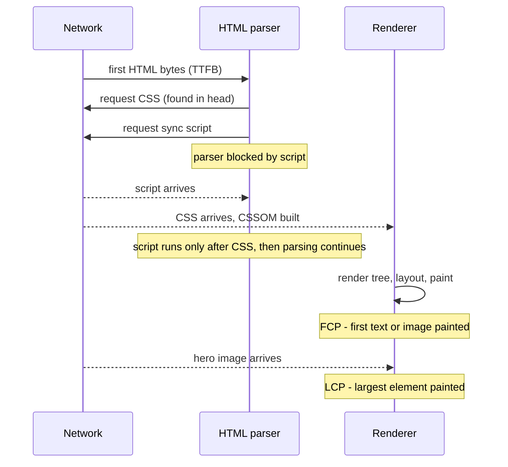

# Chapter 14 — Performance, SEO, Interview Prep and Cheat Sheets

A page can be semantic, accessible and beautifully laid out and still fail its users if it takes four seconds to show the main image, jumps around while loading, or freezes for half a second after every click. It can also fail its *owners* if search engines can't understand it. This last chapter covers both: **web performance** (the critical rendering path, render-blocking resources and Google's Core Web Vitals, measured on real pages in headless Chrome) and **SEO basics** (the HTML that helps search engines). It then turns the whole book into interview and revision material: 47 interview questions with answers linked back to the chapters, one-page cheat sheets, and a glossary of more than 200 terms.

**What you'll learn**

| # | Topic | You will be able to… |
|---|---|---|
| 14.1 | The critical rendering path | say what must happen before the first pixel and which resources are "critical" |
| 14.2 | Render-blocking resources | explain why CSS and synchronous scripts delay rendering, and fix it (measured: FCP 848 → 40 ms) |
| 14.3 | Core Web Vitals | define LCP, INP and CLS, their thresholds, and measure them with `PerformanceObserver` |
| 14.4 | Fixing each metric | apply a checklist for LCP, INP and CLS, plus the other performance basics |
| 14.5 | SEO basics | write the title, meta, canonical, structured data (JSON-LD) and semantic HTML search engines need |
| 14.6 | Interview questions | answer 47 common HTML/CSS interview questions |
| 14.7 | Cheat sheets | look up selectors, specificity, box model, flexbox, grid, units and responsive patterns |
| 14.8 | Glossary | find any term from the book and the chapter that explains it |

**How the numbers were made.** Performance only means something on a slow network, so [`code/serve.mjs`](code/serve.mjs) builds a **fake network** without starting a server: headless Chrome requests `http://site.test/<file>`, Puppeteer intercepts every request and answers from the `code/` folder after an artificial delay (for example "the stylesheet takes 800 ms"). Absolute timings are machine-dependent, but they repeat to within a few milliseconds from run to run. The metrics are read with the browser's own performance APIs (`PerformanceObserver`), the same APIs the `web-vitals` library and real-user monitoring tools use. Thresholds were checked on web.dev and SEO rules on Google Search Central in September 2026.

---

## 14.1 The critical rendering path

### What it is
The **critical rendering path** (CRP) is the minimum sequence of work the browser must finish before it can draw the first pixels of a page: download and parse the HTML into the **DOM**, download and parse the CSS into the **CSSOM**, combine them into the **render tree**, compute **layout**, **paint** and **composite**. [Chapter 1](../01-how-the-web-works/README.md#17-the-browser-rendering-pipeline) walked through each step; here we care about **what makes it slow**.

A resource is **critical** if the first render has to wait for it. By default:
- **CSS is render-blocking.** The browser won't paint until every stylesheet in `<head>` has loaded and been parsed; otherwise you'd see unstyled content that then jumps (a **FOUC**, flash of unstyled content).
- **Classic `<script>` without `async`/`defer` is parser-blocking.** The HTML parser stops, downloads the script, *waits for any pending stylesheets* (the script might read styles), runs it, and only then continues. Nothing below the script is in the DOM yet.
- **Images, fonts, `async`/`defer` scripts are not render-blocking** — but they can still delay the metrics users feel (the main image, text appearing).

### How it works — the timeline and its metrics



| Metric | Measures | Good (75th percentile of real visits) |
|---|---|---|
| **TTFB** (Time To First Byte) | Server + network until the first HTML byte | ≤ 0.8 s |
| **FCP** (First Contentful Paint) | First text/image painted | ≤ 1.8 s |
| **LCP** (Largest Contentful Paint) | Main content painted (Core Web Vital, 14.3) | ≤ 2.5 s |
| **INP**, **CLS** | Responsiveness and visual stability (Core Web Vitals) | ≤ 200 ms, ≤ 0.1 |

### The three levers
1. **Fewer critical resources** — inline small critical CSS, `defer` scripts, don't load what the first screen doesn't need.
2. **Fewer critical bytes** — minify and compress (gzip/Brotli/zstd), remove unused CSS/JS.
3. **Shorter critical path length** (round trips) — make critical resources discoverable in the HTML, preconnect to other origins, avoid chains (CSS that `@import`s CSS, JS that injects the main image).

### Self-check
1. Why is CSS render-blocking? → Painting before styles arrive would show unstyled content and then reflow it.
2. Why does a synchronous script also wait for CSS? → It might read computed styles, so the browser must apply pending stylesheets first.
3. What's the difference between render-blocking and parser-blocking? → Render-blocking delays painting; parser-blocking stops the HTML parser from building the rest of the DOM.

---

## 14.2 Render-blocking resources

### The experiment
The same small article page with three different `<head>`s. The stylesheet takes **800 ms** to arrive and the script **600 ms** ([`code/01_render_blocking.mjs`](code/01_render_blocking.mjs)).

[`code/01_blocking.html`](code/01_blocking.html) — the classic mistake:
```html
<link rel="stylesheet" href="01_styles.css">   <!-- render-blocking -->
<script src="01_app.js"></script>               <!-- parser-blocking -->
```
[`code/01_defer.html`](code/01_defer.html) — only the script fixed:
```html
<link rel="stylesheet" href="01_styles.css">
<script src="01_app.js" defer></script>
```
[`code/01_optimized.html`](code/01_optimized.html) — critical CSS inlined, the rest loaded without blocking:
```html
<style>/* only what the first screen needs */ body{…} header{…} main{…}</style>
<link rel="preload" href="01_styles.css" as="style" onload="this.onload = null; this.rel = 'stylesheet'">
<noscript><link rel="stylesheet" href="01_styles.css"></noscript>
<script src="01_app.js" defer></script>
```

Output:
```
01_blocking.html   FCP  848 ms   DOMContentLoaded  833 ms   load  834 ms   app.js ran at 833 ms
                   01_app.js blocking (done at 632 ms)  |  01_styles.css blocking (done at 833 ms)
01_defer.html      FCP  844 ms   DOMContentLoaded  833 ms   load  837 ms   app.js ran at 833 ms
                   01_app.js non-blocking (done at 631 ms)  |  01_styles.css blocking (done at 832 ms)
01_optimized.html  FCP   40 ms   DOMContentLoaded  631 ms   load  631 ms   app.js ran at 631 ms
                   01_app.js non-blocking (done at 630 ms)  |  01_styles.css non-blocking (done at 830 ms)
```
(`blocking`/`non-blocking` is Chrome's own classification, read from `PerformanceResourceTiming.renderBlockingStatus`; expect the millisecond values to differ slightly on your machine.)

What the numbers teach:
1. **Blocking**: nothing appears for ~850 ms. The script finished downloading at 632 ms but **ran at 833 ms** — it waited for the stylesheet.
2. **Only `defer`**: FCP didn't improve at all, because the stylesheet was the bottleneck. Fixing the wrong resource buys nothing — always find the *critical* one first. (`defer` still helps: the parser was never stopped.)
3. **Optimized**: first paint at **40 ms**, ~20× sooner. The full stylesheet still arrived at 830 ms and applied itself; the page was usable long before. Note also that `load` fired at 631 ms without waiting for the preloaded stylesheet.

### The toolbox

| Resource | Default | Better |
|---|---|---|
| Stylesheet | Render-blocking | Keep small; inline critical CSS (≈ first screen, a few KB); load the rest non-blocking; `media="print"` or a non-matching `media` makes a stylesheet non-blocking; split per page |
| Classic script in `<head>` | Parser-blocking | `defer` (runs in order after parsing, before `DOMContentLoaded`) or `async` (runs as soon as downloaded, any order — for independent scripts like analytics); `type="module"` is deferred by default |
| Web font | Text invisible until loaded (up to ~3 s) | `font-display: swap` or `optional`, `<link rel="preload" as="font" type="font/woff2" crossorigin>`, subset, self-host ([Chapter 11](../11-typography-color-and-visual-effects/README.md#112-loading-fonts-well-font-display-preload-subsetting)) |
| Main image | Discovered when the parser reaches it | In the HTML, `fetchpriority="high"`, never `loading="lazy"` above the fold ([Chapter 4](../04-images-media-and-embeds/README.md#44-loading-hints--loading-decoding-fetchpriority)) |
| Other origins (CDN, fonts) | DNS + TCP + TLS on first use | `<link rel="preconnect" href="https://cdn.example">` for the 1–3 most important |
| `@import` in CSS | Serial chain: CSS → discover → fetch CSS | `<link>` both files, or bundle |

```html
<!-- defer vs async -->
<script src="app.js" defer></script>        <!-- download in parallel, run after parsing, in order -->
<script src="analytics.js" async></script>  <!-- download in parallel, run ASAP, any order -->
<script type="module" src="main.js"></script>  <!-- deferred by default -->
```

**Related HTML features:** `rel="preload"` (Baseline widely available) fetches a resource you know you'll need early; `rel="modulepreload"` does the same for ES modules; `fetchpriority` (Baseline since October 2024) nudges priority; the `blocking="render"` attribute (make something *deliberately* render-blocking) is **not Baseline** (no Firefox); `<script type="speculationrules">` for prerendering the next page is **Chromium-only**. HTTP **103 Early Hints** lets a server send `Link: rel=preload` headers before the HTML is ready.

### Common mistakes
- Preloading everything → preloads compete with truly critical requests. Preload only late-discovered critical resources (a font referenced from CSS, a hero image set in CSS or JS).
- Forgetting `crossorigin` on font preloads → the font is downloaded twice.
- Moving scripts to the end of `<body>` *and* adding `defer` — fine, but `defer` in `<head>` is better: the download starts earlier.
- Inlining **all** CSS: it can't be cached across pages and bloats every HTML response.

### In the interview
**30-second answer:** "CSS in the head is render-blocking and classic scripts are parser-blocking; a script also waits for pending CSS. So I keep critical CSS small or inline it, load the rest without blocking, `defer` scripts (or `async` for independent ones), make the LCP image discoverable in the HTML with `fetchpriority=high`, preconnect to key origins, and avoid request chains like CSS `@import`."

- *Q: `async` vs `defer`?* A: Both download in parallel; `defer` runs after parsing, in document order; `async` runs as soon as it arrives, in any order, possibly mid-parse.
- *Q: Where should `<script>` go?* A: In `<head>` with `defer` (or `type="module"`), so the download starts early without blocking the parser.

### Self-check
1. Does `defer` fix a slow page whose stylesheet is the bottleneck? → No — measured: FCP 848 → 844 ms.
2. What does `onload="this.rel='stylesheet'"` on a preload do? → Turns the preloaded CSS into an applied stylesheet once it has loaded, without ever blocking render.
3. Which attribute makes `<link rel="stylesheet">` non-blocking? → A `media` that doesn't match (e.g. `print`); it's still downloaded, at low priority.

---

## 14.3 Core Web Vitals: LCP, INP, CLS

### What it is
**Core Web Vitals** are three metrics chosen by Google to capture the user experience of loading, interactivity and visual stability. They are measured on **real visits** ("field data"), and a page passes when the **75th percentile** of visits (mobile and desktop separately) is "good".

| Metric | Question it answers | Good | Needs improvement | Poor |
|---|---|---|---|---|
| **LCP** — Largest Contentful Paint | When did the main content appear? | ≤ 2.5 s | 2.5–4.0 s | > 4.0 s |
| **INP** — Interaction to Next Paint | How quickly does the page respond to clicks, taps and key presses? | ≤ 200 ms | 200–500 ms | > 500 ms |
| **CLS** — Cumulative Layout Shift | How much does content jump around unexpectedly? | ≤ 0.1 | 0.1–0.25 | > 0.25 |

INP **replaced First Input Delay (FID)** as a Core Web Vital in **March 2024**. FID only measured the *delay before the first* interaction's handler started; INP measures the *whole* time until the next frame is painted, for (almost) *all* interactions.

### How each is computed
**LCP**
1. Candidates are: ``, `<image>` inside SVG, `<video>` (poster or first frame), elements with a CSS `background-image: url()`, and block-level elements containing text.
2. Each time a larger candidate is painted, the browser emits a new `largest-contentful-paint` entry. The **last** entry before the user first interacts (click, tap, key press, scroll) is the LCP.
3. Its time breaks into four parts: **TTFB** → **resource load delay** (until the image request starts) → **resource load duration** → **element render delay**.

**INP**
1. For each discrete **interaction** (a click/tap = pointerdown + pointerup + click; a key press = keydown + keyup; hover and scroll don't count), the latency = **input delay** (main thread busy before handlers can run) + **processing time** (your handlers) + **presentation delay** (style, layout, paint until the next frame).
2. The page's INP is the **worst** interaction latency — or, on pages with many interactions, a high percentile (one outlier is ignored per 50 interactions).
3. The Event Timing API reports it, rounded to 8 ms; entries shorter than `durationThreshold` (default 104 ms, minimum 16 ms) are not reported.

**CLS**
1. Every time a *visible* element changes position between frames without the user causing it, the browser records a **layout shift** with a score = **impact fraction** (share of the viewport affected) × **distance fraction** (how far it moved, relative to the viewport).
2. Shifts within 500 ms of user input are excluded (`hadRecentInput`) — expected movement.
3. Shifts are grouped into **session windows** (gaps < 1 s, window ≤ 5 s); CLS = the **largest window's sum**.

### The experiment
Two versions of a product-guide page on a simulated phone (412×800) and slow network (CSS 300 ms, JS 800 ms, hero image 1800 ms). [`code/02_bad.html`](code/02_bad.html) makes the classic mistakes; [`code/02_fixed.html`](code/02_fixed.html) fixes them:

| | [`02_bad`](code/02_bad.js) | [`02_fixed`](code/02_fixed.js) |
|---|---|---|
| Script | Sync in `<head>` | `defer` |
| Hero image | Injected by JS after `DOMContentLoaded`, `loading="lazy"`, no `width`/`height` | In the HTML, `width="800" height="533"`, `fetchpriority="high"` |
| Promo banner (appears after 1 s) | Inserted above the content into an empty `<div>` | Inserted into a slot with `min-height` reserved |
| Click handler | 300 ms of synchronous work, then updates the UI | Updates the UI first, yields, then does the 300 ms in 50 ms chunks |

The key part of the fix for INP:

```js
const yieldToMain = () => globalThis.scheduler?.yield ? scheduler.yield() : new Promise(r => setTimeout(r, 0));

button.addEventListener('click', async () => {
  status.textContent = 'Saved ✓';           // 1. visible feedback first
  await yieldToMain();                        // 2. let the browser paint
  for (let i = 0; i < 6; i++) {               // 3. the same work, in small chunks
    busyFor(50);
    await yieldToMain();
  }
});
```

[`code/02_vitals.mjs`](code/02_vitals.mjs) installs three `PerformanceObserver`s before any page script runs, loads each page, waits, clicks the button like a user, and computes the metrics exactly as defined above:

```js
new PerformanceObserver(l => l.getEntries().forEach(e => v.lcp.push({ t: e.startTime, el: e.element?.tagName })))
  .observe({ type: 'largest-contentful-paint', buffered: true });
new PerformanceObserver(l => l.getEntries().forEach(e => v.shifts.push({ t: e.startTime, value: e.value, input: e.hadRecentInput })))
  .observe({ type: 'layout-shift', buffered: true });
new PerformanceObserver(l => l.getEntries().forEach(e => e.interactionId && v.events.push({ name: e.name, id: e.interactionId, d: e.duration })))
  .observe({ type: 'event', durationThreshold: 16, buffered: true });
// CLS = largest session window; INP = worst interaction (max duration per interactionId)
```

Output:
```
02_bad.html
  LCP 2648 ms  (element , candidates: <p> @844,  @2648)  -> needs improvement
  CLS 0.195  (shifts: 0.069 @1833ms, 0.126 @2638ms)  -> needs improvement
  INP 304 ms  (slow events in the click: pointerdown, pointerup, click)  -> needs improvement
02_fixed.html
  LCP 1844 ms  (element , candidates: <p> @340,  @1844)  -> good
  CLS 0.000  (shifts: none)  -> good
  INP < 16 ms  (slow events in the click: none)  -> good
```
(Timings are machine-dependent and vary by a few ms between runs; the fixed page's INP is sometimes reported as 16–24 ms.)


*Figure 14.1 — [`code/make_figures.mjs`](code/make_figures.mjs): screenshots requested at ~0.4, 1, 2 and 3 s; labels show when Chrome delivered each frame (the bad page can't be captured before its first paint at ~880 ms).*

Reading the results:
- **LCP 2648 → 1844 ms.** In the bad page the image request couldn't start until the blocking script (800 ms) had run and injected it: a **resource load delay** of ~850 ms before an 1800 ms download. In the fixed page the preload scanner (the browser's look-ahead parser) finds the `` in the HTML at once, so LCP ≈ the download time. The remaining 1.8 s is **resource load duration** — the next fix is a smaller image (`srcset`, AVIF/WebP — [Chapter 4](../04-images-media-and-embeds/README.md#43-responsive-images--srcset-sizes-and-picture)).
- **CLS 0.195 → 0.** Two shifts 0.8 s apart fell in one session window (0.069 + 0.126). Reserving space — `width`/`height` attributes give the image an `aspect-ratio`, `min-height` holds the banner's slot — removes both.
- **INP 304 ms → under 16 ms.** All three events of the click (pointerdown, pointerup, click) belong to one interaction; the 300 ms loop delayed the next paint for all of them. After the fix the feedback paints immediately; the same total work still runs, but in chunks between frames.

> **Two measurement gotchas.** (1) An early version of the fixed page still shifted by 15.7 px because its `height` attribute said 500 for an 800×**533** image — wrong dimensions are almost as bad as none. (2) Headless Chrome reported no Event Timing entries for a button outside its real (smaller) window, so [`code/serve.mjs`](code/serve.mjs) launches it with `--window-size=1200,1400`. Lab tooling has quirks — cross-check with field data.

### Field data vs lab data

| | Field (real users, "RUM") | Lab (synthetic) |
|---|---|---|
| Sources | Chrome UX Report (CrUX, 28-day rolling, public), Search Console's Core Web Vitals report, your own RUM with the `web-vitals` library | Lighthouse, PageSpeed Insights' lab section, WebPageTest, DevTools Performance panel, scripts like this chapter's |
| Strength | What users actually experience; what Google uses | Repeatable, debuggable, before release |
| INP | Measured | Needs a scripted interaction; Lighthouse's navigation mode reports **Total Blocking Time (TBT)** as a proxy |

**Browser support of the APIs** (web-features, September 2026): the LCP and Event Timing APIs are **Baseline newly available since December 2025** (Safari 26.2 added them). The **Layout Instability API** behind CLS is still **Chromium-only**, so CLS field data comes from Chrome users. The metrics apply to every browser's users; only measurement coverage differs.

### In the interview
**30-second answer:** "Core Web Vitals are LCP for loading — good is ≤ 2.5 s; INP for responsiveness — ≤ 200 ms; and CLS for visual stability — ≤ 0.1, all at the 75th percentile of real visits. INP replaced FID in March 2024. I measure field data with CrUX or the web-vitals library and debug in the lab with Lighthouse and DevTools. Typical fixes: make the LCP image discoverable and high-priority, break up long tasks and yield to the main thread, and reserve space for images, ads and late content."

- *Q: Why can't Lighthouse show INP on a page load?* A: INP needs real interactions; lab tools use TBT as a proxy or require a scripted user flow.
- *Q: Is a layout shift after a click counted?* A: Not if it happens within 500 ms of the input (`hadRecentInput`).
- *Q: Does a big font-swap count as CLS?* A: Yes, if text reflows and moves other content; match fallback metrics (`size-adjust`) or use `font-display: optional`.

### Self-check
1. Thresholds for "good"? → LCP ≤ 2.5 s, INP ≤ 200 ms, CLS ≤ 0.1, at the 75th percentile.
2. When does the browser stop reporting new LCP candidates? → At the first user input (click, tap, key press, scroll).
3. Why did the fixed page's image not count as a shift when it loaded? → Its box was already reserved by `width`/`height`, so nothing moved.

---

## 14.4 Fixing each metric (and the other basics)

### LCP checklist
1. **Find the LCP element** (DevTools Performance panel or `largest-contentful-paint` entries) and its four sub-parts.
2. **TTFB**: caching (CDN, HTTP cache headers), avoid redirects, server-side rendering or static generation for content pages.
3. **Load delay**: put the image in the HTML (not CSS/JS); `fetchpriority="high"`; never lazy-load it; preload if it must be referenced from CSS.
4. **Load duration**: right-sized responsive images (`srcset`/`sizes`), modern formats (AVIF/WebP), a CDN.
5. **Render delay**: remove render-blocking CSS/JS (14.2); avoid hiding content until JS runs (A/B testing snippets, client-only rendering).

### INP checklist
1. **Input delay**: break up **long tasks** (> 50 ms) during load; defer third-party scripts; don't run heavy work on a timer that collides with input.
2. **Processing**: do only the visible update in the handler; `await scheduler.yield()` (or `setTimeout`) before the rest; debounce input handlers; move heavy work to a Web Worker.
3. **Presentation**: keep the DOM small; avoid layout thrashing (reading layout after writing styles in a loop); use `content-visibility: auto` for long off-screen sections (Baseline since September 2025); prefer CSS animations on `transform`/`opacity` ([Chapter 12](../12-transitions-transforms-and-animation/README.md#127-performance-animate-transform-and-opacity)).

### CLS checklist
1. Always set **`width` and `height`** on images and videos (or CSS `aspect-ratio`) — correct values.
2. **Reserve space** for ads, embeds, banners and late-loading components (`min-height`, skeletons), or put them in an overlay (`position: fixed`) that doesn't push content.
3. Never insert content **above** existing content unless the user asked for it.
4. Fonts: `font-display: optional`, or tune the fallback with `size-adjust`/`ascent-override` so the swap doesn't reflow text.
5. Animate with `transform`, not `top`/`height` (transforms don't cause layout shifts).
6. Keep pages eligible for the **back/forward cache** (bfcache) — instant, shift-free back navigations (avoid `unload` handlers and `Cache-Control: no-store` where possible).

### Other performance basics
| Area | Practice |
|---|---|
| Transfer | Compression (Brotli/gzip/zstd), HTTP/2 or HTTP/3, long cache lifetimes for fingerprinted files (`app.3f9a1c.css`, `Cache-Control: max-age=31536000, immutable`) — [Chapter 1](../01-how-the-web-works/README.md#15-http-basics--requests-and-responses) |
| Images | Formats and responsive images ([Chapter 4](../04-images-media-and-embeds/README.md#42-image-formats--jpeg-png-gif-webp-avif-svg)); `loading="lazy"` below the fold |
| CSS | Remove unused CSS; avoid huge selectors on huge DOMs; `contain`/`content-visibility` for independent regions |
| JavaScript | Ship less; code-split per route; `defer`; audit third parties |
| Budgets | Set performance budgets (e.g. LCP < 2.5 s on a mid-range phone, JS < 200 KB compressed) and check them in CI with Lighthouse CI |

### Self-check
1. Name the four LCP sub-parts. → TTFB, resource load delay, resource load duration, element render delay.
2. What's a long task? → Main-thread work over 50 ms; it delays input handling.
3. Two ways to stop an image causing CLS? → `width`/`height` attributes or CSS `aspect-ratio` (with correct values).

---

## 14.5 SEO basics

### What it is
**Search engine optimization (SEO)** is making pages easy for search engines to **crawl** (fetch), **render** (Google runs JavaScript in an up-to-date Chromium), **index** (store and understand) and **rank**, and making the result attractive to click. Content quality and relevance matter most; HTML can't make a thin page rank. But broken HTML *can* keep a good page out of the index. This section covers the HTML side, following Google Search Central.

### The essentials, in the order a crawler meets them

| Item | HTML | Notes |
|---|---|---|
| Crawl permission | `robots.txt` at the site root | Blocks **crawling**, not indexing. A blocked URL can still be indexed from links; to keep a page out, allow crawling and use `noindex` |
| Index permission | `<meta name="robots" content="noindex">` (or `X-Robots-Tag` header) | The classic accident: a staging `noindex` shipped to production |
| Title | `<title>Specific page title \| Brand</title>` | Shown as the result's headline (Google may rewrite it). Unique per page; no hard length limit, but long titles are truncated by width — roughly 50–60 characters display fully |
| Description | `<meta name="description" content="…">` | Often used for the snippet; not a ranking signal; unique, specific; truncated around 150–160 characters |
| Canonical | `<link rel="canonical" href="https://…">` | Tells Google the preferred URL among duplicates (tracking parameters, `http`/`https`, `www`). A strong **hint**, not a directive. Absolute URLs recommended |
| Language | `<html lang="en">`; `<link rel="alternate" hreflang="de" href="…">` | `hreflang` links translated versions (include a self-reference and optionally `x-default`) |
| Mobile | `<meta name="viewport" content="width=device-width, initial-scale=1">` | Google indexes the **mobile** version of pages (mobile-first indexing) |
| Keywords meta | `<meta name="keywords">` | **Ignored** by Google Search |
| Social previews | `og:title`, `og:image`, … (Open Graph) | For link previews on social apps; not a Google ranking signal |
| Sitemap | `sitemap.xml`, listed in robots.txt / Search Console | Helps discovery of new or deep pages |

### Semantic HTML is SEO
Search engines read structure the same way assistive technology does ([Chapter 3](../03-semantic-html-and-accessibility/README.md#31-why-semantics-and-accessibility)):
- **Headings** describe the outline; one clear `<h1>` is a helpful convention (Google says multiple `<h1>`s are not a problem), and levels shouldn't skip.
- **Links** must be real `<a href>` elements (Google follows `href`, not `onclick`) with **descriptive text** — "Ridge loop route and map", not "click here".
- **Images**: `alt` text describes the image for image search and accessibility; use descriptive file names.
- **Landmarks and `<article>`/`<time>`** help identify the main content and dates.
- Content should be in the HTML or reliably rendered; content that needs a click to load may never be seen.

### Structured data (JSON-LD)
**Structured data** describes the page's content with the **schema.org** vocabulary in a machine-readable form, so search engines can show **rich results** (breadcrumbs, product price and rating, recipe cards, article dates). Google supports JSON-LD, Microdata and RDFa, and **recommends JSON-LD**: a `<script type="application/ld+json">` block, separate from the visible markup.

```html
<script type="application/ld+json">
{
  "@context": "https://schema.org",
  "@type": "Article",
  "headline": "Summer Trail Guide: 5 Evening Hikes Near Denver",
  "image": ["https://www.trailshop.example/img/hills-1200.jpg"],
  "datePublished": "2026-06-01T08:00:00-06:00",
  "dateModified": "2026-06-15T09:30:00-06:00",
  "author": [{ "@type": "Person", "name": "Maya Ortiz", "url": "https://www.trailshop.example/team/maya" }]
}
</script>
```

Rules: the data must describe what's **visible** on the page; include each rich-result type's **required** properties (Article has none required; the ones above are Google's recommended set); valid JSON (no trailing commas, double quotes). Structured data makes a page *eligible* for rich results; it **doesn't guarantee** them and isn't a direct ranking boost. Google also restricts or retires rich-result types over time (FAQ and HowTo results were cut back in 2023), so check the current Search Gallery. Test with Google's **Rich Results Test** and the **Schema Markup Validator**.

### The experiment
[`code/03_seo_audit.mjs`](code/03_seo_audit.mjs) is a small on-page checker built on jsdom (it parses HTML like a crawler's first pass). It audits [`code/03_seo_bad.html`](code/03_seo_bad.html) — `div` soup with an accidental `noindex`, a relative canonical, two `<h1>`s, no `alt`, "Click here" and a JSON-LD block with a trailing comma — and [`code/03_seo_good.html`](code/03_seo_good.html):

Output:
```
03_seo_bad.html
  FAIL  doctype present (standards mode)
  FAIL  <html lang> = null
  FAIL  <title> 4 chars: "Home"
  FAIL  meta description missing
  FAIL  meta viewport (mobile-friendly)
  FAIL  robots: "noindex"
  FAIL  canonical: /guide (absolute URL recommended)
  NOTE  meta keywords present — ignored by Google, harmless but useless
  FAIL  one <h1> (found 2) — a clarity convention, not a Google rule
  FAIL  heading levels 1→1→4 (skips a level)
  FAIL  <main> landmark
  FAIL  images without alt: 1
  FAIL  vague link text: "Click here"
  FAIL  JSON-LD does not parse: Expected double-quoted property name in JSON at position 95 (line 2 column 95)
  score: 0/13

03_seo_good.html
  PASS  doctype present (standards mode)
  PASS  <html lang> = "en"
  PASS  <title> 60 chars: "Summer Trail Guide: 5 Evening Hikes Near Denver | Trail Shop"
  PASS  meta description 136 chars
  PASS  meta viewport (mobile-friendly)
  PASS  robots: "(none = index, follow)"
  PASS  canonical: https://www.trailshop.example/guides/summer-trails (absolute URL recommended)
  ...   (headings, <main>, alt text and link text all pass)
  PASS  JSON-LD Article: recommended properties present
  PASS  JSON-LD BreadcrumbList: recommended properties present
  score: 14/14
```

The single most damaging line in the bad page is `noindex`: every other fix is wasted while it's there. The trailing comma in JSON-LD is the second classic: the whole block is ignored silently.

### Performance and SEO
Core Web Vitals are part of Google's page-experience signals: good vitals help, but relevance dominates — a fast page with poor content won't outrank a slower, better answer. Treat performance as a user-experience goal, and SEO as a side benefit.

### Common mistakes
- Client-only rendering of content pages with empty initial HTML (rendering may be delayed; other crawlers and social previews may not run JS at all). Prefer server rendering or static generation.
- Blocking CSS/JS in `robots.txt` → Google can't render the page properly.
- Same `<title>`/description on every page; canonical pointing to the home page from every page.
- Links built with `<span onclick>` or `<a>` without `href`.

### In the interview
**30-second answer:** "For SEO the HTML needs a unique, descriptive title and meta description, a canonical URL, `lang` and viewport, no accidental `noindex`, semantic structure — headings, landmarks, real links with descriptive text, alt text — and structured data in JSON-LD using schema.org to become eligible for rich results. Content should be server-rendered or reliably renderable, and good Core Web Vitals help as part of page experience."

### Self-check
1. Does `robots.txt` `Disallow` keep a page out of Google's index? → No, it prevents crawling; use `noindex` on a crawlable page.
2. Is `rel="canonical"` a command? → No, a strong hint Google usually follows.
3. Which structured-data format does Google recommend? → JSON-LD.

---

## 14.6 Interview questions

Forty-seven questions that come up in front-end interviews, with short answers and links to the full explanation. Cover the answer, say yours out loud, then check.

### HTML and accessibility
1. **What does `<!doctype html>` do?** → Puts the browser in standards mode (without it: quirks mode with legacy layout rules). [§2.2](../02-html-structure-and-text/README.md#22-document-structure-and-the-doctype)
2. **Why is `<meta charset="utf-8">` first in `<head>`?** → It must be within the first 1024 bytes so the parser decodes the rest correctly. [§2.3](../02-html-structure-and-text/README.md#23-the-head-metadata-that-matters)
3. **Block vs inline elements?** → Block boxes start on a new line and take the available width; inline boxes flow within text. It's CSS `display`, not the element "type". [§7.4](../07-box-model-and-layout-basics/README.md#74-display)
4. **`<section>` vs `<article>` vs `<div>`?** → `<article>` is self-contained (could be syndicated); `<section>` is a thematic group with a heading; `<div>` has no meaning. [§3.2](../03-semantic-html-and-accessibility/README.md#32-landmarks)
5. **What are landmarks and why do they matter?** → `header`, `nav`, `main`, `aside`, `footer` (and `form`/`section` with a name) map to ARIA landmark roles that screen-reader users jump between. [§3.2](../03-semantic-html-and-accessibility/README.md#32-landmarks)
6. **What is the first rule of ARIA?** → Don't use ARIA if a native element does the job; no ARIA is better than bad ARIA. [§3.6](../03-semantic-html-and-accessibility/README.md#36-aria)
7. **How do you write good alt text?** → Describe the image's purpose in context; `alt=""` for decorative images; never omit `alt`. [§3.5](../03-semantic-html-and-accessibility/README.md#35-alt-text)
8. **`<button>` vs `<a>`?** → Links navigate (have `href`); buttons perform actions. Both are keyboard-accessible natively; a `div` with `onclick` is not. [§3.7](../03-semantic-html-and-accessibility/README.md#37-keyboard-and-focus)
9. **How do you label a form field accessibly?** → `<label for="id">` (or wrap the input); group radios with `fieldset`/`legend`; link errors with `aria-describedby`. [§3.8](../03-semantic-html-and-accessibility/README.md#38-accessible-forms), [§5.7](../05-tables-and-forms/README.md#57-accessible-error-messages)
10. **GET vs POST forms?** → GET puts fields in the URL (bookmarkable, for searches); POST sends them in the body (for changes, sensitive data). [§5.2](../05-tables-and-forms/README.md#52-how-a-form-works--action-method-name)
11. **How do `srcset` and `sizes` work?** → `srcset` lists candidate files with widths; `sizes` tells the browser how wide the image will display; it picks the smallest adequate file for the screen's density. [§4.3](../04-images-media-and-embeds/README.md#43-responsive-images--srcset-sizes-and-picture)
12. **When do you use `<picture>`?** → Art direction (different crops per breakpoint) or format fallbacks (AVIF → WebP → JPEG). [§4.3](../04-images-media-and-embeds/README.md#43-responsive-images--srcset-sizes-and-picture)
13. **What does WCAG AA require for text contrast?** → 4.5:1 for normal text, 3:1 for large text and UI components. [§3.9](../03-semantic-html-and-accessibility/README.md#39-wcag-22)

### CSS fundamentals
14. **How is specificity calculated?** → (IDs, classes/attributes/pseudo-classes, types/pseudo-elements), compared left to right; inline styles beat selectors; `!important` changes the origin ordering. [§6.4](../06-css-fundamentals/README.md#64-specificity)
15. **What decides which declaration wins?** → Origin and importance, then context, then inline style, then cascade layer, then specificity, then (for `@scope` rules) scope proximity, then order of appearance. [§6.5](../06-css-fundamentals/README.md#65-the-cascade-and-origins)
16. **Pseudo-class vs pseudo-element?** → `:hover` selects an element in a state; `::before` creates/selects a part of an element. [§6.3](../06-css-fundamentals/README.md#63-pseudo-classes-and-pseudo-elements)
17. **Which properties inherit?** → Mostly text properties (colour, font, line-height); box properties (margin, border, width) don't. `inherit`, `initial`, `unset`, `revert` control it. [§6.6](../06-css-fundamentals/README.md#66-inheritance)
18. **`em` vs `rem`?** → `em` is relative to the element's own font size (the parent's for `font-size`); `rem` to the root's. Use `rem` for predictable scaling. [§6.7](../06-css-fundamentals/README.md#67-units)
19. **What are custom properties and how do they differ from Sass variables?** → Live, inherited values that can change per element and at runtime; Sass variables disappear at compile time. [§6.9](../06-css-fundamentals/README.md#69-custom-properties-css-variables), [§13.12](../13-modern-css-and-architecture/README.md#1312-preprocessors-sass-and-postcss)
20. **`:is()` vs `:where()`?** → Same matching; `:is()` takes its most specific argument's specificity, `:where()` is zero. [§13.2](../13-modern-css-and-architecture/README.md#132-is-and-where)
21. **What does `:has()` enable?** → Selecting an element by what it contains or what follows it — a parent/previous-sibling selector. [§13.3](../13-modern-css-and-architecture/README.md#133-has--the-relational-parent-selector)
22. **How do cascade layers help?** → They order groups of rules before specificity is considered, ending specificity wars with third-party CSS. [§13.4](../13-modern-css-and-architecture/README.md#134-cascade-layers-layer)

### Box model and layout
23. **Explain the box model and `box-sizing`.** → Content + padding + border + margin; `content-box` sizes the content only, `border-box` includes padding and border. [§7.1](../07-box-model-and-layout-basics/README.md#71-the-box-model), [§7.2](../07-box-model-and-layout-basics/README.md#72-box-sizing)
24. **What is margin collapsing?** → Adjacent vertical margins of blocks in normal flow combine into the larger one; not in flex/grid containers or across a BFC boundary. [§7.3](../07-box-model-and-layout-basics/README.md#73-margin-collapsing)
25. **Explain `position` values.** → `static` (normal), `relative` (offset, keeps its space), `absolute` (out of flow, relative to the nearest positioned ancestor), `fixed` (viewport), `sticky` (relative until a threshold, then sticks within its container). [§7.6](../07-box-model-and-layout-basics/README.md#76-positioning)
26. **Why doesn't my `z-index` work?** → It only applies to positioned (or flex/grid) items, and it's compared within the same stacking context; a parent with `opacity < 1`, `transform` etc. creates a new one. [§7.8](../07-box-model-and-layout-basics/README.md#78-z-index-and-stacking-contexts)
27. **What is a block formatting context (BFC)?** → An independent layout region: contains floats, prevents margin collapse with children; created by `display: flow-root`, flex/grid items, `overflow` other than `visible`/`clip`, etc. [§7.5](../07-box-model-and-layout-basics/README.md#75-normal-flow-and-formatting-contexts)
28. **What does `flex: 1` mean?** → `flex: 1 1 0%`: grow equally from a zero basis, allowed to shrink. [§8.4](../08-flexbox/README.md#84-the-flex-shorthand-and-minimum-sizes)
29. **Why does a flex item with long text overflow instead of shrinking?** → Its automatic minimum size is `min-width: auto` (its content); set `min-width: 0` (making it a scroll container with `overflow: hidden`/`auto` also works; `overflow: clip` does not). [§8.4](../08-flexbox/README.md#84-the-flex-shorthand-and-minimum-sizes)
30. **How do you center something horizontally and vertically?** → `display: grid; place-items: center` (or flex with `justify-content` and `align-items: center`). [§8.7](../08-flexbox/README.md#87-common-patterns)
31. **Flexbox or Grid?** → Flexbox for one-dimensional content-driven layout (rows of items); Grid for two-dimensional, layout-driven structure (rows and columns together). [§9.8](../09-grid/README.md#98-grid-vs-flexbox)
32. **`auto-fill` vs `auto-fit`?** → Both create as many tracks as fit; `auto-fit` collapses empty ones so items stretch. [§9.3](../09-grid/README.md#93-repeat-auto-fill-and-auto-fit)
33. **What is subgrid for?** → Letting nested items align to the parent grid's tracks (e.g. card titles aligned across cards). [§9.7](../09-grid/README.md#97-subgrid)

### Responsive, visual and motion
34. **What does the viewport meta tag do?** → Tells mobile browsers to lay out at the device width instead of a ~980px virtual desktop. [§10.2](../10-responsive-design/README.md#102-the-viewport-meta-tag-and-viewport-units)
35. **Mobile-first — what and why?** → Base styles for small screens, `min-width` queries add complexity; simpler CSS and faster phones. [§10.4](../10-responsive-design/README.md#104-mobile-first-in-practice)
36. **Media queries vs container queries?** → Media queries respond to the viewport; container queries to the size of a component's container — reusable components. [§10.6](../10-responsive-design/README.md#106-container-queries)
37. **How does `clamp()` give fluid typography?** → `clamp(min, preferred, max)` with a viewport-relative preferred value (plus `rem` so zoom still works). [§10.7](../10-responsive-design/README.md#107-fluid-typography-with-clamp)
38. **How do you make a web font load without invisible text?** → `font-display: swap` (or `optional`), preload the WOFF2, subset it. [§11.2](../11-typography-color-and-visual-effects/README.md#112-loading-fonts-well-font-display-preload-subsetting)
39. **Which properties are cheap to animate and why?** → `transform` and `opacity`: the compositor can animate them without layout or paint. [§12.7](../12-transitions-transforms-and-animation/README.md#127-performance-animate-transform-and-opacity)
40. **How do you respect users who get motion sickness?** → Wrap non-essential motion in `@media (prefers-reduced-motion: no-preference)` or reduce it under `reduce`. [§12.9](../12-transitions-transforms-and-animation/README.md#129-reduced-motion-and-accessibility)

### Architecture, performance and SEO
41. **BEM vs CSS Modules vs Tailwind?** → Convention (flat unique class names) vs build-time renamed classes vs generated single-purpose utilities; all fight the global namespace. [§13.11](../13-modern-css-and-architecture/README.md#1311-choosing-an-approach)
42. **How do you implement dark mode with a user toggle?** → Semantic tokens with `light-dark()`, `color-scheme: light dark`, a `data-theme` override that pins `color-scheme`, saved in localStorage and applied before first paint. [§13.14](../13-modern-css-and-architecture/README.md#1314-theming-and-dark-mode-with-custom-properties)
43. **What happens when you type a URL and press Enter?** → DNS, TCP/TLS, HTTP request/response, parsing, DOM/CSSOM, render tree, layout, paint, composite. [§1.6](../01-how-the-web-works/README.md#16-what-happens-when-you-type-a-url-and-press-enter)
44. **What are render-blocking resources?** → Stylesheets (block paint) and synchronous scripts (block parsing); fix with critical CSS, `defer`/`async`. [§14.2](#142-render-blocking-resources)
45. **What are the Core Web Vitals and their thresholds?** → LCP ≤ 2.5 s, INP ≤ 200 ms, CLS ≤ 0.1 at p75. [§14.3](#143-core-web-vitals-lcp-inp-cls)
46. **How do you prevent layout shift from images?** → `width`/`height` attributes (correct ratio) or `aspect-ratio`. [§14.4](#144-fixing-each-metric-and-the-other-basics)
47. **What HTML matters for SEO?** → Title, description, canonical, lang, viewport, no stray `noindex`, headings, real links, alt, JSON-LD. [§14.5](#145-seo-basics)

---

## 14.7 Cheat sheets

### Selectors
| Selector | Matches | Specificity |
|---|---|---|
| `*` | every element | (0,0,0) |
| `p` | type | (0,0,1) |
| `.card` | class | (0,1,0) |
| `#main` | id | (1,0,0) |
| `[type="email"]`, `[href^="https"]`, `[href$=".pdf"]`, `[class*="icon"]`, `[lang\|="en"]` | attribute: equals / starts / ends / contains / language prefix | (0,1,0) |
| `A B` | descendant | sum |
| `A > B` | child | sum |
| `A + B` | next sibling | sum |
| `A ~ B` | any later sibling | sum |
| `:hover :focus :focus-visible :focus-within :active :visited` | user action state | (0,1,0) each |
| `:checked :disabled :required :invalid :user-invalid :placeholder-shown` | form state | (0,1,0) |
| `:first-child :last-child :nth-child(2n+1) :nth-of-type(3) :only-child :empty` | structure | (0,1,0) |
| `:nth-child(2 of .item)` | nth among matches | (0,1,0) + argument |
| `:not(X) :is(X) :has(X)` | logic | most specific argument |
| `:where(X)` | logic | (0,0,0) |
| `::before ::after ::marker ::placeholder ::selection ::first-line ::backdrop` | parts | (0,0,1) |
| `&` (nesting) | parent rule's selector | as `:is(parent)` |

Details: [§6.2](../06-css-fundamentals/README.md#62-selectors), [§6.3](../06-css-fundamentals/README.md#63-pseudo-classes-and-pseudo-elements), [§13.1–13.3](../13-modern-css-and-architecture/README.md#131-native-css-nesting).

### Specificity and the cascade
- Score = (A = IDs, B = classes + attributes + pseudo-classes, C = types + pseudo-elements); compare A, then B, then C. `*` and combinators add nothing.
- The cascade, strongest criterion first: **origin & `!important`** (transition > `!important` UA > `!important` user > `!important` author > animation > author > user > UA) → **context** (shadow DOM) → **inline `style`** → **layers** (later wins; unlayered last; reversed for `!important`) → **specificity** → **scope proximity** (`@scope`) → **order of appearance**.
- Keywords: `inherit` (parent's value), `initial` (spec default), `unset` (inherit if inherited property, else initial), `revert` (browser/user value), `revert-layer` (previous layers' value).

Worked examples: `#nav .item a` = (1,1,1); `ul li:nth-child(2)` = (0,1,2); `a:not(.btn, #x)` = (1,0,1); `:where(#x) .y` = (0,1,0). [§6.4](../06-css-fundamentals/README.md#64-specificity)

### Box model
```
margin  →  border  →  padding  →  content
content-box:  width = content          total = width + padding + border (+ margin)
border-box:   width = content + padding + border
```
- Vertical margins between blocks in normal flow **collapse** (largest wins); not in flex/grid, not through padding/border, not inside a BFC. [§7.3](../07-box-model-and-layout-basics/README.md#73-margin-collapsing)
- Percentage padding/margin are relative to the **containing block's inline size** — its width in horizontal text, even for top/bottom.
- `display`: `block`, `inline`, `inline-block`, `flex`, `inline-flex`, `grid`, `flow-root` (new BFC), `contents` (box removed, children stay — careful with accessibility), `none` (removed from layout and accessibility tree).
- Positioning: `relative` → offset; `absolute` → nearest positioned ancestor; `fixed` → viewport (or a transformed ancestor); `sticky` → scroll threshold. `inset: 0` = `top/right/bottom/left: 0`.

### Flexbox
| Container | Values (default first) |
|---|---|
| `display` | `flex` \| `inline-flex` |
| `flex-direction` | `row` \| `row-reverse` \| `column` \| `column-reverse` |
| `flex-wrap` | `nowrap` \| `wrap` \| `wrap-reverse` |
| `flex-flow` | shorthand: direction + wrap |
| `justify-content` (main axis) | `flex-start`/`normal` \| `center` \| `flex-end` \| `space-between` \| `space-around` \| `space-evenly` |
| `align-items` (cross axis, per line) | `stretch`/`normal` \| `flex-start` \| `center` \| `flex-end` \| `baseline` |
| `align-content` (lines, when wrapping) | `normal` \| `flex-start` \| `center` \| `space-between` \| `stretch` … |
| `gap`, `row-gap`, `column-gap` | spacing between items |

| Item | Values |
|---|---|
| `flex-grow` | `0` — share of free space |
| `flex-shrink` | `1` — share of overflow to absorb (weighted by basis) |
| `flex-basis` | `auto` — starting size before grow/shrink |
| `flex` | `initial` = `0 1 auto`; `auto` = `1 1 auto`; `none` = `0 0 auto`; `1` = `1 1 0%` |
| `align-self` | overrides `align-items` for one item |
| `order` | `0` — visual order only (keyboard/reading order unchanged) |
| `min-width: 0` | lets items shrink below their content (`overflow: clip` doesn't; `hidden`/`auto` do) |

[Chapter 8](../08-flexbox/README.md#81-flex-container-and-flex-items)

### Grid
| Container | Example |
|---|---|
| `grid-template-columns` / `-rows` | `200px 1fr 2fr`, `repeat(3, 1fr)`, `repeat(auto-fit, minmax(16rem, 1fr))` |
| `grid-template-areas` | `"head head" "side main" "foot foot"` |
| `grid-auto-rows` / `-columns` | size of implicit tracks: `minmax(100px, auto)` |
| `grid-auto-flow` | `row` \| `column` \| `dense` |
| `gap` | `1rem 2rem` (row column) |
| `justify-items` / `align-items` / `place-items` | align items inside their cells |
| `justify-content` / `align-content` | align the whole grid inside the container |

| Item | Example |
|---|---|
| `grid-column` / `grid-row` | `1 / 3`, `2 / span 2`, `1 / -1` (full width) |
| `grid-area` | `main` (named area) or `1 / 1 / 3 / 3` |
| `justify-self` / `align-self` / `place-self` | per-item alignment |
| `grid-template-columns: subgrid` | reuse the parent's tracks |

Track sizes: `px`/`rem`, `%`, `fr` (share of free space), `auto`, `min-content`, `max-content`, `fit-content(300px)`, `minmax(min, max)`. [Chapter 9](../09-grid/README.md#92-defining-tracks)

### Units
| Unit | Relative to | Typical use |
|---|---|---|
| `px` | CSS pixel (1/96 in; scales with zoom and device pixel ratio) | borders, small fixed details |
| `rem` | root font size (16px default) | font sizes, spacing |
| `em` | own font size (parent's for `font-size`) | padding that scales with text |
| `%` | containing block (varies by property) | fluid widths |
| `ch` / `ex` / `lh` | width of "0" / x-height / line height | `max-width: 65ch` for readable lines |
| `vw` / `vh` | 1% of viewport width / height | full-screen sections |
| `svh` / `lvh` / `dvh` | small / large / dynamic viewport height (mobile toolbars) | `min-height: 100dvh` |
| `vi` / `vb` | viewport inline / block size | writing-mode-aware |
| `cqi` / `cqw` / `cqb` | container query inline / width / block | component-relative type |
| `fr` | free space in a grid | grid tracks |
| `deg` `turn` `ms` `s` | angles, time | transforms, transitions |

[§6.7](../06-css-fundamentals/README.md#67-units), [§10.2](../10-responsive-design/README.md#102-the-viewport-meta-tag-and-viewport-units)

### Responsive patterns
```html
<meta name="viewport" content="width=device-width, initial-scale=1">
```
```css
/* mobile-first breakpoints (range syntax) */
.layout { display: grid; gap: 1rem; }
@media (width >= 48rem) { .layout { grid-template-columns: 16rem 1fr; } }

/* intrinsic grid, no breakpoints */
.cards { display: grid; grid-template-columns: repeat(auto-fit, minmax(min(16rem, 100%), 1fr)); gap: 1rem; }

/* component responds to its container */
.card-wrap { container-type: inline-size; }
@container (inline-size >= 30rem) { .card { display: flex; } }

/* fluid type and space */
h1 { font-size: clamp(1.75rem, 1.2rem + 2.5vw, 3rem); }

/* user preferences */
@media (prefers-color-scheme: dark) { /* or use light-dark() tokens */ }
@media (prefers-reduced-motion: reduce) { * { animation: none; } }

/* images */
img { max-width: 100%; height: auto; }
```
```html
= 48rem) 50vw, 100vw" width="800" height="533" alt="…">
```
[Chapter 10](../10-responsive-design/README.md#101-what-responsive-design-is)

### HTML head starter
```html
<!doctype html>
<html lang="en">
<head>
  <meta charset="utf-8">
  <meta name="viewport" content="width=device-width, initial-scale=1">
  <title>Page title | Site</title>
  <meta name="description" content="What this page offers, in one or two sentences.">
  <link rel="canonical" href="https://example.com/page">
  <meta name="color-scheme" content="light dark">
  <link rel="preload" href="/fonts/inter.woff2" as="font" type="font/woff2" crossorigin>
  <link rel="stylesheet" href="/css/site.3f9a1c.css">
  <script src="/js/app.8b2e0d.js" defer></script>
  <link rel="icon" href="/favicon.svg" type="image/svg+xml">
</head>
```

---

## 14.8 Glossary

Alphabetical. Each term links to the chapter (and usually the section) that explains it.

| Term | Meaning | Where |
|---|---|---|
| `!important` | Flag that moves a declaration to a higher-priority "important" origin level | [§6.5](../06-css-fundamentals/README.md#65-the-cascade-and-origins) |
| `@container` | Container query rule | [§10.6](../10-responsive-design/README.md#106-container-queries) |
| `@font-face` | Declares a web font and its files | [§11.1](../11-typography-color-and-visual-effects/README.md#111-fonts) |
| `@import` | Loads another stylesheet (can add a layer) | [§6.1](../06-css-fundamentals/README.md#61-syntax-and-adding-css-to-a-page) |
| `@keyframes` | Named animation timeline | [§12.5](../12-transitions-transforms-and-animation/README.md#125-keyframe-animations) |
| `@layer` | Cascade layer | [§13.4](../13-modern-css-and-architecture/README.md#134-cascade-layers-layer) |
| `@media` | Media query rule | [§10.3](../10-responsive-design/README.md#103-media-queries) |
| `@property` | Registers a typed custom property | [§13.14](../13-modern-css-and-architecture/README.md#1314-theming-and-dark-mode-with-custom-properties) |
| `@scope` | Limits rules to a subtree, optionally with a lower bound | [§13.5](../13-modern-css-and-architecture/README.md#135-scope) |
| `@starting-style` | Style to transition *from* when an element first renders | [§12.8](../12-transitions-transforms-and-animation/README.md#128-enter-and-exit-animations-starting-style-and-allow-discrete) |
| `@supports` | Feature query | [§6.1](../06-css-fundamentals/README.md#61-syntax-and-adding-css-to-a-page) |
| Absolute positioning | Out of flow, placed relative to the nearest positioned ancestor | [§7.6](../07-box-model-and-layout-basics/README.md#76-positioning) |
| Absolute URL | URL with scheme and host | [§1.2](../01-how-the-web-works/README.md#12-urls--the-address-of-everything) |
| Accessibility tree | The browser's tree of roles, names and states for assistive tech | [§3.4](../03-semantic-html-and-accessibility/README.md#34-the-accessibility-tree) |
| Accessible name | What a screen reader announces for an element | [§3.4](../03-semantic-html-and-accessibility/README.md#34-the-accessibility-tree) |
| `alt` text | Text alternative for an image | [§3.5](../03-semantic-html-and-accessibility/README.md#35-alt-text) |
| ARIA | Attributes that add roles/states/properties for assistive technology | [§3.6](../03-semantic-html-and-accessibility/README.md#36-aria) |
| `aria-describedby` | Links an element to its description (e.g. an error) | [§5.7](../05-tables-and-forms/README.md#57-accessible-error-messages) |
| `aspect-ratio` | Preferred width/height ratio of a box; `` sets it automatically | [§4.1](../04-images-media-and-embeds/README.md#41-the-img-element) |
| `async` (script) | Download in parallel, run as soon as available | [§14.2](#142-render-blocking-resources) |
| Attribute | Name/value pair on an element | [§2.1](../02-html-structure-and-text/README.md#21-elements-tags-and-attributes) |
| Attribute selector | `[name="value"]` and variants | [§6.2](../06-css-fundamentals/README.md#62-selectors) |
| `autocomplete` | Hints the browser what data a field wants | [§5.6](../05-tables-and-forms/README.md#56-autocomplete--help-the-browser-fill-the-form) |
| AVIF | Modern image format with strong compression | [§4.2](../04-images-media-and-embeds/README.md#42-image-formats--jpeg-png-gif-webp-avif-svg) |
| Baseline | web-features status: works in all major browsers (newly / widely available) | [§13 intro](../13-modern-css-and-architecture/README.md) |
| BEM | Block__Element--Modifier naming convention | [§13.7](../13-modern-css-and-architecture/README.md#137-why-css-needs-an-architecture--and-bem) |
| bfcache | Back/forward cache: instant back navigations | [§14.4](#144-fixing-each-metric-and-the-other-basics) |
| Block axis | Direction in which blocks/lines stack | [§13.6](../13-modern-css-and-architecture/README.md#136-logical-properties) |
| Block formatting context (BFC) | Independent layout region for block boxes | [§7.5](../07-box-model-and-layout-basics/README.md#75-normal-flow-and-formatting-contexts) |
| Block-level element | Starts on a new line and fills the width | [§7.4](../07-box-model-and-layout-basics/README.md#74-display) |
| `border-box` | `box-sizing` in which width includes padding and border | [§7.2](../07-box-model-and-layout-basics/README.md#72-box-sizing) |
| Box model | Content, padding, border, margin | [§7.1](../07-box-model-and-layout-basics/README.md#71-the-box-model) |
| Breakpoint | Width at which a layout changes | [§10.3](../10-responsive-design/README.md#103-media-queries) |
| Canonical URL | Preferred URL among duplicates (`rel="canonical"`) | [§14.5](#145-seo-basics) |
| Canvas | Scriptable bitmap drawing surface | [§4.9](../04-images-media-and-embeds/README.md#49-canvas--an-introduction) |
| Cascade | Algorithm that picks the winning declaration | [§6.5](../06-css-fundamentals/README.md#65-the-cascade-and-origins) |
| Cascade layer | Named, ordered group of rules | [§13.4](../13-modern-css-and-architecture/README.md#134-cascade-layers-layer) |
| Character reference | `&amp;`, `&#169;` — escapes in HTML | [§2.9](../02-html-structure-and-text/README.md#29-character-references-and-comments) |
| `clamp()` | Value clamped between a min and max | [§10.7](../10-responsive-design/README.md#107-fluid-typography-with-clamp) |
| CLS | Cumulative Layout Shift — visual stability metric | [§14.3](#143-core-web-vitals-lcp-inp-cls) |
| `color-mix()` | Mixes two colours in a colour space | [§11.4](../11-typography-color-and-visual-effects/README.md#114-colour-and-contrast) |
| `color-scheme` | Declares supported light/dark schemes | [§10.5](../10-responsive-design/README.md#105-user-preference-media-queries) |
| Combinator | Relationship between selectors (space, `>`, `+`, `~`) | [§6.2](../06-css-fundamentals/README.md#62-selectors) |
| Composite | Final step: combining layers into the screen image | [§1.7](../01-how-the-web-works/README.md#17-the-browser-rendering-pipeline) |
| Compositor-only properties | `transform`, `opacity` — animate without layout/paint | [§12.7](../12-transitions-transforms-and-animation/README.md#127-performance-animate-transform-and-opacity) |
| Computed value | Value after cascade and inheritance, before layout | [§6.10](../06-css-fundamentals/README.md#610-how-it-all-fits-together) |
| Constraint Validation API | JS API behind built-in form validation | [§5.5](../05-tables-and-forms/README.md#55-built-in-validation-and-the-constraint-validation-api) |
| Container query | Styles based on a container's size | [§10.6](../10-responsive-design/README.md#106-container-queries) |
| Containing block | Box that percentages and positions are resolved against | [§7.6](../07-box-model-and-layout-basics/README.md#76-positioning) |
| `content-visibility` | Skips rendering off-screen content | [§14.4](#144-fixing-each-metric-and-the-other-basics) |
| Core Web Vitals | LCP, INP and CLS | [§14.3](#143-core-web-vitals-lcp-inp-cls) |
| Critical CSS | CSS needed for the first screen, often inlined | [§14.2](#142-render-blocking-resources) |
| Critical rendering path | Work required before the first render | [§14.1](#141-the-critical-rendering-path) |
| CrUX | Chrome UX Report — public field data | [§14.3](#143-core-web-vitals-lcp-inp-cls) |
| CSS Modules | Build-time locally scoped class names | [§13.9](../13-modern-css-and-architecture/README.md#139-css-modules) |
| CSS-in-JS | Styles authored in JavaScript | [§13.10](../13-modern-css-and-architecture/README.md#1310-css-in-js) |
| CSSOM | CSS Object Model — parsed stylesheets | [§1.7](../01-how-the-web-works/README.md#17-the-browser-rendering-pipeline) |
| `cubic-bezier()` | Custom easing curve | [§12.2](../12-transitions-transforms-and-animation/README.md#122-timing-functions-easing) |
| Custom property | `--name` value that inherits and can change at runtime | [§6.9](../06-css-fundamentals/README.md#69-custom-properties-css-variables) |
| `defer` (script) | Download in parallel, run in order after parsing | [§14.2](#142-render-blocking-resources) |
| Design token | Named design value (colour, space) stored as a variable | [§13.14](../13-modern-css-and-architecture/README.md#1314-theming-and-dark-mode-with-custom-properties) |
| Device pixel ratio | Physical pixels per CSS pixel | [§4.3](../04-images-media-and-embeds/README.md#43-responsive-images--srcset-sizes-and-picture) |
| DevTools | Browser developer tools | [§1.8](../01-how-the-web-works/README.md#18-browser-devtools) |
| `<dialog>` | Native modal/non-modal dialog element (focus handling built in) | [§3.7](../03-semantic-html-and-accessibility/README.md#37-keyboard-and-focus) |
| `display` | Outer/inner display type of a box | [§7.4](../07-box-model-and-layout-basics/README.md#74-display) |
| DNS | Resolves domain names to IP addresses | [§1.3](../01-how-the-web-works/README.md#13-dns--turning-names-into-addresses) |
| Doctype | `<!doctype html>` — standards mode | [§2.2](../02-html-structure-and-text/README.md#22-document-structure-and-the-doctype) |
| DOM | Document Object Model — tree of the parsed HTML | [§1.7](../01-how-the-web-works/README.md#17-the-browser-rendering-pipeline) |
| Donut scope | `@scope (root) to (limit)` excluding an inner region | [§13.5](../13-modern-css-and-architecture/README.md#135-scope) |
| `dvh` | Dynamic viewport height unit | [§10.2](../10-responsive-design/README.md#102-the-viewport-meta-tag-and-viewport-units) |
| Easing | Speed curve of an animation (timing function) | [§12.2](../12-transitions-transforms-and-animation/README.md#122-timing-functions-easing) |
| Element | Start tag, content, end tag | [§2.1](../02-html-structure-and-text/README.md#21-elements-tags-and-attributes) |
| `em` | Unit relative to font size | [§6.7](../06-css-fundamentals/README.md#67-units) |
| Event Timing API | Reports input event latencies (INP) | [§14.3](#143-core-web-vitals-lcp-inp-cls) |
| FCP | First Contentful Paint | [§14.1](#141-the-critical-rendering-path) |
| `fetchpriority` | Hint to raise/lower a resource's priority | [§4.4](../04-images-media-and-embeds/README.md#44-loading-hints--loading-decoding-fetchpriority) |
| Field data | Metrics from real users | [§14.3](#143-core-web-vitals-lcp-inp-cls) |
| `<fieldset>` / `<legend>` | Group of related controls and its caption | [§5.4](../05-tables-and-forms/README.md#54-choosing-and-grouping--select-datalist-textarea-fieldset-output-progress-meter) |
| `<figure>` / `<figcaption>` | Self-contained content with caption | [§4.5](../04-images-media-and-embeds/README.md#45-figure-and-figcaption) |
| `animation-fill-mode` | Whether keyframe styles apply before the animation starts / after it ends | [§12.5](../12-transitions-transforms-and-animation/README.md#125-keyframe-animations) |
| `flex` shorthand | grow, shrink, basis | [§8.4](../08-flexbox/README.md#84-the-flex-shorthand-and-minimum-sizes) |
| `flex-basis` | Item's starting main size | [§8.3](../08-flexbox/README.md#83-flex-grow-flex-shrink-and-flex-basis) |
| Flex container / item | Element with `display: flex` / its children | [§8.1](../08-flexbox/README.md#81-flex-container-and-flex-items) |
| Float | Legacy layout: box shifted left/right, text wraps | [§7.9](../07-box-model-and-layout-basics/README.md#79-floats-legacy) |
| FLIP | First-Last-Invert-Play animation technique | [§12.7](../12-transitions-transforms-and-animation/README.md#127-performance-animate-transform-and-opacity) |
| Focus indicator | Visible outline showing keyboard focus | [§3.7](../03-semantic-html-and-accessibility/README.md#37-keyboard-and-focus) |
| `:focus-visible` | Focus that should show an indicator (keyboard) | [§3.7](../03-semantic-html-and-accessibility/README.md#37-keyboard-and-focus) |
| `font-display` | How text renders while a web font loads | [§11.2](../11-typography-color-and-visual-effects/README.md#112-loading-fonts-well-font-display-preload-subsetting) |
| FOUC | Flash of unstyled content | [§14.1](#141-the-critical-rendering-path) |
| `fr` | Fraction of free space in a grid | [§9.2](../09-grid/README.md#92-defining-tracks) |
| `gap` | Space between flex/grid items | [§8.6](../08-flexbox/README.md#86-wrapping-and-gap) |
| Gradient | `linear-/radial-/conic-gradient()` images | [§11.5](../11-typography-color-and-visual-effects/README.md#115-backgrounds-and-gradients) |
| Grid area | Named or line-bounded region | [§9.4](../09-grid/README.md#94-placing-items) |
| Grid line / track / cell | Dividing lines / rows-columns / single slot | [§9.1](../09-grid/README.md#91-grid-vocabulary) |
| `:has()` | Relational ("parent") pseudo-class | [§13.3](../13-modern-css-and-architecture/README.md#133-has--the-relational-parent-selector) |
| Heading levels | `h1`–`h6` outline | [§3.3](../03-semantic-html-and-accessibility/README.md#33-headings-and-the-outline) |
| `hreflang` | Links language versions of a page | [§14.5](#145-seo-basics) |
| HSL / OKLCH | Colour notations (hue-based, perceptual) | [§6.8](../06-css-fundamentals/README.md#68-colours) |
| HTTP | Request/response protocol of the web | [§1.5](../01-how-the-web-works/README.md#15-http-basics--requests-and-responses) |
| HTTP/2, HTTP/3 | Multiplexed HTTP versions (HTTP/3 over QUIC) | [§1.4](../01-how-the-web-works/README.md#14-connections-tcp-tls-and-the-http-versions) |
| `<iframe>` | Embedded browsing context | [§4.7](../04-images-media-and-embeds/README.md#47-embedding-other-pages--iframe) |
| Implicit grid | Tracks created automatically for extra items | [§9.5](../09-grid/README.md#95-the-implicit-grid-and-auto-placement) |
| INP | Interaction to Next Paint — responsiveness metric | [§14.3](#143-core-web-vitals-lcp-inp-cls) |
| Inheritance | Children taking a parent's computed value | [§6.6](../06-css-fundamentals/README.md#66-inheritance) |
| Inline axis | Direction text runs within a line | [§13.6](../13-modern-css-and-architecture/README.md#136-logical-properties) |
| Inline element | Flows within a line of text | [§7.4](../07-box-model-and-layout-basics/README.md#74-display) |
| Input types | `email`, `number`, `date`, … | [§5.3](../05-tables-and-forms/README.md#53-input-types) |
| Intrinsic layout | Responsive without breakpoints (`auto-fit`, `min()`) | [§10.9](../10-responsive-design/README.md#109-intrinsic-layouts--responsive-without-breakpoints) |
| `:is()` | Matches any selector in a list (max specificity) | [§13.2](../13-modern-css-and-architecture/README.md#132-is-and-where) |
| JSON-LD | JSON format for structured data | [§14.5](#145-seo-basics) |
| Keyboard trap | Focus that can't leave a component (WCAG failure) | [§3.7](../03-semantic-html-and-accessibility/README.md#37-keyboard-and-focus) |
| Lab data | Metrics from synthetic tests | [§14.3](#143-core-web-vitals-lcp-inp-cls) |
| Landmark | Region role (`banner`, `navigation`, `main`, …) | [§3.2](../03-semantic-html-and-accessibility/README.md#32-landmarks) |
| Layout (reflow) | Computing box sizes and positions | [§1.7](../01-how-the-web-works/README.md#17-the-browser-rendering-pipeline) |
| Layout shift | Unexpected movement of visible content | [§14.3](#143-core-web-vitals-lcp-inp-cls) |
| Lazy loading | `loading="lazy"`: fetch when near the viewport | [§4.4](../04-images-media-and-embeds/README.md#44-loading-hints--loading-decoding-fetchpriority) |
| LCP | Largest Contentful Paint — loading metric | [§14.3](#143-core-web-vitals-lcp-inp-cls) |
| `light-dark()` | Picks a light or dark value by colour scheme | [§13.14](../13-modern-css-and-architecture/README.md#1314-theming-and-dark-mode-with-custom-properties) |
| Lighthouse | Lab auditing tool (performance, a11y, SEO) | [§14.3](#143-core-web-vitals-lcp-inp-cls) |
| Link (`<a>`) | Hyperlink; `href`, `target`, `rel` | [§2.8](../02-html-structure-and-text/README.md#28-links) |
| Lists | `ul`, `ol`, `dl` | [§2.7](../02-html-structure-and-text/README.md#27-lists) |
| Logical properties | Flow-relative properties (`margin-inline-start`) | [§13.6](../13-modern-css-and-architecture/README.md#136-logical-properties) |
| Long task | Main-thread task over 50 ms | [§14.4](#144-fixing-each-metric-and-the-other-basics) |
| Margin collapsing | Adjacent vertical margins combine | [§7.3](../07-box-model-and-layout-basics/README.md#73-margin-collapsing) |
| Media query | Condition on the device/viewport/preferences | [§10.3](../10-responsive-design/README.md#103-media-queries) |
| Meta description | Page summary for search snippets | [§14.5](#145-seo-basics) |
| `min-content` / `max-content` | Intrinsic sizes | [§9.2](../09-grid/README.md#92-defining-tracks) |
| `minmax()` | Track size range | [§9.2](../09-grid/README.md#92-defining-tracks) |
| Mobile-first | Base styles for small screens, enhance upward | [§10.4](../10-responsive-design/README.md#104-mobile-first-in-practice) |
| Nesting (CSS) | Rules inside rules; `&` | [§13.1](../13-modern-css-and-architecture/README.md#131-native-css-nesting) |
| `noindex` | Robots directive keeping a page out of the index | [§14.5](#145-seo-basics) |
| normalize.css | Stylesheet making browser defaults consistent | [§13.13](../13-modern-css-and-architecture/README.md#1313-resets-and-normalize) |
| Normal flow | Default layout of block and inline boxes | [§7.5](../07-box-model-and-layout-basics/README.md#75-normal-flow-and-formatting-contexts) |
| `object-fit` | How replaced content fills its box | [§11.9](../11-typography-color-and-visual-effects/README.md#119-object-fit-and-object-position) |
| Open Graph | `og:` meta tags for social previews | [§14.5](#145-seo-basics) |
| `order` | Visual order of flex/grid items | [§8.2](../08-flexbox/README.md#82-the-two-axes-flex-direction-and-order) |
| Origin (cascade) | User-agent, user or author stylesheet | [§6.5](../06-css-fundamentals/README.md#65-the-cascade-and-origins) |
| Outline | Line outside the border that doesn't take space | [§11.6](../11-typography-color-and-visual-effects/README.md#116-borders-radius-and-outlines) |
| `overflow` | What happens to content that doesn't fit | [§7.7](../07-box-model-and-layout-basics/README.md#77-overflow) |
| Paint | Filling in pixels for boxes | [§1.7](../01-how-the-web-works/README.md#17-the-browser-rendering-pipeline) |
| `PerformanceObserver` | API to receive performance entries | [§14.3](#143-core-web-vitals-lcp-inp-cls) |
| `<picture>` | Art direction and format fallbacks | [§4.3](../04-images-media-and-embeds/README.md#43-responsive-images--srcset-sizes-and-picture) |
| `place-items` | Shorthand for `align-items` + `justify-items` | [§9.6](../09-grid/README.md#96-alignment) |
| Positioned element | `position` other than `static` | [§7.6](../07-box-model-and-layout-basics/README.md#76-positioning) |
| PostCSS | Plugin-based CSS transformer | [§13.12](../13-modern-css-and-architecture/README.md#1312-preprocessors-sass-and-postcss) |
| `preconnect` | Early connection to another origin | [§14.2](#142-render-blocking-resources) |
| `prefers-color-scheme` | Media feature for light/dark preference | [§10.5](../10-responsive-design/README.md#105-user-preference-media-queries) |
| `prefers-reduced-motion` | Media feature for reduced motion | [§12.9](../12-transitions-transforms-and-animation/README.md#129-reduced-motion-and-accessibility) |
| `preload` | Fetch a known-critical resource early | [§14.2](#142-render-blocking-resources) |
| Preload scanner | Look-ahead parser that finds resources early | [§14.3](#143-core-web-vitals-lcp-inp-cls) |
| Preprocessor | Language compiled to CSS (Sass, Less) | [§13.12](../13-modern-css-and-architecture/README.md#1312-preprocessors-sass-and-postcss) |
| Pseudo-class | `:state` selector (`:hover`, `:checked`) | [§6.3](../06-css-fundamentals/README.md#63-pseudo-classes-and-pseudo-elements) |
| Pseudo-element | Selects or creates a part of an element (`::before`, `::marker`) | [§6.3](../06-css-fundamentals/README.md#63-pseudo-classes-and-pseudo-elements) |
| Quirks mode | Legacy rendering mode without a doctype | [§2.2](../02-html-structure-and-text/README.md#22-document-structure-and-the-doctype) |
| `rel` | Link relationship (`noopener`, `canonical`, `preload`) | [§2.8](../02-html-structure-and-text/README.md#28-links) |
| Relative colour syntax | Derive a colour from another's channels: `oklch(from var(--c) l c calc(h + 180))` | [§11.4](../11-typography-color-and-visual-effects/README.md#114-colour-and-contrast) |
| `rem` | Unit relative to root font size | [§6.7](../06-css-fundamentals/README.md#67-units) |
| Render tree | Styled boxes that will be displayed | [§1.7](../01-how-the-web-works/README.md#17-the-browser-rendering-pipeline) |
| Render-blocking | Delays the first paint (stylesheets) | [§14.2](#142-render-blocking-resources) |
| `repeat()` | Repeats track definitions | [§9.3](../09-grid/README.md#93-repeat-auto-fill-and-auto-fit) |
| Reset (CSS) | Rules neutralising browser defaults | [§13.13](../13-modern-css-and-architecture/README.md#1313-resets-and-normalize) |
| Responsive design | Layouts that adapt to any screen and setting | [§10.1](../10-responsive-design/README.md#101-what-responsive-design-is) |
| `revert-layer` | Roll back to earlier layers' value | [§13.4](../13-modern-css-and-architecture/README.md#134-cascade-layers-layer) |
| Rich results | Enhanced search results from structured data | [§14.5](#145-seo-basics) |
| `robots.txt` | Crawl rules for bots | [§14.5](#145-seo-basics) |
| Role | ARIA/semantic purpose of an element | [§3.6](../03-semantic-html-and-accessibility/README.md#36-aria) |
| Sass | The most used CSS preprocessor | [§13.12](../13-modern-css-and-architecture/README.md#1312-preprocessors-sass-and-postcss) |
| `sandbox` | Restricts an iframe's capabilities | [§4.7](../04-images-media-and-embeds/README.md#47-embedding-other-pages--iframe) |
| schema.org | Vocabulary for structured data | [§14.5](#145-seo-basics) |
| Screen reader | Software that speaks or brailles the UI | [§3.1](../03-semantic-html-and-accessibility/README.md#31-why-semantics-and-accessibility) |
| `<search>` | Landmark element for search/filter forms (widely available since April 2026) | [§3.2](../03-semantic-html-and-accessibility/README.md#32-landmarks) |
| Scroll-driven animation | Animation progress linked to scroll | [§12.11](../12-transitions-transforms-and-animation/README.md#1211-scroll-driven-animations) |
| Selector | Pattern choosing elements to style | [§6.2](../06-css-fundamentals/README.md#62-selectors) |
| Semantic HTML | Elements chosen for meaning | [§3.1](../03-semantic-html-and-accessibility/README.md#31-why-semantics-and-accessibility) |
| SEO | Search engine optimization | [§14.5](#145-seo-basics) |
| Session window (CLS) | Group of layout shifts < 1 s apart, ≤ 5 s | [§14.3](#143-core-web-vitals-lcp-inp-cls) |
| Shorthand property | Sets several longhands at once (`margin`, `flex`, `inset`) | [§7.1](../07-box-model-and-layout-basics/README.md#71-the-box-model) |
| Sitemap | XML list of URLs for crawlers | [§14.5](#145-seo-basics) |
| `sizes` | Displayed image width per condition | [§4.3](../04-images-media-and-embeds/README.md#43-responsive-images--srcset-sizes-and-picture) |
| Specificity | Weight of a selector (A,B,C) | [§6.4](../06-css-fundamentals/README.md#64-specificity) |
| `srcset` | Candidate image files | [§4.3](../04-images-media-and-embeds/README.md#43-responsive-images--srcset-sizes-and-picture) |
| Stacking context | Group painted together along z | [§7.8](../07-box-model-and-layout-basics/README.md#78-z-index-and-stacking-contexts) |
| Sticky positioning | Relative until a scroll threshold, then fixed within its container | [§7.6](../07-box-model-and-layout-basics/README.md#76-positioning) |
| Structured data | Machine-readable page description | [§14.5](#145-seo-basics) |
| Style query | `@container style(--x: y)` — query a container's custom property (Baseline since May 2026) | [§10.6](../10-responsive-design/README.md#106-container-queries) |
| Subgrid | Nested grid reusing parent tracks | [§9.7](../09-grid/README.md#97-subgrid) |
| SVG | Vector image format written in XML | [§4.8](../04-images-media-and-embeds/README.md#48-svg-basics) |
| Table semantics | `caption`, `thead`, `th scope` | [§5.1](../05-tables-and-forms/README.md#51-table-semantics) |
| Tailwind CSS | Utility-first CSS framework | [§13.8](../13-modern-css-and-architecture/README.md#138-utility-first-css-and-tailwind-css-v4) |
| TBT | Total Blocking Time — lab proxy for responsiveness | [§14.3](#143-core-web-vitals-lcp-inp-cls) |
| Text-level semantics | `em`, `strong`, `code`, `abbr`, `time`, … | [§2.6](../02-html-structure-and-text/README.md#26-text-level-semantics) |
| TLS | Encryption layer of HTTPS | [§1.4](../01-how-the-web-works/README.md#14-connections-tcp-tls-and-the-http-versions) |
| `<track>` | Captions/subtitles for media | [§4.6](../04-images-media-and-embeds/README.md#46-audio-and-video--audio-video-source-track) |
| Transform | Moves/rotates/scales the painted box | [§12.3](../12-transitions-transforms-and-animation/README.md#123-2d-transforms) |
| Transition | Animates a property change | [§12.1](../12-transitions-transforms-and-animation/README.md#121-transitions) |
| TTFB | Time To First Byte | [§14.1](#141-the-critical-rendering-path) |
| URL | Address: scheme, host, path, query, fragment | [§1.2](../01-how-the-web-works/README.md#12-urls--the-address-of-everything) |
| `:user-invalid` | Invalid after the user interacted | [§5.5](../05-tables-and-forms/README.md#55-built-in-validation-and-the-constraint-validation-api) |
| User-agent stylesheet | The browser's default CSS | [§13.13](../13-modern-css-and-architecture/README.md#1313-resets-and-normalize) |
| Utility-first CSS | Composing single-purpose classes | [§13.8](../13-modern-css-and-architecture/README.md#138-utility-first-css-and-tailwind-css-v4) |
| Validation (HTML) | Checking markup against the spec | [§2.10](../02-html-structure-and-text/README.md#210-validation) |
| View transition | Animated morph between DOM states | [§12.10](../12-transitions-transforms-and-animation/README.md#1210-view-transitions) |
| Viewport | Visible area of the page | [§10.2](../10-responsive-design/README.md#102-the-viewport-meta-tag-and-viewport-units) |
| Viewport meta tag | Sets the layout viewport on mobile | [§10.2](../10-responsive-design/README.md#102-the-viewport-meta-tag-and-viewport-units) |
| WAAPI | Web Animations API | [§12.6](../12-transitions-transforms-and-animation/README.md#126-the-web-animations-api-waapi) |
| WCAG | Web Content Accessibility Guidelines (2.2) | [§3.9](../03-semantic-html-and-accessibility/README.md#39-wcag-22) |
| Web font | Font downloaded with the page (`@font-face`, WOFF2) | [§11.1](../11-typography-color-and-visual-effects/README.md#111-fonts) |
| WebP | Image format, typically smaller than JPEG/PNG at similar quality | [§4.2](../04-images-media-and-embeds/README.md#42-image-formats--jpeg-png-gif-webp-avif-svg) |
| `:where()` | Like `:is()` with zero specificity | [§13.2](../13-modern-css-and-architecture/README.md#132-is-and-where) |
| `will-change` | Hint that a property will animate | [§12.7](../12-transitions-transforms-and-animation/README.md#127-performance-animate-transform-and-opacity) |
| Writing mode | Horizontal or vertical text flow | [§13.6](../13-modern-css-and-architecture/README.md#136-logical-properties) |
| `z-index` | Stacking order of positioned boxes | [§7.8](../07-box-model-and-layout-basics/README.md#78-z-index-and-stacking-contexts) |

---

## Chapter 14 TL;DR

- **Critical rendering path**: HTML → DOM, CSS → CSSOM, render tree, layout, paint, composite. CSS is **render-blocking**; classic scripts are **parser-blocking** and also wait for pending CSS.
- **Render-blocking fixes** (measured, CSS 800 ms / JS 600 ms): all-blocking FCP 848 ms; `defer` only → 844 ms (CSS was the bottleneck); inline critical CSS + non-blocking stylesheet + `defer` → **40 ms**.
- **Core Web Vitals** (p75 of real visits): **LCP ≤ 2.5 s**, **INP ≤ 200 ms** (replaced FID in March 2024), **CLS ≤ 0.1**. LCP = last largest paint before input; INP = worst interaction's input delay + processing + presentation; CLS = largest session window of unexpected shifts.
- **Measured**: bad page LCP 2648 ms / CLS 0.195 / INP 304 ms → fixed page 1844 ms / 0 / < 16 ms, by putting the hero `` in the HTML with correct `width`/`height` and `fetchpriority="high"`, reserving the banner's space, deferring the script, and yielding in the click handler.
- **Fix lists**: LCP (TTFB, discovery, size, render delay); INP (no long tasks, yield, small DOM); CLS (dimensions, reserved space, nothing inserted above, font metrics).
- **SEO**: title, meta description, canonical (hint, absolute), `lang`, viewport, no accidental `noindex`, `robots.txt` blocks crawling not indexing, semantic headings/links/alt, **JSON-LD** schema.org structured data (eligibility, not a guarantee), keywords meta ignored.
- **Revision**: 47 interview questions (§14.6), cheat sheets for selectors, specificity, box model, flexbox, grid, units and responsive patterns (§14.7), and a 212-term glossary (§14.8).

**That's the end of the HTML & CSS Handbook.** Next steps: the [JavaScript Handbook](../../../javascript/README.md) for behaviour and the DOM (start with its [Chapter 1](../../../javascript/chapters/01-introduction-and-setup/README.md), or jump to [Chapter 13 — The DOM and Events](../../../javascript/chapters/13-dom-and-events/README.md) if you already know the language), then the [React Handbook](../../../react/README.md) for component-based UIs. Back to the [front page of this book](../../README.md).
