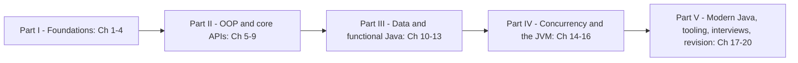

# Java Handbook

One place to learn Java from your first program to confident intermediate work on the back end, and to prepare for Java interviews, without switching between platforms. The book targets **Java 25 LTS** and marks every modern feature with the version that finalised it (records — 16, virtual threads — 21, stream gatherers — 24, compact source files — 25), and says clearly what is still preview. Each topic combines, in one explanation:
- **classic books**: *Effective Java* (Joshua Bloch), *Java Concurrency in Practice* (Brian Goetz et al.), *Modern Java in Action* and *Core Java*,
- **official documentation**: dev.java, the Java SE 25 API and language docs (docs.oracle.com), the JDK Enhancement Proposals (openjdk.org/jeps), and the JUnit, Mockito, AssertJ, Maven and Gradle docs, used to fill gaps and check facts,
- **real-world examples** from servers, libraries and the tools Java developers use every day.

Every chapter is written for a first-time learner and defines each term the first time it appears. Every code example is a runnable program, compiled with `javac --release 25` and run on JDK 26, whose **real output** appears under it. Every chapter was independently reviewed for accuracy.

> Personal study notes, written in my own words. Not for redistribution.

## Who it's for
| Reader | What you get |
|---|---|
| Complete beginners | Java as a first language, taught from zero (Ch 1–8), every term defined |
| Developers who learned Java 8 (or 11) | A "what changed" route: `var`, switch expressions, text blocks, records, sealed types, pattern matching, sequenced collections, virtual threads, gatherers, Java 25's simpler `main` (Ch 17 plus the sections it links to) |
| Developers coming from Python, JavaScript, C#… | Static types, the JVM, generics and erasure, checked exceptions, the collections framework — the parts that differ from what you know |
| Back-end developers | Collections, streams, I/O, two concurrency chapters (threads to virtual threads), JVM internals and GC tuning, testing, Maven/Gradle, logging, JDBC (Ch 10–18) |
| Interview candidates | Twenty DSA patterns in idiomatic Java, 42 Java language questions answered (Ch 19), cheat sheets with 250 machine-checked values and a 344-term glossary (Ch 20) |

## How to use it
Every topic follows the same rhythm: *what it is → why it matters → how it works → code with real output → trade-offs → common mistakes → real-world use → in the interview → self-check → TL;DR*. To review, skim the TL;DRs. To check you really learned a topic, answer the self-check questions without looking back.

**Beginner path (read in order):** 1 → 2 → 3 → 4 → 5 → 6 → 7 → 8, then 9 → 10 → 11 → 12 → 13. Then choose the back-end or interview path below. Type the examples yourself, run them, and keep Chapter 20 open as a quick reference.

**Modern Java refresher (you know Java 8):**
1. **Ch 17** first: the version table 17 → 25, one runnable example per release, what is still preview, and the upgrade checklist (§17.12).
2. Language: `var` (§2.6), text blocks (§2.12), switch expressions and pattern matching (§3.3–3.7), sealed types and records (§6.7, §6.8), compact source files and instance `main` (§4.9).
3. Libraries: `List.of`/`copyOf` and sequenced collections (§10.10, §10.11), `Stream.toList()` and gatherers (§12.4, §12.9), `Files.readString`/`writeString` (§13.4), `java.lang.IO` (§2.13).
4. Runtime: virtual threads and the end of `synchronized` pinning (§15.4, §15.5), scoped values (§15.6), G1/ZGC/generational collectors and compact object headers (§16.4–16.7).
5. Tooling: JUnit 6 and Mockito 5 on JDK 21+ (§18.4, §18.6). Check yourself with §20.15.

**Back-end and concurrency path:**
1. Data: **Ch 10** (with `HashMap` internals, §10.5), **Ch 11**, **Ch 12**, then **Ch 13** (NIO.2, charsets, why to avoid Java serialization).
2. Concurrency: **Ch 14** (threads, `synchronized`, `volatile`, locks, atomics, executors, concurrent collections, synchronizers) then **Ch 15** (`CompletableFuture`, virtual threads, scoped values, structured concurrency status, the Java Memory Model, liveness, choosing a model).
3. Runtime: **Ch 16** (memory areas, GC algorithms and a measured comparison, flags, JIT, JMH, JFR/`jcmd`, leaks, modules).
4. Shipping code: **Ch 18** (Maven, Gradle, JUnit, Mockito, AssertJ, logging, JDBC, JARs, Spring Boot pointers). Then the [SQL Handbook](../sql/chapters/01-databases-and-the-relational-model/README.md) and the [LLD Handbook](../lld/README.md)'s concurrency chapters.

**Interview-prep path (you already write some Java):**
1. Skim the TL;DRs of Ch 5–8 and 10 (equals/hashCode, immutability, exceptions, collections).
2. Work through **Ch 19**: the toolkit (§19.1–19.7), then the twenty patterns (§19.8–19.27) — re-type each solution from memory and run it.
3. Read the 42 questions in **§19.29** and practise the 30-second answers out loud; each links to the section that teaches it.
4. The night before, review with **Ch 20** (cheat sheets, §20.17 interview-question index, glossary).



## Related repositories
| Where | Read it for |
|---|---|
| [OCP Java SE 21 study repo](../../ocp-java21-study/README.md) (1Z0-830) | **Exam-trap depth.** This book explains how Java works and how to use it well; the OCP repo drills the tricky rules the exam tests (overload resolution corner cases, initialisation order puzzles, which lines compile). Chapters link to the matching OCP chapter instead of repeating traps — e.g. Ch 2 → OCP 1–2, Ch 6 → OCP 6–7, Ch 10 → OCP 9, Ch 12 → OCP 10, Ch 14–15 → OCP 13, Ch 13 → OCP 14. |
| [LLD Handbook](../lld/README.md) (Java 21) | **Design.** OOP principles, SOLID, clean code, the GoF patterns, concurrency design problems and machine-coding case studies. This book teaches the language features (classes, interfaces, records, locks, executors); the LLD book shows how to design systems with them. Ch 5–6 link to its OOP/SOLID chapters and Ch 14–15 to its concurrency chapters. |

## What's in here
| Path | Purpose |
|---|---|
| `Java-Handbook.pdf` | The whole book as one PDF, with a cover and a table of contents (built by `tools/regen_pdfs.sh`). |
| `interview/INTERVIEW.md` + `interview/Java-Interview-Edition.pdf` | **Interview Edition**: the whole book in ~44 pages for fast revision — per chapter must-know facts, key tables, likely questions with short answers, gotchas, plus a top-25 question list and a last-minute checklist. |
| `chapters/NN-name/README.md` + `ChapterNN-Notes.pdf` | One chapter (Markdown source and its PDF). |
| `chapters/NN-name/code/` | Runnable examples, one package per chapter and topic (`package ch07.strings;`). Ch 18 also has JUnit tests, Maven/Gradle build files and `run_tests.sh`. |
| `chapters/16-jvm-internals-and-performance/jpms/` | A small multi-module (JPMS) project with its own `run.sh`. |
| `tools/` | `regen_pdfs.sh` (rebuild all PDFs) and `md2pdf.mjs` (Markdown → PDF). See [tools/README.md](tools/README.md). |

## Chapters
| # | Chapter | In one line | PDF |
|---|---|---|---|
| **Part I — Foundations** | | | |
| 01 | [Java and the JVM](chapters/01-java-and-the-jvm/README.md) | What Java is, SE/EE/OpenJDK and vendors, JDK vs JRE vs JVM, install, write → compile → run, bytecode, class loading and the JIT, GC overview, `jshell`, source-file launch, IDEs, releases/LTS/JEPs | `Chapter01-Notes.pdf` |
| 02 | [Basics: Types, Variables and Operators](chapters/02-basics-types-and-operators/README.md) | Identifiers and keywords, the eight primitives and their ranges, literals, references and `null`, `var`, casting and promotion, operators and precedence, overflow, floating point, strings and text blocks, console I/O | `Chapter02-Notes.pdf` |
| 03 | [Control Flow](chapters/03-control-flow/README.md) | `if`/`else`, the classic `switch`, arrow labels and switch expressions, pattern matching for `instanceof` and `switch`, record and unnamed patterns, loops, `break`/`continue`/labels, loop pitfalls | `Chapter03-Notes.pdf` |
| 04 | [Methods and Arrays](chapters/04-methods-and-arrays/README.md) | Declaring and calling methods, pass-by-value, overloading, varargs, recursion and the stack, arrays (1D, 2D, jagged), `java.util.Arrays`, `main` and Java 25's simpler `main` | `Chapter04-Notes.pdf` |
| **Part II — OOP and core APIs** | | | |
| 05 | [OOP: Classes and Objects](chapters/05-oop-classes-and-objects/README.md) | Classes and objects, fields and `this`, constructors, packages and imports, `static`, access modifiers, encapsulation, `final`, immutability, initialisation order | `Chapter05-Notes.pdf` |
| 06 | [OOP: Inheritance, Interfaces and More](chapters/06-oop-inheritance-interfaces-and-more/README.md) | Inheritance and `super`, overriding, polymorphism and casting, abstract classes, interfaces, sealed types, records, enums, nested/local/anonymous classes, choosing a type, `equals`/`hashCode`/`toString` | `Chapter06-Notes.pdf` |
| 07 | [Core APIs: Strings, Numbers, Dates and Randomness](chapters/07-core-apis/README.md) | String immutability and the pool, the String API, `StringBuilder`, formatting, `Math`, wrappers and autoboxing, `BigDecimal`, the `java.time` model, zones and daylight saving, date formatting, random numbers | `Chapter07-Notes.pdf` |
| 08 | [Exceptions](chapters/08-exceptions/README.md) | The `Throwable` hierarchy, checked vs unchecked, handle or declare, `try`/`catch`/`finally`, multi-catch, try-with-resources, custom exceptions, chaining, reading stack traces, best practices | `Chapter08-Notes.pdf` |
| 09 | [Generics](chapters/09-generics/README.md) | Generic classes, records, interfaces and methods, inference, bounds, invariance and wildcards (PECS), type erasure and its restrictions, designing generic APIs | `Chapter09-Notes.pdf` |
| **Part III — Data and functional Java** | | | |
| 10 | [Collections](chapters/10-collections/README.md) | The framework's hierarchy, lists, sets, maps, `HashMap` internals, queues/deques/priority queues, fail-fast iterators, `Comparable`/`Comparator`, unmodifiable collections, sequenced collections, a measured big-O table, choosing a collection | `Chapter10-Notes.pdf` |
| 11 | [Lambdas and Functional Programming](chapters/11-lambdas-and-functional-programming/README.md) | Passing behaviour, functional interfaces and lambda syntax, `java.util.function`, method references, effectively final capture, composing functions, `Optional`, functional style in everyday code | `Chapter11-Notes.pdf` |
| 12 | [Streams](chapters/12-streams/README.md) | What a stream is, laziness, intermediate and terminal operations, `reduce`, collectors, primitive streams, nulls, parallel streams, gatherers (Java 24), common mistakes, streams vs loops | `Chapter12-Notes.pdf` |
| 13 | [I/O and NIO](chapters/13-io-and-nio/README.md) | `java.io` vs NIO.2, `Path` and `Files`, whole-file reads and writes, byte and character streams, buffering, charsets, the console, channels and buffers, serialization and its risks, properties, JSON | `Chapter13-Notes.pdf` |
| **Part IV — Concurrency and the JVM** | | | |
| 14 | [Concurrency I: Threads, Locks and the Toolkit](chapters/14-concurrency-1/README.md) | Threads and their lifecycle, interruption, race conditions, `synchronized`, `volatile`, `wait`/`notify`, explicit locks, atomics, executors and pools, concurrent collections, synchronizers, thread-safe class design | `Chapter14-Notes.pdf` |
| 15 | [Concurrency II: Modern Concurrency](chapters/15-concurrency-2-modern/README.md) | `Future` and `CompletableFuture`, Fork/Join, virtual threads and pinning, `ThreadLocal` vs scoped values, structured concurrency (preview), the Java Memory Model, liveness, choosing a concurrency model | `Chapter15-Notes.pdf` |
| 16 | [JVM Internals and Performance](chapters/16-jvm-internals-and-performance/README.md) | JVM architecture, class loading, memory areas, object layout, GC algorithms and five collectors measured, GC tuning, the JIT and escape analysis, JMH, JFR/`jcmd`/heap dumps, memory leaks, modules | `Chapter16-Notes.pdf` |
| **Part V — Modern Java, tooling, interviews and revision** | | | |
| 17 | [Modern Java: 17 to 25](chapters/17-modern-java-17-to-25/README.md) | Reading a feature's status, the version table, every release from 17 to 25 with runnable examples, what is still preview (and what JDK 26/27 did next), upgrading 17 → 21 → 25 | `Chapter17-Notes.pdf` |
| 18 | [Testing, Build and Tooling](chapters/18-testing-build-and-tooling/README.md) | Project layout, Maven, Gradle, JUnit 6, parameterized tests, Mockito, AssertJ, reading failures, test design, logging, JDBC, JAR packaging, everyday tools, Spring Boot and friends | `Chapter18-Notes.pdf` |
| 19 | [Java for Coding Interviews](chapters/19-java-for-coding-interviews/README.md) | The Java DSA toolkit and its pitfalls, a complexity table, twenty patterns with runnable checked solutions, talking through a solution, 42 Java interview questions answered | `Chapter19-Notes.pdf` |
| 20 | [Cheat Sheets and Glossary](chapters/20-cheatsheet-and-glossary/README.md) | One sheet per area (values machine-checked by `CheatsheetChecks`), JVM flags and tools, version table 17 → 25, build and test commands, interview-question index, where next, 344-term glossary | `Chapter20-Notes.pdf` |

Each chapter's PDF sits next to its README: `chapters/NN-name/ChapterNN-Notes.pdf`.

## Colour code (in the PDFs)
Section headings are coloured by their role, so you can scan a page for the part you need:

| Colour | Headings |
|---|---|
| Green | **What it is**, analogies, overviews |
| Red / coral | **The problem it solves** |
| Blue | **How it works**, walkthroughs |
| Amber | **Trade-offs**, comparisons, **When not to use it** |
| Bright red | **Common mistakes**, pitfalls |
| Violet | **Real-world examples** |
| Pink | **In the interview**, 30-second answers (boxed), follow-ups |
| Teal | **Self-check** |
| Yellow | **TL;DR** (boxed) |

Code blocks are syntax-highlighted, and Mermaid diagrams are rendered as images.

## Running the code
The examples target **Java 25 LTS** (`javac --release 25`) and were run on **OpenJDK 26**; any JDK 25 or newer works. No example needs network access. The shared runner lives one level up, in the notes root.

```bash
# from the notes root — compile each chapter's code/ and run every class with a main method (OK / FAIL / SKIP per file)
bash tools_run_java.sh java

# run one example by hand (packages match the folders under code/)
cd java/chapters/12-streams/code
javac --release 25 -d /tmp/ch12 $(find . -name '*.java')
java -cp /tmp/ch12 ch12.<topic>.<ClassName>
```
- **What the runner does:** each chapter's `code/` folder is compiled as one unit with `javac --release 25`, then every class with a `main` method runs (two-minute limit each). Files containing `tools_run: skip` are compiled but not run: `Interactive.java` (Ch 2) waits for keyboard input and `JdbcDemo.java` (Ch 18) needs a database. At the last full run: **194 OK, 2 SKIP, 0 FAIL**.
- **Library jars:** JUnit 6.1.3 (console launcher), Mockito 5.24.0 with Byte Buddy 1.18.14 and Objenesis 3.3, AssertJ 3.27.7 and the PostgreSQL JDBC driver 42.7.13 sit in `ROOT/.java-books/lib/` (downloaded from Maven Central) and are on the runner's class path. Only Chapter 18 uses them.
- **Chapter 18 tests:** `bash chapters/18-testing-build-and-tooling/code/run_tests.sh` compiles the shop code and its tests and runs them with the JUnit console launcher, Mockito loaded as a `-javaagent` (last run: 48 tests found, 47 successful, 1 skipped, 0 failed). `run_tests.sh fail` runs only the deliberately failing demo tests (4 failures, used in §18.8 to show how to read a report). `code/package_jar.sh` builds and runs an executable JAR by hand; `code/build-files/` holds the Maven and Gradle builds shown in §18.2–18.3.
- **JDBC example:** `JdbcDemo` runs against the SQL Handbook's private PostgreSQL (`bash tools_pg.sh start` in the notes root); the exact commands are in §18.11.
- **Modules:** `chapters/16-jvm-internals-and-performance/jpms/run.sh` builds and runs the JPMS example of §16.12.
- **Cheat-sheet checks:** `ch20.CheatsheetChecks` asserts 250 values printed on the cheat sheets (ranges, caches, collection and stream results, dates, concurrency) and prints `all 250 checks passed on Java 26`.

Timings, GC pauses, memory sizes and stack depths depend on the machine; the chapters that measure things say what they ran on (an Apple M4 Pro, macOS). Your numbers will differ, but the pattern should not.

## Rebuilding the PDFs
Requires Node 18+ and Google Chrome (the path is set in `tools/md2pdf.mjs`).

```bash
bash tools/regen_pdfs.sh      # every ChapterNN-Notes.pdf + Java-Handbook.pdf (cover title "Java Handbook")

# one chapter only
node tools/md2pdf.mjs chapters/12-streams/Chapter12-Notes.pdf chapters/12-streams/README.md
```
`md2pdf.mjs` reports any Mermaid errors or broken images.

## Sources
- **Books:** Joshua Bloch, *Effective Java* (3rd ed. — its item advice is cited throughout); Brian Goetz et al., *Java Concurrency in Practice* (Ch 14–15); Raoul-Gabriel Urma, Mario Fusco and Alan Mycroft, *Modern Java in Action* and Cay Horstmann, *Core Java* as background for Ch 11–12 and the core APIs. Their ideas are explained in my own words; no text is reproduced.
- **Documentation:** dev.java; the Java SE 25 API documentation and *Java Language Specification* (docs.oracle.com); the JEPs at openjdk.org/jeps (for every "final in Java N" and preview label, including what JDK 26 and 27 changed); the JUnit 6, Mockito, AssertJ, Maven, Gradle, SLF4J and PostgreSQL JDBC documentation.
- **Web:** used to check facts and version details (release dates, which JEP finalised what, library versions).

## Companion books
| Book | Read it for |
|---|---|
| [LLD Handbook](../lld/README.md) | Object-oriented design, SOLID, design patterns, concurrency design problems and machine-coding case studies in Java 21 |
| [SQL Handbook](../sql/chapters/01-databases-and-the-relational-model/README.md) | The database side of Ch 18's JDBC: queries, schema design, indexes, transactions (PostgreSQL) |
| [Python Handbook](../python/README.md) | A second language with a different model (dynamic typing, the GIL) — its interview chapter uses the same patterns as Ch 19 |
| [JavaScript Handbook](../javascript/README.md) | The browser and Node.js side of a full-stack project |
| [DDIA notes](../ddia/README.md) | How the data systems a Java back end talks to work at scale |
