# Java — Capstone Projects

## How to use this book

A **capstone** is a project big enough to pull several chapters together into one working program. Reading about `HashMap` internals or virtual threads teaches you the idea; building a cache or an HTTP server that uses them under load teaches you where the idea breaks. This book contains 40 capstone briefs for **plain Java 25** — no Spring, no application server, just the JDK plus a handful of test libraries. (Spring Boot projects live in the Spring book.) They run from a first afternoon project to systems that would make a strong portfolio piece or a senior-level interview story.

**How to pick one.** Use the project map below. Find a level that matches you, then check the *Prerequisites* column: those are the handbook chapters you should have read first. If you are new, do two or three beginner projects in order — each one adds a few ideas to the last. If you are preparing for interviews, pick one intermediate project about concurrency (16, 18, 19, 20 or 21) and one advanced project about storage or distribution (36–40): those generate the most interview questions.

**How to use a brief.** Every project follows the same shape:
1. Read *What it is*, *The problem it solves* and *Real-world examples* to understand why the thing exists.
2. Read *Requirements*, *The architecture* and *Data model* — this is your spec. The non-functional requirements give numbers; treat them as targets you measure, not decoration.
3. Build the **milestones in order**. Each has a "done when" check. Do not move on until the check passes — ideally as an automated test.
4. Read *Deep dive: the hard parts* before you start the milestone it talks about. It explains the bug you would otherwise spend a day finding.
5. Write the tests in *Testing strategy* as you go, not at the end.
6. When everything works, pick one or two **stretch goals**.
7. Finish with *In the interview*: say the answers out loud. If you can explain your trade-offs, the project counts.

**Using these projects in interviews.** Each *In the interview* section starts with a **30-second answer**: lead with it when someone says "tell me about a project", then let the interviewer choose where to dig. Make sure you can explain every term under **Key terms** in plain words, because follow-up questions are built from them. Practise the Q&As out loud until you can answer without reading; the **Common mistakes** list shows what weaker candidates get wrong. Quote your own numbers from the build, such as latency percentiles, data sizes, throughput and test counts, rather than the targets in the brief. Finally, have an answer ready for "what would you change at 10x?" and "what breaks first?"

**Colour-coding.** In the PDF, section headings are colour-coded so you can scan a brief quickly: *What it is* and *The problem it solves* (the idea), *Real-world examples* (who uses it), *The architecture* and *Deep dive* (how it works), *Trade-offs* (what you gave up), *In the interview*, *Self-check* and *TL;DR* each have their own colour.

**Levels.**

| Level | Who it is for | Typical size |
|---|---|---|
| Beginner | You know Chapters 1–8 and maybe collections and streams | 200–800 lines, one evening to two weekends |
| Intermediate | You are comfortable with Chapters 9–15 | 1,000–3,000 lines, one to three weeks |
| Advanced | You have read Chapters 14–17 and want depth | 3,000+ lines, three weeks to two months |

**Versions.** Every brief targets **Java 25** (LTS). Where a brief uses a feature, it says which release finalised it — for example records (16), virtual threads (21), stream gatherers and the Class-File API (24), scoped values and compact source files (25). **Structured concurrency is still a preview API in Java 25** (JEP 505, fifth preview), so the one project that relies on it says how to switch it on and offers a non-preview fallback. Tests use **JUnit 6**, **AssertJ** and **Mockito 5**, and benchmarks use **JMH** — all covered in Chapters 16 and 18.

**A note on what these briefs are.** Each brief tells you *what* to build and *why* each design choice matters. It does not give you the code. Writing the code — and getting it wrong a few times — is the point. Where a brief names a class from the JDK, look it up in the Java SE 25 API docs and in the chapter it links to.

## Project map

| # | Project | Level | Time | Prerequisites |
|---|---|---|---|---|
| 1 | Number-guessing game | Beginner | 1 evening | Ch 1–4 |
| 2 | Bank account CLI | Beginner | 1 weekend | Ch 5, 7, 8 |
| 3 | Student grade book with records | Beginner | 1 weekend | Ch 6, 10 |
| 4 | Unit converter | Beginner | 1 weekend | Ch 6, 7 |
| 5 | Word-frequency counter with streams | Beginner | 1 weekend | Ch 12, 13 |
| 6 | Tic-tac-toe with an unbeatable AI | Beginner | 1 weekend | Ch 3, 4 |
| 7 | Text adventure engine | Beginner | 1–2 weekends | Ch 3, 6, 10 |
| 8 | Expense tracker with CSV storage | Beginner | 1–2 weekends | Ch 7, 13 |
| 9 | Library catalogue and search | Beginner | 1–2 weekends | Ch 9–11 |
| 10 | Flashcards with spaced repetition | Beginner | 1–2 weekends | Ch 7, 10, 13 |
| 11 | Markdown-to-HTML converter | Intermediate | 1–2 weeks | Ch 3, 6, 7 |
| 12 | JSON parser and object mapper | Intermediate | 1–2 weeks | Ch 3, 6, 9 |
| 13 | CSV query engine with streams | Intermediate | 2 weeks | Ch 11, 12 |
| 14 | Log analyser with stream gatherers | Intermediate | 1 week | Ch 7, 12, 13 |
| 15 | File-sync tool with WatchService | Intermediate | 2 weeks | Ch 13, 14 |
| 16 | HTTP server on virtual threads | Intermediate | 2 weeks | Ch 13, 15 |
| 17 | Todo REST API with JDBC | Intermediate | 2 weeks | Ch 15, 18 |
| 18 | Chat server over sockets | Intermediate | 1–2 weeks | Ch 13–15 |
| 19 | Concurrent web crawler | Intermediate | 2 weeks | Ch 14, 15 |
| 20 | Rate-limiter library | Intermediate | 1 week | Ch 7, 14 |
| 21 | Concurrent cache with eviction | Intermediate | 1–2 weeks | Ch 10, 14 |
| 22 | Cron-style job scheduler | Intermediate | 1–2 weeks | Ch 7, 14 |
| 23 | Dependency-injection container | Intermediate | 2 weeks | Ch 6, 9, 16 |
| 24 | Plugin system with ServiceLoader and JPMS | Intermediate | 1–2 weeks | Ch 16, 18 |
| 25 | Parallel image thumbnailer | Intermediate | 1 week | Ch 13, 15 |
| 26 | Mocking library and test runner | Advanced | 2–3 weeks | Ch 6, 16, 18 |
| 27 | Reactive streams library | Advanced | 3 weeks | Ch 11, 14, 15 |
| 28 | Lock-free queue benchmarked with JMH | Advanced | 2–3 weeks | Ch 14–16 |
| 29 | JVM GC tuning lab with JFR | Advanced | 2 weeks | Ch 16 |
| 30 | Bytecode profiler: Java agent and Class-File API | Advanced | 3 weeks | Ch 16, 17 |
| 31 | Actor framework on virtual threads | Advanced | 3–4 weeks | Ch 14, 15 |
| 32 | Mini build tool | Advanced | 3–4 weeks | Ch 18, 19 |
| 33 | Compiler for a tiny language | Advanced | 4–6 weeks | Ch 6, 17, 19 |
| 34 | Mini JVM: a bytecode interpreter | Advanced | 4–6 weeks | Ch 1, 16 |
| 35 | Native binding with the FFM API | Advanced | 2–3 weeks | Ch 13, 17 |
| 36 | Full-text search engine | Advanced | 3–4 weeks | Ch 10, 12, 13 |
| 37 | In-memory database with B-tree and WAL | Advanced | 4–6 weeks | Ch 10, 13, 14 |
| 38 | Append-only message log | Advanced | 4 weeks | Ch 13, 15 |
| 39 | Low-latency order book | Advanced | 3–4 weeks | Ch 10, 14, 16 |
| 40 | Raft replicated key-value store | Advanced | 6–8 weeks | Ch 14, 15, project 37 |

## 1. Number-guessing game

**Level:** Beginner · **Time:** 1 evening · **Prerequisites:** Ch 1, Ch 2, Ch 3, Ch 4

### What it is
The computer picks a secret whole number in a range (say 1 to 100). You type guesses, and after each one it answers "too high", "too low" or "correct". When you win it tells you how many tries you needed and offers another round. It is the "hello world" of interactive programs: input, a loop, a decision, output.

### The problem it solves
A first program has to teach the full write → compile → run cycle without burying you in ceremony. Java 25 made this much easier: with **compact source files** (JEP 512, final in Java 25) a file can contain just a `void main()` method — no class declaration, no `public static`, no `String[] args` — and the new `java.lang.IO` class gives you `IO.println` and `IO.readln` for console text. The game is also the simplest place to meet three ideas you will use forever: validating untrusted input, looping until a condition holds, and keeping state (the number of tries) across iterations.

### Real-world examples
- [JEP 512](https://openjdk.org/jeps/512) argues, with small programs like this one, that beginners should not have to learn classes and `static` before writing their first loop.
- The "guess the number" game is binary search in disguise: the best strategy halves the range each time, which is why 100 numbers never need more than 7 guesses. Chapter 19 teaches the same pattern for interview problems.
- [Oracle's dev.java learning path](https://dev.java/learn/) starts beginners with the same shape of console program.

### Requirements
**Functional**
- Pick a random secret in a configurable range (default 1–100).
- Read a guess, reject anything that is not a whole number in range with a friendly message, and do not count it as a try.
- Print "too high", "too low" or "correct", then the number of tries.
- Ask "play again? (y/n)"; keep a best score for the session.

**Non-functional**
- Never crash on bad input (letters, empty line, huge numbers like `99999999999`).
- The answer to each guess appears instantly (well under 100 ms).
- Whole program under 150 lines; readable by someone who has read Chapters 1–4.

### The architecture
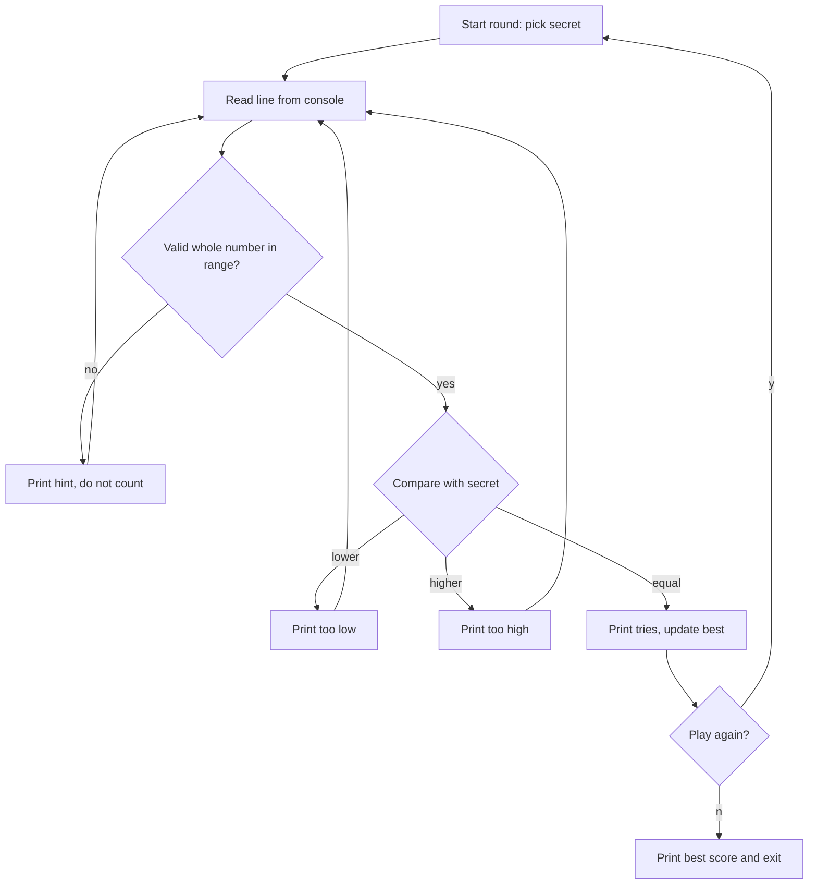
- **Start round** uses a random generator to pick the secret (`RandomGenerator.getDefault()` or `ThreadLocalRandom`, Chapter 7).
- **Read** wraps `IO.readln` so the rest of the code never sees a raw string.
- **Validate** turns text into an `int` or an "invalid" result; this is where `Integer.parseInt` and `NumberFormatException` live.
- **Compare** is a three-way decision — a perfect fit for `Integer.compare` plus a `switch` expression.

### Data model
| State | Type | Lives for |
|---|---|---|
| `secret` | `int` | one round |
| `tries` | `int` | one round |
| `best` | `int` (or `OptionalInt`) | whole session |
| `low`, `high` | `int` constants | whole program |

### Tech stack
| Component | Choice | Why |
|---|---|---|
| Language level | Java 25 compact source file | no class boilerplate for a first program |
| Console I/O | `java.lang.IO` (Java 25) | `IO.readln(prompt)` reads a line in one call |
| Randomness | `java.util.random.RandomGenerator` | modern interface over all generators (Java 17) |
| Run | `java Guess.java` | source-file launch, no separate `javac` step |

### Milestones
1. **Hello game** — a compact source file prints a welcome and a secret. *Done when* `java Guess.java` runs with no class declaration.
2. **One round** — loop until the guess equals the secret, print hints. *Done when* you can win a round.
3. **Robust input** — handle letters, blanks and out-of-range numbers. *Done when* typing `abc`, an empty line and `1000` all print a hint and the tries counter is unchanged.
4. **Sessions** — play again and keep the best score. *Done when* the best score is printed on exit.
5. **Difficulty levels** — easy (1–10), normal (1–100), hard (1–1000) chosen with a `switch` on an enum. *Done when* the range changes per level.

### Deep dive: the hard parts
- **Parsing is where programs crash.** `Integer.parseInt("12a")` throws `NumberFormatException`, and `parseInt("99999999999")` throws too because the value does not fit in an `int`. Put the try/catch in one small method that returns an `OptionalInt`; the main loop then reads like plain English. Trim the input first — users type spaces.
- **Off-by-one ranges.** `random.nextInt(1, 101)` gives 1 to 100 because the upper bound is exclusive. Write that down as a comment, and test the edges with a fixed seed.
- **Testing randomness.** Make the game take a `RandomGenerator` as a parameter. In tests you pass a seeded generator (or a fake that returns 42) so the secret is predictable.

### Testing strategy
Separate the logic (a `Game` that takes a guess and returns `TOO_LOW`, `TOO_HIGH` or `CORRECT`) from the console loop. Unit-test `Game` with JUnit 6: boundary guesses (1, 100), the winning guess, the tries count. Test the parser with a parameterized test over `"42"`, `" 42 "`, `"abc"`, `""`, `"0"`, `"101"`, `"99999999999"`.

### Trade-offs, scaling and failure modes
Compact source files are for small programs: once you need several classes in packages, switch to a normal class with `public static void main` and a build tool. `IO.readln` returns `null` at end of input (Ctrl-D), so handle that or the loop spins. A single global `best` variable is fine here, but notice it is state that a test cannot reset — a hint that later projects should pass state explicitly.

### Stretch goals
- Reverse the roles: you pick the number and the computer guesses with binary search; prove it needs at most `ceil(log2(n+1))` tries.
- Save the best score to a file with `Files.writeString` (Chapter 13).
- Add a timer with `Instant` and `Duration` (Chapter 7).

### Skills practised
- [Ch 1 — Java and the JVM](../chapters/01-java-and-the-jvm/README.md) — compile and run, source-file launch
- [Ch 2 — Types and operators](../chapters/02-basics-types-and-operators/README.md) — primitives, `int` range, `IO`
- [Ch 3 — Control flow](../chapters/03-control-flow/README.md) — loops and switch expressions
- [Ch 4 — Methods and arrays](../chapters/04-methods-and-arrays/README.md) — methods and Java 25's simpler `main`
- [Ch 8 — Exceptions](../chapters/08-exceptions/README.md) — catching `NumberFormatException`

### In the interview
**30-second answer:** I built a console number-guessing game as a single Java 25 compact source file, run with `java Guess.java`. The key decision was to split it into a pure `Game` class that takes a guess and returns `TOO_LOW`, `TOO_HIGH` or `CORRECT`, plus a thin console loop, so all the rules are unit-testable. The hardest part was input: I parse in one method that returns an `OptionalInt`, so letters, blank lines, end-of-input and values like `99999999999` never crash the program or count as a try. The whole thing is under 150 lines, and an optimal player never needs more than 7 guesses for 1–100.

**Key terms to know:**
- **Compact source file** — a Java 25 file (JEP 512) that can contain just `void main()` with no class declaration. The whole game is one of these.
- **`java.lang.IO`** — a Java 25 helper class with `IO.println` and `IO.readln(prompt)` for console text. It is used for every prompt and guess.
- **Source-file mode** — `java Guess.java` compiles in memory and runs in one step, with no `.class` file written. It is how you run the game.
- **`NumberFormatException`** — the unchecked exception `Integer.parseInt` throws for text that is not a valid `int`, including values that overflow. It is caught in the parser.
- **`OptionalInt`** — a container that either holds an `int` or is empty. The parser returns it instead of a magic value like `-1`.
- **Exclusive upper bound** — `nextInt(1, 101)` returns 1 to 100 because the second argument is never returned. This is the off-by-one to watch when picking the secret.
- **`RandomGenerator` injection** — passing the random source into `Game` instead of creating it inside. Tests pass a seeded or fake generator so the secret is known.
- **Binary search** — halving the remaining range with each guess. It explains the 7-guess bound and the "computer guesses" stretch goal.

**Q:** What does `java Guess.java` do differently from `javac` then `java`?

**A:** It compiles the source in memory and runs it in one step (source-file mode, added in Java 11 and extended to programs of several files in Java 22). No `.class` file is written to disk. That is fine for scripts and learning, but a shipped application is compiled ahead of time and packaged as a JAR.

**Q:** What is a compact source file, and when would you stop using one?

**A:** It is a Java 25 feature (JEP 512) where a file can hold top-level methods and fields with no class declaration, and `main` can be a plain `void main()`. The compiler wraps it in an unnamed class behind the scenes. Once the program needs several classes in packages, tests or a build tool, you switch back to a normal named class with a standard `main`.

**Q:** Why does the best strategy need at most 7 guesses for 1–100?

**A:** Each "too high" or "too low" answer lets you discard half of the remaining range, and 2^7 = 128 ≥ 100, so seven halvings always leave one number. That is binary search, which takes O(log n) steps. For 1–1000 the bound becomes 10 guesses, since 2^10 = 1024.

**Q:** How do you parse a guess safely?

**A:** Trim the line, call `Integer.parseInt` inside a try/catch, check the range, and return an `OptionalInt` so the loop never sees an exception. A `null` line means end of input (Ctrl-D), which should end the game rather than loop forever.
```java
static OptionalInt parse(String line, int lo, int hi) {
    if (line == null) return OptionalInt.empty();
    try {
        int n = Integer.parseInt(line.trim());
        return (n >= lo && n <= hi) ? OptionalInt.of(n) : OptionalInt.empty();
    } catch (NumberFormatException e) { return OptionalInt.empty(); }
}
```

**Q:** Is it safe to write `switch (Integer.compare(guess, secret)) { case -1 -> ... case 1 -> ... }`?

**A:** No. The `Comparable`/`compare` contract only promises a negative number, zero or a positive number, not exactly -1 or 1. Today's `Integer.compare` happens to return -1/0/1, but code that relies on it breaks with other comparators. Use `Integer.signum(...)` around the result, or plain `if (guess < secret)` checks.

**Q:** How would you make this testable?

**A:** Move the rules into a `Game` class that has no I/O and takes a `RandomGenerator` in its constructor. Tests pass a seeded generator (or a fake that always returns 42), feed guesses directly, and assert on the returned result and the tries count. The console loop then becomes a few lines that are checked by one end-to-end test with scripted input.

**Q:** What happens with input like `99999999999`, an empty line, or Ctrl-D?

**A:** `parseInt` throws `NumberFormatException` for the first two (the big value does not fit in an `int`, whose maximum is 2,147,483,647). The parser turns that into an empty result and the loop prints a hint without counting a try. `IO.readln` returns `null` at end of input, and if you do not check for it the loop spins forever printing prompts.

**Q:** `Random`, `ThreadLocalRandom` or `SecureRandom` — which one, and why?

**A:** For a game, `RandomGenerator.getDefault()` or `ThreadLocalRandom` is fine: fast and statistically good. `SecureRandom` is only needed when an attacker must not predict the value, such as tokens or keys. Using the `RandomGenerator` interface (Java 17) lets you swap implementations and pass a seeded one in tests.

**Q:** What would you change if this became a multiplayer web game?

**A:** The rules in `Game` stay the same, but the console loop is replaced by an HTTP or WebSocket handler, and each player's round state lives in a map keyed by session ID instead of local variables. The global `best` score becomes shared state that needs a thread-safe structure or a database. Clean separation between rules and I/O is what makes that change small.

**Common mistakes in answers:**
- Saying `nextInt(1, 100)` gives 1–100. The upper bound is exclusive, so it gives 1–99.
- Treating the program as finished because it handles letters. Weak answers forget overflow (`99999999999`) and end-of-input (`null` from `readln`).
- Claiming compact source files replace classes. They are a learning and scripting on-ramp. The compiler still creates a class, and real projects still use named classes and packages.

### TL;DR
A loop, a decision and safe input parsing, written as a Java 25 compact source file. Separate the rules from the console so you can test them.

## 2. Bank account CLI

**Level:** Beginner · **Time:** 1 weekend · **Prerequisites:** Ch 5, Ch 7, Ch 8

### What it is
A command-line program that manages a few bank accounts: open an account, deposit, withdraw, transfer between accounts and print a statement. You type commands like `deposit ACC-1 25.50` and the program replies with the new balance or an error.

### The problem it solves
Money is the classic example of why **encapsulation** (hiding an object's fields so only its own methods can change them) matters: if any code could write `account.balance = -500`, the bank's rules would mean nothing. It is also where beginners first meet the floating-point trap — `0.1 + 0.2` is not `0.3` in a `double` — and learn to use `BigDecimal`, a decimal number type that represents 0.10 exactly. Finally, failures (insufficient funds, unknown account) are a natural first use of **custom exceptions**.

### Real-world examples
- Martin Fowler's [Money pattern](https://martinfowler.com/eaaCatalog/money.html) describes storing an amount together with its currency and doing arithmetic in a single class, exactly the `Money` record you build here.
- The [`BigDecimal` API](https://docs.oracle.com/en/java/javase/25/docs/api/java.base/java/math/BigDecimal.html) documents the rounding modes banks choose between, such as `HALF_EVEN` ("banker's rounding").

### Requirements
**Functional**
- Commands: `open <name>`, `deposit <id> <amount>`, `withdraw <id> <amount>`, `transfer <from> <to> <amount>`, `statement <id>`, `quit`.
- Every change records a transaction (time, type, amount, balance after).
- Reject negative or zero amounts, more than 2 decimal places, overdrafts and unknown IDs with a clear message.

**Non-functional**
- Balances are always exact to the cent; no `double` anywhere near money.
- A failed transfer leaves both accounts unchanged (all-or-nothing).
- Each command answers in under 10 ms for 10,000 accounts (a `HashMap` lookup).

### The architecture
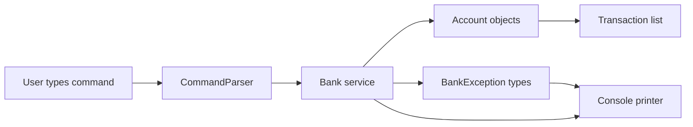
- **CommandParser** splits a line into a command record (`Deposit(id, amount)` and friends) or reports a syntax error.
- **Bank** owns a `Map<String, Account>` and implements the use cases; `transfer` checks both accounts before changing either.
- **Account** has a private balance and exposes only `deposit` and `withdraw`, which enforce the rules.
- **BankException** subclasses (`InsufficientFundsException`, `UnknownAccountException`) carry the details the printer shows.

### Data model
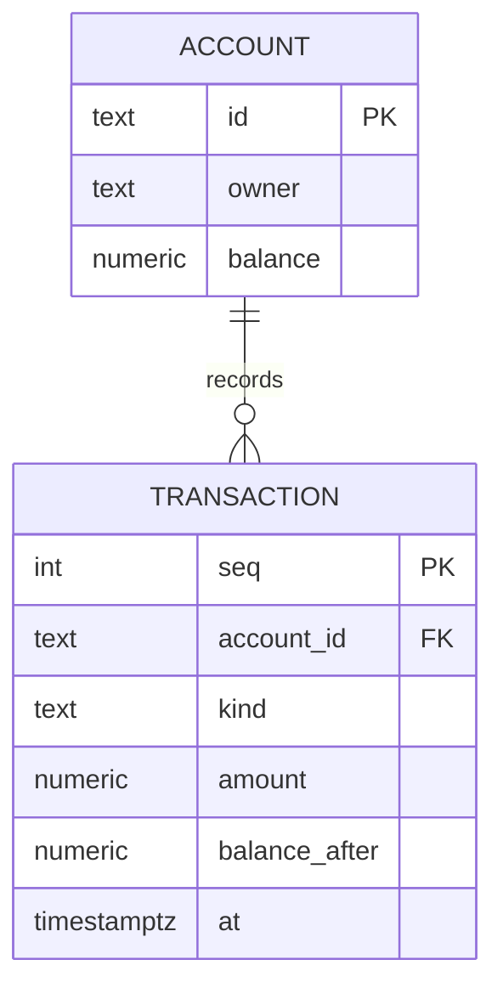

### Tech stack
| Component | Choice | Why |
|---|---|---|
| Money | `BigDecimal` with scale 2 | exact decimal arithmetic |
| Commands | sealed interface + records | the parser returns one of a fixed set of shapes |
| Time | `Instant` and `Clock` | a `Clock` can be fixed in tests |
| Storage | in memory (stretch: file) | keep the focus on the domain |

### Milestones
1. **Account class** — private balance, `deposit`, `withdraw` with validation. *Done when* a unit test shows withdrawing too much throws and leaves the balance unchanged.
2. **Money handling** — a `Money` record wrapping `BigDecimal`, created from text like `"25.50"`. *Done when* `0.10 + 0.20` equals `0.30` and `"1.005"` is rejected.
3. **Bank and transfer** — map of accounts, all-or-nothing transfer. *Done when* a failing transfer changes neither account.
4. **CLI loop** — parse commands, print results and errors. *Done when* a scripted session of 10 commands produces the expected output.
5. **Statement** — list transactions with formatted dates and amounts. *Done when* the statement totals match the balance.

### Deep dive: the hard parts
- **`BigDecimal` equality.** `new BigDecimal("2.0").equals(new BigDecimal("2.00"))` is `false` because `equals` also compares the **scale** (number of decimal places). Use `compareTo` for value comparison, or normalise every amount to scale 2 with `setScale(2, RoundingMode.UNNECESSARY)` when you create it — that call throws if the input had more decimals, which is exactly the validation you want.
- **Never construct from `double`.** `new BigDecimal(0.1)` gives `0.1000000000000000055511151231257827…`, because the `double` was already inexact. Use the `String` constructor or `BigDecimal.valueOf`.
- **All-or-nothing transfer.** Check both preconditions (both accounts exist, enough funds) before you mutate anything. If you withdraw first and the deposit then fails, money disappears. This is the single-threaded version of a database transaction.
- **Checked or unchecked?** Insufficient funds is a normal business outcome the caller must handle, so a checked exception is defensible; an unknown command is a user error you can model as a result value instead. Chapter 8 discusses the trade-off.

### Testing strategy
JUnit 6 + AssertJ: `assertThatThrownBy(() -> acc.withdraw(...)).isInstanceOf(InsufficientFundsException.class)`. Test money parsing with a parameterized test. Inject a fixed `Clock` so statement timestamps are predictable. Add one end-to-end test that feeds a script through the CLI using a `StringReader` and compares the output.

### Trade-offs, scaling and failure modes
Keeping transactions in a list makes the balance a cached value; an alternative is to derive the balance by summing transactions (event sourcing), which is slower but can never disagree. With several threads, `transfer` would need locking in a consistent order to avoid deadlock (Chapter 14) — note it now, solve it later. Everything is lost on exit until you add persistence.

### Stretch goals
- Persist accounts and transactions to a CSV or JSON file, written atomically (temp file + move).
- Multiple currencies with a `Currency` field; refuse to add EUR to USD.
- Make `Bank` thread-safe and hammer it with 8 threads doing random transfers; assert the total money is constant.

### Skills practised
- [Ch 5 — Classes and objects](../chapters/05-oop-classes-and-objects/README.md) — encapsulation, constructors, immutability
- [Ch 6 — Inheritance, interfaces, records](../chapters/06-oop-inheritance-interfaces-and-more/README.md) — sealed interfaces and records for commands
- [Ch 7 — Core APIs](../chapters/07-core-apis/README.md) — `BigDecimal`, rounding, `java.time`
- [Ch 8 — Exceptions](../chapters/08-exceptions/README.md) — custom exceptions, checked vs unchecked
- [Ch 18 — Testing, build and tooling](../chapters/18-testing-build-and-tooling/README.md) — JUnit and AssertJ

### In the interview
**30-second answer:** I built a command-line bank that opens accounts, deposits, withdraws, transfers and prints statements. The key decision was a `Money` record wrapping `BigDecimal` at scale 2, so balances are exact to the cent and amounts like `"1.005"` are rejected at the edge. The hardest part was making transfers all-or-nothing: the `Bank` checks both accounts and the funds before changing anything, so a failed transfer leaves both balances untouched. Commands are parsed into a sealed interface of records, and every rule has a JUnit test, including "withdraw too much throws and the balance is unchanged".

**Key terms to know:**
- **Encapsulation** — keeping fields private so only the object's own methods can change them. `Account.balance` can only move through `deposit` and `withdraw`.
- **Invariant** — a rule that must always hold, such as "balance is never negative". The account methods enforce it.
- **`BigDecimal`** — an exact decimal number stored as an unscaled integer plus a scale (digits after the point). It is used for every amount.
- **Scale and `RoundingMode.UNNECESSARY`** — `setScale(2, UNNECESSARY)` throws if rounding would be needed. It validates "at most 2 decimals".
- **Value object / `Money` record** — an immutable type compared by value, not identity. Amounts are `Money`, never raw numbers.
- **Checked vs unchecked exception** — checked exceptions must be declared or caught, unchecked ones (subclasses of `RuntimeException`) need not be. `InsufficientFundsException` is the design choice discussed here.
- **Sealed interface + records** — a closed set of command types the compiler knows about. The parser returns `Deposit`, `Withdraw`, `Transfer` and so on.
- **All-or-nothing (atomic) operation** — either every step happens or none does. `transfer` validates first, then mutates.
- **Injected `Clock`** — a time source passed in, so tests can fix "now". It timestamps transactions.

**Q:** Why not `double` for money?

**A:** Binary floating point cannot represent most decimal fractions exactly, so sums drift: `0.1 + 0.2` is `0.30000000000000004`. `BigDecimal` stores a decimal unscaled value and a scale, so cents are exact. Some systems store a `long` count of cents instead, which is faster and also exact, but you must handle currency decimals and overflow yourself.

**Q:** Why is `new BigDecimal("2.0").equals(new BigDecimal("2.00"))` false, and what do you do about it?

**A:** `BigDecimal.equals` compares both the value and the scale, and these have scales 1 and 2. `compareTo` compares only the numeric value and returns 0 here. Either compare with `compareTo`, or normalise every amount to scale 2 when you create it so `equals` and `hashCode` behave predictably in maps and sets.

**Q:** What is wrong with `new BigDecimal(0.1)`?

**A:** The `double` 0.1 is already inexact, and the constructor faithfully copies that inexact binary value, giving `0.1000000000000000055511151231257827…`. Use `new BigDecimal("0.1")` or `BigDecimal.valueOf(0.1)`, which goes through the double's shortest string form and gives `0.1`.

**Q:** How do you make a transfer all-or-nothing?

**A:** Look up both accounts and check the amount and funds before you change either one. Only then withdraw and deposit. If you withdraw first and the deposit then fails (unknown target account), money disappears. This is the single-threaded version of a database transaction.

**Q:** How do you make a transfer safe if two threads run it at once?

**A:** Lock both accounts, always in the same order (for example by account ID), then check and move the money. Without a consistent order, thread 1 can lock A then wait for B while thread 2 locks B then waits for A, which is a deadlock. A test with 8 threads doing random transfers should show the total money never changes.

**Q:** Should `InsufficientFundsException` be checked or unchecked?

**A:** Insufficient funds is an expected business outcome the caller should handle, so a checked exception is defensible: the compiler forces callers to deal with it. Many modern codebases prefer unchecked exceptions or a result type (such as a sealed `Result` with `Ok` and `Rejected`) because checked exceptions do not work well with lambdas and streams. The important point is to choose deliberately and keep it consistent.

**Q:** Why is `balance` private, and why use a `Money` record instead of a raw `BigDecimal`?

**A:** Private fields mean every change goes through methods that enforce "never below zero" and record a transaction. A `Money` record puts parsing, scale and (later) currency in one type, so you cannot accidentally add a raw number with three decimals or mix EUR with USD.

**Q:** What would change at 10x or 100x the accounts and traffic?

**A:** The `HashMap` lookup stays O(1), so in-memory speed is not the problem. What breaks first is durability and concurrency: everything is lost on exit, and the single-threaded design has no locking. The next steps are persistence (atomic file writes, then a database with real transactions) and thread-safe transfers with ordered locks.

**Common mistakes in answers:**
- Saying "use `double` and round at the end". Errors accumulate across many operations, and rounding cannot recover the lost cents.
- Saying `BigDecimal.equals` compares values. It also compares scale, so use `compareTo` or a fixed scale.
- Describing a transfer as "withdraw, then deposit" with no up-front validation, which loses money when the second step fails.

### TL;DR
A small domain model that teaches encapsulation, exact decimal money with `BigDecimal`, and all-or-nothing operations with clear exceptions.

## 3. Student grade book with records

**Level:** Beginner · **Time:** 1 weekend · **Prerequisites:** Ch 6, Ch 10

### What it is
A program that loads students and their marks for several courses, then answers questions: each student's average, the class average per course, the top three students, who is failing, and a letter-grade distribution. Input is a small text file; output is a tidy report.

### The problem it solves
Most beginner code is a pile of parallel arrays: `names[i]`, `marks[i]`. That breaks as soon as you sort one array and forget the other. **Records** (Java 16) let you declare a small immutable data class in one line — `record Grade(String studentId, String course, int mark)` — with constructor, accessors, `equals`, `hashCode` and `toString` generated. Combined with the right **collections** (`List`, `Map`, `TreeMap`), the grade book teaches how to model data first and compute second.

### Real-world examples
- [JEP 395](https://openjdk.org/jeps/395), which finalised records, describes them as "transparent carriers for immutable data" and explains the design choice of not letting them have extra instance fields.
- School information systems and learning platforms such as Moodle have a gradebook with exactly these reports: per-student averages, per-course statistics and grade bands.

### Requirements
**Functional**
- Load `students.txt` (id, name) and `grades.txt` (student id, course, mark 0–100).
- Report per student: average, best and worst course, letter grade (A ≥ 90, B ≥ 80, C ≥ 70, D ≥ 60, else F).
- Report per course: mean, median, highest, lowest, count.
- Top N students by average, ties broken by name.
- List lines that failed validation (unknown student, mark out of range) instead of stopping.

**Non-functional**
- 10,000 students × 10 courses processed in under 1 second.
- Data objects are immutable; nothing in the report can change the input.

### The architecture
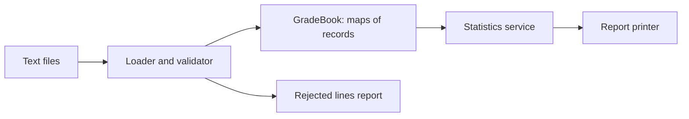
- **Loader** reads lines, splits them, builds records, and collects errors rather than throwing on the first bad line.
- **GradeBook** holds `Map<String, Student>` and `Map<String, List<Grade>>` indexed by student and by course.
- **Statistics** computes averages and medians and assigns letter grades.
- **Printer** formats aligned columns with `String.format`.

### Data model
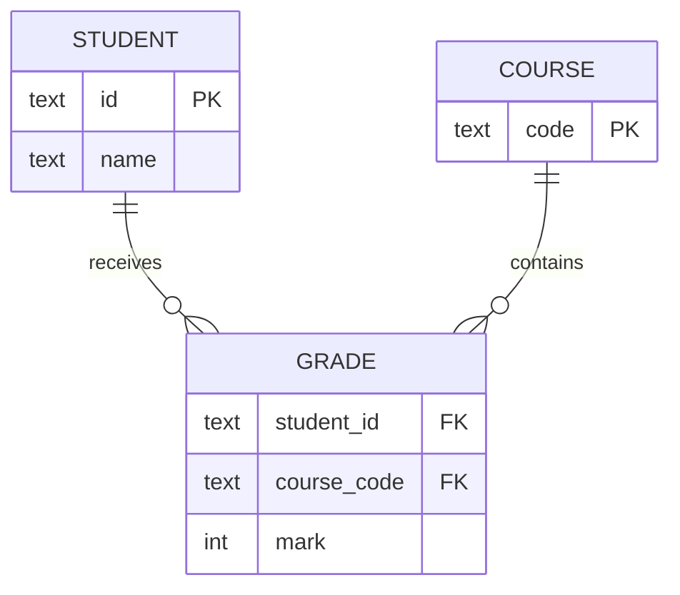

### Tech stack
| Component | Choice | Why |
|---|---|---|
| Data | records with compact constructors | validation in one place, immutable |
| Letter grade | enum `Letter` with a `from(int)` method | a fixed set of values with behaviour |
| Indexes | `HashMap`, `TreeMap` | fast lookup, sorted output |
| Sorting | `Comparator.comparing(...).thenComparing(...)` | readable multi-key sort |

### Milestones
1. **Records** — `Student`, `Grade` with a compact constructor that rejects marks outside 0–100. *Done when* `new Grade("s1","MATH",101)` throws.
2. **Loader** — parse both files, collect rejects. *Done when* a file with 3 bad lines loads the good ones and lists the 3 bad ones.
3. **Per-student stats** — averages and letters. *Done when* hand-checked numbers match for 5 students.
4. **Per-course stats** — mean, median, min, max. *Done when* the median is correct for both odd and even counts.
5. **Ranking** — top N with tie-breaking. *Done when* two students with equal averages appear in name order.

### Deep dive: the hard parts
- **Compact constructors.** A record's compact constructor (`record Grade(...) { Grade { if (mark < 0 || mark > 100) throw ...; } }`) runs before the fields are assigned, so it is the one place to validate and normalise (for example `course = course.toUpperCase()`).
- **Integer division.** `sum / count` with two `int`s truncates: 179 / 2 is 89, not 89.5. Use `double` or `BigDecimal` for averages and decide on rounding explicitly.
- **Median needs sorting.** Copy the marks, sort, and pick the middle (or average of the two middles). Do not sort the original list in place if other code shares it — or better, store `List.copyOf` so it cannot be sorted in place at all.
- **Choosing the map.** `HashMap` for lookups by ID; `TreeMap` when you want the report in course order without a separate sort step.

### Testing strategy
Unit-test the letter-grade boundaries (89, 90, 59, 60) with a parameterized test. Test median with lists of length 0, 1, 2 and 3. Load a small fixture file from `src/test/resources` and assert the full report with AssertJ's `containsExactly`.

### Trade-offs, scaling and failure modes
Records cannot have mutable state or extend other classes; that is the point, but if you later need a mutable "draft grade", use a normal class. Keeping everything in memory is fine up to millions of rows; past that you would stream the file or use a database. Collecting errors instead of failing fast is friendlier for data entry but can hide a completely wrong file — print a count and fail if more than, say, 10% of lines are bad.

### Stretch goals
- Rewrite the statistics with streams and `Collectors.groupingBy` (Chapter 12) and compare readability.
- Weighted courses (credits) and a GPA.
- Export the report as CSV and as a simple HTML table.

### Skills practised
- [Ch 6 — Inheritance, interfaces, records](../chapters/06-oop-inheritance-interfaces-and-more/README.md) — records, compact constructors, enums
- [Ch 10 — Collections](../chapters/10-collections/README.md) — `Map`, `List`, `TreeMap`, `Comparator`
- [Ch 7 — Core APIs](../chapters/07-core-apis/README.md) — formatting numbers
- [Ch 13 — I/O and NIO](../chapters/13-io-and-nio/README.md) — reading lines from files

### In the interview
**30-second answer:** I built a grade book that loads students and marks from text files and reports per-student averages and letters, per-course mean and median, and a top-N ranking. The key decision was to model the data as immutable records with compact constructors, so a mark outside 0–100 can never exist in memory, and to index them with `HashMap` for lookups and `TreeMap` for sorted output. The trickiest parts were collecting bad lines instead of failing on the first one, and getting the median right for even counts. It processes 10,000 students × 10 courses in well under a second.

**Key terms to know:**
- **Record** — a Java 16 class declared by its components, with a canonical constructor, private final fields, accessors, `equals`, `hashCode` and `toString` generated. `Student` and `Grade` are records.
- **Compact constructor** — a record constructor without a parameter list that runs before the fields are assigned. It validates the mark range and normalises course codes.
- **Immutability** — an object's state cannot change after construction. Report code cannot corrupt the input data.
- **Defensive copy** — copying a mutable argument (for example with `List.copyOf`) so outside code cannot change it later. It is needed for list components.
- **`HashMap` vs `TreeMap`** — a hash table with average O(1) lookups and no ordering versus a red-black tree with O(log n) operations and sorted keys. Both are used for indexes.
- **`Comparator.comparing(...).thenComparing(...)`** — builds a multi-key sort. It ranks by average, then by name.
- **Enum with behaviour** — an enum whose constants carry data and methods. `Letter.from(int)` maps a mark to A–F.
- **Integer division** — `int / int` truncates toward zero. It is the bug in naive averages.
- **Median** — the middle value of sorted data, or the mean of the two middles for an even count.

**Q:** What does a record generate for you?

**A:** A canonical constructor, a private final field and a public accessor (named `mark()`, not `getMark()`) for each component, and `equals`, `hashCode` and `toString` based on all components. You can add methods, static fields and extra constructors, but not extra instance fields, and a record cannot extend another class.

**Q:** Can a record be mutable?

**A:** Its fields are final, so you cannot reassign them. But if a component is a mutable object, such as an `ArrayList`, its contents can still change through a shared reference. Copy defensively with `List.copyOf` in the compact constructor, which also rejects `null` elements.

**Q:** Why do `equals` and `hashCode` matter for records used as map keys?

**A:** A `HashMap` finds a key by first using `hashCode` to pick a bucket and then `equals` to confirm the match. The contract says equal objects must have equal hash codes. Records generate both from the same components, so they are consistent, but a record holding a mutable list can change its hash code after insertion and become unfindable in the map.

**Q:** `HashMap` or `TreeMap` here?

**A:** `HashMap` for lookups by student ID, which are average O(1). `TreeMap` (O(log n) per operation) when the report must be printed in key order, such as courses alphabetically, because iteration is already sorted and you skip a separate sort step.

**Q:** Why is your average 89 instead of 89.5?

**A:** `sum / count` with two `int`s does integer division and drops the fraction, so 179 / 2 is 89. Convert to `double` first (`(double) sum / count`), use `IntStream.average()`, or use `BigDecimal` with an explicit rounding rule.
```java
double avg = marks.stream().mapToInt(Integer::intValue).average().orElse(0);
```

**Q:** How do you rank the top N students with ties broken by name?

**A:** Sort with a comparator that orders by average descending and then by name ascending, then take N. A full sort is O(n log n), which is fine for 10,000 students. For huge inputs a min-heap of size N gives O(n log N).
```java
Comparator<StudentStats> byRank = Comparator
    .comparingDouble(StudentStats::average).reversed()
    .thenComparing(StudentStats::name);
```

**Q:** Why collect bad lines instead of throwing on the first one?

**A:** Data entry files often have a few mistakes, and the user wants a list of all of them in one run rather than fixing them one at a time. The risk is silently accepting a completely wrong file, so print the reject count and fail if more than a threshold (say 10%) of lines are bad.

**Q:** How do you test it, and which edge cases matter?

**A:** Parameterized tests on letter-grade boundaries (59, 60, 89, 90), median for lists of length 0, 1, 2 and 3, a record constructor test that `new Grade("s1", "MATH", 101)` throws, and one fixture file from `src/test/resources` whose full report is checked with AssertJ `containsExactly`.

**Q:** What changes at 100x the data?

**A:** A million students × 10 courses is still fine in memory with records and maps. Past that, loading everything stops working: you stream the file and keep running sums per student and course (mean is easy, an exact median is not, because it needs all values or an approximation). At that scale a database with `GROUP BY` is usually the right tool.

**Common mistakes in answers:**
- Saying records are deeply immutable. Only the references are final; mutable components need defensive copies.
- Saying records are "just Lombok". They are a language feature with fixed semantics: no extra instance fields, no inheritance, and generated members based on all components.
- Forgetting the even-count case of the median, or sorting a shared list in place to compute it.

### TL;DR
Model the data with immutable records, index it with the right maps, then compute. Validate once, in the compact constructor.

## 4. Unit converter

**Level:** Beginner · **Time:** 1 weekend · **Prerequisites:** Ch 6, Ch 7

### What it is
A command-line converter: `convert 5 km to mi`, `convert 72 F to C`, `convert 3 cups to ml`. It knows several **dimensions** (length, mass, temperature, volume, time, data size) and refuses nonsense such as kilograms to metres.

### The problem it solves
Unit mistakes are expensive. Building a converter forces you to model a closed set of things (units) with behaviour (how to convert), which is what Java **enums** are for. It also shows the limits of a simple "multiply by a factor" design: temperature needs an offset, and some conversions must be exact. The design generalises to any "convert between representations" problem — currencies, time zones, encodings.

### Real-world examples
- NASA's [Mars Climate Orbiter](https://science.nasa.gov/mission/mars-climate-orbiter/) was lost in 1999 because one team's software produced thrust data in imperial units while another expected metric.
- [JSR 385, Units of Measurement](https://unitsofmeasurement.github.io/), is the standard Java API for quantities and units; its reference implementation shows a full-scale version of this design.

### Requirements
**Functional**
- Parse `convert <number> <unit> to <unit>`, with unit aliases (`km`, `kilometre`, `kilometer`).
- Support at least 6 dimensions and 30 units.
- Reject conversions across dimensions with a message naming both dimensions.
- `list <dimension>` prints known units.

**Non-functional**
- Results correct to at least 10 significant digits; exact for defined factors (1 inch = 0.0254 m exactly).
- Adding a unit is one line of code.

### The architecture
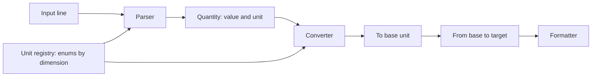
- **Parser** maps text to a `Unit` via a registry of aliases.
- **Unit registry** is a set of enums, one per dimension (`Length.METRE`, `Length.MILE`…), each implementing a `Unit` interface.
- **Converter** converts to the dimension's **base unit** (metre, kilogram, kelvin) and then to the target, so N units need N factors, not N² pairs.
- **Formatter** rounds for display without changing the stored value.

### Data model
| Type | Kind | Role |
|---|---|---|
| `Dimension` | enum | LENGTH, MASS, TEMPERATURE… |
| `Unit` | sealed interface | `dimension()`, `toBase(BigDecimal)`, `fromBase(BigDecimal)` |
| `Length`, `Mass`… | enums implementing `Unit` | one constant per unit, with factor |
| `Quantity` | record | value + unit |

### Tech stack
| Component | Choice | Why |
|---|---|---|
| Units | enums with constructor arguments | fixed set, compile-time checked |
| Arithmetic | `BigDecimal` with `MathContext.DECIMAL64` | exact factors, controlled precision |
| Dispatch | sealed interface + pattern-matching `switch` | compiler checks every dimension is handled |
| Aliases | `Map<String, Unit>` built at startup | O(1) lookup |

### Milestones
1. **Length only** — enum with factors to metres. *Done when* 1 mile = 1609.344 m exactly.
2. **Parser** — aliases and case-insensitivity. *Done when* `KM`, `km` and `kilometres` all work.
3. **More dimensions** — mass, volume, time, data size (decide: is 1 KB 1000 or 1024 bytes? support both `kB` and `KiB`).
4. **Temperature** — affine conversions with offsets. *Done when* -40 °C = -40 °F and 0 K = -273.15 °C.
5. **Errors** — cross-dimension and unknown units. *Done when* `5 kg to m` prints a clear error.

### Deep dive: the hard parts
- **Affine vs linear.** Most units are linear (`base = value × factor`). Temperature is affine (`kelvin = celsius + 273.15`, `fahrenheit` needs both a factor and an offset). Give `Unit` two methods, `toBase` and `fromBase`, rather than a single factor, so temperature fits the same interface.
- **Precision.** `BigDecimal.divide` without a `MathContext` throws `ArithmeticException` when the result does not terminate (1/3). Always pass a `MathContext`. Round only for display.
- **Exhaustiveness.** With `sealed interface Unit permits Length, Mass, Temperature…` a `switch` over a unit's type does not need a `default`; add a new dimension and every non-exhaustive switch becomes a compile error — the compiler finds the places you forgot.

### Testing strategy
Round-trip property: for every unit `u` in a dimension and value `v`, converting `v` from `u` to base and back gives `v` (to the chosen precision). Generate cases with a JUnit `@MethodSource` over `Length.values()`. Add known fixed points (water boiling, marathon distance).

### Trade-offs, scaling and failure modes
Enums make units compile-time constants, so users cannot add units without recompiling; loading them from a config file is more flexible but loses type safety. `BigDecimal` is slower than `double` by roughly an order of magnitude — irrelevant here, important in a physics simulation. Compound units (km/h, N·m) need a different model: exponents per base dimension, as JSR 385 does.

### Stretch goals
- Compound units like `km/h to m/s` by representing a unit as a map from base dimension to exponent.
- Currency conversion with rates fetched from a file, timestamped.
- A REPL with history using `IO.readln` in a loop.

### Skills practised
- [Ch 6 — Inheritance, interfaces, records](../chapters/06-oop-inheritance-interfaces-and-more/README.md) — enums with fields, sealed interfaces
- [Ch 7 — Core APIs](../chapters/07-core-apis/README.md) — `BigDecimal`, `MathContext`, formatting
- [Ch 3 — Control flow](../chapters/03-control-flow/README.md) — pattern matching for `switch`
- [Ch 10 — Collections](../chapters/10-collections/README.md) — maps for aliases

### In the interview
**30-second answer:** I built a command-line unit converter covering six dimensions and over 30 units, such as `convert 5 km to mi`. Each dimension is an enum implementing a sealed `Unit` interface, and every conversion goes through the dimension's base unit, so N units need N definitions instead of N² pairs. The hard part was temperature, which is affine rather than a simple factor, so each unit has `toBase` and `fromBase` methods instead of one multiplier. Arithmetic is `BigDecimal` with `MathContext.DECIMAL64`, so defined factors such as 1 inch = 0.0254 m are exact and round-trip tests pass for every unit.

**Key terms to know:**
- **Enum with fields** — enum constants that take constructor arguments, such as a factor to metres. Each unit is one constant.
- **Sealed interface** — an interface that lists exactly which types may implement it (`permits`). `Unit` is implemented only by the dimension enums.
- **Exhaustive switch** — a switch expression or pattern switch that covers every case, so no `default` is needed and a new case causes a compile error. It is used when dispatching on dimension.
- **Base unit** — one reference unit per dimension (metre, kilogram, kelvin) that all conversions pass through.
- **Linear vs affine conversion** — `y = a·x` versus `y = a·x + b`. Temperature is affine because of the offset (0 °C = 273.15 K).
- **`MathContext`** — a precision (number of significant digits) plus a rounding mode for `BigDecimal` operations. Every division needs one.
- **Round-trip property** — converting to base and back must return the original value. It is the main test.
- **Alias registry** — a `Map<String, Unit>` from every accepted spelling to its unit. The parser uses it for O(1) lookups.

**Q:** Why convert through a base unit?

**A:** With N units you store N factors instead of N×(N−1) pairwise rates, and every pair is automatically consistent, because km→mi and mi→km come from the same two definitions. Adding a unit is one line. The cost is two operations per conversion instead of one, which is negligible.

**Q:** Why an enum rather than `int` or `String` constants?

**A:** Enums are type-safe: a method taking `Length` cannot be given a mass. They can carry fields and methods, `values()` lets tests iterate every unit, and the compiler checks switch expressions over them for exhaustiveness. String constants can be misspelled and are only checked at run time.

**Q:** How does temperature fit the same interface as length?

**A:** Instead of a single factor, `Unit` has `toBase(BigDecimal)` and `fromBase(BigDecimal)`. Linear units implement them as multiply and divide. Celsius adds or subtracts 273.15, and Fahrenheit does `(f − 32) × 5/9 + 273.15`. The converter never needs to know which kind it has.

**Q:** Why does `BigDecimal.ONE.divide(new BigDecimal(3))` throw?

**A:** Without a `MathContext`, `divide` tries to return the exact result, and 1/3 has infinitely many decimal digits, so it throws `ArithmeticException` ("Non-terminating decimal expansion"). Pass a precision: `divide(three, MathContext.DECIMAL64)` gives 16 significant digits. Fahrenheit's 5/9 hits the same problem.

**Q:** What does a sealed interface give you that a normal interface does not?

**A:** The compiler knows the complete list of implementations, so a pattern-matching `switch` over `Unit` can be exhaustive without a `default`. If someone adds a new dimension to `permits`, every switch that does not handle it fails to compile, rather than falling into a default branch at run time.
```java
String label = switch (unit) {
    case Length l -> "length";
    case Mass m -> "mass";
    case Temperature t -> "temperature";
};
```

**Q:** What happens with `convert 5 kg to m` or an unknown unit?

**A:** The parser resolves both units, then the converter compares their `dimension()` and throws a clear error naming both dimensions ("cannot convert MASS to LENGTH"). An unknown alias fails in the registry lookup with "unknown unit 'kgs'", ideally with a suggestion. Neither case should reach the arithmetic.

**Q:** How do you test it?

**A:** A round-trip test over `Length.values()` (and each other dimension) via JUnit `@MethodSource`, checking that to-base-then-back returns the input within the chosen precision. Add fixed points with known answers: 1 mile = 1609.344 m exactly, -40 °C = -40 °F, 0 K = -273.15 °C. Add negative tests for cross-dimension and unknown units.

**Q:** Is 1 KB 1000 or 1024 bytes?

**A:** Both are used, which is why the standard units are separate: `kB` = 1000 bytes (SI prefix) and `KiB` = 1024 bytes (binary prefix, IEC). Supporting both by name removes the ambiguity rather than guessing.

**Q:** What breaks first if you add compound units like km/h, or let users add units?

**A:** The "one enum per dimension" model cannot express km/h or N·m; you need a unit represented as exponents per base dimension (length¹ time⁻¹), as JSR 385 does. User-defined units cannot be enum constants because enums are fixed at compile time, so you would load them from configuration and lose compile-time checking.

**Common mistakes in answers:**
- Treating temperature as a multiplication. Celsius and Fahrenheit have offsets, so a single factor gives wrong answers.
- Rounding intermediate results. Round only when formatting output, or errors compound across the two conversion steps.
- Saying `BigDecimal` is always the right choice. It is about an order of magnitude slower than `double`; that does not matter here but does in a numeric simulation.

### TL;DR
Enums per dimension, a shared base unit, and `toBase`/`fromBase` methods so even temperature fits. Keep arithmetic exact and round only for display.

## 5. Word-frequency counter with streams

**Level:** Beginner · **Time:** 1 weekend · **Prerequisites:** Ch 12, Ch 13

### What it is
A tool that reads one or more text files and prints the N most common words with their counts, for example `wordfreq --top 10 book.txt`. Options exclude common "stop words" (the, and, of), ignore case, and show the total and unique word counts.

### The problem it solves
Counting is the "hello world" of data processing, and it is a perfect first use of the **Stream API**: read lines, split them into words, normalise, filter, group and count, sort, take the top N — each step one line. Doing it well also teaches the parts of text handling that trip people up: character encodings, Unicode letters beyond A–Z, and reading a file too big for memory.

### Real-world examples
- In 1986 Jon Bentley asked Donald Knuth to write a literate program for this exact task in *Communications of the ACM*, and Doug McIlroy answered with a six-command Unix pipeline; the exchange ([Programming Pearls: A Literate Program](https://dl.acm.org/doi/10.1145/5948.315654)) is still a classic argument for composing small tools — which is what a stream pipeline does.
- Search engines and text-analysis tools start with the same tokenise → normalise → count step (see project 36).

### Requirements
**Functional**
- Read files given as arguments, or standard input if none.
- Words: sequences of Unicode letters and apostrophes; case-folded; optional stop-word list.
- Print top N (default 10) as aligned columns, ties ordered alphabetically.
- Print total words, distinct words, and elapsed time.

**Non-functional**
- Process a 100 MB file in under 5 seconds on a laptop, without loading it all into memory.
- Correct on UTF-8 text with accents (`café`, `naïve`).

### The architecture
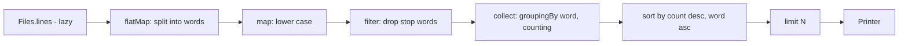
- **`Files.lines`** reads lazily, one line at a time, so memory stays small.
- **Split** uses a precompiled `Pattern` with `\p{L}` (any Unicode letter).
- **Count** builds a `Map<String, Long>`; this is the only stage that holds data.
- **Sort and limit** turn the map's entries into the top N.

### Data model
| Data | Type | Note |
|---|---|---|
| counts | `Map<String, Long>` | one entry per distinct word |
| stop words | `Set<String>` | loaded from a resource file |
| result row | `record WordCount(String word, long count)` | printed |

### Tech stack
| Component | Choice | Why |
|---|---|---|
| Reading | `Files.lines(path, UTF_8)` | lazy, explicit charset |
| Tokenising | `Pattern.compile("[\\p{L}']+")` | Unicode-aware |
| Counting | `Collectors.groupingBy(w -> w, counting())` | one line |
| Top N | `Map.Entry.comparingByValue().reversed()` | readable sorting |

### Milestones
1. **Count one file** — total and distinct words. *Done when* a 3-line fixture gives known counts.
2. **Top N** — sorted with tie-break. *Done when* equal counts appear alphabetically.
3. **Stop words and case** — *Done when* "The" and "the" merge and both are excluded.
4. **Many files and stdin** — *Done when* `cat a.txt | wordfreq` works.
5. **Big file** — generate 100 MB and time it. *Done when* it runs under the target with `-Xmx256m`.

### Deep dive: the hard parts
- **Close the stream.** `Files.lines` holds an open file handle; use try-with-resources or you leak handles when processing many files.
- **Locale-safe lower case.** `"TITLE".toLowerCase()` uses the default locale; in Turkish the dotted/dotless I rules change the result. Use `toLowerCase(Locale.ROOT)`.
- **Top N without sorting everything.** Sorting a million entries is O(n log n). A min-heap of size N (`PriorityQueue`) gives O(n log N). Implement both and compare — a good first use of a heap (Chapter 19).
- **Parallel streams.** `.parallel()` on `Files.lines` splits the file, but counting into a shared map needs a concurrent collector (`groupingByConcurrent`). Measure: for I/O-bound input it often does not help.

### Testing strategy
Unit-test the tokeniser on punctuation, apostrophes (`don't`), digits and accented letters. Test top-N with a hand-built map. Use a `@TempDir` to write fixture files. A test with an invalid UTF-8 byte checks you report a clear error (`MalformedInputException`).

### Trade-offs, scaling and failure modes
The whole vocabulary must fit in memory; for web-scale text you would count in partitions and merge (MapReduce's canonical example). Treating apostrophes as letters keeps "don't" whole but also keeps quote marks around words — decide and document. Stemming (running/runs → run) improves results but is language-specific.

### Stretch goals
- Bigram counts ("of the") with a sliding window gatherer (Chapter 12, Java 24).
- Compare heap vs full sort with JMH.
- Output as JSON or CSV.

### Skills practised
- [Ch 12 — Streams](../chapters/12-streams/README.md) — pipelines, collectors, parallel streams
- [Ch 13 — I/O and NIO](../chapters/13-io-and-nio/README.md) — `Files.lines`, charsets
- [Ch 7 — Core APIs](../chapters/07-core-apis/README.md) — `Pattern`, case folding
- [Ch 10 — Collections](../chapters/10-collections/README.md) — maps and `PriorityQueue`

### In the interview
**30-second answer:** I built a word-frequency tool that reads files or standard input and prints the top N words, as one stream pipeline: lazy lines, split into Unicode words, lower-case, filter stop words, group and count, then take the top N. The key decision was `Files.lines` with an explicit UTF-8 charset inside try-with-resources, so memory grows with the vocabulary, not the file size. The hard parts were Unicode-aware tokenising with `\p{L}`, locale-safe lower-casing, and getting the top N without sorting everything. A 100 MB file runs in under 5 seconds with a 256 MB heap.

**Key terms to know:**
- **Stream pipeline** — a source, zero or more intermediate operations (`map`, `filter`, `flatMap`) and one terminal operation (`collect`). The whole counter is one pipeline.
- **Lazy evaluation** — intermediate operations do nothing until a terminal operation pulls data. `Files.lines` only reads lines as they are needed.
- **`flatMap`** — maps each element to a stream and flattens the results. It turns lines into words.
- **`Collectors.groupingBy(..., counting())`** — groups elements by a key and counts each group into a `Map<String, Long>`.
- **Try-with-resources** — closes an `AutoCloseable` automatically. `Files.lines` holds an open file handle.
- **Charset / UTF-8** — the rule mapping bytes to characters. Invalid bytes throw `MalformedInputException` (wrapped in `UncheckedIOException` from the stream).
- **`Locale.ROOT`** — a neutral locale for case conversion so Turkish rules do not change `I`. It is used when folding case.
- **Min-heap (`PriorityQueue`)** — a structure whose smallest element is cheapest to remove. It finds the top K in O(n log K).
- **Parallel stream** — splits work across the common ForkJoin pool. It is optional here and must be measured.

**Q:** Why is `Files.lines` better than `Files.readAllLines` here?

**A:** `readAllLines` loads the whole file into a `List<String>`, so a 100 MB file needs at least that much heap (more, because Java strings carry object overhead). `Files.lines` is lazy: lines are read as the pipeline pulls them, so memory depends only on the counts map. It must be closed, so wrap it in try-with-resources.

**Q:** Walk me through the pipeline.

**A:** Each line is split by a precompiled `Pattern` into words, lower-cased with `Locale.ROOT`, filtered against a stop-word `Set`, then grouped and counted.
```java
try (Stream<String> lines = Files.lines(path, UTF_8)) {
    Map<String, Long> counts = lines
        .flatMap(line -> WORD.matcher(line).results())
        .map(m -> m.group().toLowerCase(Locale.ROOT))
        .filter(w -> !STOP.contains(w))
        .collect(groupingBy(w -> w, counting()));
}
```
`Matcher.results()` (Java 9) returns every match as a stream of `MatchResult`.

**Q:** How do you get the top K of n items efficiently?

**A:** Use a min-heap of size K: add each entry, and when the size exceeds K remove the smallest. That is O(n log K) time and O(K) extra space, against O(n log n) for sorting every entry. For K = 10 and a million distinct words the heap wins clearly, though for small inputs a full sort is simpler and fast enough.

**Q:** Why `toLowerCase(Locale.ROOT)` instead of `toLowerCase()`?

**A:** The no-argument version uses the JVM's default locale. In Turkish, upper-case `I` lower-cases to a dotless `ı`, so "TITLE" would not match "title" on a Turkish machine. `Locale.ROOT` gives the same result everywhere, which is what you want for program logic as opposed to text shown to users.

**Q:** When does `parallel()` help?

**A:** For CPU-heavy work on a large source that splits cheaply. Here reading the file is often the bottleneck, line splitting is less even than splitting an array, and merging the per-thread maps costs time, so it may not help. If you try it, use `groupingByConcurrent` or let `groupingBy` merge partial maps, never a shared `HashMap` mutated from `forEach`, and measure.

**Q:** What happens if the file is not valid UTF-8, or is missing?

**A:** A missing file makes `Files.lines` throw `NoSuchFileException`, an `IOException`. Bad bytes are only found while the stream is consumed, so they surface as an `UncheckedIOException` wrapping `MalformedInputException`. Catch both at the top level and print the file name with a clear message rather than a stack trace.

**Q:** Why does `Map<String, Long>` use `Long` and not `Integer`?

**A:** `Collectors.counting()` returns a `Long`, so the map type follows. It also avoids overflow for very large inputs. If you build the map yourself, `map.merge(word, 1L, Long::sum)` is the idiomatic one-liner.

**Q:** How do you test it?

**A:** Unit-test the tokeniser on punctuation, apostrophes (`don't`), digits and accents (`café`, `naïve`). Test the top-N step with a hand-built map, including ties, which must be alphabetical. Write fixture files into a JUnit `@TempDir`, and include an invalid UTF-8 byte to check the error message.

**Q:** What changes at web scale, say 1 TB of text?

**A:** The vocabulary may no longer fit in one JVM's memory, and one machine reads too slowly. You split the input, count each partition separately, and merge the partial counts by word, which is the classic MapReduce word count. Approximate structures such as Count-Min Sketch can find frequent words in fixed memory if exact counts are not required.

**Common mistakes in answers:**
- Forgetting that `Files.lines` must be closed. Processing thousands of files leaks file handles.
- Saying "just add `.parallel()` and it gets faster" without measuring, or mutating a shared map inside `forEach`, which is a data race.
- Splitting on `\s+` or `[a-zA-Z]+`, which mishandles punctuation and drops accented letters. Use `\p{L}`.

### TL;DR
A stream pipeline from lazy lines to a grouped count to a top-N. Mind encodings, locales and closing the file.

## 6. Tic-tac-toe with an unbeatable AI

**Level:** Beginner · **Time:** 1 weekend · **Prerequisites:** Ch 3, Ch 4

### What it is
Tic-tac-toe in the terminal: a human plays X against a computer playing O. The computer never loses — it either wins or draws — because it searches every possible continuation of the game using the **minimax** algorithm.

### The problem it solves
This is the friendliest introduction to **game-tree search**: a recursive function that imagines every move, every reply and every reply to that, and chooses the move whose worst case is best. It practises 2D arrays, recursion and clean separation between game rules, AI and user interface — the same split you will use in every larger program.

### Real-world examples
- [Minimax](https://en.wikipedia.org/wiki/Minimax) is the foundation of classic chess and checkers engines; [alpha-beta pruning](https://en.wikipedia.org/wiki/Alpha%E2%80%93beta_pruning) is the standard optimisation that skips branches which cannot change the decision.
- Tic-tac-toe has only 255,168 possible games, small enough to search completely — which is why a perfect player exists.

### Requirements
**Functional**
- Print the 3×3 board; the human enters a cell 1–9.
- Reject occupied or invalid cells.
- Detect wins on rows, columns, diagonals and draws.
- The AI never loses; choose who starts.

**Non-functional**
- AI move under 50 ms from an empty board (full search with pruning).
- Board logic independent of the console, so a GUI could reuse it.

### The architecture
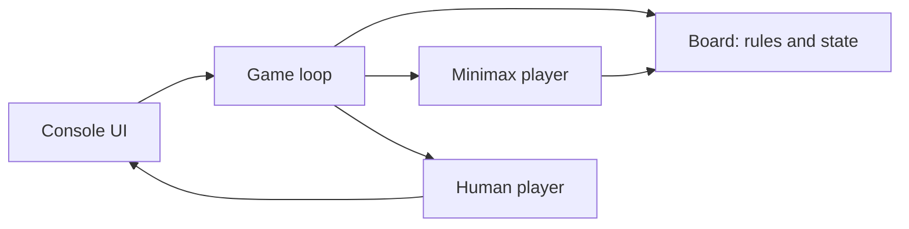
- **Board** stores cells, applies moves, and reports `winner()` or `isFull()`.
- **Player** is an interface with `int chooseMove(Board)`; `HumanPlayer` asks the console, `MinimaxPlayer` searches.
- **Game loop** alternates players until the board reports a result.

### Data model
| Type | Representation | Note |
|---|---|---|
| `Mark` | enum X, O, EMPTY | `opponent()` method |
| `Board` | `Mark[9]` or `Mark[3][3]` | plus the 8 winning lines as constants |
| `Move` | `int` 0–8 | |
| score | `int` | +10 win, -10 loss, 0 draw, adjusted by depth |

### Tech stack
| Component | Choice | Why |
|---|---|---|
| Board | array of enum | fixed size, fast copy |
| Search | recursion | mirrors the game tree |
| Players | interface + two classes | swap human/AI/random easily |
| Tests | JUnit 6 | play AI vs AI and random vs AI |

### Milestones
1. **Board rules** — moves, win detection. *Done when* tests cover all 8 winning lines.
2. **Two humans** — playable game loop. *Done when* a full game can be played.
3. **Minimax** — the AI searches the full tree. *Done when* AI vs AI always draws.
4. **Prefer fast wins** — score `10 - depth`. *Done when* the AI wins in one move when it can, instead of a slower win.
5. **Alpha-beta** — *Done when* nodes visited from an empty board drop sharply (count them).

### Deep dive: the hard parts
- **Minimax in one sentence.** On the AI's turn take the maximum score over all moves; on the opponent's turn take the minimum, assuming they also play perfectly; at a finished board return the result. Recursion depth is at most 9.
- **Undo instead of copy.** Copying the board at every node is simple; making a move, recursing, then clearing the cell (backtracking) is faster and allocates nothing. Both are fine here — notice the trade-off.
- **Depth matters.** Without a depth penalty every winning line scores +10, so the AI may "play with its food" and delay a win. Subtracting depth makes it prefer quicker wins and slower losses.
- **Alpha-beta.** Carry the best score the maximiser is already guaranteed (alpha) and the minimiser's (beta); stop exploring a branch once alpha ≥ beta. Same answer, far fewer nodes.

### Testing strategy
Fixed positions: "AI must block this row", "AI must take this win". A property test: 1,000 games of a random player against the AI — the AI never loses. Count nodes with and without pruning and assert the pruned count is smaller.

### Trade-offs, scaling and failure modes
Full search works because the tree is tiny. For Connect Four or chess you must cut off at a depth and use a **heuristic evaluation** (a guess of how good a position is), plus memoisation of repeated positions (a transposition table). A perfect AI is no fun — add a difficulty setting that sometimes plays randomly.

### Stretch goals
- Memoise board → score in a `HashMap` and measure.
- Generalise to an N×N board with K-in-a-row and depth-limited search.
- Connect Four with a heuristic.

### Skills practised
- [Ch 4 — Methods and arrays](../chapters/04-methods-and-arrays/README.md) — arrays and recursion
- [Ch 3 — Control flow](../chapters/03-control-flow/README.md) — loops and switch
- [Ch 6 — Inheritance, interfaces, records](../chapters/06-oop-inheritance-interfaces-and-more/README.md) — interfaces and enums
- [Ch 19 — Java for coding interviews](../chapters/19-java-for-coding-interviews/README.md) — backtracking

### In the interview
**30-second answer:** I built terminal tic-tac-toe where the computer never loses, because it searches the whole game tree with minimax. The key design decision was a `Player` interface with `HumanPlayer` and `MinimaxPlayer` behind it and a `Board` class with no console code, so the AI and the rules are testable on their own. The interesting problems were making the AI prefer faster wins by subtracting search depth from the score, and adding alpha-beta pruning so the first move takes well under 50 ms. A property test plays 1,000 games against a random player and asserts the AI never loses.

**Key terms to know:**
- **Game tree** — every position reachable from the current one, with moves as edges. Tic-tac-toe's is small enough to search completely (255,168 possible games).
- **Minimax** — a recursive search where the AI picks the move with the highest score and assumes the opponent picks the lowest. It is the AI's whole algorithm.
- **Terminal position** — a board with a win or a full board, scored +10, -10 or 0. It is the base case of the recursion.
- **Depth penalty** — subtracting the search depth from a win score so quicker wins score higher. It stops the AI delaying a win.
- **Alpha-beta pruning** — skipping branches that cannot change the decision, tracked with alpha (best for the maximiser so far) and beta (best for the minimiser). Same answer, far fewer nodes.
- **Backtracking** — make a move, recurse, then undo it, instead of copying the board. It saves allocation in the search.
- **Strategy pattern** — interchangeable algorithms behind one interface. `Player.chooseMove(Board)` is implemented by a human and by the AI.
- **Heuristic evaluation / transposition table** — a scoring guess for unfinished positions and a cache of positions already scored. They are what bigger games need (stretch goals).

**Q:** Explain minimax in plain words.

**A:** On the AI's turn, try every legal move, score the result recursively, and take the maximum. On the opponent's turn take the minimum, assuming they play perfectly. A finished board returns its result directly. Because the depth is at most 9, plain recursion is safe.

**Q:** Why does the AI sometimes delay a win, and how do you fix it?

**A:** Without a depth term, a win in 1 move and a win in 5 moves both score +10, so the AI may pick the slow one. Score wins as `10 - depth` and losses as `depth - 10`, so it prefers quick wins and, if losing, the slowest loss.

**Q:** What does alpha-beta pruning do, and does it change the answer?

**A:** It carries two bounds: alpha, the score the maximiser can already guarantee, and beta, the minimiser's guarantee. When alpha ≥ beta in a branch, the opponent would never let the game reach it, so the rest of the branch is skipped. The chosen move is the same as plain minimax, but far fewer nodes are visited, especially if good moves are tried first.

**Q:** Copy the board at each node, or make and undo moves?

**A:** Copying is simpler and has no risk of forgetting to undo, but allocates a new array at every node. Make/undo (backtracking) allocates nothing and is faster. With a 9-cell board either is fine; for chess engines make/undo is standard.
```java
for (int cell : board.emptyCells()) {
    board.set(cell, AI);
    best = Math.max(best, minimax(board, depth + 1, false));
    board.clear(cell);          // undo
}
```

**Q:** How do you detect a win without a long chain of `if`s?

**A:** Store the 8 winning lines (3 rows, 3 columns, 2 diagonals) as a constant array of cell-index triples and check whether all three cells in any line hold the same non-empty mark. That is data rather than code, and it generalises to K-in-a-row on bigger boards.

**Q:** How do you prove the AI never loses?

**A:** Fixed-position tests ("must block this row", "must take this win"), plus a property test where a random player plays 1,000 games against the AI and the AI never loses. Because the game is tiny, you can go further and enumerate every possible opponent strategy from both starting sides. Counting nodes with and without pruning checks that alpha-beta really prunes.

**Q:** What happens with bad input, such as an occupied cell or `x`?

**A:** The human player's input method parses and validates in a loop: a non-number, a number outside 1–9 or an occupied cell prints a hint and asks again. The `Board` also rejects an illegal move with an exception, so a bug in any player cannot corrupt the game state.

**Q:** What changes for Connect Four or chess?

**A:** The full tree is far too big (Connect Four has about 4.5 trillion positions, and chess vastly more), so you search to a fixed depth and score unfinished positions with a heuristic evaluation. You add move ordering for better pruning, a transposition table to reuse scores of positions reached by different move orders, and iterative deepening to answer within a time limit.

**Common mistakes in answers:**
- Saying alpha-beta is a heuristic that may pick a worse move. It always returns the same result as minimax; only depth-limited search with a heuristic evaluation is approximate.
- Forgetting the depth penalty and then being unable to explain why the AI "toys" with the opponent.
- Mixing console I/O into the board or AI code, which makes the AI impossible to unit-test.

### TL;DR
Recursive minimax over a 3×3 board makes a perfect player; alpha-beta makes it fast. Keep rules, AI and UI separate.

## 7. Text adventure engine

**Level:** Beginner · **Time:** 1–2 weekends · **Prerequisites:** Ch 3, Ch 6, Ch 10

### What it is
A small interactive-fiction game: you move between rooms (`go north`), pick up and use items (`take lamp`, `open door with key`), and solve a puzzle to win. The twist is that the *engine* is generic: the world (rooms, exits, items, puzzles) is described in a data file, so you can write a new adventure without changing code.

### The problem it solves
A game world is a graph of states that the player changes with typed commands. Building one teaches how to model a domain with **sealed types and records**, how to parse a tiny command language, and how to use **pattern matching for `switch`** (final in Java 21) to handle each command shape. Loading the world from data shows the separation between engine and content that every real game, and most business software, relies on.

### Real-world examples
- [Colossal Cave Adventure](https://en.wikipedia.org/wiki/Colossal_Cave_Adventure) (1976) defined the genre: a two-word parser, rooms, items and treasures.
- [JEP 441](https://openjdk.org/jeps/441) (pattern matching for `switch`) shows this style — a sealed hierarchy plus an exhaustive switch with no `default` — in its examples.

### Requirements
**Functional**
- Commands: `look`, `go <dir>`, `take <item>`, `drop <item>`, `inventory`, `use <item> [on <thing>]`, `save`, `load`, `quit`.
- Synonyms: `n` for `go north`, `get` for `take`.
- World loaded from a text file: rooms, exits, items, locked exits needing a key, a win condition.
- Save and load game state.

**Non-functional**
- Unknown words give a helpful reply, never an exception.
- A new world file with 20 rooms needs zero code changes.

### The architecture
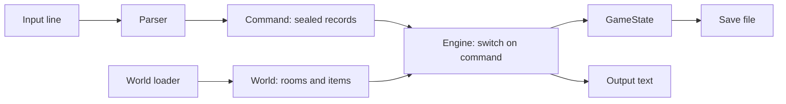
- **Parser** normalises words, applies synonyms, and returns a `Command` such as `Go(Direction.NORTH)` or `Unknown(text)`.
- **Engine** is one exhaustive `switch` over the sealed `Command` type.
- **World** is immutable (rooms, connections); **GameState** is the mutable part (current room, inventory, unlocked doors, item locations).
- **World loader** reads the data file once at start.

### Data model
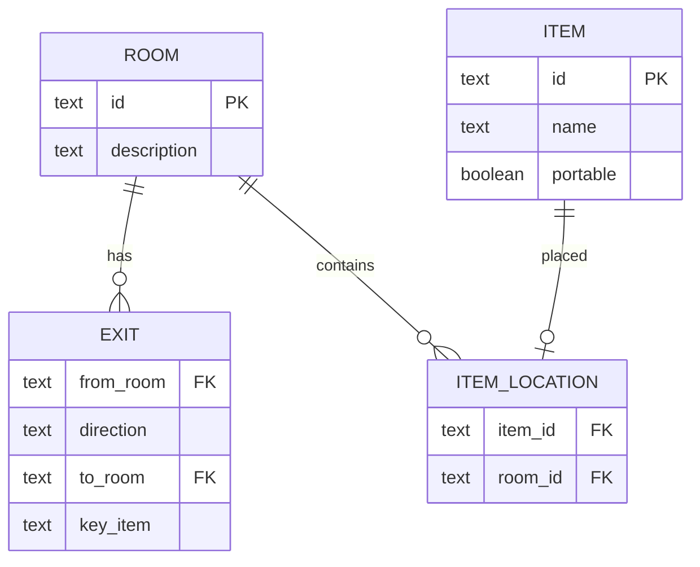

### Tech stack
| Component | Choice | Why |
|---|---|---|
| Commands | `sealed interface Command` + records | exhaustive switch, no casts |
| Directions | enum with `opposite()` | fixed set |
| World graph | `Map<String, Room>`, `EnumMap<Direction, Exit>` | fast, compact |
| Save files | `Properties` or a simple text format | readable by humans |

### Milestones
1. **Two hard-coded rooms** — `look` and `go`. *Done when* you can walk back and forth.
2. **Parser and sealed commands** — synonyms and unknown words. *Done when* `n`, `go north` and `walk north` all move you.
3. **Items and inventory** — take, drop, inventory. *Done when* an item moves from room to inventory and back.
4. **Locked exits and win** — a key opens a door; reaching the treasure wins. *Done when* the whole demo is solvable.
5. **Data-driven world and saves** — *Done when* a second world file plays without code changes, and save/load restores state.

### Deep dive: the hard parts
- **Exhaustive switch.** `switch (cmd) { case Go(var dir) -> ...; case Take(var item) -> ...; ... }` with no `default`. Adding a new record to the sealed interface breaks compilation until every switch handles it — exactly the safety you want as the game grows.
- **Separate world from state.** If items "live" inside `Room` objects that you mutate, saving means serialising the whole graph and loading a new world mixes with old state. Keep the world immutable and store mutable facts (where each item is now, which doors are open) in one `GameState` — then save is just writing that small object.
- **Validating the world file.** Exits that point to missing rooms, keys that do not exist, an unreachable win room. Check the graph at load time with a breadth-first search from the start room (Chapter 19) and report every problem.

### Testing strategy
Unit-test the parser with a table of inputs → expected `Command`. Script a full walkthrough as a test: feed commands, assert the final state is "won". Test save → load → state equals original. Test the world validator with broken fixture files.

### Trade-offs, scaling and failure modes
A two-word parser is easy but limited; a real one needs a grammar with prepositions and adjectives ("put the small key in the box"). A text world file is simple; JSON (project 12) makes nested data easier. Hard-coding puzzle logic in Java gives power; expressing puzzles as data (conditions and effects) keeps the engine generic — the classic engine-vs-scripting trade-off.

### Stretch goals
- Conditions and effects in the data file ("if has lamp, room is lit").
- NPCs that move on a timer.
- A map command that prints the rooms you have visited.

### Skills practised
- [Ch 6 — Inheritance, interfaces, records](../chapters/06-oop-inheritance-interfaces-and-more/README.md) — sealed interfaces, records, enums
- [Ch 3 — Control flow](../chapters/03-control-flow/README.md) — pattern matching for `switch`, record patterns
- [Ch 10 — Collections](../chapters/10-collections/README.md) — `Map`, `EnumMap`
- [Ch 19 — Java for coding interviews](../chapters/19-java-for-coding-interviews/README.md) — BFS over a graph

### In the interview
**30-second answer:** I built a generic text-adventure engine where rooms, exits, items, locked doors and the win condition come from a data file, so a new 20-room world needs no code changes. Commands are parsed into a sealed interface of records, such as `Go(Direction)` and `Take(String)`, and handled by one exhaustive `switch` with no `default`, so adding a command breaks compilation until it is handled everywhere. The key design decision was splitting an immutable `World` from a small mutable `GameState`, which made save and load a matter of writing one object. At load time a breadth-first search checks that every room is reachable and every exit points somewhere real.

**Key terms to know:**
- **Sealed interface** — an interface that lists its permitted implementations. `Command` permits only the command records.
- **Record pattern** — a pattern that matches a record and pulls out its components, as in `case Go(var dir)`. It is used in the engine's switch (Java 21).
- **Pattern matching for `switch`** — a switch that branches on an object's type and shape (final in Java 21). It is the engine's dispatcher.
- **Exhaustiveness** — the compiler checks that a switch covers every permitted subtype. It is why no `default` is needed.
- **Immutable world / mutable state** — static content that never changes versus the facts the player changes. `World` and `GameState`.
- **`EnumMap`** — a map whose keys are enum constants, backed by an array. It is used for a room's exits by `Direction`.
- **Graph and BFS** — rooms are nodes and exits are edges, and breadth-first search visits everything reachable from a start node. It validates the world file.
- **Data-driven design** — behaviour described in data, not code. The world file is what makes the engine generic.

**Q:** Why sealed interfaces for commands?

**A:** The compiler knows every permitted subtype, so a `switch` over a `Command` can be exhaustive without a `default`. When you add a new record such as `Open(item)`, every switch that does not handle it stops compiling, instead of silently falling into a default branch at run time. It also removes casts, because record patterns pull out the fields.
```java
String reply = switch (cmd) {
    case Go(var dir)    -> move(dir);
    case Take(var item) -> take(item);
    case Look()         -> describe(state.room());
    // ...one case per remaining command record
    case Unknown(var t) -> "I don't understand '" + t + "'.";
};
```

**Q:** Why keep the world immutable and the state separate?

**A:** The world can be shared and reasoned about freely, and all the mutable facts (current room, inventory, item locations, opened doors) live in one small `GameState`. Saving is writing that object, loading is reading it, and tests can build a state directly. If items lived inside mutable `Room` objects, saving would mean serialising the whole graph.

**Q:** How do you check that every room is reachable?

**A:** Run BFS from the start room over exits, using a queue and a visited set. Any room not visited is unreachable, and the loader reports it together with exits pointing to missing rooms and keys that do not exist. BFS is O(rooms + exits).

**Q:** Why `EnumMap<Direction, Exit>` instead of `HashMap`?

**A:** `EnumMap` stores values in an array indexed by the enum's ordinal, so it is faster and smaller than a hash map, and it iterates in declaration order. It only works with enum keys, which is exactly this case.

**Q:** How does the parser handle synonyms and unknown words?

**A:** It lower-cases and splits the line, maps synonyms through a table (`n` → `go north`, `get` → `take`), and returns a command record. Anything it cannot match becomes `Unknown(text)`, which the engine answers politely. The parser never throws, which meets the "never an exception" requirement.

**Q:** What happens if the world file is broken?

**A:** The loader validates everything before the game starts: exits to missing rooms, keys that do not exist, items in unknown rooms, and an unreachable win room. It collects all problems and reports them with line numbers rather than stopping at the first. A broken world never reaches the engine.

**Q:** How do you test a whole game?

**A:** A table-driven parser test (input → expected `Command`), a scripted walkthrough test that feeds every command needed to win and asserts the final state is "won", a save → load test asserting the restored state equals the original (records make `equals` free), and validator tests with broken fixture files.

**Q:** What would you change for a much bigger or richer game?

**A:** The two-word parser becomes a small grammar with prepositions and adjectives ("put the small key in the box"). Puzzles move from Java code into data as conditions and effects, so writers can add them without recompiling. For very large worlds you would load rooms lazily, but even thousands of rooms fit easily in memory.

**Common mistakes in answers:**
- Adding a `default` branch "to be safe". It disables the exhaustiveness check that is the main reason to use a sealed type.
- Saying a record makes the game state immutable even when it holds a mutable `List` or `Set` that is changed in place.
- Mixing content and engine, such as hard-coding room descriptions in Java, which defeats the "new world with no code changes" requirement.

### TL;DR
A data-driven game engine: sealed command records, one exhaustive switch, an immutable world and a small mutable game state.

## 8. Expense tracker with CSV storage

**Level:** Beginner · **Time:** 1–2 weekends · **Prerequisites:** Ch 7, Ch 13

### What it is
A personal finance tool: record expenses (date, amount, category, note), list them, and report totals per month and per category. Data is kept in a CSV file you can open in a spreadsheet. It also imports a bank's CSV export.

### The problem it solves
Real programs persist data, and the simplest durable format is a text file. This project teaches **file I/O** with NIO.2, the surprising complexity of CSV (quotes, commas inside fields, line breaks), safe saving that never corrupts the file, and dates done right with `java.time`.

### Real-world examples
- [RFC 4180](https://www.rfc-editor.org/rfc/rfc4180) is the closest thing CSV has to a standard: fields with commas, quotes or line breaks are wrapped in double quotes, and a quote inside a field is doubled.
- [Ledger](https://ledger-cli.org/) is a long-running command-line accounting tool that stores everything in a plain text file — the same "your data is a file you own" philosophy.

### Requirements
**Functional**
- `add 2026-09-14 12.50 food "Lunch, with Sam"`, `list --month 2026-09`, `report --by category`, `import bank.csv`, `delete <id>`.
- Monthly totals and per-category breakdown with percentages.
- Import maps the bank's columns to yours (configurable), skips duplicates.

**Non-functional**
- The data file is never left half-written, even if the program is killed during a save.
- 100,000 expenses load in under 1 second.
- Amounts exact (`BigDecimal`); dates are `LocalDate` (no time zone needed).

### The architecture
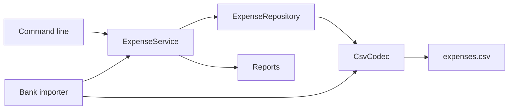
- **CsvCodec** turns a line into fields and back, handling quotes per RFC 4180.
- **Repository** loads all expenses at start and writes the whole file on save, atomically.
- **Service** validates and applies commands.
- **Reports** group by `YearMonth` and category.

### Data model
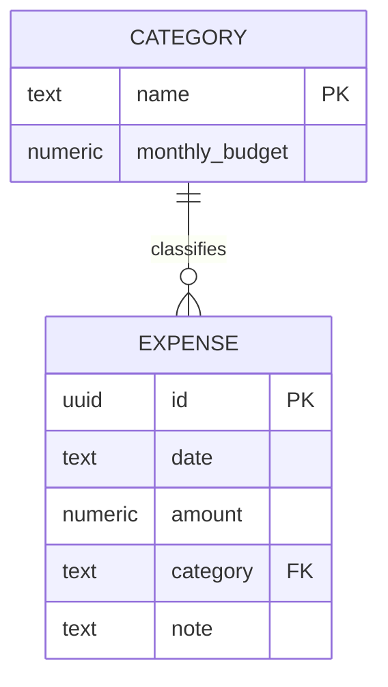

### Tech stack
| Component | Choice | Why |
|---|---|---|
| Files | `Files.newBufferedReader/Writer`, UTF-8 | explicit encoding |
| Atomic save | write temp file then `Files.move(..., ATOMIC_MOVE)` | no torn files |
| Dates | `LocalDate`, `YearMonth`, `DateTimeFormatter` | calendar-correct |
| Money | `BigDecimal` | exact |

### Milestones
1. **Add and list in memory** — *Done when* expenses print sorted by date.
2. **CSV codec** — quotes, commas, embedded newlines. *Done when* round-tripping `"Lunch, with ""Sam"""` gives the same text.
3. **Persistence** — load on start, save atomically. *Done when* killing the process mid-save leaves either the old or the new file, never a mix.
4. **Reports** — per month and category. *Done when* totals match a spreadsheet.
5. **Import** — configurable mapping, duplicate detection. *Done when* importing the same file twice adds nothing the second time.

### Deep dive: the hard parts
- **CSV is not `split(",")`.** A field can contain commas and newlines when quoted, so you must parse character by character with a small state machine (in-field, in-quotes, quote-seen). Write it and test it; then you will appreciate libraries.
- **Atomic saves.** Writing straight over the file means a crash leaves it truncated. Write to `expenses.csv.tmp` in the same directory, `force` it to disk, then `Files.move(tmp, file, ATOMIC_MOVE, REPLACE_EXISTING)`. On the same file system a rename is atomic. Keep a `.bak` of the previous version too.
- **Dates and locales.** Banks export `14/09/2026` or `09/14/2026`. Make the import format configurable (`DateTimeFormatter.ofPattern`) and reject ambiguous input rather than guessing.
- **Duplicates.** Imported rows have no ID. Hash (date, amount, description) to detect repeats, and accept that two identical coffees on one day are a real edge case — ask the user.

### Testing strategy
Use JUnit's `@TempDir` for every file test. Parameterized tests for the CSV codec over tricky lines. Test atomic save by injecting a writer that throws halfway and asserting the original file is intact. Reports tested against small fixture data.

### Trade-offs, scaling and failure modes
Rewriting the whole file on each save is simple and fine for thousands of rows; at millions you would append or use SQLite/PostgreSQL. CSV has no schema or types — a later version that adds a column must still read old files (put a header row and read by name). Two copies of the program writing at once can lose updates; a lock file (`FileChannel.tryLock`) prevents that.

### Stretch goals
- Budgets per category with warnings when a month exceeds 80%.
- A text bar chart of spending per month.
- Switch storage to SQLite or H2 via JDBC behind the same repository interface.

### Skills practised
- [Ch 13 — I/O and NIO](../chapters/13-io-and-nio/README.md) — NIO.2 files, charsets, atomic moves
- [Ch 7 — Core APIs](../chapters/07-core-apis/README.md) — `java.time`, `BigDecimal`, formatting
- [Ch 8 — Exceptions](../chapters/08-exceptions/README.md) — I/O exceptions and try-with-resources
- [Ch 12 — Streams](../chapters/12-streams/README.md) — grouping for reports

### In the interview
**30-second answer:** I built a command-line expense tracker that stores everything in a CSV file you can open in a spreadsheet, with monthly and per-category reports and import from bank exports. The key decision was atomic saves: write a temp file in the same directory, force it to disk, then rename it over the original, so killing the process mid-save leaves either the old file or the new one, never a mix. The hardest part was a real RFC 4180 CSV codec, a small state machine that handles quoted commas, doubled quotes and embedded newlines. Amounts are `BigDecimal`, dates are `LocalDate`, and 100,000 expenses load in under a second.

**Key terms to know:**
- **RFC 4180** — the CSV convention: fields containing commas, quotes or line breaks are wrapped in quotes, and a quote inside a field is written twice. The codec follows it.
- **State machine parser** — a parser that reads one character at a time and switches between states such as "in field", "in quotes" and "quote seen". It is how CSV is parsed correctly.
- **Atomic rename** — `Files.move(tmp, file, ATOMIC_MOVE)` replaces the file in one step on the same file system. It is the core of crash-safe saving.
- **fsync / `force`** — asking the OS to flush data to the physical disk, via `FileChannel.force(true)`. Without it a power cut can lose a "saved" file.
- **NIO.2** — the `java.nio.file` API (`Path`, `Files`). All file access uses it with explicit UTF-8.
- **`LocalDate` / `YearMonth`** — calendar dates and months with no time zone. Expenses and monthly reports use them.
- **`DateTimeFormatter`** — parses and formats dates with a pattern such as `dd/MM/yyyy`. Bank import formats are configurable through it.
- **Idempotent import** — importing the same file twice adds nothing the second time, via a hash of date, amount and description.
- **`@TempDir`** — a JUnit annotation that gives each test a fresh temporary directory for file tests.

**Q:** How do you save a file so a crash cannot corrupt it?

**A:** Write the full content to a temp file in the same directory, call `force(true)` on its channel so the bytes reach the disk, then `Files.move(tmp, target, ATOMIC_MOVE)`. A rename on the same file system is atomic, so readers see either the old or the new file. Keeping a `.bak` of the previous version gives a second safety net.

**Q:** Why must the temp file be in the same directory?

**A:** An atomic rename only works within one file system. If the temp file is on another mount (such as `/tmp`), `ATOMIC_MOVE` fails with `AtomicMoveNotSupportedException`, and a copy-then-delete move is not atomic. Note also that with `ATOMIC_MOVE` the Javadoc says whether an existing target is replaced is implementation-specific (other options are ignored); on Linux and macOS a rename replaces it.

**Q:** Why not split CSV lines on commas?

**A:** Quoted fields can contain commas, quotes and even newlines, so `split(",")` breaks `"Lunch, with Sam"` into two fields, and reading line by line breaks a field containing a newline. You need a quote-aware parser that can continue a record across physical lines. A round-trip test on `"Lunch, with ""Sam"""` proves the codec writes and reads back the same text.

**Q:** `LocalDate` or `Instant` for an expense?

**A:** `LocalDate`. An expense happens on a calendar day, and there is no meaningful instant or time zone. An `Instant` would be a point on the UTC timeline, and converting it back to a day depends on the zone, which can move a late-evening purchase to the next day.

**Q:** How do you parse dates from different banks?

**A:** Make the import format configurable per bank with `DateTimeFormatter.ofPattern("dd/MM/yyyy")` and parse strictly. `14/09/2026` is unambiguous, but `03/04/2026` could be March or April, so never guess. Reject a file whose dates do not parse with the configured pattern.
```java
var fmt = DateTimeFormatter.ofPattern("dd/MM/uuuu").withResolverStyle(ResolverStyle.STRICT);
LocalDate d = LocalDate.parse("14/09/2026", fmt);
```
With `STRICT`, use `uuuu` (year) rather than `yyyy` (year of era), or parsing fails.

**Q:** What if two copies of the program write at the same time?

**A:** Each loads the file, changes its own copy and saves, so the last writer wins and the other's changes are lost (a "lost update"). Taking an exclusive lock with `FileChannel.tryLock` on a lock file at startup prevents a second instance from running. A database would solve this properly with transactions.

**Q:** How do you test the atomic save?

**A:** Inject a writer that throws halfway through writing, then assert the original file is byte-for-byte unchanged and no partial file replaced it. Use `@TempDir` so each test gets a clean directory. Killing a real process mid-save is a good manual check too.

**Q:** What changes at 100x the data?

**A:** Rewriting the whole file on every save is O(n) per change, fine for thousands of rows but slow at millions. You would switch to appending new rows, or to SQLite or H2 through JDBC behind the same repository interface. CSV also has no schema, so add a header row and read columns by name to stay compatible when a column is added.

**Common mistakes in answers:**
- Saying "I write the file then close it" counts as safe. A crash mid-write leaves a truncated file; only temp-file + fsync + rename is crash-safe.
- Using `Instant` or `LocalDateTime` for a calendar-day fact and getting time-zone bugs.
- Parsing CSV with `split(",")` or one regex, which fails on quoted commas and multi-line fields.

### TL;DR
Plain-text persistence done properly: an RFC 4180 codec, atomic saves, `java.time` dates and exact money.

## 9. Library catalogue and search

**Level:** Beginner · **Time:** 1–2 weekends · **Prerequisites:** Ch 9, Ch 10, Ch 11

### What it is
A catalogue for a small library: books with title, authors, year, subjects and copies. Members borrow and return copies. Users search by title words, author, subject or year range, and sort results by relevance, year or title.

### The problem it solves
Search looks simple until you need several filters combined in any order and several sort orders. This project is where **generics**, **lambdas** and **comparators** start paying off: a filter is a `Predicate<Book>`, filters combine with `and`, sort orders are `Comparator<Book>` built with `comparing().thenComparing()`, and a small generic `Index<K, V>` gives fast lookups. Loans add simple state rules (you cannot borrow a copy that is out).

### Real-world examples
- The [Open Library API](https://openlibrary.org/developers/api) exposes search by title, author and subject over millions of records — a good source of real test data for this project.
- The [`Comparator` documentation](https://docs.oracle.com/en/java/javase/25/docs/api/java.base/java/util/Comparator.html) shows the combinators (`comparing`, `thenComparing`, `reversed`, `nullsLast`) this project relies on.

### Requirements
**Functional**
- Add books, copies and members; borrow and return with due dates; list overdue loans.
- Search with any combination of: title words, author, subject, year range, available-only.
- Sort by title, year (newest first) or a simple relevance score.
- Page results (10 per page).

**Non-functional**
- Search over 100,000 books in under 50 ms using indexes, not full scans.
- Search code adds a new filter type without touching existing ones.

### The architecture
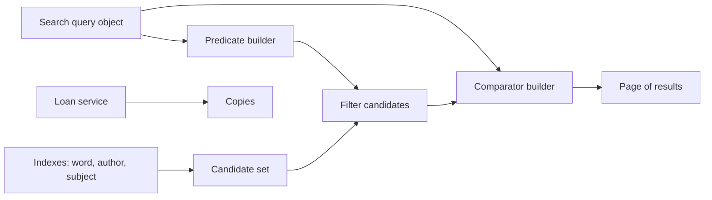
- **Indexes** map a key (lower-cased title word, author, subject) to the set of book IDs, so a query starts from a small candidate set.
- **Predicate builder** turns the query into `Predicate<Book>` pieces combined with `and`.
- **Comparator builder** maps a sort option to a `Comparator<Book>`.
- **Loan service** enforces borrow/return rules on copies.

### Data model
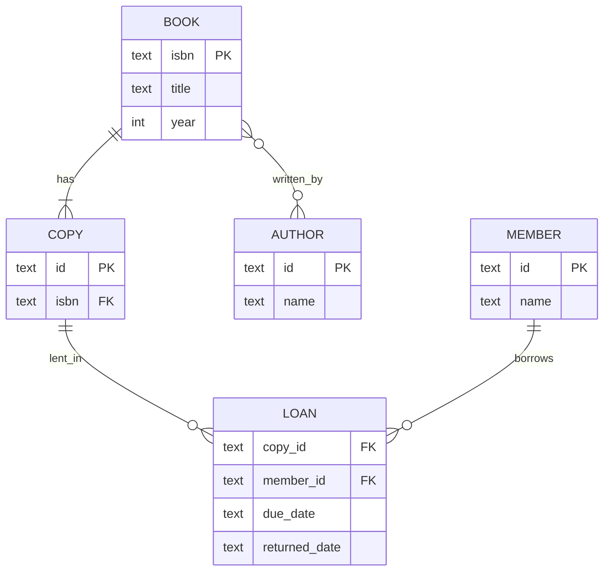

### Tech stack
| Component | Choice | Why |
|---|---|---|
| Index | generic `MultiIndex<K, V>` over `Map<K, Set<V>>` | reused for words, authors, subjects |
| Filters | `Predicate<Book>` | composable |
| Sorting | `Comparator` combinators | declarative |
| Optional fields | `Optional<Integer>` for year | no `null` checks scattered |

### Milestones
1. **Model and linear search** — *Done when* searching by title word works by scanning.
2. **Generic index** — *Done when* `MultiIndex<String, Book>` passes its own unit tests and search uses it.
3. **Combined filters** — *Done when* author + year range + available-only gives the right set.
4. **Sorting and paging** — *Done when* page 2 sorted by year is stable across runs.
5. **Loans** — borrow, return, overdue. *Done when* borrowing an out copy fails and overdue lists correctly with a fixed `Clock`.

### Deep dive: the hard parts
- **Intersect the smallest set first.** With several index hits, start from the smallest candidate set and filter the rest with predicates; intersecting large sets first wastes time.
- **Stable, total ordering.** If two books have the same year, paging can show a book on page 1 and again on page 2 between requests. Always end a comparator with a unique key: `comparing(Book::year).reversed().thenComparing(Book::isbn)`.
- **Generics with bounds.** A `MultiIndex<K, V>` needs no bounds; a "top K by score" helper might need `<T extends Comparable<? super T>>`. Write one with a wildcard and explain why (PECS: producer extends, consumer super — Chapter 9).
- **Null-safe sorting.** Books without a year sort with `Comparator.nullsLast(...)` or, better, model the year as `Optional` and map it to a sentinel only when sorting.

### Testing strategy
Unit-test `MultiIndex`. For search, build a fixture of 20 books and assert results with AssertJ's `extracting(Book::title).containsExactly(...)`. A randomized test compares the indexed search to the linear scan for 1,000 random queries — both must agree.

### Trade-offs, scaling and failure modes
In-memory indexes are fast but cost memory and must be updated on every change; a relational database with indexes or a search engine (project 36) does this for you at scale. Simple word matching misses plurals and typos; stemming and fuzzy matching help but complicate scoring.

### Stretch goals
- Import real data from the Open Library dumps.
- Prefix search with a trie (Chapter 19) for autocomplete.
- Reservations queue per book (`ArrayDeque`).

### Skills practised
- [Ch 9 — Generics](../chapters/09-generics/README.md) — generic classes and wildcards
- [Ch 10 — Collections](../chapters/10-collections/README.md) — maps, sets, ordering
- [Ch 11 — Lambdas and functional programming](../chapters/11-lambdas-and-functional-programming/README.md) — `Predicate`, `Comparator`, method references
- [Ch 7 — Core APIs](../chapters/07-core-apis/README.md) — `java.time` for due dates

### In the interview
**30-second answer:** I built a library catalogue with loans and a search that combines any mix of title words, author, subject, year range and "available only", sorted by title, year or relevance and paged ten at a time. Search starts from in-memory indexes, a generic `MultiIndex<K, V>` over `Map<K, Set<V>>`, picks the smallest candidate set, then applies the remaining filters as composed `Predicate<Book>` objects. The subtle bug I had to design out was unstable paging: every comparator ends with the ISBN as a unique tie-breaker. A randomized test checks that indexed search agrees with a linear scan on 1,000 random queries, and search over 100,000 books stays under 50 ms.

**Key terms to know:**
- **Generic class** — a class with a type parameter, such as `MultiIndex<K, V>`, written once and reused for words, authors and subjects.
- **Type erasure** — generic type arguments are removed at compile time, so at run time `MultiIndex<String, Book>` is just `MultiIndex`. It limits what generic code can do with `T`.
- **Bounded type / wildcard** — `<T extends Comparable<? super T>>` restricts what `T` may be, and `?` stands for an unknown type. It is needed in a "top K" helper.
- **PECS** — "producer extends, consumer super": use `? extends T` for a source you read from, `? super T` for a sink you write to.
- **`Predicate<T>`** — a function from `T` to `boolean` that composes with `and`, `or` and `negate`. Every filter is one.
- **`Comparator` combinators** — `comparing`, `thenComparing`, `reversed`, `nullsLast` build multi-key orders. Every sort option is one.
- **Total, stable order** — every pair of items has a defined order, so results never shuffle between requests. The ISBN tie-breaker ensures it.
- **Inverted index** — a map from a term to the items containing it. The title-word index is one.
- **Pagination** — returning results in fixed-size pages (offset and limit).

**Q:** How do you combine optional search filters cleanly?

**A:** Represent each active filter as a `Predicate<Book>` and fold them with `and`, starting from `b -> true`. Adding a filter type is adding a predicate builder, with no change to existing code (the open/closed principle).
```java
Predicate<Book> p = b -> true;
if (q.author() != null) p = p.and(b -> b.authors().contains(q.author()));
if (q.from() != null)   p = p.and(b -> b.year() >= q.from());
if (q.availableOnly())  p = p.and(loans::hasFreeCopy);
```

**Q:** Why add a unique tie-breaker to a sort?

**A:** If two books share a year, their relative order is not defined by the comparator, so it can differ between runs or after data changes, and paging may show a book twice or skip it. Ending with a unique key such as ISBN makes the order total and deterministic. Java's object sort (TimSort) is stable, but stability alone does not help when the input order itself changes.

**Q:** What does PECS mean? Give an example.

**A:** Use `? extends T` when you only read `T`s out of a structure, and `? super T` when you only put `T`s in. For example, `addAll(Collection<? super Book> sink, List<? extends Book> source)` accepts a `List<Object>` as the sink and a `List<EBook>` as the source. `Comparator<? super T>` appears in `sort` for the same reason: a comparator of `Book` can sort `EBook`s.

**Q:** Why can't you write `new T[]` or `if (x instanceof List<Book>)`?

**A:** Generics are erased: at run time the JVM has no idea what `T` or the element type of a `List` is. Creating an array needs the real element class, and an `instanceof` check needs run-time type information, so both are rejected. Workarounds are passing a `Class<T>` or `IntFunction<T[]>`, or checking `instanceof List<?>`.

**Q:** With several index hits, how do you find the candidates fast?

**A:** Look up each indexed criterion, start from the smallest set, and test the remaining criteria with predicates on just those books rather than intersecting large sets. If "author = Tolkien" gives 30 books and "subject = fantasy" gives 20,000, you check 30 books, not 20,000. This is the same idea a database query planner uses when it picks the most selective index.

**Q:** How do you sort books with no year?

**A:** Either model the year as `Optional<Integer>` and map it to a sentinel only inside the comparator, or use `Comparator.nullsLast(...)`. Without one of these, `comparing(Book::year)` throws a `NullPointerException` on unboxing or comparing a null.

**Q:** What edge cases matter for loans?

**A:** Borrowing a copy that is already out must fail, returning a copy twice must fail, and "overdue" depends on today's date, so inject a `Clock` and test with `Clock.fixed`. Each loan state change should be checked before it is applied, so a failed borrow leaves no partial loan record.

**Q:** How do you prove the indexed search is correct?

**A:** Keep the slow linear scan as a reference implementation and run a randomized test: 1,000 random queries over a fixture catalogue, asserting both return the same books in the same order. Any difference points to an index that was not updated or a predicate bug. Unit-test `MultiIndex` on its own too.

**Q:** What changes at 10 million books?

**A:** In-memory indexes cost memory and must be updated on every add, edit and loan, and simple word matching misses plurals and typos. At that size you would move to a database with proper indexes or a search engine with an inverted index, stemming and relevance scoring (project 36), and keep the `Predicate`/`Comparator` design for in-memory post-filtering.

**Common mistakes in answers:**
- Saying `List<EBook>` is a subtype of `List<Book>`. Generics are invariant; you need `List<? extends Book>`.
- Thinking a stable sort guarantees consistent paging. You need a total order with a unique final key.
- Filtering by scanning every book "because it is fast enough", with no plan for when the catalogue grows.

### TL;DR
Indexes for candidates, predicates for filters, comparators for order — generics and lambdas turning search into composable pieces.

## 10. Flashcards with spaced repetition

**Level:** Beginner · **Time:** 1–2 weekends · **Prerequisites:** Ch 7, Ch 10, Ch 13

### What it is
A study app for the terminal. You create decks of question/answer cards, and each day the app shows the cards that are due. After each card you rate yourself ("again", "hard", "good", "easy"), and the app schedules the next review further in the future the better you know it.

### The problem it solves
Reviewing everything every day wastes time; reviewing too rarely means forgetting. **Spaced repetition** schedules each card just before you are likely to forget it. Building it teaches date arithmetic with `java.time`, priority queues ("which card is due first?"), and a scheduling rule that is easy to test once you control the clock.

### Real-world examples
- The [Leitner system](https://en.wikipedia.org/wiki/Leitner_system) uses physical boxes: a card you know moves to a box reviewed less often; a card you miss goes back to box 1.
- [Anki's manual](https://docs.ankiweb.net/studying.html) describes how its scheduler sets intervals from your rating; its long-standing default algorithm descends from SuperMemo's SM-2.

### Requirements
**Functional**
- Create decks, add/edit/delete cards, import from a two-column file.
- `study <deck>` shows due cards, oldest due first, then up to N new cards a day.
- Rating updates the card's interval and next due date.
- Statistics: due today, reviewed today, retention rate over 30 days.

**Non-functional**
- Scheduling is deterministic given a clock and a rating (testable).
- A deck of 10,000 cards opens in under 1 second.
- Progress is saved after every answer.

### The architecture
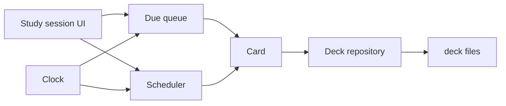
- **Due queue** is a `PriorityQueue<Card>` ordered by due date.
- **Scheduler** is a pure function: (card state, rating, today) → new card state.
- **Repository** saves decks as files (one per deck), atomically.
- **Clock** is injected so tests can travel in time.

### Data model
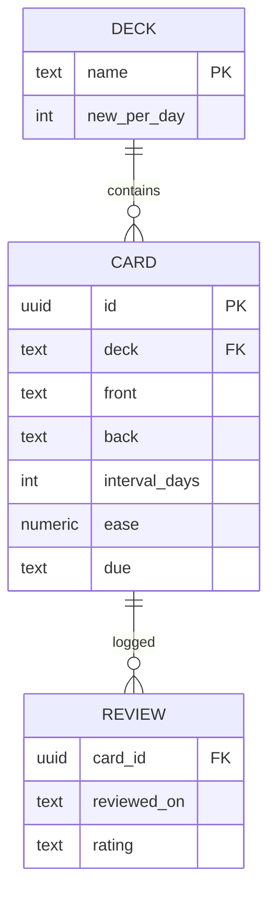

### Tech stack
| Component | Choice | Why |
|---|---|---|
| Dates | `LocalDate`, `Period`, `ChronoUnit.DAYS` | reviews are per day, no time zone maths |
| Clock | `java.time.Clock` | `Clock.fixed` in tests |
| Queue | `PriorityQueue` | O(log n) next-due |
| Storage | one text or JSON file per deck | simple, portable |

### Milestones
1. **Cards and decks** — add and list. *Done when* cards persist across runs.
2. **Leitner boxes** — 5 boxes with intervals 1, 2, 4, 8, 16 days. *Done when* a correct answer moves a card up a box.
3. **Due queue and session** — *Done when* only due cards are shown, in due order.
4. **SM-2 style scheduler** — interval × ease factor, ease adjusted by rating. *Done when* a table-driven test matches your hand-calculated schedule.
5. **Stats** — *Done when* retention over 30 days is computed from the review log.

### Deep dive: the hard parts
- **The scheduler as a pure function.** If the scheduler reads `LocalDate.now()` itself, you cannot test "what happens in 3 weeks". Pass `today` in. Then the whole algorithm is a table of inputs and outputs.
- **Ease and intervals.** In SM-2-like schemes each card has an ease (starting around 2.5); a "good" answer multiplies the interval by the ease, "hard" uses a smaller multiplier and lowers the ease, "again" resets the interval and lowers the ease. Clamp the ease to a minimum so a hard card does not get stuck being shown forever.
- **Due date vs review log.** Store both: the card's current state (for scheduling) and an append-only review log (for statistics). The log also lets you recompute all states if you change the algorithm.
- **Mutable keys in a priority queue.** Changing a card's due date while it sits in a `PriorityQueue` silently breaks the heap. Remove it, update it, then re-insert (or rebuild the queue per session).

### Testing strategy
Table-driven tests for the scheduler: (interval, ease, rating) → expected (interval, ease). A simulation test: answer "good" every day for 60 simulated days with a fixed clock and assert the intervals grow. Repository round-trip tests with `@TempDir`.

### Trade-offs, scaling and failure modes
Leitner is simple and explainable; SM-2 adapts per card; modern schedulers fit a memory model to your history but need more data and maths. Day granularity ignores time zones — if you travel, "today" changes; storing dates in the user's zone is good enough. Saving after every answer costs I/O but avoids losing a session.

### Stretch goals
- Cloze cards ("The capital of France is {{Paris}}").
- Export/import Anki-compatible text files.
- A heatmap of reviews per day in the terminal.

### Skills practised
- [Ch 7 — Core APIs](../chapters/07-core-apis/README.md) — `java.time`, `Clock`
- [Ch 10 — Collections](../chapters/10-collections/README.md) — `PriorityQueue`, ordering
- [Ch 13 — I/O and NIO](../chapters/13-io-and-nio/README.md) — saving files atomically
- [Ch 18 — Testing, build and tooling](../chapters/18-testing-build-and-tooling/README.md) — table-driven tests

### In the interview
**30-second answer:** I built a terminal flashcard app that shows only the cards due today and schedules each card further out the better you rate yourself. The key design decision was making the scheduler a pure function, (card state, rating, today) → new state, with the date passed in from an injected `Clock`, so I can simulate 60 days of reviews in a millisecond test. Due cards sit in a `PriorityQueue` ordered by due date, and I keep both the current card state and an append-only review log. A 10,000-card deck opens in under a second, and progress is saved atomically after every answer.

**Key terms to know:**
- **Spaced repetition** — reviewing an item just before you are likely to forget it, at growing intervals. It is the app's purpose.
- **Leitner system** — cards move up through boxes reviewed less and less often, and a miss sends a card back to box 1. It is the first scheduler (intervals 1, 2, 4, 8, 16 days).
- **SM-2 / ease factor** — a per-card multiplier (starting near 2.5) applied to the interval and adjusted by each rating. It is the second scheduler.
- **Pure function** — output depends only on inputs, with no hidden reads of time or files. The scheduler is one.
- **`java.time.Clock`** — an injectable source of "now". Production uses the system clock, tests use `Clock.fixed` or a test clock.
- **`LocalDate` / `ChronoUnit.DAYS`** — day-level dates and day arithmetic with no time zones.
- **`PriorityQueue`** — a binary heap that always yields the smallest element first, with O(log n) insert and poll. It orders due cards.
- **Append-only log** — records are only added, never changed. The review log feeds statistics and can rebuild card states.

**Q:** Why inject a `Clock`?

**A:** Code that calls `LocalDate.now()` directly cannot be tested for "what happens in three weeks". With a `Clock` passed in, production uses `Clock.systemDefaultZone()` and tests use `Clock.fixed(...)` or a mutable test clock that advances a day at a time. The scheduler then becomes a table of inputs and expected outputs.

**Q:** What breaks if you change an element inside a `PriorityQueue`?

**A:** The heap order is only restored when you add or remove. If you change a card's due date in place, the queue is not told, so `poll` can return the wrong card, and later operations can leave it in a broken state. Remove the card, change it, then re-add it, or rebuild the queue per session.
```java
queue.remove(card);                 // O(n) search, then O(log n) fix-up
var updated = scheduler.next(card, rating, today);
queue.add(updated);
```

**Q:** Explain the scheduling rule you implemented.

**A:** Each card has an interval in days and an ease. "Good" multiplies the interval by the ease, "easy" multiplies more and raises the ease, "hard" uses a smaller multiplier and lowers the ease, and "again" resets the interval to one day and lowers the ease. The ease is clamped to a minimum (about 1.3 in SM-2) so a hard card is not stuck being shown every day forever.

**Q:** Why keep a review log as well as card state?

**A:** The card state answers "what is due today". The log answers "how am I doing", such as retention over 30 days, and it allows recomputing every card's state if you change the algorithm. It is a small form of event sourcing: the log is the truth, the state is a cached result.

**Q:** Why does `iterator()` on a `PriorityQueue` not give cards in due order?

**A:** A heap only guarantees that the root is the smallest; the rest of the array is partially ordered. Iterating or printing it shows that internal array order. To list cards in order, `poll` repeatedly from a copy, or sort a copy of the elements.

**Q:** What happens if the program crashes mid-session?

**A:** Progress is saved after every answer using the atomic temp-file-and-rename technique, so at most the current answer is lost and the deck file is never half-written. Saving each answer costs some I/O, but a person answers a card every few seconds, so it is negligible.

**Q:** How do you test the scheduler?

**A:** Table-driven tests: (interval, ease, rating) → expected (interval, ease), including the ease floor. A simulation test answers "good" every day for 60 simulated days with a test clock and asserts the intervals grow. Repository round-trip tests use `@TempDir`.

**Q:** What edge cases come from dates and time zones?

**A:** "Today" depends on the user's time zone, so a traveller can see a day skipped or repeated. Storing due dates as `LocalDate` in the user's zone is good enough. Day arithmetic must use `plusDays` or `ChronoUnit.DAYS.between`, not 24-hour multiples, which go wrong around daylight-saving changes.

**Q:** What would change at 1 million cards or many users?

**A:** Loading the whole deck into a heap each session gets slow, so you would store cards in a database with an index on due date and query only "due ≤ today, limit N". With many users, each user's data is separate, so it partitions cleanly by user ID.

**Common mistakes in answers:**
- Calling `LocalDate.now()` inside the scheduler and then testing by waiting or by mocking static methods.
- Assuming a `PriorityQueue` re-sorts itself when an element changes, or that iterating it gives sorted order.
- Forgetting to clamp the ease, which lets difficult cards spiral to tiny intervals.

### TL;DR
A pure scheduling function, a priority queue of due cards and an injected clock — spaced repetition made testable.

## 11. Markdown-to-HTML converter

**Level:** Intermediate · **Time:** 1–2 weeks · **Prerequisites:** Ch 3, Ch 6, Ch 7

### What it is
A library and command-line tool that turns Markdown (`# Title`, `*emphasis*`, lists, links, code blocks, tables) into HTML. `md2html notes.md > notes.html` produces a valid page; the library API returns a document tree you can render to HTML or inspect.

### The problem it solves
Markdown looks trivial, and most first attempts are a pile of regular expressions that break on nested lists or `*` inside code. A correct converter needs the same structure as a real compiler front end: split the input into **blocks** (paragraphs, lists, quotes), then parse **inlines** (emphasis, links, code spans) inside each block, building an **AST** (abstract syntax tree — a tree of typed nodes describing the document) and only then rendering. That separation is the lesson.

### Real-world examples
- The [CommonMark specification](https://spec.commonmark.org/) exists because early Markdown was ambiguous; it defines the parsing strategy (blocks first, then inlines with a "delimiter stack") and ships hundreds of examples you can use as tests.
- [commonmark-java](https://github.com/commonmark/commonmark-java) is a Java implementation of that spec with an AST, visitors and extensions (tables, strikethrough).

### Requirements
**Functional**
- Blocks: ATX headings, paragraphs, block quotes, ordered/unordered lists (nested), fenced and indented code, thematic breaks, tables (extension).
- Inlines: emphasis and strong, code spans, links and images, autolinks, backslash escapes, hard line breaks.
- HTML-escape text (`<`, `&`, quotes) everywhere it is not intended markup.
- Optional heading IDs and a table of contents.

**Non-functional**
- Pass at least 80% of the CommonMark spec examples you choose to support.
- Linear time: a 1 MB document converts in under 200 ms; no pathological backtracking on inputs like 10,000 `*` characters.
- Output is safe by default: raw HTML in the input is escaped unless the caller opts in.

### The architecture
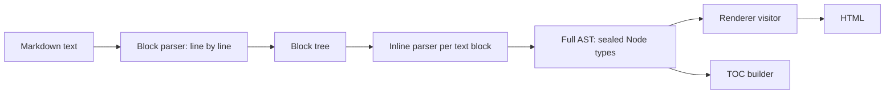
- **Block parser** reads one line at a time and keeps a stack of open containers (quote inside list item inside list), deciding for each line which containers continue.
- **Inline parser** scans the text of leaf blocks and resolves emphasis with a delimiter stack.
- **AST** is a sealed hierarchy of records: `Heading(level, children)`, `Paragraph(children)`, `Emphasis(children)`, `Text(value)`…
- **Renderer** is a switch over node types that writes HTML into a `StringBuilder`.

### Data model
| Node | Kind | Children |
|---|---|---|
| `Document` | block container | blocks |
| `ListBlock(ordered, start, tight)` | container | `ListItem`s |
| `BlockQuote` | container | blocks |
| `Heading(level)`, `Paragraph` | leaf block | inlines |
| `CodeBlock(info, literal)` | leaf block | none |
| `Emphasis`, `Strong`, `Link(url, title)` | inline container | inlines |
| `Text`, `Code`, `HardBreak` | inline leaf | none |

### Tech stack
| Component | Choice | Why |
|---|---|---|
| AST | sealed interfaces + records | exhaustive rendering |
| Rendering | pattern-matching `switch` | no visitor boilerplate |
| Strings | `StringBuilder`, code points | efficient, Unicode-safe |
| Tests | spec examples as JUnit dynamic tests | hundreds of cases from one JSON file |

### Milestones
1. **Headings and paragraphs** — *Done when* blank-line separation and `#` levels render correctly.
2. **Code blocks and escaping** — *Done when* `<script>` in text and code is escaped.
3. **Inlines** — code spans, emphasis, links. *Done when* `*a **b** c*` nests correctly.
4. **Containers** — quotes and nested lists, tight vs loose. *Done when* a 3-level nested list matches the spec.
5. **Spec harness** — load the spec examples, run them as `@TestFactory` dynamic tests, track pass rate. *Done when* the pass rate is printed per section.
6. **Extensions** — tables and heading IDs. *Done when* a GitHub-style table renders.

### Deep dive: the hard parts
- **Two phases.** Block structure must be known before inline parsing, because `*` at the start of a line may be a list marker, while inside a paragraph it is emphasis. Parse all blocks first, then inlines.
- **Emphasis and the delimiter stack.** Push each run of `*` or `_` as a delimiter with flags "can open" and "can close" (based on the characters around it). When a closer arrives, search back for a matching opener; link them, wrap the nodes in between, and remove delimiters in between. This gives linear time and handles `**strong *both***`.
- **Lazy continuation.** In Markdown a paragraph inside a block quote can continue on a line without `>`. Your block parser must allow a paragraph to "absorb" a line even when its container's marker is missing. This rule is where most hand-written parsers fail.
- **Security.** If users write the Markdown and others view the HTML, raw HTML and `javascript:` links are an XSS (cross-site scripting) hole. Escape by default and allowlist URL schemes.

### Testing strategy
The spec examples are the backbone: a JUnit `@TestFactory` produces one dynamic test per example, named by section. Add regression tests for every bug you fix. A performance test feeds adversarial input (deep nesting, thousands of unmatched delimiters) and asserts time grows linearly.

### Trade-offs, scaling and failure modes
Regex-only converters are quick to write and wrong on nesting. A full CommonMark parser is about a thousand careful lines. Building a full AST costs memory proportional to the document but allows multiple renderers and transformations (TOC, link checking); a streaming renderer uses less memory but cannot look ahead.

### Stretch goals
- Render to plain text or to ANSI-coloured terminal output from the same AST.
- Syntax-highlight code blocks by language.
- Front matter (YAML-like metadata) at the top of the file.

### Skills practised
- [Ch 6 — Inheritance, interfaces, records](../chapters/06-oop-inheritance-interfaces-and-more/README.md) — sealed types and records for ASTs
- [Ch 3 — Control flow](../chapters/03-control-flow/README.md) — pattern matching for `switch`
- [Ch 7 — Core APIs](../chapters/07-core-apis/README.md) — strings, `StringBuilder`, Unicode
- [Ch 18 — Testing, build and tooling](../chapters/18-testing-build-and-tooling/README.md) — dynamic and parameterized tests

### In the interview
**30-second answer:** I built a Markdown-to-HTML library and CLI that works like a compiler front end: a block parser reads the document line by line into a tree of containers, an inline parser handles emphasis, links and code spans inside each leaf block, and a renderer turns the resulting AST into HTML. The AST is a sealed hierarchy of records, so the renderer is one exhaustive pattern-matching `switch`. The hardest parts were emphasis, which I resolve with the CommonMark delimiter stack in linear time, and lazy continuation lines in block quotes. I run the CommonMark spec examples as JUnit dynamic tests and track the pass rate per section, and all output is HTML-escaped by default to prevent XSS.

**Key terms to know:**
- **AST (abstract syntax tree)** — a tree of typed nodes describing the document's structure. Everything between parsing and rendering is the AST.
- **Block vs inline parsing** — first decide the document's structure (paragraphs, lists, quotes), then parse emphasis and links inside text. This two-phase design is the core of the project.
- **Container stack** — the list of open containers (quote inside list item inside list) that the block parser checks each new line against.
- **Delimiter stack** — the CommonMark algorithm for matching `*` and `_` runs into emphasis and strong emphasis in linear time.
- **Lazy continuation** — a paragraph line inside a block quote may omit the `>` marker. It is the rule most hand-written parsers miss.
- **Sealed records + pattern matching** — the AST node types and the exhaustive renderer switch.
- **XSS (cross-site scripting)** — an attack where user input becomes executable script in someone else's browser. It is prevented by escaping and URL-scheme allowlists.
- **Dynamic tests (`@TestFactory`)** — JUnit tests generated at run time from data. Each spec example becomes one test.
- **Catastrophic backtracking** — a regex taking exponential time on some inputs. It is why the design avoids regex-driven parsing.

**Q:** Why not convert Markdown with regular expressions?

**A:** Markdown has nested, context-dependent structure: lists inside quotes inside lists, and emphasis rules that depend on the characters next to each delimiter. Regular expressions cannot count nesting depth, and patterns that try become slow or wrong. Some backtracking regexes take exponential time on inputs like thousands of `*` characters, which is also a denial-of-service risk.

**Q:** What is an AST and why build one?

**A:** A tree of typed nodes such as `Heading(level, children)` and `Emphasis(children)` that represents the document's structure independent of output format. It decouples parsing from output, so the same tree can be rendered to HTML, plain text or terminal colours, and transformed (a table of contents, link checking) without re-parsing.

**Q:** Why parse blocks before inlines?

**A:** The meaning of a character depends on the block structure. A `*` at the start of a line may be a list marker, while inside a paragraph it may start emphasis, and inside a code block it is just text. You only know which once the block structure is fixed, so all blocks are parsed first.

**Q:** How does the delimiter stack handle `*a **b** c*`?

**A:** Each run of `*` is pushed as a delimiter with flags saying whether it can open or close, based on the surrounding characters. When a closer arrives, the parser searches back for a compatible opener, wraps the nodes in between in `Emphasis` or `Strong`, and removes the delimiters in between. Each delimiter is processed a bounded number of times, so the whole thing is linear.

**Q:** How does the renderer look in modern Java?

**A:** A recursive pattern-matching `switch` over the sealed `Node` type, appending to a `StringBuilder`. Because the hierarchy is sealed, a new node type causes a compile error until the renderer handles it.
```java
void render(Node n, StringBuilder out) {
    switch (n) {
        case Heading(int lvl, var kids) -> { out.append("<h").append(lvl).append('>');
            kids.forEach(k -> render(k, out)); out.append("</h").append(lvl).append('>'); }
        case Text(String s) -> out.append(escapeHtml(s));
        // ...one case per node type
    }
}
```

**Q:** How do you avoid XSS in user Markdown?

**A:** Escape `<`, `>`, `&` and quotes in all text, escape or strip raw HTML unless the caller explicitly opts in, and allowlist link schemes such as `http`, `https` and `mailto` so `javascript:` URLs are dropped. Escaping happens in the renderer, so no code path can forget it.

**Q:** How do you test a parser like this?

**A:** The CommonMark spec ships hundreds of input/expected-HTML examples, which I load as JUnit dynamic tests named by section and track the pass rate. Every bug fixed gets a regression test. A performance test feeds adversarial input (deep nesting, thousands of unmatched delimiters) at several sizes and asserts time grows roughly linearly.

**Q:** What breaks first with a 100 MB document?

**A:** Memory: the full AST costs memory proportional to the document, plus the output `StringBuilder`. A streaming renderer that writes HTML as blocks close would use less memory, but cannot look ahead for things like link reference definitions at the end of the file, and it rules out whole-tree transforms such as a table of contents.

**Common mistakes in answers:**
- Claiming Markdown is "simple enough for regex". Nesting and emphasis rules make it a real parsing problem.
- Escaping HTML only in some places, such as text but not link titles or attributes, which still leaves an XSS hole.
- Describing a visitor pattern as the only way to walk an AST. With sealed types, a pattern-matching `switch` gives the same exhaustiveness with less code.

### TL;DR
Blocks first, inlines second, an AST in the middle, rendering last. Use the CommonMark examples as your test suite.

## 12. JSON parser and object mapper

**Level:** Intermediate · **Time:** 1–2 weeks · **Prerequisites:** Ch 3, Ch 6, Ch 9

### What it is
A library with two layers. The first parses JSON text into a tree of values (`JsonObject`, `JsonArray`, `JsonString`, `JsonNumber`, `JsonBool`, `JsonNull`) and writes trees back to text. The second maps between JSON and Java records: `Json.read(text, Order.class)` and `Json.write(order)`.

### The problem it solves
JSON is the data format of the web, and the JDK has no built-in JSON API, so every Java project picks a library. Writing your own shows what those libraries do: a **tokenizer** (turning characters into tokens), a **recursive-descent parser** (one method per grammar rule, calling each other), careful number and string handling, and **reflection** over records to bind data to types.

### Real-world examples
- [RFC 8259](https://www.rfc-editor.org/rfc/rfc8259) defines JSON's grammar in a page and a half, plus important interoperability notes (duplicate keys, number precision).
- [Jackson](https://github.com/FasterXML/jackson-core) separates a streaming tokenizer (`jackson-core`) from the tree model and the object mapper — the same three layers you build here.

### Requirements
**Functional**
- Parse any valid RFC 8259 text; reject invalid text with line and column in the error.
- Strings: all escapes including `\uXXXX` and surrogate pairs.
- Numbers: preserve precision (keep the original digits, offer `BigDecimal`, `long` and `double` views).
- Writer: compact and pretty-printed output.
- Mapper: records, enums, `List`, `Map<String, T>`, `Optional`, nested types, `java.time` as ISO strings.

**Non-functional**
- Parse 50 MB of JSON in under 1 second (measure with JMH against a known library for comparison).
- Maximum nesting depth (default 512) to prevent stack overflow from hostile input.
- No dependencies outside the JDK.

### The architecture
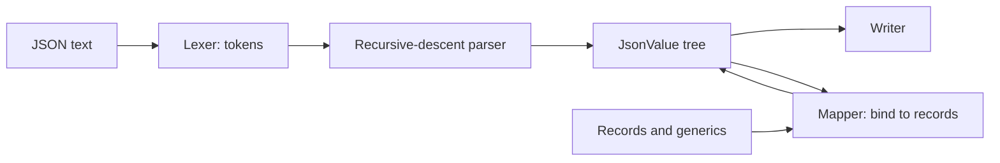
- **Lexer** reads characters and emits tokens: `{`, `}`, `[`, `]`, `:`, `,`, string, number, literal.
- **Parser** has `parseValue`, `parseObject`, `parseArray` that call each other recursively — the grammar written as code.
- **Tree** is a sealed interface `JsonValue` with records for each kind.
- **Mapper** uses `Class.getRecordComponents()` and the canonical constructor to build records, and `java.lang.reflect.Type` to understand generic types like `List<Item>`.

### Data model
| Type | Holds | Note |
|---|---|---|
| `JsonObject` | `LinkedHashMap<String, JsonValue>` | keeps key order |
| `JsonArray` | `List<JsonValue>` | immutable copy |
| `JsonNumber` | original text | converts on demand |
| `JsonString`, `JsonBool`, `JsonNull` | value | `JsonNull` is a singleton |
| `TypeRef<T>` | captured generic type | for `List<Order>` targets |

### Tech stack
| Component | Choice | Why |
|---|---|---|
| Tree | sealed interface + records | exhaustive pattern matching |
| Reflection | `RecordComponent`, `MethodHandles` | records have a canonical constructor |
| Generic types | `ParameterizedType` via a super-type token | erasure hides `T` otherwise |
| Benchmarks | JMH | honest numbers |

### Milestones
1. **Lexer** — *Done when* every token type is produced with correct positions.
2. **Parser to tree** — *Done when* all valid examples in a test suite parse and all invalid ones fail with positions.
3. **Writer** — *Done when* `parse(write(tree))` equals `tree` for random trees.
4. **Records mapping** — *Done when* a nested `Order(List<Item> items, Customer c)` round-trips.
5. **Generics and options** — `TypeRef`, unknown-field policy, naming strategy. *Done when* `Json.read(text, new TypeRef<List<Order>>(){})` works.
6. **Performance** — *Done when* a JMH benchmark reports throughput on a 1 MB file.

### Deep dive: the hard parts
- **Numbers.** RFC 8259 numbers have arbitrary precision, but many parsers silently convert to `double`, corrupting large IDs (anything above 2^53). Store the digits and convert lazily; let the mapper choose `long`, `BigDecimal` or `double` by the target type.
- **Strings and Unicode.** `😀` is one emoji written as two escapes (a surrogate pair). Decode both and check they pair properly; a lone surrogate is invalid UTF-16.
- **Recursion depth.** Recursive descent uses the call stack; `[[[[...]]]]` 100,000 deep causes `StackOverflowError`. Count depth and fail cleanly past the limit.
- **Generic types and erasure.** `Json.read(text, List.class)` cannot know the element type because generics are erased at runtime (Chapter 9). The super-type token trick — an anonymous subclass `new TypeRef<List<Order>>(){}` — preserves the type argument in the class's generic superclass, which reflection can read.

### Testing strategy
Use the JSON test suites published by the community for edge cases (valid, invalid, implementation-defined). Property-based round-trips: generate random trees, write, parse, compare. Mapper tests per supported type. JMH for speed, and a test that deep nesting fails with your error, not a stack overflow.

### Trade-offs, scaling and failure modes
A tree is easy to use but holds the whole document in memory; a streaming (pull) API reads gigabytes with constant memory. Reflection is slow on first use; cache per-class metadata. Strict parsing (rejecting comments, trailing commas, duplicate keys) is safer; lenient parsing is friendlier — make it an option, strict by default.

### Stretch goals
- A pull-parser API (`nextToken()`) used by both the tree builder and the mapper.
- JSON Pointer (`/items/0/price`) queries.
- Generate mappers at build time instead of reflection.

### Skills practised
- [Ch 3 — Control flow](../chapters/03-control-flow/README.md) — switch and pattern matching
- [Ch 6 — Inheritance, interfaces, records](../chapters/06-oop-inheritance-interfaces-and-more/README.md) — sealed types, records
- [Ch 9 — Generics](../chapters/09-generics/README.md) — generics, erasure, super-type tokens
- [Ch 16 — JVM internals and performance](../chapters/16-jvm-internals-and-performance/README.md) — JMH benchmarking

### In the interview
**30-second answer:** I built a dependency-free JSON library in three layers: a lexer that turns characters into tokens, a recursive-descent parser that builds an immutable tree of sealed `JsonValue` records, and a reflection-based mapper that binds JSON to Java records through their canonical constructors. The key decision was to keep numbers as their original text and convert lazily, because converting to `double` silently corrupts integers above 2^53. The hardest parts were reading generic targets like `List<Order>` despite type erasure, which I solved with a super-type token, and enforcing a nesting-depth limit so hostile input fails cleanly instead of overflowing the stack. I measured throughput with JMH against a well-known library.

**Key terms to know:**
- **Lexer (tokenizer)** — turns characters into tokens such as `{`, `:`, strings and numbers, with line and column for errors.
- **Recursive descent** — a parser with one method per grammar rule (`parseValue`, `parseObject`, `parseArray`) that call each other.
- **Sealed `JsonValue` tree** — records `JsonObject`, `JsonArray`, `JsonString`, `JsonNumber`, `JsonBool`, `JsonNull` behind a sealed interface.
- **Reflection** — inspecting classes at run time. The mapper uses `getRecordComponents()` and the canonical constructor.
- **Type erasure** — generic type arguments are not kept on objects at run time, so `List.class` cannot say "list of `Order`".
- **Super-type token** — an anonymous subclass such as `new TypeRef<List<Order>>(){}` whose generic superclass records the full type, readable with `getGenericSuperclass()`.
- **Surrogate pair** — two UTF-16 code units that together encode a character outside the Basic Multilingual Plane, such as an emoji. `😀` must be decoded as one.
- **2^53 limit** — the largest range where every integer is exactly representable as a `double`. Large IDs above it lose digits.
- **JMH** — the Java Microbenchmark Harness, which handles warm-up and dead-code elimination for honest numbers.

**Q:** What is recursive descent?

**A:** A parser written as one method per grammar rule, where a rule that refers to another becomes a method call. `parseValue` looks at the next token and calls `parseObject`, `parseArray` or a literal parser, and `parseObject` calls `parseValue` for each member. It is simple, fast and easy to debug for a grammar as small as JSON.

**Q:** How can a JSON library deserialise `List<Order>` despite erasure?

**A:** The caller passes a type token, an anonymous subclass whose generic superclass records `List<Order>`. Reflection reads it with `getGenericSuperclass()`, which returns a `ParameterizedType` whose type argument is `Order`. Erasure removes type arguments from objects, but they are kept in class-file signatures, which is why this works.
```java
abstract class TypeRef<T> {
    final Type type = ((ParameterizedType) getClass()
        .getGenericSuperclass()).getActualTypeArguments()[0];
}
List<Order> orders = Json.read(text, new TypeRef<List<Order>>() {});
```

**Q:** Why keep numbers as text?

**A:** JSON numbers have arbitrary precision, but a `double` has only 53 bits of mantissa, so integers above 2^53 (about 9 × 10^15), such as 64-bit IDs, and many decimals lose precision. Keeping the original digits lets the mapper pick `long`, `BigDecimal` or `double` based on the target field's type, and lets the writer reproduce the input exactly.

**Q:** How do you map JSON to a record?

**A:** Read the record's components with `Class.getRecordComponents()` (in declaration order), find the canonical constructor whose parameter types match, convert each JSON member to its component's generic type recursively, and invoke the constructor. Because the constructor runs, any validation in a compact constructor also runs. Cache the per-class metadata, because reflection lookups are slow the first time.

**Q:** What happens with `[[[[...]]]]` nested 100,000 deep?

**A:** Each level is a recursive call, so the thread's stack overflows with `StackOverflowError`, an `Error` that callers do not expect from a parser. Count the depth while parsing and throw your own parse exception past a limit (default 512). It matters because JSON often comes from untrusted clients.

**Q:** How should the parser handle duplicate keys, comments or trailing commas?

**A:** RFC 8259 says object names "should" be unique and leaves duplicate handling to implementations, and comments and trailing commas are not valid JSON. Be strict by default (reject them, with line and column), because different libraries resolving duplicates differently is a known security problem. Offer lenient parsing as an explicit option.

**Q:** How do you test it?

**A:** Use a community JSON conformance suite of valid, invalid and implementation-defined documents. Add a property-based round-trip test: generate random trees, write them, parse them back and assert equality. Add mapper tests per supported type, a test that deep nesting fails with your error, and a JMH benchmark on a 1 MB file.

**Q:** What changes for a 5 GB JSON file?

**A:** A tree holds the whole document in memory, which will not fit. You need a streaming pull API (`nextToken()`) that reads tokens on demand with constant memory, and let the mapper bind objects one at a time, such as each element of a huge top-level array. Jackson's design separates exactly these layers for that reason.

**Common mistakes in answers:**
- Saying erasure makes generic types completely unavailable at run time. They are lost on instances, but kept in field, method and superclass signatures, which reflection can read.
- Parsing numbers straight into `double` and assuming large IDs survive.
- Ignoring hostile input: no depth limit, no size limit, and lenient duplicate-key handling.

### TL;DR
Lexer, recursive-descent parser, immutable tree, reflection-based mapper. Respect number precision, Unicode and nesting limits.

## 13. CSV query engine with streams

**Level:** Intermediate · **Time:** 2 weeks · **Prerequisites:** Ch 11, Ch 12

### What it is
A command-line tool that runs SQL-like queries over CSV files: `csvq "SELECT city, COUNT(*), AVG(price) FROM sales.csv WHERE year >= 2024 GROUP BY city ORDER BY 3 DESC LIMIT 5"`. It infers column types from the data and prints a table.

### The problem it solves
Analysts often have a CSV and a question, and starting a database to ask it is overkill. Building the engine teaches how a query engine works: parse a query into a plan, then execute the plan as a pipeline of operators (scan, filter, project, aggregate, sort, limit). Java **streams** map almost one-to-one onto those operators, so this is the deepest stream exercise in the book.

### Real-world examples
- [q](https://harelba.github.io/q/) runs SQL directly on CSV and TSV files from the command line.
- [Apache Calcite](https://calcite.apache.org/) is a Java framework for parsing SQL, planning queries and executing them over arbitrary data sources; Hive, Flink and others use it.

### Requirements
**Functional**
- `SELECT` columns, expressions (`price * qty`), aliases; `WHERE` with `AND`, `OR`, comparisons, `LIKE`, `IN`; `GROUP BY` with `COUNT`, `SUM`, `AVG`, `MIN`, `MAX`; `ORDER BY` columns or positions; `LIMIT`.
- Header row gives column names; types inferred (integer, decimal, date, text) from a sample.
- Clear errors: unknown column, type mismatch, with the position in the query.

**Non-functional**
- Stream the file: a 1 GB CSV without `GROUP BY` uses under 256 MB heap.
- 10 million rows with a simple filter in under 10 seconds.
- Adding a new function means one class.

### The architecture
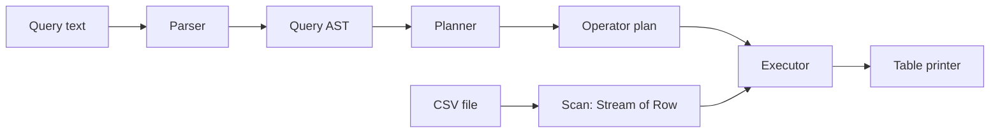
- **Parser** turns SQL text into an AST: select list, from, where expression, group by, order by, limit.
- **Planner** checks names and types against the CSV header and builds a plan: `Limit(Sort(Aggregate(Filter(Scan))))`.
- **Executor** turns each plan node into a stream stage: `filter`, `map`, `collect(groupingBy)`, `sorted`, `limit`.
- **Expressions** compile to `Function<Row, Object>` closures once, rather than being interpreted per row.

### Data model
| Type | Role |
|---|---|
| `Schema` | column names → index and type |
| `Row` | `Object[]` of typed values |
| `Expr` | sealed: `ColumnRef`, `Literal`, `BinaryOp`, `Call` |
| `PlanNode` | sealed: `Scan`, `Filter`, `Project`, `Aggregate`, `Sort`, `Limit` |
| `Accumulator` | per aggregate function: `add(value)`, `result()` |

### Tech stack
| Component | Choice | Why |
|---|---|---|
| Reading | `Files.lines` + quote-aware splitter | lazy |
| Pipeline | `Stream<Row>` | operators map to stream stages |
| Aggregation | custom `Collector` per group | combines several aggregates in one pass |
| Expressions | compiled to lambdas | no per-row tree walking |

### Milestones
1. **Scan and print** — `SELECT * FROM f LIMIT 10`. *Done when* columns align.
2. **Type inference and WHERE** — *Done when* `WHERE price > 10` compares numbers, not strings.
3. **Projection and expressions** — *Done when* `SELECT price * qty AS total` works.
4. **GROUP BY with several aggregates** — *Done when* one pass computes COUNT, SUM and AVG per group.
5. **ORDER BY and LIMIT** — *Done when* top-N uses a heap instead of a full sort.
6. **Errors and performance** — *Done when* a 1 GB file streams within the memory limit.

### Deep dive: the hard parts
- **Operator precedence.** `a OR b AND c` means `a OR (b AND c)`. A recursive-descent parser handles this with one method per precedence level (`parseOr` calls `parseAnd` calls `parseComparison`…).
- **Compile, then run.** Walking the expression tree for every row repeats the same decisions millions of times. Convert each `Expr` once into a `Function<Row, Object>` (a closure that already knows the column index and operator), then apply it per row.
- **One-pass aggregation.** Write a `Collector` whose accumulator holds an array of `Accumulator`s (one per aggregate). `groupingBy(keyFn, yourCollector)` then computes all aggregates per group in a single scan.
- **Nulls and types.** Empty cells are SQL `NULL`. Comparisons with `NULL` are neither true nor false, so `WHERE x > 5` must exclude them, and `COUNT(col)` skips them while `COUNT(*)` does not.
- **Top-N.** `ORDER BY ... LIMIT 10` should not sort 10 million rows; a bounded priority queue gives O(n log 10).

### Testing strategy
Golden tests: a directory of `.sql` + `.csv` + `.expected` files run by a parameterized test. Cross-check results against PostgreSQL or SQLite on the same data for a few queries. Unit tests for the parser (precedence, errors) and each accumulator (including empty groups).

### Trade-offs, scaling and failure modes
`GROUP BY` must keep one entry per group in memory; with millions of distinct keys you need spilling to disk. Type inference from a sample can be wrong (a column of numbers with a text value at row 9 million) — fail with a clear message or fall back to text. Parallel streams help CPU-heavy filters on large files, but ordering and `LIMIT` reduce the benefit.

### Stretch goals
- `JOIN` two CSV files with a hash join (build a map on the smaller one).
- `EXPLAIN` that prints the plan tree.
- Predicate pushdown: skip parsing columns not referenced by the query.

### Skills practised
- [Ch 12 — Streams](../chapters/12-streams/README.md) — streams, custom collectors, parallel streams
- [Ch 11 — Lambdas and functional programming](../chapters/11-lambdas-and-functional-programming/README.md) — functions as values, closures
- [Ch 6 — Inheritance, interfaces, records](../chapters/06-oop-inheritance-interfaces-and-more/README.md) — sealed hierarchies for AST and plan
- [Ch 19 — Java for coding interviews](../chapters/19-java-for-coding-interviews/README.md) — heaps for top-N

### In the interview
**30-second answer:** I built a command-line SQL engine for CSV files: it parses a query into an AST, plans it into operators (scan, filter, project, aggregate, sort, limit) checked against the CSV header, and runs the plan as a Java stream pipeline. The key design decision was compiling every expression once into a `Function<Row, Object>` closure instead of walking the expression tree per row. The hard parts were one-pass `GROUP BY` with a custom `Collector` holding several accumulators per group, SQL `NULL` semantics, and top-N with a bounded heap. It streams a 1 GB file in under 256 MB of heap and filters 10 million rows in under 10 seconds.

**Key terms to know:**
- **Query plan / operator tree** — the query rewritten as nested operators such as `Limit(Sort(Aggregate(Filter(Scan))))`. The executor runs it.
- **Recursive descent with precedence levels** — one parse method per precedence level (`parseOr` → `parseAnd` → `parseComparison`), so `a OR b AND c` means `a OR (b AND c)`.
- **Expression compilation** — turning an expression tree into a closure once per query. It removes per-row interpretation.
- **Closure** — a lambda that captures values from its surrounding scope, such as a column index.
- **Custom `Collector`** — supplier, accumulator, combiner and finisher that define how a stream is reduced. It computes several aggregates in one pass.
- **Hash aggregate** — a map from group key to accumulators, updated per row. It is how `GROUP BY` executes.
- **Three-valued logic** — SQL comparisons with `NULL` give UNKNOWN, which `WHERE` treats as not true.
- **Top-N heap** — a bounded priority queue that keeps only the best N rows, O(n log N).
- **Type inference** — guessing column types (integer, decimal, date, text) from a sample of rows.

**Q:** How does a query engine execute `GROUP BY`?

**A:** Usually with a hash aggregate: a map from group key to an array of accumulators, updated as each row streams past, then emitted at the end. Sorting by key and aggregating adjacent rows is the alternative when the data is already ordered or the groups do not fit in memory. In streams, `groupingBy(keyFn, myCollector)` is the hash aggregate.

**Q:** Why compile expressions into lambdas?

**A:** Walking the expression tree for every row repeats the same decisions (which column? which operator?) millions of times. Compiling resolves those once per query into a chain of closures that already know the column index and operator, so per-row work is just calls.
```java
Function<Row, Object> compile(Expr e) {
    return switch (e) {
        case ColumnRef c -> { int i = schema.index(c.name()); yield row -> row.get(i); }
        case Literal l   -> row -> l.value();
        case BinaryOp b  -> compileBinary(b.op(), compile(b.left()), compile(b.right()));
        case Call c      -> functions.compile(c);
    };
}
```

**Q:** How do SQL `NULL` comparisons behave?

**A:** Any comparison with `NULL`, even `NULL = NULL`, yields UNKNOWN, and `WHERE` keeps only rows where the condition is TRUE, so those rows are dropped. Use `IS NULL` to test for null. Aggregates skip nulls too: `COUNT(col)` and `AVG(col)` ignore them, while `COUNT(*)` counts every row.

**Q:** What are the four parts of a `Collector`, and why does the combiner matter?

**A:** A supplier creates a mutable container, the accumulator adds one element to it, the combiner merges two containers, and the finisher turns the container into the result. The combiner is only used by parallel streams, which split the input and merge partial results, so it must be correct even if your sequential tests never call it.

**Q:** How do you handle `ORDER BY ... LIMIT 10` over 10 million rows?

**A:** Sorting everything is O(n log n) and holds every row in memory. A min-heap of size 10 (ordered by the sort key) keeps only the current best ten, so it is O(n log 10) time and O(10) memory. Use the same comparator for the heap and the final ordering, including tie-breakers.

**Q:** What happens if type inference is wrong, such as text at row 9 million in a "numeric" column?

**A:** The value fails to convert while the query is running. Fail with a clear message naming the row, column and value, or fall back to treating the column as text, with a warning. Silently returning null for the bad value would give wrong aggregates without anyone noticing.

**Q:** How do you test a query engine?

**A:** Golden tests: a directory of `.sql`, `.csv` and `.expected` files run by one parameterized test. Cross-check a sample of queries against SQLite or PostgreSQL loaded with the same CSV. Unit-test the parser for precedence and error positions, and each accumulator, including empty groups and all-null columns.

**Q:** What breaks first at 100x the data?

**A:** Simple filters keep streaming in constant memory. `GROUP BY` with millions of distinct keys runs out of heap, because the hash table holds one entry per group, so you need to spill partitions to disk or switch to sort-based aggregation. Parallel streams can speed up CPU-heavy filters, but ordering and `LIMIT` reduce the gain, so measure.

**Common mistakes in answers:**
- Saying `NULL = NULL` is true, or that `COUNT(col)` counts nulls.
- Compiling the query but still interpreting the expression tree per row, and then calling it "compiled".
- Sorting the whole input for `LIMIT 10`, or forgetting that the combiner must be correct for parallel streams.

### TL;DR
Parse SQL into a plan, then execute the plan as a stream pipeline with compiled expressions and one-pass aggregation.

## 14. Log analyser with stream gatherers

**Level:** Intermediate · **Time:** 1 week · **Prerequisites:** Ch 7, Ch 12, Ch 13

### What it is
A tool that reads web-server or application logs (files, gzipped files or a live `tail`) and reports: requests per minute, error rate, slowest endpoints, 95th-percentile latency over a moving window, and bursts of errors ("more than 50 errors in any 1-minute window"). It uses **stream gatherers** (`Stream.gather`, final in Java 24) for windowing.

### The problem it solves
Logs are the first place you look when production misbehaves, and ad-hoc `grep | sort | uniq -c` stops working once you need time windows and percentiles. Before Java 24, streams had no way to express "group consecutive elements" or "sliding window" without collecting everything first. **Gatherers** add custom intermediate operations: `Gatherers.windowFixed`, `windowSliding`, `scan`, `fold` and `mapConcurrent`, plus your own. This project teaches them on a realistic task.

### Real-world examples
- [JEP 485](https://openjdk.org/jeps/485) introduced gatherers precisely because operations like fixed and sliding windows could not be written as streams before.
- The [`Gatherers` API](https://docs.oracle.com/en/java/javase/25/docs/api/java.base/java/util/stream/Gatherers.html) documents the built-in gatherers this project uses.

### Requirements
**Functional**
- Parse a common log format (configurable regex with named groups) into `LogEvent` records: time, level, endpoint, status, latency.
- Reports: per-minute counts, top 10 endpoints by count and by p95 latency, error rate, error bursts.
- Read plain and `.gz` files, multiple files merged by time, or follow a growing file.
- Output as a table or JSON lines.

**Non-functional**
- 1 GB of logs analysed in under 15 seconds with bounded memory (no full load).
- Malformed lines counted and sampled, never fatal.
- Time zones handled: logs in UTC, report in the user's zone.

### The architecture
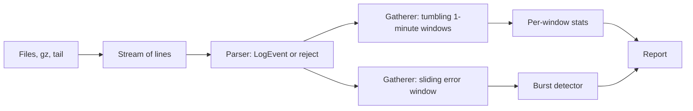
- **Sources** produce a `Stream<String>`; `GZIPInputStream` handles compressed files; a follow mode polls for new lines.
- **Parser** uses one precompiled `Pattern`; failures go to a reject counter.
- **Time-window gatherer** (custom) groups consecutive events by minute — unlike `windowFixed`, windows are defined by time, not count.
- **Burst detector** keeps a deque of error timestamps within the last 60 seconds.

### Data model
| Type | Fields |
|---|---|
| `LogEvent` | `Instant time`, `Level level`, `String endpoint`, `int status`, `Duration latency` |
| `MinuteStats` | minute, count, errors, latency histogram |
| `Histogram` | fixed buckets (1 ms … 10 s, logarithmic) |
| `Burst` | start, end, error count |

### Tech stack
| Component | Choice | Why |
|---|---|---|
| Windowing | `Gatherer.ofSequential` (Java 24) | stateful intermediate operation |
| Percentiles | bucketed histogram | constant memory per window |
| Compressed input | `GZIPInputStream` | in the JDK |
| Time | `Instant`, `ZonedDateTime`, `DateTimeFormatter` | zone-correct reports |

### Milestones
1. **Parse** — *Done when* 3 sample formats parse into `LogEvent`, rejects counted.
2. **Built-in gatherers** — `windowFixed(1000)` batches and `scan` running totals. *Done when* you can explain each one's output on a 10-element list.
3. **Custom time-window gatherer** — *Done when* events group per minute, including empty minutes if requested.
4. **Percentiles** — histogram-based p50/p95/p99 per minute. *Done when* results are within one bucket of an exact sort.
5. **Bursts and follow mode** — *Done when* a synthetic burst is detected live while the file grows.

### Deep dive: the hard parts
- **Writing a gatherer.** A gatherer has an *initializer* (create state), an *integrator* (receive each element, update state, optionally push results downstream) and a *finisher* (flush what remains). For time windows, the state is "current minute + accumulator"; when an event from a new minute arrives, push the finished window and start a new one. The finisher pushes the last window.
- **Out-of-order events.** Multi-threaded servers log slightly out of order. Allow a small lateness (say 2 seconds) by holding windows open until the "watermark" (latest time seen minus allowed lateness) passes their end — the same idea stream processors use.
- **Percentiles with bounded memory.** Exact p95 needs all values sorted. A histogram with logarithmic buckets gives an approximate p95 in constant memory and can be merged across windows by adding counts.
- **Merging files by time.** Several files each sorted by time merge with a priority queue of iterators (k-way merge), not by concatenating and sorting.

### Testing strategy
Unit-test the custom gatherer on small lists with known windows (including one-element and empty input). Fixed log fixtures with expected reports. A generated 1 GB file for the performance target, run with `-Xmx256m`. Compare histogram percentiles with exact ones on random data.

### Trade-offs, scaling and failure modes
Approximate percentiles trade accuracy for memory; document the error bound. A sequential gatherer cannot run in parallel; windows across parallel chunks need a combiner and boundary handling. Following a file breaks when the log rotates; detect the file being replaced (inode or size shrink) and reopen.

### Stretch goals
- `mapConcurrent` to enrich events (for example IP → country lookup) with bounded concurrency on virtual threads.
- Alerts via a webhook when the error rate crosses a threshold.
- Read JSON-lines logs using your parser from project 12.

### Skills practised
- [Ch 12 — Streams](../chapters/12-streams/README.md) — gatherers, collectors, laziness
- [Ch 13 — I/O and NIO](../chapters/13-io-and-nio/README.md) — compressed streams, reading large files
- [Ch 7 — Core APIs](../chapters/07-core-apis/README.md) — `java.time`, regex
- [Ch 10 — Collections](../chapters/10-collections/README.md) — `ArrayDeque`, `PriorityQueue`

### In the interview
**30-second answer:** I built a log analyser that streams plain, gzipped or live-tailed logs and reports requests per minute, error rates, slowest endpoints, p95 latency and error bursts. The key design decision was to use Java 24 stream gatherers: a custom sequential gatherer cuts the event stream into one-minute windows by timestamp, which plain streams could not express without collecting everything first. Percentiles come from a logarithmic-bucket histogram per window, so memory stays constant and windows can be merged by adding counts. It analyses 1 GB of logs in under 15 seconds with a 256 MB heap, and malformed lines are counted and sampled, never fatal.

**Key terms to know:**
- **Stream gatherer** — a custom intermediate stream operation (`Stream.gather`, final in Java 24, JEP 485) that can keep state and emit zero, one or many outputs per input.
- **Initializer / integrator / finisher** — the three parts of a gatherer: create state, handle each element (and optionally push results downstream), flush what is left at the end.
- **Built-in gatherers** — `Gatherers.windowFixed`, `windowSliding`, `scan`, `fold` and `mapConcurrent`. They are used for batching and running totals.
- **Tumbling vs sliding window** — non-overlapping fixed periods (each minute) versus a window that moves with every event (the last 60 seconds). Per-minute stats use the first, burst detection the second.
- **Percentile (p95)** — the value below which 95% of observations fall. It is reported for latency.
- **Histogram with logarithmic buckets** — counts per range (1–2 ms, 2–4 ms…) that approximate percentiles in fixed memory.
- **Watermark / allowed lateness** — "latest time seen minus a grace period". A window is closed only once the watermark passes its end, which tolerates out-of-order events.
- **k-way merge** — merging k sorted inputs with a min-heap. Several log files are merged by time this way.
- **`GZIPInputStream`** — the JDK class that decompresses `.gz` files as a stream.

**Q:** What problem do stream gatherers solve?

**A:** Before Java 24, stream intermediate operations were fixed (`map`, `filter`, `flatMap`, `distinct`…) and none could keep custom state across elements, so "group consecutive events by minute" or "sliding window" meant collecting the whole stream first or abandoning streams. Gatherers let you write such stateful operations yourself and still stay lazy and composable. `collect` is the terminal-operation analogue; `gather` is the intermediate one.

**Q:** Show the shape of your time-window gatherer.

**A:** The state holds the current minute and its accumulator. When an event from a new minute arrives, the integrator pushes the finished window downstream and starts a new one, and the finisher pushes the last window.
```java
Gatherer<LogEvent, ?, MinuteStats> perMinute = Gatherer.ofSequential(
    MinuteAcc::new,
    (acc, e, down) -> {
        if (acc.isNewMinute(e)) down.push(acc.flush());
        acc.add(e);
        return !down.isRejecting();   // stop early if downstream is done
    },
    (acc, down) -> { if (!acc.isEmpty()) down.push(acc.flush()); });
```

**Q:** Why not just use `Gatherers.windowFixed(n)`?

**A:** `windowFixed` groups by count, such as every 1,000 elements. Traffic varies, so 1,000 events might span two seconds or two hours. Time windows need to look at each event's timestamp, which is why the per-minute gatherer is custom. `windowFixed` is still useful for batching writes.

**Q:** How do you compute p95 latency over a huge stream?

**A:** An exact p95 needs every value kept and sorted, which is unbounded memory. A histogram with logarithmic buckets stores just a count per bucket, so p95 is found by walking the cumulative counts until 95% is reached, with error bounded by the bucket width. Histograms for different minutes or files merge by adding counts, which exact percentiles cannot do.

**Q:** How do you merge k sorted files?

**A:** Keep a min-heap holding the next event from each file, keyed by timestamp. Pop the smallest, output it, and push that file's next event. It is O(n log k) for n events in total, and memory holds only k events, unlike concatenating and sorting.

**Q:** What happens with out-of-order events?

**A:** Multi-threaded servers log events slightly out of order, so an event for 10:00:59 can arrive after one for 10:01:00. If the window closes immediately it is counted in the wrong minute or dropped. Allow a small lateness (say 2 seconds): keep a window open until the watermark passes its end, and count anything later still as "late".

**Q:** What happens when the log file is rotated while you follow it?

**A:** The original file is renamed or truncated and a new one created, so a reader holding the old handle sees no more data, or reads from a position past the new end. Detect it by checking whether the file at the path has a different identity (file key or inode) or has shrunk, then reopen from the start of the new file.

**Q:** Can a gatherer run in parallel?

**A:** One built with `Gatherer.ofSequential` always processes elements in order on one thread, even in a parallel stream. A parallel-capable gatherer also needs a combiner to merge states from different chunks, and time windows that straddle chunk boundaries need extra handling. For this workload, I/O and parsing dominate, so sequential processing is usually fine.

**Q:** How do you test it?

**A:** Unit-test the gatherer on tiny lists with known windows, including empty input and a single element. Run fixture logs through and compare with expected reports. Compare histogram percentiles with exact ones from sorting random data, and check the error is within one bucket. Generate a 1 GB file and run it with `-Xmx256m` for the performance target.

**Common mistakes in answers:**
- Saying gatherers are a new terminal operation. They are intermediate; `collect` remains the terminal one.
- Computing p95 by averaging per-minute p95s. Percentiles do not average; merge histograms instead.
- Forgetting the finisher, which silently drops the last window.

### TL;DR
Parse logs into events, window them with custom gatherers, summarise with histograms — all streaming, in bounded memory.

## 15. File-sync tool with WatchService

**Level:** Intermediate · **Time:** 2 weeks · **Prerequisites:** Ch 13, Ch 14

### What it is
A tool that keeps a target directory in sync with a source directory: an initial full sync, then live updates as files are created, changed, renamed or deleted, using the NIO.2 **`WatchService`** (an API that asks the operating system to notify you of file-system changes). Think of a tiny, one-way Dropbox for a folder.

### The problem it solves
Copying a folder once is easy. Keeping two folders in sync is not: file-system events arrive in bursts, can be lost when too many happen at once, do not cover subdirectories automatically, and arrive before a big file has finished being written. Building a correct sync tool teaches the edge cases of NIO.2, idempotent operations (safe to repeat) and how to combine event-driven and periodic reconciliation.

### Real-world examples
- The [rsync technical report](https://www.samba.org/rsync/tech_report/) explains how rsync transfers only changed parts of files with rolling checksums — the idea behind this project's delta stretch goal.
- [Syncthing](https://syncthing.net/) is an open-source continuous file synchroniser that combines file-system watching with periodic full rescans, the same hybrid design recommended here.
- The [`WatchService` documentation](https://docs.oracle.com/en/java/javase/25/docs/api/java.base/java/nio/file/WatchService.html) warns that events may be lost and signals this with an `OVERFLOW` event.

### Requirements
**Functional**
- `sync <source> <target> [--watch] [--delete] [--exclude pattern]`.
- Initial sync compares size and modification time (optionally a hash) and copies what changed.
- Watch mode reacts to create/modify/delete in all subdirectories, including new ones.
- Excludes via glob patterns (`**/*.tmp`, `.git/**`).
- Dry-run mode prints planned actions.

**Non-functional**
- A change is reflected in the target within 2 seconds.
- Never leave a half-copied file at the target path (copy to temp, then atomic move).
- Handles 100,000 files; initial scan of an unchanged tree under 10 seconds.
- Survives `OVERFLOW` by rescanning.

### The architecture
```mermaid
flowchart LR
    WS["WatchService thread"] --> Q["Event queue"]
    SC["Periodic scanner"] --> Q
    Q --> DB["Debouncer: coalesce per path"]
    DB --> PLAN["Planner: compare source and target"]
    PLAN --> EX["Executor: copy, move, delete"]
    EX --> T["Target directory"]
    EX --> LOG["Action log"]
```
- **Watcher** registers every directory (`WatchService` is not recursive) and turns OS events into `PathChanged(path)` messages.
- **Scanner** walks the tree every few minutes and after an `OVERFLOW`, emitting the same messages.
- **Debouncer** waits until a path has been quiet for, say, 500 ms, merging bursts of modify events into one.
- **Planner** compares source and target metadata and decides copy, delete or nothing — idempotent.
- **Executor** performs actions with temp-file + atomic move, on a small pool.

### Data model
| Type | Fields | Note |
|---|---|---|
| `FileState` | relative path, size, mtime, optional hash | from `Files.readAttributes` |
| `Action` | sealed: `Copy`, `Delete`, `MakeDir` | planner output |
| `WatchKey` map | `WatchKey → Path` | resolve relative event paths |
| `PendingChange` | path, last event time | debouncer state |

### Tech stack
| Component | Choice | Why |
|---|---|---|
| Events | `WatchService` + `ENTRY_CREATE/MODIFY/DELETE` | OS notifications |
| Walking | `Files.walkFileTree` | visit and register directories |
| Copy | `Files.copy` to temp + `Files.move(ATOMIC_MOVE)` | no torn files |
| Concurrency | one watcher thread, `ScheduledExecutorService` for debounce and scans | simple, clear ownership |
| Matching | `FileSystem.getPathMatcher("glob:...")` | built-in globbing |

### Milestones
1. **One-shot sync** — *Done when* a second run copies nothing.
2. **Excludes and dry run** — *Done when* `--dry-run` prints the exact plan.
3. **Watch a flat folder** — *Done when* creating a file in the source appears in the target.
4. **Recursive watching** — register new subdirectories as they appear. *Done when* `mkdir -p a/b/c && touch a/b/c/f` syncs.
5. **Debounce and overflow** — *Done when* writing 10,000 files quickly results in a correct target (verified by a full compare).
6. **Deletes and renames** — *Done when* a rename in the source becomes delete + create at the target, and `--delete` is respected.

### Deep dive: the hard parts
- **Events are hints, not truth.** Treat every event as "something about this path may have changed", then look at the actual file system state and act. That makes duplicate, reordered or missed events harmless, and overflow recovery just means "rescan everything".
- **New directories race.** If someone creates `a/` and immediately `a/f`, the event for `a/f` may happen before you register `a/`. After registering a new directory, scan it once to catch files created in between.
- **Partially written files.** A `MODIFY` event fires while a 2 GB file is still being written. Debounce (wait for quiet) and re-check size/mtime before and after copying; if they changed, retry.
- **Platform differences.** On Linux the JDK uses inotify; on macOS the JDK's watcher has historically polled, so events can be seconds late. Your periodic scan covers this, and your tests must not assume instant events.

### Testing strategy
Integration tests with `@TempDir` source and target: perform operations, then wait (with a timeout, not a fixed sleep) until a full compare reports equal. A stress test creates, modifies and deletes thousands of files randomly. Unit-test the planner with fake `FileState` maps — no disk needed.

### Trade-offs, scaling and failure modes
Watching is fast but unreliable; scanning is reliable but slow. Hybrid gives both. Comparing by size + mtime is cheap but misses changes that keep both (rare); hashing catches everything but reads every byte. One-way sync is well defined; two-way sync needs conflict detection (both sides changed since last sync) — a much harder problem.

### Stretch goals
- Delta transfer of large files with rsync-style rolling checksums.
- Sync to a remote machine over your HTTP server (project 16).
- Two-way sync with a state database and conflict files.

### Skills practised
- [Ch 13 — I/O and NIO](../chapters/13-io-and-nio/README.md) — `Path`, `Files`, `WatchService`, attributes, atomic moves
- [Ch 14 — Concurrency 1](../chapters/14-concurrency-1/README.md) — threads, executors, scheduled tasks, concurrent queues
- [Ch 8 — Exceptions](../chapters/08-exceptions/README.md) — handling `IOException` per file without stopping
- [Ch 18 — Testing, build and tooling](../chapters/18-testing-build-and-tooling/README.md) — integration tests with temp directories

### In the interview
**30-second answer:** I built a one-way folder sync tool: an initial full sync, then live updates driven by the NIO.2 `WatchService`. The key design decision was to treat watch events only as hints that a path may have changed: a debouncer coalesces bursts, a planner compares the real source and target state, and an executor copies through a temp file and an atomic move, so duplicate, reordered or lost events are harmless. Because `WatchService` is not recursive and can drop events with `OVERFLOW`, I register every new directory, scan it once after registering, and run periodic full rescans. Changes reach the target within 2 seconds, and a stress test with 10,000 rapid file operations ends with a full compare reporting identical trees.

**Key terms to know:**
- **`WatchService`** — the NIO.2 API that asks the operating system for file-change notifications (`ENTRY_CREATE`, `ENTRY_MODIFY`, `ENTRY_DELETE`).
- **`WatchKey`** — the registration token for one directory. It must be `reset()` after its events are processed, or no more events arrive.
- **`OVERFLOW`** — a special event meaning events were lost. The tool answers with a full rescan.
- **Debouncing** — waiting until a path has been quiet for a while (500 ms) before acting, merging a burst of events into one.
- **Idempotent operation** — doing it twice has the same effect as once. Every planned action is idempotent.
- **Reconciliation** — comparing desired and actual state and fixing the difference, as the planner and periodic scanner do.
- **Atomic move** — copy to a temp file next to the target, then `Files.move(..., ATOMIC_MOVE)`, so readers never see a half-copied file.
- **`ScheduledExecutorService`** — runs tasks after a delay or periodically. It drives debouncing and rescans.
- **`PathMatcher` (glob)** — matches paths against patterns like `**/*.tmp`. It implements excludes.

**Q:** Is `WatchService` reliable?

**A:** No. Events can be coalesced or lost (signalled by `OVERFLOW`), it watches one directory at a time rather than a tree, and on some platforms, historically macOS, the JDK polls, so events arrive seconds late. Use events as hints and reconcile with periodic scans, so the design is correct even if every event were lost.

**Q:** Show the core watch loop.

**A:** Take a key, process its events, resolve each relative path against the directory registered for that key, and reset the key.
```java
for (;;) {
    WatchKey key = watcher.take();
    Path dir = dirs.get(key);
    for (WatchEvent<?> ev : key.pollEvents()) {
        if (ev.kind() == OVERFLOW) { rescanAll(); continue; }
        changes.offer(dir.resolve((Path) ev.context()));
    }
    if (!key.reset()) dirs.remove(key);   // directory deleted
}
```

**Q:** How do you avoid copying a half-written file?

**A:** Debounce until the file has been quiet for a short time, record size and modification time before copying, check them again afterwards, and retry if they changed. Copy to a temp file in the target directory and atomically move it into place, so the target path only ever holds a complete file.

**Q:** Why should sync actions be idempotent?

**A:** Events can be duplicated or reordered, and the tool can crash and restart midway. If every action is "make the target match the current source state for this path", repeating it is harmless and the final state is the same. That is what makes "rescan everything" a safe recovery for any problem.

**Q:** What race happens when a new directory appears?

**A:** If someone runs `mkdir a && touch a/f`, the file can be created before your watcher registers `a`, so no event for `a/f` ever arrives. After registering a new directory, scan it once to pick up anything created in between.

**Q:** How do you detect what changed: size and mtime, or a hash?

**A:** Size plus modification time is cheap, coming from one metadata read, and catches nearly all changes, but misses an edit that keeps both the same, which is rare. A hash such as SHA-256 catches everything but reads every byte of both files. A common compromise is metadata by default, hashing on request, or a periodic deep check.

**Q:** How do you test something this timing-dependent?

**A:** Unit-test the planner with fake `FileState` maps, with no disk and no timing. Integration tests use `@TempDir` for source and target, perform operations, then poll with a timeout until a full compare reports equal, instead of using fixed sleeps that are flaky on slow CI machines. A stress test does thousands of random creates, modifies and deletes, then compares.

**Q:** What breaks at 100x the files, or with two-way sync?

**A:** With millions of files, the initial scan and periodic rescans get slow, and Linux inotify has a per-user watch limit (`max_user_watches`) that you can exceed. You would persist a state database of known file states to skip unchanged subtrees. Two-way sync is a much harder problem: you must detect when both sides changed since the last sync and produce conflict copies rather than overwrite.

**Common mistakes in answers:**
- Trusting events as the source of truth, so a lost or reordered event leaves the target permanently wrong.
- Forgetting `key.reset()`, after which a directory silently stops reporting events.
- Assuming registering the root directory watches the whole tree. `WatchService` is not recursive.

### TL;DR
Use watch events as hints, debounce them, compare real file state, and write atomically. A periodic rescan makes it correct.

## 16. HTTP server on virtual threads

**Level:** Intermediate · **Time:** 2 weeks · **Prerequisites:** Ch 13, Ch 15

### What it is
A small web framework on top of the JDK's built-in **`com.sun.net.httpserver`** package (module `jdk.httpserver`): routing with path parameters (`/users/{id}`), middleware (logging, timing, gzip), static files with caching headers, JSON responses, and graceful shutdown. Every request runs on its own **virtual thread** (a lightweight thread managed by the JVM, final in Java 21).

### The problem it solves
Frameworks hide how HTTP actually works. Building a thin one shows the request/response cycle, headers, status codes, keep-alive and content negotiation. It also demonstrates the main promise of virtual threads: you write simple blocking code ("read the file, call the database, write the response") and still handle thousands of concurrent connections, because a blocked virtual thread releases its carrier (OS) thread.

### Real-world examples
- [JEP 408](https://openjdk.org/jeps/408) added `jwebserver`, a minimal static file server built on the same `com.sun.net.httpserver` API (Java 18).
- [JEP 444](https://openjdk.org/jeps/444) (virtual threads) explains the thread-per-request style this server uses, and the [`HttpServer` docs](https://docs.oracle.com/en/java/javase/25/docs/api/jdk.httpserver/com/sun/net/httpserver/HttpServer.html) show how to plug in any `Executor`, including `Executors.newVirtualThreadPerTaskExecutor()`.

### Requirements
**Functional**
- Routes by method and path pattern with parameters; 404 and 405 handled correctly.
- Middleware chain: request ID, access log, timing, exception → 500 mapping, optional gzip.
- Static files from a directory with `Content-Type`, `ETag`/`If-None-Match` (304), and protection against `../` path traversal.
- JSON in and out (use project 12 or a small library).
- Graceful shutdown: stop accepting, finish in-flight requests up to a timeout.

**Non-functional**
- 10,000 concurrent slow requests (each sleeping 1 s to simulate I/O) complete in about 1–2 s on a laptop.
- p99 latency under 10 ms for a trivial handler at 5,000 requests per second.
- Request bodies limited (default 1 MB) to prevent memory exhaustion.

### The architecture
```mermaid
flowchart LR
    C["Clients"] --> HS["HttpServer listener"]
    HS --> VT["Virtual thread per request"]
    VT --> MW["Middleware chain"]
    MW --> RT["Router"]
    RT --> H1["Handlers: API"]
    RT --> H2["Static file handler"]
    H1 --> J["JSON codec"]
    MW --> LOG["Access log"]
```
- **HttpServer** accepts connections and parses HTTP/1.1; you install one root `HttpHandler`.
- **Executor** is `newVirtualThreadPerTaskExecutor()`, so each exchange runs on a fresh virtual thread.
- **Middleware** are functions `Handler → Handler` composed in order, like servlet filters.
- **Router** matches `(method, path)` against compiled patterns and puts path parameters into a `Request` object.
- **Static handler** resolves the path safely under the root and streams the file.

### Data model
| Type | Role |
|---|---|
| `Request` | method, path, params, headers, body supplier, request ID |
| `Response` | status, headers, body (bytes, stream or JSON) |
| `Handler` | `Response handle(Request)` functional interface |
| `Route` | method, compiled pattern, parameter names, handler |
| `ScopedValue<String> REQUEST_ID` | context visible to logging deep in the call stack |

### Tech stack
| Component | Choice | Why |
|---|---|---|
| HTTP | `com.sun.net.httpserver.HttpServer` | in the JDK, supported, `jdk.httpserver` module |
| Threads | virtual threads | blocking code, high concurrency |
| Context | `ScopedValue` (final in Java 25, JEP 506) | request ID without parameters or `ThreadLocal` leaks |
| Load test | `java.net.http.HttpClient` on virtual threads, or a tool like `wrk` | measure, do not guess |

### Milestones
1. **Hello server** — *Done when* `curl localhost:8080/hello` works on a virtual-thread executor.
2. **Router** — *Done when* `/users/{id}` extracts `id` and wrong methods return 405 with an `Allow` header.
3. **Middleware** — *Done when* every response has `X-Request-Id` and every request is logged with its duration.
4. **Static files** — *Done when* a second request returns 304 and `/../etc/passwd` returns 404.
5. **Load test** — *Done when* 10,000 concurrent 1-second requests finish in about 1–2 s; compare with a fixed pool of 200 platform threads.
6. **Graceful shutdown** — *Done when* in-flight requests complete after Ctrl-C.

### Deep dive: the hard parts
- **Why virtual threads help.** With a pool of 200 platform threads, the 201st slow request waits. A virtual thread blocked on I/O unmounts from its carrier, so 10,000 sleeping requests need only a handful of OS threads. They do not make CPU-bound work faster.
- **Pinning.** Before Java 24, blocking inside a `synchronized` block pinned the virtual thread to its carrier. JEP 491 (Java 24) removed that for `synchronized`; native calls can still pin. Use JFR's `jdk.VirtualThreadPinned` event to check.
- **Path traversal.** Resolve the requested path against the root, `normalize()` it, and check `startsWith(root)`. Also reject encoded variants (`%2e%2e`) by decoding first.
- **Always close the exchange.** Each `HttpExchange` must have its response body closed, even on error, or the connection hangs. Put it in the outermost middleware's `finally`.
- **Scoped values vs ThreadLocal.** With one virtual thread per request, `ThreadLocal` works but is mutable and easy to leak. A `ScopedValue` bound with `ScopedValue.where(REQUEST_ID, id).run(...)` is immutable and automatically unbound when the handler returns.

### Testing strategy
Start the server on port 0 (random free port) in a JUnit extension; use `java.net.http.HttpClient` for tests. Test routing, headers, 304, traversal and error mapping. A load test (tagged so it does not run on every build) asserts throughput and p99. Use JFR to confirm no pinning events.

### Trade-offs, scaling and failure modes
`com.sun.net.httpserver` supports HTTP/1.1 only and is basic (no HTTP/2, limited tuning); production servers such as Jetty, Tomcat or Netty offer far more. Unlimited virtual threads can overload a downstream database: add a `Semaphore` to cap concurrent DB calls. A slow client reading responses slowly still holds memory for its buffers.

### Stretch goals
- Server-Sent Events endpoint that streams updates.
- HTTPS with `HttpsServer` and a self-signed certificate.
- Per-IP rate limiting with project 20's limiter.

### Skills practised
- [Ch 15 — Modern concurrency](../chapters/15-concurrency-2-modern/README.md) — virtual threads, pinning, scoped values
- [Ch 13 — I/O and NIO](../chapters/13-io-and-nio/README.md) — streaming files, path safety
- [Ch 11 — Lambdas and functional programming](../chapters/11-lambdas-and-functional-programming/README.md) — handlers and middleware as functions
- [Ch 16 — JVM internals and performance](../chapters/16-jvm-internals-and-performance/README.md) — JFR events, modules (`requires jdk.httpserver`)

### In the interview
**30-second answer:** I built a small web framework on the JDK's `com.sun.net.httpserver`, with routing and path parameters, a middleware chain, safe static files with ETags, JSON, and graceful shutdown. The key decision was running every request on its own virtual thread via `Executors.newVirtualThreadPerTaskExecutor()`, so handlers are plain blocking code yet 10,000 concurrent one-second requests finish in about 1–2 seconds, where a 200-thread platform pool needs about 50 seconds. I carry the request ID in a `ScopedValue` instead of a `ThreadLocal`. The parts that needed real care were path-traversal protection, always closing the exchange, and checking with JFR that nothing pins virtual threads.

**Key terms to know:**
- **Virtual thread** — a lightweight thread scheduled by the JVM rather than the OS (final in Java 21). A blocked virtual thread unmounts from its carrier, so you can have millions. Each request runs on one.
- **Carrier thread** — the platform (OS) thread a virtual thread runs on, from a `ForkJoinPool` sized to the CPU count by default.
- **Pinning** — a virtual thread that cannot unmount while blocked, tying up its carrier. Since Java 24 (JEP 491) `synchronized` no longer pins, but native frames still can. JFR event `jdk.VirtualThreadPinned` detects it.
- **Thread-per-request** — one thread handles one request from start to finish with blocking calls. Virtual threads make this style scale.
- **`ScopedValue`** — an immutable, per-thread value bound for the duration of a call (final in Java 25, JEP 506). It carries the request ID to logging.
- **Middleware** — a function `Handler → Handler` that wraps another handler, like a servlet filter. Logging, timing, gzip and error mapping are middleware.
- **ETag / 304 Not Modified** — a version tag for a resource. If the client's `If-None-Match` matches, the server sends no body.
- **Path traversal** — an attack using `../` to read files outside the web root.
- **Back-pressure** — limiting incoming work so a slower resource is not overwhelmed, for example a `Semaphore` around database calls.

**Q:** What do virtual threads improve for a web server?

**A:** Concurrency for I/O-bound work with simple blocking code. Each request gets a cheap thread, and when it blocks on I/O or `sleep` it unmounts from its carrier, so a few OS threads serve thousands of waiting requests. Throughput is no longer capped by a thread-pool size, and there are no callbacks or reactive chains.

**Q:** When do virtual threads not help?

**A:** For CPU-bound work, because there are still only as many carriers as cores, so nothing runs faster. They also do not help when another resource is the bottleneck, such as 20 database connections or a rate-limited API. More threads just queue there, so you still need limits like a connection pool or a `Semaphore`.

**Q:** Should you pool virtual threads?

**A:** No. They are cheap to create and meant to be used once per task; pooling only adds contention. Create one per task with `newVirtualThreadPerTaskExecutor()` or `Thread.ofVirtual().start(...)`, and if you need to limit concurrency, limit the resource with a `Semaphore` instead of limiting threads.

**Q:** What is pinning, and did Java 24 fix it?

**A:** Pinning means a blocked virtual thread cannot unmount and holds its carrier, so with enough pinned threads the server stalls. Before Java 24, blocking inside `synchronized` pinned; JEP 491 (Java 24) fixed that. Blocking while a native method or foreign function is on the stack can still pin. JFR's `jdk.VirtualThreadPinned` event shows where it happens.

**Q:** Why `ScopedValue` instead of `ThreadLocal` for the request ID?

**A:** A `ThreadLocal` is mutable, must be removed manually, and with pooled threads it leaks values between requests. A `ScopedValue` is bound immutably for the duration of one call and automatically unbound when it returns, so it cannot leak, and it is cheap to read.
```java
static final ScopedValue<String> REQUEST_ID = ScopedValue.newInstance();
ScopedValue.where(REQUEST_ID, newId()).run(() -> next.handle(exchange));
// deep in logging code:
log(REQUEST_ID.orElse("-") + " " + message);
```

**Q:** How do you prevent `../` attacks on a static file handler?

**A:** URL-decode the path first (so `%2e%2e` becomes `..`), resolve it against the root, `normalize()` it, and check the result still `startsWith(root)`; otherwise return 404. For symbolic links inside the root, compare `toRealPath()` too. Test with `/../etc/passwd` and encoded variants.

**Q:** What happens if a handler throws, or forgets to close the exchange?

**A:** If nobody catches the exception, the client gets a dropped connection instead of a 500. If the response body is never closed, the connection hangs and the client eventually times out. The outermost middleware catches everything, maps it to a 500 with the request ID, and closes the exchange in a `finally`.

**Q:** How do you test and load-test it?

**A:** A JUnit extension starts the server on port 0 (a random free port) and tests call it with `java.net.http.HttpClient`: routes, 405 with `Allow`, 304, traversal and error mapping. A tagged load test fires 10,000 concurrent slow requests from virtual-thread clients and asserts total time and p99, and a JFR recording checks for pinning events.

**Q:** What breaks first at 10x traffic?

**A:** Usually not the threads but what they call: a database or downstream API gets 10x the concurrent requests and slows down or fails, so you cap calls with a pool or `Semaphore`. Memory per in-flight request (buffers, bodies) is next, so the 1 MB body limit matters. The JDK server itself is HTTP/1.1 only and basic; at real scale you would move to Jetty, Tomcat or Netty.

**Common mistakes in answers:**
- Saying virtual threads make code faster. They improve concurrency for waiting work; CPU-bound work is no faster.
- Pooling virtual threads or limiting them with a fixed pool, instead of limiting the scarce resource.
- Still claiming every `synchronized` block pins in current Java. That was fixed in Java 24; native calls can still pin.

### TL;DR
A thin framework over the JDK HTTP server with routing, middleware and safe static files, one virtual thread per request.

## 17. Todo REST API with JDBC

**Level:** Intermediate · **Time:** 2 weeks · **Prerequisites:** Ch 15, Ch 18

### What it is
A complete REST API for todo lists — create lists, add, edit, complete and delete items, filter and page — backed by a relational database through plain **JDBC** (Java Database Connectivity, the JDK's standard SQL API). The server reuses project 16's router (or a minimal version), and the integration tests and a small CLI client use **`java.net.http.HttpClient`** (final in Java 11).

### The problem it solves
Frameworks like Spring do a lot for you; this project shows what they do by doing it by hand: resource design, status codes, validation, SQL with prepared statements, transactions, connection pooling, schema migrations and optimistic locking. If you later use Spring Data or Hibernate, you will know what they generate.

### Real-world examples
- [Todo-Backend](https://todobackend.com/) is a shared API spec with an automated test suite, implemented in dozens of languages — a good contract to test your server against.
- [RFC 9110](https://www.rfc-editor.org/rfc/rfc9110) defines HTTP semantics: which methods are safe and idempotent, and what `201`, `204`, `409` and `412` mean.

### Requirements
**Functional**
- `POST /lists`, `GET /lists/{id}`, `POST /lists/{id}/items`, `PATCH /items/{id}`, `DELETE /items/{id}`, `GET /lists/{id}/items?done=false&page=2&size=20`.
- Validation errors return `400` with a JSON body listing each problem.
- Optimistic concurrency: responses carry an `ETag` (version); `PATCH` with a stale `If-Match` returns `412`.
- CLI client: `todo add "Buy milk"`, `todo done 42`.

**Non-functional**
- p95 under 20 ms for single-item reads at 500 requests per second on a laptop with PostgreSQL or H2.
- No SQL injection possible: every query uses `PreparedStatement` parameters.
- Schema created and upgraded by versioned migration scripts at startup.

### The architecture
```mermaid
flowchart LR
    CL["CLI and tests: HttpClient"] --> API["HTTP layer: routes, JSON"]
    API --> SVC["Service: validation, rules"]
    SVC --> REPO["Repository: JDBC"]
    REPO --> POOL["Connection pool"]
    POOL --> DB["PostgreSQL or H2"]
    MIG["Migrator"] --> DB
```
- **HTTP layer** maps requests to service calls and results to status codes.
- **Service** validates and runs each use case inside one transaction.
- **Repository** contains all SQL; maps `ResultSet` rows to records.
- **Pool** keeps a few open connections, since opening one per request costs milliseconds.
- **Migrator** applies `V1__init.sql`, `V2__add_due_date.sql`… once each, recorded in a table.

### Data model
```mermaid
erDiagram
    TODO_LIST ||--o{ TODO_ITEM : contains
    TODO_LIST {
        bigint id PK
        text title
        timestamptz created_at
    }
    TODO_ITEM {
        bigint id PK
        bigint list_id FK
        text title
        boolean done
        int version
        timestamptz updated_at
    }
    SCHEMA_VERSION {
        int version PK
        timestamptz applied_at
    }
```

### Tech stack
| Component | Choice | Why |
|---|---|---|
| Server | `com.sun.net.httpserver` on virtual threads | from project 16 |
| Client | `java.net.http.HttpClient` | standard, async-capable |
| Database | PostgreSQL (or H2 for tests) | real SQL, real transactions |
| Pool | a small pool you write, or HikariCP | understand, then use the standard |
| Tests | JUnit 6, AssertJ, Testcontainers (optional) | real database in tests |

### Milestones
1. **Schema and migrator** — *Done when* starting twice applies migrations once.
2. **Repository** — CRUD with prepared statements. *Done when* repository tests pass against H2 or PostgreSQL.
3. **HTTP endpoints** — *Done when* each endpoint returns the right status (`201` with `Location`, `204` on delete, `404`).
4. **Validation and errors** — *Done when* bad input yields a `400` with a list of field errors.
5. **Optimistic locking** — *Done when* two concurrent PATCHes with the same `If-Match` produce one `200` and one `412`.
6. **Paging, CLI and load test** — *Done when* the CLI works and the p95 target is met.

### Deep dive: the hard parts
- **Transactions in JDBC.** Call `setAutoCommit(false)`, do the work, `commit()`, and `rollback()` in a catch; always close the connection (returning it to the pool) in try-with-resources. Keep one connection per use case so all statements share the transaction.
- **Optimistic locking.** `UPDATE todo_item SET title = ?, version = version + 1 WHERE id = ? AND version = ?`. If the update count is 0, someone else changed it first → `412`. No locks are held between requests.
- **Pool sizing with virtual threads.** Virtual threads make it easy to start 10,000 requests, but a database handles a few dozen connections well. The pool is your back-pressure: requests wait for a connection (with a timeout) rather than overwhelming the database.
- **Paging.** `LIMIT/OFFSET` gets slower as the offset grows; keyset pagination (`WHERE id > :lastSeen ORDER BY id LIMIT 20`) stays fast. Offer keyset with an opaque cursor.

### Testing strategy
Repository tests against a real database (H2 in PostgreSQL mode, or PostgreSQL in a container). API tests start the server on a random port and call it with `HttpClient`. Run the Todo-Backend spec tests if you match its contract. A concurrency test fires parallel PATCHes and asserts exactly one wins.

### Trade-offs, scaling and failure modes
Hand-written SQL is explicit and fast but verbose; an ORM saves code but hides queries. H2 is convenient but differs from PostgreSQL in subtle SQL details — run at least the CI tests on PostgreSQL. A single database is a single point of failure; read replicas and caching are the next steps but bring stale reads.

### Stretch goals
- Full-text search on titles using PostgreSQL's `tsvector` (PostgreSQL feature).
- An outbox table that records events for another service to consume.
- Rewrite the persistence with the Spring book's approach and compare.

### Skills practised
- [Ch 18 — Testing, build and tooling](../chapters/18-testing-build-and-tooling/README.md) — JDBC, transactions, testing
- [Ch 15 — Modern concurrency](../chapters/15-concurrency-2-modern/README.md) — virtual threads and back-pressure
- [Ch 8 — Exceptions](../chapters/08-exceptions/README.md) — exception translation
- [Ch 12 — Streams](../chapters/12-streams/README.md) — mapping results

### In the interview
**30-second answer:** I built a todo REST API by hand: HTTP routing on the JDK server with virtual threads, a service layer that runs each use case in one JDBC transaction, a repository with only prepared statements, a connection pool, and a versioned schema migrator. The key design decision was optimistic locking: each item has a version exposed as an `ETag`, and `PATCH` with a stale `If-Match` returns 412, so no database locks are held between requests. I also treat the connection pool as back-pressure, because virtual threads make it easy to start 10,000 requests but the database is happiest with a few dozen connections. Single-item reads stay under 20 ms p95 at 500 requests per second, and a concurrency test shows two parallel PATCHes produce exactly one 200 and one 412.

**Key terms to know:**
- **JDBC** — the JDK's standard SQL API (`Connection`, `PreparedStatement`, `ResultSet`). All persistence uses it directly.
- **`PreparedStatement`** — SQL with `?` placeholders whose values are sent separately. It prevents SQL injection.
- **Transaction / auto-commit** — a group of statements that all commit or all roll back. JDBC auto-commits each statement unless you call `setAutoCommit(false)`.
- **Connection pool** — a set of open connections reused across requests, because opening one costs milliseconds. It also limits database load.
- **Optimistic locking** — detect conflicting updates with a version column instead of holding locks. It backs `ETag`/`If-Match` and 412.
- **Idempotent and safe methods** — `GET` changes nothing (safe); `PUT` and `DELETE` have the same effect if repeated (idempotent); `POST` is neither.
- **Status codes** — `201 Created` + `Location`, `204 No Content`, `400`, `404`, `409 Conflict`, `412 Precondition Failed`.
- **Schema migration** — versioned SQL scripts applied once each, recorded in a table.
- **Keyset pagination** — `WHERE id > :last ORDER BY id LIMIT 20`. It stays fast where `OFFSET` slows down.

**Q:** Why `PreparedStatement` instead of string concatenation?

**A:** Parameters are sent separately from the SQL text, so user input is always treated as a value and can never change the query's structure, which prevents SQL injection. The database can also cache the parsed plan. Column and table names cannot be parameters, so if those come from input (such as a sort field), map them through an allowlist.

**Q:** Show how you run a use case in a transaction.

**A:** Take one connection, turn off auto-commit, do every statement on that connection, commit, and roll back on any exception. Try-with-resources returns the connection to the pool.
```java
try (Connection c = pool.getConnection()) {
    c.setAutoCommit(false);
    try { var r = work.apply(c); c.commit(); return r; }
    catch (Exception e) { c.rollback(); throw e; }
}
```
Using a different connection for each statement would put each one in its own transaction.

**Q:** Optimistic or pessimistic locking for a todo app?

**A:** Optimistic: conflicts are rare, and no locks are held while a user is editing, which might take minutes. The update is `UPDATE todo_item SET title = ?, version = version + 1 WHERE id = ? AND version = ?`, and an update count of 0 means someone else changed it first, so you return 412. Pessimistic locking (`SELECT ... FOR UPDATE`) suits short transactions with high contention, such as decrementing stock.

**Q:** Which HTTP status for a successful create, and why does `PATCH` need care?

**A:** `201 Created` with a `Location` header pointing at the new resource. `PATCH` is not guaranteed idempotent, so a client retrying after a timeout might apply a change twice. The `If-Match` version check makes a retried PATCH fail safely with 412 instead of silently overwriting.

**Q:** How big should the connection pool be with virtual threads?

**A:** Size it for the database, not for the number of threads: typically a few dozen connections, close to the database server's cores times a small factor. Virtual threads waiting for a connection are cheap, so the pool becomes the queue. Always use a borrow timeout so requests fail with 503 instead of waiting forever when the database is overloaded.

**Q:** Why does `OFFSET` paging get slow, and what replaces it?

**A:** `LIMIT 20 OFFSET 100000` makes the database find and throw away 100,000 rows before returning 20, so later pages cost more. Keyset pagination remembers the last seen key and asks for `WHERE id > :lastSeen ORDER BY id LIMIT 20`, which uses the index directly. It is also stable when rows are inserted between page requests; return the key as an opaque cursor.

**Q:** What happens if the database goes down mid-request?

**A:** The JDBC call throws `SQLException`. The transaction rolls back (the database discards uncommitted work if the connection dies), the pool discards the broken connection, and the API returns 503 rather than 500 with a stack trace. If the failure happens after the commit was sent but before the reply arrived, the client cannot know whether it succeeded; idempotency keys solve that for `POST`.

**Q:** How do you test it?

**A:** Repository tests run against a real database, H2 in PostgreSQL mode for speed and PostgreSQL in a container on CI, because H2 differs in subtle SQL details. API tests start the server on a random port and use `HttpClient`, checking status codes, headers and error bodies. A concurrency test fires parallel PATCHes with the same `If-Match` and asserts exactly one succeeds.

**Q:** What changes at 10x or 100x load?

**A:** The single database becomes the bottleneck and single point of failure. First add indexes and check query plans, then read replicas for `GET`s (accepting slightly stale reads), caching, and finally partitioning data by user or list. The stateless HTTP layer scales horizontally behind a load balancer with no changes.

**Common mistakes in answers:**
- Using a separate connection per statement and believing it is still one transaction.
- Making the pool as big as the number of threads, which overloads the database instead of protecting it.
- Saying `PreparedStatement` can parameterise table or column names. Only values can be parameters.

### TL;DR
A REST API by hand: correct HTTP semantics, prepared statements, explicit transactions, a pool as back-pressure, and version-checked updates.

## 18. Chat server over sockets

**Level:** Intermediate · **Time:** 1–2 weeks · **Prerequisites:** Ch 13, Ch 14, Ch 15

### What it is
A multi-user chat server that speaks a simple line-based text protocol over TCP: users connect with `nc` or your own client, pick a nickname, join rooms, send messages to a room or privately, and see who is online. The server handles thousands of simultaneous connections.

### The problem it solves
Under every web framework and database driver is a socket: a two-way byte stream between two programs. This project teaches **TCP sockets** (`ServerSocket`, `Socket`), framing (how to know where one message ends), protocol design, and the shared-state concurrency of a server where many connections read and write the same rooms. It compares the classic thread-per-connection model on virtual threads with an event-loop model on NIO selectors.

### Real-world examples
- [RFC 1459](https://www.rfc-editor.org/rfc/rfc1459) describes IRC, a line-based chat protocol with nicknames, channels and private messages; this project is a small IRC-like design.
- Oracle's [sockets tutorial](https://docs.oracle.com/javase/tutorial/networking/sockets/) shows the classic `ServerSocket` accept loop that this project starts from.

### Requirements
**Functional**
- Commands: `NICK name`, `JOIN #room`, `PART #room`, `MSG #room text`, `MSG nick text`, `WHO #room`, `QUIT`.
- Server replies use numeric codes (`200 OK`, `433 nick in use`).
- Join/leave notices broadcast to room members; last 50 messages of a room replayed on join.

**Non-functional**
- 10,000 concurrent idle connections; a message reaches 1,000 room members in under 100 ms.
- A slow client must not block others (bounded outgoing queue per client; drop or disconnect when full).
- Lines longer than 4 KB are rejected; idle clients are timed out.

### The architecture
```mermaid
flowchart LR
    C1["Client"] --> ACC["Accept loop"]
    C2["Client"] --> ACC
    ACC --> S["Session: reader virtual thread"]
    S --> CMD["Command handler"]
    CMD --> REG["Registry: users and rooms"]
    REG --> OQ["Per-session outbound queue"]
    OQ --> WR["Writer virtual thread"]
    WR --> C1
```
- **Accept loop** takes connections and starts a session.
- **Session** has a reader thread that parses lines and a writer thread that drains a bounded outbound queue — so a slow socket write never blocks the sender.
- **Registry** maps nicknames to sessions and rooms to member sets, using concurrent collections.
- **Command handler** validates and executes commands, enqueuing messages to recipients.

### Data model
| Type | Fields / role |
|---|---|
| `Session` | socket, nickname, joined rooms, `BlockingQueue<String> outbound` |
| `Room` | name, members (`Set<Session>`), history (bounded deque) |
| `Registry` | `ConcurrentHashMap<String, Session>`, `ConcurrentHashMap<String, Room>` |
| `Command` | sealed records: `Nick`, `Join`, `Msg`… |

### Tech stack
| Component | Choice | Why |
|---|---|---|
| Sockets | `ServerSocket` / `Socket` | blocking, simple |
| Threads | virtual threads, two per connection | cheap at 10,000 connections |
| Framing | UTF-8 lines with a max length | simple, `nc`-friendly |
| Alternative | `Selector` + `SocketChannel` | compare with the event-loop model |

### Milestones
1. **Echo server** — *Done when* `nc localhost 7000` echoes lines.
2. **Nicknames and broadcast** — single global room. *Done when* two `nc` sessions chat.
3. **Rooms and private messages** — *Done when* messages reach only room members.
4. **Slow consumers** — bounded queues and a writer thread. *Done when* a client that never reads does not delay others (tested).
5. **Scale test** — 10,000 connections from a load client. *Done when* latency targets hold.
6. **NIO version** — a selector-based server with the same protocol. *Done when* both pass the same test suite; compare code size and performance.

### Deep dive: the hard parts
- **Framing.** TCP is a byte stream, not messages: one `read` may return half a line or three lines. Use a `BufferedReader` over the input with UTF-8, and enforce a maximum line length yourself (a client sending 1 GB with no newline must not exhaust memory).
- **Slow consumers.** If the sender writes directly to every recipient's socket, one client with a full TCP buffer blocks the whole room. Give each session an outbound `ArrayBlockingQueue`; senders `offer` (never block); if the queue is full, disconnect that client.
- **Consistent shared state.** A `JOIN` adds the session to a room and the room to the session — two updates. Make room membership the single source of truth, or lock per room. Nickname changes need an atomic check-and-set: `putIfAbsent` on the registry.
- **Clean disconnects.** A client can vanish without `QUIT`. Catch the `IOException`, remove the session from all rooms in a `finally`, and broadcast a leave notice. Use socket timeouts or heartbeats to detect dead peers.

### Testing strategy
Integration tests open real sockets to a server on port 0, with a small test client that waits for expected lines (with timeouts). Test slow consumers with a client that connects and never reads. A load test opens thousands of virtual-thread clients. Unit-test the parser and command handler without sockets.

### Trade-offs, scaling and failure modes
Thread-per-connection on virtual threads is easy to read; selectors give finer control and are what Netty is built on, at the cost of callback-style state machines. A single server keeps rooms in memory; scaling out needs a shared pub/sub layer between servers. Plain TCP is unencrypted — wrap with TLS (`SSLServerSocket`) for anything real.

### Stretch goals
- WebSocket support (RFC 6455) so browsers can join.
- Persist history to disk with your log from project 38.
- Message rate limits per user (project 20).

### Skills practised
- [Ch 13 — I/O and NIO](../chapters/13-io-and-nio/README.md) — streams, charsets, channels and selectors
- [Ch 14 — Concurrency 1](../chapters/14-concurrency-1/README.md) — concurrent collections, blocking queues
- [Ch 15 — Modern concurrency](../chapters/15-concurrency-2-modern/README.md) — virtual threads
- [Ch 6 — Inheritance, interfaces, records](../chapters/06-oop-inheritance-interfaces-and-more/README.md) — sealed command types

### In the interview
**30-second answer:** I built an IRC-style chat server over raw TCP with nicknames, rooms, private messages and room history, which you can use from plain `nc`. Each connection gets two virtual threads: a reader that parses lines and runs commands, and a writer that drains a bounded outbound queue, so a slow client can never block anyone else. If a client's queue fills up, it is disconnected. Shared state lives in `ConcurrentHashMap`s, with `putIfAbsent` making nickname claims atomic. The server holds 10,000 concurrent connections and delivers a message to 1,000 room members in under 100 ms, and I wrote a second, selector-based version that passes the same test suite so I could compare the two models.

**Key terms to know:**
- **TCP socket** — a reliable, ordered, two-way byte stream between two programs (`ServerSocket` accepts, `Socket` connects).
- **Framing** — deciding where one message ends in a byte stream, here with newline-delimited UTF-8 lines and a 4 KB maximum.
- **Thread-per-connection** — each connection served by blocking code on its own threads. Virtual threads make it cheap.
- **Event loop / `Selector`** — one thread watches many non-blocking `SocketChannel`s and reacts to readiness events. It is the model behind Netty and the second implementation here.
- **Slow consumer** — a client that reads more slowly than messages arrive. It is handled with a bounded `ArrayBlockingQueue` and `offer`.
- **`ConcurrentHashMap` atomic operations** — `putIfAbsent`, `computeIfAbsent`, `remove(key, value)` do check-and-act in one step. They protect the registry.
- **Broadcast / fan-out** — sending one message to every member of a room.
- **Heartbeat / socket timeout** — detecting dead peers that disappeared without closing the connection.

**Q:** Why can a single `read` return half a message?

**A:** TCP delivers a stream of bytes with no message boundaries; the sender's writes can be split or merged anywhere along the way. The application must frame messages itself with a delimiter (a newline here) or a length prefix. A `BufferedReader` handles the newline case, but you must still cap line length so a client sending 1 GB with no newline cannot exhaust memory.

**Q:** How do you stop one slow client from slowing everyone?

**A:** Separate sending from writing. The sender only calls `offer` on each recipient's bounded queue, which never blocks, and each session's writer thread does the actual socket writes. If a queue is full, that client is too slow, so disconnect it (or drop its messages). Without this, one client with a full TCP buffer blocks the sender's thread, and with it the whole room.
```java
void deliver(Session s, String line) {
    if (!s.outbound().offer(line)) s.close("too slow");
}
```

**Q:** Thread-per-connection or event loop?

**A:** With virtual threads, thread-per-connection scales to tens of thousands of connections and the code reads top to bottom. An event loop with a `Selector` uses a few threads and gives tighter control over buffers, but each connection becomes a state machine of callbacks. I chose virtual threads for clarity and kept the selector version to compare code size and performance.

**Q:** How do you make nickname changes safe under concurrency?

**A:** "Check if the name is free, then take it" as two separate steps lets two clients take the same name. `registry.putIfAbsent(nick, session)` does both atomically and returns the existing session if the name is taken, so you reply `433 nick in use`. Removing the old nickname uses `remove(oldNick, session)`, so you only remove your own entry.

**Q:** What happens when a client disappears without sending `QUIT`?

**A:** If the connection was reset, the next read or write throws `IOException`. If the network silently died, a blocking read could wait forever, so set a read timeout (`setSoTimeout`) or send heartbeats. In both cases a `finally` block removes the session from every room and the registry and broadcasts a leave notice, so no dead sessions accumulate.

**Q:** How is room state kept consistent when `JOIN` touches both a room and a session?

**A:** Make room membership the single source of truth, a concurrent set per room, and derive "which rooms am I in" from it, or lock per room when both must change together. Two independent updates without coordination can leave a session listed in a room it thinks it left. Iterating a `ConcurrentHashMap.newKeySet()` while others modify it is safe, though the iterator is weakly consistent: it may or may not see concurrent changes.

**Q:** How do you test it?

**A:** Unit-test the parser and command handler with no sockets. Integration tests start the server on port 0 and use a small test client that waits for expected lines with timeouts, never fixed sleeps. One test connects a client that never reads and asserts other clients still get messages quickly. A load test opens thousands of virtual-thread clients to check the latency target.

**Q:** What changes when one server is not enough?

**A:** Rooms live in one server's memory, so users on different servers cannot see each other. You add a shared pub/sub layer, such as Redis or Kafka, that every server subscribes to for its rooms, plus a shared store for nicknames and history. Plain TCP is also unencrypted, so anything real needs TLS (`SSLServerSocket`) or WebSockets over HTTPS.

**Common mistakes in answers:**
- Assuming one `write` on the sender equals one `read` on the receiver. TCP has no message boundaries.
- Writing directly to every recipient's socket from the sender's thread, so one stuck client freezes the room.
- Using a plain `HashMap` for the registry, or check-then-put on a `ConcurrentHashMap`, which is still a race.

### TL;DR
TCP sockets, line framing, a reader and writer per session with bounded queues, and concurrent registries — one virtual thread per direction.

## 19. Concurrent web crawler

**Level:** Intermediate · **Time:** 2 weeks · **Prerequisites:** Ch 14, Ch 15

### What it is
A crawler that starts from seed URLs, downloads pages, extracts links, and follows them up to a depth or page limit — fetching many pages at once while staying polite to each website. It outputs a site map, broken links and basic page statistics.

### The problem it solves
A crawler is the classic concurrency exercise: lots of slow I/O (perfect for virtual threads), a shared "already seen" set, a work queue, per-host limits, timeouts, retries, and a clear termination condition ("stop when the queue is empty and no fetch is in progress" is harder than it sounds). Done well, it shows you can coordinate many concurrent tasks without races or deadlocks.

### Real-world examples
- [RFC 9309](https://www.rfc-editor.org/rfc/rfc9309) standardises the Robots Exclusion Protocol (`robots.txt`), which every polite crawler must follow.
- [Common Crawl](https://commoncrawl.org/) runs a large public web crawl and publishes the data — a good reference for what crawl output looks like at scale.
- [jsoup](https://jsoup.org/) is a widely used Java HTML parser; use it for link extraction or write a simple extractor first.

### Requirements
**Functional**
- Seeds, max depth, max pages, allowed host patterns.
- Respect `robots.txt` (per host, cached) and a per-host delay.
- Extract `<a href>` links, resolve relative URLs, normalise (lower-case host, remove fragments), skip non-HTML.
- Report: pages fetched, status codes, broken links with the page that linked them, redirect chains.

**Non-functional**
- 200 concurrent fetches overall, at most 2 per host.
- Each URL fetched at most once.
- Timeouts: connect 5 s, total 15 s; up to 2 retries with backoff for 5xx and timeouts.
- Graceful stop on Ctrl-C, writing partial results.

### The architecture
```mermaid
flowchart LR
    SEED["Seeds"] --> FR["Frontier queue"]
    FR --> SCH["Scheduler: per-host permits"]
    SCH --> F["Fetcher: HttpClient on virtual threads"]
    F --> P["Parser: extract links"]
    P --> N["Normaliser and filter"]
    N --> SEEN{"Seen before?"}
    SEEN -- "no" --> FR
    F --> RES["Results store"]
    ROB["robots.txt cache"] --> SCH
```
- **Frontier** holds URLs to visit with their depth.
- **Seen set** (`ConcurrentHashMap.newKeySet()`) ensures each normalised URL is enqueued once — `add` returns false if already present, atomically.
- **Scheduler** takes a global `Semaphore` permit and a per-host permit before fetching, and enforces politeness delays.
- **Fetcher** uses one shared `HttpClient`, each fetch on a virtual thread.
- **Results** collect status, links and timings for the report.

### Data model
| Type | Fields |
|---|---|
| `CrawlTask` | URI, depth, referrer |
| `PageResult` | URI, status, content type, out-links, fetch time, error |
| `HostState` | `Semaphore` permits, next allowed time, robots rules |
| `Stats` | `LongAdder` counters per status class |

### Tech stack
| Component | Choice | Why |
|---|---|---|
| HTTP | `java.net.http.HttpClient` | timeouts, redirects, HTTP/2 |
| Concurrency | virtual threads + `Semaphore`s | blocking style, bounded load |
| Dedup | `ConcurrentHashMap.newKeySet()` | atomic check-and-add |
| Counting | `LongAdder` | low-contention counters |
| HTML | jsoup or a regex-free tokenizer | robust link extraction |

### Milestones
1. **Sequential crawler** — *Done when* it crawls a local test site correctly.
2. **Concurrent fetching** — virtual threads + global semaphore. *Done when* 200 fetches run concurrently against a slow test server.
3. **Politeness** — per-host limits, delays, robots.txt. *Done when* tests show no more than 2 concurrent requests per host.
4. **Termination** — *Done when* the crawler stops exactly when the frontier is empty and nothing is in flight.
5. **Retries and report** — *Done when* broken links list their referrers and transient errors are retried.

### Deep dive: the hard parts
- **Knowing when you are done.** An empty queue does not mean finished — a fetch in progress may add more URLs. Track in-flight work: increment a counter (or `Phaser.register`) before submitting, decrement after processing, and finish when it reaches zero. A `Phaser` or a `CountDownLatch`-style counter with careful ordering works; structured concurrency (preview) is another option.
- **URL normalisation.** `HTTP://Example.com:80/a/../b#top` and `http://example.com/b` are the same page. Use `URI.normalize()`, lower-case scheme and host, drop default ports and fragments. Without this you crawl duplicates forever.
- **Per-host fairness.** A global semaphore alone lets one big site take all 200 slots. Acquire a per-host permit too, and do it in a fixed order (global then host) to avoid deadlock.
- **Back-pressure on memory.** Virtual threads are cheap, but 1 million pending tasks each holding a page body is not. Bound the frontier and stream bodies with a size limit.

### Testing strategy
Run a local test site (your project 16 server or a JDK `HttpServer`) with known pages, slow endpoints, redirects, 500s and loops. Assert exact visit sets, maximum concurrency per host (the server counts), and termination. Unit-test normalisation with a table of URL pairs.

### Trade-offs, scaling and failure modes
In-memory seen sets cap the crawl at tens of millions of URLs; large crawlers use Bloom filters (probabilistic sets that can have false positives) or distributed stores. Breadth-first crawling finds shallow pages fast; depth-first wanders. Crawler traps (calendars with infinite "next month" links) need depth and per-host page limits.

### Stretch goals
- Use `Gatherers.mapConcurrent` (Java 24) for a stream-based version and compare.
- Persist the frontier so a crawl can resume.
- Render pages with JavaScript via a headless browser (out of the JDK — note the cost).

### Skills practised
- [Ch 14 — Concurrency 1](../chapters/14-concurrency-1/README.md) — semaphores, concurrent maps, `LongAdder`, `Phaser`
- [Ch 15 — Modern concurrency](../chapters/15-concurrency-2-modern/README.md) — virtual threads, structured concurrency status
- [Ch 10 — Collections](../chapters/10-collections/README.md) — queues and sets
- [Ch 7 — Core APIs](../chapters/07-core-apis/README.md) — URI handling, strings

### In the interview
**30-second answer:** I built a polite concurrent web crawler that starts from seed URLs, follows links up to a depth or page limit, and reports broken links with their referrers, redirect chains and status codes. Each fetch runs on a virtual thread through one shared `HttpClient`, bounded by a global `Semaphore` of 200 and a per-host semaphore of 2, with `robots.txt` and per-host delays respected. Deduplication is an atomic `add` on a concurrent set of normalised URLs, so each URL is fetched at most once. The hardest part was termination: I count in-flight tasks and finish exactly when that count reaches zero, because an empty queue does not mean the crawl is done.

**Key terms to know:**
- **Frontier** — the queue of URLs waiting to be fetched, each with its depth and referrer.
- **Seen set** — `ConcurrentHashMap.newKeySet()`, whose `add` atomically returns false if the URL was already present. It ensures each URL is enqueued once.
- **URL normalisation** — rewriting equivalent URLs to one form (lower-case scheme and host, no default port, no fragment, `..` resolved). Without it, duplicates are crawled.
- **`Semaphore`** — a counter of permits; `acquire` waits for one and `release` returns it. Global and per-host limits use it.
- **Politeness** — per-host concurrency limits, delays between requests and obeying `robots.txt` (RFC 9309).
- **In-flight counting / `Phaser`** — tracking tasks that are submitted but not finished. It is how the crawler knows it is done.
- **`LongAdder`** — a counter split into cells to avoid contention, summed on read. It is used for statistics.
- **Retry with backoff** — retrying transient failures (5xx, timeouts) after growing delays, at most twice here.
- **Crawler trap** — a site that generates infinite URLs, such as a calendar's "next month" link. Depth and per-host page limits stop it.

**Q:** How do you guarantee each URL is fetched once with many threads?

**A:** Normalise it first, then call `seen.add(url)` on a concurrent set. `add` is atomic, so exactly one thread gets `true` and enqueues the URL, and every other thread gets `false`. Checking `contains` and then calling `add` as two steps would let two threads both see "not present".

**Q:** How does the crawler know it has finished?

**A:** It tracks in-flight tasks. The counter is incremented before a task is submitted and decremented after it has finished processing, including enqueuing its children. Because children are counted before their parent finishes, the count only reaches zero when there is truly no work left.
```java
void submit(CrawlTask t) {
    inFlight.incrementAndGet();
    executor.submit(() -> {
        try { process(t); }          // may call submit() for new links
        finally { if (inFlight.decrementAndGet() == 0) done.countDown(); }
    });
}
```

**Q:** How do you avoid overloading one website?

**A:** Take a per-host permit (2 here) as well as the global one, wait the per-host delay between requests, and honour `robots.txt` rules, cached per host. A global limit alone would let one large site take all 200 slots. Always acquire in the same order, global then host, and release in a `finally`, so permits are never leaked or deadlocked.

**Q:** Why virtual threads here, and what do they not solve?

**A:** A crawler spends almost all its time waiting on the network, so one blocking virtual thread per fetch gives high concurrency with simple code. They do not limit load: you could start a million fetches and flood both remote sites and your own memory. That is why semaphores bound concurrency and the frontier is bounded too.

**Q:** Why `LongAdder` rather than `AtomicLong` for the statistics?

**A:** Under heavy contention, many threads doing compare-and-set on one `AtomicLong` keep retrying. `LongAdder` spreads increments across several cells and only sums them when read, so increments are cheaper. It suits counters that are written often and read rarely; for a value you must read-and-update atomically, `AtomicLong` is still the right tool.

**Q:** What happens with redirect loops, slow servers or 500s?

**A:** `HttpClient` follows redirects with its own limit, and the crawler records the chain. Connect and request timeouts (5 s and 15 s) stop a slow server from holding a permit forever. 5xx responses and timeouts are retried up to twice with backoff; 4xx are recorded as broken, never retried.

**Q:** How do you test a crawler?

**A:** Run a local test site using the JDK `HttpServer` with known pages, slow endpoints, redirects, 500s and link loops. Assert the exact set of visited URLs, that the server never saw more than 2 concurrent requests per host (the server counts them), and that the crawl terminates. Unit-test normalisation with a table of URL pairs that must or must not be equal.

**Q:** What changes at 100 million URLs?

**A:** The in-memory seen set and frontier no longer fit. You replace the seen set with a Bloom filter, a compact probabilistic set that may give false positives (skipping a few URLs) but never false negatives, or a disk-backed or distributed store. The frontier is persisted so the crawl can resume, and work is partitioned across machines by host so politeness stays local to one worker.

**Common mistakes in answers:**
- Saying "stop when the queue is empty". A running fetch may be about to add more URLs, so you must also count in-flight work.
- Using `contains` followed by `add`, a check-then-act race that fetches some URLs twice.
- Treating virtual threads as a rate limit. They remove the thread limit; you still need semaphores and timeouts.

### TL;DR
Virtual threads for I/O, semaphores for limits, a concurrent seen-set for dedup, and careful in-flight counting to know when you are done.

## 20. Rate-limiter library

**Level:** Intermediate · **Time:** 1 week · **Prerequisites:** Ch 7, Ch 14

### What it is
A small, thread-safe library that decides whether a request is allowed: `limiter.tryAcquire("user-42")` returns true or false. It implements several algorithms — **token bucket**, **fixed window**, **sliding-window log** and **sliding-window counter** — behind one interface, with per-key limits and automatic cleanup of idle keys.

### The problem it solves
Every public API must protect itself from clients that send too much traffic, whether by bug or attack. Rate limiting looks like one `if`, but correct concurrent counting, fairness at window boundaries, memory for millions of keys and testing time-based behaviour all need care. It is also one of the most common interview design questions.

### Real-world examples
- Stripe's engineering post [Scaling your API with rate limiters](https://stripe.com/blog/rate-limiters) describes four limiter types they run and explains their token-bucket implementation.
- [Bucket4j](https://github.com/bucket4j/bucket4j) is a Java rate-limiting library based on the token-bucket algorithm, with local and distributed back ends.

### Requirements
**Functional**
- Interface `RateLimiter { boolean tryAcquire(K key); boolean tryAcquire(K key, int permits); Duration retryAfter(K key); }`.
- Algorithms: token bucket (capacity, refill rate), fixed window, sliding log, sliding counter.
- Per-key configuration (free vs paid tiers).
- Idle keys evicted after a configurable time.

**Non-functional**
- `tryAcquire` under 1 µs average uncontended, and correct under 32 threads.
- Memory per key: constant for token bucket and counters (a few dozen bytes).
- Deterministic tests via an injectable time source.

### The architecture
```mermaid
flowchart LR
    APP["Caller"] --> RL["RateLimiter interface"]
    RL --> TB["TokenBucket"]
    RL --> FW["FixedWindow"]
    RL --> SL["SlidingLog"]
    RL --> SC["SlidingCounter"]
    TB --> ST["Per-key state map"]
    FW --> ST
    SL --> ST
    SC --> ST
    CLK["Time source"] --> TB
    CLK --> SC
    EV["Idle evictor"] --> ST
```
- **Interface** hides the algorithm; callers configure a limiter with a builder.
- **State map** is a `ConcurrentHashMap<K, State>`; each algorithm defines its `State`.
- **Time source** returns nanoseconds (wrapping `System.nanoTime`) so tests can advance time manually.
- **Evictor** periodically removes keys untouched for longer than the idle timeout.

### Data model
| Algorithm | State per key | Memory |
|---|---|---|
| Token bucket | tokens (double), last refill time | constant |
| Fixed window | window start, count | constant |
| Sliding log | deque of timestamps | grows with limit |
| Sliding counter | previous count, current count, window start | constant |

### Tech stack
| Component | Choice | Why |
|---|---|---|
| Per-key map | `ConcurrentHashMap.compute` | atomic read-modify-write per key |
| Hot path option | `AtomicLong` with CAS loop | lock-free single-key limiter |
| Time | `LongSupplier` of nanos | testable, monotonic |
| Benchmarks | JMH with `@Threads` | measure contention honestly |

### Milestones
1. **Token bucket, single key** — *Done when* a test with a fake clock shows capacity, refill and burst behaviour exactly.
2. **Per-key map** — *Done when* 32 threads hammering 1,000 keys never exceed limits (counted).
3. **Other algorithms** — *Done when* each passes the same contract tests.
4. **Boundary test** — *Done when* a test demonstrates fixed window allowing 2× the limit across a boundary, and sliding counter not.
5. **Eviction and benchmark** — *Done when* idle keys disappear and JMH numbers are recorded.

### Deep dive: the hard parts
- **Lazy refill.** A token bucket does not need a timer. On each request compute `elapsed = now - lastRefill`, add `elapsed × rate` tokens up to capacity, then try to take one. All state changes must happen atomically — do it inside `map.compute(key, ...)` or in a CAS loop on an immutable state object.
- **The fixed-window boundary problem.** With "100 per minute" windows, a client can send 100 at 12:00:59 and 100 at 12:01:00 — 200 in two seconds. A sliding log fixes it exactly but stores every timestamp; a sliding counter approximates it with `current + previous × (fraction of previous window still in view)` in constant memory.
- **Monotonic time.** `System.currentTimeMillis()` can jump backwards when the clock is adjusted; `System.nanoTime()` cannot, and is the right source for elapsed time.
- **Contention.** `compute` locks one map bin; very hot single keys benefit from a lock-free CAS loop on an `AtomicReference<State>`. Benchmark both with JMH.

### Testing strategy
Contract tests (an abstract JUnit class) run against every algorithm. A fake clock advances time precisely. Concurrency test: N threads, count successes, assert they never exceed the theoretical maximum. JMH for throughput under 1, 4 and 32 threads.

### Trade-offs, scaling and failure modes
A local limiter only limits one process; with 10 servers each allowing 100/s, a client gets 1,000/s. Distributed limiting needs shared state (Redis with atomic scripts) or approximate splitting of the budget. Rejecting is not the only response: you can queue (smooth) requests instead. Choose whether to fail open or closed when the limiter's store is unavailable.

### Stretch goals
- A blocking `acquire()` that waits until a permit is available, using virtual threads.
- HTTP middleware for project 16 returning `429` with `Retry-After`.
- A concurrency limiter (max in-flight requests) as Stripe describes.

### Skills practised
- [Ch 14 — Concurrency 1](../chapters/14-concurrency-1/README.md) — atomics, CAS, `ConcurrentHashMap.compute`
- [Ch 7 — Core APIs](../chapters/07-core-apis/README.md) — time and durations
- [Ch 16 — JVM internals and performance](../chapters/16-jvm-internals-and-performance/README.md) — JMH
- [Ch 9 — Generics](../chapters/09-generics/README.md) — generic keys

### In the interview
**30-second answer:** I built a thread-safe rate-limiter library with four algorithms behind one interface: token bucket, fixed window, sliding-window log and sliding-window counter, with per-key limits and eviction of idle keys. The key design decision was lazy refill with atomic per-key updates, done inside `ConcurrentHashMap.compute` or as a compare-and-set loop on an immutable state record, so no timer threads are needed and 32 threads hammering 1,000 keys never exceed the limit. Time comes from an injected nanosecond source, so tests are exact and fast. I also wrote a test showing a fixed window letting through twice the limit across a boundary, which the sliding counter prevents, and recorded `tryAcquire` throughput with JMH.

**Key terms to know:**
- **Token bucket** — a bucket holding up to `capacity` tokens, refilled at a fixed rate; each request takes one. It allows bursts up to capacity and enforces an average rate.
- **Fixed window** — count requests per calendar window (each minute). Simple, but bursty at boundaries.
- **Sliding-window log** — keep each request's timestamp and count those in the last window. Exact but memory grows with the limit.
- **Sliding-window counter** — estimate as `current + previous × overlap fraction`. Near-exact in constant memory.
- **Lazy refill** — compute tokens earned since the last request when the next one arrives, instead of running a timer.
- **CAS (compare-and-set)** — atomically replace a value only if it still equals what you read, retrying otherwise. It gives a lock-free single-key limiter.
- **`ConcurrentHashMap.compute`** — runs a read-modify-write for one key atomically. It updates per-key state.
- **Monotonic clock** — `System.nanoTime()` never goes backwards, unlike wall-clock time.
- **429 / `Retry-After`** — the HTTP status for "too many requests" and the header telling the client when to retry.

**Q:** Token bucket vs leaky bucket?

**A:** A token bucket allows bursts up to its capacity while enforcing an average rate: an idle client saves up tokens and can spend them at once. A leaky bucket is a queue drained at a constant rate, so output is smooth and bursts are delayed or dropped. APIs usually prefer token buckets because short bursts are normal and harmless.

**Q:** What is wrong with fixed windows?

**A:** With "100 per minute", a client can send 100 requests at 12:00:59 and 100 more at 12:01:00, which is 200 in two seconds, because the counter resets at the boundary. The sliding log fixes this exactly but stores every timestamp. The sliding counter approximates it in constant memory by weighting the previous window's count by how much of it is still in view.

**Q:** Show a lock-free token bucket for one key.

**A:** Read the immutable state, compute refilled tokens, and try to swap in the new state; if another thread won the race, loop and retry. `State` is a record of `(double tokens, long lastNanos)`.
```java
boolean tryAcquire() {
    for (;;) {
        State s = ref.get(); long now = clock.getAsLong();
        double t = Math.min(capacity, s.tokens() + (now - s.lastNanos()) * perNano);
        if (t < 1) return false;
        if (ref.compareAndSet(s, new State(t - 1, now))) return true;
    }
}
```

**Q:** Why `System.nanoTime()` and not `currentTimeMillis()`?

**A:** `currentTimeMillis()` is wall-clock time, which can jump backwards or forwards when NTP or an administrator adjusts the clock, producing negative elapsed times or a sudden flood of tokens. `nanoTime()` is monotonic and meant for measuring elapsed time. Its absolute value has no meaning, so only compare differences, using `a - b`, which also handles overflow correctly.

**Q:** `compute` or a CAS loop, which is faster?

**A:** `compute` locks one map bin while it runs, which is simple and fine for many keys with little contention per key. For a very hot single key, a CAS loop on an `AtomicReference` avoids blocking, though under heavy contention threads waste work retrying. I measured both with JMH using `@Threads(1, 4, 32)` rather than guessing.

**Q:** How do you test something based on time?

**A:** Inject a `LongSupplier` for nanoseconds and use a fake clock in tests that you advance by exact amounts, so "capacity 10, refill 1 per second, wait 3 seconds" gives exactly 3 more permits with no sleeping. An abstract JUnit contract test runs against all four algorithms. A concurrency test counts successes from N threads and asserts they never exceed the theoretical maximum.

**Q:** How do you rate-limit across many servers?

**A:** A local limiter only limits one process: 10 servers each allowing 100/s lets a client do 1,000/s. Keep counters in a shared store with atomic operations, such as Redis running a Lua script that refills and takes tokens in one step, or divide the budget across servers and accept approximation. Shared state adds a network round trip per request, so some systems combine a local limiter with periodic synchronisation.

**Q:** What happens if the shared limiter store is down?

**A:** You must choose to fail open (allow traffic, risking overload) or fail closed (reject traffic, causing an outage for everyone). Most public APIs fail open with a local fallback limiter, because rejecting all users is usually worse than briefly exceeding limits. Make the choice explicit and configurable.

**Q:** What breaks first with millions of keys?

**A:** Memory: each key needs a map entry plus state, so idle keys must be evicted, which the evictor does by last-access time. The sliding log is the worst case because it stores up to `limit` timestamps per key; token bucket and counters are constant per key, a few dozen bytes plus map overhead.

**Common mistakes in answers:**
- Using a background timer thread per key to add tokens. Lazy refill on access needs no threads.
- Reading the token count and updating it in two steps without atomicity, which lets concurrent requests over-spend.
- Using `currentTimeMillis()` for elapsed time.

### TL;DR
Token bucket with lazy refill, atomic per-key state, a fake clock for tests — and know why fixed windows leak at the edges.

## 21. Concurrent cache with eviction

**Level:** Intermediate · **Time:** 1–2 weeks · **Prerequisites:** Ch 10, Ch 14

### What it is
An in-process cache library: `Cache<K, V>` with `get`, `put`, `getOrLoad(key, loader)`, a maximum size, time-based expiry, eviction policies (LRU, then a frequency-aware policy), statistics (hit rate), and correct behaviour under many threads — a small version of what Caffeine does.

### The problem it solves
Caching is the cheapest way to make a slow thing fast, and the easiest way to introduce subtle bugs: unbounded growth (a memory leak), stale data, a "thundering herd" of threads all loading the same missing key, and lock contention that makes the cache slower than no cache. Building one teaches `LinkedHashMap`, `ConcurrentHashMap`, lock striping and why the choice of eviction policy changes hit rates.

### Real-world examples
- [Caffeine](https://github.com/ben-manes/caffeine) is the de facto Java caching library; its design uses the W-TinyLFU policy and buffers reads to avoid locking on every access.
- The [TinyLFU paper](https://arxiv.org/abs/1512.00727) (Einziger, Friedman, Manes) explains how a compact frequency sketch decides whether a new item is worth evicting an old one.

### Requirements
**Functional**
- `get`, `put`, `invalidate`, `getOrLoad` with a loader function; `size`, `stats`.
- Size bound by entry count (and optionally by weight).
- Expire after write and after access.
- Policies: LRU (least recently used) and a simple TinyLFU admission filter.
- Removal listener notified on eviction or expiry.

**Non-functional**
- `get` hit under 100 ns average single-threaded; scales to 16 threads without a global lock.
- Under concurrent `getOrLoad` for the same missing key, the loader runs once.
- Never exceeds max size by more than a small, documented slack.

### The architecture
```mermaid
flowchart LR
    API["Cache API"] --> MAP["ConcurrentHashMap: key to node"]
    API --> LD["Loader: one future per key"]
    MAP --> POL["Eviction policy"]
    POL --> LRU["LRU: access-ordered list"]
    POL --> LFU["TinyLFU: frequency sketch"]
    API --> EXP["Expiry: timer wheel or lazy check"]
    API --> ST["Stats: LongAdders"]
    POL --> RL["Removal listener"]
```
- **Map** stores entries; it is the source of truth for lookups.
- **Policy** decides what to evict; LRU keeps a doubly linked list ordered by recency.
- **Loader** stores a `CompletableFuture<V>` in the map for missing keys, so concurrent callers wait on the same load.
- **Expiry** checks timestamps on read (lazy) and periodically sweeps.
- **Stats** count hits, misses, loads and evictions.

### Data model
| Type | Fields |
|---|---|
| `Node<K, V>` | key, value, write time, access time, prev/next links |
| `FrequencySketch` | small array of 4-bit counters, periodically halved |
| `CacheStats` | hits, misses, loadSuccess, loadFailure, evictions |
| `Policy` | interface: `onAccess`, `onWrite`, `selectVictim` |

### Tech stack
| Component | Choice | Why |
|---|---|---|
| Baseline | `LinkedHashMap(accessOrder=true)` + `removeEldestEntry` | LRU in 10 lines, single-threaded |
| Concurrent map | `ConcurrentHashMap` | fine-grained locking |
| Load dedup | `computeIfAbsent` with `CompletableFuture` | one load per key |
| Counters | `LongAdder` | cheap under contention |
| Benchmarks | JMH | compare with Caffeine honestly |

### Milestones
1. **Single-threaded LRU** with `LinkedHashMap`. *Done when* eviction order matches a hand trace.
2. **Thread-safe LRU** — map + lock-protected list. *Done when* a 16-thread stress test keeps size bounded and loses no updates.
3. **getOrLoad** — *Done when* 100 threads asking for the same missing key cause exactly one load.
4. **Expiry** — *Done when* a fake clock advances past TTL and the entry is gone.
5. **TinyLFU admission** — *Done when* on a scan-heavy trace (one-off keys mixed with hot keys) the hit rate beats plain LRU.
6. **Benchmark** — *Done when* JMH results for your cache and Caffeine are side by side.

### Deep dive: the hard parts
- **LRU needs a write on every read.** Moving a node to the front of the list on each hit means every `get` takes a lock — a bottleneck. Caffeine's trick is to record accesses in a lossy ring buffer and apply them to the policy in batches. You can start with a lock, measure, then add buffering.
- **Loading once.** `map.computeIfAbsent(key, k -> loader.apply(k))` blocks other updates in the same bin while the loader runs, which can be slow or even deadlock if the loader touches the cache. Store a `CompletableFuture` instead: insert the future quickly, complete it outside the map lock, and remove it if the load fails.
- **Scan resistance.** A one-time scan over a million keys flushes an LRU cache completely. TinyLFU keeps approximate frequencies in a count-min sketch; a new key is admitted only if it is estimated to be more frequent than the victim. Counters are halved periodically so old popularity fades.
- **Removal listener deadlocks.** Never call user callbacks while holding your locks; queue them and run after.

### Testing strategy
Unit tests with a fake clock and deterministic traces. Concurrency stress tests asserting invariants (size bound, no lost entries, stats consistent). Replay a recorded access trace and compare hit rates of LRU vs TinyLFU. JMH benchmarks with read-heavy and write-heavy mixes.

### Trade-offs, scaling and failure modes
A local cache is fast but each server has its own copy — data can differ between servers until entries expire. Caching nulls ("negative caching") prevents repeated lookups of missing keys but can hide newly created data. Large caches create GC pressure; weigh keeping data on-heap vs a compact off-heap structure.

### Stretch goals
- Refresh-ahead: reload an entry in the background before it expires.
- Weight-based eviction (bytes rather than counts).
- A two-level cache: local in front of a remote one.

### Skills practised
- [Ch 10 — Collections](../chapters/10-collections/README.md) — `LinkedHashMap`, `HashMap` internals
- [Ch 14 — Concurrency 1](../chapters/14-concurrency-1/README.md) — `ConcurrentHashMap`, locks, `LongAdder`
- [Ch 15 — Modern concurrency](../chapters/15-concurrency-2-modern/README.md) — `CompletableFuture`
- [Ch 16 — JVM internals and performance](../chapters/16-jvm-internals-and-performance/README.md) — JMH, GC pressure

### In the interview
**30-second answer:** I built an in-process cache library, a small Caffeine: `get`, `put` and `getOrLoad` with a size bound, expiry after write or access, LRU and TinyLFU eviction, removal listeners and hit-rate statistics. Lookups go through a `ConcurrentHashMap`, and missing keys are loaded through one `CompletableFuture` per key, so 100 threads asking for the same missing key cause exactly one load. The hardest problem was that LRU turns every read into a write to the recency list, so I moved to buffering access events and applying them in batches. On a scan-heavy trace TinyLFU admission beat plain LRU's hit rate, and I benchmarked against Caffeine with JMH.

**Key terms to know:**
- **LRU (least recently used)** — evict the entry not used for the longest time, using a hash map plus a doubly linked list in recency order.
- **`LinkedHashMap` access order** — `new LinkedHashMap<>(16, 0.75f, true)` reorders on every `get`, and `removeEldestEntry` evicts. It is the single-threaded baseline.
- **Cache stampede (thundering herd)** — many threads miss the same key at once and all hit the slow backend. It is prevented with one shared future per key.
- **TinyLFU** — an admission policy that only lets a new key in if it is estimated to be used more often than the eviction victim.
- **Count-min sketch** — a compact array of small counters giving approximate frequencies, halved periodically so old popularity fades. TinyLFU uses it.
- **Scan resistance** — not being flushed by a one-off pass over many keys.
- **Lock striping / fine-grained locking** — locking small parts of a structure instead of the whole. `ConcurrentHashMap` locks per bin.
- **TTL / expiry** — time-to-live after write or after last access, checked lazily on read plus a periodic sweep.
- **Hit rate** — hits / (hits + misses). The metric that eviction policies compete on.

**Q:** How do you implement an LRU cache in O(1)?

**A:** A hash map from key to a node in a doubly linked list ordered by recency. On every access, unlink the node and move it to the head; on insert, add at the head and, if over capacity, remove the tail node and its map entry. Every step is O(1). In Java the single-threaded version is a few lines:
```java
class Lru<K, V> extends LinkedHashMap<K, V> {
    private final int max;
    Lru(int max) { super(16, 0.75f, true); this.max = max; }
    @Override protected boolean removeEldestEntry(Map.Entry<K, V> e) {
        return size() > max;
    }
}
```

**Q:** What is a cache stampede and how do you prevent it?

**A:** When a popular key is missing or expires, many requests miss at the same moment and all call the backend, which can knock it over. Coalesce loads: the first caller puts a `CompletableFuture` in the map and runs the loader, and everyone else waits on that same future. Early or background refresh before expiry reduces stampedes further.

**Q:** Why not just use `computeIfAbsent(key, loader)`?

**A:** `computeIfAbsent` holds a lock on that map bin while the loader runs, so a slow load blocks other keys in the same bin. If the loader touches the cache itself, `ConcurrentHashMap` may throw `IllegalStateException` ("Recursive update") or deadlock; its Javadoc forbids updating other mappings from the function. Inserting a future quickly and completing it outside the lock avoids both, and you remove the future if the load fails so the next caller retries.

**Q:** Why can LFU-style admission beat LRU?

**A:** LRU assumes recently used means likely to be used again. A one-time scan over a million keys breaks that and pushes out every hot entry. TinyLFU only admits a new key if its estimated frequency is higher than the victim's, so one-off keys rarely displace popular ones.

**Q:** Why is LRU hard to make fast under concurrency?

**A:** Every `get` must move a node in a shared list, so every read takes a lock, and 16 reader threads queue on it. Caffeine records accesses in lossy ring buffers and applies them to the policy in batches under a try-lock. Losing a few access records only makes the policy slightly less precise, never incorrect.

**Q:** What happens if the loader throws, or the removal listener is slow?

**A:** A failed load must complete the future exceptionally, pass the error to every waiter, and remove the future so it is not cached as a permanent failure (unless you deliberately cache errors briefly). User callbacks such as removal listeners must never run while you hold internal locks, or a slow or re-entrant listener can stall or deadlock the cache. Queue them and run them afterwards.

**Q:** How do you test a concurrent cache?

**A:** Unit tests with a fake clock for expiry and hand-traced eviction orders. Stress tests with 16 threads that check invariants: size within the documented slack, no lost entries, stats adding up. A test with 100 threads on one missing key asserts the loader ran once. Replaying a recorded access trace compares LRU and TinyLFU hit rates.

**Q:** What changes at 10x the data or with many servers?

**A:** A larger on-heap cache means more GC work and longer pauses with some collectors, so consider weight-based limits or off-heap storage. With many servers each has its own copy, which can disagree until entries expire; you either accept short staleness, broadcast invalidations, or add a shared remote cache (such as Redis) behind the local one.

**Common mistakes in answers:**
- Describing LRU with a `PriorityQueue` of timestamps, which is O(log n) and needs updates on every access.
- Claiming `ConcurrentHashMap` alone makes the cache correct. Eviction order, size bounds and single loading need their own design.
- Ignoring negative caching: caching "not found" saves backend calls but can hide data created later, so it needs a short TTL.

### TL;DR
A concurrent map plus a policy: LRU for recency, TinyLFU for frequency, one future per missing key, and buffered bookkeeping to avoid a global lock.

## 22. Cron-style job scheduler

**Level:** Intermediate · **Time:** 1–2 weeks · **Prerequisites:** Ch 7, Ch 14

### What it is
A library and daemon that runs jobs on schedules: cron expressions (`0 30 9 * * MON-FRI`), fixed rates, fixed delays and one-off times, in a chosen time zone. It records each run's outcome, prevents overlapping runs of the same job, retries failures with backoff, and catches up (or deliberately skips) runs missed while it was down.

### The problem it solves
"Run this every day at 2:30" sounds easy until daylight saving time removes 2:30 one night and repeats 1:30 another, the job takes longer than its interval, the machine sleeps, or the process restarts. This project teaches `ScheduledExecutorService`, the `java.time` model of zones and DST, and how to design the "next fire time" calculation as a pure, testable function.

### Real-world examples
- The [crontab(5) manual](https://man7.org/linux/man-pages/man5/crontab.5.html) defines the classic five-field syntax and its special cases such as day-of-month vs day-of-week.
- [Quartz](https://www.quartz-scheduler.org/) is a long-standing Java scheduler with cron triggers, persistence and "misfire" policies for runs missed during downtime.

### Requirements
**Functional**
- Parse cron expressions with ranges, lists, steps (`*/15`), names (`MON`, `JAN`).
- Schedules: cron, fixed rate, fixed delay, once.
- Per-job time zone; correct behaviour across DST changes.
- Policies: no overlap (skip or queue), retries with exponential backoff, timeout per run.
- Misfire handling on startup: run once, run all missed, or skip.
- Run history with start, end, status, error.

**Non-functional**
- Fires within 100 ms of the scheduled time under normal load.
- 10,000 scheduled jobs with one scheduler thread for timing.
- `nextFireTime` computation fully unit-testable without waiting.

### The architecture
```mermaid
flowchart LR
    REG["Job registry"] --> TQ["Timer queue: next fire times"]
    TQ --> TT["Timing thread"]
    TT --> WP["Worker executor: virtual threads"]
    WP --> JOB["Job code"]
    WP --> HIST["Run history store"]
    CRON["Cron parser and next-time calculator"] --> TQ
    WP --> RET["Retry and overlap policy"]
    RET --> TQ
```
- **Cron parser** turns an expression into sets of allowed seconds, minutes, hours, days, months, weekdays.
- **Next-time calculator** is a pure function `(schedule, after, zone) → next ZonedDateTime`.
- **Timer queue** is a priority queue of (fire instant, job); a single timing thread sleeps until the earliest.
- **Workers** run jobs on virtual threads with timeouts, so a slow job never delays timing.
- **History** persists outcomes (file or JDBC).

### Data model
```mermaid
erDiagram
    JOB ||--o{ JOB_RUN : produces
    JOB {
        text id PK
        text schedule
        text zone
        text overlap_policy
        int max_retries
        timestamptz next_fire
    }
    JOB_RUN {
        uuid id PK
        text job_id FK
        timestamptz scheduled_for
        timestamptz started_at
        timestamptz finished_at
        text status
        text error
    }
```

### Tech stack
| Component | Choice | Why |
|---|---|---|
| Timing | one thread + `PriorityQueue` or `ScheduledExecutorService` | precise wake-ups |
| Execution | virtual-thread executor | jobs may block on I/O |
| Time | `ZonedDateTime`, `ZoneId`, `Clock` | DST-correct, testable |
| Storage | JDBC or a JSON file | survive restarts |

### Milestones
1. **Fixed rate and delay** with `ScheduledExecutorService`. *Done when* you can explain the difference with a slow job.
2. **Cron parser** — *Done when* 30 expressions parse and invalid ones give clear errors.
3. **Next fire time** — *Done when* table-driven tests pass, including month ends, leap days and DST.
4. **Scheduler loop** — timing thread + workers. *Done when* 1,000 jobs fire on time in a test with a controllable clock.
5. **Policies** — overlap, retries, timeouts. *Done when* a job that takes 2× its interval never overlaps under the "skip" policy.
6. **Persistence and misfires** — *Done when* restarting after a simulated 3-hour outage applies the chosen misfire policy.

### Deep dive: the hard parts
- **DST gaps and overlaps.** In a zone that springs forward at 02:00, local time 02:30 does not exist that day; in autumn 01:30 happens twice. Decide and document: for a gap, run at the next valid instant (`ZonedDateTime.of` already shifts forward); for an overlap, run once (at the earlier offset). Compute in local time, convert to `Instant` only for sleeping.
- **Next-time search.** Do not loop minute by minute for a year. Increment the largest field that does not match (month, then day, then hour…), resetting smaller fields to their minimum. Bound the search (e.g. 5 years) so `0 0 30 2 *` (30 February) terminates with "never".
- **Rate vs delay.** Fixed *rate* schedules start times relative to the first run (catching up if late); fixed *delay* waits a gap after each run ends. With slow jobs, fixed rate can bunch up runs.
- **Day-of-month OR day-of-week.** Classic cron fires when *either* field matches if both are restricted — a famous surprise. Implement it and test it.

### Testing strategy
Pure tests for the parser and next-time function with hundreds of table rows, including zones like `Europe/London` and `America/New_York` around DST dates. Scheduler tests with a fake clock and a fake sleeper so a week passes in milliseconds. Concurrency tests for overlap policies.

### Trade-offs, scaling and failure modes
One process means one point of failure; running two instances fires every job twice unless they coordinate (a database lock row per job, or leader election as in project 40). In-memory timers lose state on crash — persist next fire times. Wall-clock jumps (NTP corrections) can make jobs fire early or late; compute sleeps from a monotonic clock and re-check the wall clock on wake.

### Stretch goals
- Distributed mode: multiple instances, a database row lock ensures each run happens once.
- A small web UI on project 16 showing upcoming and recent runs.
- Job dependencies: run B after A succeeds (a DAG, topological order).

### Skills practised
- [Ch 7 — Core APIs](../chapters/07-core-apis/README.md) — `ZonedDateTime`, zones, DST, `Clock`
- [Ch 14 — Concurrency 1](../chapters/14-concurrency-1/README.md) — `ScheduledExecutorService`, thread ownership
- [Ch 15 — Modern concurrency](../chapters/15-concurrency-2-modern/README.md) — virtual threads, timeouts
- [Ch 10 — Collections](../chapters/10-collections/README.md) — priority queues

### In the interview
**30-second answer:** I built a job scheduler library and daemon that runs jobs on cron expressions, fixed rates, fixed delays or one-off times, each in its own time zone, with overlap policies, retries with backoff, timeouts, run history and misfire handling after downtime. The key design decision was making "next fire time" a pure function of (schedule, after, zone), so hundreds of table-driven tests cover month ends, leap days and DST without waiting for anything. One timing thread sleeps until the earliest entry in a priority queue and hands jobs to a virtual-thread executor, so a slow job never delays timing for the other 10,000. The trickiest cases were DST gaps and overlaps and classic cron's day-of-month OR day-of-week rule.

**Key terms to know:**
- **Cron expression** — fields for (seconds,) minutes, hours, day of month, month and day of week, with ranges, lists, steps (`*/15`) and names (`MON`).
- **Next-fire-time function** — a pure calculation from a schedule and a starting time to the next run. It is the heart of the scheduler and fully unit-testable.
- **`ZonedDateTime` / `ZoneId`** — a date-time with a time-zone region whose rules include DST. Schedules are computed in local time.
- **DST gap and overlap** — a local time that does not exist (spring forward) or happens twice (fall back).
- **Fixed rate vs fixed delay** — start runs a fixed period apart versus wait a fixed gap after each run finishes.
- **`ScheduledExecutorService`** — the JDK executor that runs tasks after a delay or periodically. It is the first milestone.
- **Misfire policy** — what to do about runs missed during downtime: run once, run all, or skip.
- **Overlap policy** — what to do if a run is still going when the next is due: skip or queue.
- **Exponential backoff** — retry delays that double each time (1 s, 2 s, 4 s…), usually with random jitter.

**Q:** `scheduleAtFixedRate` vs `scheduleWithFixedDelay`?

**A:** Fixed rate aims to start runs at `initialDelay + n × period`; if a run is late, the next ones start back to back to catch up. Fixed delay waits the full period after each run finishes, so starts drift but never bunch. Neither runs the same task concurrently with itself; a slow run just delays the next.

**Q:** What happens if a periodic task throws an exception?

**A:** With `ScheduledExecutorService`, an uncaught exception silently cancels all future runs of that task; the exception is only visible through the returned `ScheduledFuture`. Wrap job bodies in a try/catch that records the failure and applies the retry policy, so one bad run does not stop the schedule.
```java
ses.scheduleAtFixedRate(() -> {
    try { job.run(); }
    catch (Throwable t) { history.recordFailure(job, t); }
}, 0, 1, TimeUnit.MINUTES);
```

**Q:** How should a daily 02:30 job behave on a DST spring-forward day?

**A:** 02:30 does not exist that day. `ZonedDateTime.of` shifts a gap time forward by the gap length (to 03:30 for a one-hour gap), and a sensible policy runs then and documents it. On the fall-back day 01:30 happens twice; run once, at the earlier offset, which is what `ZonedDateTime` picks by default. Store schedules as local time plus zone, never as fixed UTC offsets.

**Q:** How do you compute the next fire time efficiently?

**A:** Do not test every minute of the next year. Find the largest field that does not match (month, then day, then hour, then minute), advance it to its next allowed value and reset all smaller fields to their minimum, then check again. Bound the search (say 5 years) so an impossible expression like 30 February returns "never" instead of looping forever.

**Q:** What is the day-of-month / day-of-week surprise in cron?

**A:** In classic cron, if both day fields are restricted, the job runs when either matches, not both. So `0 0 13 * 5` runs on every 13th and on every Friday, not only on Friday the 13th. Implement it deliberately and test it, because many people expect AND.

**Q:** Why one timing thread plus a worker pool?

**A:** The timing thread only sleeps until the earliest fire time and hands the job off, so its wake-ups stay precise however long jobs take. Jobs run on virtual threads with timeouts, so a job blocked on I/O costs little and cannot delay others. Timing sleeps should be computed from a monotonic clock, re-checking the wall clock on wake, because NTP corrections can make the wall clock jump.

**Q:** How do you avoid duplicate runs with two scheduler instances?

**A:** Coordinate through shared state: for example a conditional update `UPDATE job SET next_fire = ? WHERE id = ? AND next_fire = ?`, where only the instance whose update count is 1 runs the job, or a row lock. Alternatively elect a single leader (project 40). Without coordination, running two instances for availability fires every job twice.

**Q:** How do you test a scheduler without waiting?

**A:** The cron parser and next-time function are pure, so test them with large tables, including `Europe/London` and `America/New_York` around their DST dates, month ends and 29 February. The scheduler loop takes a fake clock and a fake sleeper, so a simulated week passes in milliseconds. Concurrency tests check that a job taking twice its interval never overlaps under the "skip" policy.

**Q:** What happens after a 3-hour outage?

**A:** On startup, the scheduler reads each job's persisted next fire time and sees runs in the past. The misfire policy decides: run once now (typical for "refresh a report"), run every missed occurrence (for billing jobs that must process each period), or skip to the next future time. Persisting next fire times is what makes this possible; in-memory timers forget.

**Common mistakes in answers:**
- Storing schedules as UTC times, which shifts "9:00 local" by an hour twice a year.
- Saying fixed rate starts a new run while the previous one is still going. It never overlaps; it bunches runs after a delay.
- Forgetting that an uncaught exception silently cancels a periodic task in `ScheduledExecutorService`.

### TL;DR
Parse cron into field sets, compute next fire times as a pure DST-aware function, and keep timing separate from execution.

## 23. Dependency-injection container

**Level:** Intermediate · **Time:** 2 weeks · **Prerequisites:** Ch 6, Ch 9, Ch 16

### What it is
A small **dependency-injection (DI) container**: you annotate classes with `@Singleton` and constructors with `@Inject`, and the container builds the object graph for you — creating each dependency first, injecting it, and managing lifetimes. It supports interfaces bound to implementations, named qualifiers, providers for lazy creation, and lifecycle callbacks.

### The problem it solves
Without DI, classes create their own dependencies (`new PostgresRepository(...)`), which makes them hard to test and tightly coupled. **Dependency injection** means a class receives what it needs through its constructor; a **container** automates the wiring. Building one demystifies what Spring and Guice do: **reflection** (inspecting classes at runtime), annotations, generics at runtime, cycle detection, and scopes.

### Real-world examples
- [JSR 330](https://jcp.org/en/jsr/detail?id=330) standardised the annotations `@Inject`, `@Singleton`, `@Named` and `Provider<T>` that most Java containers understand.
- [Guice](https://github.com/google/guice) resolves bindings with reflection at runtime; [Dagger](https://dagger.dev/) does the same job by generating code at compile time — the two ends of the design space you will compare.

### Requirements
**Functional**
- Constructor injection with `@Inject`; a single public constructor is used automatically.
- Bindings: `bind(Repo.class).to(JdbcRepo.class)`, instance bindings, provider methods in a module class.
- Scopes: singleton and prototype (new instance each time).
- Qualifiers: `@Named("primary")`.
- `Provider<T>` injection for lazy or repeated creation.
- Clear errors: missing binding (with the dependency path), circular dependency (with the cycle), ambiguous constructor.
- `@PostConstruct`-style init and `close()` on shutdown in reverse creation order.

**Non-functional**
- Graph of 500 classes resolved in under 200 ms.
- Validation mode builds the full graph at startup so errors surface immediately.

### The architecture
```mermaid
flowchart LR
    MOD["Modules: bindings"] --> BR["Binding registry"]
    REQ["get Type"] --> RES["Resolver"]
    BR --> RES
    RES --> REF["Reflection: constructors, annotations"]
    RES --> SC["Scope store: singletons"]
    RES --> CYC["Cycle detector: resolution stack"]
    RES --> LC["Lifecycle manager"]
```
- **Binding registry** maps a `Key` (type + optional qualifier) to how to produce it: a class, an instance or a provider method.
- **Resolver** recursively resolves a constructor's parameters, then invokes it.
- **Scope store** caches singletons (thread-safely).
- **Cycle detector** keeps the stack of keys currently being resolved.
- **Lifecycle manager** remembers creation order to close in reverse.

### Data model
| Type | Role |
|---|---|
| `Key<T>` | `java.lang.reflect.Type` + qualifier annotation |
| `Binding<T>` | sealed: `ClassBinding`, `InstanceBinding`, `ProviderBinding` |
| `Scope` | enum SINGLETON, PROTOTYPE |
| `ResolutionStack` | deque of keys for error messages and cycles |

### Tech stack
| Component | Choice | Why |
|---|---|---|
| Annotations | your own `@Inject`, `@Singleton`, `@Named` (runtime retention) | learn how they work |
| Reflection | `Class.getConstructors`, `Parameter.getParameterizedType` | discover dependencies |
| Invocation | `MethodHandles.Lookup` or `Constructor.newInstance` | create objects |
| Generics | `ParameterizedType` | `Provider<Foo>`, `List<Plugin>` |
| Modules (JPMS) | `opens` to the container | reflection needs access |

### Milestones
1. **Constructor injection** for concrete classes. *Done when* a 3-level graph builds.
2. **Bindings and modules** — *Done when* an interface resolves to its bound implementation.
3. **Scopes** — *Done when* singletons are shared and prototypes are fresh; singletons are safe under concurrent `get`.
4. **Errors** — *Done when* a cycle A → B → A reports "A -> B -> A" and a missing binding shows the path.
5. **Qualifiers and providers** — *Done when* two named `DataSource`s inject correctly and `Provider<T>` breaks a cycle.
6. **Lifecycle** — *Done when* closeables close in reverse order on shutdown.

### Deep dive: the hard parts
- **Annotations need runtime retention.** `@Retention(RUNTIME)` or reflection cannot see them. `@Target(CONSTRUCTOR)` stops misuse.
- **Generic keys.** `Provider<Foo>` and `Provider<Bar>` are the same `Class` after erasure. Use `Parameter.getParameterizedType()` to get the full `Type`, and make `Key` compare `Type`s, not `Class`es.
- **Cycles.** Push a key before resolving its dependencies, pop after. If a key is already on the stack, you have a cycle — print the stack slice. A `Provider<T>` injection can legitimately break a cycle because it resolves later.
- **Thread-safe singletons.** Two threads may ask for the same singleton at once. Use `ConcurrentHashMap.computeIfAbsent` — but beware: creating a singleton that needs another singleton triggers a recursive `computeIfAbsent` on the same map, which is not allowed. Use a per-key lock or a holder future instead.
- **JPMS and reflection.** In a modular app, reflection into another module's non-exported package fails unless that module `opens` it. Document what users must declare (Chapter 16).

### Testing strategy
Each feature gets small fixture classes in the test source. Error tests assert the exact messages. A concurrency test resolves the same singleton from 32 threads and checks identity. A test-friendly feature: `overrides` modules that replace a binding with a fake, showing why DI helps testing.

### Trade-offs, scaling and failure modes
Runtime reflection is flexible but slower to start and errors appear only when running; compile-time DI (Dagger) catches errors at build time and starts fast, but needs annotation processing. Field injection is convenient but hides dependencies and blocks immutability; prefer constructors. Too much "magic" makes code hard to follow — keep the container small.

### Stretch goals
- An annotation processor that generates factories at compile time (Dagger-style) and compare startup.
- Request scope for project 16, using a `ScopedValue` to hold the current scope.
- Inject all implementations of an interface as `List<T>`.

### Skills practised
- [Ch 6 — Inheritance, interfaces, records](../chapters/06-oop-inheritance-interfaces-and-more/README.md) — interfaces, constructors, annotations
- [Ch 9 — Generics](../chapters/09-generics/README.md) — generics at runtime, `Type`, erasure
- [Ch 16 — JVM internals and performance](../chapters/16-jvm-internals-and-performance/README.md) — class loading, reflection, JPMS `opens`
- [Ch 14 — Concurrency 1](../chapters/14-concurrency-1/README.md) — thread-safe lazy initialisation

### In the interview
**30-second answer:** I built a small dependency-injection container in the style of Guice: `@Inject` constructors, interface bindings in modules, singleton and prototype scopes, `@Named` qualifiers, `Provider<T>` injection and lifecycle callbacks. The key decision was keying bindings by the full generic `Type` plus qualifier, read with `Parameter.getParameterizedType()`, because after erasure `Provider<Foo>` and `Provider<Bar>` are the same `Class`. The hardest parts were cycle detection with a resolution stack that prints the exact cycle, and thread-safe singleton creation, since a recursive `computeIfAbsent` on the same map is not allowed. A 500-class graph resolves in under 200 ms, and 32 threads asking for the same singleton always get the identical instance.

**Key terms to know:**
- **Dependency injection** — a class receives its collaborators (usually through its constructor) instead of creating them. The container automates the wiring.
- **Inversion of control** — the framework, not your code, decides when objects are created and connected.
- **Reflection** — inspecting and invoking classes at run time (`getConstructors`, `newInstance`). It is how the container discovers dependencies.
- **Retention policy** — `@Retention(RUNTIME)` keeps an annotation visible to reflection. Without it, `@Inject` is invisible at run time.
- **Binding and `Key`** — a rule mapping a `Key` (type + qualifier) to a class, instance or provider method.
- **Scope** — the lifetime of created objects: singleton (one per container) or prototype (new each time).
- **Qualifier** — an annotation such as `@Named("primary")` that tells apart two bindings of the same type.
- **`Provider<T>`** — an object whose `get()` creates or returns a `T` later. It enables lazy creation and can break cycles.
- **Cycle detection** — finding A → B → A while resolving, using a stack of keys in progress.
- **JPMS `opens`** — a module declaration that allows deep reflection into a package. The container needs it.

**Q:** Why prefer constructor injection?

**A:** Dependencies are explicit in the constructor signature, fields can be `final`, the object is complete as soon as it is constructed, and tests can call the constructor with fakes without any container. Field injection hides dependencies, prevents `final` fields, and allows half-built objects.

**Q:** How does a container detect circular dependencies?

**A:** Push each key onto a stack before resolving its constructor parameters and pop it afterwards. If a key you are about to resolve is already on the stack, there is a cycle, and the stack slice from that key gives the message "A -> B -> A". Injecting `Provider<B>` into A breaks the cycle, because B is only resolved when `get()` is called later.

**Q:** How do you read `Provider<Foo>` from a constructor parameter?

**A:** `Parameter.getType()` returns just `Provider.class` because of erasure. `Parameter.getParameterizedType()` returns a `ParameterizedType` whose actual type argument is `Foo`, because generic signatures are kept in the class file. The `Key` therefore stores a `Type`, not a `Class`, and its `equals` compares types and qualifiers.
```java
for (Parameter p : ctor.getParameters()) {
    Type t = p.getParameterizedType();                 // Provider<Foo>, not Provider
    Annotation q = qualifierOf(p.getAnnotations());    // e.g. @Named("primary")
    args.add(resolve(new Key(t, q)));
}
```

**Q:** How do you make singleton creation thread-safe?

**A:** Two threads may request the same singleton at once, and both must get the same instance. `ConcurrentHashMap.computeIfAbsent` looks ideal, but creating singleton A requires singleton B, which calls `computeIfAbsent` on the same map from inside the first call; the Javadoc forbids that and it can throw `IllegalStateException` or deadlock. Use a per-key lock or store a holder future, creating the object outside the map's internal lock.

**Q:** Reflection-based vs generated DI?

**A:** Reflection (Guice, Spring by default) is flexible and needs no build step, but errors appear only when the app starts and startup is slower. Generated code (Dagger) uses an annotation processor to write plain factory classes at compile time, so missing bindings fail the build, startup is fast, and it works well with ahead-of-time compilation such as GraalVM native images, which restrict reflection.

**Q:** What happens with a missing binding, or two constructors?

**A:** A missing binding should fail with the full dependency path ("No binding for Repo, required by Service, required by Controller"), so the user knows where to look. A class with several public constructors and none marked `@Inject` is ambiguous, so fail with a clear message rather than guessing. A validation mode resolves the whole graph at startup so these errors appear immediately, not on the first request.

**Q:** Why does reflection fail in a modular application?

**A:** Under JPMS, deep reflection into a package of another module (calling non-public constructors or `setAccessible(true)`) is only allowed if that module `opens` the package to the container. Public constructors in exported packages are fine. Users must declare `opens com.acme.app to my.container;`, which the container's error message should say.

**Q:** How do you test the container, and how does DI help testing?

**A:** Small fixture classes per feature, exact error-message assertions for cycles and missing bindings, and a concurrency test resolving one singleton from 32 threads and asserting identity. To show DI's value, an override module replaces the real `Repo` binding with a fake, and the whole graph runs in a test with no database.

**Common mistakes in answers:**
- Saying DI requires a container. DI is passing dependencies in; the container is only automation.
- Using `getType()` for generic parameters and then wondering why `Provider<Foo>` and `Provider<Bar>` collide.
- Forgetting `@Retention(RUNTIME)` on custom annotations, so reflection never sees them.

### TL;DR
Keys, bindings, a recursive resolver with a cycle stack, and scopes — reflection and runtime generics doing what Spring and Guice do.

## 24. Plugin system with ServiceLoader and JPMS

**Level:** Intermediate · **Time:** 1–2 weeks · **Prerequisites:** Ch 16, Ch 18

### What it is
An application — say a file converter or a text-processing pipeline — whose features come from **plugins**: separately built JARs dropped into a `plugins/` folder. The host discovers them with **`ServiceLoader`** (the JDK's built-in mechanism for finding implementations of an interface), loads each in its own **module layer** (an isolated group of JPMS modules) so plugins can use different versions of a library, and can unload and reload them.

### The problem it solves
Extensible software (IDEs, build tools, browsers) must load code it has never seen, without letting that code break the host or other plugins. This project teaches the **Java Platform Module System (JPMS)** properly: `module-info.java`, `exports`, `requires`, `uses` and `provides`, plus class loaders and module layers — the parts of Chapter 16 that are hard to appreciate in a single-module app.

### Real-world examples
- The [`ServiceLoader` documentation](https://docs.oracle.com/en/java/javase/25/docs/api/java.base/java/util/ServiceLoader.html) describes both discovery styles: `provides ... with ...` in a module descriptor, and `META-INF/services` files on the class path. JDBC drivers are found this way by `DriverManager`.
- [Jenkins plugins](https://www.jenkins.io/doc/developer/plugin-development/) are a large, real ecosystem of separately built extensions loaded into one Java process with isolated class loaders.

### Requirements
**Functional**
- An API module `app.api` exporting `interface Converter { String name(); boolean supports(String ext); void convert(Path in, Path out); }`.
- Host discovers plugins at startup from `plugins/*.jar` and lists them with versions.
- Each plugin in its own `ModuleLayer` with its own class loader.
- Two plugins can depend on different versions of the same third-party library.
- `reload` command: unload a plugin and load a new version without restarting.
- A failing plugin (exception in constructor or method) is isolated and reported.

**Non-functional**
- Plugin discovery under 500 ms for 20 plugins.
- Plugins cannot access host internals (only `app.api` is exported).
- Unloaded plugins become collectable (verified with a heap check).

### The architecture
```mermaid
flowchart TD
    BOOT["Boot layer: host and app.api"] --> PM["Plugin manager"]
    PM --> F["ModuleFinder on plugin jar"]
    F --> CFG["Configuration resolve"]
    CFG --> L1["Layer A: plugin A and lib v1"]
    CFG --> L2["Layer B: plugin B and lib v2"]
    L1 --> SL["ServiceLoader per layer"]
    L2 --> SL
    SL --> REG["Registry of Converter instances"]
```
- **Boot layer** holds the host and API modules.
- **Plugin manager** creates, for each plugin directory or JAR, a `ModuleFinder`, resolves a `Configuration` with the boot layer as parent, and defines a new `ModuleLayer`.
- **ServiceLoader** is invoked per layer (`ServiceLoader.load(layer, Converter.class)`) so each plugin's providers are found in its own layer.
- **Registry** tracks plugin name, version, layer and instances, so unloading drops all references.

### Data model
| Type | Fields |
|---|---|
| `PluginDescriptor` | name, version, path, module name |
| `LoadedPlugin` | descriptor, `ModuleLayer`, list of service instances, state |
| `PluginState` | enum LOADED, FAILED, UNLOADED |
| `Converter` | the service interface |

### Tech stack
| Component | Choice | Why |
|---|---|---|
| Discovery | `ServiceLoader` with `uses`/`provides` | standard, declarative |
| Isolation | `ModuleLayer.defineModulesWithOneLoader` | per-plugin class loader |
| Build | Maven or Gradle multi-module, or `javac --module-source-path` | separate JARs |
| Packaging | optional `jlink` runtime image | small distributable host |

### Milestones
1. **Class-path version** — `META-INF/services` discovery. *Done when* two converters are found.
2. **Modular host** — `module-info.java` with `uses Converter`; plugins with `provides`. *Done when* it runs on the module path.
3. **Layers per plugin** — *Done when* plugins load from `plugins/` at runtime.
4. **Conflicting library versions** — *Done when* plugin A uses lib 1.0 and B uses lib 2.0 in the same run and both work.
5. **Isolation and failure** — *Done when* a plugin that throws on load is marked FAILED and others work.
6. **Reload** — *Done when* reloading a new JAR changes behaviour and the old layer is garbage-collected (check with a `WeakReference` and a heap histogram).

### Deep dive: the hard parts
- **`uses` and `provides`.** A consumer module must declare `uses app.api.Converter`; a provider declares `provides app.api.Converter with com.acme.PdfConverter`. The provider class need not be exported — `ServiceLoader` can instantiate it anyway, which keeps implementations private.
- **Layers and resolution.** `Configuration.resolve(finder, List.of(parentConfig), ModuleFinder.of(), Set.of("acme.pdf"))` resolves the plugin and its dependencies, failing fast on missing modules or split packages (the same package in two modules).
- **Class unloading.** A layer and its classes are collected only when nothing references them: no instances, no `Class` objects, no threads started by the plugin, no entries in static caches (including `ThreadLocal`s and JDBC drivers registered with `DriverManager`). This is the classic class-loader leak; prove you avoided it.
- **API stability.** Plugins compile against `app.api`. Changing an interface method breaks every plugin. Add default methods for evolution and version the API module.

### Testing strategy
Build test plugins as part of the build (separate modules) and copy them into a temp `plugins/` folder for integration tests. Tests: discovery, conflicting versions, failure isolation, reload and unload (assert the `WeakReference` to the old class loader clears after `System.gc()` — retried a few times, since GC is a hint).

### Trade-offs, scaling and failure modes
Module layers give strong isolation but every plugin needs a proper `module-info`; class-path plugins are easier for authors but share one namespace and conflict. Plugins run in-process: a plugin that loops forever or leaks memory affects the host. Stronger isolation means a separate process (communicating over sockets or stdin/stdout), at the cost of speed and complexity.

### Stretch goals
- Plugin dependencies on each other (layer graphs with several parents).
- Signed plugins: verify JAR signatures before loading.
- Hot-reload when a JAR changes, using your WatchService code from project 15.

### Skills practised
- [Ch 16 — JVM internals and performance](../chapters/16-jvm-internals-and-performance/README.md) — class loading, JPMS, `ModuleLayer`, leaks
- [Ch 18 — Testing, build and tooling](../chapters/18-testing-build-and-tooling/README.md) — multi-module builds and JARs
- [Ch 6 — Inheritance, interfaces, records](../chapters/06-oop-inheritance-interfaces-and-more/README.md) — interfaces and default methods
- [Ch 9 — Generics](../chapters/09-generics/README.md) — generic service lookup

### In the interview
**30-second answer:** I built a host application whose converters come from plugin JARs dropped into a `plugins/` folder. The host exports only an `app.api` module, discovers plugins with `ServiceLoader` through `uses` and `provides`, and loads each plugin into its own `ModuleLayer` with its own class loader, so two plugins can use different versions of the same library in one JVM. The hardest part was unloading: a layer is only garbage-collected when nothing references it, so I clear every instance, thread and static cache and prove the old class loader is gone with a `WeakReference` test. A plugin that throws during loading is marked FAILED and the others keep working.

**Key terms to know:**
- **JPMS (Java Platform Module System)** — modules declared in `module-info.java` with `requires`, `exports`, `opens`, `uses` and `provides` (Java 9).
- **Strong encapsulation** — only exported packages are accessible to other modules. Plugins see `app.api` only.
- **`ServiceLoader`** — the JDK mechanism that finds and instantiates implementations of a service interface.
- **`uses` / `provides ... with`** — the consumer declares which service it looks up, and the provider declares which class implements it.
- **Class loader** — the object that loads class bytes; a class's identity is its name plus its loader. It is what makes isolation possible.
- **`ModuleLayer` / `Configuration`** — a resolved group of modules with its own class loader(s), created at run time with the boot layer as parent. There is one per plugin.
- **Split package** — the same package in two modules of one layer, which the module system rejects.
- **Class-loader leak** — a lingering reference that keeps an unloaded plugin's loader and every class it loaded in memory.
- **`WeakReference`** — a reference that does not keep its object alive. It is used to prove unloading.

**Q:** How does `ServiceLoader` find implementations?

**A:** On the module path it reads `provides app.api.Converter with com.acme.PdfConverter` clauses in module descriptors; on the class path it reads `META-INF/services/app.api.Converter` files listing class names. Providers are instantiated lazily as you iterate, using a public no-argument constructor or, for modules, a public static `provider()` method. The provider class does not need to be in an exported package, so implementations stay private.

**Q:** Show the code that loads one plugin into its own layer.

**A:** Find the plugin's modules, resolve them against the boot layer's configuration, define a layer with one new class loader, then ask `ServiceLoader` for providers in that layer.
```java
ModuleFinder finder = ModuleFinder.of(pluginDir);
ModuleLayer boot = ModuleLayer.boot();
Configuration cf = boot.configuration()
    .resolve(finder, ModuleFinder.of(), Set.of(moduleName));
ModuleLayer layer = boot.defineModulesWithOneLoader(cf, ClassLoader.getSystemClassLoader());
ServiceLoader.load(layer, Converter.class).forEach(registry::add);
```

**Q:** How can two plugins use different versions of the same library?

**A:** Each plugin's layer has its own class loader, and each layer resolves its own copy of the library module. Classes are identified by name plus loader, so `com.lib.Parser` from layer A and from layer B are different classes and never clash. In a single flat class path only one version could win.

**Q:** Why do class-loader leaks happen, and how do you prove you avoided one?

**A:** Any surviving reference from outside the layer keeps the loader and all its classes alive: a plugin instance in a host cache, a thread the plugin started, a `ThreadLocal` value, a JDBC driver registered with `DriverManager`, or a listener registered with the host. To prove unloading, keep only a `WeakReference` to the old class loader, drop everything else, call `System.gc()` a few times (it is only a hint) and assert the reference has cleared.

**Q:** What is the difference between `exports` and `opens`?

**A:** `exports` makes a package's public types accessible at compile time and run time. `opens` additionally allows deep reflection at run time, including private members, which frameworks such as DI containers and JSON mappers need. You can open a package without exporting it, and qualify either to specific modules (`opens x to y`).

**Q:** What happens if a plugin throws, or is badly behaved?

**A:** An exception in a provider's constructor surfaces as a `ServiceConfigurationError` during iteration; catch it per plugin, mark that plugin FAILED and keep loading the rest. But in-process isolation has limits: a plugin that loops forever, leaks memory or calls `System.exit` affects the whole JVM. Strong isolation needs a separate process communicating over sockets or standard input and output.

**Q:** How do you evolve the plugin API without breaking every plugin?

**A:** Plugins compile against `app.api`, so adding an abstract method to `Converter` breaks every existing plugin. Add new methods as `default` methods with sensible behaviour, never remove or change signatures in a minor version, and put a version in the API module so the host can refuse plugins built for an incompatible major version.

**Q:** How do you test the plugin system?

**A:** Build small test plugins as separate modules during the build and copy them into a `@TempDir` plugins folder. Integration tests cover discovery, two plugins using conflicting library versions, a plugin that throws during loading, and reload, including the `WeakReference` unloading check retried a few times because GC timing varies.

**Common mistakes in answers:**
- Saying the provider class must be exported. `ServiceLoader` can instantiate it from a non-exported package; only the service interface must be visible.
- Believing unloading a plugin is just removing it from a list. Every reference, thread and registration must go, or the class loader leaks.
- Thinking modules alone give version isolation. Isolation comes from separate class loaders (separate layers); one layer cannot hold two versions of a module.

### TL;DR
`uses`/`provides` for discovery, one module layer per plugin for isolation, and careful reference hygiene so plugins can be unloaded.

## 25. Parallel image thumbnailer

**Level:** Intermediate · **Time:** 1 week · **Prerequisites:** Ch 13, Ch 15

### What it is
A tool that scans a folder tree of photos and produces thumbnails at several sizes, as fast as the machine allows: `thumbs ~/Pictures --sizes 128,512 --out ~/thumbs`. It uses the **Fork/Join** framework and parallel streams for CPU work, virtual threads for file I/O, and skips images that are already up to date.

### The problem it solves
This is a clean lab for the difference between **CPU-bound** work (resizing pixels — limited by cores) and **I/O-bound** work (reading and writing files — limited by the disk). Mixing them in one thread pool performs badly. Measuring the effect of pool sizes, work splitting and memory use teaches more about parallelism than any toy example.

### Real-world examples
- Doug Lea's paper [A Java Fork/Join Framework](https://gee.cs.oswego.edu/dl/papers/fj.pdf) explains work stealing, the scheduling strategy behind `ForkJoinPool` and parallel streams.
- [Thumbnailator](https://github.com/coobird/thumbnailator) is a Java thumbnail library built on `javax.imageio` and `java.awt.image`, the same APIs you use here.

### Requirements
**Functional**
- Recursively find JPEG and PNG files; output thumbnails preserving aspect ratio and folder structure.
- Multiple sizes; quality setting; skip if the thumbnail is newer than the source.
- Report: images processed, skipped, failed (with reasons), total time, images per second.

**Non-functional**
- Near-linear speed-up up to the number of cores for CPU work (measure 1, 2, 4, 8 threads).
- Memory bounded: never more than a configurable number of decoded images in memory (a 24-megapixel image is about 96 MB decoded as `int` ARGB).
- A corrupt image fails alone, never the batch.

### The architecture
```mermaid
flowchart LR
    W["Directory walker"] --> Q["Bounded work queue"]
    Q --> RD["Readers: virtual threads, decode"]
    RD --> SEM["Semaphore: max decoded images"]
    SEM --> RS["Resizer: ForkJoinPool"]
    RS --> WR["Writers: virtual threads, encode"]
    WR --> OUT["Output tree"]
    RS --> ST["Stats"]
```
- **Walker** streams paths with `Files.walk` and filters by extension and freshness.
- **Readers** decode images on virtual threads (mostly I/O).
- **Semaphore** limits decoded images in memory — back-pressure.
- **Resizer** splits a large image into tiles or rows as `RecursiveAction`s on a `ForkJoinPool` sized to the cores.
- **Writers** encode and write files on virtual threads.

### Data model
| Type | Role |
|---|---|
| `Job` | source path, target paths per size |
| `DecodedImage` | `BufferedImage` + source info, releases a permit when done |
| `ResizeTask` | `RecursiveAction` over a band of rows |
| `Stats` | `LongAdder`s and a list of failures |

### Tech stack
| Component | Choice | Why |
|---|---|---|
| Decode/encode | `ImageIO` | in the JDK |
| CPU parallelism | `ForkJoinPool` with `RecursiveAction` | work stealing |
| I/O concurrency | virtual threads | blocking file I/O without pool sizing |
| Back-pressure | `Semaphore` | caps memory |
| Measuring | JFR and a simple timer, JMH for the resize kernel | separate I/O from CPU |

### Milestones
1. **Sequential thumbnailer** — *Done when* outputs are correct and timings recorded.
2. **Parallel stream version** — `paths.parallel().forEach(...)`. *Done when* you have measured speed-up and noticed memory spikes.
3. **Pipeline with back-pressure** — readers, semaphore, resizers, writers. *Done when* peak heap stays under the limit for 1,000 large images.
4. **Fork/Join resize** — split by rows. *Done when* a single huge image resizes faster with 8 threads than with 1.
5. **Scaling report** — *Done when* a table shows throughput for 1–N cores and you can explain where it stops scaling.

### Deep dive: the hard parts
- **Do not block in the ForkJoinPool.** Its threads are meant for CPU work; blocking them on file I/O leaves cores idle. That is why I/O runs on virtual threads and only pixel work goes to the pool.
- **Split threshold.** Splitting a 100×100 image into tasks costs more than resizing it. Pick a threshold (e.g. split until a band has fewer than 64 rows) and measure; too small means overhead, too large means poor load balancing.
- **Memory is the real limit.** Decoding ten 24-megapixel images at once can need nearly 1 GB. The semaphore, acquired before decoding and released after encoding, is what keeps the program alive on a small heap.
- **Quality.** Single-step bilinear scaling of a 6000-px image to 128 px looks jagged. Progressive halving (repeatedly halve until close, then scale) or area averaging gives smoother results — and changes the CPU cost.

### Testing strategy
Unit-test the resize kernel on tiny synthetic images with known pixels. Integration test on a folder of fixture images, including a corrupt file and a zero-byte file. Performance tests (tagged) produce the scaling table; JMH for the kernel alone.

### Trade-offs, scaling and failure modes
Parallel streams are one line and good enough for simple cases, but use the common pool and give no back-pressure. An explicit pipeline is more code but controls memory and separates I/O from CPU. On a slow disk, I/O dominates and more cores do not help. `ImageIO` is not the fastest decoder; native libraries are faster (see project 35 for FFM).

### Stretch goals
- Read EXIF orientation and rotate correctly.
- Use the FFM API to call a native image library and compare.
- A watch mode that thumbnails new photos as they arrive (project 15).

### Skills practised
- [Ch 15 — Modern concurrency](../chapters/15-concurrency-2-modern/README.md) — Fork/Join, virtual threads
- [Ch 14 — Concurrency 1](../chapters/14-concurrency-1/README.md) — semaphores, executors
- [Ch 12 — Streams](../chapters/12-streams/README.md) — parallel streams and their limits
- [Ch 13 — I/O and NIO](../chapters/13-io-and-nio/README.md) — walking trees, file I/O

### In the interview
**30-second answer:** I built a thumbnailer that walks a photo tree and writes thumbnails at several sizes, skipping images that are already up to date. The key design decision was separating I/O from CPU work: decoding and writing run on virtual threads, while pixel resizing runs as `RecursiveAction`s on a `ForkJoinPool` sized to the cores. A `Semaphore`, acquired before decoding and released after encoding, caps how many decoded images are in memory, because a 24-megapixel image is about 96 MB once decoded. I measured throughput at 1, 2, 4 and 8 threads and can explain where scaling stops, and a corrupt image fails alone without stopping the batch.

**Key terms to know:**
- **CPU-bound vs I/O-bound** — limited by processor speed (resizing pixels) versus by waiting on disk or network (reading files). They need different kinds of concurrency.
- **Fork/Join framework** — split a task into subtasks (`fork`), run them in parallel and combine results (`join`). Resizing splits an image into row bands.
- **`RecursiveAction` / `RecursiveTask`** — Fork/Join tasks without and with a result.
- **Work stealing** — idle workers take tasks from the back of busy workers' queues. It is what makes Fork/Join balance load.
- **Split threshold** — the size below which a task stops splitting and does the work directly.
- **Common pool** — the shared `ForkJoinPool` that parallel streams use by default, with parallelism of (cores − 1).
- **Back-pressure via `Semaphore`** — limiting items in flight so memory stays bounded.
- **Amdahl's law** — speed-up is limited by the part of the work that stays serial. It explains the scaling table.
- **`BufferedImage` / `ImageIO`** — the JDK's in-memory image type and its decoder/encoder.

**Q:** How does work stealing work?

**A:** Each worker thread has its own double-ended queue of tasks. It pushes and pops its own tasks at one end (newest first, which is cache-friendly), and when it runs out, it steals from the other end of another worker's queue, taking the oldest and usually largest task. Owners and thieves work at opposite ends, so contention is low and load balances itself.

**Q:** Show the shape of the Fork/Join resize task.

**A:** If the band of rows is small enough, resize it directly; otherwise split it in two and run both halves in parallel.
```java
protected void compute() {
    if (rowEnd - rowStart <= THRESHOLD) { resizeRows(rowStart, rowEnd); return; }
    int mid = (rowStart + rowEnd) >>> 1;
    invokeAll(new ResizeTask(src, dst, rowStart, mid),
              new ResizeTask(src, dst, mid, rowEnd));
}
```

**Q:** Why not run I/O inside a `ForkJoinPool`?

**A:** The pool has only about one thread per core. If those threads block on file reads, the cores sit idle while work waits. Run I/O on virtual threads (or a separate pool) and give the Fork/Join pool only pixel work. The same reasoning is why blocking calls inside a parallel stream hurt everything else using the common pool.

**Q:** How do you choose the split threshold?

**A:** Too small and the cost of creating and scheduling tasks outweighs the work, as with splitting a 100×100 thumbnail. Too large and there are too few tasks to balance across cores. Start around "a band of about 64 rows", measure with JMH on real image sizes, and adjust; the right value depends on the per-row cost.

**Q:** How do you stop a parallel pipeline from running out of memory?

**A:** Bound the number of in-flight items. Here a semaphore with, say, 8 permits is acquired before decoding and released after encoding, so at most 8 decoded images exist at once whatever the number of reader threads. Without it, `parallel().forEach` can decode many large images at once and throw `OutOfMemoryError` on a small heap.

**Q:** Parallel stream or an explicit pipeline?

**A:** `paths.parallel().forEach(...)` is one line and works for simple cases, but it uses the shared common pool, mixes I/O and CPU on the same few threads, and has no memory bound. The explicit pipeline is more code but controls memory, keeps I/O off the CPU pool and lets you measure each stage. I built both and kept the measurements.

**Q:** Why does speed-up stop being linear?

**A:** Parts of the work stay serial or shared: walking the directory, disk bandwidth, the JPEG decoder itself, and memory bandwidth when many cores read large images. By Amdahl's law, if 10% of the time is serial, even infinitely many cores give at most a 10× speed-up. On a slow disk, I/O dominates and extra cores barely help at all.

**Q:** What happens with a corrupt, zero-byte or huge image?

**A:** `ImageIO.read` may throw `IOException` or return `null` when no decoder recognises the file, so check for both. Each job catches its own failure, records it with the reason in the stats, releases its semaphore permit in a `finally`, and the batch continues. A very large image needs either a per-image size limit or subsampled decoding through an `ImageReader` to avoid one image using the whole heap.

**Q:** How do you test and measure it?

**A:** Unit-test the resize kernel on tiny synthetic images with known pixel values. An integration test runs over fixture images, including a corrupt file and a zero-byte file, and checks outputs and failure reports. A tagged performance test produces the 1–N core throughput table, JMH measures the kernel alone, and JFR shows whether threads are waiting on I/O or busy on CPU.

**Common mistakes in answers:**
- Saying "use more threads" for CPU-bound work. Beyond the core count, extra threads only add switching overhead.
- Running blocking I/O inside parallel streams or the common pool, which starves other users of that pool.
- Ignoring memory: the decoded image is far bigger than the JPEG file on disk.

### TL;DR
Separate I/O (virtual threads) from CPU work (Fork/Join), bound memory with a semaphore, and measure where scaling stops.

## 26. Mocking library and test runner

**Level:** Advanced · **Time:** 2–3 weeks · **Prerequisites:** Ch 6, Ch 16, Ch 18

### What it is
Two connected tools. First, a **mini test runner**: it finds classes with methods annotated `@Test`, runs them with `@BeforeEach`/`@AfterEach`, reports passes, failures and timings, and supports parameterized tests. Second, a **mocking library**: `Mock<PaymentGateway> m = mock(PaymentGateway.class); when(m.charge(any())).thenReturn(OK); verify(m).charge(eq(100))` — built on dynamic proxies for interfaces and bytecode generation for classes.

### The problem it solves
Every Java developer uses JUnit and Mockito; few know how they work. A test runner is reflection plus careful error handling. A mocking library is much trickier: it must intercept calls, record them, match arguments, and support the `when(mock.method())` syntax, which only works because of a clever trick with thread-local state. Building both turns "magic" into understood mechanics.

### Real-world examples
- [Mockito](https://site.mockito.org/) builds its mocks with [Byte Buddy](https://bytebuddy.net/). Since Mockito 5 the default "inline" mock maker rewrites the mocked class itself through an instrumentation agent (so final classes and static methods can be mocked); the older subclass mock maker, which generates a subclass per mock, is still available. On recent JDKs the agent should be attached with `-javaagent` at startup, as Chapter 18 shows.
- [JUnit](https://junit.org/) separates the **Platform** (launching and reporting) from **engines** (discovering and running tests) — a split worth copying.

### Requirements
**Functional**
- Runner: discover `@Test` methods in a package or class path; lifecycle annotations; assertions; `@Disabled`; parameterized tests from a method source; per-test timeouts; a summary report and non-zero exit code on failure.
- Mocks: interfaces via `java.lang.reflect.Proxy`; classes via generated subclasses (Class-File API or Byte Buddy).
- Stubbing: `when(...).thenReturn(...)`, `thenThrow`, `thenAnswer`; consecutive answers.
- Verification: `verify(mock, times(n))`, `never()`, argument matchers (`any`, `eq`, custom), argument captors, in-order verification.
- Default answers: zero, false, null, empty collections, `Optional.empty()`.

**Non-functional**
- Runs 1,000 trivial tests in under 1 second.
- Failure messages are actionable: expected vs actual calls listed.
- One test's failure or exception never stops the others.

### The architecture
```mermaid
flowchart LR
    subgraph RUN["Test runner"]
      DIS["Discovery: scan classes"] --> EXE["Executor: lifecycle, timeouts"]
      EXE --> REP["Reporter"]
    end
    subgraph MOCK["Mock library"]
      FAC["Mock factory"] --> PX["Proxy for interfaces"]
      FAC --> GEN["Subclass generator for classes"]
      PX --> HND["Invocation handler"]
      GEN --> HND
      HND --> REC["Invocation recorder"]
      HND --> STB["Stub table and matchers"]
      VER["Verifier"] --> REC
    end
    EXE --> FAC
```
- **Discovery** finds candidate classes (scan directories or JARs for `.class` files, load them, filter by annotations).
- **Executor** creates a fresh instance per test, runs lifecycle methods, catches `Throwable`, enforces timeouts.
- **Mock factory** chooses a proxy (interfaces) or a generated subclass (classes).
- **Invocation handler** records each call and looks up a stubbed answer.
- **Matchers** are registered on a thread-local stack while arguments are evaluated.

### Data model
| Type | Fields |
|---|---|
| `Invocation` | mock, `Method`, arguments, sequence number |
| `Stubbing` | method, list of matchers, queue of answers |
| `ArgumentMatcher<T>` | `boolean matches(T)` + description |
| `TestResult` | test id, status, duration, throwable |
| `MockingProgress` | thread-local: last invocation, pending matchers |

### Tech stack
| Component | Choice | Why |
|---|---|---|
| Interface mocks | `java.lang.reflect.Proxy` | in the JDK |
| Class mocks | Class-File API (Java 24) or Byte Buddy | generate subclasses |
| Instantiation | call a constructor or use a no-arg path | avoid running real constructor logic if possible |
| Reflection | `Method.invoke`, `MethodHandles` | invoke tests |
| Timeouts | a virtual thread per test with `join(timeout)` | stop hung tests |

### Milestones
1. **Runner basics** — discover and run `@Test` methods, report. *Done when* failures and exceptions are reported without stopping.
2. **Lifecycle and parameters** — *Done when* `@BeforeEach` runs per test and a parameterized test expands to N results.
3. **Interface mocks** — proxy, default answers, `thenReturn`. *Done when* a service test uses a mocked repository.
4. **Matchers and verification** — *Done when* `verify(m, times(2)).save(any())` passes and a mismatch prints expected vs actual calls.
5. **Class mocks** — generated subclass. *Done when* a non-final class with a no-arg constructor can be mocked.
6. **Polish** — captors, in-order, timeouts. *Done when* your own library's tests run on your own runner.

### Deep dive: the hard parts
- **How `when(mock.foo())` works.** Java evaluates `mock.foo()` first. The handler records "last invocation = foo()" in a thread-local and returns a default. Then `when(...)` ignores its argument, reads the last invocation from the thread-local, and creates a stubbing for it. Matchers like `any()` work the same way: each call pushes a matcher on a thread-local stack and returns a dummy value (`null` or 0); the next recorded invocation consumes them. This is why mixing matchers and raw values fails.
- **Primitives and matchers.** `any()` returning `null` crashes when the parameter is `int` (unboxing). Provide `anyInt()` returning 0, and so on.
- **Mocking classes.** A subclass can override non-final, non-private methods only. Final classes and methods need bytecode instrumentation of the class itself (Mockito's inline mock maker, the default since Mockito 5, uses an agent for this). Constructors with side effects are a problem: generated subclasses should call the cheapest constructor or bypass it.
- **Test isolation.** A new instance per test method (as JUnit Jupiter does by default) prevents state leaking between tests. Reset the thread-local mocking state after every test, or a forgotten `when(` poisons the next test.

### Testing strategy
Bootstrap: write the runner's first tests with JUnit 6, then migrate them to your runner once it works ("self-hosting"). For mocks, test every stub/verify combination and every error message. Include tests that misuse the API (unfinished stubbing, matchers mixed with raw values) and assert helpful errors.

### Trade-offs, scaling and failure modes
Proxies are simple but only work for interfaces. Bytecode generation handles classes but depends on class-file versions — the Class-File API tracks the JDK, while third-party libraries must catch up. Over-mocking produces tests that verify implementation details and break on every refactor; prefer fakes for complex collaborators. Parallel test execution needs strict isolation of static state.

### Stretch goals
- Run test classes in parallel on virtual threads; detect shared static state.
- Spies: partial mocks that call real methods unless stubbed.
- A JUnit Platform `TestEngine` so IDEs can run your tests.

### Skills practised
- [Ch 6 — Inheritance, interfaces, records](../chapters/06-oop-inheritance-interfaces-and-more/README.md) — interfaces, inheritance, annotations
- [Ch 16 — JVM internals and performance](../chapters/16-jvm-internals-and-performance/README.md) — class loading, reflection, bytecode
- [Ch 17 — Modern Java 17 to 25](../chapters/17-modern-java-17-to-25/README.md) — Class-File API
- [Ch 18 — Testing, build and tooling](../chapters/18-testing-build-and-tooling/README.md) — JUnit, Mockito, test design
- [Ch 8 — Exceptions](../chapters/08-exceptions/README.md) — exception handling and reporting

### In the interview
**30-second answer:** I built a small test runner and a mocking library to understand how JUnit and Mockito work. The runner discovers `@Test` methods by reflection, creates a fresh instance per test, runs lifecycle methods, enforces timeouts and keeps going when a test throws. The mocking library uses `java.lang.reflect.Proxy` for interfaces and generated subclasses for classes, records every call, and supports `when(...).thenReturn(...)`, argument matchers and `verify`. The interesting part is that `when(mock.foo())` works only because the mock records its last invocation in thread-local state, which also explains why mixing matchers with raw values fails; in the end the library's own tests run on my runner.

**Key terms to know:**
- **Reflection** — finding classes, methods and annotations at run time and invoking them. It powers test discovery and execution.
- **Dynamic proxy** — `java.lang.reflect.Proxy` creates, at run time, a class implementing given interfaces that forwards every call to an `InvocationHandler`. It mocks interfaces.
- **Bytecode generation** — creating new classes at run time (Class-File API in Java 24, or Byte Buddy). It mocks classes via subclasses.
- **Inline mock maker** — Mockito 5's default, which rewrites the mocked class itself through an instrumentation agent so final classes and methods can be mocked.
- **Stubbing** — telling a mock what to return (`thenReturn`), throw (`thenThrow`) or compute (`thenAnswer`) for a call.
- **Verification** — checking which calls happened, how often and in what order (`verify(m, times(2))`).
- **Argument matcher** — a predicate such as `any()` or `eq(100)` used instead of a literal argument. Matchers are recorded on a thread-local stack.
- **`ThreadLocal`** — per-thread state. It is how `when` and matchers find the last invocation.
- **Test double: mock vs stub vs fake** — a mock verifies interactions, a stub returns canned answers, a fake is a working lightweight implementation.

**Q:** How does Mockito's `when(mock.method())` capture the call?

**A:** Java evaluates `mock.method()` first. The mock's handler records "last invocation = method(args)" in thread-local state and returns a default such as `null` or 0. Then `when(...)` ignores the value it was passed, reads that last invocation from the thread-local, and returns a builder that attaches the stub to it.

**Q:** Why does `when(m.charge(any(), 100))` fail?

**A:** Each matcher call such as `any()` pushes a matcher onto a thread-local stack and returns a dummy value. When the invocation is recorded, the library expects either no matchers (all raw values) or one matcher per argument. Here there is one matcher for two arguments, so it cannot tell which argument it belongs to. Wrap raw values in `eq(100)`.

**Q:** Why can't a dynamic proxy mock a class?

**A:** `Proxy` generates a class that extends `java.lang.reflect.Proxy` and implements the given interfaces; Java has single inheritance, so it cannot also extend your class. For classes you generate a subclass that overrides each method, which still cannot handle `final` classes or methods, or instrument the class's own bytecode, as Mockito's inline mock maker does.
```java
Repo mock = (Repo) Proxy.newProxyInstance(
    Repo.class.getClassLoader(), new Class<?>[] { Repo.class },
    (proxy, method, args) -> recorder.handle(method, args));   // record and answer
```

**Q:** How does the runner keep one failing test from stopping the rest?

**A:** It invokes each test method reflectively inside a try/catch of `Throwable`. `Method.invoke` wraps the test's exception in `InvocationTargetException`, so the runner unwraps `getCause()` to report the real failure. Each test gets a new instance of its class, so fields cannot leak state from one test to the next, and the thread-local mocking state is reset after every test.

**Q:** How do you enforce a per-test timeout?

**A:** Run the test on its own (virtual) thread and `join` with a timeout. If it has not finished, report it as timed out and interrupt it. You cannot forcibly stop a Java thread safely, so a test that ignores interruption keeps running in the background; the report should say so.

**Q:** Mock or fake?

**A:** A mock verifies interactions ("`save` was called twice"), which is right for checking that an email was sent. A fake is a working lightweight implementation, such as an in-memory repository, which is better for stateful collaborators. Over-mocking produces tests that check implementation details and break on every refactor, while fakes test behaviour.

**Q:** Why does Mockito ask you to attach its agent with `-javaagent` on recent JDKs?

**A:** The inline mock maker needs an instrumentation agent to rewrite classes. Since JDK 21 (JEP 451), loading an agent dynamically into a running JVM prints a warning, and a future release is expected to disallow it by default. Attaching it at startup with `-javaagent` is the supported path.

**Q:** How do you test a test framework?

**A:** Bootstrap: write the first tests with JUnit, then migrate them to your own runner once it works ("self-hosting"). Test every stubbing and verification combination, the exact text of failure messages ("wanted 2 calls, got 1", with actual calls listed), and deliberate misuse such as unfinished stubbing or mixed matchers, which must give helpful errors.

**Common mistakes in answers:**
- Saying Mockito mocks classes with dynamic proxies. Proxies only handle interfaces; Mockito uses Byte Buddy to generate or instrument classes.
- Thinking `when(...)` receives the method call as an argument. It only receives the returned dummy value; the call itself is found through thread-local state.
- Assuming a timed-out test thread is killed. Java threads can only be asked to stop through interruption.

### TL;DR
A runner is reflection plus isolation; a mock library is proxies or generated subclasses plus thread-local recording that makes `when(...)` and matchers work.

## 27. Reactive streams library

**Level:** Advanced · **Time:** 3 weeks · **Prerequisites:** Ch 11, Ch 14, Ch 15

### What it is
A small reactive library implementing `java.util.concurrent.Flow` (the JDK's copy of the Reactive Streams interfaces, Java 9): a `Flux<T>`-like type with operators `map`, `filter`, `flatMap`, `take`, `buffer`, `zip`, `onErrorResume`, `publishOn`, plus sources (`fromIterable`, `interval`, `fromFile`) and sinks. The defining feature is **back-pressure**: a subscriber requests `n` items and a publisher never sends more.

### The problem it solves
Reactive libraries (Reactor, RxJava) power non-blocking servers and event pipelines, and their behaviour is famously hard to reason about. Implementing the protocol — `onSubscribe`, `request(n)`, `onNext`, `onError`, `onComplete`, `cancel` — under concurrency teaches demand accounting, serialized signals, and the "drain loop" pattern used throughout these libraries. It also gives a fair basis to compare reactive code with virtual threads.

### Real-world examples
- The [Reactive Streams specification](https://www.reactive-streams.org/) defines the four interfaces and a list of rules (for example, `onNext` calls must never exceed requested demand and must be signalled serially); it also ships a TCK (technology compatibility kit) to test implementations.
- [Project Reactor](https://projectreactor.io/) implements the spec in Java and is the base of Spring WebFlux; its operators use the same drain-loop technique you will write.
- The JDK's [`Flow`](https://docs.oracle.com/en/java/javase/25/docs/api/java.base/java/util/concurrent/Flow.html) and `SubmissionPublisher` are a minimal built-in implementation.

### Requirements
**Functional**
- `Publisher<T>` sources: `just`, `fromIterable`, `range`, `interval`, `fromCallable`, `fromLines(Path)`.
- Operators: `map`, `filter`, `take`, `skip`, `buffer(n)`, `flatMap(maxConcurrency)`, `concatMap`, `zip`, `merge`, `onErrorResume`, `retry(n)`, `timeout`, `publishOn(executor)`.
- Terminal: `subscribe(consumer)`, `blockLast()`, `collectList()`.
- Cancellation propagates upstream; resources (files, timers) are released.

**Non-functional**
- Passes the relevant Reactive Streams TCK tests for your publishers.
- No unbounded buffering anywhere: memory stays bounded for an infinite source with a slow subscriber.
- 10 million `range → map → filter` items per second on one core.

### The architecture
```mermaid
flowchart LR
    SRC["Source publisher"] --> OP1["map operator"]
    OP1 --> OP2["flatMap: inner publishers"]
    OP2 --> OP3["publishOn: queue and executor"]
    OP3 --> SUB["Subscriber"]
    SUB -- "request n" --> OP3
    OP3 -- "request n" --> OP2
    OP2 -- "request n" --> OP1
    OP1 -- "request n" --> SRC
```
- **Data flows downstream** (`onNext`), **demand flows upstream** (`request(n)`).
- **Each operator** is both a subscriber (to its upstream) and a subscription (to its downstream).
- **flatMap** subscribes to inner publishers, with a bound on how many run at once, and merges their outputs in a queue.
- **publishOn** switches threads using a bounded queue and an executor; it is where async boundaries live.

### Data model
| Type | Role |
|---|---|
| `Flow.Publisher<T>` | source of signals |
| `Flow.Subscriber<T>` | receives `onSubscribe`, `onNext`, `onError`, `onComplete` |
| `Flow.Subscription` | `request(long n)`, `cancel()` |
| `AtomicLong requested` | outstanding demand per subscription |
| `AtomicInteger wip` | "work in progress" counter for the drain loop |
| bounded queue | items waiting for demand at async boundaries |

### Tech stack
| Component | Choice | Why |
|---|---|---|
| Interfaces | `java.util.concurrent.Flow` | in the JDK |
| Concurrency | atomics, lock-free queues, executors | the spec forbids blocking in signals |
| Testing | Reactive Streams TCK + JUnit 6 | spec compliance |
| Benchmarks | JMH | operator overhead |

### Milestones
1. **Synchronous sources and `map`/`filter`** — *Done when* `range(1,10).map(x -> x*2).subscribe(...)` respects `request(3)`.
2. **Demand accounting** — `request` adds with overflow capping at `Long.MAX_VALUE` (unbounded). *Done when* requests from several threads never lose demand.
3. **`take` and cancellation** — *Done when* `interval(...).take(5)` stops the timer.
4. **`publishOn`** — drain loop with a bounded queue. *Done when* signals arrive on the executor thread and never concurrently.
5. **`flatMap`** with max concurrency. *Done when* merging 1,000 inner publishers with concurrency 8 is correct and bounded.
6. **TCK and benchmarks** — *Done when* sources pass the TCK and JMH numbers are recorded.

### Deep dive: the hard parts
- **The drain loop.** Several threads may call `request` or `onNext` at once, but downstream signals must be serial. Use a work-in-progress counter: whoever increments it from 0 to 1 owns the loop and emits while there is demand and data; others just increment and leave. The owner loops until it successfully decrements back to 0. This "missed counter" pattern avoids locks.
- **Reentrancy.** A subscriber may call `request(1)` *inside* `onNext`. A naive publisher then recurses and overflows the stack after thousands of items. The drain loop fixes this too: the nested `request` just adds demand and returns.
- **Terminal signals.** After `onError` or `onComplete`, nothing else may be signalled, and `cancel` must be idempotent. Track state with atomics, and deliver errors only after queued items if the operator's contract says so.
- **Reactive vs virtual threads.** Back-pressure and composition across async boundaries are reactive strengths; plain sequential code on virtual threads is easier to read and debug for request/response workloads. Implement one pipeline both ways and compare.

### Testing strategy
The TCK verifies spec rules for publishers. A test subscriber records signals and lets you request manually (`ts.request(2); assert values == [1,2]`). Concurrency tests with many threads calling `request`. Infinite-source tests with a slow subscriber and a heap limit verify bounded memory.

### Trade-offs, scaling and failure modes
Reactive code scales well with few threads but is hard to debug: stack traces show operator internals, not your logic. Every async boundary adds a queue and a thread hop. Choosing a buffer size is a trade-off between throughput and memory. With virtual threads, many teams prefer blocking code for request/response, keeping reactive libraries for streaming and event processing.

### Stretch goals
- Operator fusion: merge adjacent synchronous operators to skip per-item `request` overhead.
- A `Gatherer`-based bridge from a `Stream` to your publisher.
- Hot publishers (`share`) with replay.

### Skills practised
- [Ch 14 — Concurrency 1](../chapters/14-concurrency-1/README.md) — atomics, lock-free coordination
- [Ch 15 — Modern concurrency](../chapters/15-concurrency-2-modern/README.md) — executors, `CompletableFuture`, virtual threads compared
- [Ch 11 — Lambdas and functional programming](../chapters/11-lambdas-and-functional-programming/README.md) — higher-order functions
- [Ch 9 — Generics](../chapters/09-generics/README.md) — generic operator signatures

### In the interview
**30-second answer:** I built a small reactive library on `java.util.concurrent.Flow`, with sources, operators such as `map`, `flatMap`, `take`, `zip` and `publishOn`, and blocking terminals for tests. The defining requirement is back-pressure: a subscriber requests `n` items and a publisher never sends more, so an infinite source feeding a slow subscriber stays in bounded memory. The hardest parts were demand accounting from several threads and keeping signals serial, which I solved with the drain-loop ("work in progress" counter) pattern instead of locks. My publishers pass the relevant Reactive Streams TCK rules, and `range → map → filter` runs about 10 million items per second on one core.

**Key terms to know:**
- **Reactive Streams / `Flow`** — four interfaces (`Publisher`, `Subscriber`, `Subscription`, `Processor`) and a set of rules. The JDK copy is `java.util.concurrent.Flow` (Java 9).
- **Back-pressure** — the consumer says how much it can take with `request(n)`, and the producer never exceeds it.
- **Demand accounting** — tracking outstanding requested items in an `AtomicLong`, capped at `Long.MAX_VALUE`, which means unbounded.
- **Serial signals** — `onNext`, `onError` and `onComplete` are never called concurrently for one subscriber.
- **Drain loop / WIP counter** — whoever moves a counter from 0 to 1 emits; other threads only increment it and leave. It keeps signals serial without locks.
- **Terminal signal** — `onError` or `onComplete`, after which nothing else may be signalled.
- **Cancellation** — `cancel()` propagates upstream and releases timers and files. It must be idempotent.
- **Async boundary (`publishOn`)** — a bounded queue plus an executor where signals switch threads.
- **TCK** — the Reactive Streams Technology Compatibility Kit, a test suite for spec rules.

**Q:** What is back-pressure?

**A:** A way for a consumer to tell a producer how much it can handle, here by calling `request(n)` on its subscription, so a fast producer cannot overwhelm a slow consumer. Without it, the only options are unbounded buffering (eventually `OutOfMemoryError`) or dropping data. With it, demand flows upstream and data flows downstream, and memory stays bounded end to end.

**Q:** Why must `onNext` calls be serial?

**A:** The spec guarantees a subscriber never sees concurrent signals, so subscriber code needs no locks of its own. Operators that receive signals from several threads, such as `flatMap` merging inner publishers or `publishOn`, must therefore serialise their output, which is what drain loops do.

**Q:** Explain the drain loop.

**A:** A "work in progress" counter tracks pending work. A thread that increments it from 0 to 1 becomes the only emitter and loops while there is demand and data; other threads just increment it and return, which tells the emitter "check again". The emitter then subtracts the work it saw and only exits when the counter reaches 0, so no signal is missed.
```java
void drain() {
    if (wip.getAndIncrement() != 0) return;   // someone else is draining
    int missed = 1;
    do {
        emitWhileDemandAndData();
        missed = wip.addAndGet(-missed);
    } while (missed != 0);
}
```

**Q:** What goes wrong if a subscriber calls `request(1)` inside `onNext`?

**A:** A naive publisher's `request` emits the next item immediately, calling `onNext` again from inside `onNext`, so the stack grows with every item and overflows after a few thousand. The drain loop fixes it: the nested `request` only adds demand and increments the counter, and the outer loop emits the next item iteratively.

**Q:** How do you add demand safely from several threads?

**A:** Use a CAS loop on an `AtomicLong` that adds `n` and caps at `Long.MAX_VALUE` instead of overflowing to a negative number, and treat `Long.MAX_VALUE` as "unbounded". A non-positive `n` is a spec violation that must be reported with `onError(IllegalArgumentException)`.

**Q:** Reactive streams or virtual threads?

**A:** Virtual threads for straightforward request/response code: blocking calls read top to bottom, stack traces make sense, and concurrency is cheap. Reactive streams for streaming data with back-pressure and complex composition across async sources, such as merging live feeds with rate limits. I implemented one pipeline both ways to compare readability, debugging and throughput.

**Q:** What happens after an error?

**A:** After `onError` or `onComplete` nothing else may be signalled, and the operator must cancel upstream subscriptions and release resources. `retry(n)` resubscribes to the source; `onErrorResume` switches to a fallback publisher. Track the terminal state with an atomic flag so a late `onNext` from another thread is dropped, not delivered.

**Q:** How do you test a reactive library?

**A:** The TCK checks spec rules for each publisher. A test subscriber records every signal and lets the test request manually (`request(2)`, then assert exactly two values arrived). Concurrency tests have many threads calling `request` at once and assert no demand is lost. An infinite source with a slow subscriber, run with a small heap, proves memory stays bounded.

**Q:** What are the costs at scale?

**A:** Every async boundary adds a queue and a thread hop, and buffer sizes trade throughput against memory. Debugging is hard because stack traces show operator internals rather than your logic. Operator fusion, combining adjacent synchronous operators so they skip per-item `request` bookkeeping, is how mature libraries recover performance.

**Common mistakes in answers:**
- Saying reactive code is "faster". It uses fewer threads for waiting work; per-item overhead is often higher than plain loops.
- Adding an unbounded queue "just in case", which silently removes back-pressure.
- Using a lock around `onNext` to serialise signals, which can deadlock when a subscriber calls back into `request`.

### TL;DR
Implement `Flow` with demand accounting and drain loops so signals stay serial and memory stays bounded; then compare honestly with virtual threads.

## 28. Lock-free queue benchmarked with JMH

**Level:** Advanced · **Time:** 2–3 weeks · **Prerequisites:** Ch 14, Ch 15, Ch 16

### What it is
A set of concurrent queues — a single-producer/single-consumer (SPSC) ring buffer, a multi-producer/single-consumer (MPSC) linked queue, and the classic Michael–Scott multi-producer/multi-consumer (MPMC) queue — implemented with `VarHandle` atomics, proven correct with stress tests, and compared against `ArrayBlockingQueue`, `ConcurrentLinkedQueue` and `LinkedBlockingQueue` using **JMH** (the Java Microbenchmark Harness).

### The problem it solves
"Lock-free is faster" is often false, and when it is true it is for specific reasons: no lock handoffs, fewer cache misses, no false sharing. This project teaches the **Java Memory Model** (which writes become visible to which threads, and when), compare-and-set loops, memory ordering modes (plain, opaque, release/acquire, volatile), and how to measure concurrent code without fooling yourself.

### Real-world examples
- The Michael and Scott paper, [Simple, Fast, and Practical Non-Blocking and Blocking Concurrent Queue Algorithms](https://www.cs.rochester.edu/~scott/papers/1996_PODC_queues.pdf) (PODC 1996), describes the algorithm that `ConcurrentLinkedQueue` is based on.
- [JCTools](https://github.com/JCTools/JCTools) provides specialised SPSC/MPSC/MPMC queues for the JVM, used by Netty and others.
- [JMH](https://github.com/openjdk/jmh) is the OpenJDK benchmark harness; its samples explain dead-code elimination, warm-up and false sharing.

### Requirements
**Functional**
- `offer`, `poll`, `size` (approximate), `isEmpty` for each queue.
- SPSC bounded ring; MPSC unbounded linked; MPMC (Michael–Scott) unbounded linked.
- Optional blocking wrappers with spin-then-park waiting.

**Non-functional**
- Correctness: no lost or duplicated elements under 10⁸ operations across threads; FIFO per producer.
- Performance: SPSC ring at least several times faster than `ArrayBlockingQueue` in a 1-producer/1-consumer JMH benchmark (report what you actually measure).
- Each benchmark reports throughput and, for latency tests, percentiles.

### The architecture
```mermaid
flowchart TD
    subgraph SPSC["SPSC ring buffer"]
      P1["Producer"] --> T["tail index - written by producer only"]
      C1["Consumer"] --> H["head index - written by consumer only"]
      T --> A["Array slots"]
      H --> A
    end
    subgraph MPMC["Michael-Scott queue"]
      PN["Producers: CAS on last node next"] --> N["Linked nodes"]
      CN["Consumers: CAS on head"] --> N
    end
```
- **SPSC ring**: the producer owns `tail`, the consumer owns `head`; each only reads the other's index. No CAS needed — just ordered writes (release) and reads (acquire).
- **MPSC**: producers swap the tail atomically (`getAndSet`) and link the previous node; the single consumer walks without CAS.
- **MPMC**: both ends use CAS loops; helping (advancing a lagging tail) makes it lock-free.

### Data model
| Field | Ordering used | Why |
|---|---|---|
| ring `tail` | `setRelease` / `getAcquire` | publish the element before the index |
| ring `head` | `setRelease` / `getAcquire` | free the slot before the producer reuses it |
| node `next` | `compareAndSet` (volatile) | link atomically |
| padding fields | none | keep hot fields on separate cache lines |

### Tech stack
| Component | Choice | Why |
|---|---|---|
| Atomics | `VarHandle` | fine-grained memory ordering without `Unsafe` |
| Benchmarks | JMH with `@Group` for producer/consumer pairs | honest concurrent measurement |
| Stress tests | jcstress (OpenJDK concurrency stress harness) or your own | find rare interleavings |
| Profiling | JMH `-prof gc`, `-prof perfasm` (Linux) | explain the numbers |

### Milestones
1. **Baseline benchmarks** of JDK queues with JMH. *Done when* you can explain each result.
2. **SPSC ring** — *Done when* a 1-producer/1-consumer stress test of 10⁸ elements passes and JMH shows the speed-up.
3. **False sharing** — remove and add padding between `head` and `tail`. *Done when* you can show the difference in a benchmark.
4. **MPSC queue** — *Done when* N producers and one consumer pass the stress test with per-producer FIFO checks.
5. **Michael–Scott MPMC** — *Done when* it passes stress tests and you can explain the "lagging tail" helping step.
6. **Report** — *Done when* a table and plots compare all queues under 1, 2, 4, 8 threads.

### Deep dive: the hard parts
- **Publication order.** In the ring, the producer writes the element into the slot, then advances `tail` with release semantics. The consumer reads `tail` with acquire semantics, then reads the slot. Release/acquire guarantees the element write is visible before the index — without it, the consumer can see the new index and a stale (null) slot.
- **False sharing.** `head` and `tail` written by different cores but sitting on the same 64-byte cache line make the line bounce between cores on every operation. Pad them apart (fields between, or the `@Contended` annotation with `-XX:-RestrictContended`). Cache the other side's index locally and re-read it only when needed — a big win.
- **ABA and GC.** In C, CAS-based queues suffer the ABA problem (a pointer freed and reused looks unchanged). In Java the garbage collector does not reuse a node while anyone references it, which removes most ABA issues — one reason lock-free algorithms are easier on the JVM.
- **Benchmarking traps.** Dead-code elimination, missing warm-up, unbalanced producer/consumer rates and coordinated omission all distort results. Use JMH's `Blackhole`, `@Group` and several forks.

### Testing strategy
Stress tests with sequence numbers per producer: the consumer verifies no gaps, duplicates or reordering within a producer. Run them many times, on several machines if possible. jcstress tests for small racy scenarios (publication order). JMH for performance — never JUnit timing.

### Trade-offs, scaling and failure modes
Lock-free does not mean wait-free: a thread can retry a CAS indefinitely under contention. Under heavy contention, MPMC queues may be slower than a lock because of CAS failures and cache traffic. Specialised queues (SPSC) are fastest but only correct under their threading assumptions — misuse corrupts data silently. Busy-spinning consumers burn CPU; blocking wrappers trade latency for efficiency.

### Stretch goals
- A bounded MPMC ring with per-slot sequence numbers (the Vyukov design).
- Batch `drain(consumer, limit)` operations.
- Use your SPSC ring as the input queue of project 39's order book.

### Skills practised
- [Ch 14 — Concurrency 1](../chapters/14-concurrency-1/README.md) — atomics, CAS, volatile
- [Ch 15 — Modern concurrency](../chapters/15-concurrency-2-modern/README.md) — the Java Memory Model, happens-before
- [Ch 16 — JVM internals and performance](../chapters/16-jvm-internals-and-performance/README.md) — JMH, object layout, cache effects
- [Ch 10 — Collections](../chapters/10-collections/README.md) — queue semantics

### In the interview
**30-second answer:** I implemented three concurrent queues with `VarHandle` atomics: a single-producer/single-consumer ring buffer, a multi-producer/single-consumer linked queue, and the Michael–Scott multi-producer/multi-consumer queue. Then I proved them correct with stress tests of 10^8 sequence-numbered elements and compared them with `ArrayBlockingQueue` and `ConcurrentLinkedQueue` using JMH. The key insight was matching memory ordering to ownership: in the SPSC ring each index has a single writer, so release/acquire is enough and there is no CAS at all. The biggest measured wins came from padding `head` and `tail` onto separate cache lines to remove false sharing, and from caching the other side's index; under heavy contention the MPMC queue was not always faster than a lock, and I report that honestly.

**Key terms to know:**
- **Java Memory Model (JMM)** — the rules for when one thread's writes become visible to another. Without a happens-before relationship, a thread may see stale or reordered values.
- **Happens-before** — a guarantee that one action's effects are visible to another, created by things like a volatile write followed by a read of the same variable, a lock release then acquire, or `Thread.start`.
- **`VarHandle` access modes** — plain, opaque, release/acquire and volatile, from weakest to strongest ordering. The queues use the cheapest mode that is correct.
- **Release/acquire** — a release write makes all earlier writes visible to a thread that reads the same variable with acquire. It publishes ring-buffer elements.
- **CAS (compare-and-set)** — atomically update a value only if it still has the expected value. It is used where several threads write the same field.
- **Lock-free vs wait-free** — some thread always makes progress versus every thread finishes in a bounded number of steps.
- **False sharing** — independent fields on the same 64-byte cache line written by different cores, making the line bounce between them.
- **ABA problem** — a value changes A → B → A, so a CAS wrongly succeeds. Java's GC removes most ABA cases for node-based queues.
- **JMH and jcstress** — the OpenJDK harnesses for honest microbenchmarks and for finding rare racy interleavings.

**Q:** What does lock-free mean?

**A:** At least one thread always makes progress in a finite number of steps, even if other threads are delayed or descheduled; a thread paused at the wrong moment cannot block everyone, as it could while holding a lock. It does not mean every thread progresses: under contention one thread's CAS can keep failing. That stronger guarantee is called wait-free.

**Q:** What is false sharing?

**A:** CPUs move memory between caches in 64-byte lines. If `head` (written by the consumer) and `tail` (written by the producer) sit on the same line, every write by one core invalidates the other core's copy, and the line ping-pongs although the threads never touch the same variable. Pad the fields apart, or use `@Contended` (which needs `-XX:-RestrictContended` outside the JDK), and benchmark the difference.

**Q:** Why release/acquire instead of full volatile?

**A:** In the SPSC ring each index has exactly one writer, so all you need is "the element written into the slot is visible before the new index is". A release store of `tail` and an acquire load on the other side give exactly that. A full volatile write also orders it against later reads, which on x86 needs an expensive fence instruction. Release/acquire costs almost nothing extra there.
```java
// producer
buffer[(int) (t & mask)] = e;      // plain write of the element
TAIL.setRelease(this, t + 1);      // publish: element is visible before index
// consumer
long t = (long) TAIL.getAcquire(this);
```

**Q:** Why does the SPSC ring need no CAS, while the MPMC queue does?

**A:** CAS is needed when several threads may write the same variable and must not lose each other's updates. In SPSC, only the producer writes `tail` and only the consumer writes `head`, so ordered plain writes suffice. In MPMC, many producers race for the tail and many consumers race for the head, so each step is a CAS loop, and threads "help" by advancing a lagging tail pointer.

**Q:** Is lock-free always faster?

**A:** No. Under heavy contention, many threads retrying failed CAS operations generate a lot of cache traffic, and a good lock that makes threads wait in turn can win. `ArrayBlockingQueue` with one lock may beat an MPMC queue at high thread counts. The real wins come from specialised designs (SPSC, MPSC) whose assumptions remove contention entirely.

**Q:** What happens if someone uses the SPSC queue with two producers?

**A:** Both producers read the same `tail`, write into the same slot and publish the same index, so one element silently overwrites the other or elements are duplicated. Nothing throws. Specialised queues are only correct under their threading contract, so name and document them clearly, and assert the contract in debug builds if possible.

**Q:** How do you prove a concurrent queue is correct?

**A:** Stress tests where each producer sends increasing sequence numbers and the consumer checks for gaps, duplicates and per-producer reordering, run 10^8 operations many times and on more than one machine. jcstress tests small publication scenarios across millions of interleavings, such as "can the consumer see the index but a null slot?". Passing tests do not prove absence of bugs, so reason about happens-before for every shared field as well.

**Q:** What are the classic benchmarking traps, and how does JMH help?

**A:** The JIT can remove code whose result is unused (dead-code elimination), early iterations run interpreted (no warm-up), one JVM's profile can bias results (forks), and producer/consumer pairs can run at different rates. JMH handles warm-up and forks, provides `Blackhole` to consume results, and `@Group` to run producer and consumer threads together. Never measure with `System.nanoTime` around a loop in a JUnit test.

**Common mistakes in answers:**
- Saying `volatile` makes `count++` atomic. It gives visibility and ordering, not atomic read-modify-write; use `AtomicLong` or CAS.
- Equating lock-free with wait-free, or with "always faster".
- Assuming the ABA problem works the same in Java as in C; garbage collection prevents node reuse while a reference exists.

### TL;DR
Ring buffers and CAS queues with `VarHandle` ordering, padding against false sharing, stress-tested for correctness and measured with JMH.

## 29. JVM GC tuning lab with JFR

**Level:** Advanced · **Time:** 2 weeks · **Prerequisites:** Ch 16

### What it is
A reproducible laboratory for garbage-collection behaviour: a configurable workload generator (allocation rate, object lifetimes, live-set size, cache churn) plus a harness that runs it under different collectors and flags — **G1**, **ZGC** (generational-only since JDK 24), **Parallel**, **Serial**, **Shenandoah** (generational mode final in JDK 25) — records **JDK Flight Recorder (JFR)** data, and produces a report of pause times, throughput, CPU and memory footprint.

### The problem it solves
GC tuning advice on the internet is often outdated or measured on toy programs. Most real tuning starts with choosing a collector and a heap size, then confirming the effect with data. This lab teaches you to form a hypothesis, change one variable, measure with JFR, and read the evidence — the skill interviewers probe when they ask "how would you investigate long GC pauses?".

### Real-world examples
- Netflix's post [Bending pause times to your will with Generational ZGC](https://netflixtechblog.com/bending-pause-times-to-your-will-with-generational-zgc-256629c9386b) explains why they moved many services from G1 to generational ZGC on JDK 21 and what changed in tail latency.
- Oracle's [HotSpot GC tuning guide](https://docs.oracle.com/en/java/javase/25/gctuning/) documents each collector's goals and the flags that matter.
- [JDK Mission Control](https://www.oracle.com/java/technologies/jdk-mission-control.html) is the GUI for analysing JFR recordings.

### Requirements
**Functional**
- Workload profiles: request/response (short-lived garbage), cache (long-lived, churning), batch (high allocation, throughput matters), and leak (slow growth).
- Harness: run a matrix of (collector × heap size × profile), each in a fresh JVM, with warm-up and a fixed duration.
- Capture JFR (`-XX:StartFlightRecording`), parse it with the `jdk.jfr.consumer` API, and compute: pause p50/p99/max, GC CPU share, allocation rate, heap after GC, application throughput.
- Report as a Markdown or HTML table plus simple charts.

**Non-functional**
- Each run is reproducible: same seed, same duration, results within about 5% between repetitions (report variance).
- A full matrix finishes in under 30 minutes on a laptop.

### The architecture
```mermaid
flowchart LR
    CFG["Experiment matrix"] --> H["Harness: ProcessBuilder per run"]
    H --> JVM["Child JVM: workload plus flags"]
    JVM --> JFR["JFR recording file"]
    JVM --> M["App metrics: ops and latency"]
    JFR --> P["Parser: jdk.jfr.consumer"]
    P --> A["Analyser"]
    M --> A
    A --> R["Report"]
```
- **Workload** allocates according to the profile and measures its own operation latency (so you see what users would feel, not just GC pauses).
- **Harness** launches each configuration in a separate JVM so runs do not affect each other.
- **Parser** reads events such as `jdk.GarbageCollection`, `jdk.GCPhasePause`, `jdk.GCHeapSummary`, `jdk.ObjectAllocationSample`, `jdk.CPULoad`.
- **Analyser** computes percentiles and compares against a baseline.

### Data model
| Record | Fields |
|---|---|
| `RunConfig` | collector, heap size, extra flags, profile, seed, duration |
| `GcEventSummary` | count, pause p50/p99/max, total pause, GC CPU |
| `AppSummary` | ops/s, latency p50/p99/p999 |
| `RunResult` | config, summaries, JFR file path |

### Tech stack
| Component | Choice | Why |
|---|---|---|
| Recording | JFR (`-XX:StartFlightRecording`, `jcmd JFR.start`) | low overhead, in the JDK |
| Parsing | `jdk.jfr.consumer.RecordingFile` | programmatic analysis |
| Live view | `RecordingStream` (JFR event streaming) | watch a running JVM |
| CLI checks | `jfr view gc-pauses`, `jcmd GC.heap_info` | quick sanity checks |
| Latency | a histogram in the workload | user-visible effect |

### Milestones
1. **Workload generator** — *Done when* allocation rate and live set match the configured targets (verified by JFR).
2. **Harness** — *Done when* one command runs a matrix and stores results.
3. **JFR parsing** — *Done when* your pause percentiles match `jfr view gc-pauses` for the same file.
4. **Experiments** — compare G1 vs generational ZGC vs Parallel on each profile; vary heap size. *Done when* each result has a one-paragraph explanation.
5. **Leak profile** — *Done when* the report flags growing heap-after-GC and identifies the leaking type from allocation samples or a heap histogram.

### Deep dive: the hard parts
- **Pauses vs throughput vs footprint.** Every collector trades among these three. Parallel maximises throughput with longer stop-the-world pauses; G1 balances, aiming at a pause target (`-XX:MaxGCPauseMillis`, default 200 ms); ZGC does almost all work concurrently, keeping pauses typically below a millisecond, at the cost of more CPU and headroom. State which one your workload needs before tuning.
- **Measure what users feel.** GC pause events miss time-to-safepoint and allocation stalls (ZGC stalls threads when it cannot keep up). Measure end-to-end operation latency in the workload too, and look for `jdk.ZAllocationStall`.
- **Heap size first.** Most problems are fixed by enough headroom: a live set of 2 GB in a 2.5 GB heap makes any collector work constantly. Set `-Xms` equal to `-Xmx` in experiments so heap resizing does not add noise.
- **Coordinated omission.** If the workload measures latency only when it manages to send a request, a long pause hides the requests that should have been sent. Schedule operations at fixed intended times and measure from the intended time.

### Testing strategy
Unit-test the analyser with small recorded JFR files committed as fixtures. Validate the workload generator's allocation rate against JFR. Repeat each run three times and report spread; treat a difference smaller than the spread as noise.

### Trade-offs, scaling and failure modes
Lab results do not transfer automatically to production: real object graphs, thread counts and container CPU limits differ. Containers matter — the JVM sizes the heap from the container memory limit (`-XX:MaxRAMPercentage`). JFR's default settings are low overhead; the "profile" settings collect more and cost more. Too many tuning flags make behaviour hard to predict; prefer few, justified changes.

### Stretch goals
- Compare compact object headers (JEP 519, a product option in JDK 25: `-XX:+UseCompactObjectHeaders`) on a pointer-heavy workload — measure heap and throughput.
- A live dashboard using `RecordingStream` in the workload JVM.
- Run the matrix in containers with different CPU and memory limits.

### Skills practised
- [Ch 16 — JVM internals and performance](../chapters/16-jvm-internals-and-performance/README.md) — GC algorithms, flags, JFR, `jcmd`, leaks
- [Ch 14 — Concurrency 1](../chapters/14-concurrency-1/README.md) — threads in the workload
- [Ch 13 — I/O and NIO](../chapters/13-io-and-nio/README.md) — reading and writing result files
- [Ch 12 — Streams](../chapters/12-streams/README.md) — aggregating results

### In the interview
**30-second answer:** I built a reproducible GC lab: a workload generator with configurable allocation rate, object lifetimes and live-set size, and a harness that runs a matrix of collector × heap size × profile, each in a fresh JVM, recording JDK Flight Recorder data. A parser built on `jdk.jfr.consumer` computes pause percentiles, GC CPU share, allocation rate and heap after GC, alongside the latency the workload itself measures. The key discipline was changing one variable per run with fixed seeds and `-Xms` equal to `-Xmx`, and repeating each run three times so I can tell a real difference from noise. The main findings were that heap headroom fixes more problems than flags, and that generational ZGC cut p99 latency on the request profile at the cost of extra CPU.

**Key terms to know:**
- **Garbage collection** — automatic reclaiming of objects no longer reachable from roots (thread stacks, static fields).
- **Generational hypothesis** — most objects die young, so collectors collect a small young generation often and the old generation rarely.
- **Stop-the-world pause** — all application threads halted for GC work. It is what latency-sensitive services try to minimise.
- **G1 / ZGC / Parallel / Serial / Shenandoah** — G1 is the default and balances pauses and throughput (pause target `-XX:MaxGCPauseMillis`, default 200 ms). ZGC (generational-only since JDK 24) does nearly all work concurrently with sub-millisecond pauses. Parallel maximises throughput with longer pauses. Serial is single-threaded for small heaps. Shenandoah is another concurrent collector whose generational mode is a product feature in JDK 25.
- **Live set / headroom** — memory still reachable after GC, and the free space above it.
- **Allocation rate** — bytes allocated per second. It drives how often the young generation fills.
- **JFR (JDK Flight Recorder)** — the JVM's built-in low-overhead event recorder, analysed with JDK Mission Control or the `jfr` tool.
- **Allocation stall** — ZGC pausing an allocating thread because collection cannot keep up (`jdk.ZAllocationStall`).
- **Coordinated omission** — a latency-measurement error where a stall also stops the load generator, hiding the delayed requests.

**Q:** How would you investigate long GC pauses?

**A:** Turn on GC logging (`-Xlog:gc*`) or JFR and look at what the pauses are (young, mixed, full), their causes, heap occupancy after GC and the allocation rate. Check for too little headroom, a growing live set (a leak), and with G1 humongous allocations (objects at least half a region in size). Fix the cause first: heap size, leaks, allocation hot spots. Only then consider a low-pause collector like generational ZGC, measuring user-visible latency before and after.

**Q:** G1 or ZGC?

**A:** G1 is a good default that balances throughput and pause times for most services. ZGC suits latency-sensitive services, keeping pauses typically below a millisecond regardless of heap size, but it uses more CPU for its concurrent work and needs memory headroom, or threads hit allocation stalls. Parallel is best for batch jobs where only total throughput matters.

**Q:** What are the three things every collector trades off?

**A:** Pause time (latency), throughput (share of CPU left for the application) and footprint (memory needed). You can usually improve two at the expense of the third. Before tuning, decide which the workload needs; a nightly batch job and a trading API want opposite choices.

**Q:** Why measure from the intended start time?

**A:** If the load generator only sends the next request after the previous one finishes, a 500 ms pause delays one measured request, while the many requests that should have been sent during it are never measured. That is coordinated omission, and it makes p99 look far better than users experience. Schedule operations at fixed intended times and measure latency from the intended time.

**Q:** How does the JVM size the heap in a container?

**A:** The JVM is container-aware: it reads the container's memory limit and by default uses 25% of it as the maximum heap. In containers you usually set `-XX:MaxRAMPercentage` (for example 75) or an explicit `-Xmx`, leaving room for metaspace, thread stacks, direct buffers and the JIT's code cache, or the container is killed for exceeding its limit even though the heap looks fine.

**Q:** How do you find a memory leak with this lab?

**A:** A leak shows as heap-after-GC rising steadily across collections, even when allocation rate is constant. JFR's `jdk.OldObjectSample` events and allocation samples point at the type and allocation site, and a heap histogram (`jcmd <pid> GC.class_histogram`) taken twice shows which class keeps growing. A heap dump analysed in a tool shows the reference path keeping objects alive.

**Q:** How do you make experiments trustworthy?

**A:** Run each configuration in a fresh JVM with the same seed and duration, warm up before measuring, set `-Xms` equal to `-Xmx` so heap resizing does not add noise, and repeat each run several times. A difference smaller than the spread between repetitions is noise. Validate your own parser against `jfr view gc-pauses` for the same recording.

**Q:** What changes from lab to production?

**A:** Real object graphs, thread counts and CPU limits differ, so lab numbers guide a decision but do not replace production measurement. Roll out a collector change to a few instances, compare their p99 latency, CPU and memory against the rest, and keep the flag set small and justified. Each extra tuning flag makes behaviour harder to predict.

**Common mistakes in answers:**
- Quoting old advice such as "ZGC is not generational" or long lists of CMS-era flags. CMS was removed in JDK 14, and ZGC is generational-only since JDK 24.
- Looking only at GC pause events. Users feel end-to-end latency, including time-to-safepoint and allocation stalls.
- Tuning flags before checking heap headroom and the live set, which fixes most problems on its own.

### TL;DR
A reproducible lab: controlled workloads, one variable per run, JFR as the evidence, and user-visible latency as the judge.

## 30. Bytecode profiler: Java agent and Class-File API

**Level:** Advanced · **Time:** 3 weeks · **Prerequisites:** Ch 16, Ch 17

### What it is
A profiler delivered as a **Java agent** (a JAR the JVM loads before your `main` with `-javaagent:profiler.jar`). It rewrites the bytecode of selected classes as they are loaded, inserting timing code at method entry and exit, and produces a report of call counts, total and self time, and a flame-graph-ready output. Bytecode is transformed with the JDK's own **Class-File API** (`java.lang.classfile`, JEP 484, final in Java 24).

### The problem it solves
Profilers, APM agents, code-coverage tools and mocking libraries all modify bytecode at load time. Understanding how they work — the `Instrumentation` API, class-file structure, stack maps, and the overhead instrumentation adds — is deep JVM knowledge. Until Java 24, this always required a third-party library such as ASM; the Class-File API is now the standard way and evolves with each class-file version.

### Real-world examples
- [JEP 484](https://openjdk.org/jeps/484) explains why the JDK added a class-file API: frameworks lagged behind new class-file versions when they depended on bundled copies of ASM.
- The [`java.lang.instrument` package](https://docs.oracle.com/en/java/javase/25/docs/api/java.instrument/java/lang/instrument/package-summary.html) defines agents, `premain` and `ClassFileTransformer`.
- [async-profiler](https://github.com/async-profiler/async-profiler) takes the opposite approach — sampling stacks without changing bytecode — and is a good comparison for overhead and accuracy.

### Requirements
**Functional**
- Agent with `premain(String args, Instrumentation inst)`; options for include/exclude package patterns.
- Instrument matching methods: record entry time, and on every exit path (normal return and exception) record elapsed time.
- Per-thread call stacks to compute self time and build collapsed stack output (`a;b;c 1234`) for flame graphs.
- Report at JVM shutdown and on demand (via a small HTTP endpoint or `jcmd`-triggered dump).
- Optional sampling mode without instrumentation, using periodic thread stack dumps, for comparison.

**Non-functional**
- Overhead under 2× on a CPU-bound benchmark when instrumenting only application packages (measure it).
- Never break the target program: a transform failure leaves the class unchanged and logs the error.
- Thread-safe recording with no global lock on the hot path.

### The architecture
```mermaid
flowchart LR
    JVM["JVM startup"] --> PM["Agent premain"]
    PM --> TR["ClassFileTransformer"]
    CL["Class loading"] --> TR
    TR --> CF["Class-File API: parse, transform, write"]
    CF --> BC["Instrumented bytecode"]
    BC --> RT["Runtime recorder: per-thread stacks"]
    RT --> AG["Aggregator"]
    AG --> OUT["Report and collapsed stacks"]
```
- **premain** parses options and registers the transformer.
- **Transformer** receives each class's bytes; if the class matches, it parses them with `ClassFile.of().parse(bytes)`, applies a `ClassTransform` that rewrites method code, and returns new bytes.
- **Code transform** inserts `Recorder.enter(methodId)` at the start and `Recorder.exit(methodId)` before every return instruction and in an exception handler covering the body.
- **Recorder** keeps a per-thread stack of (method, start nanos) and per-thread aggregates, merged at report time.

### Data model
| Type | Fields |
|---|---|
| `MethodId` | int index into a table of class/method/descriptor strings |
| `Frame` | method id, start nanos, child time |
| `ThreadProfile` | stack array, map from stack path to (count, total, self) |
| `Report` | merged profiles, sorted by self time |

### Tech stack
| Component | Choice | Why |
|---|---|---|
| Agent | `java.lang.instrument` | standard load-time hook |
| Bytecode | `java.lang.classfile` (Java 24+) | JDK-maintained, current class-file versions |
| Timing | `System.nanoTime` | monotonic |
| Per-thread state | plain fields in a per-thread object found via `ThreadLocal` | no contention on the hot path |
| Validation | `javap -c`, running with `-Xverify` defaults | read and check output |

### Milestones
1. **Hello agent** — prints each loaded class name. *Done when* `-javaagent` works with a manifest `Premain-Class`.
2. **Parse and re-emit** — transform that changes nothing. *Done when* the app runs normally with all classes passing through the Class-File API.
3. **Entry/exit calls** — *Done when* `javap -c` shows inserted calls and counts are correct for a test program.
4. **Exceptions** — wrap bodies in a handler that calls `exit` and rethrows. *Done when* methods that throw are still timed.
5. **Self time and flame graph output** — *Done when* the collapsed output renders in a flame graph tool.
6. **Overhead study** — instrumented vs sampling vs none on JMH benchmarks. *Done when* you can explain the overhead numbers.

### Deep dive: the hard parts
- **Every exit path.** A method can return from several `return` instructions and exit by exception. Insert the exit call before each return opcode (`IRETURN`, `ARETURN`, `RETURN`…) and add a catch-all handler around the original code that records exit and rethrows (`ATHROW`).
- **Stack map frames.** Since Java 7 the verifier requires stack map frames describing local and stack types at branch targets. Adding a handler changes them. The Class-File API can generate them for you (by default it computes stack maps), which is one of its big advantages — but understand what it is doing.
- **Do not instrument yourself.** Instrumenting the recorder's own classes, or JDK classes it uses, causes infinite recursion. Exclude your package and `java.*` by default; guard re-entry with a per-thread flag.
- **Overhead and distortion.** Two `nanoTime` calls cost tens of nanoseconds; on tiny methods called millions of times, instrumentation dominates and also blocks JIT inlining, changing what you measure. That is why sampling profilers exist. Show this effect with data.

### Testing strategy
Fixture programs with known call patterns (A calls B 10 times, B sleeps). Integration tests launch a child JVM with the agent and parse its report. Bytecode tests run the transformer on compiled fixture classes and load the result in a fresh class loader. A failure-injection test proves a broken transform leaves the class usable.

### Trade-offs, scaling and failure modes
Instrumentation gives exact call counts but distorts timings and inlining; sampling distorts less but misses short, rare methods and suffers from safepoint bias when using thread dumps. Load-time instrumentation affects startup; attach-time retransformation exists but dynamically loading agents now prints warnings (JEP 451, Java 21) and may be disallowed by default in future.

### Stretch goals
- Allocation profiling: instrument `NEW` instructions and record allocation sites.
- Retransform on demand: turn instrumentation on for one class while the app runs.
- Export to JFR as custom events (`jdk.jfr.Event` subclasses) and view in JMC.

### Skills practised
- [Ch 16 — JVM internals and performance](../chapters/16-jvm-internals-and-performance/README.md) — class loading, bytecode, JIT inlining, JFR, JMH
- [Ch 17 — Modern Java 17 to 25](../chapters/17-modern-java-17-to-25/README.md) — Class-File API (Java 24)
- [Ch 14 — Concurrency 1](../chapters/14-concurrency-1/README.md) — thread-confined state
- [Ch 1 — Java and the JVM](../chapters/01-java-and-the-jvm/README.md) — the JVM's class-loading pipeline

### In the interview
**30-second answer:** I built a profiler delivered as a Java agent: `premain` registers a `ClassFileTransformer`, and for matching classes I rewrite the bytecode with the JDK's Class-File API (final in Java 24) to call `Recorder.enter` at method entry and `Recorder.exit` before every return and in a catch-all handler that rethrows. The recorder keeps a per-thread stack, so there is no global lock on the hot path, and it produces call counts, self and total time, and collapsed stacks for flame graphs. The hard parts were covering every exit path, letting the API compute stack map frames, and never instrumenting the profiler itself. I also measured overhead against a sampling mode and showed how instrumentation distorts tiny methods by blocking JIT inlining.

**Key terms to know:**
- **Java agent** — a JAR loaded with `-javaagent:` whose `premain` method runs before the application's `main`, named by `Premain-Class` in the manifest.
- **`Instrumentation` / `ClassFileTransformer`** — the API that lets an agent receive each class's bytes before it is defined and return modified bytes.
- **Bytecode** — the JVM's instruction set stored in `.class` files (`INVOKESTATIC`, `IRETURN`, `ATHROW`…). `javap -c` prints it.
- **Class-File API (`java.lang.classfile`)** — the JDK's standard API for parsing, transforming and generating class files (JEP 484, final in Java 24).
- **Stack map frames** — type information at branch targets that the verifier requires since Java 7. Adding an exception handler changes them.
- **Self time vs total time** — time spent in a method's own code versus including the methods it calls.
- **Flame graph** — a visualisation of stack samples where width shows time. Collapsed stacks (`a;b;c 1234`) are its input.
- **Sampling profiler** — periodically records thread stacks without changing code, with lower overhead but statistical results.
- **Safepoint bias** — samples taken only at JVM safepoints over-represent certain code locations. It is a weakness of thread-dump sampling.

**Q:** How does a Java agent modify classes?

**A:** The JVM calls the agent's `premain(String args, Instrumentation inst)` before `main`, and the agent registers a `ClassFileTransformer`. For every class loaded afterwards, the JVM passes its bytes to `transform`; returning `null` means "unchanged", and returning new bytes makes the JVM define the modified class. Classes loaded before the agent can be changed later with `retransformClasses`, within limits such as not adding fields or methods.

**Q:** What does a transform with the Class-File API look like?

**A:** Parse the bytes, then rebuild the class with a transform that rewrites matching methods' code; the builder emits the instructions you add plus the originals.
```java
ClassFile cf = ClassFile.of();
byte[] out = cf.transformClass(cf.parse(bytes),
    ClassTransform.transformingMethodBodies(
        m -> matches(m),                              // which methods
        CodeTransform.ofStateful(TimingTransform::new) // inserts enter/exit calls
    ));
```
The API computes stack map frames by default, which is one of its main advantages over hand-rolled ASM code.

**Q:** How do you time every exit path, including exceptions?

**A:** Insert a call to `Recorder.exit` before every return instruction (`IRETURN`, `LRETURN`, `ARETURN`, `RETURN`…), and wrap the original body in an exception handler covering all of it that calls `exit` and rethrows the exception with `ATHROW`. Otherwise a method that throws is entered but never exited, and the per-thread stack gets out of step.

**Q:** Instrumenting vs sampling profiler?

**A:** Instrumentation records every call exactly, giving exact counts, but adds overhead to every call and changes what the JIT does: the inserted calls make small methods too big to inline, so you measure a different program. Sampling captures stacks periodically with low overhead and little distortion, but its results are statistical and miss short, rare methods. Thread-dump sampling also suffers from safepoint bias, which tools like async-profiler avoid.

**Q:** Why did the JDK add the Class-File API?

**A:** The class-file format changes with every Java release. Frameworks that bundled a copy of ASM could not read classes compiled for a newer JDK until the library caught up, which blocked upgrades. The Class-File API ships with the JDK, so it always supports the current class-file version.

**Q:** What happens if you instrument the profiler's own classes or `java.*`?

**A:** `Recorder.enter` would itself be instrumented and call `Recorder.enter`, recursing until the stack overflows, and instrumenting core JDK classes the recorder uses (such as collections) does the same indirectly. Exclude your own package and `java.*` by default, and guard against re-entry with a per-thread flag.

**Q:** What if your transform throws or produces invalid bytecode?

**A:** An exception thrown from `transform` is caught by the JVM and the class is loaded unchanged, but invalid returned bytes fail verification with `VerifyError` when the class loads, which can crash the application. Wrap the transform in try/catch, return `null` on any error and log it, and test transforms by loading the output in a fresh class loader.

**Q:** How do you test the agent?

**A:** Fixture programs with known call patterns (A calls B ten times, B sleeps 10 ms) run in a child JVM with the agent, and tests parse the report. Bytecode tests run the transformer on compiled fixture classes and load the result in a new class loader. A failure-injection test checks that a broken transform leaves the class usable, and `javap -c` confirms the inserted calls.

**Q:** Why are dynamically attached agents discouraged now?

**A:** Since JDK 21 (JEP 451), loading an agent into a running JVM prints a warning, and a future release is expected to disallow it by default unless `-XX:+EnableDynamicAgentLoading` is set. The goal is integrity: code should not be able to change a running application without the operator's consent at startup. Agents meant for production should be attached with `-javaagent`.

**Common mistakes in answers:**
- Instrumenting only the normal return, so methods that throw are never closed on the timing stack.
- Trusting instrumented timings of tiny hot methods. The instrumentation itself and lost inlining dominate the result.
- Saying agents can freely redefine any loaded class. Retransformation cannot add or remove fields or methods, and dynamic attach now warns.

### TL;DR
A `premain` agent, a Class-File API transform that times every exit path, per-thread recording — and data showing why instrumentation distorts what it measures.

## 31. Actor framework on virtual threads

**Level:** Advanced · **Time:** 3–4 weeks · **Prerequisites:** Ch 14, Ch 15

### What it is
A small **actor** framework. An actor is an object with private state and a **mailbox** (a queue of messages); it processes one message at a time, so its state needs no locks. Actors talk only by sending messages (`ref.tell(msg)`, or `ref.ask(msg)` for a reply), can create child actors, and are restarted by their parent's **supervision strategy** when they fail. Each actor runs on a **virtual thread**, and request fan-out uses **structured concurrency**.

### The problem it solves
Shared mutable state plus locks is the root of most concurrency bugs. The actor model replaces it with isolated state and messages: no data races by construction, failures contained in a hierarchy ("let it crash, then restart cleanly"). Before virtual threads, JVM actor libraries needed their own schedulers to multiplex thousands of actors over a few threads; with virtual threads, one blocking loop per actor is cheap. This project shows what that simplification buys and what it does not.

### Real-world examples
- [Erlang/OTP](https://www.erlang.org/) made actors and supervision trees the standard way to build telecom systems that keep running despite failures.
- [Akka](https://akka.io/) brought the model to the JVM with typed actors, supervision, clustering and persistence.
- [JEP 505](https://openjdk.org/jeps/505) (structured concurrency, fifth preview in Java 25) and the [`StructuredTaskScope` API](https://docs.oracle.com/en/java/javase/25/docs/api/java.base/java/util/concurrent/StructuredTaskScope.html) define the scope-based fan-out used in the `ask` aggregation milestone.

### Requirements
**Functional**
- `ActorSystem.spawn(behavior, name)` → `ActorRef<M>` (typed by message type).
- `tell` (fire and forget), `ask` with timeout returning a result.
- Behaviours as functions from message to next behaviour (so state changes are explicit).
- Parent/child hierarchy; supervision strategies: restart, resume, stop, escalate, with restart limits (e.g. 3 per minute).
- Death watch: an actor can be notified when another stops.
- Scatter-gather: an actor asks N children and combines results within a deadline.

**Non-functional**
- 100,000 live actors on a laptop; 1 million messages per second for a ping-pong benchmark across many pairs (report your number).
- Bounded mailboxes with a configurable overflow policy (drop newest, drop oldest, fail sender).
- A crashing actor never affects unrelated actors.

### The architecture
```mermaid
flowchart TD
    SYS["ActorSystem"] --> ROOT["Root guardian"]
    ROOT --> P["Parent actor"]
    P --> C1["Child actor"]
    P --> C2["Child actor"]
    C1 --> MB1["Mailbox queue"]
    C1 --> VT1["Virtual thread: receive loop"]
    P --> SUP["Supervision strategy"]
    C1 -- "failure signal" --> SUP
    SUP -- "restart or stop" --> C1
```
- **ActorSystem** owns the root guardian and the name registry.
- **Actor cell** holds the mailbox, current behaviour, children and supervisor reference.
- **Receive loop**, on its own virtual thread, takes messages from the mailbox and applies the behaviour.
- **Supervisor** receives failure signals from children and applies the strategy.
- **System messages** (stop, restart, child-failed) use a separate priority queue so they are not stuck behind user messages.

### Data model
| Type | Role |
|---|---|
| `ActorRef<M>` | address; `tell(M)`, `ask` |
| `Behavior<M>` | function `(context, message) -> Behavior<M>` |
| `ActorCell` | mailbox, behaviour, children, parent, thread |
| `SystemMessage` | sealed: `Stop`, `Restart`, `ChildFailed`, `Terminated` |
| `SupervisorStrategy` | decision per exception type, restart window |

### Tech stack
| Component | Choice | Why |
|---|---|---|
| Execution | one virtual thread per actor | simple blocking receive loop |
| Mailbox | bounded `LinkedBlockingQueue` or your MPSC queue from project 28 | many senders, one receiver |
| Fan-out | `StructuredTaskScope` (preview: `--enable-preview`) or `CompletableFuture` fallback | bounded lifetimes |
| Context | `ScopedValue` (final in Java 25) | current actor in the call chain |
| Messages | sealed interfaces + records | exhaustive handling |

### Milestones
1. **Single actor** — mailbox, loop, `tell`. *Done when* a counter actor processes 1 million increments with a correct final count and no locks in user code.
2. **Typed behaviours and `ask`** — *Done when* `ask` returns replies and times out cleanly.
3. **Hierarchy and supervision** — *Done when* a child that throws is restarted with fresh state, and after 3 failures in a minute it is stopped and the parent is notified.
4. **Death watch and stop** — *Done when* stopping a parent stops all descendants, children first.
5. **Scatter-gather with structured concurrency** — *Done when* a request fans out to 10 workers, returns within a deadline, and cancels the slow ones (preview API), with an equivalent `CompletableFuture` version.
6. **Benchmarks** — *Done when* ping-pong throughput and 100,000-actor memory use are recorded.

### Deep dive: the hard parts
- **One message at a time.** The guarantee that makes actor state safe is that the receive loop processes messages sequentially on one thread at a time. Never let a behaviour hand its mutable state to another thread (for example by capturing it in a `CompletableFuture` callback); results of async work must come back as messages.
- **Restart semantics.** On failure, the actor's state is discarded and a fresh behaviour is created; the mailbox is usually kept, minus the message that failed. Decide whether the failing message is retried (risk of a crash loop) or dropped.
- **Structured concurrency status.** In Java 25, `StructuredTaskScope` is a preview API (JEP 505): you open a scope with `StructuredTaskScope.open()` (or with a `Joiner` policy), `fork` subtasks onto virtual threads, `join`, then read results; closing the scope guarantees no subtask outlives it. Because preview APIs change between releases (JDK 26 and JDK 27 changed it again, in JEP 525 and JEP 533), isolate it behind a small interface and keep a non-preview implementation.
- **Mailbox overflow.** An unbounded mailbox hides overload until memory runs out. Bounded mailboxes force a policy decision and surface back-pressure to senders.
- **ask deadlocks.** Actor A asking B while B asks A, both blocking their loops, deadlocks. `ask` from inside an actor should not block the receive loop; deliver the reply as a message.

### Testing strategy
A test kit with probes: a probe is an `ActorRef` whose received messages tests can assert (`probe.expectMessage(...)` with timeout). Supervision tests inject failures. Concurrency stress tests with many actors and random messages, checking invariants (for example, total money in a bank of actors stays constant). JMH or a simple harness for throughput.

### Trade-offs, scaling and failure modes
Actors remove data races but not logical races: message ordering between different senders is not guaranteed. Debugging is harder because a "call stack" spans messages. One virtual thread per actor is simple, but a scheduler-based design (actors as tasks run when they have mail) uses less memory for millions of mostly idle actors. Distribution (actors on several machines) adds serialization, network failures and location transparency — a big step.

### Stretch goals
- Persistent actors: journal events to project 38's log and rebuild state on restart.
- Remote actors over project 18's socket code.
- A dispatcher mode that runs actors as tasks on a small pool, compared with thread-per-actor.

### Skills practised
- [Ch 15 — Modern concurrency](../chapters/15-concurrency-2-modern/README.md) — virtual threads, structured concurrency (preview), scoped values
- [Ch 14 — Concurrency 1](../chapters/14-concurrency-1/README.md) — blocking queues, executors, cancellation
- [Ch 6 — Inheritance, interfaces, records](../chapters/06-oop-inheritance-interfaces-and-more/README.md) — sealed messages
- [Ch 11 — Lambdas and functional programming](../chapters/11-lambdas-and-functional-programming/README.md) — behaviours as functions

### In the interview
**30-second answer:** I built a typed actor framework where each actor has private state, a bounded mailbox and a receive loop on its own virtual thread, so its state is only ever touched by one thread and needs no locks. Actors communicate only through `tell` and `ask`, form a parent/child hierarchy, and are restarted, resumed or stopped by their supervisor's strategy, with restart limits such as 3 per minute. Scatter-gather fan-out uses `StructuredTaskScope`, which is still a preview API in Java 25, so it sits behind a small interface with a `CompletableFuture` fallback. The system runs 100,000 live actors on a laptop, and a bank-of-actors stress test keeps the total money constant under random concurrent transfers.

**Key terms to know:**
- **Actor** — an object with private state and a mailbox that handles one message at a time. Other code can only send it messages.
- **Mailbox** — the actor's message queue, with many senders and one receiver; bounded here, with an overflow policy.
- **`tell` / `ask`** — fire-and-forget send versus send-and-await-reply with a timeout.
- **Behaviour** — a function `(context, message) → next behaviour`, so state changes are explicit return values.
- **Supervision / "let it crash"** — a parent decides what happens when a child fails (restart with fresh state, resume, stop, escalate), instead of defensive recovery code everywhere.
- **Death watch** — being notified with a `Terminated` message when another actor stops.
- **Structured concurrency** — subtasks are forked inside a scope and cannot outlive it, and failure or cancellation propagates. `StructuredTaskScope` is a preview API in Java 25 (JEP 505).
- **`ScopedValue`** — an immutable per-call context value (final in Java 25). It holds the current actor.
- **Data race vs logical race** — unsynchronised concurrent access to memory versus a correctness bug caused by message ordering. Actors prevent the first, not the second.

**Q:** Why do actors avoid data races?

**A:** Each actor's state is touched only by its own receive loop, one message at a time, on one thread at a time; other code can only put messages in the mailbox, a thread-safe queue whose hand-off also creates the happens-before edge for the message contents. As long as a behaviour never hands its mutable state to another thread (for example in a `CompletableFuture` callback), no locks are needed.

**Q:** Is structured concurrency final in Java 25?

**A:** No. It is the fifth preview (JEP 505), so you compile and run with `--enable-preview`, and the API changed in later releases too. Scoped values, by contrast, became final in Java 25 (JEP 506). That is why my fan-out code sits behind a small interface with a non-preview `CompletableFuture` implementation.
```java
try (var scope = StructuredTaskScope.open()) {          // preview API in Java 25
    List<Subtask<Quote>> tasks = workers.stream()
        .map(w -> scope.fork(() -> w.ask(req, timeout))).toList();
    scope.join();                                        // waits; fails fast by default
    return tasks.stream().map(Subtask::get).toList();
}
```

**Q:** What does "let it crash" mean?

**A:** Do not wrap every operation in defensive recovery code. Let a failing actor stop, and have its supervisor restart it from a known-good initial state, which clears whatever corrupted state caused the failure. Restart limits (3 per minute, say) stop a permanently broken actor from looping, escalating to its parent instead.

**Q:** What happens to the mailbox and the failing message on restart?

**A:** The actor's state is discarded and a fresh behaviour created, while the mailbox is usually kept so queued messages are not lost. The message that caused the failure is normally dropped; retrying it risks a crash loop if the message itself is the problem ("poison message"). It is a deliberate, documented choice.

**Q:** How can `ask` cause a deadlock, and how do you avoid it?

**A:** If actor A blocks its receive loop waiting for B's reply while B blocks waiting for A's, neither ever processes the other's request. Inside an actor, `ask` must not block the loop: it should return a future whose result is delivered back to the actor as a message. Blocking `ask` is only safe from outside the actor system, and always with a timeout.

**Q:** Why bounded mailboxes?

**A:** An unbounded mailbox hides overload: a slow actor's queue grows until the JVM runs out of memory. A bounded mailbox forces a policy (drop newest, drop oldest, or fail the sender), which surfaces back-pressure. System messages such as stop and restart use a separate queue so they are not stuck behind user messages.

**Q:** One virtual thread per actor, or actors scheduled as tasks?

**A:** A virtual thread per actor makes the receive loop plain blocking code, and an idle actor costs only a parked virtual thread, so 100,000 actors are fine. For millions of mostly idle actors, a scheduler-based design (an actor is a task submitted only when it has mail, as in Akka) uses less memory. I benchmarked ping-pong throughput and memory per actor to compare.

**Q:** How do you test actors?

**A:** A test kit provides probes, `ActorRef`s whose received messages a test can assert with timeouts (`probe.expectMessage(...)`). Supervision tests inject exceptions and check restarts, limits and parent notifications. Stress tests send random messages between many actors and check invariants, such as total money in a bank of actors staying constant.

**Q:** What changes when actors span several machines?

**A:** Messages must be serialised, delivery can fail or be duplicated, and `tell` becomes "at most once" unless you add acknowledgements and retries. You need location-transparent addresses, failure detection for remote nodes, and handling for network partitions. It is a big step; Akka Cluster and Erlang distribution exist because it is hard.

**Common mistakes in answers:**
- Saying actors eliminate all concurrency bugs. They remove data races, but message ordering between different senders is not guaranteed, so logical races remain.
- Claiming structured concurrency is a final Java 25 feature. It is a preview; scoped values are the final one.
- Blocking an actor's loop on `ask`, or capturing its mutable state in an async callback that runs on another thread.

### TL;DR
Isolated state, mailboxes, one virtual thread per actor and supervision trees; structured concurrency for fan-out — behind an interface, because it is still preview.

## 32. Mini build tool

**Level:** Advanced · **Time:** 3–4 weeks · **Prerequisites:** Ch 18, Ch 19

### What it is
A build tool for Java projects: it reads a small build file declaring modules, their sources and dependencies (on each other and on Maven Central artifacts), resolves and downloads JARs, compiles with the in-process compiler API (`javax.tools.JavaCompiler`), runs tests, and packages JARs — doing only the work whose inputs changed, and running independent tasks in parallel.

### The problem it solves
Maven and Gradle feel like black boxes until you build one. A build tool is a **task graph** (tasks with inputs, outputs and dependencies) plus **incremental execution** (skip tasks whose inputs have not changed, using content hashes) plus **dependency resolution** (pick one version of each library from a graph of transitive dependencies). Each part is a classic computer-science problem with a practical twist.

### Real-world examples
- Maven's [build lifecycle guide](https://maven.apache.org/guides/introduction/introduction-to-the-lifecycle.html) describes fixed phases (compile, test, package…) bound to plugin goals.
- Gradle's [incremental build documentation](https://docs.gradle.org/current/userguide/incremental_build.html) explains declared inputs and outputs, up-to-date checks and fingerprints — the mechanism you implement.
- [Bazel](https://bazel.build/) takes hermetic, content-addressed builds further, with remote caching and execution.

### Requirements
**Functional**
- Build file (your own simple format or JSON) with modules, source dirs, module dependencies and external coordinates.
- Resolve transitive Maven dependencies from POM files with a "nearest wins" or "highest wins" policy; report conflicts.
- Tasks: `resolve`, `compile`, `compileTests`, `test`, `jar`, `run`; `build` depends on them.
- Incremental: skip a task when its input and output fingerprints match the last run.
- Parallel execution of independent tasks.
- Clear, ordered console output and a failure summary.

**Non-functional**
- No-op build of a 20-module project in under 1 second.
- Changing one file in a leaf module recompiles only that module and its dependents.
- Downloads verified by checksum; a local cache shared across projects.

### The architecture
```mermaid
flowchart LR
    BF["Build file"] --> M["Project model"]
    M --> G["Task graph"]
    G --> TS["Topological scheduler"]
    TS --> EX["Executor: parallel workers"]
    EX --> T1["Compile task: JavaCompiler"]
    EX --> T2["Test task: JUnit launcher"]
    EX --> T3["Jar task"]
    R["Resolver: POMs and cache"] --> T1
    FP["Fingerprint store"] --> EX
```
- **Project model** is the parsed build file plus defaults.
- **Task graph** is a DAG (directed acyclic graph): each task lists the tasks it needs.
- **Scheduler** runs tasks whose dependencies have finished (Kahn's algorithm), up to N at once.
- **Fingerprint store** keeps hashes of each task's inputs and outputs from the last successful run.
- **Resolver** downloads POMs and JARs, walks the dependency graph and picks versions.

### Data model
```mermaid
erDiagram
    MODULE ||--o{ TASK : defines
    TASK }o--o{ TASK : depends_on
    MODULE }o--o{ ARTIFACT : requires
    TASK ||--o| FINGERPRINT : last_run
    MODULE {
        text name PK
        text source_dir
    }
    TASK {
        text id PK
        text module FK
        text kind
    }
    ARTIFACT {
        text coordinates PK
        text sha1
        text local_path
    }
    FINGERPRINT {
        text task_id FK
        text input_hash
        text output_hash
    }
```

### Tech stack
| Component | Choice | Why |
|---|---|---|
| Compile | `ToolProvider.getSystemJavaCompiler()` | in-process, diagnostics as objects |
| Tests | JUnit Platform Launcher API | run JUnit 6 tests programmatically |
| Hashing | `MessageDigest` SHA-256 over file contents | content-based up-to-date checks |
| Downloads | `HttpClient` + checksum verification | from Maven Central |
| Parallelism | executor + `CountDownLatch` per task or `CompletableFuture` graph | run independent tasks together |

### Milestones
1. **Single-module compile and jar** — *Done when* your tool builds a hello-world project.
2. **Task graph and topological order** — *Done when* cycles are reported with their path and tasks run in valid order.
3. **Multi-module** — *Done when* module B compiles against A's output.
4. **Incremental** — fingerprints. *Done when* a second build does nothing and touching one leaf file rebuilds only what is needed.
5. **Dependency resolution** — *Done when* a project depending on a real library (AssertJ, say) resolves its transitive dependencies and reports a version conflict.
6. **Tests and parallelism** — *Done when* tests run via the launcher and independent modules compile in parallel.

### Deep dive: the hard parts
- **Fingerprints, not timestamps.** Timestamps change on checkout and lie after a revert. Hash input file contents, the classpath, and the task's configuration (compiler flags); hash outputs too, so you notice if someone deleted them. Store per task.
- **ABI-aware recompilation.** If module A changes only inside a method body, its dependents do not need recompiling. Hash A's public API (class signatures) separately from its implementation — the idea behind Gradle's compile avoidance. Start simple; add this as an optimisation.
- **Version conflicts.** Two paths may request different versions of one library. Maven picks the nearest in the tree (first declared wins on ties); Gradle picks the highest. Implement one, report every conflict, and let the user pin versions.
- **Parallel scheduling.** Track each task's remaining dependency count; when it reaches zero, submit the task. On failure, stop scheduling new tasks but let running ones finish, then report.

### Testing strategy
Fixture projects in test resources: single module, multi-module, cycle, conflict. Tests run the tool in a temp directory and assert which tasks ran or were skipped. Unit tests for topological sort and version selection. Mock the HTTP repository with a local server (project 16) so tests are offline.

### Trade-offs, scaling and failure modes
A declarative build file is easy to read; a programmable one (like Gradle's) is flexible but harder to reason about and cache. Hashing all inputs costs time on large trees — cache hashes keyed by (path, size, mtime) and only rehash changed files. Non-hermetic tasks (reading environment variables, the network) break caching; declare such inputs explicitly.

### Stretch goals
- Remote build cache: store outputs by input hash on a shared server.
- `jlink` task producing a custom runtime image.
- Watch mode that rebuilds on file changes (project 15).

### Skills practised
- [Ch 18 — Testing, build and tooling](../chapters/18-testing-build-and-tooling/README.md) — Maven and Gradle concepts, JUnit launcher, JARs
- [Ch 19 — Java for coding interviews](../chapters/19-java-for-coding-interviews/README.md) — topological sort, graphs
- [Ch 13 — I/O and NIO](../chapters/13-io-and-nio/README.md) — files, hashing, walking trees
- [Ch 15 — Modern concurrency](../chapters/15-concurrency-2-modern/README.md) — parallel task execution

### In the interview
**30-second answer:** I built a small build tool for multi-module Java projects: it reads a build file, resolves transitive dependencies from Maven Central with checksum verification, compiles in-process with `javax.tools.JavaCompiler`, runs JUnit through the Platform Launcher API, and packages JARs. Tasks form a DAG, and a scheduler runs every task whose dependencies are done, several at once. The key design decision was content fingerprints instead of timestamps: each task stores SHA-256 hashes of its inputs, configuration and outputs, and is skipped when they match. A no-op build of 20 modules takes under a second, and changing one leaf file recompiles only that module and its dependents.

**Key terms to know:**
- **Task graph (DAG)** — tasks as nodes and "needs" as edges, with no cycles allowed. It defines what can run and in what order.
- **Topological sort / Kahn's algorithm** — an order in which every task comes after its dependencies, found by repeatedly taking nodes with no unfinished dependencies.
- **Incremental build** — skipping tasks whose inputs and outputs have not changed since the last successful run.
- **Fingerprint** — a content hash (SHA-256 via `MessageDigest`) of a task's inputs, settings or outputs.
- **ABI / compile avoidance** — a module's public API signatures. Dependents only need recompiling when the API changes, not the method bodies.
- **Transitive dependency resolution** — following each library's POM to its own dependencies and choosing one version per library.
- **Nearest-wins vs highest-wins** — Maven picks the version closest to the root of the tree; Gradle picks the highest requested.
- **Hermetic task** — a task whose output depends only on declared inputs, never on the environment or network. Only such tasks cache safely.
- **`javax.tools.JavaCompiler`** — the in-process compiler API, returning diagnostics as objects.

**Q:** How does a build tool decide what to rebuild?

**A:** Before running a task, it hashes the task's declared inputs (source files, classpath, compiler flags) and checks its outputs still exist with the recorded hashes. If everything matches the last successful run, the task is up to date and skipped. Any change, or a missing output, makes it run, and its new outputs become inputs to dependent tasks.

**Q:** Why hashes instead of file timestamps?

**A:** Timestamps change when you check out a branch or copy files, so you rebuild needlessly, and they can lie after reverting a file to old content with a new timestamp. Content hashes depend only on the bytes. Hashing large trees is slow, so cache each file's hash keyed by (path, size, mtime) and only rehash files whose metadata changed.

**Q:** How do you find a valid order for tasks?

**A:** Topological sort of the task DAG. With Kahn's algorithm, count each task's unfinished dependencies, start every task with a count of zero, and when a task finishes, decrement its dependents' counts and start any that reach zero. If tasks remain but none has count zero, there is a cycle, and you report its path. The same counting drives parallel execution.
```java
void onFinished(Task t) {
    for (Task d : dependents.get(t))
        if (remaining.get(d).decrementAndGet() == 0) executor.submit(() -> run(d));
}
```

**Q:** Nearest-wins vs highest-wins resolution?

**A:** Maven picks the version nearest the root of the dependency tree, using declaration order to break ties; Gradle picks the highest version requested anywhere. Nearest-wins can select an older version that a deeper library cannot work with, causing `NoSuchMethodError` at run time, while highest-wins can pull in an upgrade you never asked for. Report every conflict and let the user pin versions.

**Q:** Why can a module skip recompiling when its dependency changed?

**A:** If module A changed only inside a method body, every class compiled against A still links correctly, because compiled code depends on A's signatures, not its implementation. Hashing A's public API separately lets B skip compilation. Changing a public method signature, a constant's value (constants are inlined into callers) or a class hierarchy does require recompiling dependents.

**Q:** What happens when a task fails mid-build?

**A:** Stop scheduling new tasks, let tasks already running finish, then print a summary of what failed and why. Never record fingerprints for a failed task, so it runs again next time. Write outputs to a temporary location and move them into place on success, so a half-written JAR is never mistaken for an up-to-date one.

**Q:** Why should downloads be verified by checksum?

**A:** A corrupted or tampered JAR would otherwise be cached and used in every build. Comparing the downloaded file's hash with the published checksum catches corruption. Checksums from the same server do not stop a compromised repository, which is why signatures and lock files with pinned hashes exist.

**Q:** How do you test a build tool?

**A:** Fixture projects in test resources (single module, multi-module, a cycle, a version conflict) are copied to a temp directory, and tests assert which tasks ran and which were skipped. A second build must run nothing, and touching one leaf file must rebuild exactly the expected set. Unit-test topological sort and version selection separately, and serve a fake Maven repository from a local HTTP server so tests are offline.

**Q:** What changes at 1,000 modules or for a whole team?

**A:** Hashing and graph setup become the cost, so cache file hashes and load only the part of the graph needed for the requested tasks. Across a team, a remote build cache keyed by input hash lets one machine's outputs be reused by others, which is only safe if tasks are hermetic, with every input declared.

**Common mistakes in answers:**
- Using file timestamps for up-to-date checks and calling the build "incremental".
- Forgetting that task configuration (compiler flags, Java release) is an input; changing it must invalidate outputs.
- Treating a resolved dependency graph as a tree with no conflicts. Real projects request the same library at several versions.

### TL;DR
A DAG of tasks, content fingerprints for incrementality, a resolver for transitive dependencies, and a scheduler that runs ready tasks in parallel.

## 33. Compiler for a tiny language

**Level:** Advanced · **Time:** 4–6 weeks · **Prerequisites:** Ch 6, Ch 17, Ch 19

### What it is
A compiler for a small language of your own — call it *Tiny*: integers, booleans, strings, variables, `if`/`while`, functions with recursion, and `print`. It reads `.tiny` source files and produces real JVM `.class` files using the **Class-File API** (final in Java 24), which you run with plain `java`. A tree-walking interpreter comes first, as a reference implementation.

### The problem it solves
Compilers are the best exercise in structured programming: a **lexer** turns text into tokens, a **parser** builds an AST, a **type checker** rejects wrong programs with good errors, and a **code generator** emits instructions for a machine — here the JVM, which is a stack machine with a verifier that rejects sloppy code. Java 21+ is well suited: sealed interfaces and records for the AST, pattern matching for traversals.

### Real-world examples
- [Crafting Interpreters](https://craftinginterpreters.com/) by Robert Nystrom builds a tree-walking interpreter in Java and a bytecode VM in C for a small language — a free, excellent companion.
- The [JVM Specification](https://docs.oracle.com/javase/specs/jvms/se25/html/index.html) defines the class-file format, instructions and verification rules your generated code must satisfy.
- [JEP 484](https://openjdk.org/jeps/484) introduced the API you will use to emit class files.

### Requirements
**Functional**
- Syntax: `let x: int = 1;`, `fun fib(n: int): int { ... }`, `if`, `while`, `return`, arithmetic, comparisons, `&&`/`||` with short-circuit, string concatenation, `print`.
- Static types (int, bool, string); type errors and undefined names reported with line and column, several errors per run.
- Interpreter mode and compile mode producing the same output.
- Compiled code: one class per source file, functions as static methods, a `main`.

**Non-functional**
- Compiled `fib(30)` within 2× of the equivalent hand-written Java (it is the same JVM).
- Compiler processes 10,000 lines in under 1 second.
- Generated class files pass the JVM verifier.

### The architecture
```mermaid
flowchart LR
    SRC["Tiny source"] --> LEX["Lexer"]
    LEX --> PAR["Parser: recursive descent, Pratt for expressions"]
    PAR --> AST["AST: sealed records"]
    AST --> RES["Resolver: scopes and symbols"]
    RES --> TC["Type checker"]
    TC --> INT["Interpreter"]
    TC --> GEN["Code generator: Class-File API"]
    GEN --> CLS["class file"]
    CLS --> JVM["java runs it"]
```
- **Lexer** produces tokens with positions; handles comments and string escapes.
- **Parser** uses recursive descent for statements and **Pratt parsing** (operator-precedence parsing driven by a table of binding powers) for expressions.
- **Resolver** connects each variable use to its declaration and assigns local-variable slots.
- **Type checker** annotates nodes with types and collects errors.
- **Interpreter** walks the AST; **code generator** emits bytecode for the same AST.

### Data model
| Type | Examples |
|---|---|
| `Token` | kind, text, line, column |
| `Expr` (sealed) | `IntLit`, `Var`, `Binary(op, l, r)`, `Call(name, args)` |
| `Stmt` (sealed) | `Let`, `Assign`, `If`, `While`, `Return`, `Print`, `Block` |
| `FunDecl` | name, params, return type, body |
| `Symbol` | name, type, slot index or function descriptor |
| `Diagnostic` | message, line, column, severity |

### Tech stack
| Component | Choice | Why |
|---|---|---|
| AST | sealed interfaces + records | exhaustive passes |
| Traversal | pattern-matching `switch` with record patterns | concise, compiler-checked |
| Bytecode | `java.lang.classfile` (`ClassFile.of().build(...)`) | JDK-maintained, computes stack maps |
| Loading for tests | a custom `ClassLoader.defineClass` | run generated code in-process |
| Testing | golden files: `.tiny` + expected output | interpreter and compiler must agree |

### Milestones
1. **Lexer and expression parser** — *Done when* `1 + 2 * 3` parses with correct precedence and errors point at the right column.
2. **Interpreter for expressions, variables, `if`, `while`** — *Done when* a loop summing 1..100 prints 5050.
3. **Functions and recursion in the interpreter** — *Done when* `fib(20)` is correct.
4. **Type checker** — *Done when* `let x: int = true;` and calling with wrong arity give clear errors, several per run.
5. **Code generation** — expressions and statements to bytecode. *Done when* compiled programs give the same output as the interpreter for every golden test.
6. **Functions as static methods, strings, short-circuit** — *Done when* `fib(30)` compiled runs at near-Java speed.

### Deep dive: the hard parts
- **Precedence and associativity.** Pratt parsing assigns each operator a left and right binding power; `parseExpr(minPower)` keeps consuming operators whose power is at least `minPower`. It handles precedence, left/right associativity and prefix operators in one compact loop.
- **The JVM is a stack machine.** `a + b * c` becomes: load a, load b, load c, `imul`, `iadd`. Every instruction has a fixed effect on the operand stack, and at every branch target the stack must have the same shape on all incoming paths — the verifier checks this. Generate expressions in post-order and you rarely go wrong.
- **Control flow with labels.** `while (c) body` becomes: label start, evaluate c, `ifeq end`, body, `goto start`, label end. Short-circuit `&&` is control flow too: evaluate left, jump to "false" if zero, evaluate right. The Class-File API gives you labels and computes stack map frames.
- **Locals and slots.** Each method parameter and local variable needs a slot index; the resolver assigns them per function, reusing slots of variables whose block has ended if you like.

### Testing strategy
Golden tests: each `.tiny` file has an expected output; run both the interpreter and the compiled class and compare. Error tests: files with expected diagnostics. Fuzzing: generate random well-typed programs and check interpreter and compiler agree (differential testing). `javap -c` on output for manual inspection.

### Trade-offs, scaling and failure modes
Targeting the JVM gives you a world-class JIT and GC for free, but you must fit its model (static types, stack machine, verification). An interpreter is easier to debug and extend; a compiler is faster. Good error messages are most of a real compiler's work — recover after an error so users see all problems at once.

### Stretch goals
- Arrays and records in Tiny, mapped to JVM arrays and classes.
- Closures (functions capturing variables), using `invokedynamic` and `LambdaMetafactory` or generated classes.
- A REPL that compiles each line into a new class and loads it.

### Skills practised
- [Ch 6 — Inheritance, interfaces, records](../chapters/06-oop-inheritance-interfaces-and-more/README.md) — sealed hierarchies and records
- [Ch 3 — Control flow](../chapters/03-control-flow/README.md) — pattern matching and record patterns
- [Ch 17 — Modern Java 17 to 25](../chapters/17-modern-java-17-to-25/README.md) — Class-File API
- [Ch 16 — JVM internals and performance](../chapters/16-jvm-internals-and-performance/README.md) — class loading and bytecode
- [Ch 19 — Java for coding interviews](../chapters/19-java-for-coding-interviews/README.md) — recursion and trees

### In the interview
**30-second answer:** I built a compiler for a small statically typed language, Tiny, with variables, `if`, `while`, recursive functions, strings and `print`, that emits real JVM class files with the Class-File API and runs on plain `java`. The pipeline is a lexer, a recursive-descent parser with Pratt parsing for expressions, a resolver that assigns local-variable slots, a type checker that reports several errors per run with line and column, and two back ends: a tree-walking interpreter and a bytecode generator. Every golden test must give the same output from both, which caught most code-generation bugs. Compiled `fib(30)` runs within 2× of hand-written Java, because once loaded it is optimised by the same JIT.

**Key terms to know:**
- **Lexer** — turns source text into tokens with positions, handling comments and string escapes.
- **Parser / AST** — builds a tree of sealed records (`Binary`, `If`, `Call`…) from tokens.
- **Pratt parsing** — expression parsing driven by each operator's binding power, handling precedence and associativity in one loop.
- **Semantic analysis** — name resolution (which declaration does `x` refer to?) and type checking.
- **Stack machine** — the JVM evaluates expressions by pushing and popping an operand stack (`iload`, `iadd`).
- **Local variable slots** — numbered storage for parameters and locals in a JVM method frame.
- **Verifier and stack map frames** — the JVM checks bytecode type safety before running it; stack map frames give the expected types at branch targets.
- **Labels and jumps** — `ifeq`, `goto` and labels implement `if`, `while` and short-circuit `&&`/`||`.
- **Differential testing** — running the same program through two implementations (interpreter and compiler) and comparing results.

**Q:** What are the phases of a compiler?

**A:** Lexing into tokens, parsing into an AST, semantic analysis (resolving names and checking types), optional optimisation, and code generation for the target machine. Keeping the phases separate means each can be tested alone, and the interpreter and compiler share everything except the last phase.

**Q:** How does Pratt parsing handle `1 + 2 * 3` and `a - b - c`?

**A:** Each operator has a binding power: `*` binds tighter than `+`. `parseExpr(minPower)` parses a primary expression, then keeps consuming operators whose power is at least `minPower`, parsing the right side with a higher minimum. So `2 * 3` is grouped before the `+`. Left-associative operators parse the right side with power + 1, which makes `a - b - c` mean `(a - b) - c`.
```java
Expr parseExpr(int minPower) {
    Expr left = parsePrimary();
    while (power(peek()) >= minPower) {
        Token op = next();
        left = new Binary(op, left, parseExpr(power(op) + 1));  // left-associative
    }
    return left;
}
```

**Q:** How does `a + b * c` become bytecode?

**A:** Generate operands before operators (post-order): `iload a`, `iload b`, `iload c`, `imul`, `iadd`. Each instruction has a fixed effect on the operand stack, so walking the AST in post-order always leaves the result on top. For `int` the instructions start with `i`; strings use `StringBuilder` or `invokedynamic` string concatenation.

**Q:** Why does the JVM verifier care about stack maps?

**A:** The verifier proves bytecode is type-safe (no treating an `int` as a reference, no stack underflow) in a single linear pass. To do that without exploring every path, it needs stack map frames stating the types of locals and stack entries at every branch target, and every path into a target must agree. The Class-File API computes them by default, but you must still generate consistent code, such as leaving the same stack depth on both branches of an `if`.

**Q:** How do you compile `while` and short-circuit `&&`?

**A:** `while (c) body` becomes: label start, evaluate `c`, `ifeq end` (jump out if false), body, `goto start`, label end. `a && b` is control flow too: evaluate `a`, jump to a "push false" label if it is zero, otherwise evaluate `b`, so `b` is never evaluated when `a` is false. That is what makes `x != 0 && 10 / x > 1` safe.

**Q:** Interpreter or compiler?

**A:** A tree-walking interpreter is simpler, starts instantly and is easy to debug, but pays for walking the tree on every operation. Compiling to bytecode lets the JIT turn hot functions into optimised machine code, so steady-state speed is far higher. Keeping both gave me a reference implementation for testing the compiler.

**Q:** What happens with a type error, or with several errors in one file?

**A:** The type checker records a diagnostic with line and column (for example "expected int, found bool") and keeps going, giving the bad expression an "error" type that suppresses follow-on errors, so users see all real problems in one run. Code generation runs only if there are no errors; generating bytecode for an ill-typed program would just produce a `VerifyError`.

**Q:** How do you test a compiler?

**A:** Golden tests: each `.tiny` file has expected output, and both the interpreter and the compiled class must produce it. Error tests have expected diagnostics. Differential fuzzing generates random well-typed programs and checks that interpreter and compiler agree, which finds code-generation bugs no hand-written test would. Generated classes are loaded through a custom class loader in the test, and `javap -c` helps inspect failures.

**Q:** What would it take to add closures?

**A:** A function that captures variables needs those variables to live beyond the stack frame that created them. On the JVM you either generate a class per closure with fields for the captured values, or use `invokedynamic` with `LambdaMetafactory`, as `javac` does for lambdas. Captured variables that are reassigned need a shared mutable box, which is why Java requires captured locals to be effectively final.

**Common mistakes in answers:**
- Writing one recursive function per precedence level and getting associativity wrong, so `a - b - c` parses as `a - (b - c)`.
- Assuming the JVM will accept any bytecode that "looks right". The verifier rejects inconsistent stack shapes at branch targets.
- Evaluating both sides of `&&` and then combining them, which breaks short-circuit semantics.

### TL;DR
Lexer, Pratt parser, sealed-record AST, type checker, then two back ends — an interpreter and a Class-File API code generator — that must agree on every test.

## 34. Mini JVM: a bytecode interpreter

**Level:** Advanced · **Time:** 4–6 weeks · **Prerequisites:** Ch 1, Ch 16

### What it is
A Java program that loads real `.class` files (compiled by `javac`) and executes them by interpreting their bytecode: a class-file parser, a method area, frames with operand stacks and local variables, about 100 of the ~200 opcodes, object allocation, virtual method dispatch, exceptions, and a minimal set of native methods so `System.out.println` works.

### The problem it solves
Chapter 16 describes the JVM's architecture; building a small one makes it concrete. You will understand exactly what `invokevirtual` does, how a constant pool works, why `long` takes two local slots, how exceptions find their handler, and how much a JIT must do to be fast. Interview questions about class loading, stack vs heap and dispatch become easy to answer from experience.

### Real-world examples
- The [Java Virtual Machine Specification, Java SE 25 edition](https://docs.oracle.com/javase/specs/jvms/se25/html/index.html) is the authoritative description of every structure and instruction you implement (chapters 4 and 6 above all).
- The JDK's `javap -v` tool prints constant pools and bytecode — your best debugging companion; and [JEP 484](https://openjdk.org/jeps/484)'s Class-File API can parse class files for you if you want to skip writing the parser.

### Requirements
**Functional**
- Parse class files: constant pool, fields, methods, `Code` attribute, exception table.
- Class loading from a class path (directories and JARs), lazily on first use, with superclass loading and static initialisation (`<clinit>`) in the right order.
- Interpret: constants, loads/stores, arithmetic for int/long/float/double, comparisons and branches, `new`, fields, arrays, `invokestatic`, `invokespecial`, `invokevirtual`, `invokeinterface`, `athrow` with exception tables, `checkcast`/`instanceof`.
- Strings: `ldc` of string constants and enough of `String`/`StringBuilder` to concatenate (bridge to host strings or interpret real `java.lang` classes for a subset).
- Natives: `System.out.println` variants, `System.arraycopy`, a few `Math` methods.

**Non-functional**
- Runs a set of test programs (fibonacci, sorting, a linked list, polymorphism, exceptions, a small interpreter) with identical output to the real JVM.
- Executes at least 10 million simple bytecodes per second.

### The architecture
```mermaid
flowchart LR
    CP["Class path"] --> CL["Class loader and parser"]
    CL --> MA["Method area: runtime classes"]
    MA --> LINK["Linker: resolve symbols, vtables"]
    INT["Interpreter loop"] --> FR["Frame stack: locals and operand stack"]
    INT --> MA
    INT --> HEAP["Heap: objects and arrays"]
    INT --> NAT["Native method table"]
```
- **Parser** turns bytes into a `ClassFile` model (write your own, or use the Class-File API).
- **Method area** holds runtime classes: field layouts, static fields, methods, a **vtable** (virtual method table — an array of method implementations indexed by slot).
- **Linker** resolves constant-pool references to fields and methods on first use and caches them.
- **Interpreter** is a loop: fetch opcode, `switch`, execute, advance the program counter.
- **Heap** uses host Java objects (`InstanceObject` with a `Value[]` of fields) — the host GC collects them.

### Data model
| Type | Role |
|---|---|
| `RuntimeClass` | name, super, interfaces, field slots, statics, vtable, init state |
| `RuntimeMethod` | name, descriptor, max stack, max locals, code, exception table, vtable index |
| `Frame` | method, pc, `long[]` or `Object[]` locals, operand stack, owner thread |
| `InstanceObject` | class pointer, field values |
| `ArrayObject` | element type, primitive or reference array |

### Tech stack
| Component | Choice | Why |
|---|---|---|
| Parsing | `DataInputStream` or `java.lang.classfile` | learn the format, or skip it |
| Dispatch | big `switch` on opcode | simple and fast enough |
| Values | separate primitive and reference stacks, or one `long[]` plus `Object[]` | avoid boxing |
| Tests | compile fixtures with `javac --release 25`, compare output with real `java` | differential testing |

### Milestones
1. **Parser** — *Done when* your dump matches `javap -v` for 10 classes.
2. **Static methods and arithmetic** — *Done when* a static `fib(25)` prints the right answer.
3. **Objects and fields** — `new`, constructors, getfield/putfield. *Done when* a linked-list program works.
4. **Virtual dispatch and interfaces** — vtables, `invokeinterface`. *Done when* a polymorphism test (shapes with `area()`) matches.
5. **Exceptions** — *Done when* `try/catch/finally` and uncaught exceptions with stack traces behave like the JVM.
6. **Strings and natives** — *Done when* string concatenation programs print correctly. Note: `javac` compiles `+` on strings to `invokedynamic` with `StringConcatFactory`; either implement that bootstrap minimally or compile fixtures with `-XDstringConcat=inline` to get `StringBuilder` calls.

### Deep dive: the hard parts
- **Two-slot types.** `long` and `double` occupy two local-variable slots and count as two stack words in the spec. Model this faithfully or your slot indices will be wrong for any method using them.
- **Class initialisation order.** A class is initialised on first active use (`new`, static field access, static call): initialise the superclass first, then run `<clinit>`. A class whose initialiser touches itself recursively must see "being initialised" state, not loop.
- **Exception handling.** When an exception is thrown, search the current method's exception table for an entry whose range covers the pc and whose type matches (with subclass check); if none, pop the frame and repeat in the caller. Rethrow in `finally` blocks is just bytecode — `javac` compiles `finally` by duplicating code.
- **invokedynamic.** Lambdas and string concatenation use `invokedynamic`. A full implementation needs method handles and bootstrap methods — a project on its own. Support it minimally or avoid it in fixtures, and say so.
- **Performance.** A naive interpreter allocates a boxed value per operation. Use primitive arrays for the stack, cache resolved references in the instruction stream ("quickening"), and measure with JMH.

### Testing strategy
Differential tests: each fixture program runs on the real JVM and on yours; outputs must match. Unit tests per opcode group with hand-assembled methods (the Class-File API can generate tiny test methods). A conformance list tracks which opcodes are implemented.

### Trade-offs, scaling and failure modes
Writing your own parser teaches the format; using the Class-File API lets you focus on execution. Reusing the host GC and host objects keeps things simple but hides memory management — a stretch goal can add your own heap and a simple mark-sweep collector. Real JVMs spend most of their complexity on the JIT and GC; an interpreter is 10–100× slower than JIT-compiled code.

### Stretch goals
- Your own heap as a big `long[]` with a mark-sweep or copying GC.
- Threads and `monitorenter`/`monitorexit`.
- Run the compiled output of project 33 on your VM.

### Skills practised
- [Ch 1 — Java and the JVM](../chapters/01-java-and-the-jvm/README.md) — bytecode, class loading, the JVM pipeline
- [Ch 16 — JVM internals and performance](../chapters/16-jvm-internals-and-performance/README.md) — memory areas, class loading in depth, JIT
- [Ch 13 — I/O and NIO](../chapters/13-io-and-nio/README.md) — binary data, `DataInputStream`
- [Ch 6 — Inheritance, interfaces, records](../chapters/06-oop-inheritance-interfaces-and-more/README.md) — inheritance and dispatch, seen from the inside

### In the interview
**30-second answer:** I built a small JVM in Java: it parses real `.class` files from `javac`, loads classes lazily from a class path, runs static initialisers in the right order, and interprets about 100 opcodes, including object allocation, virtual and interface dispatch through vtables, and exceptions found through each method's exception table. Each call gets a frame with a local-variable array and an operand stack, held in primitive arrays to avoid boxing. The correctness strategy was differential testing: every fixture program runs on the real JVM and on mine, and the outputs must match. It executes over 10 million simple bytecodes per second, and building it made class loading, dispatch and the cost of interpretation concrete.

**Key terms to know:**
- **Class file** — the binary format `javac` produces: constant pool, fields, methods, a `Code` attribute with bytecode, and an exception table. `javap -v` prints it.
- **Constant pool** — a per-class table of constants and symbolic references (class names, method names, descriptors) that instructions refer to by index.
- **Frame** — per-call state: local variables, operand stack and program counter. A new one is pushed for each method call.
- **Operand stack** — where JVM instructions take their inputs and leave results (`iadd` pops two ints, pushes one).
- **Linking / resolution** — turning symbolic constant-pool references into actual fields and methods on first use, then caching them.
- **Class initialisation (`<clinit>`)** — running static initialisers on first active use, superclass first.
- **vtable** — per-class array of method implementations indexed by slot. It makes `invokevirtual` a lookup instead of a search.
- **`invokestatic` / `invokespecial` / `invokevirtual` / `invokeinterface` / `invokedynamic`** — the five call instructions: static, exact (constructors, private, `super`), virtual, through an interface, and bootstrap-linked call sites (lambdas, string concatenation).
- **Interpreter vs JIT** — executing bytecode one instruction at a time versus compiling hot code to machine code.

**Q:** What does `invokevirtual` do?

**A:** It resolves the symbolic method reference, pops the arguments and the receiver object from the operand stack, finds the implementation in the receiver's runtime class (via its vtable slot, or a search up the hierarchy), pushes a new frame with the receiver in local slot 0 and the arguments after it, and starts executing. A `null` receiver throws `NullPointerException`. The runtime class, not the declared type, picks the method, which is how polymorphism works.

**Q:** When is a class initialised?

**A:** On first active use: creating an instance, calling a static method, assigning or reading a non-constant static field, or initialising a subclass. Its superclass is initialised first, then its `<clinit>` runs. Reading a `static final` compile-time constant does not trigger initialisation, because `javac` copies the value into the caller.

**Q:** Why is a JIT so much faster than an interpreter?

**A:** An interpreter pays for fetching, decoding and dispatching every instruction and moves values through a memory-based stack. A JIT compiles hot methods to machine code once, removing dispatch overhead, and applies optimisations such as inlining, escape analysis (allocating non-escaping objects on the stack or not at all) and register allocation. Interpreters are typically 10–100× slower than JIT-compiled code.

**Q:** Why does a `long` take two local-variable slots?

**A:** The JVM specification defines locals and stack entries as 32-bit units, and `long` and `double` occupy two of them. A method `static void f(long a, int b)` has `a` in slots 0–1 and `b` in slot 2. If your interpreter treats every value as one slot, the indices in real class files no longer line up.

**Q:** How does exception handling find a handler?

**A:** When an exception is thrown, look in the current method's exception table for an entry whose pc range covers the throwing instruction and whose catch type is the exception's class or a superclass (any type for `finally`). If found, clear the operand stack, push the exception and jump to the handler. If not, pop the frame and repeat in the caller; if no frame handles it, the thread dies with a stack trace.

**Q:** What is the interpreter's inner loop?

**A:** Fetch the opcode at the program counter, switch on it, execute, advance.
```java
for (;;) {
    int op = code[pc++] & 0xFF;
    switch (op) {
        case IADD     -> { int b = (int) stack[--sp]; stack[sp - 1] = (int) stack[sp - 1] + b; }
        case IRETURN  -> { return stack[--sp]; }
        // ...about 100 more
    }
}
```

**Q:** Why do string concatenation and lambdas break a simple VM?

**A:** Since Java 9, `javac` compiles string `+` to `invokedynamic` with `StringConcatFactory`, and lambdas use `invokedynamic` with `LambdaMetafactory`. Supporting it means running a bootstrap method that returns a method handle, which is a project of its own. I compiled string fixtures with `-XDstringConcat=inline` to get plain `StringBuilder` calls, and said so in the README.

**Q:** How do you test a VM?

**A:** Differential testing: compile fixture programs (fibonacci, sorting, linked lists, polymorphism, exceptions) with `javac --release 25`, run them on the real JVM and on mine, and compare output. Unit tests per opcode group use tiny methods generated with the Class-File API. A conformance list tracks which opcodes are implemented, so unsupported ones fail with a clear error rather than misbehaving.

**Q:** What would it take to make it faster or more complete?

**A:** Faster: cache resolved references in the instruction stream ("quickening"), avoid boxing entirely, and eventually compile hot methods, which is where real JVMs spend most of their complexity. More complete: threads with `monitorenter`/`monitorexit`, your own heap and garbage collector instead of reusing the host's, and `invokedynamic`.

**Common mistakes in answers:**
- Saying the declared type of a variable decides which method `invokevirtual` calls. The receiver's runtime class does.
- Claiming a class is initialised when it is loaded. Loading, linking and initialisation are separate, and initialisation is lazy.
- Saying reading any `static final` field triggers initialisation. Compile-time constants are inlined and do not.

### TL;DR
Parse class files, build runtime classes with vtables, and interpret frames with operand stacks — then compare your output with the real JVM, program by program.

## 35. Native binding with the FFM API

**Level:** Advanced · **Time:** 2–3 weeks · **Prerequisites:** Ch 13, Ch 17

### What it is
A Java library that wraps a native C library — **SQLite** is a good choice, or zlib — using the **Foreign Function & Memory (FFM) API** (`java.lang.foreign`, final in Java 22, JEP 454). It exposes an idiomatic Java API (`try (var db = Sqlite.open(path)) { db.query("SELECT ...", row -> ...); }`) while calling C functions directly, with no JNI glue code. You first write the bindings by hand, then generate them with **jextract** and compare.

### The problem it solves
Some capabilities exist only as native libraries: databases, compression, cryptography, GPU and OS APIs. **JNI** (the Java Native Interface) required writing and compiling C wrappers for every platform. FFM lets Java describe C functions and memory layouts directly, with safety checks (bounds, lifetimes via **arenas** — owners that free native memory when closed). This project teaches native memory, pointers, C strings, callbacks (C calling Java) and resource safety.

### Real-world examples
- [JEP 454](https://openjdk.org/jeps/454) explains the API's goals and its key types: `Linker`, `SymbolLookup`, `FunctionDescriptor`, `MemorySegment`, `Arena`.
- [jextract](https://github.com/openjdk/jextract) generates Java bindings from C header files.
- The [SQLite C interface](https://www.sqlite.org/c3ref/open.html) documents `sqlite3_open_v2`, prepared statements and result codes — the functions you bind.

### Requirements
**Functional**
- Open and close a database; prepare, bind parameters (int, long, double, text, blob), step, read columns, finalize.
- Transactions; error codes mapped to Java exceptions with SQLite's message.
- A callback: register a custom SQL function implemented in Java (an upcall from C).
- A small JDBC-like API on top: `query(sql, params, rowMapper)`.

**Non-functional**
- No native memory leaks: every allocation tied to an arena; every statement finalized (verify by running 1 million queries with stable RSS).
- Throughput within 30% of the xerial `sqlite-jdbc` driver on simple inserts and selects (measure honestly with JMH; report what you get).
- Thread-safety rules documented (SQLite connections are not thread-safe by default).

### The architecture
```mermaid
flowchart LR
    APP["Java application"] --> API["Idiomatic API: Database, Statement"]
    API --> BIND["Bindings: MethodHandles per C function"]
    BIND --> LNK["Linker.nativeLinker"]
    LNK --> LIB["libsqlite3 shared library"]
    API --> AR["Arenas: confined per call, per statement"]
    LIB -- "upcall" --> UP["Java callback via upcallStub"]
```
- **Bindings** look up each symbol (`SymbolLookup.libraryLookup`) and create a downcall `MethodHandle` from a `FunctionDescriptor` describing the C signature.
- **Idiomatic API** hides pointers: `Database` wraps a `sqlite3*`, `Statement` wraps a `sqlite3_stmt*`; both implement `AutoCloseable`.
- **Arenas** own memory: a confined arena per call for temporary C strings, a longer-lived one per statement for bound blobs.
- **Upcalls** expose a Java method as a C function pointer for custom SQL functions.

### Data model
| Java type | C side | Note |
|---|---|---|
| `MemorySegment` (address) | `sqlite3*`, `sqlite3_stmt*` | opaque pointers |
| `Arena.ofConfined()` | malloc/free scope | freed on close |
| `ValueLayout.JAVA_INT`, `ADDRESS` | `int`, pointers | describe signatures |
| `arena.allocateFrom(String)` | `const char*` (UTF-8, NUL-terminated) | Java string to C |
| `segment.getString(0)` | read C string | after `reinterpret` to a size |

### Tech stack
| Component | Choice | Why |
|---|---|---|
| Native calls | FFM API (Java 22+) | no JNI, checked memory access |
| Binding generation | jextract | compare with hand-written bindings |
| Native library | system SQLite (or a bundled build) | real, widely available |
| Benchmarks | JMH | measure call overhead |
| Run flag | `--enable-native-access=ALL-UNNAMED` (or your module name) | avoids restricted-method warnings |

### Milestones
1. **Call a trivial function** — `sqlite3_libversion()` returns a C string. *Done when* Java prints the version.
2. **Open, exec, close** — *Done when* a table is created and errors map to exceptions.
3. **Prepared statements** — bind and read all types. *Done when* a round-trip test of every type passes, including UTF-8 text and blobs.
4. **Resource safety** — *Done when* 1 million prepare/step/finalize cycles keep memory flat.
5. **Upcall** — *Done when* `SELECT my_upper(name) FROM t` calls your Java function.
6. **jextract and benchmarks** — *Done when* generated bindings work and JMH compares them with your hand-written ones and a JDBC driver.

### Deep dive: the hard parts
- **Out-parameters.** `sqlite3_open_v2(const char*, sqlite3** ppDb, int, const char*)` returns the handle through a pointer-to-pointer. Allocate a pointer-sized segment in an arena, pass it, then read the address back with `get(ValueLayout.ADDRESS, 0)`.
- **Lifetimes.** Memory from a confined arena is invalid after the arena closes; using it throws `IllegalStateException` instead of crashing — the safety JNI lacked. But native objects SQLite allocates (statements) are not arena-managed: you must call `sqlite3_finalize` yourself, so wrap them in `AutoCloseable` and consider a `Cleaner` as a safety net (never as the main mechanism).
- **Strings.** C strings are NUL-terminated bytes; SQLite uses UTF-8. Use `arena.allocateFrom(str)` for input. For output, returned pointers have zero length, so `reinterpret` them to a size before calling `getString` — `reinterpret` is a restricted method that needs native access enabled.
- **Upcalls and exceptions.** An exception escaping an upcall crashes the JVM. Catch everything in your Java callback and report the error back through SQLite's `sqlite3_result_error`.

### Testing strategy
Integration tests against a temp database file and an in-memory database (`:memory:`). Type round-trip tests. Error mapping tests (syntax errors, constraint violations). A leak test running many cycles while sampling native memory (Native Memory Tracking or process RSS). JMH for overhead per call.

### Trade-offs, scaling and failure modes
FFM removes C glue but not native risks: a wrong `FunctionDescriptor` can still crash the JVM, and native code is platform-specific (library names, availability). Each downcall has a small fixed cost — design APIs that do more work per call (batching). jextract bindings are complete but low-level; a hand-written idiomatic layer is still needed on top.

### Stretch goals
- Bind zlib's streaming `deflate` and compare with `java.util.zip`.
- Implement JDBC's `Connection`/`PreparedStatement` interfaces so project 17 can run on your binding.
- Use `MemorySegment` mapping of a file for a zero-copy reader in project 38.

### Skills practised
- [Ch 17 — Modern Java 17 to 25](../chapters/17-modern-java-17-to-25/README.md) — Foreign Function & Memory API
- [Ch 13 — I/O and NIO](../chapters/13-io-and-nio/README.md) — binary data, buffers, charsets
- [Ch 8 — Exceptions](../chapters/08-exceptions/README.md) — try-with-resources and exception mapping
- [Ch 16 — JVM internals and performance](../chapters/16-jvm-internals-and-performance/README.md) — native memory tracking, JMH

### In the interview
**30-second answer:** I wrapped the SQLite C library in an idiomatic Java API using the Foreign Function & Memory API, final in Java 22, with no JNI glue code. Each C function is a downcall `MethodHandle` built from a `FunctionDescriptor`, and `Database` and `Statement` are `AutoCloseable` wrappers around native pointers. Temporary native memory such as C strings lives in confined arenas, so it is freed deterministically and any use after free throws instead of crashing. The tricky parts were out-parameters like `sqlite3**`, reading zero-length returned pointers, and an upcall for a custom SQL function that must never let a Java exception escape into C. A million prepare/step/finalize cycles keep memory flat, and I benchmarked my hand-written bindings against jextract-generated ones and a JDBC driver.

**Key terms to know:**
- **FFM API (`java.lang.foreign`)** — the standard API for calling native functions and accessing off-heap memory (JEP 454, final in Java 22). It replaces most JNI and `Unsafe` use.
- **`Linker` / downcall** — the object that creates a `MethodHandle` which calls a C function from Java.
- **`SymbolLookup`** — finds a native function's address in a library by name.
- **`FunctionDescriptor` / `ValueLayout`** — the C signature described in Java (`JAVA_INT`, `JAVA_LONG`, `ADDRESS`). A wrong one can crash the JVM.
- **`MemorySegment`** — a bounded region of memory (native or heap) with checked access.
- **`Arena`** — owns segments and frees them all when closed. Confined arenas are single-thread; shared ones can be closed from any thread.
- **Upcall** — a Java method exposed to C as a function pointer, used for the custom SQL function.
- **Restricted methods / native access** — unsafe operations such as `reinterpret` need `--enable-native-access`, or the JVM warns.
- **jextract** — a tool that generates Java bindings from C header files.

**Q:** What does FFM replace?

**A:** JNI for calling native code, because no C wrapper has to be written and compiled per platform, and `sun.misc.Unsafe` for off-heap memory access. Unlike `Unsafe`, every access is checked against the segment's bounds and its arena's lifetime, so a mistake throws an exception instead of corrupting memory.

**Q:** What is an `Arena`?

**A:** An owner of native memory segments. When it closes, all its memory is freed at once and any later access to those segments throws `IllegalStateException`. Confined arenas can only be used by the thread that created them; shared arenas can be used by many threads; the global arena is never freed; automatic arenas are freed by the garbage collector.

**Q:** How do you call a C function with an out-parameter like `sqlite3_open_v2`?

**A:** Allocate a pointer-sized segment, pass it as the `sqlite3**` argument, then read the address C wrote into it.
```java
try (Arena arena = Arena.ofConfined()) {
    MemorySegment ppDb = arena.allocate(ValueLayout.ADDRESS);
    int rc = (int) OPEN_V2.invokeExact(arena.allocateFrom(path), ppDb, flags, MemorySegment.NULL);
    if (rc != SQLITE_OK) throw new SqliteException(rc);
    return new Database(ppDb.get(ValueLayout.ADDRESS, 0));   // the sqlite3* handle
}
```
The handle outlives the arena because SQLite allocated it, not the arena; it must be released with `sqlite3_close`.

**Q:** Who frees memory that SQLite allocates?

**A:** Not the arena: arenas only free memory they allocated. Statements and connections are SQLite objects and must be released with `sqlite3_finalize` and `sqlite3_close`, so the Java wrappers implement `AutoCloseable` and are used with try-with-resources. A `Cleaner` can act as a safety net for forgotten objects, but never as the main mechanism, because GC timing is unpredictable.

**Q:** How do you read a C string that SQLite returns?

**A:** A pointer returned from native code arrives as a zero-length segment, because Java does not know how big the memory behind it is. Call `reinterpret` with a size (a restricted method that needs native access enabled) and then `getString(0)`, which reads UTF-8 up to the NUL terminator. For input, `arena.allocateFrom(str)` writes a NUL-terminated UTF-8 copy.

**Q:** What happens if a Java exception escapes an upcall?

**A:** The JVM cannot unwind through C stack frames, so it terminates the process. The upcall must catch everything and report the error through the C API, here `sqlite3_result_error`, so SQLite fails just that query.

**Q:** Is the binding thread-safe?

**A:** A SQLite connection is not safe to use from several threads at once in the default mode, so document "one connection per thread" or guard each `Database` with a lock. Confined arenas add their own rule: only the owning thread may use them, which naturally catches accidental sharing. A pool of connections serves concurrent users.

**Q:** How do you test for native memory leaks?

**A:** Java heap tools cannot see native memory. Run a million prepare/bind/step/finalize cycles while sampling process memory (RSS) or Native Memory Tracking, and assert it stays flat. Also test type round trips (including UTF-8 text and blobs), error mapping for syntax errors and constraint violations, and both file-based and `:memory:` databases.

**Q:** What are the costs and limits of FFM?

**A:** Each downcall has a small fixed overhead, so APIs should do more work per call, such as batching rows. A wrong `FunctionDescriptor` or a pointer used after `sqlite3_finalize` can still crash the JVM, because FFM checks memory it manages, not what C does. Native libraries are also platform-specific, so library names and availability must be handled per operating system.

**Common mistakes in answers:**
- Saying FFM makes native code safe. It checks Java-side memory access, but C code can still crash the process.
- Assuming closing an arena frees objects the C library allocated. Only memory the arena allocated is freed.
- Letting exceptions escape upcalls, or relying on finalisation or `Cleaner` instead of explicit `close`.

### TL;DR
Describe C functions with `FunctionDescriptor`, call them through `MethodHandle`s, own memory with arenas, and wrap native handles in `AutoCloseable` Java objects.

## 36. Full-text search engine

**Level:** Advanced · **Time:** 3–4 weeks · **Prerequisites:** Ch 10, Ch 12, Ch 13

### What it is
A search engine library and server: it indexes documents (for example all Wikipedia abstracts, or your notes), and answers queries like `java "virtual threads" -spring` with ranked results in milliseconds. It builds an **inverted index** (a map from each term to the list of documents containing it), ranks with **BM25**, stores immutable index **segments** on disk, and merges them in the background.

### The problem it solves
`LIKE '%word%'` scans every row and cannot rank. Search engines invert the problem: precompute where every term appears, then answer queries by intersecting short lists. Building one teaches text analysis, compact data structures (delta-encoded integer lists), on-disk formats, memory-mapped files and relevance scoring — and explains how Lucene and Elasticsearch work.

### Real-world examples
- [Apache Lucene](https://lucene.apache.org/) is the Java search library behind Elasticsearch, OpenSearch and Solr; its design (immutable segments, merges, BM25 by default) is the model for this project.
- [Introduction to Information Retrieval](https://nlp.stanford.edu/IR-book/) (Manning, Raghavan, Schütze) is a free textbook covering inverted indexes, compression and ranking.
- [Okapi BM25](https://en.wikipedia.org/wiki/Okapi_BM25) gives the ranking formula and its parameters k1 and b.

### Requirements
**Functional**
- Index documents with fields (title, body); analyse text: tokenise, lower-case, remove stop words, optional stemming.
- Queries: terms (OR by default), `+required`, `-excluded`, `"phrase queries"`, field-specific `title:java`.
- BM25 ranking with title boost; top-k results with highlighted snippets.
- Incremental indexing: new documents become searchable within a second; deletes supported.
- HTTP API on project 16's server.

**Non-functional**
- Index 1 million short documents in under 2 minutes.
- p95 query latency under 50 ms for 2–3 term queries.
- Index size well under the raw text size thanks to compression.
- A crash during indexing never corrupts committed segments.

### The architecture
```mermaid
flowchart LR
    DOC["Documents"] --> AN["Analyzer: tokens"]
    AN --> BUF["In-memory segment buffer"]
    BUF --> FL["Flush: immutable segment files"]
    FL --> SEGS["Segments on disk, mmapped"]
    SEGS --> MRG["Background merger"]
    MRG --> SEGS
    Q["Query"] --> QP["Query parser"]
    QP --> EXE["Executor: postings intersect, BM25"]
    SEGS --> EXE
    EXE --> TOPK["Top-k heap and snippets"]
```
- **Analyzer** turns text into normalised terms with positions.
- **Buffer** accumulates postings in memory; at a size threshold it is **flushed** as an immutable segment.
- **Segment** files: term dictionary (sorted terms → offset), postings (doc IDs, frequencies, positions — delta- and variable-length-encoded), stored fields, and a deletion bitmap.
- **Merger** combines small segments into bigger ones, dropping deleted documents.
- **Executor** walks postings lists, intersects or unions them, scores with BM25 and keeps top-k in a heap.

### Data model
| Structure | Content | Encoding |
|---|---|---|
| Term dictionary | sorted terms → postings offset, doc frequency | front-coded blocks + sparse in-memory index |
| Postings | doc ID deltas, term frequency | variable-length integers |
| Positions | position deltas per doc | variable-length integers |
| Stored fields | original title and body | compressed blocks |
| Live docs | deleted flags | bitset |
| Commit point | list of active segments | written atomically |

### Tech stack
| Component | Choice | Why |
|---|---|---|
| Disk access | `FileChannel.map` (memory-mapped) or FFM `MemorySegment` | OS page cache, zero-copy reads |
| Top-k | `PriorityQueue` of size k | O(n log k) |
| Concurrency | single writer, many readers on immutable segments | no read locks |
| Compression | variable-length ints, delta encoding | small, fast |
| Server | project 16 | HTTP API |

### Milestones
1. **In-memory inverted index** — *Done when* term queries return correct documents.
2. **BM25 ranking** — *Done when* results order matches a hand-computed example.
3. **Boolean and phrase queries** — *Done when* `"virtual threads"` matches only adjacent terms (positions).
4. **On-disk segments** — flush, mmap, search across segments. *Done when* a restart searches the persisted index.
5. **Deletes and merging** — *Done when* merging removes deleted docs and search results are unchanged.
6. **Scale test** — 1 million documents. *Done when* indexing and query targets are met.

### Deep dive: the hard parts
- **Why immutable segments.** Updating a compressed, sorted on-disk structure in place is slow and unsafe. Instead, write new segments and never modify them; deletes are marks in a side bitmap; merges create new segments. Readers see a consistent set of segments (a snapshot) with no locks, and a crash cannot corrupt existing segments.
- **Intersecting postings.** For `+a +b`, walk both sorted doc-ID lists with two pointers, advancing the smaller. Skip lists (or block maxima) let you jump ahead in long lists instead of reading every entry.
- **BM25.** Score = sum over query terms of IDF × (tf × (k1 + 1)) / (tf + k1 × (1 − b + b × docLen / avgDocLen)). IDF rewards rare terms; the denominator saturates term frequency and normalises by document length. Use k1 ≈ 1.2 and b ≈ 0.75 as starting points; the statistics (document counts, average length) must be combined across segments.
- **Commit atomically.** A commit file lists active segments; write a new one and atomically rename it. On startup, load the latest commit and delete unreferenced files.

### Testing strategy
Unit tests per encoding (round-trip random integer lists). Query semantics tests on small corpora with known answers. Ranking tests against a hand-computed BM25 example. Crash tests: kill indexing mid-flush and assert the previous commit loads cleanly. Benchmarks for indexing rate and query latency.

### Trade-offs, scaling and failure modes
Bigger segments search faster but merge costs grow (write amplification); a tiered merge policy balances them. Memory-mapped files rely on the OS cache — great when the index fits in RAM, slow when it does not. Near-real-time search (seconds) is cheap; truly instant visibility of every write is expensive. Distributed search shards the index and merges top-k from each shard.

### Stretch goals
- Fuzzy queries (edit distance) via a finite-state automaton over the term dictionary.
- Faceting: counts per category for the result set.
- Vector search: store embeddings and rank by cosine similarity, combined with BM25.

### Skills practised
- [Ch 10 — Collections](../chapters/10-collections/README.md) — maps, priority queues, sorted structures
- [Ch 12 — Streams](../chapters/12-streams/README.md) — analysis pipelines
- [Ch 13 — I/O and NIO](../chapters/13-io-and-nio/README.md) — channels, buffers, memory mapping, atomic commits
- [Ch 14 — Concurrency 1](../chapters/14-concurrency-1/README.md) — single-writer/many-reader concurrency

### In the interview
**30-second answer:** I built a Lucene-style full-text search engine: an analyser turns text into terms, an in-memory buffer is flushed as immutable on-disk segments with a sorted term dictionary and delta-encoded postings, and a background merger combines segments and drops deleted documents. Queries support required and excluded terms, phrases using stored positions, and field boosts, ranked by BM25 with a top-k heap. The key design decision was immutability: segments are never modified, deletes are a side bitmap, and a commit file listing active segments is replaced atomically, so readers need no locks and a crash cannot corrupt committed data. It indexes a million short documents in under two minutes with p95 query latency under 50 ms.

**Key terms to know:**
- **Inverted index** — a map from each term to the sorted list of documents (and positions) containing it.
- **Analyser** — the tokenise, lower-case, stop-word and stemming pipeline that turns text into terms, used for both documents and queries.
- **Postings list** — the doc IDs, term frequencies and positions for one term.
- **Delta + variable-length encoding** — store gaps between sorted doc IDs, and write small numbers in fewer bytes. It makes postings small.
- **Segment** — an immutable mini-index on disk. Searches run over all live segments.
- **Merge / write amplification** — combining segments rewrites data many times; a tiered merge policy limits the cost.
- **BM25** — a ranking formula combining IDF (rarer terms count more), saturating term frequency and document-length normalisation (parameters k1 and b).
- **Memory-mapped file** — `FileChannel.map` makes a file look like memory, served from the OS page cache.
- **Commit point** — a small file listing the active segments, written to a temp file and atomically renamed.

**Q:** What is an inverted index?

**A:** A map from each term to a sorted list of the documents (and positions) where it appears. A query reads only the lists for its terms instead of scanning every document, which is why it beats `LIKE '%word%'`, which must scan every row and cannot rank.

**Q:** Why does Lucene use immutable segments?

**A:** Updating a compressed, sorted on-disk structure in place is slow and risky. With immutable segments, writes are appends of new files, readers see a consistent snapshot with no locks, OS caching is simple, and a crash cannot corrupt existing data. Deletes are marks in a bitmap, and merges reclaim the space later.

**Q:** What does BM25 improve over plain TF-IDF?

**A:** It saturates term frequency, so the tenth occurrence of a word adds much less than the second and keyword stuffing does not pay. It also normalises by document length, so a long document is not favoured just for containing more words. Both effects are tunable with k1 (saturation, around 1.2) and b (length normalisation, around 0.75).

**Q:** How do you intersect postings for `+java +threads`?

**A:** Walk both sorted doc-ID lists with two pointers, always advancing the one with the smaller ID, and emit IDs found in both. Start from the shorter list, and use skip data (block maxima) to jump ahead in long lists instead of decoding every entry.
```java
while (a.doc() != END && b.doc() != END) {
    if (a.doc() == b.doc()) { emit(a.doc()); a.next(); b.next(); }
    else if (a.doc() < b.doc()) a.advance(b.doc());   // skip ahead
    else b.advance(a.doc());
}
```

**Q:** How do phrase queries work?

**A:** First intersect the documents containing every term, then check positions: for `"virtual threads"`, a match needs a position p for `virtual` and p + 1 for `threads` in the same document. That is why the index stores positions, which make it larger, but without them phrases are impossible.

**Q:** What happens if the process crashes while indexing?

**A:** Segments that a commit point references are complete and never modified, so they are safe. A segment that was half-written when the crash happened is not listed in any commit file. On startup the engine loads the latest commit and deletes unreferenced files. Documents added after the last commit are lost unless you also keep a write-ahead log.

**Q:** Why memory-map the index, and when does it hurt?

**A:** Memory-mapped files are read through the OS page cache with no copying into the Java heap, so a hot index is served at memory speed and does not add GC pressure. If the index is much larger than RAM, page faults turn queries into random disk reads and latency jumps. `FileChannel.map` is limited to 2 GB per mapping; FFM `MemorySegment` mappings do not have that limit.

**Q:** How do you test a search engine?

**A:** Round-trip tests for every encoding on random integer lists, query-semantics tests on a tiny corpus with known answers for each operator, and a ranking test against a hand-computed BM25 example. A crash test kills indexing mid-flush and asserts the previous commit still loads. Benchmarks measure indexing rate and query latency at the target scale.

**Q:** What changes at 100x the data?

**A:** One machine's index and RAM are no longer enough. You shard documents across machines, send each query to all shards, and merge their top-k results; replicas add throughput and availability. Statistics such as document frequency differ per shard, so scores are slightly inconsistent unless global statistics are shared.

**Common mistakes in answers:**
- Saying deletes remove documents from segments immediately. They only mark a bitmap; space comes back when merges rewrite segments.
- Using different analysers at index and query time, so "Running" in a query never matches "run" in the index.
- Treating BM25 statistics per segment as global, which gives inconsistent scores across segments.

### TL;DR
Analyse, invert, compress, write immutable segments, merge in the background, and rank with BM25 using postings intersections and a top-k heap.

## 37. In-memory database with B-tree and WAL

**Level:** Advanced · **Time:** 4–6 weeks · **Prerequisites:** Ch 10, Ch 13, Ch 14

### What it is
A key-value and simple-table database that keeps data in memory in a **B-tree** (a balanced tree with many keys per node, kept sorted) and makes it durable with a **write-ahead log (WAL)** — every change is appended to a log file and flushed before it is acknowledged — plus periodic **snapshots** (checkpoints). It supports transactions with snapshot isolation, range scans, and a tiny SQL-like interface.

### The problem it solves
"Durable" and "fast" pull in opposite directions: writing data structures to disk on every change is slow, keeping them only in memory loses everything on crash. The WAL resolves this: sequential appends are fast, and after a crash you rebuild memory state by replaying the log since the last snapshot. Building it teaches B-trees, crash recovery, `fsync`, checksums, and multi-version concurrency control (MVCC) — the foundations of PostgreSQL, SQLite and every serious database.

### Real-world examples
- SQLite's [write-ahead logging documentation](https://www.sqlite.org/wal.html) explains how WAL mode gives readers and a writer concurrency, and how checkpoints move log contents back into the database file.
- PostgreSQL's [WAL introduction](https://www.postgresql.org/docs/current/wal-intro.html) explains why logging changes before data pages allows fewer disk writes and crash recovery.
- [H2's MVStore](https://www.h2database.com/html/mvstore.html) is a Java storage engine with versioned, copy-on-write maps — a good reference for this design.

### Requirements
**Functional**
- `put`, `get`, `delete`, `scan(from, to)` on byte or string keys.
- Transactions: `begin`, reads see a consistent snapshot, `commit` or `rollback`; write-write conflicts detected (first committer wins).
- WAL with group commit; snapshots; recovery on startup = load snapshot + replay WAL.
- Simple tables layered on top: `CREATE TABLE`, `INSERT`, `SELECT ... WHERE key BETWEEN`.

**Non-functional**
- 100,000 single-key durable commits per second with group commit on an SSD (report your figure and the `fsync` cost).
- Point reads under 1 µs from memory; range scans of 1,000 keys under 1 ms.
- No acknowledged commit lost after `kill -9`; torn log tails detected by checksum.

### The architecture
```mermaid
flowchart LR
    C["Client: transactions"] --> TM["Transaction manager: MVCC"]
    TM --> BT["B-tree: versioned values"]
    TM --> WAL["WAL writer: group commit"]
    WAL --> LOG["Log segments with CRC"]
    CK["Checkpointer"] --> SNAP["Snapshot file"]
    BT --> CK
    REC["Recovery"] --> SNAP
    REC --> LOG
    REC --> BT
```
- **Transaction manager** assigns timestamps, buffers writes per transaction, checks conflicts at commit, and assigns commit order.
- **B-tree** stores keys in sorted nodes; each value is a small version chain (newest first) tagged with commit timestamps.
- **WAL writer** collects commit records from many transactions, writes them in one batch, calls `force` once, then acknowledges all (group commit).
- **Checkpointer** periodically writes a consistent snapshot and truncates old log segments.
- **Recovery** loads the latest valid snapshot and replays committed records after it.

### Data model
```mermaid
erDiagram
    LOG_SEGMENT ||--o{ LOG_RECORD : contains
    SNAPSHOT ||--o{ SNAPSHOT_ENTRY : contains
    LOG_RECORD {
        bigint lsn PK
        bigint txn_id
        text kind
        text key_name
        text value_data
        int crc
    }
    LOG_SEGMENT {
        bigint first_lsn PK
        text file_name
    }
    SNAPSHOT {
        bigint up_to_lsn PK
        text file_name
    }
    SNAPSHOT_ENTRY {
        text key_name
        text value_data
    }
```

### Tech stack
| Component | Choice | Why |
|---|---|---|
| Index | your own B-tree (order 64–256) | cache-friendly, sorted, range scans |
| Log I/O | `FileChannel` + `force(false)` | durable appends |
| Checksums | `java.util.zip.CRC32C` | detect torn or corrupt records |
| Concurrency | single writer thread for the log, readers on snapshots | simple and fast |
| Tests | crash simulation, property tests vs `TreeMap` | correctness first |

### Milestones
1. **B-tree** — insert, search, delete with splits and merges. *Done when* a property test of 1 million random operations matches a `TreeMap`.
2. **WAL and recovery** — *Done when* after `kill -9` at random moments, all acknowledged writes are present.
3. **Group commit** — *Done when* throughput with 64 concurrent writers is many times higher than one `fsync` per commit.
4. **Snapshots** — *Done when* recovery time is bounded by the log since the last snapshot.
5. **MVCC transactions** — *Done when* snapshot reads are stable during concurrent writes and write-write conflicts abort.
6. **Tables and a tiny SQL** — *Done when* range `SELECT`s use the B-tree.

### Deep dive: the hard parts
- **B-tree splits and merges.** When a node exceeds its capacity, split it in two and push the middle key up; deletions that leave a node under half full borrow from a sibling or merge with it. Keep a high fan-out (many keys per node) so the tree is shallow — three or four levels cover millions of keys.
- **What durable means.** `write` puts bytes in the OS page cache; only `FileChannel.force` asks the OS to flush to the device. Acknowledge a commit only after `force` returns. One `force` per commit costs about the device's flush latency; group commit amortises it across many transactions.
- **Torn writes.** A crash can leave half a record at the end of the log. Frame each record as (length, CRC, payload); during replay, stop at the first record whose CRC fails — everything before it is valid.
- **Snapshot isolation.** Each transaction reads the newest version with commit timestamp ≤ its start timestamp. At commit, if any key it wrote has a newer committed version than its start, abort (first committer wins). Old versions can be removed once no running transaction can see them. Note that snapshot isolation allows "write skew" anomalies; serializable isolation needs more.

### Testing strategy
Property tests against `TreeMap` as a model. Crash tests: a child JVM writes with acknowledgments to a parent, gets killed at random points, and the parent verifies every acknowledged key after recovery. Corrupt-tail tests flip bytes at the end of the log. Concurrency tests for isolation anomalies (lost updates must abort).

### Trade-offs, scaling and failure modes
In-memory data limits size to RAM; disk-based B-trees use a buffer pool and page I/O. A B-tree is read-optimised; an LSM tree (log-structured merge tree) is write-optimised but needs compaction. Group commit raises throughput but adds a little latency per commit. Snapshots of large states take time and memory; copy-on-write trees make them cheap. Single-node durability does not survive disk loss — replicate (project 40).

### Stretch goals
- Persist the B-tree itself in fixed-size pages with a buffer pool.
- Secondary indexes on table columns.
- Serializable snapshot isolation (detecting read-write conflicts).

### Skills practised
- [Ch 10 — Collections](../chapters/10-collections/README.md) — sorted maps, tree structures
- [Ch 13 — I/O and NIO](../chapters/13-io-and-nio/README.md) — channels, `force`, checksums, atomic renames
- [Ch 14 — Concurrency 1](../chapters/14-concurrency-1/README.md) — locks, single-writer designs
- [Ch 15 — Modern concurrency](../chapters/15-concurrency-2-modern/README.md) — memory model, happens-before for snapshots

### In the interview
**30-second answer:** I built an in-memory database that keeps data in my own B-tree and makes it durable with a checksummed write-ahead log plus periodic snapshots, with snapshot-isolation transactions and a tiny SQL layer for range queries. A commit is acknowledged only after its log record has been forced to disk, and group commit batches many transactions into one `force`, which multiplied throughput with 64 concurrent writers. Recovery loads the latest snapshot and replays the log, stopping at the first record whose CRC fails, which handles torn writes. A crash test kills a child JVM at random moments and checks that every acknowledged write survives, and a property test of a million random operations matches `TreeMap`.

**Key terms to know:**
- **B-tree** — a balanced search tree with many sorted keys per node, so it stays shallow; nodes split and merge to stay balanced. It is the index.
- **Write-ahead log (WAL)** — an append-only file where every change is recorded and flushed before it is acknowledged, so state can be rebuilt after a crash.
- **`fsync` / `FileChannel.force`** — forcing written bytes from the OS page cache to the storage device. Only then is data durable.
- **Group commit** — many transactions' log records written and forced together, sharing one flush.
- **Snapshot / checkpoint** — a full copy of the state at a log position, so recovery replays only the log after it.
- **CRC32C** — a fast checksum used to detect torn or corrupted log records.
- **MVCC (multi-version concurrency control)** — keeping several versions of each value tagged with commit timestamps, so readers see a consistent snapshot without blocking writers.
- **Snapshot isolation / write skew** — each transaction reads as of its start time and conflicting writes abort (first committer wins); write skew is the anomaly it still allows.
- **ACID** — atomicity, consistency, isolation, durability. The WAL gives A and D, MVCC gives I.

**Q:** What is a write-ahead log?

**A:** An append-only file where every change is recorded and forced to disk before the change is acknowledged (and, in disk-based databases, before data pages are written). After a crash, replaying the log from the last snapshot rebuilds exactly the committed state. Appends are sequential writes, which are much cheaper than updating data structures in place on disk.

**Q:** Why B-trees instead of binary trees for databases?

**A:** Each node holds many keys, so a tree with millions of keys is only three or four levels deep, and each level costs one page read on disk or a few cache-line fetches in memory. A binary tree is about 20 levels deep for a million keys, with a pointer chase and likely cache miss per level. Sorted nodes also make range scans efficient.

**Q:** What is group commit?

**A:** Batching many transactions' log records into one write and one `force`, sharing the flush cost among them. If a flush takes 1 ms, one-commit-per-flush caps you near 1,000 commits per second; with 100 transactions per batch the same device does around 100,000. Each commit waits a little longer, so you trade a small amount of latency for much higher throughput.
```java
List<Commit> batch = drainPending();               // all commits queued so far
for (Commit c : batch) channel.write(c.record());
channel.force(false);                               // one flush for the whole batch
batch.forEach(c -> c.future().complete(null));      // acknowledge after force
```

**Q:** What exactly does "durable" mean, and where do people get it wrong?

**A:** `write` only copies bytes into the operating system's page cache; a power cut can still lose them. Data is durable only after `force` (fsync) returns. Acknowledging before forcing is the classic bug; for brand-new files, the directory entry also needs to be synced so the file itself survives.

**Q:** How do you handle a torn write at the end of the log?

**A:** A crash can leave half a record at the tail. Frame every record as (length, CRC, payload). During recovery, read records in order and stop at the first one whose length runs past the file end or whose CRC does not match; everything before it is valid, and the tail is truncated. Records in the middle failing their CRC means real corruption, which must be reported, not silently skipped.

**Q:** How does snapshot isolation work, and what anomaly does it allow?

**A:** Each transaction gets a start timestamp and reads, for each key, the newest version committed at or before that timestamp, so it sees a frozen snapshot. At commit, if another transaction committed a newer version of any key it wrote, it aborts (first committer wins), which prevents lost updates. It still allows write skew: two transactions read overlapping data and write different keys, for example both doctors going off call because each saw the other on call. Serializable isolation must also track read-write conflicts.

**Q:** How do you prove no acknowledged commit is lost?

**A:** A child JVM writes keys and reports each acknowledged key to the parent process, and the parent kills it with `kill -9` at random moments. After recovery, every acknowledged key must be present. Corrupt-tail tests flip bytes at the end of the log, and a model-based property test compares a million random operations against `TreeMap`.

**Q:** When can old versions be deleted?

**A:** A version can be removed once no running transaction could still read it: find the oldest active transaction's start timestamp, and for each key keep only the newest version at or before it plus anything newer. A long-running transaction therefore blocks cleanup and makes memory grow, the same problem PostgreSQL's vacuum has with long transactions.

**Q:** What changes when the data no longer fits in RAM?

**A:** The B-tree moves to fixed-size pages on disk with a buffer pool caching hot pages, and the WAL then also protects page writes. For write-heavy workloads an LSM tree (log-structured merge tree) is the alternative, buffering writes in memory and writing sorted files, at the cost of background compaction. A single node also cannot survive disk loss, which is why databases replicate (project 40).

**Common mistakes in answers:**
- Saying `write()` makes data durable. Only `force`/`fsync` does.
- Claiming snapshot isolation is serializable. It allows write skew.
- Skipping every bad record during replay instead of stopping at the first bad tail record, which can apply a later record without an earlier one.

### TL;DR
A B-tree in memory, a checksummed write-ahead log with group commit, snapshots for fast recovery, and MVCC for consistent reads.

## 38. Append-only message log

**Level:** Advanced · **Time:** 4 weeks · **Prerequisites:** Ch 13, Ch 15

### What it is
A Kafka-like message log as a single-node server: producers append messages to named **topics** split into **partitions**; each partition is an ordered, append-only sequence stored in **segment files**; consumers read from an **offset** (a message's position number) and record their progress per **consumer group**. Old segments are deleted by retention time or size.

### The problem it solves
Many systems need a durable, ordered stream of events that several readers consume at their own pace — order events feeding billing, analytics and email. A log is the simplest structure that does this: appends are sequential (fast on any disk), reads are sequential, and offsets make replay trivial. Building one teaches file layout, indexes, zero-copy transfer, batching and consumer coordination.

### Real-world examples
- The [Apache Kafka documentation's design section](https://kafka.apache.org/documentation/#design) explains why Kafka relies on sequential disk I/O and the OS page cache, uses segment files with offset indexes, and sends data with zero-copy transfer.
- The same append-only log idea underlies database WALs (project 37) and Raft (project 40).

### Requirements
**Functional**
- Binary protocol over TCP: `Produce(topic, partition, batch)`, `Fetch(topic, partition, offset, maxBytes)`, `CommitOffset(group, topic, partition, offset)`, `ListOffsets`.
- Topics with N partitions; producer chooses partition by key hash.
- Segments roll at a size (e.g. 64 MB); each has a sparse offset index.
- Retention by age and total size; compaction (keep latest per key) as a stretch goal.
- Consumer groups: committed offsets stored durably.

**Non-functional**
- 500,000 small messages per second produced on a laptop with batching (report your figure).
- Fetch from any offset with one index lookup plus a short scan.
- Configurable durability: `force` per batch or every N ms.
- A crash loses at most the unflushed window and never corrupts earlier data.

### The architecture
```mermaid
flowchart LR
    PR["Producers"] --> NET["Network layer: virtual threads"]
    NET --> PM["Partition manager"]
    PM --> P0["Partition 0 log"]
    PM --> P1["Partition 1 log"]
    P0 --> SEG["Active segment and index"]
    P0 --> OLD["Closed segments"]
    CO["Consumers"] --> NET
    NET --> FE["Fetch: index lookup, transferTo"]
    FE --> SEG
    GRP["Group offsets store"] --> NET
    RET["Retention cleaner"] --> OLD
```
- **Network layer** frames requests (length-prefixed binary) and handles each connection on a virtual thread.
- **Partition log** has one active segment for appends and closed segments for reads; appends are serialised per partition.
- **Segment** = `.log` file of record batches + `.index` file mapping some offsets to byte positions.
- **Fetch** finds the segment (floor lookup by base offset), the nearest index entry, scans forward, then sends bytes with `FileChannel.transferTo` (zero-copy).
- **Group offsets** are themselves written to an internal log or a small file.

### Data model
| Structure | Fields |
|---|---|
| Record batch | base offset, count, CRC, timestamps, records (key, value, headers) |
| Segment | base offset, `.log` file, `.index` file, size, max timestamp |
| Index entry | relative offset (int), file position (int), every ~4 KB |
| Partition | segments in a `ConcurrentSkipListMap<Long, Segment>`, next offset, high watermark |
| Group offsets | (group, topic, partition) → offset |

### Tech stack
| Component | Choice | Why |
|---|---|---|
| Storage | `FileChannel` append, `force` policy | sequential I/O, controllable durability |
| Index | memory-mapped `MappedByteBuffer` or FFM segment | fast random lookups |
| Zero-copy | `FileChannel.transferTo(socketChannel)` | no copy through the Java heap |
| Network | blocking sockets on virtual threads | simple code |
| Segment lookup | `ConcurrentSkipListMap.floorEntry` | find segment by offset |

### Milestones
1. **Single partition log** — append, read by offset, segments roll. *Done when* reads at any offset are correct across segments.
2. **Index** — *Done when* fetch from the middle of a 1 GB log takes milliseconds.
3. **Recovery** — *Done when* after a kill, the tail is validated by CRC and truncated to the last good batch.
4. **Network protocol and clients** — *Done when* a producer and consumer exchange 10 million messages correctly.
5. **Batching and zero-copy** — *Done when* throughput meets the target and you can show the gain over per-message writes.
6. **Consumer groups and retention** — *Done when* a restarted consumer resumes from its committed offset and old segments are deleted on schedule.

### Deep dive: the hard parts
- **Batching everywhere.** Per-message syscalls and `force` calls dominate cost. Producers send batches; the broker writes each batch with one call; the log stores batches as units with one CRC. Throughput can rise by an order of magnitude or more.
- **Sparse index.** Indexing every message wastes space. Add an entry every ~4 KB of log; a lookup finds the floor entry (binary search in the mapped index) and scans forward at most 4 KB.
- **Zero-copy.** `transferTo` lets the OS send file bytes straight from the page cache to the socket (`sendfile` on Linux), skipping user space. This only works when you send stored bytes unchanged — one reason the on-disk format equals the wire format.
- **What "committed" means.** If you acknowledge before `force`, a power loss can lose acknowledged messages; Kafka relies on replication rather than per-message fsync. On a single node, offer the choice explicitly and document the risk. Consumers should only see data up to the durable point (a "high watermark").

### Testing strategy
Unit tests for segments, index lookup and recovery with corrupted tails. Integration tests with real clients over sockets. Ordering tests: per-partition order is preserved for every key. Throughput benchmarks with various batch sizes and force policies. Retention tests with a fake clock.

### Trade-offs, scaling and failure modes
More partitions increase parallelism but each costs file handles and memory, and ordering is only per partition. A single node is a single point of failure; replication (project 40's Raft, or leader-follower) is the next step. Retention by time means slow consumers can lose data they never read — monitor consumer lag.

### Stretch goals
- Log compaction: keep only the latest record per key in closed segments.
- Replication to a follower node with acknowledgments.
- Exactly-once-ish producers: producer IDs and sequence numbers to drop duplicates on retry.

### Skills practised
- [Ch 13 — I/O and NIO](../chapters/13-io-and-nio/README.md) — channels, mapped buffers, `transferTo`, binary formats
- [Ch 15 — Modern concurrency](../chapters/15-concurrency-2-modern/README.md) — virtual threads for connections
- [Ch 14 — Concurrency 1](../chapters/14-concurrency-1/README.md) — concurrent maps, single-writer per partition
- [Ch 10 — Collections](../chapters/10-collections/README.md) — skip lists and navigable maps

### In the interview
**30-second answer:** I built a single-node, Kafka-style message log: producers append batches to partitioned topics, each partition is a sequence of segment files with a sparse offset index, and consumers fetch from any offset and commit their progress per consumer group. The key design decisions were batching everywhere, so one write call and one CRC per batch, and making the on-disk format equal to the wire format so fetches use `FileChannel.transferTo` for zero-copy sends. On restart the tail of the active segment is validated by CRC and truncated to the last good batch. It produces about 500,000 small messages per second on a laptop, and fetching from the middle of a 1 GB log takes milliseconds.

**Key terms to know:**
- **Topic / partition** — a named stream split into independent ordered logs. Ordering is guaranteed only within a partition.
- **Offset** — a message's position number in its partition, used by consumers to say where to read from.
- **Segment** — one file of the partition log (`.log` plus `.index`). Logs roll to a new segment at a size limit, and retention deletes whole old segments.
- **Sparse index** — an index entry every ~4 KB mapping offset to file position; lookup is a binary search then a short scan.
- **Record batch** — many messages stored and sent as one unit with one CRC. It is the main source of throughput.
- **Zero-copy (`transferTo` / `sendfile`)** — the OS sends file bytes from the page cache straight to the socket without copying through the Java heap.
- **Consumer group / committed offset** — a set of consumers sharing a topic, with durably stored progress per partition.
- **High watermark** — the highest offset that is safe for consumers to read, such as the durable or replicated point.
- **Consumer lag** — how far a consumer's committed offset trails the end of the log.

**Q:** Why are append-only logs fast even on spinning disks?

**A:** Appends and sequential reads avoid seeks, which dominate the cost of random I/O on spinning disks and still matter on SSDs. The OS page cache buffers writes and serves recent reads from memory, and read-ahead prefetches the next blocks. Batching reduces system calls, so throughput approaches the device's sequential bandwidth.

**Q:** How does a consumer find message 1,000,000 quickly?

**A:** Find the segment whose base offset is the largest one not above the target, with a floor lookup in a sorted map of segments. Binary-search that segment's sparse index for the nearest entry at or below the offset, then scan forward at most a few kilobytes.
```java
Map.Entry<Long, Segment> e = segments.floorEntry(offset);   // ConcurrentSkipListMap
Segment seg = e.getValue();
long pos = seg.index().floorPosition(offset - seg.baseOffset());
return seg.scanFrom(pos, offset);                            // short forward scan
```

**Q:** What does zero-copy mean here?

**A:** Sending file data to a socket without copying it into application memory. `FileChannel.transferTo(socketChannel)` maps to `sendfile` on Linux, so bytes go from the page cache to the network stack inside the kernel, saving CPU and memory bandwidth. It only works if you send the stored bytes unchanged, which is why the on-disk batch format is the wire format; TLS encryption usually prevents it because the bytes must be transformed.

**Q:** When is a produced message "committed", and what can be lost?

**A:** If the broker acknowledges before `force`, a power loss can lose acknowledged messages, though a process crash will not, because the data is in the OS page cache. Forcing per batch is safest but slowest; forcing every N ms bounds the loss window. Kafka itself relies mainly on replication across brokers rather than per-message fsync. On a single node the choice must be explicit and documented.

**Q:** How do you guarantee ordering, and what breaks it?

**A:** Appends to a partition are serialised and offsets are assigned in order, so each partition is totally ordered; producers choose the partition by key hash so all messages for a key stay ordered. There is no order across partitions. Producer retries can duplicate or reorder messages unless the producer limits in-flight requests or uses producer IDs and sequence numbers so the broker drops duplicates.

**Q:** What happens if the broker crashes mid-append?

**A:** The last batch may be partly written. On startup, scan the active segment's tail, validate each batch's length and CRC, truncate at the first invalid one, and rebuild the tail of the sparse index. Closed segments are never modified, so they need no repair.

**Q:** What happens to a consumer that falls far behind?

**A:** Retention deletes old segments by age or size whether or not anyone has read them. A consumer whose committed offset now points into a deleted segment has lost those messages and must reset to the earliest or latest offset by policy. Monitoring consumer lag and alerting before retention catches up is the operational answer.

**Q:** How do you test it?

**A:** Unit tests for segment rolling, index lookups at every boundary, and recovery with corrupted tails. Integration tests run real producers and consumers over sockets and check per-key ordering for 10 million messages. Retention tests use a fake clock, and benchmarks compare batch sizes and force policies, showing the gain over per-message writes.

**Q:** What changes at 10x the traffic or with many machines?

**A:** More partitions spread load across disks and consumers, but each costs file handles and memory, and ordering stays per partition. One broker is a single point of failure, so the next step is replication: each partition has a leader and followers, and the high watermark advances only when enough replicas have the data. Partitions are then spread across brokers for throughput.

**Common mistakes in answers:**
- Claiming the log guarantees global order across a topic. Order is only per partition.
- Saying a message is durable once `write` returns, without `force` or replication.
- Indexing every message, which wastes space; a sparse index plus a short scan is enough.

### TL;DR
Partitions of append-only segments, sparse indexes, batches with CRCs, zero-copy fetches and committed offsets — the core of Kafka on one machine.

## 39. Low-latency order book

**Level:** Advanced · **Time:** 3–4 weeks · **Prerequisites:** Ch 10, Ch 14, Ch 16

### What it is
A matching engine for one or more trading instruments: it accepts limit and market orders, cancels and modifications, matches buyers and sellers by **price-time priority** (best price first, then earliest order at that price), and publishes trades and book updates. The goal is predictable latency — microseconds, with tiny variance — on a normal JVM.

### The problem it solves
Exchanges and trading systems need correctness (never match wrongly, never lose an order) and speed with low jitter. On the JVM, jitter comes from garbage collection, allocation, cache misses, locks and thread hand-offs. This project teaches the "mechanical sympathy" techniques — single-threaded business logic, pre-allocated objects, primitive collections, ring buffers between threads — and how to measure latency distributions properly.

### Real-world examples
- Martin Fowler's article [The LMAX Architecture](https://martinfowler.com/articles/lmax.html) describes a retail exchange whose business logic runs on a single thread in memory, fed by ring buffers, with event sourcing for recovery.
- The [LMAX Disruptor](https://lmax-exchange.github.io/disruptor/) is the open-source ring-buffer library from that system.

### Requirements
**Functional**
- Orders: limit (price, quantity, side), market, immediate-or-cancel; cancel; reduce quantity.
- Price-time priority matching; partial fills; self-trade prevention per account (stretch).
- Outputs: execution reports (fills, cancels, rejects) and top-of-book / depth updates.
- Journal of all input commands; deterministic replay rebuilds identical state.

**Non-functional**
- Median processing latency per order in the low microseconds and p99.9 within a small multiple of the median (report your measured percentiles and the hardware).
- Zero allocation on the steady-state matching path (verify with JMH `-prof gc` or JFR allocation events).
- 1 million orders per second sustained on one core for a simple mix (report your figure).

### The architecture
```mermaid
flowchart LR
    GW["Gateway threads: parse input"] --> IN["Input ring buffer"]
    IN --> J["Journaler: append commands"]
    IN --> ME["Matching engine: single thread"]
    ME --> OB["Order books per instrument"]
    ME --> OUT["Output ring buffer"]
    OUT --> PUB["Publishers: executions, market data"]
```
- **Gateways** decode client messages into pre-allocated command slots in the input ring.
- **Journaler** writes commands to disk in the same order the engine sees them (for replay).
- **Matching engine** is one thread with exclusive ownership of all books — no locks.
- **Order book** per instrument: bids and asks as price levels, each level a FIFO queue of orders.
- **Publishers** read events from the output ring and send them out.

### Data model
| Structure | Implementation | Why |
|---|---|---|
| Price | `long` ticks (price × 10^k) | no `BigDecimal` on the hot path |
| Price levels | sorted array or tree keyed by price; best price cached | fast best-bid/ask |
| Level queue | intrusive doubly linked list of orders | O(1) append and cancel |
| Order lookup | primitive `long → Order` hash map (open addressing) | O(1) cancel without boxing |
| Order objects | pre-allocated pool | no garbage |

### Tech stack
| Component | Choice | Why |
|---|---|---|
| Hand-off | SPSC/MPSC ring buffers (project 28) or the Disruptor | low-latency, allocation-free |
| Collections | your own primitive maps or a primitive-collections library | avoid boxing |
| GC | small heap, generational ZGC or tuned G1; verify with JFR | low pauses |
| Measurement | HdrHistogram-style latency histograms, JMH | real percentiles |
| Determinism | single-threaded engine + journal | replayable |

### Milestones
1. **Correct book** — limit orders, matching, cancels, with `TreeMap` and objects. *Done when* a scenario test suite (partial fills, price improvement, FIFO at a level) passes.
2. **Journal and replay** — *Done when* replaying a recorded day produces identical outputs.
3. **Latency harness** — fixed-rate load generator and histogram. *Done when* you report p50/p99/p99.9 for version 1.
4. **Remove allocation** — pools, primitive maps, long prices. *Done when* JFR shows no allocation on the hot path and the tail latency drops.
5. **Threaded pipeline** — rings between gateway, engine and publisher. *Done when* end-to-end percentiles are measured and explained.
6. **Tuning** — thread affinity hints, busy-spin vs park, GC choice. *Done when* each change is justified by a measurement.

### Deep dive: the hard parts
- **Single writer.** One thread owns the books, so there are no locks or CAS operations in matching — the fastest synchronisation is none. Parallelism comes from sharding instruments across engine threads, never from sharing a book.
- **Allocation and GC.** Every `new Order` eventually costs GC work and can trigger pauses. Pre-allocate order objects in a pool, reuse event slots in ring buffers, and keep prices as `long`s. Check with an allocation profiler, not by guessing — autoboxing and lambdas allocate silently.
- **Cancel in O(1).** Cancelling must find the order instantly (hash map by order ID) and unlink it from its level (doubly linked list). If the level becomes empty, remove the level and update the cached best price.
- **Measuring latency.** Average latency hides the problems. Record every latency in a histogram, generate load at a fixed rate (to avoid coordinated omission), warm up the JIT first, and report high percentiles alongside the hardware and JVM flags.

### Testing strategy
Scenario tests written as tables of input orders and expected executions. Property tests: total quantity is conserved; the book is never crossed (best bid < best ask) after processing; replay determinism. Fuzz tests with random orders compared against a simple, obviously correct reference implementation. Latency benchmarks kept separate from functional tests.

### Trade-offs, scaling and failure modes
Allocation-free Java is harder to read and maintain; apply it only on the measured hot path. A single-threaded engine is limited by one core per shard. Busy-spinning threads give the lowest latency but burn CPUs. In-memory state needs the journal (and snapshots) for recovery, and replication for availability — exchanges replicate the input stream to hot standbys that process it identically.

### Stretch goals
- Snapshots of the book state to shorten replay.
- A binary protocol inspired by real market-data feeds, with sequence numbers and gap detection.
- Run the engine on a hot standby fed by the same journal and switch over.

### Skills practised
- [Ch 10 — Collections](../chapters/10-collections/README.md) — sorted maps, linked lists, custom hash maps
- [Ch 14 — Concurrency 1](../chapters/14-concurrency-1/README.md) — single-writer design, hand-offs
- [Ch 16 — JVM internals and performance](../chapters/16-jvm-internals-and-performance/README.md) — GC, allocation profiling, JIT warm-up, JMH
- [Ch 15 — Modern concurrency](../chapters/15-concurrency-2-modern/README.md) — memory model for ring-buffer publication

### In the interview
**30-second answer:** I built a matching engine with price-time priority, supporting limit, market and immediate-or-cancel orders, cancels and partial fills, aimed at low and predictable latency on a normal JVM. The key design decision was a single engine thread that owns every order book, fed by ring buffers from gateway threads and journaling every input command, so matching needs no locks and replaying the journal rebuilds identical state. To reduce tail latency I removed allocation from the hot path with pooled orders, `long` prices in ticks and a primitive order-ID map, and confirmed zero allocation with JFR. I report p50, p99 and p99.9 from a fixed-rate load generator with a histogram, together with the hardware and JVM flags used.

**Key terms to know:**
- **Order book** — all resting buy orders (bids) and sell orders (asks) for an instrument, grouped into price levels.
- **Price-time priority** — better prices match first; at the same price, the earliest order matches first.
- **Limit / market / IOC order** — trade at this price or better; trade at any price; fill what you can now and cancel the rest.
- **Single-writer principle** — one thread owns and mutates the state, so no locks or CAS are needed.
- **Ring buffer** — a pre-allocated circular array used to pass events between threads (LMAX Disruptor, project 28).
- **Event sourcing / journal** — storing input commands so state can be rebuilt by deterministic replay.
- **Allocation-free hot path** — pooled objects, primitive collections and no boxing or lambdas on the matching path, so there is no garbage to collect.
- **Tail latency (p99.9)** — the latency of the slowest 0.1% of operations. Jitter shows up here.
- **Coordinated omission** — understating latency because the load generator pauses whenever the system stalls.

**Q:** What is price-time priority?

**A:** Orders at better prices match first: the highest bid and the lowest ask. Among orders at the same price, the one that arrived first matches first. Each price level is therefore a FIFO queue, and an incoming order walks the opposite side from the best price inward until it is filled or no longer crosses.

**Q:** Why run matching on a single thread?

**A:** One thread that owns the books needs no locks or atomic operations, and there are no contention spikes from threads competing. Processing order is exactly the journal order, which makes the engine deterministic and replayable. Throughput scales by sharding instruments across engine threads, never by sharing one book between threads.

**Q:** How do you reduce GC-related latency spikes in Java?

**A:** Avoid allocation on the hot path: pool order objects, reuse ring-buffer slots, keep prices as `long` ticks, and use primitive maps so IDs are not boxed. Then size the heap well and choose a low-pause collector such as generational ZGC. Verify with JFR allocation events or JMH `-prof gc`, because autoboxing, lambdas capturing variables, iterators and string building all allocate silently.

**Q:** How do you cancel an order in O(1)?

**A:** Keep a hash map from order ID to the order object, and link orders within a price level as an intrusive doubly linked list (the `prev`/`next` fields live in the order itself). A cancel looks up the order and unlinks it in constant time. If the level becomes empty, remove it and update the cached best price.
```java
void cancel(long orderId) {
    Order o = ordersById.remove(orderId);      // primitive long -> Order map
    if (o == null) { reject(orderId); return; }
    o.level().unlink(o);                       // O(1) with prev/next pointers
    if (o.level().isEmpty()) book.removeLevel(o.level());
    pool.release(o);
}
```

**Q:** Why prices as `long` ticks instead of `BigDecimal` or `double`?

**A:** `double` cannot represent most decimal prices exactly, so equal prices might compare unequal. `BigDecimal` is exact but allocates objects and is slow to compare. An instrument has a fixed tick size, so storing price × 10^k as a `long` is exact, allocation-free and compares with a single instruction; you convert at the edges only.

**Q:** How do you measure latency honestly?

**A:** Generate load at a fixed rate and measure each operation from its intended send time, so a stall is charged to every delayed request (avoiding coordinated omission). Record every value in a histogram rather than an average, warm up the JIT first, and report p50, p99, p99.9 and the maximum, with the hardware, OS and JVM flags.

**Q:** What happens if the engine crashes?

**A:** All state is in memory, so it is rebuilt by loading the latest snapshot and replaying the journal after it, which gives identical state because the engine is deterministic. For availability, exchanges feed the same input stream to a hot standby that processes it identically and can take over immediately. The journal must be written before results are published, or a published fill could be lost on replay.

**Q:** How do you test a matching engine?

**A:** Scenario tables of input orders and expected executions, covering partial fills, price improvement and FIFO at a level. Property tests check that quantity is conserved, the book is never crossed after processing (best bid below best ask), and replay is deterministic. Fuzz tests compare against a simple, obviously correct reference implementation, and latency benchmarks are kept separate from functional tests.

**Q:** What breaks first at 10x the order rate?

**A:** One core per shard is the hard limit, so a single very busy instrument saturates its engine thread first; you can only make the per-order path cheaper. Journal I/O is next, which is why journals batch writes. Busy-spinning threads give the lowest latency but burn a full CPU each, so the number of shards is limited by cores.

**Common mistakes in answers:**
- Using locks or concurrent collections inside the matching engine "for safety", which adds contention and nondeterminism with no benefit.
- Reporting average latency. Averages hide the tail, which is what traders feel.
- Saying "Java has GC, so it cannot do low latency". With an allocation-free hot path, a low-pause collector and warm-up, the JVM reaches stable microsecond-level latency.

### TL;DR
A single-threaded, allocation-free matching engine with price-time priority, fed by ring buffers, journaled for replay, measured with real latency histograms.

## 40. Raft replicated key-value store

**Level:** Advanced · **Time:** 6–8 weeks · **Prerequisites:** Ch 14, Ch 15, project 37

### What it is
A key-value store replicated across 3 or 5 server processes using the **Raft consensus algorithm**. Clients can talk to any node; writes go through the elected **leader**, which replicates them in a log to **followers**; a write is committed once a **majority** has stored it. If the leader dies, the others elect a new one and the service continues without losing committed data.

### The problem it solves
A single database server is a single point of failure. Copying data to replicas is easy; agreeing on the order of writes when machines crash, restart and get cut off from each other is hard. **Consensus** algorithms solve it, and Raft was designed to be understandable. Implementing it is the capstone of distributed-systems learning: timeouts, RPCs, persistent state, network partitions, linearizable reads and the testing discipline needed to trust any of it.

### Real-world examples
- The Raft paper, [In Search of an Understandable Consensus Algorithm](https://raft.github.io/raft.pdf) (Ongaro and Ousterhout), specifies leader election, log replication and safety precisely — its Figure 2 is effectively your implementation checklist.
- [etcd](https://etcd.io/), the key-value store behind Kubernetes, uses Raft; [Apache Ratis](https://ratis.apache.org/) is a Java Raft library.
- MIT's [6.5840 Distributed Systems](https://pdos.csail.mit.edu/6.824/) (formerly 6.824) course has students implement Raft and a KV service on it, with strict tests.

### Requirements
**Functional**
- Leader election with randomised timeouts; terms; votes persisted.
- Log replication with consistency checks (`prevLogIndex`, `prevLogTerm`) and conflict repair.
- Commit by majority; apply committed entries in order to the state machine (the KV store from project 37 or a `TreeMap`).
- Client API: `put`, `get`, `delete`, `cas`; requests to followers redirected to the leader.
- Duplicate detection: client IDs and sequence numbers so retried writes apply once.
- Snapshots and log compaction; `InstallSnapshot` for lagging followers.

**Non-functional**
- Safety under any crash/restart/partition schedule: committed writes are never lost or reordered.
- Leader failover within about 1–2 seconds (election timeouts of 150–300 ms plus detection).
- Linearizable reads (each read sees all writes that completed before it).
- 3-node cluster sustains thousands of writes per second with batching on one machine (report your figure).

### The architecture
```mermaid
flowchart LR
    CL["Client"] --> L["Leader node"]
    L --> RL["Raft log"]
    L -- "AppendEntries" --> F1["Follower 1"]
    L -- "AppendEntries" --> F2["Follower 2"]
    F1 --> RL1["Raft log"]
    F2 --> RL2["Raft log"]
    RL --> SM["State machine: KV store"]
    RL1 --> SM1["State machine"]
    RL2 --> SM2["State machine"]
```
Inside each node:
```mermaid
stateDiagram-v2
    [*] --> Follower
    Follower --> Candidate: election timeout
    Candidate --> Leader: majority votes
    Candidate --> Follower: sees higher term or leader
    Candidate --> Candidate: split vote, new timeout
    Leader --> Follower: sees higher term
```
- **Raft core** is a single-threaded event loop per node that handles timers, RPC requests and RPC responses in order — no locks inside the algorithm.
- **Persistent state** (current term, voted-for, log entries) is written with the WAL techniques of project 37 and forced to disk *before* replying to RPCs.
- **Transport** sends `RequestVote`, `AppendEntries` and `InstallSnapshot` RPCs over TCP (project 18) or HTTP (project 16), each call on a virtual thread, feeding responses back into the event loop.
- **State machine** applies committed entries; the KV service maps client requests to log entries and waits for them to commit.

### Data model
| State | Persistent? | Meaning |
|---|---|---|
| `currentTerm` | yes | latest term seen |
| `votedFor` | yes | candidate voted for in this term |
| `log[]` | yes | entries (term, index, command) |
| `commitIndex` | no | highest index known committed |
| `lastApplied` | no | highest index applied to the state machine |
| `nextIndex[]`, `matchIndex[]` | no (leader only) | replication progress per follower |
| client table | in snapshots | last sequence number and result per client |

### Tech stack
| Component | Choice | Why |
|---|---|---|
| Node loop | one platform or virtual thread + `BlockingQueue` of events | deterministic, lock-free algorithm code |
| RPC | your socket or HTTP layer, virtual threads | blocking calls with timeouts |
| Storage | WAL + snapshots (project 37) | durable term, vote and log |
| Testing | in-process simulated network with controllable delays, drops and partitions | reproducible failure schedules |
| Fault injection | random seeds logged with each test | replay failures exactly |

### Milestones
1. **Election** — *Done when* a 3-node in-memory cluster elects exactly one leader per term, and re-elects after the leader is stopped.
2. **Replication** — *Done when* entries written to the leader appear in the same order on all nodes, and a lagging follower is repaired.
3. **Commit and apply** — *Done when* a KV `put` returns only after majority commit and every node's state machine converges.
4. **Persistence** — *Done when* nodes restarted at random points rejoin without violating safety.
5. **Partitions and chaos tests** — *Done when* thousands of randomised schedules (crashes, partitions, message loss and reordering) pass linearizability checks.
6. **Snapshots and client dedup** — *Done when* logs stay bounded, lagging nodes catch up via snapshots, and retried client writes apply once.

### Deep dive: the hard parts
- **Election safety.** A node grants at most one vote per term (persisted) and only to a candidate whose log is at least as up to date as its own (compare last term, then last index). Randomised timeouts make split votes rare.
- **Commit rule subtlety.** A leader may only count replicas to commit entries from its *own* current term; older-term entries become committed indirectly. Skipping this rule (Figure 8 in the paper) lets a committed-looking entry be overwritten.
- **Persistence before reply.** If a node votes or acknowledges an append and then crashes before forcing it to disk, it may vote twice or forget acknowledged entries after restart — breaking safety. `force` first, reply second.
- **Linearizable reads.** Reading from the leader's local state can return stale data if a new leader was elected elsewhere during a partition. Either put reads through the log, or use the paper's read-index approach: confirm leadership with a heartbeat round to a majority before answering.
- **Testing is the real work.** Bugs appear only under rare interleavings. Build a simulated network in-process (messages are events in a queue with random delays and drops), drive time with a fake clock, and check a linearizability history checker over client operations. Log the seed of every run.

### Testing strategy
Deterministic simulation: all nodes in one JVM, a seeded scheduler controlling message delivery and timers, so any failure can be replayed exactly. Invariant checks after every step (at most one leader per term, logs match up to commit index, committed entries never change). A linearizability checker over recorded client histories. Finally, real multi-process tests with `kill -9` and network faults.

### Trade-offs, scaling and failure modes
Consensus costs a majority round trip per write (batching and pipelining help). A 3-node cluster tolerates 1 failure; 5 nodes tolerate 2 but replicate more. All writes go through one leader — scaling writes means sharding data into many Raft groups (as many distributed databases do). Clock-based leader leases speed up reads but depend on bounded clock drift.

### Stretch goals
- Membership changes (add/remove nodes) with joint consensus or single-server changes.
- Multi-Raft: shard keys across several Raft groups.
- Pre-vote and leadership transfer for smoother failovers.

### Skills practised
- [Ch 15 — Modern concurrency](../chapters/15-concurrency-2-modern/README.md) — virtual threads, timeouts, memory model
- [Ch 14 — Concurrency 1](../chapters/14-concurrency-1/README.md) — event loops, blocking queues, executors
- [Ch 13 — I/O and NIO](../chapters/13-io-and-nio/README.md) — durable storage, `force`
- [Ch 18 — Testing, build and tooling](../chapters/18-testing-build-and-tooling/README.md) — deterministic simulation and property-based testing
- [Ch 10 — Collections](../chapters/10-collections/README.md) — logs, maps and indexes

### In the interview
**30-second answer:** I built a key-value store replicated across 3 or 5 nodes with the Raft consensus algorithm: leader election with randomised timeouts, log replication with consistency checks, commit by majority, snapshots, and client deduplication so retried writes apply once. Each node runs the algorithm on a single-threaded event loop, and term, vote and log are forced to disk before any RPC reply, because otherwise a restarted node could vote twice or forget acknowledged entries. Most of the effort went into testing: a deterministic in-process simulation with a seeded scheduler drives thousands of crash, partition and message-loss schedules, checks invariants after every step and runs a linearizability checker over client histories. A 3-node cluster survives one failure and fails over in about 1–2 seconds.

**Key terms to know:**
- **Consensus** — getting several machines to agree on one sequence of values despite crashes and network failures.
- **Term** — Raft's logical clock: a numbered period with at most one leader. Stale terms are rejected.
- **Leader / follower / candidate** — the three node roles. Only the leader accepts writes and replicates them.
- **Majority (quorum)** — more than half of the nodes. Any two majorities overlap, which is what makes Raft safe.
- **`AppendEntries` / `RequestVote`** — the replication-and-heartbeat RPC and the election RPC.
- **Log matching (`prevLogIndex`, `prevLogTerm`)** — a follower accepts entries only if its log agrees with the leader's at the previous position, and conflicting entries are overwritten.
- **Commit index / state machine** — the highest entry known stored on a majority; committed entries are applied in order to the KV store.
- **Linearizability** — every operation appears to take effect at one instant between its start and end, so reads see all completed writes.
- **Deterministic simulation testing** — running all nodes in one JVM with a seeded scheduler for messages and timers, so any failure can be replayed exactly.

**Q:** How does Raft elect a leader?

**A:** A follower that hears no heartbeat within a randomised election timeout (for example 150–300 ms) becomes a candidate, increments its term, votes for itself and requests votes. A node grants at most one vote per term, persisted, and only to a candidate whose log is at least as up to date as its own (higher last term, or equal term and at least as long). A candidate with votes from a majority becomes leader; randomised timeouts make split votes rare.

**Q:** When is a log entry committed?

**A:** When the leader has stored it on a majority of nodes and it is from the leader's current term; earlier-term entries then become committed along with it. Counting replicas for an old-term entry directly is unsafe: the paper's Figure 8 shows such an entry can still be overwritten by a later leader. Committed entries are never lost, because any future leader must have them to win an election.

**Q:** How do you serve linearizable reads?

**A:** A leader cut off by a partition may not know a new leader exists, so answering from its local state can return stale data. Either put reads through the log like writes, or use read index: record the current commit index, confirm leadership with a heartbeat round acknowledged by a majority, wait until that index is applied, then answer. Leader leases based on clock timing are faster but depend on bounded clock drift.

**Q:** What happens during a network partition?

**A:** Only the side with a majority can elect a leader and commit writes. An old leader on the minority side keeps accepting requests but can never commit them, and those clients time out. When the partition heals, the old leader sees a higher term, steps down, and its uncommitted entries are overwritten. Committed data stays consistent throughout.

**Q:** Why must `votedFor` and the log be persisted before replying?

**A:** If a node votes, crashes before saving its vote and restarts, it could vote again in the same term, allowing two leaders in one term. If it acknowledges entries it has not saved, the leader may count them toward a majority that does not really exist after a crash. So every RPC handler forces state to disk first and replies second.
```java
void onRequestVote(RequestVote rv) {
    if (rv.term() > currentTerm) becomeFollower(rv.term());
    boolean grant = rv.term() == currentTerm
        && (votedFor == null || votedFor.equals(rv.candidateId()))
        && candidateLogUpToDate(rv.lastLogTerm(), rv.lastLogIndex());
    if (grant) { votedFor = rv.candidateId(); storage.persistVote(currentTerm, votedFor); } // force first
    reply(new VoteReply(currentTerm, grant));                                                 // then reply
}
```

**Q:** Why does a 4-node cluster tolerate no more failures than 3 nodes?

**A:** A majority of 4 is 3, so it tolerates 1 failure, the same as 3 nodes (majority 2), while replicating to more machines and needing more acknowledgements per write. Odd sizes give the best fault tolerance per node: 3 nodes tolerate 1 failure, 5 tolerate 2.

**Q:** How do retried client writes apply only once?

**A:** A client may resend a `put` after a timeout even though the first attempt committed. Each request carries a client ID and sequence number, and the state machine keeps the last sequence number and result per client, included in snapshots. A duplicate returns the saved result instead of applying again, which makes operations like `cas` and increments safe to retry.

**Q:** How do you test a consensus implementation?

**A:** Bugs appear only under rare interleavings, so ordinary tests are not enough. Run all nodes in one JVM with a simulated network and fake clock driven by a seeded random scheduler that delays, drops, duplicates and reorders messages and crashes nodes. After every step check invariants (at most one leader per term, logs match up to the commit index, committed entries never change), and check client histories for linearizability. Log the seed so any failure replays exactly, then add real multi-process tests with `kill -9`.

**Q:** How do you scale writes beyond one leader?

**A:** Every write goes through one leader and needs a majority round trip, so batching and pipelining help but one group has a ceiling. Distributed databases shard the key space into many independent Raft groups ("multi-Raft"), each with its own leader on a different node, so writes spread across machines. Cross-shard transactions then need an extra protocol on top, such as two-phase commit.

**Common mistakes in answers:**
- Saying an entry is committed as soon as it is on a majority, regardless of term. The current-term rule matters.
- Serving reads from the leader's local state and calling them linearizable.
- Choosing even cluster sizes, or thinking more nodes always mean more fault tolerance.

### Self-check
1. Why must `votedFor` be persisted before replying to `RequestVote`?
2. What breaks if a leader commits an entry from a previous term by counting replicas?
3. Why does a 4-node cluster tolerate no more failures than a 3-node cluster?

### TL;DR
Leader election, log replication and majority commit with persistence before every reply — and a deterministic simulation harness, because consensus bugs only show up under rare failures.
