# Java — Capstone Projects

## How to use this book

A **capstone** is a project big enough to pull several chapters together into one working program. Reading about `HashMap` internals or virtual threads teaches you the idea; building a cache or an HTTP server that uses them under load teaches you where the idea breaks. This book contains 40 capstone briefs for **plain Java 25** — no Spring, no application server, just the JDK plus a handful of test libraries. (Spring Boot projects live in the Spring book.) They run from a first afternoon project to systems that would make a strong portfolio piece or a senior-level interview story.

**How to pick one.** Use the project map below. Find a level that matches you, then check the *Prerequisites* column: those are the handbook chapters you should have read first. If you are new, do two or three beginner projects in order — each one adds a few ideas to the last. If you are preparing for interviews, pick one intermediate project about concurrency (16, 18, 19, 20 or 21) and one advanced project about storage or distribution (36–40): those generate the most interview questions.

**How to use a brief.** Every project follows the same shape:
1. Read *What it is*, *The problem it solves* and *Real-world examples* to understand why the thing exists.
2. Read *Requirements*, *The architecture* and *Data model* — this is your spec. The non-functional requirements give numbers; treat them as targets you measure, not decoration.
3. Build the **milestones in order**. Each has a "done when" check. Do not move on until the check passes — ideally as an automated test.
4. Read *Deep dive: the hard parts* before you start the milestone it talks about. It explains the bug you would otherwise spend a day finding.
5. Write the tests in *Testing strategy* as you go, not at the end.
6. When everything works, pick one or two **stretch goals**.
7. Finish with *In the interview*: say the answers out loud. If you can explain your trade-offs, the project counts.

**Colour-coding.** In the PDF, section headings are colour-coded so you can scan a brief quickly: *What it is* and *The problem it solves* (the idea), *Real-world examples* (who uses it), *The architecture* and *Deep dive* (how it works), *Trade-offs* (what you gave up), *In the interview*, *Self-check* and *TL;DR* each have their own colour.

**Levels.**

| Level | Who it is for | Typical size |
|---|---|---|
| Beginner | You know Chapters 1–8 and maybe collections and streams | 200–800 lines, one evening to two weekends |
| Intermediate | You are comfortable with Chapters 9–15 | 1,000–3,000 lines, one to three weeks |
| Advanced | You have read Chapters 14–17 and want depth | 3,000+ lines, three weeks to two months |

**Versions.** Every brief targets **Java 25** (LTS). Where a brief uses a feature, it says which release finalised it — for example records (16), virtual threads (21), stream gatherers and the Class-File API (24), scoped values and compact source files (25). **Structured concurrency is still a preview API in Java 25** (JEP 505, fifth preview), so the one project that relies on it says how to switch it on and offers a non-preview fallback. Tests use **JUnit 6**, **AssertJ** and **Mockito 5**, and benchmarks use **JMH** — all covered in Chapters 16 and 18.

**A note on what these briefs are.** Each brief tells you *what* to build and *why* each design choice matters. It does not give you the code. Writing the code — and getting it wrong a few times — is the point. Where a brief names a class from the JDK, look it up in the Java SE 25 API docs and in the chapter it links to.

## Project map

| # | Project | Level | Time | Prerequisites |
|---|---|---|---|---|
| 1 | Number-guessing game | Beginner | 1 evening | Ch 1–4 |
| 2 | Bank account CLI | Beginner | 1 weekend | Ch 5, 7, 8 |
| 3 | Student grade book with records | Beginner | 1 weekend | Ch 6, 10 |
| 4 | Unit converter | Beginner | 1 weekend | Ch 6, 7 |
| 5 | Word-frequency counter with streams | Beginner | 1 weekend | Ch 12, 13 |
| 6 | Tic-tac-toe with an unbeatable AI | Beginner | 1 weekend | Ch 3, 4 |
| 7 | Text adventure engine | Beginner | 1–2 weekends | Ch 3, 6, 10 |
| 8 | Expense tracker with CSV storage | Beginner | 1–2 weekends | Ch 7, 13 |
| 9 | Library catalogue and search | Beginner | 1–2 weekends | Ch 9–11 |
| 10 | Flashcards with spaced repetition | Beginner | 1–2 weekends | Ch 7, 10, 13 |
| 11 | Markdown-to-HTML converter | Intermediate | 1–2 weeks | Ch 3, 6, 7 |
| 12 | JSON parser and object mapper | Intermediate | 1–2 weeks | Ch 3, 6, 9 |
| 13 | CSV query engine with streams | Intermediate | 2 weeks | Ch 11, 12 |
| 14 | Log analyser with stream gatherers | Intermediate | 1 week | Ch 7, 12, 13 |
| 15 | File-sync tool with WatchService | Intermediate | 2 weeks | Ch 13, 14 |
| 16 | HTTP server on virtual threads | Intermediate | 2 weeks | Ch 13, 15 |
| 17 | Todo REST API with JDBC | Intermediate | 2 weeks | Ch 15, 18 |
| 18 | Chat server over sockets | Intermediate | 1–2 weeks | Ch 13–15 |
| 19 | Concurrent web crawler | Intermediate | 2 weeks | Ch 14, 15 |
| 20 | Rate-limiter library | Intermediate | 1 week | Ch 7, 14 |
| 21 | Concurrent cache with eviction | Intermediate | 1–2 weeks | Ch 10, 14 |
| 22 | Cron-style job scheduler | Intermediate | 1–2 weeks | Ch 7, 14 |
| 23 | Dependency-injection container | Intermediate | 2 weeks | Ch 6, 9, 16 |
| 24 | Plugin system with ServiceLoader and JPMS | Intermediate | 1–2 weeks | Ch 16, 18 |
| 25 | Parallel image thumbnailer | Intermediate | 1 week | Ch 13, 15 |
| 26 | Mocking library and test runner | Advanced | 2–3 weeks | Ch 6, 16, 18 |
| 27 | Reactive streams library | Advanced | 3 weeks | Ch 11, 14, 15 |
| 28 | Lock-free queue benchmarked with JMH | Advanced | 2–3 weeks | Ch 14–16 |
| 29 | JVM GC tuning lab with JFR | Advanced | 2 weeks | Ch 16 |
| 30 | Bytecode profiler: Java agent and Class-File API | Advanced | 3 weeks | Ch 16, 17 |
| 31 | Actor framework on virtual threads | Advanced | 3–4 weeks | Ch 14, 15 |
| 32 | Mini build tool | Advanced | 3–4 weeks | Ch 18, 19 |
| 33 | Compiler for a tiny language | Advanced | 4–6 weeks | Ch 6, 17, 19 |
| 34 | Mini JVM: a bytecode interpreter | Advanced | 4–6 weeks | Ch 1, 16 |
| 35 | Native binding with the FFM API | Advanced | 2–3 weeks | Ch 13, 17 |
| 36 | Full-text search engine | Advanced | 3–4 weeks | Ch 10, 12, 13 |
| 37 | In-memory database with B-tree and WAL | Advanced | 4–6 weeks | Ch 10, 13, 14 |
| 38 | Append-only message log | Advanced | 4 weeks | Ch 13, 15 |
| 39 | Low-latency order book | Advanced | 3–4 weeks | Ch 10, 14, 16 |
| 40 | Raft replicated key-value store | Advanced | 6–8 weeks | Ch 14, 15, project 37 |

## 1. Number-guessing game

**Level:** Beginner · **Time:** 1 evening · **Prerequisites:** Ch 1, Ch 2, Ch 3, Ch 4

### What it is
The computer picks a secret whole number in a range (say 1 to 100). You type guesses, and after each one it answers "too high", "too low" or "correct". When you win it tells you how many tries you needed and offers another round. It is the "hello world" of interactive programs: input, a loop, a decision, output.

### The problem it solves
A first program has to teach the full write → compile → run cycle without burying you in ceremony. Java 25 made this much easier: with **compact source files** (JEP 512, final in Java 25) a file can contain just a `void main()` method — no class declaration, no `public static`, no `String[] args` — and the new `java.lang.IO` class gives you `IO.println` and `IO.readln` for console text. The game is also the simplest place to meet three ideas you will use forever: validating untrusted input, looping until a condition holds, and keeping state (the number of tries) across iterations.

### Real-world examples
- The design notes of [JEP 512](https://openjdk.org/jeps/512) use exactly this kind of small program to explain why beginners should not have to learn classes and `static` before writing their first loop.
- The "guess the number" game is binary search in disguise: the best strategy halves the range each time, which is why 100 numbers never need more than 7 guesses. Chapter 19 teaches the same pattern for interview problems.
- [Oracle's dev.java learning path](https://dev.java/learn/) starts beginners with the same shape of console program.

### Requirements
**Functional**
- Pick a random secret in a configurable range (default 1–100).
- Read a guess, reject anything that is not a whole number in range with a friendly message, and do not count it as a try.
- Print "too high", "too low" or "correct", then the number of tries.
- Ask "play again? (y/n)"; keep a best score for the session.

**Non-functional**
- Never crash on bad input (letters, empty line, huge numbers like `99999999999`).
- The answer to each guess appears instantly (well under 100 ms).
- Whole program under 150 lines; readable by someone who has read Chapters 1–4.

### The architecture
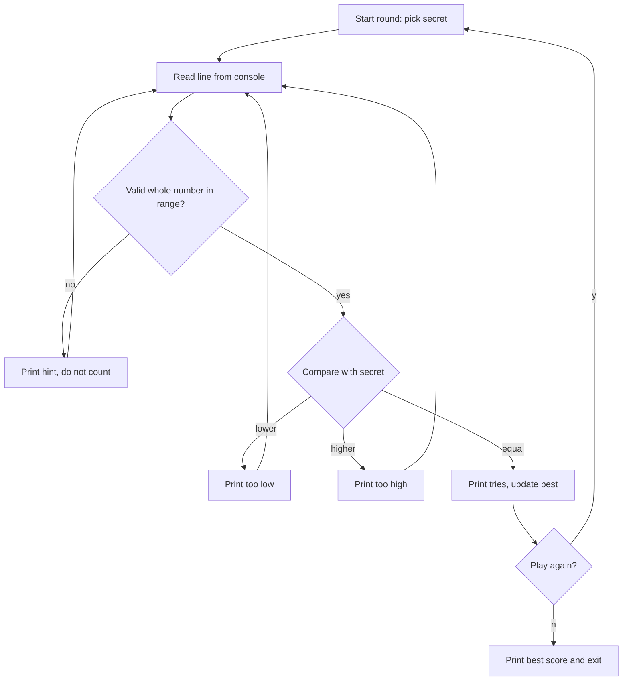
- **Start round** uses a random generator to pick the secret (`RandomGenerator.getDefault()` or `ThreadLocalRandom`, Chapter 7).
- **Read** wraps `IO.readln` so the rest of the code never sees a raw string.
- **Validate** turns text into an `int` or an "invalid" result; this is where `Integer.parseInt` and `NumberFormatException` live.
- **Compare** is a three-way decision — a perfect fit for `Integer.compare` plus a `switch` expression.

### Data model
| State | Type | Lives for |
|---|---|---|
| `secret` | `int` | one round |
| `tries` | `int` | one round |
| `best` | `int` (or `OptionalInt`) | whole session |
| `low`, `high` | `int` constants | whole program |

### Tech stack
| Component | Choice | Why |
|---|---|---|
| Language level | Java 25 compact source file | no class boilerplate for a first program |
| Console I/O | `java.lang.IO` (Java 25) | `IO.readln(prompt)` reads a line in one call |
| Randomness | `java.util.random.RandomGenerator` | modern interface over all generators (Java 17) |
| Run | `java Guess.java` | source-file launch, no separate `javac` step |

### Milestones
1. **Hello game** — a compact source file prints a welcome and a secret. *Done when* `java Guess.java` runs with no class declaration.
2. **One round** — loop until the guess equals the secret, print hints. *Done when* you can win a round.
3. **Robust input** — handle letters, blanks and out-of-range numbers. *Done when* typing `abc`, an empty line and `1000` all print a hint and the tries counter is unchanged.
4. **Sessions** — play again and keep the best score. *Done when* the best score is printed on exit.
5. **Difficulty levels** — easy (1–10), normal (1–100), hard (1–1000) chosen with a `switch` on an enum. *Done when* the range changes per level.

### Deep dive: the hard parts
- **Parsing is where programs crash.** `Integer.parseInt("12a")` throws `NumberFormatException`, and `parseInt("99999999999")` throws too because the value does not fit in an `int`. Put the try/catch in one small method that returns an `OptionalInt`; the main loop then reads like plain English. Trim the input first — users type spaces.
- **Off-by-one ranges.** `random.nextInt(1, 101)` gives 1 to 100 because the upper bound is exclusive. Write that down as a comment, and test the edges with a fixed seed.
- **Testing randomness.** Make the game take a `RandomGenerator` as a parameter. In tests you pass a seeded generator (or a fake that returns 42) so the secret is predictable.

### Testing strategy
Separate the logic (a `Game` that takes a guess and returns `TOO_LOW`, `TOO_HIGH` or `CORRECT`) from the console loop. Unit-test `Game` with JUnit 6: boundary guesses (1, 100), the winning guess, the tries count. Test the parser with a parameterized test over `"42"`, `" 42 "`, `"abc"`, `""`, `"0"`, `"101"`, `"99999999999"`.

### Trade-offs, scaling and failure modes
Compact source files are for small programs: once you need several classes in packages, switch to a normal class with `public static void main` and a build tool. `IO.readln` returns `null` at end of input (Ctrl-D), so handle that or the loop spins. A single global `best` variable is fine here, but notice it is state that a test cannot reset — a hint that later projects should pass state explicitly.

### Stretch goals
- Reverse the roles: you pick the number and the computer guesses with binary search; prove it needs at most `ceil(log2(n+1))` tries.
- Save the best score to a file with `Files.writeString` (Chapter 13).
- Add a timer with `Instant` and `Duration` (Chapter 7).

### Skills practised
- [Ch 1 — Java and the JVM](../chapters/01-java-and-the-jvm/README.md) — compile and run, source-file launch
- [Ch 2 — Types and operators](../chapters/02-basics-types-and-operators/README.md) — primitives, `int` range, `IO`
- [Ch 3 — Control flow](../chapters/03-control-flow/README.md) — loops and switch expressions
- [Ch 4 — Methods and arrays](../chapters/04-methods-and-arrays/README.md) — methods and Java 25's simpler `main`
- [Ch 8 — Exceptions](../chapters/08-exceptions/README.md) — catching `NumberFormatException`

### In the interview
**Q:** What does `java Guess.java` do differently from `javac` then `java`?

**A:** It compiles the source in memory and runs it in one step (source-file mode, Java 11, extended to several files in Java 22). No `.class` file is written. Fine for scripts and learning, not for shipping.

**Q:** Why does the best strategy need at most 7 guesses for 1–100?

**A:** Each answer halves the remaining range, and 2^7 = 128 ≥ 100. That is binary search: O(log n).

**Q:** How would you make this testable?

**A:** Move the rules into a class with no I/O and inject the random generator, so tests control the secret.

### TL;DR
A loop, a decision and safe input parsing, written as a Java 25 compact source file. Separate the rules from the console so you can test them.

## 2. Bank account CLI

**Level:** Beginner · **Time:** 1 weekend · **Prerequisites:** Ch 5, Ch 7, Ch 8

### What it is
A command-line program that manages a few bank accounts: open an account, deposit, withdraw, transfer between accounts and print a statement. You type commands like `deposit ACC-1 25.50` and the program replies with the new balance or an error.

### The problem it solves
Money is the classic example of why **encapsulation** (hiding an object's fields so only its own methods can change them) matters: if any code could write `account.balance = -500`, the bank's rules would mean nothing. It is also where beginners first meet the floating-point trap — `0.1 + 0.2` is not `0.3` in a `double` — and learn to use `BigDecimal`, a decimal number type that represents 0.10 exactly. Finally, failures (insufficient funds, unknown account) are a natural first use of **custom exceptions**.

### Real-world examples
- Martin Fowler's [Money pattern](https://martinfowler.com/eaaCatalog/money.html) describes storing an amount together with its currency and doing arithmetic in a single class, exactly the `Money` record you build here.
- The [`BigDecimal` API](https://docs.oracle.com/en/java/javase/25/docs/api/java.base/java/math/BigDecimal.html) documents the rounding modes banks choose between, such as `HALF_EVEN` ("banker's rounding").

### Requirements
**Functional**
- Commands: `open <name>`, `deposit <id> <amount>`, `withdraw <id> <amount>`, `transfer <from> <to> <amount>`, `statement <id>`, `quit`.
- Every change records a transaction (time, type, amount, balance after).
- Reject negative or zero amounts, more than 2 decimal places, overdrafts and unknown IDs with a clear message.

**Non-functional**
- Balances are always exact to the cent; no `double` anywhere near money.
- A failed transfer leaves both accounts unchanged (all-or-nothing).
- Each command answers in under 10 ms for 10,000 accounts (a `HashMap` lookup).

### The architecture
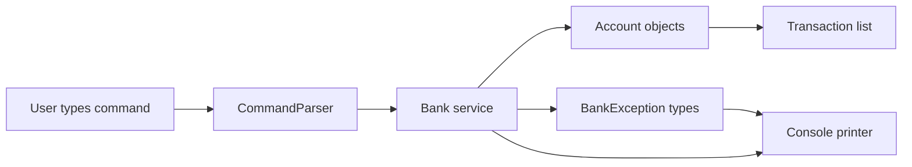
- **CommandParser** splits a line into a command record (`Deposit(id, amount)` and friends) or reports a syntax error.
- **Bank** owns a `Map<String, Account>` and implements the use cases; `transfer` checks both accounts before changing either.
- **Account** has a private balance and exposes only `deposit` and `withdraw`, which enforce the rules.
- **BankException** subclasses (`InsufficientFundsException`, `UnknownAccountException`) carry the details the printer shows.

### Data model
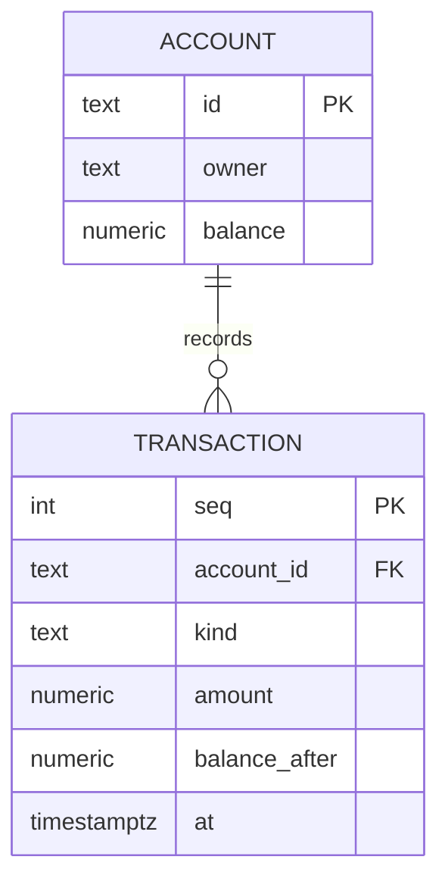

### Tech stack
| Component | Choice | Why |
|---|---|---|
| Money | `BigDecimal` with scale 2 | exact decimal arithmetic |
| Commands | sealed interface + records | the parser returns one of a fixed set of shapes |
| Time | `Instant` and `Clock` | a `Clock` can be fixed in tests |
| Storage | in memory (stretch: file) | keep the focus on the domain |

### Milestones
1. **Account class** — private balance, `deposit`, `withdraw` with validation. *Done when* a unit test shows withdrawing too much throws and leaves the balance unchanged.
2. **Money handling** — a `Money` record wrapping `BigDecimal`, created from text like `"25.50"`. *Done when* `0.10 + 0.20` equals `0.30` and `"1.005"` is rejected.
3. **Bank and transfer** — map of accounts, all-or-nothing transfer. *Done when* a failing transfer changes neither account.
4. **CLI loop** — parse commands, print results and errors. *Done when* a scripted session of 10 commands produces the expected output.
5. **Statement** — list transactions with formatted dates and amounts. *Done when* the statement totals match the balance.

### Deep dive: the hard parts
- **`BigDecimal` equality.** `new BigDecimal("2.0").equals(new BigDecimal("2.00"))` is `false` because `equals` also compares the **scale** (number of decimal places). Use `compareTo` for value comparison, or normalise every amount to scale 2 with `setScale(2, RoundingMode.UNNECESSARY)` when you create it — that call throws if the input had more decimals, which is exactly the validation you want.
- **Never construct from `double`.** `new BigDecimal(0.1)` gives `0.1000000000000000055511151231257827…`, because the `double` was already inexact. Use the `String` constructor or `BigDecimal.valueOf`.
- **All-or-nothing transfer.** Check both preconditions (both accounts exist, enough funds) before you mutate anything. If you withdraw first and the deposit then fails, money disappears. This is the single-threaded version of a database transaction.
- **Checked or unchecked?** Insufficient funds is a normal business outcome the caller must handle, so a checked exception is defensible; an unknown command is a user error you can model as a result value instead. Chapter 8 discusses the trade-off.

### Testing strategy
JUnit 6 + AssertJ: `assertThatThrownBy(() -> acc.withdraw(...)).isInstanceOf(InsufficientFundsException.class)`. Test money parsing with a parameterized test. Inject a fixed `Clock` so statement timestamps are predictable. Add one end-to-end test that feeds a script through the CLI using a `StringReader` and compares the output.

### Trade-offs, scaling and failure modes
Keeping transactions in a list makes the balance a cached value; an alternative is to derive the balance by summing transactions (event sourcing), which is slower but can never disagree. With several threads, `transfer` would need locking in a consistent order to avoid deadlock (Chapter 14) — note it now, solve it later. Everything is lost on exit until you add persistence.

### Stretch goals
- Persist accounts and transactions to a CSV or JSON file, written atomically (temp file + move).
- Multiple currencies with a `Currency` field; refuse to add EUR to USD.
- Make `Bank` thread-safe and hammer it with 8 threads doing random transfers; assert the total money is constant.

### Skills practised
- [Ch 5 — Classes and objects](../chapters/05-oop-classes-and-objects/README.md) — encapsulation, constructors, immutability
- [Ch 6 — Inheritance, interfaces, records](../chapters/06-oop-inheritance-interfaces-and-more/README.md) — sealed interfaces and records for commands
- [Ch 7 — Core APIs](../chapters/07-core-apis/README.md) — `BigDecimal`, rounding, `java.time`
- [Ch 8 — Exceptions](../chapters/08-exceptions/README.md) — custom exceptions, checked vs unchecked
- [Ch 18 — Testing, build and tooling](../chapters/18-testing-build-and-tooling/README.md) — JUnit and AssertJ

### In the interview
**Q:** Why not `double` for money?

**A:** Binary floating point cannot represent most decimal fractions exactly, so sums drift (`0.1 + 0.2 = 0.30000000000000004`). `BigDecimal` stores a decimal unscaled value and a scale, so cents are exact. Some systems use a `long` count of cents instead, which is faster.

**Q:** How do you make a transfer safe if two threads run it at once?

**A:** Lock both accounts, always in the same order (e.g. by ID), check, then move the money. A consistent lock order prevents deadlock.

**Q:** Why is `balance` private?

**A:** So every change goes through methods that enforce the invariant "balance never goes below zero".

### TL;DR
A small domain model that teaches encapsulation, exact decimal money with `BigDecimal`, and all-or-nothing operations with clear exceptions.

## 3. Student grade book with records

**Level:** Beginner · **Time:** 1 weekend · **Prerequisites:** Ch 6, Ch 10

### What it is
A program that loads students and their marks for several courses, then answers questions: each student's average, the class average per course, the top three students, who is failing, and a letter-grade distribution. Input is a small text file; output is a tidy report.

### The problem it solves
Most beginner code is a pile of parallel arrays: `names[i]`, `marks[i]`. That breaks as soon as you sort one array and forget the other. **Records** (Java 16) let you declare a small immutable data class in one line — `record Grade(String studentId, String course, int mark)` — with constructor, accessors, `equals`, `hashCode` and `toString` generated. Combined with the right **collections** (`List`, `Map`, `TreeMap`), the grade book teaches how to model data first and compute second.

### Real-world examples
- [JEP 395](https://openjdk.org/jeps/395), which finalised records, describes them as "transparent carriers for immutable data" and explains the design choice of not letting them have extra instance fields.
- School information systems and learning platforms such as Moodle have a gradebook with exactly these reports: per-student averages, per-course statistics and grade bands.

### Requirements
**Functional**
- Load `students.txt` (id, name) and `grades.txt` (student id, course, mark 0–100).
- Report per student: average, best and worst course, letter grade (A ≥ 90, B ≥ 80, C ≥ 70, D ≥ 60, else F).
- Report per course: mean, median, highest, lowest, count.
- Top N students by average, ties broken by name.
- List lines that failed validation (unknown student, mark out of range) instead of stopping.

**Non-functional**
- 10,000 students × 10 courses processed in under 1 second.
- Data objects are immutable; nothing in the report can change the input.

### The architecture
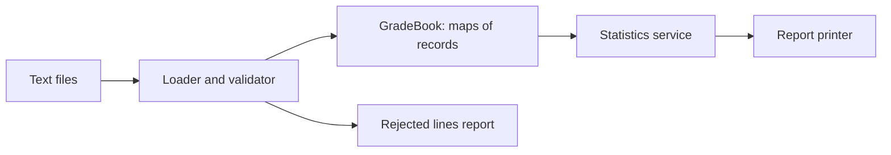
- **Loader** reads lines, splits them, builds records, and collects errors rather than throwing on the first bad line.
- **GradeBook** holds `Map<String, Student>` and `Map<String, List<Grade>>` indexed by student and by course.
- **Statistics** computes averages and medians and assigns letter grades.
- **Printer** formats aligned columns with `String.format`.

### Data model
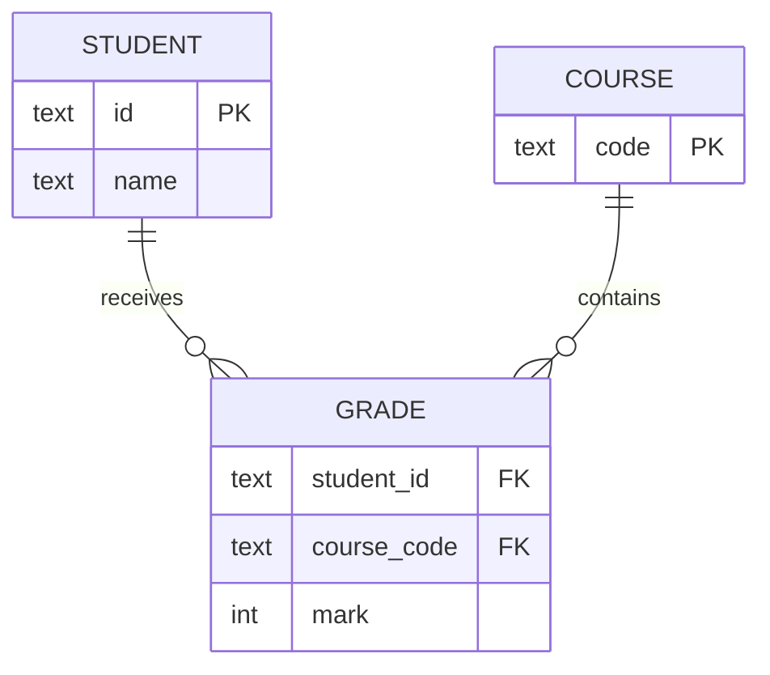

### Tech stack
| Component | Choice | Why |
|---|---|---|
| Data | records with compact constructors | validation in one place, immutable |
| Letter grade | enum `Letter` with a `from(int)` method | a fixed set of values with behaviour |
| Indexes | `HashMap`, `TreeMap` | fast lookup, sorted output |
| Sorting | `Comparator.comparing(...).thenComparing(...)` | readable multi-key sort |

### Milestones
1. **Records** — `Student`, `Grade` with a compact constructor that rejects marks outside 0–100. *Done when* `new Grade("s1","MATH",101)` throws.
2. **Loader** — parse both files, collect rejects. *Done when* a file with 3 bad lines loads the good ones and lists the 3 bad ones.
3. **Per-student stats** — averages and letters. *Done when* hand-checked numbers match for 5 students.
4. **Per-course stats** — mean, median, min, max. *Done when* the median is correct for both odd and even counts.
5. **Ranking** — top N with tie-breaking. *Done when* two students with equal averages appear in name order.

### Deep dive: the hard parts
- **Compact constructors.** A record's compact constructor (`record Grade(...) { Grade { if (mark < 0 || mark > 100) throw ...; } }`) runs before the fields are assigned, so it is the one place to validate and normalise (for example `course = course.toUpperCase()`).
- **Integer division.** `sum / count` with two `int`s truncates: 179 / 2 is 89, not 89.5. Use `double` or `BigDecimal` for averages and decide on rounding explicitly.
- **Median needs sorting.** Copy the marks, sort, and pick the middle (or average of the two middles). Do not sort the original list in place if other code shares it — or better, store `List.copyOf` so it cannot be sorted in place at all.
- **Choosing the map.** `HashMap` for lookups by ID; `TreeMap` when you want the report in course order without a separate sort step.

### Testing strategy
Unit-test the letter-grade boundaries (89, 90, 59, 60) with a parameterized test. Test median with lists of length 0, 1, 2 and 3. Load a small fixture file from `src/test/resources` and assert the full report with AssertJ's `containsExactly`.

### Trade-offs, scaling and failure modes
Records cannot have mutable state or extend other classes; that is the point, but if you later need a mutable "draft grade", use a normal class. Keeping everything in memory is fine up to millions of rows; past that you would stream the file or use a database. Collecting errors instead of failing fast is friendlier for data entry but can hide a completely wrong file — print a count and fail if more than, say, 10% of lines are bad.

### Stretch goals
- Rewrite the statistics with streams and `Collectors.groupingBy` (Chapter 12) and compare readability.
- Weighted courses (credits) and a GPA.
- Export the report as CSV and as a simple HTML table.

### Skills practised
- [Ch 6 — Inheritance, interfaces, records](../chapters/06-oop-inheritance-interfaces-and-more/README.md) — records, compact constructors, enums
- [Ch 10 — Collections](../chapters/10-collections/README.md) — `Map`, `List`, `TreeMap`, `Comparator`
- [Ch 7 — Core APIs](../chapters/07-core-apis/README.md) — formatting numbers
- [Ch 13 — I/O and NIO](../chapters/13-io-and-nio/README.md) — reading lines from files

### In the interview
**Q:** What does a record generate for you?

**A:** A canonical constructor, private final fields, accessor methods named after the components, and `equals`, `hashCode` and `toString` based on all components.

**Q:** Can a record be mutable?

**A:** Its fields are final, but if a component is a mutable object (like an `ArrayList`) its contents can still change. Copy defensively with `List.copyOf` in the compact constructor.

**Q:** `HashMap` or `TreeMap` here?

**A:** `HashMap` for O(1) lookups by ID; `TreeMap` (O(log n)) when the output must be sorted by key.

### TL;DR
Model the data with immutable records, index it with the right maps, then compute. Validate once, in the compact constructor.

## 4. Unit converter

**Level:** Beginner · **Time:** 1 weekend · **Prerequisites:** Ch 6, Ch 7

### What it is
A command-line converter: `convert 5 km to mi`, `convert 72 F to C`, `convert 3 cups to ml`. It knows several **dimensions** (length, mass, temperature, volume, time, data size) and refuses nonsense such as kilograms to metres.

### The problem it solves
Unit mistakes are expensive. Building a converter forces you to model a closed set of things (units) with behaviour (how to convert), which is what Java **enums** are for. It also shows the limits of a simple "multiply by a factor" design: temperature needs an offset, and some conversions must be exact. The design generalises to any "convert between representations" problem — currencies, time zones, encodings.

### Real-world examples
- NASA's [Mars Climate Orbiter](https://science.nasa.gov/mission/mars-climate-orbiter/) was lost in 1999 because one team's software produced thrust data in imperial units while another expected metric.
- [JSR 385, Units of Measurement](https://unitsofmeasurement.github.io/), is the standard Java API for quantities and units; its reference implementation shows a full-scale version of this design.

### Requirements
**Functional**
- Parse `convert <number> <unit> to <unit>`, with unit aliases (`km`, `kilometre`, `kilometer`).
- Support at least 6 dimensions and 30 units.
- Reject conversions across dimensions with a message naming both dimensions.
- `list <dimension>` prints known units.

**Non-functional**
- Results correct to at least 10 significant digits; exact for defined factors (1 inch = 0.0254 m exactly).
- Adding a unit is one line of code.

### The architecture
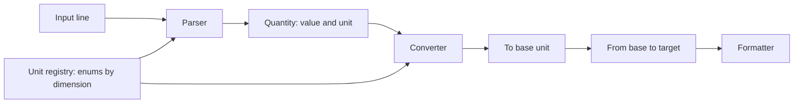
- **Parser** maps text to a `Unit` via a registry of aliases.
- **Unit registry** is a set of enums, one per dimension (`Length.METRE`, `Length.MILE`…), each implementing a `Unit` interface.
- **Converter** converts to the dimension's **base unit** (metre, kilogram, kelvin) and then to the target, so N units need N factors, not N² pairs.
- **Formatter** rounds for display without changing the stored value.

### Data model
| Type | Kind | Role |
|---|---|---|
| `Dimension` | enum | LENGTH, MASS, TEMPERATURE… |
| `Unit` | sealed interface | `dimension()`, `toBase(BigDecimal)`, `fromBase(BigDecimal)` |
| `Length`, `Mass`… | enums implementing `Unit` | one constant per unit, with factor |
| `Quantity` | record | value + unit |

### Tech stack
| Component | Choice | Why |
|---|---|---|
| Units | enums with constructor arguments | fixed set, compile-time checked |
| Arithmetic | `BigDecimal` with `MathContext.DECIMAL64` | exact factors, controlled precision |
| Dispatch | sealed interface + pattern-matching `switch` | compiler checks every dimension is handled |
| Aliases | `Map<String, Unit>` built at startup | O(1) lookup |

### Milestones
1. **Length only** — enum with factors to metres. *Done when* 1 mile = 1609.344 m exactly.
2. **Parser** — aliases and case-insensitivity. *Done when* `KM`, `km` and `kilometres` all work.
3. **More dimensions** — mass, volume, time, data size (decide: is 1 KB 1000 or 1024 bytes? support both `kB` and `KiB`).
4. **Temperature** — affine conversions with offsets. *Done when* -40 °C = -40 °F and 0 K = -273.15 °C.
5. **Errors** — cross-dimension and unknown units. *Done when* `5 kg to m` prints a clear error.

### Deep dive: the hard parts
- **Affine vs linear.** Most units are linear (`base = value × factor`). Temperature is affine (`kelvin = celsius + 273.15`, `fahrenheit` needs both a factor and an offset). Give `Unit` two methods, `toBase` and `fromBase`, rather than a single factor, so temperature fits the same interface.
- **Precision.** `BigDecimal.divide` without a `MathContext` throws `ArithmeticException` when the result does not terminate (1/3). Always pass a `MathContext`. Round only for display.
- **Exhaustiveness.** With `sealed interface Unit permits Length, Mass, Temperature…` a `switch` over a unit's type does not need a `default`; add a new dimension and every non-exhaustive switch becomes a compile error — the compiler finds the places you forgot.

### Testing strategy
Round-trip property: for every unit `u` in a dimension and value `v`, converting `v` from `u` to base and back gives `v` (to the chosen precision). Generate cases with a JUnit `@MethodSource` over `Length.values()`. Add known fixed points (water boiling, marathon distance).

### Trade-offs, scaling and failure modes
Enums make units compile-time constants, so users cannot add units without recompiling; loading them from a config file is more flexible but loses type safety. `BigDecimal` is slower than `double` by roughly an order of magnitude — irrelevant here, important in a physics simulation. Compound units (km/h, N·m) need a different model: exponents per base dimension, as JSR 385 does.

### Stretch goals
- Compound units like `km/h to m/s` by representing a unit as a map from base dimension to exponent.
- Currency conversion with rates fetched from a file, timestamped.
- A REPL with history using `IO.readln` in a loop.

### Skills practised
- [Ch 6 — Inheritance, interfaces, records](../chapters/06-oop-inheritance-interfaces-and-more/README.md) — enums with fields, sealed interfaces
- [Ch 7 — Core APIs](../chapters/07-core-apis/README.md) — `BigDecimal`, `MathContext`, formatting
- [Ch 3 — Control flow](../chapters/03-control-flow/README.md) — pattern matching for `switch`
- [Ch 10 — Collections](../chapters/10-collections/README.md) — maps for aliases

### In the interview
**Q:** Why convert through a base unit?

**A:** With N units you store N factors instead of N×(N−1) pairwise rates, and every pair is consistent.

**Q:** Why an enum rather than constants?

**A:** Enums are type-safe (you cannot pass a mass where a length is expected), can carry fields and methods, and work with exhaustive switches.

**Q:** Why does `BigDecimal.ONE.divide(new BigDecimal(3))` throw?

**A:** The exact result has infinitely many digits; you must give a precision or rounding mode.

### TL;DR
Enums per dimension, a shared base unit, and `toBase`/`fromBase` methods so even temperature fits. Keep arithmetic exact and round only for display.

## 5. Word-frequency counter with streams

**Level:** Beginner · **Time:** 1 weekend · **Prerequisites:** Ch 12, Ch 13

### What it is
A tool that reads one or more text files and prints the N most common words with their counts, for example `wordfreq --top 10 book.txt`. Options exclude common "stop words" (the, and, of), ignore case, and show the total and unique word counts.

### The problem it solves
Counting is the "hello world" of data processing, and it is a perfect first use of the **Stream API**: read lines, split them into words, normalise, filter, group and count, sort, take the top N — each step one line. Doing it well also teaches the parts of text handling that trip people up: character encodings, Unicode letters beyond A–Z, and reading a file too big for memory.

### Real-world examples
- In 1986 Jon Bentley asked Donald Knuth to write a literate program for this exact task in *Communications of the ACM*, and Doug McIlroy answered with a six-command Unix pipeline; the exchange ([Programming Pearls: A Literate Program](https://dl.acm.org/doi/10.1145/5948.315654)) is still a classic argument for composing small tools — which is what a stream pipeline does.
- Search engines and text-analysis tools start with the same tokenise → normalise → count step (see project 36).

### Requirements
**Functional**
- Read files given as arguments, or standard input if none.
- Words: sequences of Unicode letters and apostrophes; case-folded; optional stop-word list.
- Print top N (default 10) as aligned columns, ties ordered alphabetically.
- Print total words, distinct words, and elapsed time.

**Non-functional**
- Process a 100 MB file in under 5 seconds on a laptop, without loading it all into memory.
- Correct on UTF-8 text with accents (`café`, `naïve`).

### The architecture
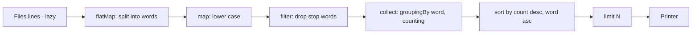
- **`Files.lines`** reads lazily, one line at a time, so memory stays small.
- **Split** uses a precompiled `Pattern` with `\p{L}` (any Unicode letter).
- **Count** builds a `Map<String, Long>`; this is the only stage that holds data.
- **Sort and limit** turn the map's entries into the top N.

### Data model
| Data | Type | Note |
|---|---|---|
| counts | `Map<String, Long>` | one entry per distinct word |
| stop words | `Set<String>` | loaded from a resource file |
| result row | `record WordCount(String word, long count)` | printed |

### Tech stack
| Component | Choice | Why |
|---|---|---|
| Reading | `Files.lines(path, UTF_8)` | lazy, explicit charset |
| Tokenising | `Pattern.compile("[\\p{L}']+")` | Unicode-aware |
| Counting | `Collectors.groupingBy(w -> w, counting())` | one line |
| Top N | `Map.Entry.comparingByValue().reversed()` | readable sorting |

### Milestones
1. **Count one file** — total and distinct words. *Done when* a 3-line fixture gives known counts.
2. **Top N** — sorted with tie-break. *Done when* equal counts appear alphabetically.
3. **Stop words and case** — *Done when* "The" and "the" merge and both are excluded.
4. **Many files and stdin** — *Done when* `cat a.txt | wordfreq` works.
5. **Big file** — generate 100 MB and time it. *Done when* it runs under the target with `-Xmx256m`.

### Deep dive: the hard parts
- **Close the stream.** `Files.lines` holds an open file handle; use try-with-resources or you leak handles when processing many files.
- **Locale-safe lower case.** `"TITLE".toLowerCase()` uses the default locale; in Turkish the dotted/dotless I rules change the result. Use `toLowerCase(Locale.ROOT)`.
- **Top N without sorting everything.** Sorting a million entries is O(n log n). A min-heap of size N (`PriorityQueue`) gives O(n log N). Implement both and compare — a good first use of a heap (Chapter 19).
- **Parallel streams.** `.parallel()` on `Files.lines` splits the file, but counting into a shared map needs a concurrent collector (`groupingByConcurrent`). Measure: for I/O-bound input it often does not help.

### Testing strategy
Unit-test the tokeniser on punctuation, apostrophes (`don't`), digits and accented letters. Test top-N with a hand-built map. Use a `@TempDir` to write fixture files. A test with an invalid UTF-8 byte checks you report a clear error (`MalformedInputException`).

### Trade-offs, scaling and failure modes
The whole vocabulary must fit in memory; for web-scale text you would count in partitions and merge (MapReduce's canonical example). Treating apostrophes as letters keeps "don't" whole but also keeps quote marks around words — decide and document. Stemming (running/runs → run) improves results but is language-specific.

### Stretch goals
- Bigram counts ("of the") with a sliding window gatherer (Chapter 12, Java 24).
- Compare heap vs full sort with JMH.
- Output as JSON or CSV.

### Skills practised
- [Ch 12 — Streams](../chapters/12-streams/README.md) — pipelines, collectors, parallel streams
- [Ch 13 — I/O and NIO](../chapters/13-io-and-nio/README.md) — `Files.lines`, charsets
- [Ch 7 — Core APIs](../chapters/07-core-apis/README.md) — `Pattern`, case folding
- [Ch 10 — Collections](../chapters/10-collections/README.md) — maps and `PriorityQueue`

### In the interview
**Q:** Why is `Files.lines` better than `Files.readAllLines` here?

**A:** It is lazy: lines are read as the stream pulls them, so memory does not grow with file size.

**Q:** How do you get the top K of n items efficiently?

**A:** A min-heap of size K: push each item, pop the smallest when size exceeds K. O(n log K) time, O(K) extra space.

**Q:** When does `parallel()` help?

**A:** For CPU-heavy work on large, easily split sources. With file I/O and a shared result it often does not; measure.

### TL;DR
A stream pipeline from lazy lines to a grouped count to a top-N. Mind encodings, locales and closing the file.

## 6. Tic-tac-toe with an unbeatable AI

**Level:** Beginner · **Time:** 1 weekend · **Prerequisites:** Ch 3, Ch 4

### What it is
Tic-tac-toe in the terminal: a human plays X against a computer playing O. The computer never loses — it either wins or draws — because it searches every possible continuation of the game using the **minimax** algorithm.

### The problem it solves
This is the friendliest introduction to **game-tree search**: a recursive function that imagines every move, every reply and every reply to that, and chooses the move whose worst case is best. It practises 2D arrays, recursion and clean separation between game rules, AI and user interface — the same split you will use in every larger program.

### Real-world examples
- [Minimax](https://en.wikipedia.org/wiki/Minimax) is the foundation of classic chess and checkers engines; [alpha-beta pruning](https://en.wikipedia.org/wiki/Alpha%E2%80%93beta_pruning) is the standard optimisation that skips branches which cannot change the decision.
- Tic-tac-toe has only 255,168 possible games, small enough to search completely — which is why a perfect player exists.

### Requirements
**Functional**
- Print the 3×3 board; the human enters a cell 1–9.
- Reject occupied or invalid cells.
- Detect wins on rows, columns, diagonals and draws.
- The AI never loses; choose who starts.

**Non-functional**
- AI move under 50 ms from an empty board (full search with pruning).
- Board logic independent of the console, so a GUI could reuse it.

### The architecture
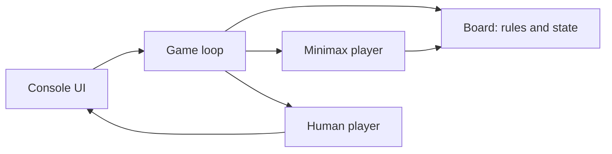
- **Board** stores cells, applies moves, and reports `winner()` or `isFull()`.
- **Player** is an interface with `int chooseMove(Board)`; `HumanPlayer` asks the console, `MinimaxPlayer` searches.
- **Game loop** alternates players until the board reports a result.

### Data model
| Type | Representation | Note |
|---|---|---|
| `Mark` | enum X, O, EMPTY | `opponent()` method |
| `Board` | `Mark[9]` or `Mark[3][3]` | plus the 8 winning lines as constants |
| `Move` | `int` 0–8 | |
| score | `int` | +10 win, -10 loss, 0 draw, adjusted by depth |

### Tech stack
| Component | Choice | Why |
|---|---|---|
| Board | array of enum | fixed size, fast copy |
| Search | recursion | mirrors the game tree |
| Players | interface + two classes | swap human/AI/random easily |
| Tests | JUnit 6 | play AI vs AI and random vs AI |

### Milestones
1. **Board rules** — moves, win detection. *Done when* tests cover all 8 winning lines.
2. **Two humans** — playable game loop. *Done when* a full game can be played.
3. **Minimax** — the AI searches the full tree. *Done when* AI vs AI always draws.
4. **Prefer fast wins** — score `10 - depth`. *Done when* the AI wins in one move when it can, instead of a slower win.
5. **Alpha-beta** — *Done when* nodes visited from an empty board drop sharply (count them).

### Deep dive: the hard parts
- **Minimax in one sentence.** On the AI's turn take the maximum score over all moves; on the opponent's turn take the minimum, assuming they also play perfectly; at a finished board return the result. Recursion depth is at most 9.
- **Undo instead of copy.** Copying the board at every node is simple; making a move, recursing, then clearing the cell (backtracking) is faster and allocates nothing. Both are fine here — notice the trade-off.
- **Depth matters.** Without a depth penalty every winning line scores +10, so the AI may "play with its food" and delay a win. Subtracting depth makes it prefer quicker wins and slower losses.
- **Alpha-beta.** Carry the best score the maximiser is already guaranteed (alpha) and the minimiser's (beta); stop exploring a branch once alpha ≥ beta. Same answer, far fewer nodes.

### Testing strategy
Fixed positions: "AI must block this row", "AI must take this win". A property test: 1,000 games of a random player against the AI — the AI never loses. Count nodes with and without pruning and assert the pruned count is smaller.

### Trade-offs, scaling and failure modes
Full search works because the tree is tiny. For Connect Four or chess you must cut off at a depth and use a **heuristic evaluation** (a guess of how good a position is), plus memoisation of repeated positions (a transposition table). A perfect AI is no fun — add a difficulty setting that sometimes plays randomly.

### Stretch goals
- Memoise board → score in a `HashMap` and measure.
- Generalise to an N×N board with K-in-a-row and depth-limited search.
- Connect Four with a heuristic.

### Skills practised
- [Ch 4 — Methods and arrays](../chapters/04-methods-and-arrays/README.md) — arrays and recursion
- [Ch 3 — Control flow](../chapters/03-control-flow/README.md) — loops and switch
- [Ch 6 — Inheritance, interfaces, records](../chapters/06-oop-inheritance-interfaces-and-more/README.md) — interfaces and enums
- [Ch 19 — Java for coding interviews](../chapters/19-java-for-coding-interviews/README.md) — backtracking

### In the interview
**Q:** What is minimax?

**A:** A recursive search over game states where one player maximises and the other minimises the score, assuming both play optimally.

**Q:** What does alpha-beta pruning change?

**A:** Not the result, only the work: branches that cannot affect the final choice are skipped. With good move ordering it roughly square-roots the number of nodes.

**Q:** Copy the board or undo moves?

**A:** Undo is faster and allocation-free but easier to get wrong; copy is simpler. For 9 cells either is fine.

### TL;DR
Recursive minimax over a 3×3 board makes a perfect player; alpha-beta makes it fast. Keep rules, AI and UI separate.

## 7. Text adventure engine

**Level:** Beginner · **Time:** 1–2 weekends · **Prerequisites:** Ch 3, Ch 6, Ch 10

### What it is
A small interactive-fiction game: you move between rooms (`go north`), pick up and use items (`take lamp`, `open door with key`), and solve a puzzle to win. The twist is that the *engine* is generic: the world (rooms, exits, items, puzzles) is described in a data file, so you can write a new adventure without changing code.

### The problem it solves
A game world is a graph of states that the player changes with typed commands. Building one teaches how to model a domain with **sealed types and records**, how to parse a tiny command language, and how to use **pattern matching for `switch`** (final in Java 21) to handle each command shape. Loading the world from data shows the separation between engine and content that every real game, and most business software, relies on.

### Real-world examples
- [Colossal Cave Adventure](https://en.wikipedia.org/wiki/Colossal_Cave_Adventure) (1976) defined the genre: a two-word parser, rooms, items and treasures.
- [JEP 441](https://openjdk.org/jeps/441) (pattern matching for `switch`) uses exactly this style — a sealed hierarchy plus an exhaustive switch — as its motivating example.

### Requirements
**Functional**
- Commands: `look`, `go <dir>`, `take <item>`, `drop <item>`, `inventory`, `use <item> [on <thing>]`, `save`, `load`, `quit`.
- Synonyms: `n` for `go north`, `get` for `take`.
- World loaded from a text file: rooms, exits, items, locked exits needing a key, a win condition.
- Save and load game state.

**Non-functional**
- Unknown words give a helpful reply, never an exception.
- A new world file with 20 rooms needs zero code changes.

### The architecture
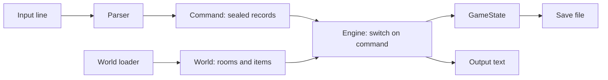
- **Parser** normalises words, applies synonyms, and returns a `Command` such as `Go(Direction.NORTH)` or `Unknown(text)`.
- **Engine** is one exhaustive `switch` over the sealed `Command` type.
- **World** is immutable (rooms, connections); **GameState** is the mutable part (current room, inventory, unlocked doors, item locations).
- **World loader** reads the data file once at start.

### Data model
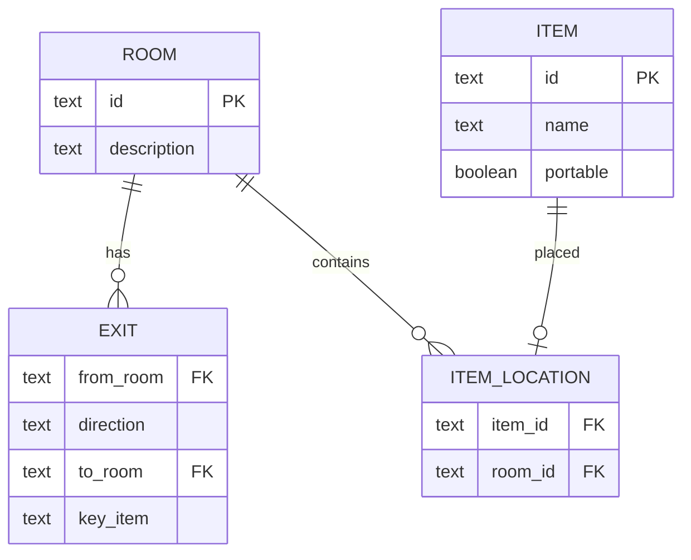

### Tech stack
| Component | Choice | Why |
|---|---|---|
| Commands | `sealed interface Command` + records | exhaustive switch, no casts |
| Directions | enum with `opposite()` | fixed set |
| World graph | `Map<String, Room>`, `EnumMap<Direction, Exit>` | fast, compact |
| Save files | `Properties` or a simple text format | readable by humans |

### Milestones
1. **Two hard-coded rooms** — `look` and `go`. *Done when* you can walk back and forth.
2. **Parser and sealed commands** — synonyms and unknown words. *Done when* `n`, `go north` and `walk north` all move you.
3. **Items and inventory** — take, drop, inventory. *Done when* an item moves from room to inventory and back.
4. **Locked exits and win** — a key opens a door; reaching the treasure wins. *Done when* the whole demo is solvable.
5. **Data-driven world and saves** — *Done when* a second world file plays without code changes, and save/load restores state.

### Deep dive: the hard parts
- **Exhaustive switch.** `switch (cmd) { case Go(var dir) -> ...; case Take(var item) -> ...; ... }` with no `default`. Adding a new record to the sealed interface breaks compilation until every switch handles it — exactly the safety you want as the game grows.
- **Separate world from state.** If items "live" inside `Room` objects that you mutate, saving means serialising the whole graph and loading a new world mixes with old state. Keep the world immutable and store mutable facts (where each item is now, which doors are open) in one `GameState` — then save is just writing that small object.
- **Validating the world file.** Exits that point to missing rooms, keys that do not exist, an unreachable win room. Check the graph at load time with a breadth-first search from the start room (Chapter 19) and report every problem.

### Testing strategy
Unit-test the parser with a table of inputs → expected `Command`. Script a full walkthrough as a test: feed commands, assert the final state is "won". Test save → load → state equals original. Test the world validator with broken fixture files.

### Trade-offs, scaling and failure modes
A two-word parser is easy but limited; a real one needs a grammar with prepositions and adjectives ("put the small key in the box"). A text world file is simple; JSON (project 12) makes nested data easier. Hard-coding puzzle logic in Java gives power; expressing puzzles as data (conditions and effects) keeps the engine generic — the classic engine-vs-scripting trade-off.

### Stretch goals
- Conditions and effects in the data file ("if has lamp, room is lit").
- NPCs that move on a timer.
- A map command that prints the rooms you have visited.

### Skills practised
- [Ch 6 — Inheritance, interfaces, records](../chapters/06-oop-inheritance-interfaces-and-more/README.md) — sealed interfaces, records, enums
- [Ch 3 — Control flow](../chapters/03-control-flow/README.md) — pattern matching for `switch`, record patterns
- [Ch 10 — Collections](../chapters/10-collections/README.md) — `Map`, `EnumMap`
- [Ch 19 — Java for coding interviews](../chapters/19-java-for-coding-interviews/README.md) — BFS over a graph

### In the interview
**Q:** Why sealed interfaces for commands?

**A:** The compiler knows every permitted subtype, so a switch over them can be exhaustive without `default`; adding a type causes compile errors where it is not handled.

**Q:** Why keep the world immutable?

**A:** It can be shared and reasoned about freely, and the mutable state is small and in one place, which makes saving and testing simple.

**Q:** How do you check that every room is reachable?

**A:** BFS from the start room over exits; any room not visited is unreachable.

### TL;DR
A data-driven game engine: sealed command records, one exhaustive switch, an immutable world and a small mutable game state.

## 8. Expense tracker with CSV storage

**Level:** Beginner · **Time:** 1–2 weekends · **Prerequisites:** Ch 7, Ch 13

### What it is
A personal finance tool: record expenses (date, amount, category, note), list them, and report totals per month and per category. Data is kept in a CSV file you can open in a spreadsheet. It also imports a bank's CSV export.

### The problem it solves
Real programs persist data, and the simplest durable format is a text file. This project teaches **file I/O** with NIO.2, the surprising complexity of CSV (quotes, commas inside fields, line breaks), safe saving that never corrupts the file, and dates done right with `java.time`.

### Real-world examples
- [RFC 4180](https://www.rfc-editor.org/rfc/rfc4180) is the closest thing CSV has to a standard: fields with commas, quotes or line breaks are wrapped in double quotes, and a quote inside a field is doubled.
- [Ledger](https://ledger-cli.org/) is a long-running command-line accounting tool that stores everything in a plain text file — the same "your data is a file you own" philosophy.

### Requirements
**Functional**
- `add 2026-09-14 12.50 food "Lunch, with Sam"`, `list --month 2026-09`, `report --by category`, `import bank.csv`, `delete <id>`.
- Monthly totals and per-category breakdown with percentages.
- Import maps the bank's columns to yours (configurable), skips duplicates.

**Non-functional**
- The data file is never left half-written, even if the program is killed during a save.
- 100,000 expenses load in under 1 second.
- Amounts exact (`BigDecimal`); dates are `LocalDate` (no time zone needed).

### The architecture
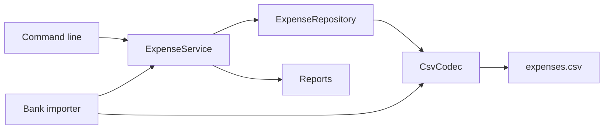
- **CsvCodec** turns a line into fields and back, handling quotes per RFC 4180.
- **Repository** loads all expenses at start and writes the whole file on save, atomically.
- **Service** validates and applies commands.
- **Reports** group by `YearMonth` and category.

### Data model
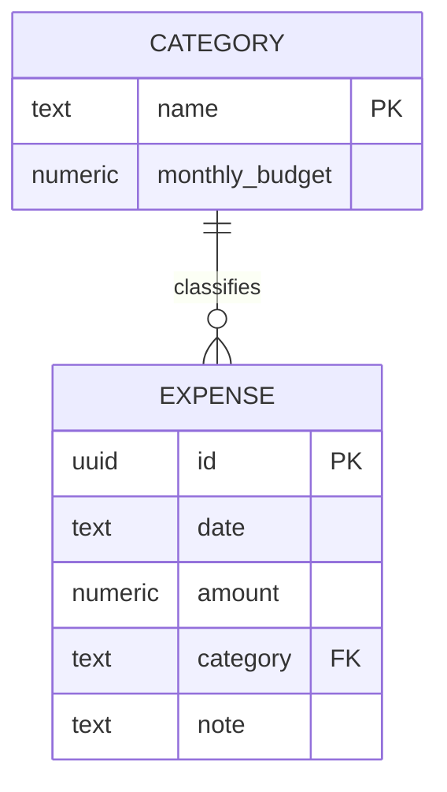

### Tech stack
| Component | Choice | Why |
|---|---|---|
| Files | `Files.newBufferedReader/Writer`, UTF-8 | explicit encoding |
| Atomic save | write temp file then `Files.move(..., ATOMIC_MOVE)` | no torn files |
| Dates | `LocalDate`, `YearMonth`, `DateTimeFormatter` | calendar-correct |
| Money | `BigDecimal` | exact |

### Milestones
1. **Add and list in memory** — *Done when* expenses print sorted by date.
2. **CSV codec** — quotes, commas, embedded newlines. *Done when* round-tripping `"Lunch, with ""Sam"""` gives the same text.
3. **Persistence** — load on start, save atomically. *Done when* killing the process mid-save leaves either the old or the new file, never a mix.
4. **Reports** — per month and category. *Done when* totals match a spreadsheet.
5. **Import** — configurable mapping, duplicate detection. *Done when* importing the same file twice adds nothing the second time.

### Deep dive: the hard parts
- **CSV is not `split(",")`.** A field can contain commas and newlines when quoted, so you must parse character by character with a small state machine (in-field, in-quotes, quote-seen). Write it and test it; then you will appreciate libraries.
- **Atomic saves.** Writing straight over the file means a crash leaves it truncated. Write to `expenses.csv.tmp` in the same directory, `force` it to disk, then `Files.move(tmp, file, ATOMIC_MOVE, REPLACE_EXISTING)`. On the same file system a rename is atomic. Keep a `.bak` of the previous version too.
- **Dates and locales.** Banks export `14/09/2026` or `09/14/2026`. Make the import format configurable (`DateTimeFormatter.ofPattern`) and reject ambiguous input rather than guessing.
- **Duplicates.** Imported rows have no ID. Hash (date, amount, description) to detect repeats, and accept that two identical coffees on one day are a real edge case — ask the user.

### Testing strategy
Use JUnit's `@TempDir` for every file test. Parameterized tests for the CSV codec over tricky lines. Test atomic save by injecting a writer that throws halfway and asserting the original file is intact. Reports tested against small fixture data.

### Trade-offs, scaling and failure modes
Rewriting the whole file on each save is simple and fine for thousands of rows; at millions you would append or use SQLite/PostgreSQL. CSV has no schema or types — a later version that adds a column must still read old files (put a header row and read by name). Two copies of the program writing at once can lose updates; a lock file (`FileChannel.tryLock`) prevents that.

### Stretch goals
- Budgets per category with warnings when a month exceeds 80%.
- A text bar chart of spending per month.
- Switch storage to SQLite or H2 via JDBC behind the same repository interface.

### Skills practised
- [Ch 13 — I/O and NIO](../chapters/13-io-and-nio/README.md) — NIO.2 files, charsets, atomic moves
- [Ch 7 — Core APIs](../chapters/07-core-apis/README.md) — `java.time`, `BigDecimal`, formatting
- [Ch 8 — Exceptions](../chapters/08-exceptions/README.md) — I/O exceptions and try-with-resources
- [Ch 12 — Streams](../chapters/12-streams/README.md) — grouping for reports

### In the interview
**Q:** How do you save a file so a crash cannot corrupt it?

**A:** Write a temp file in the same directory, flush and fsync it, then atomically rename it over the original.

**Q:** Why not split CSV lines on commas?

**A:** Quoted fields can contain commas, quotes and newlines; you need a quote-aware parser.

**Q:** `LocalDate` or `Instant` for an expense?

**A:** `LocalDate`: an expense happens on a calendar day; there is no meaningful instant or time zone.

### TL;DR
Plain-text persistence done properly: an RFC 4180 codec, atomic saves, `java.time` dates and exact money.

## 9. Library catalogue and search

**Level:** Beginner · **Time:** 1–2 weekends · **Prerequisites:** Ch 9, Ch 10, Ch 11

### What it is
A catalogue for a small library: books with title, authors, year, subjects and copies. Members borrow and return copies. Users search by title words, author, subject or year range, and sort results by relevance, year or title.

### The problem it solves
Search looks simple until you need several filters combined in any order and several sort orders. This project is where **generics**, **lambdas** and **comparators** start paying off: a filter is a `Predicate<Book>`, filters combine with `and`, sort orders are `Comparator<Book>` built with `comparing().thenComparing()`, and a small generic `Index<K, V>` gives fast lookups. Loans add simple state rules (you cannot borrow a copy that is out).

### Real-world examples
- The [Open Library API](https://openlibrary.org/developers/api) exposes search by title, author and subject over millions of records — a good source of real test data for this project.
- The [`Comparator` documentation](https://docs.oracle.com/en/java/javase/25/docs/api/java.base/java/util/Comparator.html) shows the combinators (`comparing`, `thenComparing`, `reversed`, `nullsLast`) this project relies on.

### Requirements
**Functional**
- Add books, copies and members; borrow and return with due dates; list overdue loans.
- Search with any combination of: title words, author, subject, year range, available-only.
- Sort by title, year (newest first) or a simple relevance score.
- Page results (10 per page).

**Non-functional**
- Search over 100,000 books in under 50 ms using indexes, not full scans.
- Search code adds a new filter type without touching existing ones.

### The architecture
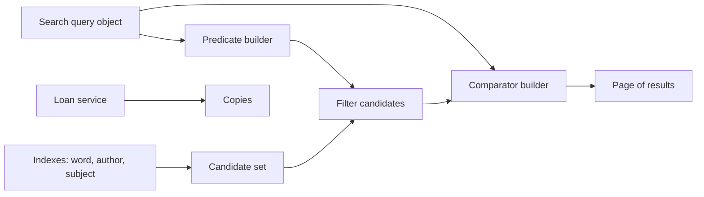
- **Indexes** map a key (lower-cased title word, author, subject) to the set of book IDs, so a query starts from a small candidate set.
- **Predicate builder** turns the query into `Predicate<Book>` pieces combined with `and`.
- **Comparator builder** maps a sort option to a `Comparator<Book>`.
- **Loan service** enforces borrow/return rules on copies.

### Data model
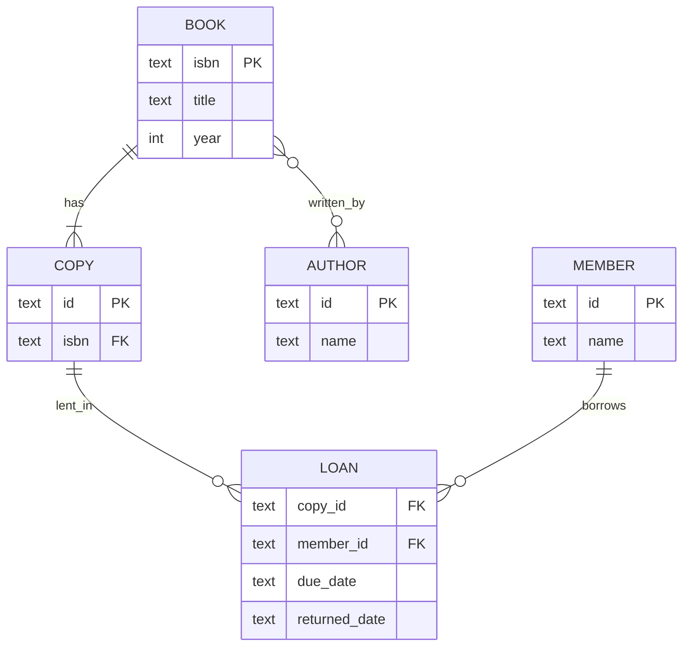

### Tech stack
| Component | Choice | Why |
|---|---|---|
| Index | generic `MultiIndex<K, V>` over `Map<K, Set<V>>` | reused for words, authors, subjects |
| Filters | `Predicate<Book>` | composable |
| Sorting | `Comparator` combinators | declarative |
| Optional fields | `Optional<Integer>` for year | no `null` checks scattered |

### Milestones
1. **Model and linear search** — *Done when* searching by title word works by scanning.
2. **Generic index** — *Done when* `MultiIndex<String, Book>` passes its own unit tests and search uses it.
3. **Combined filters** — *Done when* author + year range + available-only gives the right set.
4. **Sorting and paging** — *Done when* page 2 sorted by year is stable across runs.
5. **Loans** — borrow, return, overdue. *Done when* borrowing an out copy fails and overdue lists correctly with a fixed `Clock`.

### Deep dive: the hard parts
- **Intersect the smallest set first.** With several index hits, start from the smallest candidate set and filter the rest with predicates; intersecting large sets first wastes time.
- **Stable, total ordering.** If two books have the same year, paging can show a book on page 1 and again on page 2 between requests. Always end a comparator with a unique key: `comparing(Book::year).reversed().thenComparing(Book::isbn)`.
- **Generics with bounds.** A `MultiIndex<K, V>` needs no bounds; a "top K by score" helper might need `<T extends Comparable<? super T>>`. Write one with a wildcard and explain why (PECS: producer extends, consumer super — Chapter 9).
- **Null-safe sorting.** Books without a year sort with `Comparator.nullsLast(...)` or, better, model the year as `Optional` and map it to a sentinel only when sorting.

### Testing strategy
Unit-test `MultiIndex`. For search, build a fixture of 20 books and assert results with AssertJ's `extracting(Book::title).containsExactly(...)`. A randomized test compares the indexed search to the linear scan for 1,000 random queries — both must agree.

### Trade-offs, scaling and failure modes
In-memory indexes are fast but cost memory and must be updated on every change; a relational database with indexes or a search engine (project 36) does this for you at scale. Simple word matching misses plurals and typos; stemming and fuzzy matching help but complicate scoring.

### Stretch goals
- Import real data from the Open Library dumps.
- Prefix search with a trie (Chapter 19) for autocomplete.
- Reservations queue per book (`ArrayDeque`).

### Skills practised
- [Ch 9 — Generics](../chapters/09-generics/README.md) — generic classes and wildcards
- [Ch 10 — Collections](../chapters/10-collections/README.md) — maps, sets, ordering
- [Ch 11 — Lambdas and functional programming](../chapters/11-lambdas-and-functional-programming/README.md) — `Predicate`, `Comparator`, method references
- [Ch 7 — Core APIs](../chapters/07-core-apis/README.md) — `java.time` for due dates

### In the interview
**Q:** How do you combine optional search filters cleanly?

**A:** Represent each as a `Predicate<T>` and fold them with `and`, starting from `t -> true`. New filters are new predicates; existing code is untouched.

**Q:** Why add a unique tie-breaker to a sort?

**A:** To make the order total and deterministic, so pagination does not duplicate or skip items.

**Q:** What does PECS mean?

**A:** Use `? extends T` for a source you read from, `? super T` for a sink you write to.

### TL;DR
Indexes for candidates, predicates for filters, comparators for order — generics and lambdas turning search into composable pieces.

## 10. Flashcards with spaced repetition

**Level:** Beginner · **Time:** 1–2 weekends · **Prerequisites:** Ch 7, Ch 10, Ch 13

### What it is
A study app for the terminal. You create decks of question/answer cards, and each day the app shows the cards that are due. After each card you rate yourself ("again", "hard", "good", "easy"), and the app schedules the next review further in the future the better you know it.

### The problem it solves
Reviewing everything every day wastes time; reviewing too rarely means forgetting. **Spaced repetition** schedules each card just before you are likely to forget it. Building it teaches date arithmetic with `java.time`, priority queues ("which card is due first?"), and a scheduling rule that is easy to test once you control the clock.

### Real-world examples
- The [Leitner system](https://en.wikipedia.org/wiki/Leitner_system) uses physical boxes: a card you know moves to a box reviewed less often; a card you miss goes back to box 1.
- [Anki's manual](https://docs.ankiweb.net/studying.html) describes how its scheduler sets intervals from your rating; its long-standing default algorithm descends from SuperMemo's SM-2.

### Requirements
**Functional**
- Create decks, add/edit/delete cards, import from a two-column file.
- `study <deck>` shows due cards, oldest due first, then up to N new cards a day.
- Rating updates the card's interval and next due date.
- Statistics: due today, reviewed today, retention rate over 30 days.

**Non-functional**
- Scheduling is deterministic given a clock and a rating (testable).
- A deck of 10,000 cards opens in under 1 second.
- Progress is saved after every answer.

### The architecture
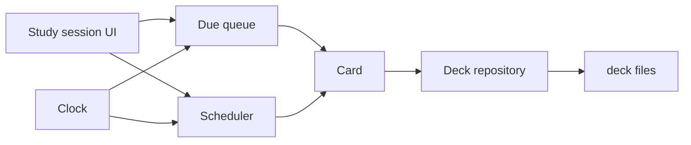
- **Due queue** is a `PriorityQueue<Card>` ordered by due date.
- **Scheduler** is a pure function: (card state, rating, today) → new card state.
- **Repository** saves decks as files (one per deck), atomically.
- **Clock** is injected so tests can travel in time.

### Data model
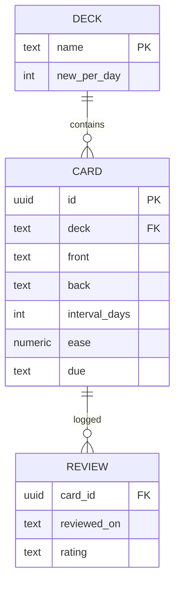

### Tech stack
| Component | Choice | Why |
|---|---|---|
| Dates | `LocalDate`, `Period`, `ChronoUnit.DAYS` | reviews are per day, no time zone maths |
| Clock | `java.time.Clock` | `Clock.fixed` in tests |
| Queue | `PriorityQueue` | O(log n) next-due |
| Storage | one text or JSON file per deck | simple, portable |

### Milestones
1. **Cards and decks** — add and list. *Done when* cards persist across runs.
2. **Leitner boxes** — 5 boxes with intervals 1, 2, 4, 8, 16 days. *Done when* a correct answer moves a card up a box.
3. **Due queue and session** — *Done when* only due cards are shown, in due order.
4. **SM-2 style scheduler** — interval × ease factor, ease adjusted by rating. *Done when* a table-driven test matches your hand-calculated schedule.
5. **Stats** — *Done when* retention over 30 days is computed from the review log.

### Deep dive: the hard parts
- **The scheduler as a pure function.** If the scheduler reads `LocalDate.now()` itself, you cannot test "what happens in 3 weeks". Pass `today` in. Then the whole algorithm is a table of inputs and outputs.
- **Ease and intervals.** In SM-2-like schemes each card has an ease (starting around 2.5); a "good" answer multiplies the interval by the ease, "hard" uses a smaller multiplier and lowers the ease, "again" resets the interval and lowers the ease. Clamp the ease to a minimum so a hard card does not get stuck being shown forever.
- **Due date vs review log.** Store both: the card's current state (for scheduling) and an append-only review log (for statistics). The log also lets you recompute all states if you change the algorithm.
- **Mutable keys in a priority queue.** Changing a card's due date while it sits in a `PriorityQueue` silently breaks the heap. Remove it, update it, then re-insert (or rebuild the queue per session).

### Testing strategy
Table-driven tests for the scheduler: (interval, ease, rating) → expected (interval, ease). A simulation test: answer "good" every day for 60 simulated days with a fixed clock and assert the intervals grow. Repository round-trip tests with `@TempDir`.

### Trade-offs, scaling and failure modes
Leitner is simple and explainable; SM-2 adapts per card; modern schedulers fit a memory model to your history but need more data and maths. Day granularity ignores time zones — if you travel, "today" changes; storing dates in the user's zone is good enough. Saving after every answer costs I/O but avoids losing a session.

### Stretch goals
- Cloze cards ("The capital of France is {{Paris}}").
- Export/import Anki-compatible text files.
- A heatmap of reviews per day in the terminal.

### Skills practised
- [Ch 7 — Core APIs](../chapters/07-core-apis/README.md) — `java.time`, `Clock`
- [Ch 10 — Collections](../chapters/10-collections/README.md) — `PriorityQueue`, ordering
- [Ch 13 — I/O and NIO](../chapters/13-io-and-nio/README.md) — saving files atomically
- [Ch 18 — Testing, build and tooling](../chapters/18-testing-build-and-tooling/README.md) — table-driven tests

### In the interview
**Q:** Why inject a `Clock`?

**A:** So time-dependent logic is deterministic in tests; `Clock.fixed` or a mutable test clock lets you simulate days passing.

**Q:** What breaks if you mutate an element inside a `PriorityQueue`?

**A:** The heap order is not re-established, so `poll` can return the wrong element. Remove, change, re-add.

**Q:** Why keep a review log as well as card state?

**A:** State answers "what is due"; the log answers "how am I doing" and allows recomputing state if the algorithm changes.

### TL;DR
A pure scheduling function, a priority queue of due cards and an injected clock — spaced repetition made testable.

## 11. Markdown-to-HTML converter

**Level:** Intermediate · **Time:** 1–2 weeks · **Prerequisites:** Ch 3, Ch 6, Ch 7

### What it is
A library and command-line tool that turns Markdown (`# Title`, `*emphasis*`, lists, links, code blocks, tables) into HTML. `md2html notes.md > notes.html` produces a valid page; the library API returns a document tree you can render to HTML or inspect.

### The problem it solves
Markdown looks trivial, and most first attempts are a pile of regular expressions that break on nested lists or `*` inside code. A correct converter needs the same structure as a real compiler front end: split the input into **blocks** (paragraphs, lists, quotes), then parse **inlines** (emphasis, links, code spans) inside each block, building an **AST** (abstract syntax tree — a tree of typed nodes describing the document) and only then rendering. That separation is the lesson.

### Real-world examples
- The [CommonMark specification](https://spec.commonmark.org/) exists because early Markdown was ambiguous; it defines the parsing strategy (blocks first, then inlines with a "delimiter stack") and ships hundreds of examples you can use as tests.
- [commonmark-java](https://github.com/commonmark/commonmark-java) is a Java implementation of that spec with an AST, visitors and extensions (tables, strikethrough).

### Requirements
**Functional**
- Blocks: ATX headings, paragraphs, block quotes, ordered/unordered lists (nested), fenced and indented code, thematic breaks, tables (extension).
- Inlines: emphasis and strong, code spans, links and images, autolinks, backslash escapes, hard line breaks.
- HTML-escape text (`<`, `&`, quotes) everywhere it is not intended markup.
- Optional heading IDs and a table of contents.

**Non-functional**
- Pass at least 80% of the CommonMark spec examples you choose to support.
- Linear time: a 1 MB document converts in under 200 ms; no pathological backtracking on inputs like 10,000 `*` characters.
- Output is safe by default: raw HTML in the input is escaped unless the caller opts in.

### The architecture
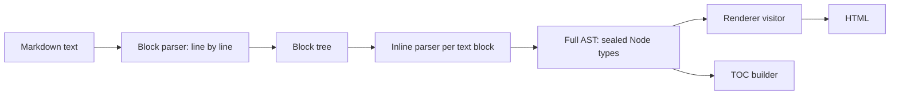
- **Block parser** reads one line at a time and keeps a stack of open containers (quote inside list item inside list), deciding for each line which containers continue.
- **Inline parser** scans the text of leaf blocks and resolves emphasis with a delimiter stack.
- **AST** is a sealed hierarchy of records: `Heading(level, children)`, `Paragraph(children)`, `Emphasis(children)`, `Text(value)`…
- **Renderer** is a switch over node types that writes HTML into a `StringBuilder`.

### Data model
| Node | Kind | Children |
|---|---|---|
| `Document` | block container | blocks |
| `ListBlock(ordered, start, tight)` | container | `ListItem`s |
| `BlockQuote` | container | blocks |
| `Heading(level)`, `Paragraph` | leaf block | inlines |
| `CodeBlock(info, literal)` | leaf block | none |
| `Emphasis`, `Strong`, `Link(url, title)` | inline container | inlines |
| `Text`, `Code`, `HardBreak` | inline leaf | none |

### Tech stack
| Component | Choice | Why |
|---|---|---|
| AST | sealed interfaces + records | exhaustive rendering |
| Rendering | pattern-matching `switch` | no visitor boilerplate |
| Strings | `StringBuilder`, code points | efficient, Unicode-safe |
| Tests | spec examples as JUnit dynamic tests | hundreds of cases from one JSON file |

### Milestones
1. **Headings and paragraphs** — *Done when* blank-line separation and `#` levels render correctly.
2. **Code blocks and escaping** — *Done when* `<script>` in text and code is escaped.
3. **Inlines** — code spans, emphasis, links. *Done when* `*a **b** c*` nests correctly.
4. **Containers** — quotes and nested lists, tight vs loose. *Done when* a 3-level nested list matches the spec.
5. **Spec harness** — load the spec examples, run them as `@TestFactory` dynamic tests, track pass rate. *Done when* the pass rate is printed per section.
6. **Extensions** — tables and heading IDs. *Done when* a GitHub-style table renders.

### Deep dive: the hard parts
- **Two phases.** Block structure must be known before inline parsing, because `*` at the start of a line may be a list marker, while inside a paragraph it is emphasis. Parse all blocks first, then inlines.
- **Emphasis and the delimiter stack.** Push each run of `*` or `_` as a delimiter with flags "can open" and "can close" (based on the characters around it). When a closer arrives, search back for a matching opener; link them, wrap the nodes in between, and remove delimiters in between. This gives linear time and handles `**strong *both***`.
- **Lazy continuation.** In Markdown a paragraph inside a block quote can continue on a line without `>`. Your block parser must allow a paragraph to "absorb" a line even when its container's marker is missing. This rule is where most hand-written parsers fail.
- **Security.** If users write the Markdown and others view the HTML, raw HTML and `javascript:` links are an XSS (cross-site scripting) hole. Escape by default and allowlist URL schemes.

### Testing strategy
The spec examples are the backbone: a JUnit `@TestFactory` produces one dynamic test per example, named by section. Add regression tests for every bug you fix. A performance test feeds adversarial input (deep nesting, thousands of unmatched delimiters) and asserts time grows linearly.

### Trade-offs, scaling and failure modes
Regex-only converters are quick to write and wrong on nesting. A full CommonMark parser is about a thousand careful lines. Building a full AST costs memory proportional to the document but allows multiple renderers and transformations (TOC, link checking); a streaming renderer uses less memory but cannot look ahead.

### Stretch goals
- Render to plain text or to ANSI-coloured terminal output from the same AST.
- Syntax-highlight code blocks by language.
- Front matter (YAML-like metadata) at the top of the file.

### Skills practised
- [Ch 6 — Inheritance, interfaces, records](../chapters/06-oop-inheritance-interfaces-and-more/README.md) — sealed types and records for ASTs
- [Ch 3 — Control flow](../chapters/03-control-flow/README.md) — pattern matching for `switch`
- [Ch 7 — Core APIs](../chapters/07-core-apis/README.md) — strings, `StringBuilder`, Unicode
- [Ch 18 — Testing, build and tooling](../chapters/18-testing-build-and-tooling/README.md) — dynamic and parameterized tests

### In the interview
**Q:** Why not convert Markdown with regular expressions?

**A:** Markdown has nested, context-dependent structure (lists in quotes in lists, emphasis rules that depend on neighbours). Regexes cannot track nesting and tend to backtrack badly.

**Q:** What is an AST and why build one?

**A:** A tree of typed nodes representing the document's structure. It decouples parsing from output, so you can render to several formats and transform the tree.

**Q:** How do you avoid XSS in user Markdown?

**A:** Escape all text, escape or strip raw HTML, and allowlist link schemes such as `http`, `https` and `mailto`.

### TL;DR
Blocks first, inlines second, an AST in the middle, rendering last. Use the CommonMark examples as your test suite.

## 12. JSON parser and object mapper

**Level:** Intermediate · **Time:** 1–2 weeks · **Prerequisites:** Ch 3, Ch 6, Ch 9

### What it is
A library with two layers. The first parses JSON text into a tree of values (`JsonObject`, `JsonArray`, `JsonString`, `JsonNumber`, `JsonBool`, `JsonNull`) and writes trees back to text. The second maps between JSON and Java records: `Json.read(text, Order.class)` and `Json.write(order)`.

### The problem it solves
JSON is the data format of the web, and the JDK has no built-in JSON API, so every Java project picks a library. Writing your own shows what those libraries do: a **tokenizer** (turning characters into tokens), a **recursive-descent parser** (one method per grammar rule, calling each other), careful number and string handling, and **reflection** over records to bind data to types.

### Real-world examples
- [RFC 8259](https://www.rfc-editor.org/rfc/rfc8259) defines JSON's grammar in a page and a half, plus important interoperability notes (duplicate keys, number precision).
- [Jackson](https://github.com/FasterXML/jackson-core) separates a streaming tokenizer (`jackson-core`) from the tree model and the object mapper — the same three layers you build here.

### Requirements
**Functional**
- Parse any valid RFC 8259 text; reject invalid text with line and column in the error.
- Strings: all escapes including `\uXXXX` and surrogate pairs.
- Numbers: preserve precision (keep the original digits, offer `BigDecimal`, `long` and `double` views).
- Writer: compact and pretty-printed output.
- Mapper: records, enums, `List`, `Map<String, T>`, `Optional`, nested types, `java.time` as ISO strings.

**Non-functional**
- Parse 50 MB of JSON in under 1 second (measure with JMH against a known library for comparison).
- Maximum nesting depth (default 512) to prevent stack overflow from hostile input.
- No dependencies outside the JDK.

### The architecture
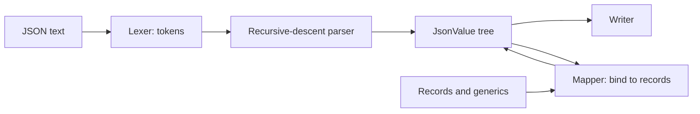
- **Lexer** reads characters and emits tokens: `{`, `}`, `[`, `]`, `:`, `,`, string, number, literal.
- **Parser** has `parseValue`, `parseObject`, `parseArray` that call each other recursively — the grammar written as code.
- **Tree** is a sealed interface `JsonValue` with records for each kind.
- **Mapper** uses `Class.getRecordComponents()` and the canonical constructor to build records, and `java.lang.reflect.Type` to understand generic types like `List<Item>`.

### Data model
| Type | Holds | Note |
|---|---|---|
| `JsonObject` | `LinkedHashMap<String, JsonValue>` | keeps key order |
| `JsonArray` | `List<JsonValue>` | immutable copy |
| `JsonNumber` | original text | converts on demand |
| `JsonString`, `JsonBool`, `JsonNull` | value | `JsonNull` is a singleton |
| `TypeRef<T>` | captured generic type | for `List<Order>` targets |

### Tech stack
| Component | Choice | Why |
|---|---|---|
| Tree | sealed interface + records | exhaustive pattern matching |
| Reflection | `RecordComponent`, `MethodHandles` | records have a canonical constructor |
| Generic types | `ParameterizedType` via a super-type token | erasure hides `T` otherwise |
| Benchmarks | JMH | honest numbers |

### Milestones
1. **Lexer** — *Done when* every token type is produced with correct positions.
2. **Parser to tree** — *Done when* all valid examples in a test suite parse and all invalid ones fail with positions.
3. **Writer** — *Done when* `parse(write(tree))` equals `tree` for random trees.
4. **Records mapping** — *Done when* a nested `Order(List<Item> items, Customer c)` round-trips.
5. **Generics and options** — `TypeRef`, unknown-field policy, naming strategy. *Done when* `Json.read(text, new TypeRef<List<Order>>(){})` works.
6. **Performance** — *Done when* a JMH benchmark reports throughput on a 1 MB file.

### Deep dive: the hard parts
- **Numbers.** RFC 8259 numbers have arbitrary precision, but many parsers silently convert to `double`, corrupting large IDs (anything above 2^53). Store the digits and convert lazily; let the mapper choose `long`, `BigDecimal` or `double` by the target type.
- **Strings and Unicode.** `😀` is one emoji written as two escapes (a surrogate pair). Decode both and check they pair properly; a lone surrogate is invalid UTF-16.
- **Recursion depth.** Recursive descent uses the call stack; `[[[[...]]]]` 100,000 deep causes `StackOverflowError`. Count depth and fail cleanly past the limit.
- **Generic types and erasure.** `Json.read(text, List.class)` cannot know the element type because generics are erased at runtime (Chapter 9). The super-type token trick — an anonymous subclass `new TypeRef<List<Order>>(){}` — preserves the type argument in the class's generic superclass, which reflection can read.

### Testing strategy
Use the JSON test suites published by the community for edge cases (valid, invalid, implementation-defined). Property-based round-trips: generate random trees, write, parse, compare. Mapper tests per supported type. JMH for speed, and a test that deep nesting fails with your error, not a stack overflow.

### Trade-offs, scaling and failure modes
A tree is easy to use but holds the whole document in memory; a streaming (pull) API reads gigabytes with constant memory. Reflection is slow on first use; cache per-class metadata. Strict parsing (rejecting comments, trailing commas, duplicate keys) is safer; lenient parsing is friendlier — make it an option, strict by default.

### Stretch goals
- A pull-parser API (`nextToken()`) used by both the tree builder and the mapper.
- JSON Pointer (`/items/0/price`) queries.
- Generate mappers at build time instead of reflection.

### Skills practised
- [Ch 3 — Control flow](../chapters/03-control-flow/README.md) — switch and pattern matching
- [Ch 6 — Inheritance, interfaces, records](../chapters/06-oop-inheritance-interfaces-and-more/README.md) — sealed types, records
- [Ch 9 — Generics](../chapters/09-generics/README.md) — generics, erasure, super-type tokens
- [Ch 16 — JVM internals and performance](../chapters/16-jvm-internals-and-performance/README.md) — JMH benchmarking

### In the interview
**Q:** What is recursive descent?

**A:** A parser written as one method per grammar rule; rules that refer to other rules become method calls. Simple, fast and easy to debug for grammars like JSON.

**Q:** How can a JSON library deserialise `List<Order>` despite erasure?

**A:** The caller passes a type token — an anonymous subclass whose generic superclass records `List<Order>`, readable with `getGenericSuperclass()`.

**Q:** Why keep numbers as text?

**A:** To avoid precision loss: a `double` cannot represent all 64-bit integers or decimals exactly.

### TL;DR
Lexer, recursive-descent parser, immutable tree, reflection-based mapper. Respect number precision, Unicode and nesting limits.

## 13. CSV query engine with streams

**Level:** Intermediate · **Time:** 2 weeks · **Prerequisites:** Ch 11, Ch 12

### What it is
A command-line tool that runs SQL-like queries over CSV files: `csvq "SELECT city, COUNT(*), AVG(price) FROM sales.csv WHERE year >= 2024 GROUP BY city ORDER BY 3 DESC LIMIT 5"`. It infers column types from the data and prints a table.

### The problem it solves
Analysts often have a CSV and a question, and starting a database to ask it is overkill. Building the engine teaches how a query engine works: parse a query into a plan, then execute the plan as a pipeline of operators (scan, filter, project, aggregate, sort, limit). Java **streams** map almost one-to-one onto those operators, so this is the deepest stream exercise in the book.

### Real-world examples
- [q](https://harelba.github.io/q/) runs SQL directly on CSV and TSV files from the command line.
- [Apache Calcite](https://calcite.apache.org/) is a Java framework for parsing SQL, planning queries and executing them over arbitrary data sources; Hive, Flink and others use it.

### Requirements
**Functional**
- `SELECT` columns, expressions (`price * qty`), aliases; `WHERE` with `AND`, `OR`, comparisons, `LIKE`, `IN`; `GROUP BY` with `COUNT`, `SUM`, `AVG`, `MIN`, `MAX`; `ORDER BY` columns or positions; `LIMIT`.
- Header row gives column names; types inferred (integer, decimal, date, text) from a sample.
- Clear errors: unknown column, type mismatch, with the position in the query.

**Non-functional**
- Stream the file: a 1 GB CSV without `GROUP BY` uses under 256 MB heap.
- 10 million rows with a simple filter in under 10 seconds.
- Adding a new function means one class.

### The architecture
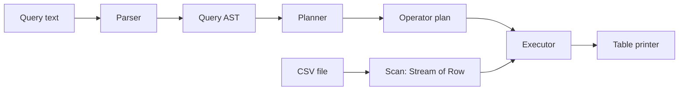
- **Parser** turns SQL text into an AST: select list, from, where expression, group by, order by, limit.
- **Planner** checks names and types against the CSV header and builds a plan: `Limit(Sort(Aggregate(Filter(Scan))))`.
- **Executor** turns each plan node into a stream stage: `filter`, `map`, `collect(groupingBy)`, `sorted`, `limit`.
- **Expressions** compile to `Function<Row, Object>` closures once, rather than being interpreted per row.

### Data model
| Type | Role |
|---|---|
| `Schema` | column names → index and type |
| `Row` | `Object[]` of typed values |
| `Expr` | sealed: `ColumnRef`, `Literal`, `BinaryOp`, `Call` |
| `PlanNode` | sealed: `Scan`, `Filter`, `Project`, `Aggregate`, `Sort`, `Limit` |
| `Accumulator` | per aggregate function: `add(value)`, `result()` |

### Tech stack
| Component | Choice | Why |
|---|---|---|
| Reading | `Files.lines` + quote-aware splitter | lazy |
| Pipeline | `Stream<Row>` | operators map to stream stages |
| Aggregation | custom `Collector` per group | combines several aggregates in one pass |
| Expressions | compiled to lambdas | no per-row tree walking |

### Milestones
1. **Scan and print** — `SELECT * FROM f LIMIT 10`. *Done when* columns align.
2. **Type inference and WHERE** — *Done when* `WHERE price > 10` compares numbers, not strings.
3. **Projection and expressions** — *Done when* `SELECT price * qty AS total` works.
4. **GROUP BY with several aggregates** — *Done when* one pass computes COUNT, SUM and AVG per group.
5. **ORDER BY and LIMIT** — *Done when* top-N uses a heap instead of a full sort.
6. **Errors and performance** — *Done when* a 1 GB file streams within the memory limit.

### Deep dive: the hard parts
- **Operator precedence.** `a OR b AND c` means `a OR (b AND c)`. A recursive-descent parser handles this with one method per precedence level (`parseOr` calls `parseAnd` calls `parseComparison`…).
- **Compile, then run.** Walking the expression tree for every row repeats the same decisions millions of times. Convert each `Expr` once into a `Function<Row, Object>` (a closure that already knows the column index and operator), then apply it per row.
- **One-pass aggregation.** Write a `Collector` whose accumulator holds an array of `Accumulator`s (one per aggregate). `groupingBy(keyFn, yourCollector)` then computes all aggregates per group in a single scan.
- **Nulls and types.** Empty cells are SQL `NULL`. Comparisons with `NULL` are neither true nor false, so `WHERE x > 5` must exclude them, and `COUNT(col)` skips them while `COUNT(*)` does not.
- **Top-N.** `ORDER BY ... LIMIT 10` should not sort 10 million rows; a bounded priority queue gives O(n log 10).

### Testing strategy
Golden tests: a directory of `.sql` + `.csv` + `.expected` files run by a parameterized test. Cross-check results against PostgreSQL or SQLite on the same data for a few queries. Unit tests for the parser (precedence, errors) and each accumulator (including empty groups).

### Trade-offs, scaling and failure modes
`GROUP BY` must keep one entry per group in memory; with millions of distinct keys you need spilling to disk. Type inference from a sample can be wrong (a column of numbers with a text value at row 9 million) — fail with a clear message or fall back to text. Parallel streams help CPU-heavy filters on large files, but ordering and `LIMIT` reduce the benefit.

### Stretch goals
- `JOIN` two CSV files with a hash join (build a map on the smaller one).
- `EXPLAIN` that prints the plan tree.
- Predicate pushdown: skip parsing columns not referenced by the query.

### Skills practised
- [Ch 12 — Streams](../chapters/12-streams/README.md) — streams, custom collectors, parallel streams
- [Ch 11 — Lambdas and functional programming](../chapters/11-lambdas-and-functional-programming/README.md) — functions as values, closures
- [Ch 6 — Inheritance, interfaces, records](../chapters/06-oop-inheritance-interfaces-and-more/README.md) — sealed hierarchies for AST and plan
- [Ch 19 — Java for coding interviews](../chapters/19-java-for-coding-interviews/README.md) — heaps for top-N

### In the interview
**Q:** How does a query engine execute `GROUP BY`?

**A:** Usually with a hash aggregate: a map from group key to accumulators, updated per row, then emitted. Sorting by key is the alternative when data is already ordered or too big for memory.

**Q:** Why compile expressions into lambdas?

**A:** To pay the interpretation cost once per query instead of once per row.

**Q:** How do SQL `NULL` comparisons behave?

**A:** They yield unknown, which `WHERE` treats as false; use `IS NULL` to test for null.

### TL;DR
Parse SQL into a plan, then execute the plan as a stream pipeline with compiled expressions and one-pass aggregation.

## 14. Log analyser with stream gatherers

**Level:** Intermediate · **Time:** 1 week · **Prerequisites:** Ch 7, Ch 12, Ch 13

### What it is
A tool that reads web-server or application logs (files, gzipped files or a live `tail`) and reports: requests per minute, error rate, slowest endpoints, 95th-percentile latency over a moving window, and bursts of errors ("more than 50 errors in any 1-minute window"). It uses **stream gatherers** (`Stream.gather`, final in Java 24) for windowing.

### The problem it solves
Logs are the first place you look when production misbehaves, and ad-hoc `grep | sort | uniq -c` stops working once you need time windows and percentiles. Before Java 24, streams had no way to express "group consecutive elements" or "sliding window" without collecting everything first. **Gatherers** add custom intermediate operations: `Gatherers.windowFixed`, `windowSliding`, `scan`, `fold` and `mapConcurrent`, plus your own. This project teaches them on a realistic task.

### Real-world examples
- [JEP 485](https://openjdk.org/jeps/485) introduced gatherers precisely because operations like fixed and sliding windows could not be written as streams before.
- The [`Gatherers` API](https://docs.oracle.com/en/java/javase/25/docs/api/java.base/java/util/stream/Gatherers.html) documents the built-in gatherers this project uses.

### Requirements
**Functional**
- Parse a common log format (configurable regex with named groups) into `LogEvent` records: time, level, endpoint, status, latency.
- Reports: per-minute counts, top 10 endpoints by count and by p95 latency, error rate, error bursts.
- Read plain and `.gz` files, multiple files merged by time, or follow a growing file.
- Output as a table or JSON lines.

**Non-functional**
- 1 GB of logs analysed in under 15 seconds with bounded memory (no full load).
- Malformed lines counted and sampled, never fatal.
- Time zones handled: logs in UTC, report in the user's zone.

### The architecture
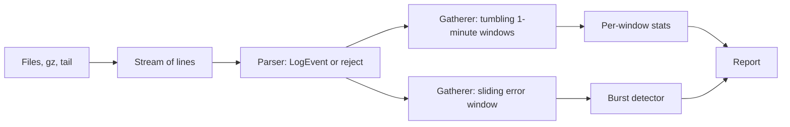
- **Sources** produce a `Stream<String>`; `GZIPInputStream` handles compressed files; a follow mode polls for new lines.
- **Parser** uses one precompiled `Pattern`; failures go to a reject counter.
- **Time-window gatherer** (custom) groups consecutive events by minute — unlike `windowFixed`, windows are defined by time, not count.
- **Burst detector** keeps a deque of error timestamps within the last 60 seconds.

### Data model
| Type | Fields |
|---|---|
| `LogEvent` | `Instant time`, `Level level`, `String endpoint`, `int status`, `Duration latency` |
| `MinuteStats` | minute, count, errors, latency histogram |
| `Histogram` | fixed buckets (1 ms … 10 s, logarithmic) |
| `Burst` | start, end, error count |

### Tech stack
| Component | Choice | Why |
|---|---|---|
| Windowing | `Gatherer.ofSequential` (Java 24) | stateful intermediate operation |
| Percentiles | bucketed histogram | constant memory per window |
| Compressed input | `GZIPInputStream` | in the JDK |
| Time | `Instant`, `ZonedDateTime`, `DateTimeFormatter` | zone-correct reports |

### Milestones
1. **Parse** — *Done when* 3 sample formats parse into `LogEvent`, rejects counted.
2. **Built-in gatherers** — `windowFixed(1000)` batches and `scan` running totals. *Done when* you can explain each one's output on a 10-element list.
3. **Custom time-window gatherer** — *Done when* events group per minute, including empty minutes if requested.
4. **Percentiles** — histogram-based p50/p95/p99 per minute. *Done when* results are within one bucket of an exact sort.
5. **Bursts and follow mode** — *Done when* a synthetic burst is detected live while the file grows.

### Deep dive: the hard parts
- **Writing a gatherer.** A gatherer has an *initializer* (create state), an *integrator* (receive each element, update state, optionally push results downstream) and a *finisher* (flush what remains). For time windows, the state is "current minute + accumulator"; when an event from a new minute arrives, push the finished window and start a new one. The finisher pushes the last window.
- **Out-of-order events.** Multi-threaded servers log slightly out of order. Allow a small lateness (say 2 seconds) by holding windows open until the "watermark" (latest time seen minus allowed lateness) passes their end — the same idea stream processors use.
- **Percentiles with bounded memory.** Exact p95 needs all values sorted. A histogram with logarithmic buckets gives an approximate p95 in constant memory and can be merged across windows by adding counts.
- **Merging files by time.** Several files each sorted by time merge with a priority queue of iterators (k-way merge), not by concatenating and sorting.

### Testing strategy
Unit-test the custom gatherer on small lists with known windows (including one-element and empty input). Fixed log fixtures with expected reports. A generated 1 GB file for the performance target, run with `-Xmx256m`. Compare histogram percentiles with exact ones on random data.

### Trade-offs, scaling and failure modes
Approximate percentiles trade accuracy for memory; document the error bound. A sequential gatherer cannot run in parallel; windows across parallel chunks need a combiner and boundary handling. Following a file breaks when the log rotates; detect the file being replaced (inode or size shrink) and reopen.

### Stretch goals
- `mapConcurrent` to enrich events (for example IP → country lookup) with bounded concurrency on virtual threads.
- Alerts via a webhook when the error rate crosses a threshold.
- Read JSON-lines logs using your parser from project 12.

### Skills practised
- [Ch 12 — Streams](../chapters/12-streams/README.md) — gatherers, collectors, laziness
- [Ch 13 — I/O and NIO](../chapters/13-io-and-nio/README.md) — compressed streams, reading large files
- [Ch 7 — Core APIs](../chapters/07-core-apis/README.md) — `java.time`, regex
- [Ch 10 — Collections](../chapters/10-collections/README.md) — `ArrayDeque`, `PriorityQueue`

### In the interview
**Q:** What problem do stream gatherers solve?

**A:** They let you write custom stateful intermediate operations (windows, scans, deduplication by run) that previously required collecting the whole stream or abandoning streams.

**Q:** How do you compute p95 latency over a huge stream?

**A:** With a histogram or a sketch that stores counts per bucket, giving an approximation in fixed memory, mergeable across windows.

**Q:** How do you merge k sorted files?

**A:** A min-heap holding the next element of each file; pop the smallest, push that file's next element. O(n log k).

### TL;DR
Parse logs into events, window them with custom gatherers, summarise with histograms — all streaming, in bounded memory.

## 15. File-sync tool with WatchService

**Level:** Intermediate · **Time:** 2 weeks · **Prerequisites:** Ch 13, Ch 14

### What it is
A tool that keeps a target directory in sync with a source directory: an initial full sync, then live updates as files are created, changed, renamed or deleted, using the NIO.2 **`WatchService`** (an API that asks the operating system to notify you of file-system changes). Think of a tiny, one-way Dropbox for a folder.

### The problem it solves
Copying a folder once is easy. Keeping two folders in sync is not: file-system events arrive in bursts, can be lost when too many happen at once, do not cover subdirectories automatically, and arrive before a big file has finished being written. Building a correct sync tool teaches the edge cases of NIO.2, idempotent operations (safe to repeat) and how to combine event-driven and periodic reconciliation.

### Real-world examples
- The [rsync technical report](https://rsync.samba.org/tech_report/) explains how rsync transfers only changed parts of files with rolling checksums — the idea behind this project's delta stretch goal.
- [Syncthing](https://syncthing.net/) is an open-source continuous file synchroniser that combines file-system watching with periodic full rescans, the same hybrid design recommended here.
- The [`WatchService` documentation](https://docs.oracle.com/en/java/javase/25/docs/api/java.base/java/nio/file/WatchService.html) warns that events may be lost and signals this with an `OVERFLOW` event.

### Requirements
**Functional**
- `sync <source> <target> [--watch] [--delete] [--exclude pattern]`.
- Initial sync compares size and modification time (optionally a hash) and copies what changed.
- Watch mode reacts to create/modify/delete in all subdirectories, including new ones.
- Excludes via glob patterns (`**/*.tmp`, `.git/**`).
- Dry-run mode prints planned actions.

**Non-functional**
- A change is reflected in the target within 2 seconds.
- Never leave a half-copied file at the target path (copy to temp, then atomic move).
- Handles 100,000 files; initial scan of an unchanged tree under 10 seconds.
- Survives `OVERFLOW` by rescanning.

### The architecture
```mermaid
flowchart LR
    WS["WatchService thread"] --> Q["Event queue"]
    SC["Periodic scanner"] --> Q
    Q --> DB["Debouncer: coalesce per path"]
    DB --> PLAN["Planner: compare source and target"]
    PLAN --> EX["Executor: copy, move, delete"]
    EX --> T["Target directory"]
    EX --> LOG["Action log"]
```
- **Watcher** registers every directory (`WatchService` is not recursive) and turns OS events into `PathChanged(path)` messages.
- **Scanner** walks the tree every few minutes and after an `OVERFLOW`, emitting the same messages.
- **Debouncer** waits until a path has been quiet for, say, 500 ms, merging bursts of modify events into one.
- **Planner** compares source and target metadata and decides copy, delete or nothing — idempotent.
- **Executor** performs actions with temp-file + atomic move, on a small pool.

### Data model
| Type | Fields | Note |
|---|---|---|
| `FileState` | relative path, size, mtime, optional hash | from `Files.readAttributes` |
| `Action` | sealed: `Copy`, `Delete`, `MakeDir` | planner output |
| `WatchKey` map | `WatchKey → Path` | resolve relative event paths |
| `PendingChange` | path, last event time | debouncer state |

### Tech stack
| Component | Choice | Why |
|---|---|---|
| Events | `WatchService` + `ENTRY_CREATE/MODIFY/DELETE` | OS notifications |
| Walking | `Files.walkFileTree` | visit and register directories |
| Copy | `Files.copy` to temp + `Files.move(ATOMIC_MOVE)` | no torn files |
| Concurrency | one watcher thread, `ScheduledExecutorService` for debounce and scans | simple, clear ownership |
| Matching | `FileSystem.getPathMatcher("glob:...")` | built-in globbing |

### Milestones
1. **One-shot sync** — *Done when* a second run copies nothing.
2. **Excludes and dry run** — *Done when* `--dry-run` prints the exact plan.
3. **Watch a flat folder** — *Done when* creating a file in the source appears in the target.
4. **Recursive watching** — register new subdirectories as they appear. *Done when* `mkdir -p a/b/c && touch a/b/c/f` syncs.
5. **Debounce and overflow** — *Done when* writing 10,000 files quickly results in a correct target (verified by a full compare).
6. **Deletes and renames** — *Done when* a rename in the source becomes delete + create at the target, and `--delete` is respected.

### Deep dive: the hard parts
- **Events are hints, not truth.** Treat every event as "something about this path may have changed", then look at the actual file system state and act. That makes duplicate, reordered or missed events harmless, and overflow recovery just means "rescan everything".
- **New directories race.** If someone creates `a/` and immediately `a/f`, the event for `a/f` may happen before you register `a/`. After registering a new directory, scan it once to catch files created in between.
- **Partially written files.** A `MODIFY` event fires while a 2 GB file is still being written. Debounce (wait for quiet) and re-check size/mtime before and after copying; if they changed, retry.
- **Platform differences.** On Linux the JDK uses inotify; on macOS the JDK's watcher has historically polled, so events can be seconds late. Your periodic scan covers this, and your tests must not assume instant events.

### Testing strategy
Integration tests with `@TempDir` source and target: perform operations, then wait (with a timeout, not a fixed sleep) until a full compare reports equal. A stress test creates, modifies and deletes thousands of files randomly. Unit-test the planner with fake `FileState` maps — no disk needed.

### Trade-offs, scaling and failure modes
Watching is fast but unreliable; scanning is reliable but slow. Hybrid gives both. Comparing by size + mtime is cheap but misses changes that keep both (rare); hashing catches everything but reads every byte. One-way sync is well defined; two-way sync needs conflict detection (both sides changed since last sync) — a much harder problem.

### Stretch goals
- Delta transfer of large files with rsync-style rolling checksums.
- Sync to a remote machine over your HTTP server (project 16).
- Two-way sync with a state database and conflict files.

### Skills practised
- [Ch 13 — I/O and NIO](../chapters/13-io-and-nio/README.md) — `Path`, `Files`, `WatchService`, attributes, atomic moves
- [Ch 14 — Concurrency 1](../chapters/14-concurrency-1/README.md) — threads, executors, scheduled tasks, concurrent queues
- [Ch 8 — Exceptions](../chapters/08-exceptions/README.md) — handling `IOException` per file without stopping
- [Ch 18 — Testing, build and tooling](../chapters/18-testing-build-and-tooling/README.md) — integration tests with temp directories

### In the interview
**Q:** Is `WatchService` reliable?

**A:** No. Events can be coalesced or lost (`OVERFLOW`), it is not recursive, and some platforms poll. Use events as hints and reconcile with periodic scans.

**Q:** How do you avoid copying a half-written file?

**A:** Debounce until the file has been quiet, re-check size and mtime around the copy, and copy to a temp file followed by an atomic move.

**Q:** Why should sync actions be idempotent?

**A:** So repeated or reordered events and retries after crashes produce the same final state.

### TL;DR
Use watch events as hints, debounce them, compare real file state, and write atomically. A periodic rescan makes it correct.

## 16. HTTP server on virtual threads

**Level:** Intermediate · **Time:** 2 weeks · **Prerequisites:** Ch 13, Ch 15

### What it is
A small web framework on top of the JDK's built-in **`com.sun.net.httpserver`** package (module `jdk.httpserver`): routing with path parameters (`/users/{id}`), middleware (logging, timing, gzip), static files with caching headers, JSON responses, and graceful shutdown. Every request runs on its own **virtual thread** (a lightweight thread managed by the JVM, final in Java 21).

### The problem it solves
Frameworks hide how HTTP actually works. Building a thin one shows the request/response cycle, headers, status codes, keep-alive and content negotiation. It also demonstrates the main promise of virtual threads: you write simple blocking code ("read the file, call the database, write the response") and still handle thousands of concurrent connections, because a blocked virtual thread releases its carrier (OS) thread.

### Real-world examples
- [JEP 408](https://openjdk.org/jeps/408) added `jwebserver`, a minimal static file server built on the same `com.sun.net.httpserver` API (Java 18).
- [JEP 444](https://openjdk.org/jeps/444) (virtual threads) explains the thread-per-request style this server uses, and the [`HttpServer` docs](https://docs.oracle.com/en/java/javase/25/docs/api/jdk.httpserver/com/sun/net/httpserver/HttpServer.html) show how to plug in any `Executor`, including `Executors.newVirtualThreadPerTaskExecutor()`.

### Requirements
**Functional**
- Routes by method and path pattern with parameters; 404 and 405 handled correctly.
- Middleware chain: request ID, access log, timing, exception → 500 mapping, optional gzip.
- Static files from a directory with `Content-Type`, `ETag`/`If-None-Match` (304), and protection against `../` path traversal.
- JSON in and out (use project 12 or a small library).
- Graceful shutdown: stop accepting, finish in-flight requests up to a timeout.

**Non-functional**
- 10,000 concurrent slow requests (each sleeping 1 s to simulate I/O) complete in about 1–2 s on a laptop.
- p99 latency under 10 ms for a trivial handler at 5,000 requests per second.
- Request bodies limited (default 1 MB) to prevent memory exhaustion.

### The architecture
```mermaid
flowchart LR
    C["Clients"] --> HS["HttpServer listener"]
    HS --> VT["Virtual thread per request"]
    VT --> MW["Middleware chain"]
    MW --> RT["Router"]
    RT --> H1["Handlers: API"]
    RT --> H2["Static file handler"]
    H1 --> J["JSON codec"]
    MW --> LOG["Access log"]
```
- **HttpServer** accepts connections and parses HTTP/1.1; you install one root `HttpHandler`.
- **Executor** is `newVirtualThreadPerTaskExecutor()`, so each exchange runs on a fresh virtual thread.
- **Middleware** are functions `Handler → Handler` composed in order, like servlet filters.
- **Router** matches `(method, path)` against compiled patterns and puts path parameters into a `Request` object.
- **Static handler** resolves the path safely under the root and streams the file.

### Data model
| Type | Role |
|---|---|
| `Request` | method, path, params, headers, body supplier, request ID |
| `Response` | status, headers, body (bytes, stream or JSON) |
| `Handler` | `Response handle(Request)` functional interface |
| `Route` | method, compiled pattern, parameter names, handler |
| `ScopedValue<String> REQUEST_ID` | context visible to logging deep in the call stack |

### Tech stack
| Component | Choice | Why |
|---|---|---|
| HTTP | `com.sun.net.httpserver.HttpServer` | in the JDK, supported, `jdk.httpserver` module |
| Threads | virtual threads | blocking code, high concurrency |
| Context | `ScopedValue` (final in Java 25, JEP 506) | request ID without parameters or `ThreadLocal` leaks |
| Load test | `java.net.http.HttpClient` on virtual threads, or a tool like `wrk` | measure, do not guess |

### Milestones
1. **Hello server** — *Done when* `curl localhost:8080/hello` works on a virtual-thread executor.
2. **Router** — *Done when* `/users/{id}` extracts `id` and wrong methods return 405 with an `Allow` header.
3. **Middleware** — *Done when* every response has `X-Request-Id` and every request is logged with its duration.
4. **Static files** — *Done when* a second request returns 304 and `/../etc/passwd` returns 404.
5. **Load test** — *Done when* 10,000 concurrent 1-second requests finish in about 1–2 s; compare with a fixed pool of 200 platform threads.
6. **Graceful shutdown** — *Done when* in-flight requests complete after Ctrl-C.

### Deep dive: the hard parts
- **Why virtual threads help.** With a pool of 200 platform threads, the 201st slow request waits. A virtual thread blocked on I/O unmounts from its carrier, so 10,000 sleeping requests need only a handful of OS threads. They do not make CPU-bound work faster.
- **Pinning.** Before Java 24, blocking inside a `synchronized` block pinned the virtual thread to its carrier. JEP 491 (Java 24) removed that for `synchronized`; native calls can still pin. Use JFR's `jdk.VirtualThreadPinned` event to check.
- **Path traversal.** Resolve the requested path against the root, `normalize()` it, and check `startsWith(root)`. Also reject encoded variants (`%2e%2e`) by decoding first.
- **Always close the exchange.** Each `HttpExchange` must have its response body closed, even on error, or the connection hangs. Put it in the outermost middleware's `finally`.
- **Scoped values vs ThreadLocal.** With one virtual thread per request, `ThreadLocal` works but is mutable and easy to leak. A `ScopedValue` bound with `ScopedValue.where(REQUEST_ID, id).run(...)` is immutable and automatically unbound when the handler returns.

### Testing strategy
Start the server on port 0 (random free port) in a JUnit extension; use `java.net.http.HttpClient` for tests. Test routing, headers, 304, traversal and error mapping. A load test (tagged so it does not run on every build) asserts throughput and p99. Use JFR to confirm no pinning events.

### Trade-offs, scaling and failure modes
`com.sun.net.httpserver` supports HTTP/1.1 only and is basic (no HTTP/2, limited tuning); production servers such as Jetty, Tomcat or Netty offer far more. Unlimited virtual threads can overload a downstream database: add a `Semaphore` to cap concurrent DB calls. A slow client reading responses slowly still holds memory for its buffers.

### Stretch goals
- Server-Sent Events endpoint that streams updates.
- HTTPS with `HttpsServer` and a self-signed certificate.
- Per-IP rate limiting with project 20's limiter.

### Skills practised
- [Ch 15 — Modern concurrency](../chapters/15-concurrency-2-modern/README.md) — virtual threads, pinning, scoped values
- [Ch 13 — I/O and NIO](../chapters/13-io-and-nio/README.md) — streaming files, path safety
- [Ch 11 — Lambdas and functional programming](../chapters/11-lambdas-and-functional-programming/README.md) — handlers and middleware as functions
- [Ch 16 — JVM internals and performance](../chapters/16-jvm-internals-and-performance/README.md) — JFR events, modules (`requires jdk.httpserver`)

### In the interview
**Q:** What do virtual threads improve for a web server?

**A:** Concurrency for I/O-bound work with simple blocking code: one cheap thread per request instead of a limited pool, so throughput is not capped by pool size.

**Q:** When do virtual threads not help?

**A:** CPU-bound work, and when another resource (database connections, a rate-limited API) is the bottleneck.

**Q:** How do you prevent `../` attacks on a static file handler?

**A:** Decode, resolve against the root, normalise, and verify the result is still inside the root.

### TL;DR
A thin framework over the JDK HTTP server with routing, middleware and safe static files, one virtual thread per request.

## 17. Todo REST API with JDBC

**Level:** Intermediate · **Time:** 2 weeks · **Prerequisites:** Ch 15, Ch 18

### What it is
A complete REST API for todo lists — create lists, add, edit, complete and delete items, filter and page — backed by a relational database through plain **JDBC** (Java Database Connectivity, the JDK's standard SQL API). The server reuses project 16's router (or a minimal version), and the integration tests and a small CLI client use **`java.net.http.HttpClient`** (final in Java 11).

### The problem it solves
Frameworks like Spring do a lot for you; this project shows what they do by doing it by hand: resource design, status codes, validation, SQL with prepared statements, transactions, connection pooling, schema migrations and optimistic locking. If you later use Spring Data or Hibernate, you will know what they generate.

### Real-world examples
- [Todo-Backend](https://todobackend.com/) is a shared API spec with an automated test suite, implemented in dozens of languages — a good contract to test your server against.
- [RFC 9110](https://www.rfc-editor.org/rfc/rfc9110) defines HTTP semantics: which methods are safe and idempotent, and what `201`, `204`, `409` and `412` mean.

### Requirements
**Functional**
- `POST /lists`, `GET /lists/{id}`, `POST /lists/{id}/items`, `PATCH /items/{id}`, `DELETE /items/{id}`, `GET /lists/{id}/items?done=false&page=2&size=20`.
- Validation errors return `400` with a JSON body listing each problem.
- Optimistic concurrency: responses carry an `ETag` (version); `PATCH` with a stale `If-Match` returns `412`.
- CLI client: `todo add "Buy milk"`, `todo done 42`.

**Non-functional**
- p95 under 20 ms for single-item reads at 500 requests per second on a laptop with PostgreSQL or H2.
- No SQL injection possible: every query uses `PreparedStatement` parameters.
- Schema created and upgraded by versioned migration scripts at startup.

### The architecture
```mermaid
flowchart LR
    CL["CLI and tests: HttpClient"] --> API["HTTP layer: routes, JSON"]
    API --> SVC["Service: validation, rules"]
    SVC --> REPO["Repository: JDBC"]
    REPO --> POOL["Connection pool"]
    POOL --> DB["PostgreSQL or H2"]
    MIG["Migrator"] --> DB
```
- **HTTP layer** maps requests to service calls and results to status codes.
- **Service** validates and runs each use case inside one transaction.
- **Repository** contains all SQL; maps `ResultSet` rows to records.
- **Pool** keeps a few open connections, since opening one per request costs milliseconds.
- **Migrator** applies `V1__init.sql`, `V2__add_due_date.sql`… once each, recorded in a table.

### Data model
```mermaid
erDiagram
    TODO_LIST ||--o{ TODO_ITEM : contains
    TODO_LIST {
        bigint id PK
        text title
        timestamptz created_at
    }
    TODO_ITEM {
        bigint id PK
        bigint list_id FK
        text title
        boolean done
        int version
        timestamptz updated_at
    }
    SCHEMA_VERSION {
        int version PK
        timestamptz applied_at
    }
```

### Tech stack
| Component | Choice | Why |
|---|---|---|
| Server | `com.sun.net.httpserver` on virtual threads | from project 16 |
| Client | `java.net.http.HttpClient` | standard, async-capable |
| Database | PostgreSQL (or H2 for tests) | real SQL, real transactions |
| Pool | a small pool you write, or HikariCP | understand, then use the standard |
| Tests | JUnit 6, AssertJ, Testcontainers (optional) | real database in tests |

### Milestones
1. **Schema and migrator** — *Done when* starting twice applies migrations once.
2. **Repository** — CRUD with prepared statements. *Done when* repository tests pass against H2 or PostgreSQL.
3. **HTTP endpoints** — *Done when* each endpoint returns the right status (`201` with `Location`, `204` on delete, `404`).
4. **Validation and errors** — *Done when* bad input yields a `400` with a list of field errors.
5. **Optimistic locking** — *Done when* two concurrent PATCHes with the same `If-Match` produce one `200` and one `412`.
6. **Paging, CLI and load test** — *Done when* the CLI works and the p95 target is met.

### Deep dive: the hard parts
- **Transactions in JDBC.** Call `setAutoCommit(false)`, do the work, `commit()`, and `rollback()` in a catch; always close the connection (returning it to the pool) in try-with-resources. Keep one connection per use case so all statements share the transaction.
- **Optimistic locking.** `UPDATE todo_item SET title = ?, version = version + 1 WHERE id = ? AND version = ?`. If the update count is 0, someone else changed it first → `412`. No locks are held between requests.
- **Pool sizing with virtual threads.** Virtual threads make it easy to start 10,000 requests, but a database handles a few dozen connections well. The pool is your back-pressure: requests wait for a connection (with a timeout) rather than overwhelming the database.
- **Paging.** `LIMIT/OFFSET` gets slower as the offset grows; keyset pagination (`WHERE id > :lastSeen ORDER BY id LIMIT 20`) stays fast. Offer keyset with an opaque cursor.

### Testing strategy
Repository tests against a real database (H2 in PostgreSQL mode, or PostgreSQL in a container). API tests start the server on a random port and call it with `HttpClient`. Run the Todo-Backend spec tests if you match its contract. A concurrency test fires parallel PATCHes and asserts exactly one wins.

### Trade-offs, scaling and failure modes
Hand-written SQL is explicit and fast but verbose; an ORM saves code but hides queries. H2 is convenient but differs from PostgreSQL in subtle SQL details — run at least the CI tests on PostgreSQL. A single database is a single point of failure; read replicas and caching are the next steps but bring stale reads.

### Stretch goals
- Full-text search on titles using PostgreSQL's `tsvector` (PostgreSQL feature).
- An outbox table that records events for another service to consume.
- Rewrite the persistence with the Spring book's approach and compare.

### Skills practised
- [Ch 18 — Testing, build and tooling](../chapters/18-testing-build-and-tooling/README.md) — JDBC, transactions, testing
- [Ch 15 — Modern concurrency](../chapters/15-concurrency-2-modern/README.md) — virtual threads and back-pressure
- [Ch 8 — Exceptions](../chapters/08-exceptions/README.md) — exception translation
- [Ch 12 — Streams](../chapters/12-streams/README.md) — mapping results

### In the interview
**Q:** Why `PreparedStatement` instead of string concatenation?

**A:** Parameters are sent separately from the SQL text, so user input cannot change the query (no SQL injection), and the database can reuse the plan.

**Q:** Optimistic or pessimistic locking for a todo app?

**A:** Optimistic: conflicts are rare, and no locks are held while a user edits. Pessimistic (`SELECT ... FOR UPDATE`) suits short, high-contention transactions.

**Q:** Which HTTP status for a successful create?

**A:** `201 Created` with a `Location` header pointing to the new resource.

### TL;DR
A REST API by hand: correct HTTP semantics, prepared statements, explicit transactions, a pool as back-pressure, and version-checked updates.

## 18. Chat server over sockets

**Level:** Intermediate · **Time:** 1–2 weeks · **Prerequisites:** Ch 13, Ch 14, Ch 15

### What it is
A multi-user chat server that speaks a simple line-based text protocol over TCP: users connect with `nc` or your own client, pick a nickname, join rooms, send messages to a room or privately, and see who is online. The server handles thousands of simultaneous connections.

### The problem it solves
Under every web framework and database driver is a socket: a two-way byte stream between two programs. This project teaches **TCP sockets** (`ServerSocket`, `Socket`), framing (how to know where one message ends), protocol design, and the shared-state concurrency of a server where many connections read and write the same rooms. It compares the classic thread-per-connection model on virtual threads with an event-loop model on NIO selectors.

### Real-world examples
- [RFC 1459](https://www.rfc-editor.org/rfc/rfc1459) describes IRC, a line-based chat protocol with nicknames, channels and private messages; this project is a small IRC-like design.
- Oracle's [sockets tutorial](https://docs.oracle.com/javase/tutorial/networking/sockets/) shows the classic `ServerSocket` accept loop that this project starts from.

### Requirements
**Functional**
- Commands: `NICK name`, `JOIN #room`, `PART #room`, `MSG #room text`, `MSG nick text`, `WHO #room`, `QUIT`.
- Server replies use numeric codes (`200 OK`, `433 nick in use`).
- Join/leave notices broadcast to room members; last 50 messages of a room replayed on join.

**Non-functional**
- 10,000 concurrent idle connections; a message reaches 1,000 room members in under 100 ms.
- A slow client must not block others (bounded outgoing queue per client; drop or disconnect when full).
- Lines longer than 4 KB are rejected; idle clients are timed out.

### The architecture
```mermaid
flowchart LR
    C1["Client"] --> ACC["Accept loop"]
    C2["Client"] --> ACC
    ACC --> S["Session: reader virtual thread"]
    S --> CMD["Command handler"]
    CMD --> REG["Registry: users and rooms"]
    REG --> OQ["Per-session outbound queue"]
    OQ --> WR["Writer virtual thread"]
    WR --> C1
```
- **Accept loop** takes connections and starts a session.
- **Session** has a reader thread that parses lines and a writer thread that drains a bounded outbound queue — so a slow socket write never blocks the sender.
- **Registry** maps nicknames to sessions and rooms to member sets, using concurrent collections.
- **Command handler** validates and executes commands, enqueuing messages to recipients.

### Data model
| Type | Fields / role |
|---|---|
| `Session` | socket, nickname, joined rooms, `BlockingQueue<String> outbound` |
| `Room` | name, members (`Set<Session>`), history (bounded deque) |
| `Registry` | `ConcurrentHashMap<String, Session>`, `ConcurrentHashMap<String, Room>` |
| `Command` | sealed records: `Nick`, `Join`, `Msg`… |

### Tech stack
| Component | Choice | Why |
|---|---|---|
| Sockets | `ServerSocket` / `Socket` | blocking, simple |
| Threads | virtual threads, two per connection | cheap at 10,000 connections |
| Framing | UTF-8 lines with a max length | simple, `nc`-friendly |
| Alternative | `Selector` + `SocketChannel` | compare with the event-loop model |

### Milestones
1. **Echo server** — *Done when* `nc localhost 7000` echoes lines.
2. **Nicknames and broadcast** — single global room. *Done when* two `nc` sessions chat.
3. **Rooms and private messages** — *Done when* messages reach only room members.
4. **Slow consumers** — bounded queues and a writer thread. *Done when* a client that never reads does not delay others (tested).
5. **Scale test** — 10,000 connections from a load client. *Done when* latency targets hold.
6. **NIO version** — a selector-based server with the same protocol. *Done when* both pass the same test suite; compare code size and performance.

### Deep dive: the hard parts
- **Framing.** TCP is a byte stream, not messages: one `read` may return half a line or three lines. Use a `BufferedReader` over the input with UTF-8, and enforce a maximum line length yourself (a client sending 1 GB with no newline must not exhaust memory).
- **Slow consumers.** If the sender writes directly to every recipient's socket, one client with a full TCP buffer blocks the whole room. Give each session an outbound `ArrayBlockingQueue`; senders `offer` (never block); if the queue is full, disconnect that client.
- **Consistent shared state.** A `JOIN` adds the session to a room and the room to the session — two updates. Make room membership the single source of truth, or lock per room. Nickname changes need an atomic check-and-set: `putIfAbsent` on the registry.
- **Clean disconnects.** A client can vanish without `QUIT`. Catch the `IOException`, remove the session from all rooms in a `finally`, and broadcast a leave notice. Use socket timeouts or heartbeats to detect dead peers.

### Testing strategy
Integration tests open real sockets to a server on port 0, with a small test client that waits for expected lines (with timeouts). Test slow consumers with a client that connects and never reads. A load test opens thousands of virtual-thread clients. Unit-test the parser and command handler without sockets.

### Trade-offs, scaling and failure modes
Thread-per-connection on virtual threads is easy to read; selectors give finer control and are what Netty is built on, at the cost of callback-style state machines. A single server keeps rooms in memory; scaling out needs a shared pub/sub layer between servers. Plain TCP is unencrypted — wrap with TLS (`SSLServerSocket`) for anything real.

### Stretch goals
- WebSocket support (RFC 6455) so browsers can join.
- Persist history to disk with your log from project 38.
- Message rate limits per user (project 20).

### Skills practised
- [Ch 13 — I/O and NIO](../chapters/13-io-and-nio/README.md) — streams, charsets, channels and selectors
- [Ch 14 — Concurrency 1](../chapters/14-concurrency-1/README.md) — concurrent collections, blocking queues
- [Ch 15 — Modern concurrency](../chapters/15-concurrency-2-modern/README.md) — virtual threads
- [Ch 6 — Inheritance, interfaces, records](../chapters/06-oop-inheritance-interfaces-and-more/README.md) — sealed command types

### In the interview
**Q:** Why can a single `read` return half a message?

**A:** TCP delivers a byte stream with no message boundaries; the application must frame messages (delimiters or length prefixes).

**Q:** How do you stop one slow client from slowing everyone?

**A:** Decouple sending from writing with a bounded per-client queue and a dedicated writer; drop or disconnect when it fills.

**Q:** Thread-per-connection or event loop?

**A:** With virtual threads, thread-per-connection scales to many thousands and is simpler; event loops give tighter control and fewer context switches but more complex code.

### TL;DR
TCP sockets, line framing, a reader and writer per session with bounded queues, and concurrent registries — one virtual thread per direction.

## 19. Concurrent web crawler

**Level:** Intermediate · **Time:** 2 weeks · **Prerequisites:** Ch 14, Ch 15

### What it is
A crawler that starts from seed URLs, downloads pages, extracts links, and follows them up to a depth or page limit — fetching many pages at once while staying polite to each website. It outputs a site map, broken links and basic page statistics.

### The problem it solves
A crawler is the classic concurrency exercise: lots of slow I/O (perfect for virtual threads), a shared "already seen" set, a work queue, per-host limits, timeouts, retries, and a clear termination condition ("stop when the queue is empty and no fetch is in progress" is harder than it sounds). Done well, it shows you can coordinate many concurrent tasks without races or deadlocks.

### Real-world examples
- [RFC 9309](https://www.rfc-editor.org/rfc/rfc9309) standardises the Robots Exclusion Protocol (`robots.txt`), which every polite crawler must follow.
- [Common Crawl](https://commoncrawl.org/) runs a large public web crawl and publishes the data — a good reference for what crawl output looks like at scale.
- [jsoup](https://jsoup.org/) is a widely used Java HTML parser; use it for link extraction or write a simple extractor first.

### Requirements
**Functional**
- Seeds, max depth, max pages, allowed host patterns.
- Respect `robots.txt` (per host, cached) and a per-host delay.
- Extract `<a href>` links, resolve relative URLs, normalise (lower-case host, remove fragments), skip non-HTML.
- Report: pages fetched, status codes, broken links with the page that linked them, redirect chains.

**Non-functional**
- 200 concurrent fetches overall, at most 2 per host.
- Each URL fetched at most once.
- Timeouts: connect 5 s, total 15 s; up to 2 retries with backoff for 5xx and timeouts.
- Graceful stop on Ctrl-C, writing partial results.

### The architecture
```mermaid
flowchart LR
    SEED["Seeds"] --> FR["Frontier queue"]
    FR --> SCH["Scheduler: per-host permits"]
    SCH --> F["Fetcher: HttpClient on virtual threads"]
    F --> P["Parser: extract links"]
    P --> N["Normaliser and filter"]
    N --> SEEN{"Seen before?"}
    SEEN -- "no" --> FR
    F --> RES["Results store"]
    ROB["robots.txt cache"] --> SCH
```
- **Frontier** holds URLs to visit with their depth.
- **Seen set** (`ConcurrentHashMap.newKeySet()`) ensures each normalised URL is enqueued once — `add` returns false if already present, atomically.
- **Scheduler** takes a global `Semaphore` permit and a per-host permit before fetching, and enforces politeness delays.
- **Fetcher** uses one shared `HttpClient`, each fetch on a virtual thread.
- **Results** collect status, links and timings for the report.

### Data model
| Type | Fields |
|---|---|
| `CrawlTask` | URI, depth, referrer |
| `PageResult` | URI, status, content type, out-links, fetch time, error |
| `HostState` | `Semaphore` permits, next allowed time, robots rules |
| `Stats` | `LongAdder` counters per status class |

### Tech stack
| Component | Choice | Why |
|---|---|---|
| HTTP | `java.net.http.HttpClient` | timeouts, redirects, HTTP/2 |
| Concurrency | virtual threads + `Semaphore`s | blocking style, bounded load |
| Dedup | `ConcurrentHashMap.newKeySet()` | atomic check-and-add |
| Counting | `LongAdder` | low-contention counters |
| HTML | jsoup or a regex-free tokenizer | robust link extraction |

### Milestones
1. **Sequential crawler** — *Done when* it crawls a local test site correctly.
2. **Concurrent fetching** — virtual threads + global semaphore. *Done when* 200 fetches run concurrently against a slow test server.
3. **Politeness** — per-host limits, delays, robots.txt. *Done when* tests show no more than 2 concurrent requests per host.
4. **Termination** — *Done when* the crawler stops exactly when the frontier is empty and nothing is in flight.
5. **Retries and report** — *Done when* broken links list their referrers and transient errors are retried.

### Deep dive: the hard parts
- **Knowing when you are done.** An empty queue does not mean finished — a fetch in progress may add more URLs. Track in-flight work: increment a counter (or `Phaser.register`) before submitting, decrement after processing, and finish when it reaches zero. A `Phaser` or a `CountDownLatch`-style counter with careful ordering works; structured concurrency (preview) is another option.
- **URL normalisation.** `HTTP://Example.com:80/a/../b#top` and `http://example.com/b` are the same page. Use `URI.normalize()`, lower-case scheme and host, drop default ports and fragments. Without this you crawl duplicates forever.
- **Per-host fairness.** A global semaphore alone lets one big site take all 200 slots. Acquire a per-host permit too, and do it in a fixed order (global then host) to avoid deadlock.
- **Back-pressure on memory.** Virtual threads are cheap, but 1 million pending tasks each holding a page body is not. Bound the frontier and stream bodies with a size limit.

### Testing strategy
Run a local test site (your project 16 server or a JDK `HttpServer`) with known pages, slow endpoints, redirects, 500s and loops. Assert exact visit sets, maximum concurrency per host (the server counts), and termination. Unit-test normalisation with a table of URL pairs.

### Trade-offs, scaling and failure modes
In-memory seen sets cap the crawl at tens of millions of URLs; large crawlers use Bloom filters (probabilistic sets that can have false positives) or distributed stores. Breadth-first crawling finds shallow pages fast; depth-first wanders. Crawler traps (calendars with infinite "next month" links) need depth and per-host page limits.

### Stretch goals
- Use `Gatherers.mapConcurrent` (Java 24) for a stream-based version and compare.
- Persist the frontier so a crawl can resume.
- Render pages with JavaScript via a headless browser (out of the JDK — note the cost).

### Skills practised
- [Ch 14 — Concurrency 1](../chapters/14-concurrency-1/README.md) — semaphores, concurrent maps, `LongAdder`, `Phaser`
- [Ch 15 — Modern concurrency](../chapters/15-concurrency-2-modern/README.md) — virtual threads, structured concurrency status
- [Ch 10 — Collections](../chapters/10-collections/README.md) — queues and sets
- [Ch 7 — Core APIs](../chapters/07-core-apis/README.md) — URI handling, strings

### In the interview
**Q:** How do you guarantee each URL is fetched once with many threads?

**A:** Normalise it, then use an atomic `add` on a concurrent set; only the thread for which `add` returns true enqueues it.

**Q:** How does the crawler know it has finished?

**A:** It tracks in-flight tasks; when the frontier is empty and the in-flight count is zero, the crawl is complete.

**Q:** How do you avoid overloading one website?

**A:** Per-host concurrency limits, delays, and honouring `robots.txt` crawl rules.

### TL;DR
Virtual threads for I/O, semaphores for limits, a concurrent seen-set for dedup, and careful in-flight counting to know when you are done.

## 20. Rate-limiter library

**Level:** Intermediate · **Time:** 1 week · **Prerequisites:** Ch 7, Ch 14

### What it is
A small, thread-safe library that decides whether a request is allowed: `limiter.tryAcquire("user-42")` returns true or false. It implements several algorithms — **token bucket**, **fixed window**, **sliding-window log** and **sliding-window counter** — behind one interface, with per-key limits and automatic cleanup of idle keys.

### The problem it solves
Every public API must protect itself from clients that send too much traffic, whether by bug or attack. Rate limiting looks like one `if`, but correct concurrent counting, fairness at window boundaries, memory for millions of keys and testing time-based behaviour all need care. It is also one of the most common interview design questions.

### Real-world examples
- Stripe's engineering post [Scaling your API with rate limiters](https://stripe.com/blog/rate-limiters) describes four limiter types they run and explains their token-bucket implementation.
- [Bucket4j](https://github.com/bucket4j/bucket4j) is a Java rate-limiting library based on the token-bucket algorithm, with local and distributed back ends.

### Requirements
**Functional**
- Interface `RateLimiter { boolean tryAcquire(K key); boolean tryAcquire(K key, int permits); Duration retryAfter(K key); }`.
- Algorithms: token bucket (capacity, refill rate), fixed window, sliding log, sliding counter.
- Per-key configuration (free vs paid tiers).
- Idle keys evicted after a configurable time.

**Non-functional**
- `tryAcquire` under 1 µs average uncontended, and correct under 32 threads.
- Memory per key: constant for token bucket and counters (a few dozen bytes).
- Deterministic tests via an injectable time source.

### The architecture
```mermaid
flowchart LR
    APP["Caller"] --> RL["RateLimiter interface"]
    RL --> TB["TokenBucket"]
    RL --> FW["FixedWindow"]
    RL --> SL["SlidingLog"]
    RL --> SC["SlidingCounter"]
    TB --> ST["Per-key state map"]
    FW --> ST
    SL --> ST
    SC --> ST
    CLK["Time source"] --> TB
    CLK --> SC
    EV["Idle evictor"] --> ST
```
- **Interface** hides the algorithm; callers configure a limiter with a builder.
- **State map** is a `ConcurrentHashMap<K, State>`; each algorithm defines its `State`.
- **Time source** returns nanoseconds (wrapping `System.nanoTime`) so tests can advance time manually.
- **Evictor** periodically removes keys untouched for longer than the idle timeout.

### Data model
| Algorithm | State per key | Memory |
|---|---|---|
| Token bucket | tokens (double), last refill time | constant |
| Fixed window | window start, count | constant |
| Sliding log | deque of timestamps | grows with limit |
| Sliding counter | previous count, current count, window start | constant |

### Tech stack
| Component | Choice | Why |
|---|---|---|
| Per-key map | `ConcurrentHashMap.compute` | atomic read-modify-write per key |
| Hot path option | `AtomicLong` with CAS loop | lock-free single-key limiter |
| Time | `LongSupplier` of nanos | testable, monotonic |
| Benchmarks | JMH with `@Threads` | measure contention honestly |

### Milestones
1. **Token bucket, single key** — *Done when* a test with a fake clock shows capacity, refill and burst behaviour exactly.
2. **Per-key map** — *Done when* 32 threads hammering 1,000 keys never exceed limits (counted).
3. **Other algorithms** — *Done when* each passes the same contract tests.
4. **Boundary test** — *Done when* a test demonstrates fixed window allowing 2× the limit across a boundary, and sliding counter not.
5. **Eviction and benchmark** — *Done when* idle keys disappear and JMH numbers are recorded.

### Deep dive: the hard parts
- **Lazy refill.** A token bucket does not need a timer. On each request compute `elapsed = now - lastRefill`, add `elapsed × rate` tokens up to capacity, then try to take one. All state changes must happen atomically — do it inside `map.compute(key, ...)` or in a CAS loop on an immutable state object.
- **The fixed-window boundary problem.** With "100 per minute" windows, a client can send 100 at 12:00:59 and 100 at 12:01:00 — 200 in two seconds. A sliding log fixes it exactly but stores every timestamp; a sliding counter approximates it with `current + previous × (fraction of previous window still in view)` in constant memory.
- **Monotonic time.** `System.currentTimeMillis()` can jump backwards when the clock is adjusted; `System.nanoTime()` cannot, and is the right source for elapsed time.
- **Contention.** `compute` locks one map bin; very hot single keys benefit from a lock-free CAS loop on an `AtomicReference<State>`. Benchmark both with JMH.

### Testing strategy
Contract tests (an abstract JUnit class) run against every algorithm. A fake clock advances time precisely. Concurrency test: N threads, count successes, assert they never exceed the theoretical maximum. JMH for throughput under 1, 4 and 32 threads.

### Trade-offs, scaling and failure modes
A local limiter only limits one process; with 10 servers each allowing 100/s, a client gets 1,000/s. Distributed limiting needs shared state (Redis with atomic scripts) or approximate splitting of the budget. Rejecting is not the only response: you can queue (smooth) requests instead. Choose whether to fail open or closed when the limiter's store is unavailable.

### Stretch goals
- A blocking `acquire()` that waits until a permit is available, using virtual threads.
- HTTP middleware for project 16 returning `429` with `Retry-After`.
- A concurrency limiter (max in-flight requests) as Stripe describes.

### Skills practised
- [Ch 14 — Concurrency 1](../chapters/14-concurrency-1/README.md) — atomics, CAS, `ConcurrentHashMap.compute`
- [Ch 7 — Core APIs](../chapters/07-core-apis/README.md) — time and durations
- [Ch 16 — JVM internals and performance](../chapters/16-jvm-internals-and-performance/README.md) — JMH
- [Ch 9 — Generics](../chapters/09-generics/README.md) — generic keys

### In the interview
**Q:** Token bucket vs leaky bucket?

**A:** A token bucket allows bursts up to its capacity while enforcing an average rate; a leaky bucket outputs at a constant rate, smoothing bursts.

**Q:** What is wrong with fixed windows?

**A:** Bursts at window edges can let through up to twice the limit in a short span.

**Q:** How do you rate-limit across many servers?

**A:** Keep counters in a shared store with atomic operations (e.g. Redis with a script), or divide the budget across servers and accept approximation.

### TL;DR
Token bucket with lazy refill, atomic per-key state, a fake clock for tests — and know why fixed windows leak at the edges.

## 21. Concurrent cache with eviction

**Level:** Intermediate · **Time:** 1–2 weeks · **Prerequisites:** Ch 10, Ch 14

### What it is
An in-process cache library: `Cache<K, V>` with `get`, `put`, `getOrLoad(key, loader)`, a maximum size, time-based expiry, eviction policies (LRU, then a frequency-aware policy), statistics (hit rate), and correct behaviour under many threads — a small version of what Caffeine does.

### The problem it solves
Caching is the cheapest way to make a slow thing fast, and the easiest way to introduce subtle bugs: unbounded growth (a memory leak), stale data, a "thundering herd" of threads all loading the same missing key, and lock contention that makes the cache slower than no cache. Building one teaches `LinkedHashMap`, `ConcurrentHashMap`, lock striping and why the choice of eviction policy changes hit rates.

### Real-world examples
- [Caffeine](https://github.com/ben-manes/caffeine) is the de facto Java caching library; its design uses the W-TinyLFU policy and buffers reads to avoid locking on every access.
- The [TinyLFU paper](https://arxiv.org/abs/1512.00727) (Einziger, Friedman, Manes) explains how a compact frequency sketch decides whether a new item is worth evicting an old one.

### Requirements
**Functional**
- `get`, `put`, `invalidate`, `getOrLoad` with a loader function; `size`, `stats`.
- Size bound by entry count (and optionally by weight).
- Expire after write and after access.
- Policies: LRU (least recently used) and a simple TinyLFU admission filter.
- Removal listener notified on eviction or expiry.

**Non-functional**
- `get` hit under 100 ns average single-threaded; scales to 16 threads without a global lock.
- Under concurrent `getOrLoad` for the same missing key, the loader runs once.
- Never exceeds max size by more than a small, documented slack.

### The architecture
```mermaid
flowchart LR
    API["Cache API"] --> MAP["ConcurrentHashMap: key to node"]
    API --> LD["Loader: one future per key"]
    MAP --> POL["Eviction policy"]
    POL --> LRU["LRU: access-ordered list"]
    POL --> LFU["TinyLFU: frequency sketch"]
    API --> EXP["Expiry: timer wheel or lazy check"]
    API --> ST["Stats: LongAdders"]
    POL --> RL["Removal listener"]
```
- **Map** stores entries; it is the source of truth for lookups.
- **Policy** decides what to evict; LRU keeps a doubly linked list ordered by recency.
- **Loader** stores a `CompletableFuture<V>` in the map for missing keys, so concurrent callers wait on the same load.
- **Expiry** checks timestamps on read (lazy) and periodically sweeps.
- **Stats** count hits, misses, loads and evictions.

### Data model
| Type | Fields |
|---|---|
| `Node<K, V>` | key, value, write time, access time, prev/next links |
| `FrequencySketch` | small array of 4-bit counters, periodically halved |
| `CacheStats` | hits, misses, loadSuccess, loadFailure, evictions |
| `Policy` | interface: `onAccess`, `onWrite`, `selectVictim` |

### Tech stack
| Component | Choice | Why |
|---|---|---|
| Baseline | `LinkedHashMap(accessOrder=true)` + `removeEldestEntry` | LRU in 10 lines, single-threaded |
| Concurrent map | `ConcurrentHashMap` | fine-grained locking |
| Load dedup | `computeIfAbsent` with `CompletableFuture` | one load per key |
| Counters | `LongAdder` | cheap under contention |
| Benchmarks | JMH | compare with Caffeine honestly |

### Milestones
1. **Single-threaded LRU** with `LinkedHashMap`. *Done when* eviction order matches a hand trace.
2. **Thread-safe LRU** — map + lock-protected list. *Done when* a 16-thread stress test keeps size bounded and loses no updates.
3. **getOrLoad** — *Done when* 100 threads asking for the same missing key cause exactly one load.
4. **Expiry** — *Done when* a fake clock advances past TTL and the entry is gone.
5. **TinyLFU admission** — *Done when* on a scan-heavy trace (one-off keys mixed with hot keys) the hit rate beats plain LRU.
6. **Benchmark** — *Done when* JMH results for your cache and Caffeine are side by side.

### Deep dive: the hard parts
- **LRU needs a write on every read.** Moving a node to the front of the list on each hit means every `get` takes a lock — a bottleneck. Caffeine's trick is to record accesses in a lossy ring buffer and apply them to the policy in batches. You can start with a lock, measure, then add buffering.
- **Loading once.** `map.computeIfAbsent(key, k -> loader.apply(k))` blocks other updates in the same bin while the loader runs, which can be slow or even deadlock if the loader touches the cache. Store a `CompletableFuture` instead: insert the future quickly, complete it outside the map lock, and remove it if the load fails.
- **Scan resistance.** A one-time scan over a million keys flushes an LRU cache completely. TinyLFU keeps approximate frequencies in a count-min sketch; a new key is admitted only if it is estimated to be more frequent than the victim. Counters are halved periodically so old popularity fades.
- **Removal listener deadlocks.** Never call user callbacks while holding your locks; queue them and run after.

### Testing strategy
Unit tests with a fake clock and deterministic traces. Concurrency stress tests asserting invariants (size bound, no lost entries, stats consistent). Replay a recorded access trace and compare hit rates of LRU vs TinyLFU. JMH benchmarks with read-heavy and write-heavy mixes.

### Trade-offs, scaling and failure modes
A local cache is fast but each server has its own copy — data can differ between servers until entries expire. Caching nulls ("negative caching") prevents repeated lookups of missing keys but can hide newly created data. Large caches create GC pressure; weigh keeping data on-heap vs a compact off-heap structure.

### Stretch goals
- Refresh-ahead: reload an entry in the background before it expires.
- Weight-based eviction (bytes rather than counts).
- A two-level cache: local in front of a remote one.

### Skills practised
- [Ch 10 — Collections](../chapters/10-collections/README.md) — `LinkedHashMap`, `HashMap` internals
- [Ch 14 — Concurrency 1](../chapters/14-concurrency-1/README.md) — `ConcurrentHashMap`, locks, `LongAdder`
- [Ch 15 — Modern concurrency](../chapters/15-concurrency-2-modern/README.md) — `CompletableFuture`
- [Ch 16 — JVM internals and performance](../chapters/16-jvm-internals-and-performance/README.md) — JMH, GC pressure

### In the interview
**Q:** How do you implement an LRU cache in O(1)?

**A:** A hash map from key to a node in a doubly linked list ordered by recency; on access move the node to the head; evict from the tail.

**Q:** What is a cache stampede and how do you prevent it?

**A:** Many requests miss the same key at once and all hit the backend. Coalesce loads with one shared future per key, or use locks or early refresh.

**Q:** Why can LFU-style admission beat LRU?

**A:** It protects frequently used items from being pushed out by one-off scans.

### TL;DR
A concurrent map plus a policy: LRU for recency, TinyLFU for frequency, one future per missing key, and buffered bookkeeping to avoid a global lock.

## 22. Cron-style job scheduler

**Level:** Intermediate · **Time:** 1–2 weeks · **Prerequisites:** Ch 7, Ch 14

### What it is
A library and daemon that runs jobs on schedules: cron expressions (`0 30 9 * * MON-FRI`), fixed rates, fixed delays and one-off times, in a chosen time zone. It records each run's outcome, prevents overlapping runs of the same job, retries failures with backoff, and catches up (or deliberately skips) runs missed while it was down.

### The problem it solves
"Run this every day at 2:30" sounds easy until daylight saving time removes 2:30 one night and repeats 1:30 another, the job takes longer than its interval, the machine sleeps, or the process restarts. This project teaches `ScheduledExecutorService`, the `java.time` model of zones and DST, and how to design the "next fire time" calculation as a pure, testable function.

### Real-world examples
- The [crontab(5) manual](https://man7.org/linux/man-pages/man5/crontab.5.html) defines the classic five-field syntax and its special cases such as day-of-month vs day-of-week.
- [Quartz](https://www.quartz-scheduler.org/) is a long-standing Java scheduler with cron triggers, persistence and "misfire" policies for runs missed during downtime.

### Requirements
**Functional**
- Parse cron expressions with ranges, lists, steps (`*/15`), names (`MON`, `JAN`).
- Schedules: cron, fixed rate, fixed delay, once.
- Per-job time zone; correct behaviour across DST changes.
- Policies: no overlap (skip or queue), retries with exponential backoff, timeout per run.
- Misfire handling on startup: run once, run all missed, or skip.
- Run history with start, end, status, error.

**Non-functional**
- Fires within 100 ms of the scheduled time under normal load.
- 10,000 scheduled jobs with one scheduler thread for timing.
- `nextFireTime` computation fully unit-testable without waiting.

### The architecture
```mermaid
flowchart LR
    REG["Job registry"] --> TQ["Timer queue: next fire times"]
    TQ --> TT["Timing thread"]
    TT --> WP["Worker executor: virtual threads"]
    WP --> JOB["Job code"]
    WP --> HIST["Run history store"]
    CRON["Cron parser and next-time calculator"] --> TQ
    WP --> RET["Retry and overlap policy"]
    RET --> TQ
```
- **Cron parser** turns an expression into sets of allowed seconds, minutes, hours, days, months, weekdays.
- **Next-time calculator** is a pure function `(schedule, after, zone) → next ZonedDateTime`.
- **Timer queue** is a priority queue of (fire instant, job); a single timing thread sleeps until the earliest.
- **Workers** run jobs on virtual threads with timeouts, so a slow job never delays timing.
- **History** persists outcomes (file or JDBC).

### Data model
```mermaid
erDiagram
    JOB ||--o{ JOB_RUN : produces
    JOB {
        text id PK
        text schedule
        text zone
        text overlap_policy
        int max_retries
        timestamptz next_fire
    }
    JOB_RUN {
        uuid id PK
        text job_id FK
        timestamptz scheduled_for
        timestamptz started_at
        timestamptz finished_at
        text status
        text error
    }
```

### Tech stack
| Component | Choice | Why |
|---|---|---|
| Timing | one thread + `PriorityQueue` or `ScheduledExecutorService` | precise wake-ups |
| Execution | virtual-thread executor | jobs may block on I/O |
| Time | `ZonedDateTime`, `ZoneId`, `Clock` | DST-correct, testable |
| Storage | JDBC or a JSON file | survive restarts |

### Milestones
1. **Fixed rate and delay** with `ScheduledExecutorService`. *Done when* you can explain the difference with a slow job.
2. **Cron parser** — *Done when* 30 expressions parse and invalid ones give clear errors.
3. **Next fire time** — *Done when* table-driven tests pass, including month ends, leap days and DST.
4. **Scheduler loop** — timing thread + workers. *Done when* 1,000 jobs fire on time in a test with a controllable clock.
5. **Policies** — overlap, retries, timeouts. *Done when* a job that takes 2× its interval never overlaps under the "skip" policy.
6. **Persistence and misfires** — *Done when* restarting after a simulated 3-hour outage applies the chosen misfire policy.

### Deep dive: the hard parts
- **DST gaps and overlaps.** In a zone that springs forward at 02:00, local time 02:30 does not exist that day; in autumn 01:30 happens twice. Decide and document: for a gap, run at the next valid instant (`ZonedDateTime.of` already shifts forward); for an overlap, run once (at the earlier offset). Compute in local time, convert to `Instant` only for sleeping.
- **Next-time search.** Do not loop minute by minute for a year. Increment the largest field that does not match (month, then day, then hour…), resetting smaller fields to their minimum. Bound the search (e.g. 5 years) so `0 0 30 2 *` (30 February) terminates with "never".
- **Rate vs delay.** Fixed *rate* schedules start times relative to the first run (catching up if late); fixed *delay* waits a gap after each run ends. With slow jobs, fixed rate can bunch up runs.
- **Day-of-month OR day-of-week.** Classic cron fires when *either* field matches if both are restricted — a famous surprise. Implement it and test it.

### Testing strategy
Pure tests for the parser and next-time function with hundreds of table rows, including zones like `Europe/London` and `America/New_York` around DST dates. Scheduler tests with a fake clock and a fake sleeper so a week passes in milliseconds. Concurrency tests for overlap policies.

### Trade-offs, scaling and failure modes
One process means one point of failure; running two instances fires every job twice unless they coordinate (a database lock row per job, or leader election as in project 40). In-memory timers lose state on crash — persist next fire times. Wall-clock jumps (NTP corrections) can make jobs fire early or late; compute sleeps from a monotonic clock and re-check the wall clock on wake.

### Stretch goals
- Distributed mode: multiple instances, a database row lock ensures each run happens once.
- A small web UI on project 16 showing upcoming and recent runs.
- Job dependencies: run B after A succeeds (a DAG, topological order).

### Skills practised
- [Ch 7 — Core APIs](../chapters/07-core-apis/README.md) — `ZonedDateTime`, zones, DST, `Clock`
- [Ch 14 — Concurrency 1](../chapters/14-concurrency-1/README.md) — `ScheduledExecutorService`, thread ownership
- [Ch 15 — Modern concurrency](../chapters/15-concurrency-2-modern/README.md) — virtual threads, timeouts
- [Ch 10 — Collections](../chapters/10-collections/README.md) — priority queues

### In the interview
**Q:** `scheduleAtFixedRate` vs `scheduleWithFixedDelay`?

**A:** Fixed rate aims at start times period apart (late runs try to catch up); fixed delay waits the period after each run finishes. Neither runs the same task concurrently.

**Q:** How should a daily 02:30 job behave on a DST spring-forward day?

**A:** 02:30 does not exist; a sensible policy runs at the next valid time (03:00 or 03:30) and documents it. Store schedules in local time with a zone, not as UTC offsets.

**Q:** How do you avoid duplicate runs with two scheduler instances?

**A:** Coordinate: a database lock or conditional update per run, or elect a single leader.

### TL;DR
Parse cron into field sets, compute next fire times as a pure DST-aware function, and keep timing separate from execution.

## 23. Dependency-injection container

**Level:** Intermediate · **Time:** 2 weeks · **Prerequisites:** Ch 6, Ch 9, Ch 16

### What it is
A small **dependency-injection (DI) container**: you annotate classes with `@Singleton` and constructors with `@Inject`, and the container builds the object graph for you — creating each dependency first, injecting it, and managing lifetimes. It supports interfaces bound to implementations, named qualifiers, providers for lazy creation, and lifecycle callbacks.

### The problem it solves
Without DI, classes create their own dependencies (`new PostgresRepository(...)`), which makes them hard to test and tightly coupled. **Dependency injection** means a class receives what it needs through its constructor; a **container** automates the wiring. Building one demystifies what Spring and Guice do: **reflection** (inspecting classes at runtime), annotations, generics at runtime, cycle detection, and scopes.

### Real-world examples
- [JSR 330](https://jcp.org/en/jsr/detail?id=330) standardised the annotations `@Inject`, `@Singleton`, `@Named` and `Provider<T>` that most Java containers understand.
- [Guice](https://github.com/google/guice) resolves bindings with reflection at runtime; [Dagger](https://dagger.dev/) does the same job by generating code at compile time — the two ends of the design space you will compare.

### Requirements
**Functional**
- Constructor injection with `@Inject`; a single public constructor is used automatically.
- Bindings: `bind(Repo.class).to(JdbcRepo.class)`, instance bindings, provider methods in a module class.
- Scopes: singleton and prototype (new instance each time).
- Qualifiers: `@Named("primary")`.
- `Provider<T>` injection for lazy or repeated creation.
- Clear errors: missing binding (with the dependency path), circular dependency (with the cycle), ambiguous constructor.
- `@PostConstruct`-style init and `close()` on shutdown in reverse creation order.

**Non-functional**
- Graph of 500 classes resolved in under 200 ms.
- Validation mode builds the full graph at startup so errors surface immediately.

### The architecture
```mermaid
flowchart LR
    MOD["Modules: bindings"] --> BR["Binding registry"]
    REQ["get Type"] --> RES["Resolver"]
    BR --> RES
    RES --> REF["Reflection: constructors, annotations"]
    RES --> SC["Scope store: singletons"]
    RES --> CYC["Cycle detector: resolution stack"]
    RES --> LC["Lifecycle manager"]
```
- **Binding registry** maps a `Key` (type + optional qualifier) to how to produce it: a class, an instance or a provider method.
- **Resolver** recursively resolves a constructor's parameters, then invokes it.
- **Scope store** caches singletons (thread-safely).
- **Cycle detector** keeps the stack of keys currently being resolved.
- **Lifecycle manager** remembers creation order to close in reverse.

### Data model
| Type | Role |
|---|---|
| `Key<T>` | `java.lang.reflect.Type` + qualifier annotation |
| `Binding<T>` | sealed: `ClassBinding`, `InstanceBinding`, `ProviderBinding` |
| `Scope` | enum SINGLETON, PROTOTYPE |
| `ResolutionStack` | deque of keys for error messages and cycles |

### Tech stack
| Component | Choice | Why |
|---|---|---|
| Annotations | your own `@Inject`, `@Singleton`, `@Named` (runtime retention) | learn how they work |
| Reflection | `Class.getConstructors`, `Parameter.getParameterizedType` | discover dependencies |
| Invocation | `MethodHandles.Lookup` or `Constructor.newInstance` | create objects |
| Generics | `ParameterizedType` | `Provider<Foo>`, `List<Plugin>` |
| Modules (JPMS) | `opens` to the container | reflection needs access |

### Milestones
1. **Constructor injection** for concrete classes. *Done when* a 3-level graph builds.
2. **Bindings and modules** — *Done when* an interface resolves to its bound implementation.
3. **Scopes** — *Done when* singletons are shared and prototypes are fresh; singletons are safe under concurrent `get`.
4. **Errors** — *Done when* a cycle A → B → A reports "A -> B -> A" and a missing binding shows the path.
5. **Qualifiers and providers** — *Done when* two named `DataSource`s inject correctly and `Provider<T>` breaks a cycle.
6. **Lifecycle** — *Done when* closeables close in reverse order on shutdown.

### Deep dive: the hard parts
- **Annotations need runtime retention.** `@Retention(RUNTIME)` or reflection cannot see them. `@Target(CONSTRUCTOR)` stops misuse.
- **Generic keys.** `Provider<Foo>` and `Provider<Bar>` are the same `Class` after erasure. Use `Parameter.getParameterizedType()` to get the full `Type`, and make `Key` compare `Type`s, not `Class`es.
- **Cycles.** Push a key before resolving its dependencies, pop after. If a key is already on the stack, you have a cycle — print the stack slice. A `Provider<T>` injection can legitimately break a cycle because it resolves later.
- **Thread-safe singletons.** Two threads may ask for the same singleton at once. Use `ConcurrentHashMap.computeIfAbsent` — but beware: creating a singleton that needs another singleton triggers a recursive `computeIfAbsent` on the same map, which is not allowed. Use a per-key lock or a holder future instead.
- **JPMS and reflection.** In a modular app, reflection into another module's non-exported package fails unless that module `opens` it. Document what users must declare (Chapter 16).

### Testing strategy
Each feature gets small fixture classes in the test source. Error tests assert the exact messages. A concurrency test resolves the same singleton from 32 threads and checks identity. A test-friendly feature: `overrides` modules that replace a binding with a fake, showing why DI helps testing.

### Trade-offs, scaling and failure modes
Runtime reflection is flexible but slower to start and errors appear only when running; compile-time DI (Dagger) catches errors at build time and starts fast, but needs annotation processing. Field injection is convenient but hides dependencies and blocks immutability; prefer constructors. Too much "magic" makes code hard to follow — keep the container small.

### Stretch goals
- An annotation processor that generates factories at compile time (Dagger-style) and compare startup.
- Request scope for project 16, using a `ScopedValue` to hold the current scope.
- Inject all implementations of an interface as `List<T>`.

### Skills practised
- [Ch 6 — Inheritance, interfaces, records](../chapters/06-oop-inheritance-interfaces-and-more/README.md) — interfaces, constructors, annotations
- [Ch 9 — Generics](../chapters/09-generics/README.md) — generics at runtime, `Type`, erasure
- [Ch 16 — JVM internals and performance](../chapters/16-jvm-internals-and-performance/README.md) — class loading, reflection, JPMS `opens`
- [Ch 14 — Concurrency 1](../chapters/14-concurrency-1/README.md) — thread-safe lazy initialisation

### In the interview
**Q:** Why prefer constructor injection?

**A:** Dependencies are explicit, fields can be final, objects are complete after construction, and tests can pass fakes without a container.

**Q:** How does a container detect circular dependencies?

**A:** It tracks the keys being resolved on a stack; meeting a key already on the stack is a cycle.

**Q:** Reflection-based vs generated DI?

**A:** Reflection is flexible and needs no build step; generated code fails at compile time, starts faster and works well with ahead-of-time compilation.

### TL;DR
Keys, bindings, a recursive resolver with a cycle stack, and scopes — reflection and runtime generics doing what Spring and Guice do.

## 24. Plugin system with ServiceLoader and JPMS

**Level:** Intermediate · **Time:** 1–2 weeks · **Prerequisites:** Ch 16, Ch 18

### What it is
An application — say a file converter or a text-processing pipeline — whose features come from **plugins**: separately built JARs dropped into a `plugins/` folder. The host discovers them with **`ServiceLoader`** (the JDK's built-in mechanism for finding implementations of an interface), loads each in its own **module layer** (an isolated group of JPMS modules) so plugins can use different versions of a library, and can unload and reload them.

### The problem it solves
Extensible software (IDEs, build tools, browsers) must load code it has never seen, without letting that code break the host or other plugins. This project teaches the **Java Platform Module System (JPMS)** properly: `module-info.java`, `exports`, `requires`, `uses` and `provides`, plus class loaders and module layers — the parts of Chapter 16 that are hard to appreciate in a single-module app.

### Real-world examples
- The [`ServiceLoader` documentation](https://docs.oracle.com/en/java/javase/25/docs/api/java.base/java/util/ServiceLoader.html) describes both discovery styles: `provides ... with ...` in a module descriptor, and `META-INF/services` files on the class path. JDBC drivers are found this way by `DriverManager`.
- [Jenkins plugins](https://www.jenkins.io/doc/developer/plugin-development/) are a large, real ecosystem of separately built extensions loaded into one Java process with isolated class loaders.

### Requirements
**Functional**
- An API module `app.api` exporting `interface Converter { String name(); boolean supports(String ext); void convert(Path in, Path out); }`.
- Host discovers plugins at startup from `plugins/*.jar` and lists them with versions.
- Each plugin in its own `ModuleLayer` with its own class loader.
- Two plugins can depend on different versions of the same third-party library.
- `reload` command: unload a plugin and load a new version without restarting.
- A failing plugin (exception in constructor or method) is isolated and reported.

**Non-functional**
- Plugin discovery under 500 ms for 20 plugins.
- Plugins cannot access host internals (only `app.api` is exported).
- Unloaded plugins become collectable (verified with a heap check).

### The architecture
```mermaid
flowchart TD
    BOOT["Boot layer: host and app.api"] --> PM["Plugin manager"]
    PM --> F["ModuleFinder on plugin jar"]
    F --> CFG["Configuration resolve"]
    CFG --> L1["Layer A: plugin A and lib v1"]
    CFG --> L2["Layer B: plugin B and lib v2"]
    L1 --> SL["ServiceLoader per layer"]
    L2 --> SL
    SL --> REG["Registry of Converter instances"]
```
- **Boot layer** holds the host and API modules.
- **Plugin manager** creates, for each plugin directory or JAR, a `ModuleFinder`, resolves a `Configuration` with the boot layer as parent, and defines a new `ModuleLayer`.
- **ServiceLoader** is invoked per layer (`ServiceLoader.load(layer, Converter.class)`) so each plugin's providers are found in its own layer.
- **Registry** tracks plugin name, version, layer and instances, so unloading drops all references.

### Data model
| Type | Fields |
|---|---|
| `PluginDescriptor` | name, version, path, module name |
| `LoadedPlugin` | descriptor, `ModuleLayer`, list of service instances, state |
| `PluginState` | enum LOADED, FAILED, UNLOADED |
| `Converter` | the service interface |

### Tech stack
| Component | Choice | Why |
|---|---|---|
| Discovery | `ServiceLoader` with `uses`/`provides` | standard, declarative |
| Isolation | `ModuleLayer.defineModulesWithOneLoader` | per-plugin class loader |
| Build | Maven or Gradle multi-module, or `javac --module-source-path` | separate JARs |
| Packaging | optional `jlink` runtime image | small distributable host |

### Milestones
1. **Class-path version** — `META-INF/services` discovery. *Done when* two converters are found.
2. **Modular host** — `module-info.java` with `uses Converter`; plugins with `provides`. *Done when* it runs on the module path.
3. **Layers per plugin** — *Done when* plugins load from `plugins/` at runtime.
4. **Conflicting library versions** — *Done when* plugin A uses lib 1.0 and B uses lib 2.0 in the same run and both work.
5. **Isolation and failure** — *Done when* a plugin that throws on load is marked FAILED and others work.
6. **Reload** — *Done when* reloading a new JAR changes behaviour and the old layer is garbage-collected (check with a `WeakReference` and a heap histogram).

### Deep dive: the hard parts
- **`uses` and `provides`.** A consumer module must declare `uses app.api.Converter`; a provider declares `provides app.api.Converter with com.acme.PdfConverter`. The provider class need not be exported — `ServiceLoader` can instantiate it anyway, which keeps implementations private.
- **Layers and resolution.** `Configuration.resolve(finder, List.of(parentConfig), ModuleFinder.of(), Set.of("acme.pdf"))` resolves the plugin and its dependencies, failing fast on missing modules or split packages (the same package in two modules).
- **Class unloading.** A layer and its classes are collected only when nothing references them: no instances, no `Class` objects, no threads started by the plugin, no entries in static caches (including `ThreadLocal`s and JDBC drivers registered with `DriverManager`). This is the classic class-loader leak; prove you avoided it.
- **API stability.** Plugins compile against `app.api`. Changing an interface method breaks every plugin. Add default methods for evolution and version the API module.

### Testing strategy
Build test plugins as part of the build (separate modules) and copy them into a temp `plugins/` folder for integration tests. Tests: discovery, conflicting versions, failure isolation, reload and unload (assert the `WeakReference` to the old class loader clears after `System.gc()` — retried a few times, since GC is a hint).

### Trade-offs, scaling and failure modes
Module layers give strong isolation but every plugin needs a proper `module-info`; class-path plugins are easier for authors but share one namespace and conflict. Plugins run in-process: a plugin that loops forever or leaks memory affects the host. Stronger isolation means a separate process (communicating over sockets or stdin/stdout), at the cost of speed and complexity.

### Stretch goals
- Plugin dependencies on each other (layer graphs with several parents).
- Signed plugins: verify JAR signatures before loading.
- Hot-reload when a JAR changes, using your WatchService code from project 15.

### Skills practised
- [Ch 16 — JVM internals and performance](../chapters/16-jvm-internals-and-performance/README.md) — class loading, JPMS, `ModuleLayer`, leaks
- [Ch 18 — Testing, build and tooling](../chapters/18-testing-build-and-tooling/README.md) — multi-module builds and JARs
- [Ch 6 — Inheritance, interfaces, records](../chapters/06-oop-inheritance-interfaces-and-more/README.md) — interfaces and default methods
- [Ch 9 — Generics](../chapters/09-generics/README.md) — generic service lookup

### In the interview
**Q:** How does `ServiceLoader` find implementations?

**A:** On the module path from `provides ... with` clauses in module descriptors; on the class path from `META-INF/services/<interface name>` files. It instantiates providers lazily.

**Q:** How can two plugins use different versions of the same library?

**A:** Load each in its own class loader (here, its own module layer), so each sees its own copy of the library's classes.

**Q:** Why do class-loader leaks happen?

**A:** Any surviving reference from outside — a static cache, a thread, a registered driver — keeps the loader and all its classes alive.

### TL;DR
`uses`/`provides` for discovery, one module layer per plugin for isolation, and careful reference hygiene so plugins can be unloaded.

## 25. Parallel image thumbnailer

**Level:** Intermediate · **Time:** 1 week · **Prerequisites:** Ch 13, Ch 15

### What it is
A tool that scans a folder tree of photos and produces thumbnails at several sizes, as fast as the machine allows: `thumbs ~/Pictures --sizes 128,512 --out ~/thumbs`. It uses the **Fork/Join** framework and parallel streams for CPU work, virtual threads for file I/O, and skips images that are already up to date.

### The problem it solves
This is a clean lab for the difference between **CPU-bound** work (resizing pixels — limited by cores) and **I/O-bound** work (reading and writing files — limited by the disk). Mixing them in one thread pool performs badly. Measuring the effect of pool sizes, work splitting and memory use teaches more about parallelism than any toy example.

### Real-world examples
- Doug Lea's paper [A Java Fork/Join Framework](https://gee.cs.oswego.edu/dl/papers/fj.pdf) explains work stealing, the scheduling strategy behind `ForkJoinPool` and parallel streams.
- [Thumbnailator](https://github.com/coobird/thumbnailator) is a Java thumbnail library built on `javax.imageio` and `java.awt.image`, the same APIs you use here.

### Requirements
**Functional**
- Recursively find JPEG and PNG files; output thumbnails preserving aspect ratio and folder structure.
- Multiple sizes; quality setting; skip if the thumbnail is newer than the source.
- Report: images processed, skipped, failed (with reasons), total time, images per second.

**Non-functional**
- Near-linear speed-up up to the number of cores for CPU work (measure 1, 2, 4, 8 threads).
- Memory bounded: never more than a configurable number of decoded images in memory (a 24-megapixel image is about 96 MB decoded as `int` ARGB).
- A corrupt image fails alone, never the batch.

### The architecture
```mermaid
flowchart LR
    W["Directory walker"] --> Q["Bounded work queue"]
    Q --> RD["Readers: virtual threads, decode"]
    RD --> SEM["Semaphore: max decoded images"]
    SEM --> RS["Resizer: ForkJoinPool"]
    RS --> WR["Writers: virtual threads, encode"]
    WR --> OUT["Output tree"]
    RS --> ST["Stats"]
```
- **Walker** streams paths with `Files.walk` and filters by extension and freshness.
- **Readers** decode images on virtual threads (mostly I/O).
- **Semaphore** limits decoded images in memory — back-pressure.
- **Resizer** splits a large image into tiles or rows as `RecursiveAction`s on a `ForkJoinPool` sized to the cores.
- **Writers** encode and write files on virtual threads.

### Data model
| Type | Role |
|---|---|
| `Job` | source path, target paths per size |
| `DecodedImage` | `BufferedImage` + source info, releases a permit when done |
| `ResizeTask` | `RecursiveAction` over a band of rows |
| `Stats` | `LongAdder`s and a list of failures |

### Tech stack
| Component | Choice | Why |
|---|---|---|
| Decode/encode | `ImageIO` | in the JDK |
| CPU parallelism | `ForkJoinPool` with `RecursiveAction` | work stealing |
| I/O concurrency | virtual threads | blocking file I/O without pool sizing |
| Back-pressure | `Semaphore` | caps memory |
| Measuring | JFR and a simple timer, JMH for the resize kernel | separate I/O from CPU |

### Milestones
1. **Sequential thumbnailer** — *Done when* outputs are correct and timings recorded.
2. **Parallel stream version** — `paths.parallel().forEach(...)`. *Done when* you have measured speed-up and noticed memory spikes.
3. **Pipeline with back-pressure** — readers, semaphore, resizers, writers. *Done when* peak heap stays under the limit for 1,000 large images.
4. **Fork/Join resize** — split by rows. *Done when* a single huge image resizes faster with 8 threads than with 1.
5. **Scaling report** — *Done when* a table shows throughput for 1–N cores and you can explain where it stops scaling.

### Deep dive: the hard parts
- **Do not block in the ForkJoinPool.** Its threads are meant for CPU work; blocking them on file I/O leaves cores idle. That is why I/O runs on virtual threads and only pixel work goes to the pool.
- **Split threshold.** Splitting a 100×100 image into tasks costs more than resizing it. Pick a threshold (e.g. split until a band has fewer than 64 rows) and measure; too small means overhead, too large means poor load balancing.
- **Memory is the real limit.** Decoding ten 24-megapixel images at once can need nearly 1 GB. The semaphore, acquired before decoding and released after encoding, is what keeps the program alive on a small heap.
- **Quality.** Single-step bilinear scaling of a 6000-px image to 128 px looks jagged. Progressive halving (repeatedly halve until close, then scale) or area averaging gives smoother results — and changes the CPU cost.

### Testing strategy
Unit-test the resize kernel on tiny synthetic images with known pixels. Integration test on a folder of fixture images, including a corrupt file and a zero-byte file. Performance tests (tagged) produce the scaling table; JMH for the kernel alone.

### Trade-offs, scaling and failure modes
Parallel streams are one line and good enough for simple cases, but use the common pool and give no back-pressure. An explicit pipeline is more code but controls memory and separates I/O from CPU. On a slow disk, I/O dominates and more cores do not help. `ImageIO` is not the fastest decoder; native libraries are faster (see project 35 for FFM).

### Stretch goals
- Read EXIF orientation and rotate correctly.
- Use the FFM API to call a native image library and compare.
- A watch mode that thumbnails new photos as they arrive (project 15).

### Skills practised
- [Ch 15 — Modern concurrency](../chapters/15-concurrency-2-modern/README.md) — Fork/Join, virtual threads
- [Ch 14 — Concurrency 1](../chapters/14-concurrency-1/README.md) — semaphores, executors
- [Ch 12 — Streams](../chapters/12-streams/README.md) — parallel streams and their limits
- [Ch 13 — I/O and NIO](../chapters/13-io-and-nio/README.md) — walking trees, file I/O

### In the interview
**Q:** How does work stealing work?

**A:** Each worker has a deque of tasks; it pushes and pops its own at one end, and idle workers steal from the other end of busy workers' deques, balancing load with little contention.

**Q:** Why not run I/O inside a `ForkJoinPool`?

**A:** Its few threads (about one per core) would block, leaving CPUs idle. Use virtual threads or a separate pool for I/O.

**Q:** How do you stop a parallel pipeline from running out of memory?

**A:** Bound the number of in-flight items with bounded queues or a semaphore — back-pressure.

### TL;DR
Separate I/O (virtual threads) from CPU work (Fork/Join), bound memory with a semaphore, and measure where scaling stops.

## 26. Mocking library and test runner

**Level:** Advanced · **Time:** 2–3 weeks · **Prerequisites:** Ch 6, Ch 16, Ch 18

### What it is
Two connected tools. First, a **mini test runner**: it finds classes with methods annotated `@Test`, runs them with `@BeforeEach`/`@AfterEach`, reports passes, failures and timings, and supports parameterized tests. Second, a **mocking library**: `Mock<PaymentGateway> m = mock(PaymentGateway.class); when(m.charge(any())).thenReturn(OK); verify(m).charge(eq(100))` — built on dynamic proxies for interfaces and bytecode generation for classes.

### The problem it solves
Every Java developer uses JUnit and Mockito; few know how they work. A test runner is reflection plus careful error handling. A mocking library is much trickier: it must intercept calls, record them, match arguments, and support the `when(mock.method())` syntax, which only works because of a clever trick with thread-local state. Building both turns "magic" into understood mechanics.

### Real-world examples
- [Mockito](https://site.mockito.org/) creates mocks by generating subclasses at runtime with [Byte Buddy](https://bytebuddy.net/), and on modern JDKs can use an instrumentation agent for final classes.
- [JUnit](https://junit.org/) separates the **Platform** (launching and reporting) from **engines** (discovering and running tests) — a split worth copying.

### Requirements
**Functional**
- Runner: discover `@Test` methods in a package or class path; lifecycle annotations; assertions; `@Disabled`; parameterized tests from a method source; per-test timeouts; a summary report and non-zero exit code on failure.
- Mocks: interfaces via `java.lang.reflect.Proxy`; classes via generated subclasses (Class-File API or Byte Buddy).
- Stubbing: `when(...).thenReturn(...)`, `thenThrow`, `thenAnswer`; consecutive answers.
- Verification: `verify(mock, times(n))`, `never()`, argument matchers (`any`, `eq`, custom), argument captors, in-order verification.
- Default answers: zero, false, null, empty collections, `Optional.empty()`.

**Non-functional**
- Runs 1,000 trivial tests in under 1 second.
- Failure messages are actionable: expected vs actual calls listed.
- One test's failure or exception never stops the others.

### The architecture
```mermaid
flowchart LR
    subgraph RUN["Test runner"]
      DIS["Discovery: scan classes"] --> EXE["Executor: lifecycle, timeouts"]
      EXE --> REP["Reporter"]
    end
    subgraph MOCK["Mock library"]
      FAC["Mock factory"] --> PX["Proxy for interfaces"]
      FAC --> GEN["Subclass generator for classes"]
      PX --> HND["Invocation handler"]
      GEN --> HND
      HND --> REC["Invocation recorder"]
      HND --> STB["Stub table and matchers"]
      VER["Verifier"] --> REC
    end
    EXE --> FAC
```
- **Discovery** finds candidate classes (scan directories or JARs for `.class` files, load them, filter by annotations).
- **Executor** creates a fresh instance per test, runs lifecycle methods, catches `Throwable`, enforces timeouts.
- **Mock factory** chooses a proxy (interfaces) or a generated subclass (classes).
- **Invocation handler** records each call and looks up a stubbed answer.
- **Matchers** are registered on a thread-local stack while arguments are evaluated.

### Data model
| Type | Fields |
|---|---|
| `Invocation` | mock, `Method`, arguments, sequence number |
| `Stubbing` | method, list of matchers, queue of answers |
| `ArgumentMatcher<T>` | `boolean matches(T)` + description |
| `TestResult` | test id, status, duration, throwable |
| `MockingProgress` | thread-local: last invocation, pending matchers |

### Tech stack
| Component | Choice | Why |
|---|---|---|
| Interface mocks | `java.lang.reflect.Proxy` | in the JDK |
| Class mocks | Class-File API (Java 24) or Byte Buddy | generate subclasses |
| Instantiation | call a constructor or use a no-arg path | avoid running real constructor logic if possible |
| Reflection | `Method.invoke`, `MethodHandles` | invoke tests |
| Timeouts | a virtual thread per test with `join(timeout)` | stop hung tests |

### Milestones
1. **Runner basics** — discover and run `@Test` methods, report. *Done when* failures and exceptions are reported without stopping.
2. **Lifecycle and parameters** — *Done when* `@BeforeEach` runs per test and a parameterized test expands to N results.
3. **Interface mocks** — proxy, default answers, `thenReturn`. *Done when* a service test uses a mocked repository.
4. **Matchers and verification** — *Done when* `verify(m, times(2)).save(any())` passes and a mismatch prints expected vs actual calls.
5. **Class mocks** — generated subclass. *Done when* a non-final class with a no-arg constructor can be mocked.
6. **Polish** — captors, in-order, timeouts. *Done when* your own library's tests run on your own runner.

### Deep dive: the hard parts
- **How `when(mock.foo())` works.** Java evaluates `mock.foo()` first. The handler records "last invocation = foo()" in a thread-local and returns a default. Then `when(...)` ignores its argument, reads the last invocation from the thread-local, and creates a stubbing for it. Matchers like `any()` work the same way: each call pushes a matcher on a thread-local stack and returns a dummy value (`null` or 0); the next recorded invocation consumes them. This is why mixing matchers and raw values fails.
- **Primitives and matchers.** `any()` returning `null` crashes when the parameter is `int` (unboxing). Provide `anyInt()` returning 0, and so on.
- **Mocking classes.** A subclass can override non-final, non-private methods only. Final classes and methods need bytecode instrumentation of the class itself (Mockito's inline mock maker uses an agent). Constructors with side effects are a problem: generated subclasses should call the cheapest constructor or bypass it.
- **Test isolation.** A new instance per test method (as JUnit Jupiter does by default) prevents state leaking between tests. Reset the thread-local mocking state after every test, or a forgotten `when(` poisons the next test.

### Testing strategy
Bootstrap: write the runner's first tests with JUnit 6, then migrate them to your runner once it works ("self-hosting"). For mocks, test every stub/verify combination and every error message. Include tests that misuse the API (unfinished stubbing, matchers mixed with raw values) and assert helpful errors.

### Trade-offs, scaling and failure modes
Proxies are simple but only work for interfaces. Bytecode generation handles classes but depends on class-file versions — the Class-File API tracks the JDK, while third-party libraries must catch up. Over-mocking produces tests that verify implementation details and break on every refactor; prefer fakes for complex collaborators. Parallel test execution needs strict isolation of static state.

### Stretch goals
- Run test classes in parallel on virtual threads; detect shared static state.
- Spies: partial mocks that call real methods unless stubbed.
- A JUnit Platform `TestEngine` so IDEs can run your tests.

### Skills practised
- [Ch 6 — Inheritance, interfaces, records](../chapters/06-oop-inheritance-interfaces-and-more/README.md) — interfaces, inheritance, annotations
- [Ch 16 — JVM internals and performance](../chapters/16-jvm-internals-and-performance/README.md) — class loading, reflection, bytecode
- [Ch 17 — Modern Java 17 to 25](../chapters/17-modern-java-17-to-25/README.md) — Class-File API
- [Ch 18 — Testing, build and tooling](../chapters/18-testing-build-and-tooling/README.md) — JUnit, Mockito, test design
- [Ch 8 — Exceptions](../chapters/08-exceptions/README.md) — exception handling and reporting

### In the interview
**Q:** How does Mockito's `when(mock.method())` capture the call?

**A:** The mock records the invocation in thread-local state when it is called; `when` then reads that last invocation and attaches the stub.

**Q:** Why can't a dynamic proxy mock a class?

**A:** `java.lang.reflect.Proxy` creates classes that implement interfaces; it cannot extend a class. Subclass generation or instrumentation is needed.

**Q:** Mock or fake?

**A:** A mock verifies interactions; a fake is a working lightweight implementation (in-memory repository). Fakes produce less brittle tests for stateful collaborators.

### TL;DR
A runner is reflection plus isolation; a mock library is proxies or generated subclasses plus thread-local recording that makes `when(...)` and matchers work.

## 27. Reactive streams library

**Level:** Advanced · **Time:** 3 weeks · **Prerequisites:** Ch 11, Ch 14, Ch 15

### What it is
A small reactive library implementing `java.util.concurrent.Flow` (the JDK's copy of the Reactive Streams interfaces, Java 9): a `Flux<T>`-like type with operators `map`, `filter`, `flatMap`, `take`, `buffer`, `zip`, `onErrorResume`, `publishOn`, plus sources (`fromIterable`, `interval`, `fromFile`) and sinks. The defining feature is **back-pressure**: a subscriber requests `n` items and a publisher never sends more.

### The problem it solves
Reactive libraries (Reactor, RxJava) power non-blocking servers and event pipelines, and their behaviour is famously hard to reason about. Implementing the protocol — `onSubscribe`, `request(n)`, `onNext`, `onError`, `onComplete`, `cancel` — under concurrency teaches demand accounting, serialized signals, and the "drain loop" pattern used throughout these libraries. It also gives a fair basis to compare reactive code with virtual threads.

### Real-world examples
- The [Reactive Streams specification](https://www.reactive-streams.org/) defines the four interfaces and a list of rules (for example, `onNext` calls must never exceed requested demand and must be signalled serially); it also ships a TCK (technology compatibility kit) to test implementations.
- [Project Reactor](https://projectreactor.io/) implements the spec in Java and is the base of Spring WebFlux; its operators use the same drain-loop technique you will write.
- The JDK's [`Flow`](https://docs.oracle.com/en/java/javase/25/docs/api/java.base/java/util/concurrent/Flow.html) and `SubmissionPublisher` are a minimal built-in implementation.

### Requirements
**Functional**
- `Publisher<T>` sources: `just`, `fromIterable`, `range`, `interval`, `fromCallable`, `fromLines(Path)`.
- Operators: `map`, `filter`, `take`, `skip`, `buffer(n)`, `flatMap(maxConcurrency)`, `concatMap`, `zip`, `merge`, `onErrorResume`, `retry(n)`, `timeout`, `publishOn(executor)`.
- Terminal: `subscribe(consumer)`, `blockLast()`, `collectList()`.
- Cancellation propagates upstream; resources (files, timers) are released.

**Non-functional**
- Passes the relevant Reactive Streams TCK tests for your publishers.
- No unbounded buffering anywhere: memory stays bounded for an infinite source with a slow subscriber.
- 10 million `range → map → filter` items per second on one core.

### The architecture
```mermaid
flowchart LR
    SRC["Source publisher"] --> OP1["map operator"]
    OP1 --> OP2["flatMap: inner publishers"]
    OP2 --> OP3["publishOn: queue and executor"]
    OP3 --> SUB["Subscriber"]
    SUB -- "request n" --> OP3
    OP3 -- "request n" --> OP2
    OP2 -- "request n" --> OP1
    OP1 -- "request n" --> SRC
```
- **Data flows downstream** (`onNext`), **demand flows upstream** (`request(n)`).
- **Each operator** is both a subscriber (to its upstream) and a subscription (to its downstream).
- **flatMap** subscribes to inner publishers, with a bound on how many run at once, and merges their outputs in a queue.
- **publishOn** switches threads using a bounded queue and an executor; it is where async boundaries live.

### Data model
| Type | Role |
|---|---|
| `Flow.Publisher<T>` | source of signals |
| `Flow.Subscriber<T>` | receives `onSubscribe`, `onNext`, `onError`, `onComplete` |
| `Flow.Subscription` | `request(long n)`, `cancel()` |
| `AtomicLong requested` | outstanding demand per subscription |
| `AtomicInteger wip` | "work in progress" counter for the drain loop |
| bounded queue | items waiting for demand at async boundaries |

### Tech stack
| Component | Choice | Why |
|---|---|---|
| Interfaces | `java.util.concurrent.Flow` | in the JDK |
| Concurrency | atomics, lock-free queues, executors | the spec forbids blocking in signals |
| Testing | Reactive Streams TCK + JUnit 6 | spec compliance |
| Benchmarks | JMH | operator overhead |

### Milestones
1. **Synchronous sources and `map`/`filter`** — *Done when* `range(1,10).map(x -> x*2).subscribe(...)` respects `request(3)`.
2. **Demand accounting** — `request` adds with overflow capping at `Long.MAX_VALUE` (unbounded). *Done when* requests from several threads never lose demand.
3. **`take` and cancellation** — *Done when* `interval(...).take(5)` stops the timer.
4. **`publishOn`** — drain loop with a bounded queue. *Done when* signals arrive on the executor thread and never concurrently.
5. **`flatMap`** with max concurrency. *Done when* merging 1,000 inner publishers with concurrency 8 is correct and bounded.
6. **TCK and benchmarks** — *Done when* sources pass the TCK and JMH numbers are recorded.

### Deep dive: the hard parts
- **The drain loop.** Several threads may call `request` or `onNext` at once, but downstream signals must be serial. Use a work-in-progress counter: whoever increments it from 0 to 1 owns the loop and emits while there is demand and data; others just increment and leave. The owner loops until it successfully decrements back to 0. This "missed counter" pattern avoids locks.
- **Reentrancy.** A subscriber may call `request(1)` *inside* `onNext`. A naive publisher then recurses and overflows the stack after thousands of items. The drain loop fixes this too: the nested `request` just adds demand and returns.
- **Terminal signals.** After `onError` or `onComplete`, nothing else may be signalled, and `cancel` must be idempotent. Track state with atomics, and deliver errors only after queued items if the operator's contract says so.
- **Reactive vs virtual threads.** Back-pressure and composition across async boundaries are reactive strengths; plain sequential code on virtual threads is easier to read and debug for request/response workloads. Implement one pipeline both ways and compare.

### Testing strategy
The TCK verifies spec rules for publishers. A test subscriber records signals and lets you request manually (`ts.request(2); assert values == [1,2]`). Concurrency tests with many threads calling `request`. Infinite-source tests with a slow subscriber and a heap limit verify bounded memory.

### Trade-offs, scaling and failure modes
Reactive code scales well with few threads but is hard to debug: stack traces show operator internals, not your logic. Every async boundary adds a queue and a thread hop. Choosing a buffer size is a trade-off between throughput and memory. With virtual threads, many teams prefer blocking code for request/response, keeping reactive libraries for streaming and event processing.

### Stretch goals
- Operator fusion: merge adjacent synchronous operators to skip per-item `request` overhead.
- A `Gatherer`-based bridge from a `Stream` to your publisher.
- Hot publishers (`share`) with replay.

### Skills practised
- [Ch 14 — Concurrency 1](../chapters/14-concurrency-1/README.md) — atomics, lock-free coordination
- [Ch 15 — Modern concurrency](../chapters/15-concurrency-2-modern/README.md) — executors, `CompletableFuture`, virtual threads compared
- [Ch 11 — Lambdas and functional programming](../chapters/11-lambdas-and-functional-programming/README.md) — higher-order functions
- [Ch 9 — Generics](../chapters/09-generics/README.md) — generic operator signatures

### In the interview
**Q:** What is back-pressure?

**A:** A way for a consumer to tell a producer how much it can handle (`request(n)`), so a fast producer cannot overwhelm a slow consumer.

**Q:** Why must `onNext` calls be serial?

**A:** The spec guarantees subscribers never see concurrent signals, so they need no internal synchronisation; operators use drain loops to uphold this.

**Q:** Reactive streams or virtual threads?

**A:** Virtual threads for straightforward blocking request handling; reactive streams for streaming data with back-pressure and complex async composition.

### TL;DR
Implement `Flow` with demand accounting and drain loops so signals stay serial and memory stays bounded; then compare honestly with virtual threads.

## 28. Lock-free queue benchmarked with JMH

**Level:** Advanced · **Time:** 2–3 weeks · **Prerequisites:** Ch 14, Ch 15, Ch 16

### What it is
A set of concurrent queues — a single-producer/single-consumer (SPSC) ring buffer, a multi-producer/single-consumer (MPSC) linked queue, and the classic Michael–Scott multi-producer/multi-consumer (MPMC) queue — implemented with `VarHandle` atomics, proven correct with stress tests, and compared against `ArrayBlockingQueue`, `ConcurrentLinkedQueue` and `LinkedBlockingQueue` using **JMH** (the Java Microbenchmark Harness).

### The problem it solves
"Lock-free is faster" is often false, and when it is true it is for specific reasons: no lock handoffs, fewer cache misses, no false sharing. This project teaches the **Java Memory Model** (which writes become visible to which threads, and when), compare-and-set loops, memory ordering modes (plain, opaque, release/acquire, volatile), and how to measure concurrent code without fooling yourself.

### Real-world examples
- The Michael and Scott paper, [Simple, Fast, and Practical Non-Blocking and Blocking Concurrent Queue Algorithms](https://www.cs.rochester.edu/~scott/papers/1996_PODC_queues.pdf) (PODC 1996), describes the algorithm that `ConcurrentLinkedQueue` is based on.
- [JCTools](https://github.com/JCTools/JCTools) provides specialised SPSC/MPSC/MPMC queues for the JVM, used by Netty and others.
- [JMH](https://github.com/openjdk/jmh) is the OpenJDK benchmark harness; its samples explain dead-code elimination, warm-up and false sharing.

### Requirements
**Functional**
- `offer`, `poll`, `size` (approximate), `isEmpty` for each queue.
- SPSC bounded ring; MPSC unbounded linked; MPMC (Michael–Scott) unbounded linked.
- Optional blocking wrappers with spin-then-park waiting.

**Non-functional**
- Correctness: no lost or duplicated elements under 10⁸ operations across threads; FIFO per producer.
- Performance: SPSC ring at least several times faster than `ArrayBlockingQueue` in a 1-producer/1-consumer JMH benchmark (report what you actually measure).
- Each benchmark reports throughput and, for latency tests, percentiles.

### The architecture
```mermaid
flowchart TD
    subgraph SPSC["SPSC ring buffer"]
      P1["Producer"] --> T["tail index - written by producer only"]
      C1["Consumer"] --> H["head index - written by consumer only"]
      T --> A["Array slots"]
      H --> A
    end
    subgraph MPMC["Michael-Scott queue"]
      PN["Producers: CAS on last node next"] --> N["Linked nodes"]
      CN["Consumers: CAS on head"] --> N
    end
```
- **SPSC ring**: the producer owns `tail`, the consumer owns `head`; each only reads the other's index. No CAS needed — just ordered writes (release) and reads (acquire).
- **MPSC**: producers swap the tail atomically (`getAndSet`) and link the previous node; the single consumer walks without CAS.
- **MPMC**: both ends use CAS loops; helping (advancing a lagging tail) makes it lock-free.

### Data model
| Field | Ordering used | Why |
|---|---|---|
| ring `tail` | `setRelease` / `getAcquire` | publish the element before the index |
| ring `head` | `setRelease` / `getAcquire` | free the slot before the producer reuses it |
| node `next` | `compareAndSet` (volatile) | link atomically |
| padding fields | none | keep hot fields on separate cache lines |

### Tech stack
| Component | Choice | Why |
|---|---|---|
| Atomics | `VarHandle` | fine-grained memory ordering without `Unsafe` |
| Benchmarks | JMH with `@Group` for producer/consumer pairs | honest concurrent measurement |
| Stress tests | jcstress (OpenJDK concurrency stress harness) or your own | find rare interleavings |
| Profiling | JMH `-prof gc`, `-prof perfasm` (Linux) | explain the numbers |

### Milestones
1. **Baseline benchmarks** of JDK queues with JMH. *Done when* you can explain each result.
2. **SPSC ring** — *Done when* a 1-producer/1-consumer stress test of 10⁸ elements passes and JMH shows the speed-up.
3. **False sharing** — remove and add padding between `head` and `tail`. *Done when* you can show the difference in a benchmark.
4. **MPSC queue** — *Done when* N producers and one consumer pass the stress test with per-producer FIFO checks.
5. **Michael–Scott MPMC** — *Done when* it passes stress tests and you can explain the "lagging tail" helping step.
6. **Report** — *Done when* a table and plots compare all queues under 1, 2, 4, 8 threads.

### Deep dive: the hard parts
- **Publication order.** In the ring, the producer writes the element into the slot, then advances `tail` with release semantics. The consumer reads `tail` with acquire semantics, then reads the slot. Release/acquire guarantees the element write is visible before the index — without it, the consumer can see the new index and a stale (null) slot.
- **False sharing.** `head` and `tail` written by different cores but sitting on the same 64-byte cache line make the line bounce between cores on every operation. Pad them apart (fields between, or the `@Contended` annotation with `-XX:-RestrictContended`). Cache the other side's index locally and re-read it only when needed — a big win.
- **ABA and GC.** In C, CAS-based queues suffer the ABA problem (a pointer freed and reused looks unchanged). In Java the garbage collector does not reuse a node while anyone references it, which removes most ABA issues — one reason lock-free algorithms are easier on the JVM.
- **Benchmarking traps.** Dead-code elimination, missing warm-up, unbalanced producer/consumer rates and coordinated omission all distort results. Use JMH's `Blackhole`, `@Group` and several forks.

### Testing strategy
Stress tests with sequence numbers per producer: the consumer verifies no gaps, duplicates or reordering within a producer. Run them many times, on several machines if possible. jcstress tests for small racy scenarios (publication order). JMH for performance — never JUnit timing.

### Trade-offs, scaling and failure modes
Lock-free does not mean wait-free: a thread can retry a CAS indefinitely under contention. Under heavy contention, MPMC queues may be slower than a lock because of CAS failures and cache traffic. Specialised queues (SPSC) are fastest but only correct under their threading assumptions — misuse corrupts data silently. Busy-spinning consumers burn CPU; blocking wrappers trade latency for efficiency.

### Stretch goals
- A bounded MPMC ring with per-slot sequence numbers (the Vyukov design).
- Batch `drain(consumer, limit)` operations.
- Use your SPSC ring as the input queue of project 39's order book.

### Skills practised
- [Ch 14 — Concurrency 1](../chapters/14-concurrency-1/README.md) — atomics, CAS, volatile
- [Ch 15 — Modern concurrency](../chapters/15-concurrency-2-modern/README.md) — the Java Memory Model, happens-before
- [Ch 16 — JVM internals and performance](../chapters/16-jvm-internals-and-performance/README.md) — JMH, object layout, cache effects
- [Ch 10 — Collections](../chapters/10-collections/README.md) — queue semantics

### In the interview
**Q:** What does lock-free mean?

**A:** At least one thread always makes progress in a finite number of steps, even if others are delayed; no thread holding a lock can block everyone.

**Q:** What is false sharing?

**A:** Independent variables on the same cache line written by different cores, causing the line to ping-pong between caches; fix with padding or layout changes.

**Q:** Why release/acquire instead of full volatile?

**A:** It gives exactly the ordering needed for single-writer publication at lower cost than sequentially consistent volatile access.

### TL;DR
Ring buffers and CAS queues with `VarHandle` ordering, padding against false sharing, stress-tested for correctness and measured with JMH.

## 29. JVM GC tuning lab with JFR

**Level:** Advanced · **Time:** 2 weeks · **Prerequisites:** Ch 16

### What it is
A reproducible laboratory for garbage-collection behaviour: a configurable workload generator (allocation rate, object lifetimes, live-set size, cache churn) plus a harness that runs it under different collectors and flags — **G1**, **ZGC** (generational-only since JDK 24), **Parallel**, **Serial**, **Shenandoah** (generational mode final in JDK 25) — records **JDK Flight Recorder (JFR)** data, and produces a report of pause times, throughput, CPU and memory footprint.

### The problem it solves
GC tuning advice on the internet is often outdated or measured on toy programs. Most real tuning starts with choosing a collector and a heap size, then confirming the effect with data. This lab teaches you to form a hypothesis, change one variable, measure with JFR, and read the evidence — the skill interviewers probe when they ask "how would you investigate long GC pauses?".

### Real-world examples
- Netflix's post [Bending pause times to your will with Generational ZGC](https://netflixtechblog.com/bending-pause-times-to-your-will-with-generational-zgc-256629c9386b) explains why they moved many services from G1 to generational ZGC on JDK 21 and what changed in tail latency.
- Oracle's [HotSpot GC tuning guide](https://docs.oracle.com/en/java/javase/25/gctuning/) documents each collector's goals and the flags that matter.
- [JDK Mission Control](https://www.oracle.com/java/technologies/jdk-mission-control.html) is the GUI for analysing JFR recordings.

### Requirements
**Functional**
- Workload profiles: request/response (short-lived garbage), cache (long-lived, churning), batch (high allocation, throughput matters), and leak (slow growth).
- Harness: run a matrix of (collector × heap size × profile), each in a fresh JVM, with warm-up and a fixed duration.
- Capture JFR (`-XX:StartFlightRecording`), parse it with the `jdk.jfr.consumer` API, and compute: pause p50/p99/max, GC CPU share, allocation rate, heap after GC, application throughput.
- Report as a Markdown or HTML table plus simple charts.

**Non-functional**
- Each run is reproducible: same seed, same duration, results within about 5% between repetitions (report variance).
- A full matrix finishes in under 30 minutes on a laptop.

### The architecture
```mermaid
flowchart LR
    CFG["Experiment matrix"] --> H["Harness: ProcessBuilder per run"]
    H --> JVM["Child JVM: workload plus flags"]
    JVM --> JFR["JFR recording file"]
    JVM --> M["App metrics: ops and latency"]
    JFR --> P["Parser: jdk.jfr.consumer"]
    P --> A["Analyser"]
    M --> A
    A --> R["Report"]
```
- **Workload** allocates according to the profile and measures its own operation latency (so you see what users would feel, not just GC pauses).
- **Harness** launches each configuration in a separate JVM so runs do not affect each other.
- **Parser** reads events such as `jdk.GarbageCollection`, `jdk.GCPhasePause`, `jdk.GCHeapSummary`, `jdk.ObjectAllocationSample`, `jdk.CPULoad`.
- **Analyser** computes percentiles and compares against a baseline.

### Data model
| Record | Fields |
|---|---|
| `RunConfig` | collector, heap size, extra flags, profile, seed, duration |
| `GcEventSummary` | count, pause p50/p99/max, total pause, GC CPU |
| `AppSummary` | ops/s, latency p50/p99/p999 |
| `RunResult` | config, summaries, JFR file path |

### Tech stack
| Component | Choice | Why |
|---|---|---|
| Recording | JFR (`-XX:StartFlightRecording`, `jcmd JFR.start`) | low overhead, in the JDK |
| Parsing | `jdk.jfr.consumer.RecordingFile` | programmatic analysis |
| Live view | `RecordingStream` (JFR event streaming) | watch a running JVM |
| CLI checks | `jfr view gc-pauses`, `jcmd GC.heap_info` | quick sanity checks |
| Latency | a histogram in the workload | user-visible effect |

### Milestones
1. **Workload generator** — *Done when* allocation rate and live set match the configured targets (verified by JFR).
2. **Harness** — *Done when* one command runs a matrix and stores results.
3. **JFR parsing** — *Done when* your pause percentiles match `jfr view gc-pauses` for the same file.
4. **Experiments** — compare G1 vs generational ZGC vs Parallel on each profile; vary heap size. *Done when* each result has a one-paragraph explanation.
5. **Leak profile** — *Done when* the report flags growing heap-after-GC and identifies the leaking type from allocation samples or a heap histogram.

### Deep dive: the hard parts
- **Pauses vs throughput vs footprint.** Every collector trades among these three. Parallel maximises throughput with longer stop-the-world pauses; G1 balances, aiming at a pause target (`-XX:MaxGCPauseMillis`, default 200 ms); ZGC does almost all work concurrently, keeping pauses typically below a millisecond, at the cost of more CPU and headroom. State which one your workload needs before tuning.
- **Measure what users feel.** GC pause events miss time-to-safepoint and allocation stalls (ZGC stalls threads when it cannot keep up). Measure end-to-end operation latency in the workload too, and look for `jdk.ZAllocationStall`.
- **Heap size first.** Most problems are fixed by enough headroom: a live set of 2 GB in a 2.5 GB heap makes any collector work constantly. Set `-Xms` equal to `-Xmx` in experiments so heap resizing does not add noise.
- **Coordinated omission.** If the workload measures latency only when it manages to send a request, a long pause hides the requests that should have been sent. Schedule operations at fixed intended times and measure from the intended time.

### Testing strategy
Unit-test the analyser with small recorded JFR files committed as fixtures. Validate the workload generator's allocation rate against JFR. Repeat each run three times and report spread; treat a difference smaller than the spread as noise.

### Trade-offs, scaling and failure modes
Lab results do not transfer automatically to production: real object graphs, thread counts and container CPU limits differ. Containers matter — the JVM sizes the heap from the container memory limit (`-XX:MaxRAMPercentage`). JFR's default settings are low overhead; the "profile" settings collect more and cost more. Too many tuning flags make behaviour hard to predict; prefer few, justified changes.

### Stretch goals
- Compare compact object headers (JEP 519, a product option in JDK 25: `-XX:+UseCompactObjectHeaders`) on a pointer-heavy workload — measure heap and throughput.
- A live dashboard using `RecordingStream` in the workload JVM.
- Run the matrix in containers with different CPU and memory limits.

### Skills practised
- [Ch 16 — JVM internals and performance](../chapters/16-jvm-internals-and-performance/README.md) — GC algorithms, flags, JFR, `jcmd`, leaks
- [Ch 14 — Concurrency 1](../chapters/14-concurrency-1/README.md) — threads in the workload
- [Ch 13 — I/O and NIO](../chapters/13-io-and-nio/README.md) — reading and writing result files
- [Ch 12 — Streams](../chapters/12-streams/README.md) — aggregating results

### In the interview
**Q:** How would you investigate long GC pauses?

**A:** Enable GC logging or JFR, look at pause causes, heap occupancy after GC and allocation rate; check heap headroom and humongous allocations (G1); then consider a low-pause collector like generational ZGC, measuring user-visible latency before and after.

**Q:** G1 or ZGC?

**A:** G1 is a good default balancing throughput and pauses; ZGC suits latency-sensitive services with spare CPU and memory headroom, giving sub-millisecond pauses.

**Q:** Why measure from the intended start time?

**A:** To avoid coordinated omission, which hides the latency of requests delayed by a stall.

### TL;DR
A reproducible lab: controlled workloads, one variable per run, JFR as the evidence, and user-visible latency as the judge.

## 30. Bytecode profiler: Java agent and Class-File API

**Level:** Advanced · **Time:** 3 weeks · **Prerequisites:** Ch 16, Ch 17

### What it is
A profiler delivered as a **Java agent** (a JAR the JVM loads before your `main` with `-javaagent:profiler.jar`). It rewrites the bytecode of selected classes as they are loaded, inserting timing code at method entry and exit, and produces a report of call counts, total and self time, and a flame-graph-ready output. Bytecode is transformed with the JDK's own **Class-File API** (`java.lang.classfile`, JEP 484, final in Java 24).

### The problem it solves
Profilers, APM agents, code-coverage tools and mocking libraries all modify bytecode at load time. Understanding how they work — the `Instrumentation` API, class-file structure, stack maps, and the overhead instrumentation adds — is deep JVM knowledge. Until Java 24, this always required a third-party library such as ASM; the Class-File API is now the standard way and evolves with each class-file version.

### Real-world examples
- [JEP 484](https://openjdk.org/jeps/484) explains why the JDK added a class-file API: frameworks lagged behind new class-file versions when they depended on bundled copies of ASM.
- The [`java.lang.instrument` package](https://docs.oracle.com/en/java/javase/25/docs/api/java.instrument/java/lang/instrument/package-summary.html) defines agents, `premain` and `ClassFileTransformer`.
- [async-profiler](https://github.com/async-profiler/async-profiler) takes the opposite approach — sampling stacks without changing bytecode — and is a good comparison for overhead and accuracy.

### Requirements
**Functional**
- Agent with `premain(String args, Instrumentation inst)`; options for include/exclude package patterns.
- Instrument matching methods: record entry time, and on every exit path (normal return and exception) record elapsed time.
- Per-thread call stacks to compute self time and build collapsed stack output (`a;b;c 1234`) for flame graphs.
- Report at JVM shutdown and on demand (via a small HTTP endpoint or `jcmd`-triggered dump).
- Optional sampling mode without instrumentation, using periodic thread stack dumps, for comparison.

**Non-functional**
- Overhead under 2× on a CPU-bound benchmark when instrumenting only application packages (measure it).
- Never break the target program: a transform failure leaves the class unchanged and logs the error.
- Thread-safe recording with no global lock on the hot path.

### The architecture
```mermaid
flowchart LR
    JVM["JVM startup"] --> PM["Agent premain"]
    PM --> TR["ClassFileTransformer"]
    CL["Class loading"] --> TR
    TR --> CF["Class-File API: parse, transform, write"]
    CF --> BC["Instrumented bytecode"]
    BC --> RT["Runtime recorder: per-thread stacks"]
    RT --> AG["Aggregator"]
    AG --> OUT["Report and collapsed stacks"]
```
- **premain** parses options and registers the transformer.
- **Transformer** receives each class's bytes; if the class matches, it parses them with `ClassFile.of().parse(bytes)`, applies a `ClassTransform` that rewrites method code, and returns new bytes.
- **Code transform** inserts `Recorder.enter(methodId)` at the start and `Recorder.exit(methodId)` before every return instruction and in an exception handler covering the body.
- **Recorder** keeps a per-thread stack of (method, start nanos) and per-thread aggregates, merged at report time.

### Data model
| Type | Fields |
|---|---|
| `MethodId` | int index into a table of class/method/descriptor strings |
| `Frame` | method id, start nanos, child time |
| `ThreadProfile` | stack array, map from stack path to (count, total, self) |
| `Report` | merged profiles, sorted by self time |

### Tech stack
| Component | Choice | Why |
|---|---|---|
| Agent | `java.lang.instrument` | standard load-time hook |
| Bytecode | `java.lang.classfile` (Java 24+) | JDK-maintained, current class-file versions |
| Timing | `System.nanoTime` | monotonic |
| Per-thread state | plain fields in a per-thread object found via `ThreadLocal` | no contention on the hot path |
| Validation | `javap -c`, running with `-Xverify` defaults | read and check output |

### Milestones
1. **Hello agent** — prints each loaded class name. *Done when* `-javaagent` works with a manifest `Premain-Class`.
2. **Parse and re-emit** — transform that changes nothing. *Done when* the app runs normally with all classes passing through the Class-File API.
3. **Entry/exit calls** — *Done when* `javap -c` shows inserted calls and counts are correct for a test program.
4. **Exceptions** — wrap bodies in a handler that calls `exit` and rethrows. *Done when* methods that throw are still timed.
5. **Self time and flame graph output** — *Done when* the collapsed output renders in a flame graph tool.
6. **Overhead study** — instrumented vs sampling vs none on JMH benchmarks. *Done when* you can explain the overhead numbers.

### Deep dive: the hard parts
- **Every exit path.** A method can return from several `return` instructions and exit by exception. Insert the exit call before each return opcode (`IRETURN`, `ARETURN`, `RETURN`…) and add a catch-all handler around the original code that records exit and rethrows (`ATHROW`).
- **Stack map frames.** Since Java 7 the verifier requires stack map frames describing local and stack types at branch targets. Adding a handler changes them. The Class-File API can generate them for you (by default it computes stack maps), which is one of its big advantages — but understand what it is doing.
- **Do not instrument yourself.** Instrumenting the recorder's own classes, or JDK classes it uses, causes infinite recursion. Exclude your package and `java.*` by default; guard re-entry with a per-thread flag.
- **Overhead and distortion.** Two `nanoTime` calls cost tens of nanoseconds; on tiny methods called millions of times, instrumentation dominates and also blocks JIT inlining, changing what you measure. That is why sampling profilers exist. Show this effect with data.

### Testing strategy
Fixture programs with known call patterns (A calls B 10 times, B sleeps). Integration tests launch a child JVM with the agent and parse its report. Bytecode tests run the transformer on compiled fixture classes and load the result in a fresh class loader. A failure-injection test proves a broken transform leaves the class usable.

### Trade-offs, scaling and failure modes
Instrumentation gives exact call counts but distorts timings and inlining; sampling distorts less but misses short, rare methods and suffers from safepoint bias when using thread dumps. Load-time instrumentation affects startup; attach-time retransformation exists but dynamically loading agents now prints warnings (JEP 451, Java 21) and may be disallowed by default in future.

### Stretch goals
- Allocation profiling: instrument `NEW` instructions and record allocation sites.
- Retransform on demand: turn instrumentation on for one class while the app runs.
- Export to JFR as custom events (`jdk.jfr.Event` subclasses) and view in JMC.

### Skills practised
- [Ch 16 — JVM internals and performance](../chapters/16-jvm-internals-and-performance/README.md) — class loading, bytecode, JIT inlining, JFR, JMH
- [Ch 17 — Modern Java 17 to 25](../chapters/17-modern-java-17-to-25/README.md) — Class-File API (Java 24)
- [Ch 14 — Concurrency 1](../chapters/14-concurrency-1/README.md) — thread-confined state
- [Ch 1 — Java and the JVM](../chapters/01-java-and-the-jvm/README.md) — the JVM's class-loading pipeline

### In the interview
**Q:** How does a Java agent modify classes?

**A:** It registers a `ClassFileTransformer` via `Instrumentation`; the JVM passes each class's bytes to the transformer before defining it, and uses the bytes it returns.

**Q:** Instrumenting vs sampling profiler?

**A:** Instrumentation records every call exactly but adds overhead and changes inlining; sampling periodically captures stacks with low overhead but statistical accuracy.

**Q:** Why did the JDK add the Class-File API?

**A:** So the JDK and tools can parse and generate class files with an API that always supports the current class-file version, instead of depending on third-party libraries that lag behind.

### TL;DR
A `premain` agent, a Class-File API transform that times every exit path, per-thread recording — and data showing why instrumentation distorts what it measures.

## 31. Actor framework on virtual threads

**Level:** Advanced · **Time:** 3–4 weeks · **Prerequisites:** Ch 14, Ch 15

### What it is
A small **actor** framework. An actor is an object with private state and a **mailbox** (a queue of messages); it processes one message at a time, so its state needs no locks. Actors talk only by sending messages (`ref.tell(msg)`, or `ref.ask(msg)` for a reply), can create child actors, and are restarted by their parent's **supervision strategy** when they fail. Each actor runs on a **virtual thread**, and request fan-out uses **structured concurrency**.

### The problem it solves
Shared mutable state plus locks is the root of most concurrency bugs. The actor model replaces it with isolated state and messages: no data races by construction, failures contained in a hierarchy ("let it crash, then restart cleanly"). Before virtual threads, JVM actor libraries needed their own schedulers to multiplex thousands of actors over a few threads; with virtual threads, one blocking loop per actor is cheap. This project shows what that simplification buys and what it does not.

### Real-world examples
- [Erlang/OTP](https://www.erlang.org/) made actors and supervision trees the standard way to build telecom systems that keep running despite failures.
- [Akka](https://akka.io/) brought the model to the JVM with typed actors, supervision, clustering and persistence.
- [JEP 505](https://openjdk.org/jeps/505) (structured concurrency, fifth preview in Java 25) and the [`StructuredTaskScope` API](https://docs.oracle.com/en/java/javase/25/docs/api/java.base/java/util/concurrent/StructuredTaskScope.html) define the scope-based fan-out used in the `ask` aggregation milestone.

### Requirements
**Functional**
- `ActorSystem.spawn(behavior, name)` → `ActorRef<M>` (typed by message type).
- `tell` (fire and forget), `ask` with timeout returning a result.
- Behaviours as functions from message to next behaviour (so state changes are explicit).
- Parent/child hierarchy; supervision strategies: restart, resume, stop, escalate, with restart limits (e.g. 3 per minute).
- Death watch: an actor can be notified when another stops.
- Scatter-gather: an actor asks N children and combines results within a deadline.

**Non-functional**
- 100,000 live actors on a laptop; 1 million messages per second for a ping-pong benchmark across many pairs (report your number).
- Bounded mailboxes with a configurable overflow policy (drop newest, drop oldest, fail sender).
- A crashing actor never affects unrelated actors.

### The architecture
```mermaid
flowchart TD
    SYS["ActorSystem"] --> ROOT["Root guardian"]
    ROOT --> P["Parent actor"]
    P --> C1["Child actor"]
    P --> C2["Child actor"]
    C1 --> MB1["Mailbox queue"]
    C1 --> VT1["Virtual thread: receive loop"]
    P --> SUP["Supervision strategy"]
    C1 -- "failure signal" --> SUP
    SUP -- "restart or stop" --> C1
```
- **ActorSystem** owns the root guardian and the name registry.
- **Actor cell** holds the mailbox, current behaviour, children and supervisor reference.
- **Receive loop**, on its own virtual thread, takes messages from the mailbox and applies the behaviour.
- **Supervisor** receives failure signals from children and applies the strategy.
- **System messages** (stop, restart, child-failed) use a separate priority queue so they are not stuck behind user messages.

### Data model
| Type | Role |
|---|---|
| `ActorRef<M>` | address; `tell(M)`, `ask` |
| `Behavior<M>` | function `(context, message) -> Behavior<M>` |
| `ActorCell` | mailbox, behaviour, children, parent, thread |
| `SystemMessage` | sealed: `Stop`, `Restart`, `ChildFailed`, `Terminated` |
| `SupervisorStrategy` | decision per exception type, restart window |

### Tech stack
| Component | Choice | Why |
|---|---|---|
| Execution | one virtual thread per actor | simple blocking receive loop |
| Mailbox | bounded `LinkedBlockingQueue` or your MPSC queue from project 28 | many senders, one receiver |
| Fan-out | `StructuredTaskScope` (preview: `--enable-preview`) or `CompletableFuture` fallback | bounded lifetimes |
| Context | `ScopedValue` (final in Java 25) | current actor in the call chain |
| Messages | sealed interfaces + records | exhaustive handling |

### Milestones
1. **Single actor** — mailbox, loop, `tell`. *Done when* a counter actor processes 1 million increments with a correct final count and no locks in user code.
2. **Typed behaviours and `ask`** — *Done when* `ask` returns replies and times out cleanly.
3. **Hierarchy and supervision** — *Done when* a child that throws is restarted with fresh state, and after 3 failures in a minute it is stopped and the parent is notified.
4. **Death watch and stop** — *Done when* stopping a parent stops all descendants, children first.
5. **Scatter-gather with structured concurrency** — *Done when* a request fans out to 10 workers, returns within a deadline, and cancels the slow ones (preview API), with an equivalent `CompletableFuture` version.
6. **Benchmarks** — *Done when* ping-pong throughput and 100,000-actor memory use are recorded.

### Deep dive: the hard parts
- **One message at a time.** The guarantee that makes actor state safe is that the receive loop processes messages sequentially on one thread at a time. Never let a behaviour hand its mutable state to another thread (for example by capturing it in a `CompletableFuture` callback); results of async work must come back as messages.
- **Restart semantics.** On failure, the actor's state is discarded and a fresh behaviour is created; the mailbox is usually kept, minus the message that failed. Decide whether the failing message is retried (risk of a crash loop) or dropped.
- **Structured concurrency status.** In Java 25, `StructuredTaskScope` is a preview API (JEP 505): you open a scope with `StructuredTaskScope.open()` (or with a `Joiner` policy), `fork` subtasks onto virtual threads, `join`, then read results; closing the scope guarantees no subtask outlives it. Because preview APIs change between releases (JDK 26 and 27 changed it again), isolate it behind a small interface and keep a non-preview implementation.
- **Mailbox overflow.** An unbounded mailbox hides overload until memory runs out. Bounded mailboxes force a policy decision and surface back-pressure to senders.
- **ask deadlocks.** Actor A asking B while B asks A, both blocking their loops, deadlocks. `ask` from inside an actor should not block the receive loop; deliver the reply as a message.

### Testing strategy
A test kit with probes: a probe is an `ActorRef` whose received messages tests can assert (`probe.expectMessage(...)` with timeout). Supervision tests inject failures. Concurrency stress tests with many actors and random messages, checking invariants (for example, total money in a bank of actors stays constant). JMH or a simple harness for throughput.

### Trade-offs, scaling and failure modes
Actors remove data races but not logical races: message ordering between different senders is not guaranteed. Debugging is harder because a "call stack" spans messages. One virtual thread per actor is simple, but a scheduler-based design (actors as tasks run when they have mail) uses less memory for millions of mostly idle actors. Distribution (actors on several machines) adds serialization, network failures and location transparency — a big step.

### Stretch goals
- Persistent actors: journal events to project 38's log and rebuild state on restart.
- Remote actors over project 18's socket code.
- A dispatcher mode that runs actors as tasks on a small pool, compared with thread-per-actor.

### Skills practised
- [Ch 15 — Modern concurrency](../chapters/15-concurrency-2-modern/README.md) — virtual threads, structured concurrency (preview), scoped values
- [Ch 14 — Concurrency 1](../chapters/14-concurrency-1/README.md) — blocking queues, executors, cancellation
- [Ch 6 — Inheritance, interfaces, records](../chapters/06-oop-inheritance-interfaces-and-more/README.md) — sealed messages
- [Ch 11 — Lambdas and functional programming](../chapters/11-lambdas-and-functional-programming/README.md) — behaviours as functions

### In the interview
**Q:** Why do actors avoid data races?

**A:** Each actor's state is touched only by its own receive loop, one message at a time; other code interacts only by sending messages.

**Q:** Is structured concurrency final in Java 25?

**A:** No. It is the fifth preview (JEP 505) and needs `--enable-preview`; scoped values, by contrast, became final in Java 25 (JEP 506).

**Q:** What does "let it crash" mean?

**A:** Do not write defensive recovery everywhere; let a failing actor stop and have its supervisor restart it from a known good state.

### TL;DR
Isolated state, mailboxes, one virtual thread per actor and supervision trees; structured concurrency for fan-out — behind an interface, because it is still preview.

## 32. Mini build tool

**Level:** Advanced · **Time:** 3–4 weeks · **Prerequisites:** Ch 18, Ch 19

### What it is
A build tool for Java projects: it reads a small build file declaring modules, their sources and dependencies (on each other and on Maven Central artifacts), resolves and downloads JARs, compiles with the in-process compiler API (`javax.tools.JavaCompiler`), runs tests, and packages JARs — doing only the work whose inputs changed, and running independent tasks in parallel.

### The problem it solves
Maven and Gradle feel like black boxes until you build one. A build tool is a **task graph** (tasks with inputs, outputs and dependencies) plus **incremental execution** (skip tasks whose inputs have not changed, using content hashes) plus **dependency resolution** (pick one version of each library from a graph of transitive dependencies). Each part is a classic computer-science problem with a practical twist.

### Real-world examples
- Maven's [build lifecycle guide](https://maven.apache.org/guides/introduction/introduction-to-the-lifecycle.html) describes fixed phases (compile, test, package…) bound to plugin goals.
- Gradle's [incremental build documentation](https://docs.gradle.org/current/userguide/incremental_build.html) explains declared inputs and outputs, up-to-date checks and fingerprints — the mechanism you implement.
- [Bazel](https://bazel.build/) takes hermetic, content-addressed builds further, with remote caching and execution.

### Requirements
**Functional**
- Build file (your own simple format or JSON) with modules, source dirs, module dependencies and external coordinates.
- Resolve transitive Maven dependencies from POM files with a "nearest wins" or "highest wins" policy; report conflicts.
- Tasks: `resolve`, `compile`, `compileTests`, `test`, `jar`, `run`; `build` depends on them.
- Incremental: skip a task when its input and output fingerprints match the last run.
- Parallel execution of independent tasks.
- Clear, ordered console output and a failure summary.

**Non-functional**
- No-op build of a 20-module project in under 1 second.
- Changing one file in a leaf module recompiles only that module and its dependents.
- Downloads verified by checksum; a local cache shared across projects.

### The architecture
```mermaid
flowchart LR
    BF["Build file"] --> M["Project model"]
    M --> G["Task graph"]
    G --> TS["Topological scheduler"]
    TS --> EX["Executor: parallel workers"]
    EX --> T1["Compile task: JavaCompiler"]
    EX --> T2["Test task: JUnit launcher"]
    EX --> T3["Jar task"]
    R["Resolver: POMs and cache"] --> T1
    FP["Fingerprint store"] --> EX
```
- **Project model** is the parsed build file plus defaults.
- **Task graph** is a DAG (directed acyclic graph): each task lists the tasks it needs.
- **Scheduler** runs tasks whose dependencies have finished (Kahn's algorithm), up to N at once.
- **Fingerprint store** keeps hashes of each task's inputs and outputs from the last successful run.
- **Resolver** downloads POMs and JARs, walks the dependency graph and picks versions.

### Data model
```mermaid
erDiagram
    MODULE ||--o{ TASK : defines
    TASK }o--o{ TASK : depends_on
    MODULE }o--o{ ARTIFACT : requires
    TASK ||--o| FINGERPRINT : last_run
    MODULE {
        text name PK
        text source_dir
    }
    TASK {
        text id PK
        text module FK
        text kind
    }
    ARTIFACT {
        text coordinates PK
        text sha1
        text local_path
    }
    FINGERPRINT {
        text task_id FK
        text input_hash
        text output_hash
    }
```

### Tech stack
| Component | Choice | Why |
|---|---|---|
| Compile | `ToolProvider.getSystemJavaCompiler()` | in-process, diagnostics as objects |
| Tests | JUnit Platform Launcher API | run JUnit 6 tests programmatically |
| Hashing | `MessageDigest` SHA-256 over file contents | content-based up-to-date checks |
| Downloads | `HttpClient` + checksum verification | from Maven Central |
| Parallelism | executor + `CountDownLatch` per task or `CompletableFuture` graph | run independent tasks together |

### Milestones
1. **Single-module compile and jar** — *Done when* your tool builds a hello-world project.
2. **Task graph and topological order** — *Done when* cycles are reported with their path and tasks run in valid order.
3. **Multi-module** — *Done when* module B compiles against A's output.
4. **Incremental** — fingerprints. *Done when* a second build does nothing and touching one leaf file rebuilds only what is needed.
5. **Dependency resolution** — *Done when* a project depending on a real library (AssertJ, say) resolves its transitive dependencies and reports a version conflict.
6. **Tests and parallelism** — *Done when* tests run via the launcher and independent modules compile in parallel.

### Deep dive: the hard parts
- **Fingerprints, not timestamps.** Timestamps change on checkout and lie after a revert. Hash input file contents, the classpath, and the task's configuration (compiler flags); hash outputs too, so you notice if someone deleted them. Store per task.
- **ABI-aware recompilation.** If module A changes only inside a method body, its dependents do not need recompiling. Hash A's public API (class signatures) separately from its implementation — the idea behind Gradle's compile avoidance. Start simple; add this as an optimisation.
- **Version conflicts.** Two paths may request different versions of one library. Maven picks the nearest in the tree (first declared wins on ties); Gradle picks the highest. Implement one, report every conflict, and let the user pin versions.
- **Parallel scheduling.** Track each task's remaining dependency count; when it reaches zero, submit the task. On failure, stop scheduling new tasks but let running ones finish, then report.

### Testing strategy
Fixture projects in test resources: single module, multi-module, cycle, conflict. Tests run the tool in a temp directory and assert which tasks ran or were skipped. Unit tests for topological sort and version selection. Mock the HTTP repository with a local server (project 16) so tests are offline.

### Trade-offs, scaling and failure modes
A declarative build file is easy to read; a programmable one (like Gradle's) is flexible but harder to reason about and cache. Hashing all inputs costs time on large trees — cache hashes keyed by (path, size, mtime) and only rehash changed files. Non-hermetic tasks (reading environment variables, the network) break caching; declare such inputs explicitly.

### Stretch goals
- Remote build cache: store outputs by input hash on a shared server.
- `jlink` task producing a custom runtime image.
- Watch mode that rebuilds on file changes (project 15).

### Skills practised
- [Ch 18 — Testing, build and tooling](../chapters/18-testing-build-and-tooling/README.md) — Maven and Gradle concepts, JUnit launcher, JARs
- [Ch 19 — Java for coding interviews](../chapters/19-java-for-coding-interviews/README.md) — topological sort, graphs
- [Ch 13 — I/O and NIO](../chapters/13-io-and-nio/README.md) — files, hashing, walking trees
- [Ch 15 — Modern concurrency](../chapters/15-concurrency-2-modern/README.md) — parallel task execution

### In the interview
**Q:** How does a build tool decide what to rebuild?

**A:** It compares fingerprints (hashes) of each task's declared inputs and outputs with the last run; tasks whose fingerprints match are skipped.

**Q:** How do you find a valid order for tasks?

**A:** Topological sort of the task DAG (Kahn's algorithm or DFS); a cycle means the build is invalid.

**Q:** Nearest-wins vs highest-wins resolution?

**A:** Maven picks the version nearest the root of the dependency tree; Gradle picks the highest requested. Both can surprise you, so pin versions where it matters.

### TL;DR
A DAG of tasks, content fingerprints for incrementality, a resolver for transitive dependencies, and a scheduler that runs ready tasks in parallel.

## 33. Compiler for a tiny language

**Level:** Advanced · **Time:** 4–6 weeks · **Prerequisites:** Ch 6, Ch 17, Ch 19

### What it is
A compiler for a small language of your own — call it *Tiny*: integers, booleans, strings, variables, `if`/`while`, functions with recursion, and `print`. It reads `.tiny` source files and produces real JVM `.class` files using the **Class-File API** (final in Java 24), which you run with plain `java`. A tree-walking interpreter comes first, as a reference implementation.

### The problem it solves
Compilers are the best exercise in structured programming: a **lexer** turns text into tokens, a **parser** builds an AST, a **type checker** rejects wrong programs with good errors, and a **code generator** emits instructions for a machine — here the JVM, which is a stack machine with a verifier that rejects sloppy code. Java 21+ is well suited: sealed interfaces and records for the AST, pattern matching for traversals.

### Real-world examples
- [Crafting Interpreters](https://craftinginterpreters.com/) by Robert Nystrom builds a tree-walking interpreter in Java and a bytecode VM in C for a small language — a free, excellent companion.
- The [JVM Specification](https://docs.oracle.com/javase/specs/jvms/se25/html/index.html) defines the class-file format, instructions and verification rules your generated code must satisfy.
- [JEP 484](https://openjdk.org/jeps/484) introduced the API you will use to emit class files.

### Requirements
**Functional**
- Syntax: `let x: int = 1;`, `fun fib(n: int): int { ... }`, `if`, `while`, `return`, arithmetic, comparisons, `&&`/`||` with short-circuit, string concatenation, `print`.
- Static types (int, bool, string); type errors and undefined names reported with line and column, several errors per run.
- Interpreter mode and compile mode producing the same output.
- Compiled code: one class per source file, functions as static methods, a `main`.

**Non-functional**
- Compiled `fib(30)` within 2× of the equivalent hand-written Java (it is the same JVM).
- Compiler processes 10,000 lines in under 1 second.
- Generated class files pass the JVM verifier.

### The architecture
```mermaid
flowchart LR
    SRC["Tiny source"] --> LEX["Lexer"]
    LEX --> PAR["Parser: recursive descent, Pratt for expressions"]
    PAR --> AST["AST: sealed records"]
    AST --> RES["Resolver: scopes and symbols"]
    RES --> TC["Type checker"]
    TC --> INT["Interpreter"]
    TC --> GEN["Code generator: Class-File API"]
    GEN --> CLS["class file"]
    CLS --> JVM["java runs it"]
```
- **Lexer** produces tokens with positions; handles comments and string escapes.
- **Parser** uses recursive descent for statements and **Pratt parsing** (operator-precedence parsing driven by a table of binding powers) for expressions.
- **Resolver** connects each variable use to its declaration and assigns local-variable slots.
- **Type checker** annotates nodes with types and collects errors.
- **Interpreter** walks the AST; **code generator** emits bytecode for the same AST.

### Data model
| Type | Examples |
|---|---|
| `Token` | kind, text, line, column |
| `Expr` (sealed) | `IntLit`, `Var`, `Binary(op, l, r)`, `Call(name, args)` |
| `Stmt` (sealed) | `Let`, `Assign`, `If`, `While`, `Return`, `Print`, `Block` |
| `FunDecl` | name, params, return type, body |
| `Symbol` | name, type, slot index or function descriptor |
| `Diagnostic` | message, line, column, severity |

### Tech stack
| Component | Choice | Why |
|---|---|---|
| AST | sealed interfaces + records | exhaustive passes |
| Traversal | pattern-matching `switch` with record patterns | concise, compiler-checked |
| Bytecode | `java.lang.classfile` (`ClassFile.of().build(...)`) | JDK-maintained, computes stack maps |
| Loading for tests | a custom `ClassLoader.defineClass` | run generated code in-process |
| Testing | golden files: `.tiny` + expected output | interpreter and compiler must agree |

### Milestones
1. **Lexer and expression parser** — *Done when* `1 + 2 * 3` parses with correct precedence and errors point at the right column.
2. **Interpreter for expressions, variables, `if`, `while`** — *Done when* a loop summing 1..100 prints 5050.
3. **Functions and recursion in the interpreter** — *Done when* `fib(20)` is correct.
4. **Type checker** — *Done when* `let x: int = true;` and calling with wrong arity give clear errors, several per run.
5. **Code generation** — expressions and statements to bytecode. *Done when* compiled programs give the same output as the interpreter for every golden test.
6. **Functions as static methods, strings, short-circuit** — *Done when* `fib(30)` compiled runs at near-Java speed.

### Deep dive: the hard parts
- **Precedence and associativity.** Pratt parsing assigns each operator a left and right binding power; `parseExpr(minPower)` keeps consuming operators whose power is at least `minPower`. It handles precedence, left/right associativity and prefix operators in one compact loop.
- **The JVM is a stack machine.** `a + b * c` becomes: load a, load b, load c, `imul`, `iadd`. Every instruction has a fixed effect on the operand stack, and at every branch target the stack must have the same shape on all incoming paths — the verifier checks this. Generate expressions in post-order and you rarely go wrong.
- **Control flow with labels.** `while (c) body` becomes: label start, evaluate c, `ifeq end`, body, `goto start`, label end. Short-circuit `&&` is control flow too: evaluate left, jump to "false" if zero, evaluate right. The Class-File API gives you labels and computes stack map frames.
- **Locals and slots.** Each method parameter and local variable needs a slot index; the resolver assigns them per function, reusing slots of variables whose block has ended if you like.

### Testing strategy
Golden tests: each `.tiny` file has an expected output; run both the interpreter and the compiled class and compare. Error tests: files with expected diagnostics. Fuzzing: generate random well-typed programs and check interpreter and compiler agree (differential testing). `javap -c` on output for manual inspection.

### Trade-offs, scaling and failure modes
Targeting the JVM gives you a world-class JIT and GC for free, but you must fit its model (static types, stack machine, verification). An interpreter is easier to debug and extend; a compiler is faster. Good error messages are most of a real compiler's work — recover after an error so users see all problems at once.

### Stretch goals
- Arrays and records in Tiny, mapped to JVM arrays and classes.
- Closures (functions capturing variables), using `invokedynamic` and `LambdaMetafactory` or generated classes.
- A REPL that compiles each line into a new class and loads it.

### Skills practised
- [Ch 6 — Inheritance, interfaces, records](../chapters/06-oop-inheritance-interfaces-and-more/README.md) — sealed hierarchies and records
- [Ch 3 — Control flow](../chapters/03-control-flow/README.md) — pattern matching and record patterns
- [Ch 17 — Modern Java 17 to 25](../chapters/17-modern-java-17-to-25/README.md) — Class-File API
- [Ch 16 — JVM internals and performance](../chapters/16-jvm-internals-and-performance/README.md) — class loading and bytecode
- [Ch 19 — Java for coding interviews](../chapters/19-java-for-coding-interviews/README.md) — recursion and trees

### In the interview
**Q:** What are the phases of a compiler?

**A:** Lexing, parsing into an AST, semantic analysis (name resolution and type checking), optional optimisation, and code generation.

**Q:** Why does the JVM verifier care about stack maps?

**A:** It checks type safety of bytecode in one pass; stack map frames tell it the types of locals and stack entries at branch targets.

**Q:** Interpreter or compiler?

**A:** An interpreter is simpler and starts instantly; compiling to bytecode lets the JIT optimise hot code, giving much higher steady-state speed.

### TL;DR
Lexer, Pratt parser, sealed-record AST, type checker, then two back ends — an interpreter and a Class-File API code generator — that must agree on every test.

## 34. Mini JVM: a bytecode interpreter

**Level:** Advanced · **Time:** 4–6 weeks · **Prerequisites:** Ch 1, Ch 16

### What it is
A Java program that loads real `.class` files (compiled by `javac`) and executes them by interpreting their bytecode: a class-file parser, a method area, frames with operand stacks and local variables, about 100 of the ~200 opcodes, object allocation, virtual method dispatch, exceptions, and a minimal set of native methods so `System.out.println` works.

### The problem it solves
Chapter 16 describes the JVM's architecture; building a small one makes it concrete. You will understand exactly what `invokevirtual` does, how a constant pool works, why `long` takes two local slots, how exceptions find their handler, and how much a JIT must do to be fast. Interview questions about class loading, stack vs heap and dispatch become easy to answer from experience.

### Real-world examples
- The [Java Virtual Machine Specification, Java SE 25 edition](https://docs.oracle.com/javase/specs/jvms/se25/html/index.html) is the authoritative description of every structure and instruction you implement (chapters 4 and 6 above all).
- The JDK's `javap -v` tool prints constant pools and bytecode — your best debugging companion; and [JEP 484](https://openjdk.org/jeps/484)'s Class-File API can parse class files for you if you want to skip writing the parser.

### Requirements
**Functional**
- Parse class files: constant pool, fields, methods, `Code` attribute, exception table.
- Class loading from a class path (directories and JARs), lazily on first use, with superclass loading and static initialisation (`<clinit>`) in the right order.
- Interpret: constants, loads/stores, arithmetic for int/long/float/double, comparisons and branches, `new`, fields, arrays, `invokestatic`, `invokespecial`, `invokevirtual`, `invokeinterface`, `athrow` with exception tables, `checkcast`/`instanceof`.
- Strings: `ldc` of string constants and enough of `String`/`StringBuilder` to concatenate (bridge to host strings or interpret real `java.lang` classes for a subset).
- Natives: `System.out.println` variants, `System.arraycopy`, a few `Math` methods.

**Non-functional**
- Runs a set of test programs (fibonacci, sorting, a linked list, polymorphism, exceptions, a small interpreter) with identical output to the real JVM.
- Executes at least 10 million simple bytecodes per second.

### The architecture
```mermaid
flowchart LR
    CP["Class path"] --> CL["Class loader and parser"]
    CL --> MA["Method area: runtime classes"]
    MA --> LINK["Linker: resolve symbols, vtables"]
    INT["Interpreter loop"] --> FR["Frame stack: locals and operand stack"]
    INT --> MA
    INT --> HEAP["Heap: objects and arrays"]
    INT --> NAT["Native method table"]
```
- **Parser** turns bytes into a `ClassFile` model (write your own, or use the Class-File API).
- **Method area** holds runtime classes: field layouts, static fields, methods, a **vtable** (virtual method table — an array of method implementations indexed by slot).
- **Linker** resolves constant-pool references to fields and methods on first use and caches them.
- **Interpreter** is a loop: fetch opcode, `switch`, execute, advance the program counter.
- **Heap** uses host Java objects (`InstanceObject` with a `Value[]` of fields) — the host GC collects them.

### Data model
| Type | Role |
|---|---|
| `RuntimeClass` | name, super, interfaces, field slots, statics, vtable, init state |
| `RuntimeMethod` | name, descriptor, max stack, max locals, code, exception table, vtable index |
| `Frame` | method, pc, `long[]` or `Object[]` locals, operand stack, owner thread |
| `InstanceObject` | class pointer, field values |
| `ArrayObject` | element type, primitive or reference array |

### Tech stack
| Component | Choice | Why |
|---|---|---|
| Parsing | `DataInputStream` or `java.lang.classfile` | learn the format, or skip it |
| Dispatch | big `switch` on opcode | simple and fast enough |
| Values | separate primitive and reference stacks, or one `long[]` plus `Object[]` | avoid boxing |
| Tests | compile fixtures with `javac --release 25`, compare output with real `java` | differential testing |

### Milestones
1. **Parser** — *Done when* your dump matches `javap -v` for 10 classes.
2. **Static methods and arithmetic** — *Done when* a static `fib(25)` prints the right answer.
3. **Objects and fields** — `new`, constructors, getfield/putfield. *Done when* a linked-list program works.
4. **Virtual dispatch and interfaces** — vtables, `invokeinterface`. *Done when* a polymorphism test (shapes with `area()`) matches.
5. **Exceptions** — *Done when* `try/catch/finally` and uncaught exceptions with stack traces behave like the JVM.
6. **Strings and natives** — *Done when* string concatenation programs print correctly. Note: `javac` compiles `+` on strings to `invokedynamic` with `StringConcatFactory`; either implement that bootstrap minimally or compile fixtures with `-XDstringConcat=inline` to get `StringBuilder` calls.

### Deep dive: the hard parts
- **Two-slot types.** `long` and `double` occupy two local-variable slots and count as two stack words in the spec. Model this faithfully or your slot indices will be wrong for any method using them.
- **Class initialisation order.** A class is initialised on first active use (`new`, static field access, static call): initialise the superclass first, then run `<clinit>`. A class whose initialiser touches itself recursively must see "being initialised" state, not loop.
- **Exception handling.** When an exception is thrown, search the current method's exception table for an entry whose range covers the pc and whose type matches (with subclass check); if none, pop the frame and repeat in the caller. Rethrow in `finally` blocks is just bytecode — `javac` compiles `finally` by duplicating code.
- **invokedynamic.** Lambdas and string concatenation use `invokedynamic`. A full implementation needs method handles and bootstrap methods — a project on its own. Support it minimally or avoid it in fixtures, and say so.
- **Performance.** A naive interpreter allocates a boxed value per operation. Use primitive arrays for the stack, cache resolved references in the instruction stream ("quickening"), and measure with JMH.

### Testing strategy
Differential tests: each fixture program runs on the real JVM and on yours; outputs must match. Unit tests per opcode group with hand-assembled methods (the Class-File API can generate tiny test methods). A conformance list tracks which opcodes are implemented.

### Trade-offs, scaling and failure modes
Writing your own parser teaches the format; using the Class-File API lets you focus on execution. Reusing the host GC and host objects keeps things simple but hides memory management — a stretch goal can add your own heap and a simple mark-sweep collector. Real JVMs spend most of their complexity on the JIT and GC; an interpreter is 10–100× slower than JIT-compiled code.

### Stretch goals
- Your own heap as a big `long[]` with a mark-sweep or copying GC.
- Threads and `monitorenter`/`monitorexit`.
- Run the compiled output of project 33 on your VM.

### Skills practised
- [Ch 1 — Java and the JVM](../chapters/01-java-and-the-jvm/README.md) — bytecode, class loading, the JVM pipeline
- [Ch 16 — JVM internals and performance](../chapters/16-jvm-internals-and-performance/README.md) — memory areas, class loading in depth, JIT
- [Ch 13 — I/O and NIO](../chapters/13-io-and-nio/README.md) — binary data, `DataInputStream`
- [Ch 6 — Inheritance, interfaces, records](../chapters/06-oop-inheritance-interfaces-and-more/README.md) — inheritance and dispatch, seen from the inside

### In the interview
**Q:** What does `invokevirtual` do?

**A:** It pops the receiver and arguments, looks up the method implementation in the receiver's runtime class (via a vtable or search up the hierarchy), pushes a new frame and starts executing it.

**Q:** When is a class initialised?

**A:** On first active use — creating an instance, calling a static method, or accessing a non-constant static field — after its superclass is initialised.

**Q:** Why is a JIT so much faster than an interpreter?

**A:** It compiles hot bytecode to machine code, removing dispatch overhead and enabling optimisations like inlining, escape analysis and register allocation.

### TL;DR
Parse class files, build runtime classes with vtables, and interpret frames with operand stacks — then compare your output with the real JVM, program by program.

## 35. Native binding with the FFM API

**Level:** Advanced · **Time:** 2–3 weeks · **Prerequisites:** Ch 13, Ch 17

### What it is
A Java library that wraps a native C library — **SQLite** is a good choice, or zlib — using the **Foreign Function & Memory (FFM) API** (`java.lang.foreign`, final in Java 22, JEP 454). It exposes an idiomatic Java API (`try (var db = Sqlite.open(path)) { db.query("SELECT ...", row -> ...); }`) while calling C functions directly, with no JNI glue code. You first write the bindings by hand, then generate them with **jextract** and compare.

### The problem it solves
Some capabilities exist only as native libraries: databases, compression, cryptography, GPU and OS APIs. **JNI** (the Java Native Interface) required writing and compiling C wrappers for every platform. FFM lets Java describe C functions and memory layouts directly, with safety checks (bounds, lifetimes via **arenas** — owners that free native memory when closed). This project teaches native memory, pointers, C strings, callbacks (C calling Java) and resource safety.

### Real-world examples
- [JEP 454](https://openjdk.org/jeps/454) explains the API's goals and its key types: `Linker`, `SymbolLookup`, `FunctionDescriptor`, `MemorySegment`, `Arena`.
- [jextract](https://github.com/openjdk/jextract) generates Java bindings from C header files.
- The [SQLite C interface](https://www.sqlite.org/c3ref/open.html) documents `sqlite3_open_v2`, prepared statements and result codes — the functions you bind.

### Requirements
**Functional**
- Open and close a database; prepare, bind parameters (int, long, double, text, blob), step, read columns, finalize.
- Transactions; error codes mapped to Java exceptions with SQLite's message.
- A callback: register a custom SQL function implemented in Java (an upcall from C).
- A small JDBC-like API on top: `query(sql, params, rowMapper)`.

**Non-functional**
- No native memory leaks: every allocation tied to an arena; every statement finalized (verify by running 1 million queries with stable RSS).
- Throughput within 30% of the xerial `sqlite-jdbc` driver on simple inserts and selects (measure honestly with JMH; report what you get).
- Thread-safety rules documented (SQLite connections are not thread-safe by default).

### The architecture
```mermaid
flowchart LR
    APP["Java application"] --> API["Idiomatic API: Database, Statement"]
    API --> BIND["Bindings: MethodHandles per C function"]
    BIND --> LNK["Linker.nativeLinker"]
    LNK --> LIB["libsqlite3 shared library"]
    API --> AR["Arenas: confined per call, per statement"]
    LIB -- "upcall" --> UP["Java callback via upcallStub"]
```
- **Bindings** look up each symbol (`SymbolLookup.libraryLookup`) and create a downcall `MethodHandle` from a `FunctionDescriptor` describing the C signature.
- **Idiomatic API** hides pointers: `Database` wraps a `sqlite3*`, `Statement` wraps a `sqlite3_stmt*`; both implement `AutoCloseable`.
- **Arenas** own memory: a confined arena per call for temporary C strings, a longer-lived one per statement for bound blobs.
- **Upcalls** expose a Java method as a C function pointer for custom SQL functions.

### Data model
| Java type | C side | Note |
|---|---|---|
| `MemorySegment` (address) | `sqlite3*`, `sqlite3_stmt*` | opaque pointers |
| `Arena.ofConfined()` | malloc/free scope | freed on close |
| `ValueLayout.JAVA_INT`, `ADDRESS` | `int`, pointers | describe signatures |
| `arena.allocateFrom(String)` | `const char*` (UTF-8, NUL-terminated) | Java string to C |
| `segment.getString(0)` | read C string | after `reinterpret` to a size |

### Tech stack
| Component | Choice | Why |
|---|---|---|
| Native calls | FFM API (Java 22+) | no JNI, checked memory access |
| Binding generation | jextract | compare with hand-written bindings |
| Native library | system SQLite (or a bundled build) | real, widely available |
| Benchmarks | JMH | measure call overhead |
| Run flag | `--enable-native-access=ALL-UNNAMED` (or your module name) | avoids restricted-method warnings |

### Milestones
1. **Call a trivial function** — `sqlite3_libversion()` returns a C string. *Done when* Java prints the version.
2. **Open, exec, close** — *Done when* a table is created and errors map to exceptions.
3. **Prepared statements** — bind and read all types. *Done when* a round-trip test of every type passes, including UTF-8 text and blobs.
4. **Resource safety** — *Done when* 1 million prepare/step/finalize cycles keep memory flat.
5. **Upcall** — *Done when* `SELECT my_upper(name) FROM t` calls your Java function.
6. **jextract and benchmarks** — *Done when* generated bindings work and JMH compares them with your hand-written ones and a JDBC driver.

### Deep dive: the hard parts
- **Out-parameters.** `sqlite3_open_v2(const char*, sqlite3** ppDb, int, const char*)` returns the handle through a pointer-to-pointer. Allocate a pointer-sized segment in an arena, pass it, then read the address back with `get(ValueLayout.ADDRESS, 0)`.
- **Lifetimes.** Memory from a confined arena is invalid after the arena closes; using it throws `IllegalStateException` instead of crashing — the safety JNI lacked. But native objects SQLite allocates (statements) are not arena-managed: you must call `sqlite3_finalize` yourself, so wrap them in `AutoCloseable` and consider a `Cleaner` as a safety net (never as the main mechanism).
- **Strings.** C strings are NUL-terminated bytes; SQLite uses UTF-8. Use `arena.allocateFrom(str)` for input. For output, returned pointers have zero length; `reinterpret` them to a size (or use `getString`) — `reinterpret` is a restricted method that needs native access enabled.
- **Upcalls and exceptions.** An exception escaping an upcall crashes the JVM. Catch everything in your Java callback and report the error back through SQLite's `sqlite3_result_error`.

### Testing strategy
Integration tests against a temp database file and an in-memory database (`:memory:`). Type round-trip tests. Error mapping tests (syntax errors, constraint violations). A leak test running many cycles while sampling native memory (Native Memory Tracking or process RSS). JMH for overhead per call.

### Trade-offs, scaling and failure modes
FFM removes C glue but not native risks: a wrong `FunctionDescriptor` can still crash the JVM, and native code is platform-specific (library names, availability). Each downcall has a small fixed cost — design APIs that do more work per call (batching). jextract bindings are complete but low-level; a hand-written idiomatic layer is still needed on top.

### Stretch goals
- Bind zlib's streaming `deflate` and compare with `java.util.zip`.
- Implement JDBC's `Connection`/`PreparedStatement` interfaces so project 17 can run on your binding.
- Use `MemorySegment` mapping of a file for a zero-copy reader in project 38.

### Skills practised
- [Ch 17 — Modern Java 17 to 25](../chapters/17-modern-java-17-to-25/README.md) — Foreign Function & Memory API
- [Ch 13 — I/O and NIO](../chapters/13-io-and-nio/README.md) — binary data, buffers, charsets
- [Ch 8 — Exceptions](../chapters/08-exceptions/README.md) — try-with-resources and exception mapping
- [Ch 16 — JVM internals and performance](../chapters/16-jvm-internals-and-performance/README.md) — native memory tracking, JMH

### In the interview
**Q:** What does FFM replace?

**A:** JNI for calling native code (no C glue needed) and `sun.misc.Unsafe` for off-heap memory access, with bounds and lifetime checks.

**Q:** What is an `Arena`?

**A:** An owner of native memory segments; when it closes, all its memory is freed and further access is rejected. Confined arenas are single-thread, shared ones can be used by many threads.

**Q:** What happens if a Java exception escapes an upcall?

**A:** The JVM terminates; upcalls must catch and translate errors themselves.

### TL;DR
Describe C functions with `FunctionDescriptor`, call them through `MethodHandle`s, own memory with arenas, and wrap native handles in `AutoCloseable` Java objects.

## 36. Full-text search engine

**Level:** Advanced · **Time:** 3–4 weeks · **Prerequisites:** Ch 10, Ch 12, Ch 13

### What it is
A search engine library and server: it indexes documents (for example all Wikipedia abstracts, or your notes), and answers queries like `java "virtual threads" -spring` with ranked results in milliseconds. It builds an **inverted index** (a map from each term to the list of documents containing it), ranks with **BM25**, stores immutable index **segments** on disk, and merges them in the background.

### The problem it solves
`LIKE '%word%'` scans every row and cannot rank. Search engines invert the problem: precompute where every term appears, then answer queries by intersecting short lists. Building one teaches text analysis, compact data structures (delta-encoded integer lists), on-disk formats, memory-mapped files and relevance scoring — and explains how Lucene and Elasticsearch work.

### Real-world examples
- [Apache Lucene](https://lucene.apache.org/) is the Java search library behind Elasticsearch, OpenSearch and Solr; its design (immutable segments, merges, BM25 by default) is the model for this project.
- [Introduction to Information Retrieval](https://nlp.stanford.edu/IR-book/) (Manning, Raghavan, Schütze) is a free textbook covering inverted indexes, compression and ranking.
- [Okapi BM25](https://en.wikipedia.org/wiki/Okapi_BM25) gives the ranking formula and its parameters k1 and b.

### Requirements
**Functional**
- Index documents with fields (title, body); analyse text: tokenise, lower-case, remove stop words, optional stemming.
- Queries: terms (OR by default), `+required`, `-excluded`, `"phrase queries"`, field-specific `title:java`.
- BM25 ranking with title boost; top-k results with highlighted snippets.
- Incremental indexing: new documents become searchable within a second; deletes supported.
- HTTP API on project 16's server.

**Non-functional**
- Index 1 million short documents in under 2 minutes.
- p95 query latency under 50 ms for 2–3 term queries.
- Index size well under the raw text size thanks to compression.
- A crash during indexing never corrupts committed segments.

### The architecture
```mermaid
flowchart LR
    DOC["Documents"] --> AN["Analyzer: tokens"]
    AN --> BUF["In-memory segment buffer"]
    BUF --> FL["Flush: immutable segment files"]
    FL --> SEGS["Segments on disk, mmapped"]
    SEGS --> MRG["Background merger"]
    MRG --> SEGS
    Q["Query"] --> QP["Query parser"]
    QP --> EXE["Executor: postings intersect, BM25"]
    SEGS --> EXE
    EXE --> TOPK["Top-k heap and snippets"]
```
- **Analyzer** turns text into normalised terms with positions.
- **Buffer** accumulates postings in memory; at a size threshold it is **flushed** as an immutable segment.
- **Segment** files: term dictionary (sorted terms → offset), postings (doc IDs, frequencies, positions — delta- and variable-length-encoded), stored fields, and a deletion bitmap.
- **Merger** combines small segments into bigger ones, dropping deleted documents.
- **Executor** walks postings lists, intersects or unions them, scores with BM25 and keeps top-k in a heap.

### Data model
| Structure | Content | Encoding |
|---|---|---|
| Term dictionary | sorted terms → postings offset, doc frequency | front-coded blocks + sparse in-memory index |
| Postings | doc ID deltas, term frequency | variable-length integers |
| Positions | position deltas per doc | variable-length integers |
| Stored fields | original title and body | compressed blocks |
| Live docs | deleted flags | bitset |
| Commit point | list of active segments | written atomically |

### Tech stack
| Component | Choice | Why |
|---|---|---|
| Disk access | `FileChannel.map` (memory-mapped) or FFM `MemorySegment` | OS page cache, zero-copy reads |
| Top-k | `PriorityQueue` of size k | O(n log k) |
| Concurrency | single writer, many readers on immutable segments | no read locks |
| Compression | variable-length ints, delta encoding | small, fast |
| Server | project 16 | HTTP API |

### Milestones
1. **In-memory inverted index** — *Done when* term queries return correct documents.
2. **BM25 ranking** — *Done when* results order matches a hand-computed example.
3. **Boolean and phrase queries** — *Done when* `"virtual threads"` matches only adjacent terms (positions).
4. **On-disk segments** — flush, mmap, search across segments. *Done when* a restart searches the persisted index.
5. **Deletes and merging** — *Done when* merging removes deleted docs and search results are unchanged.
6. **Scale test** — 1 million documents. *Done when* indexing and query targets are met.

### Deep dive: the hard parts
- **Why immutable segments.** Updating a compressed, sorted on-disk structure in place is slow and unsafe. Instead, write new segments and never modify them; deletes are marks in a side bitmap; merges create new segments. Readers see a consistent set of segments (a snapshot) with no locks, and a crash cannot corrupt existing segments.
- **Intersecting postings.** For `+a +b`, walk both sorted doc-ID lists with two pointers, advancing the smaller. Skip lists (or block maxima) let you jump ahead in long lists instead of reading every entry.
- **BM25.** Score = sum over query terms of IDF × (tf × (k1 + 1)) / (tf + k1 × (1 − b + b × docLen / avgDocLen)). IDF rewards rare terms; the denominator saturates term frequency and normalises by document length. Use k1 ≈ 1.2 and b ≈ 0.75 as starting points; the statistics (document counts, average length) must be combined across segments.
- **Commit atomically.** A commit file lists active segments; write a new one and atomically rename it. On startup, load the latest commit and delete unreferenced files.

### Testing strategy
Unit tests per encoding (round-trip random integer lists). Query semantics tests on small corpora with known answers. Ranking tests against a hand-computed BM25 example. Crash tests: kill indexing mid-flush and assert the previous commit loads cleanly. Benchmarks for indexing rate and query latency.

### Trade-offs, scaling and failure modes
Bigger segments search faster but merge costs grow (write amplification); a tiered merge policy balances them. Memory-mapped files rely on the OS cache — great when the index fits in RAM, slow when it does not. Near-real-time search (seconds) is cheap; truly instant visibility of every write is expensive. Distributed search shards the index and merges top-k from each shard.

### Stretch goals
- Fuzzy queries (edit distance) via a finite-state automaton over the term dictionary.
- Faceting: counts per category for the result set.
- Vector search: store embeddings and rank by cosine similarity, combined with BM25.

### Skills practised
- [Ch 10 — Collections](../chapters/10-collections/README.md) — maps, priority queues, sorted structures
- [Ch 12 — Streams](../chapters/12-streams/README.md) — analysis pipelines
- [Ch 13 — I/O and NIO](../chapters/13-io-and-nio/README.md) — channels, buffers, memory mapping, atomic commits
- [Ch 14 — Concurrency 1](../chapters/14-concurrency-1/README.md) — single-writer/many-reader concurrency

### In the interview
**Q:** What is an inverted index?

**A:** A map from each term to a sorted list of the documents (and positions) where it appears, so queries read only the lists for their terms.

**Q:** Why does Lucene use immutable segments?

**A:** Writes become appends of new files, readers need no locks, caching is simple and crashes cannot corrupt existing data; merges clean up over time.

**Q:** What does BM25 improve over plain TF-IDF?

**A:** It saturates term frequency (the tenth occurrence matters less than the second) and normalises by document length with tunable parameters.

### TL;DR
Analyse, invert, compress, write immutable segments, merge in the background, and rank with BM25 using postings intersections and a top-k heap.

## 37. In-memory database with B-tree and WAL

**Level:** Advanced · **Time:** 4–6 weeks · **Prerequisites:** Ch 10, Ch 13, Ch 14

### What it is
A key-value and simple-table database that keeps data in memory in a **B-tree** (a balanced tree with many keys per node, kept sorted) and makes it durable with a **write-ahead log (WAL)** — every change is appended to a log file and flushed before it is acknowledged — plus periodic **snapshots** (checkpoints). It supports transactions with snapshot isolation, range scans, and a tiny SQL-like interface.

### The problem it solves
"Durable" and "fast" pull in opposite directions: writing data structures to disk on every change is slow, keeping them only in memory loses everything on crash. The WAL resolves this: sequential appends are fast, and after a crash you rebuild memory state by replaying the log since the last snapshot. Building it teaches B-trees, crash recovery, `fsync`, checksums, and multi-version concurrency control (MVCC) — the foundations of PostgreSQL, SQLite and every serious database.

### Real-world examples
- SQLite's [write-ahead logging documentation](https://www.sqlite.org/wal.html) explains how WAL mode gives readers and a writer concurrency, and how checkpoints move log contents back into the database file.
- PostgreSQL's [WAL introduction](https://www.postgresql.org/docs/current/wal-intro.html) explains why logging changes before data pages allows fewer disk writes and crash recovery.
- [H2's MVStore](https://www.h2database.com/html/mvstore.html) is a Java storage engine with versioned, copy-on-write maps — a good reference for this design.

### Requirements
**Functional**
- `put`, `get`, `delete`, `scan(from, to)` on byte or string keys.
- Transactions: `begin`, reads see a consistent snapshot, `commit` or `rollback`; write-write conflicts detected (first committer wins).
- WAL with group commit; snapshots; recovery on startup = load snapshot + replay WAL.
- Simple tables layered on top: `CREATE TABLE`, `INSERT`, `SELECT ... WHERE key BETWEEN`.

**Non-functional**
- 100,000 single-key durable commits per second with group commit on an SSD (report your figure and the `fsync` cost).
- Point reads under 1 µs from memory; range scans of 1,000 keys under 1 ms.
- No acknowledged commit lost after `kill -9`; torn log tails detected by checksum.

### The architecture
```mermaid
flowchart LR
    C["Client: transactions"] --> TM["Transaction manager: MVCC"]
    TM --> BT["B-tree: versioned values"]
    TM --> WAL["WAL writer: group commit"]
    WAL --> LOG["Log segments with CRC"]
    CK["Checkpointer"] --> SNAP["Snapshot file"]
    BT --> CK
    REC["Recovery"] --> SNAP
    REC --> LOG
    REC --> BT
```
- **Transaction manager** assigns timestamps, buffers writes per transaction, checks conflicts at commit, and assigns commit order.
- **B-tree** stores keys in sorted nodes; each value is a small version chain (newest first) tagged with commit timestamps.
- **WAL writer** collects commit records from many transactions, writes them in one batch, calls `force` once, then acknowledges all (group commit).
- **Checkpointer** periodically writes a consistent snapshot and truncates old log segments.
- **Recovery** loads the latest valid snapshot and replays committed records after it.

### Data model
```mermaid
erDiagram
    LOG_SEGMENT ||--o{ LOG_RECORD : contains
    SNAPSHOT ||--o{ SNAPSHOT_ENTRY : contains
    LOG_RECORD {
        bigint lsn PK
        bigint txn_id
        text kind
        text key_name
        text value_data
        int crc
    }
    LOG_SEGMENT {
        bigint first_lsn PK
        text file_name
    }
    SNAPSHOT {
        bigint up_to_lsn PK
        text file_name
    }
    SNAPSHOT_ENTRY {
        text key_name
        text value_data
    }
```

### Tech stack
| Component | Choice | Why |
|---|---|---|
| Index | your own B-tree (order 64–256) | cache-friendly, sorted, range scans |
| Log I/O | `FileChannel` + `force(false)` | durable appends |
| Checksums | `java.util.zip.CRC32C` | detect torn or corrupt records |
| Concurrency | single writer thread for the log, readers on snapshots | simple and fast |
| Tests | crash simulation, property tests vs `TreeMap` | correctness first |

### Milestones
1. **B-tree** — insert, search, delete with splits and merges. *Done when* a property test of 1 million random operations matches a `TreeMap`.
2. **WAL and recovery** — *Done when* after `kill -9` at random moments, all acknowledged writes are present.
3. **Group commit** — *Done when* throughput with 64 concurrent writers is many times higher than one `fsync` per commit.
4. **Snapshots** — *Done when* recovery time is bounded by the log since the last snapshot.
5. **MVCC transactions** — *Done when* snapshot reads are stable during concurrent writes and write-write conflicts abort.
6. **Tables and a tiny SQL** — *Done when* range `SELECT`s use the B-tree.

### Deep dive: the hard parts
- **B-tree splits and merges.** When a node exceeds its capacity, split it in two and push the middle key up; deletions that leave a node under half full borrow from a sibling or merge with it. Keep a high fan-out (many keys per node) so the tree is shallow — three or four levels cover millions of keys.
- **What durable means.** `write` puts bytes in the OS page cache; only `FileChannel.force` asks the OS to flush to the device. Acknowledge a commit only after `force` returns. One `force` per commit costs about the device's flush latency; group commit amortises it across many transactions.
- **Torn writes.** A crash can leave half a record at the end of the log. Frame each record as (length, CRC, payload); during replay, stop at the first record whose CRC fails — everything before it is valid.
- **Snapshot isolation.** Each transaction reads the newest version with commit timestamp ≤ its start timestamp. At commit, if any key it wrote has a newer committed version than its start, abort (first committer wins). Old versions can be removed once no running transaction can see them. Note that snapshot isolation allows "write skew" anomalies; serializable isolation needs more.

### Testing strategy
Property tests against `TreeMap` as a model. Crash tests: a child JVM writes with acknowledgments to a parent, gets killed at random points, and the parent verifies every acknowledged key after recovery. Corrupt-tail tests flip bytes at the end of the log. Concurrency tests for isolation anomalies (lost updates must abort).

### Trade-offs, scaling and failure modes
In-memory data limits size to RAM; disk-based B-trees use a buffer pool and page I/O. A B-tree is read-optimised; an LSM tree (log-structured merge tree) is write-optimised but needs compaction. Group commit raises throughput but adds a little latency per commit. Snapshots of large states take time and memory; copy-on-write trees make them cheap. Single-node durability does not survive disk loss — replicate (project 40).

### Stretch goals
- Persist the B-tree itself in fixed-size pages with a buffer pool.
- Secondary indexes on table columns.
- Serializable snapshot isolation (detecting read-write conflicts).

### Skills practised
- [Ch 10 — Collections](../chapters/10-collections/README.md) — sorted maps, tree structures
- [Ch 13 — I/O and NIO](../chapters/13-io-and-nio/README.md) — channels, `force`, checksums, atomic renames
- [Ch 14 — Concurrency 1](../chapters/14-concurrency-1/README.md) — locks, single-writer designs
- [Ch 15 — Modern concurrency](../chapters/15-concurrency-2-modern/README.md) — memory model, happens-before for snapshots

### In the interview
**Q:** What is a write-ahead log?

**A:** An append-only file where every change is recorded and flushed before it is applied or acknowledged, so after a crash the state can be rebuilt by replaying it.

**Q:** Why B-trees instead of binary trees for databases?

**A:** Each node holds many keys, so the tree is shallow and each level costs one page or cache-line fetch; binary trees are deep and pointer-heavy.

**Q:** What is group commit?

**A:** Batching many transactions' log records into one write and one flush, sharing the cost of `fsync` among them.

### TL;DR
A B-tree in memory, a checksummed write-ahead log with group commit, snapshots for fast recovery, and MVCC for consistent reads.

## 38. Append-only message log

**Level:** Advanced · **Time:** 4 weeks · **Prerequisites:** Ch 13, Ch 15

### What it is
A Kafka-like message log as a single-node server: producers append messages to named **topics** split into **partitions**; each partition is an ordered, append-only sequence stored in **segment files**; consumers read from an **offset** (a message's position number) and record their progress per **consumer group**. Old segments are deleted by retention time or size.

### The problem it solves
Many systems need a durable, ordered stream of events that several readers consume at their own pace — order events feeding billing, analytics and email. A log is the simplest structure that does this: appends are sequential (fast on any disk), reads are sequential, and offsets make replay trivial. Building one teaches file layout, indexes, zero-copy transfer, batching and consumer coordination.

### Real-world examples
- The [Apache Kafka documentation's design section](https://kafka.apache.org/documentation/#design) explains why Kafka relies on sequential disk I/O and the OS page cache, uses segment files with offset indexes, and sends data with zero-copy transfer.
- The same append-only log idea underlies database WALs (project 37) and Raft (project 40).

### Requirements
**Functional**
- Binary protocol over TCP: `Produce(topic, partition, batch)`, `Fetch(topic, partition, offset, maxBytes)`, `CommitOffset(group, topic, partition, offset)`, `ListOffsets`.
- Topics with N partitions; producer chooses partition by key hash.
- Segments roll at a size (e.g. 64 MB); each has a sparse offset index.
- Retention by age and total size; compaction (keep latest per key) as a stretch goal.
- Consumer groups: committed offsets stored durably.

**Non-functional**
- 500,000 small messages per second produced on a laptop with batching (report your figure).
- Fetch from any offset with one index lookup plus a short scan.
- Configurable durability: `force` per batch or every N ms.
- A crash loses at most the unflushed window and never corrupts earlier data.

### The architecture
```mermaid
flowchart LR
    PR["Producers"] --> NET["Network layer: virtual threads"]
    NET --> PM["Partition manager"]
    PM --> P0["Partition 0 log"]
    PM --> P1["Partition 1 log"]
    P0 --> SEG["Active segment and index"]
    P0 --> OLD["Closed segments"]
    CO["Consumers"] --> NET
    NET --> FE["Fetch: index lookup, transferTo"]
    FE --> SEG
    GRP["Group offsets store"] --> NET
    RET["Retention cleaner"] --> OLD
```
- **Network layer** frames requests (length-prefixed binary) and handles each connection on a virtual thread.
- **Partition log** has one active segment for appends and closed segments for reads; appends are serialised per partition.
- **Segment** = `.log` file of record batches + `.index` file mapping some offsets to byte positions.
- **Fetch** finds the segment (floor lookup by base offset), the nearest index entry, scans forward, then sends bytes with `FileChannel.transferTo` (zero-copy).
- **Group offsets** are themselves written to an internal log or a small file.

### Data model
| Structure | Fields |
|---|---|
| Record batch | base offset, count, CRC, timestamps, records (key, value, headers) |
| Segment | base offset, `.log` file, `.index` file, size, max timestamp |
| Index entry | relative offset (int), file position (int), every ~4 KB |
| Partition | segments in a `ConcurrentSkipListMap<Long, Segment>`, next offset, high watermark |
| Group offsets | (group, topic, partition) → offset |

### Tech stack
| Component | Choice | Why |
|---|---|---|
| Storage | `FileChannel` append, `force` policy | sequential I/O, controllable durability |
| Index | memory-mapped `MappedByteBuffer` or FFM segment | fast random lookups |
| Zero-copy | `FileChannel.transferTo(socketChannel)` | no copy through the Java heap |
| Network | blocking sockets on virtual threads | simple code |
| Segment lookup | `ConcurrentSkipListMap.floorEntry` | find segment by offset |

### Milestones
1. **Single partition log** — append, read by offset, segments roll. *Done when* reads at any offset are correct across segments.
2. **Index** — *Done when* fetch from the middle of a 1 GB log takes milliseconds.
3. **Recovery** — *Done when* after a kill, the tail is validated by CRC and truncated to the last good batch.
4. **Network protocol and clients** — *Done when* a producer and consumer exchange 10 million messages correctly.
5. **Batching and zero-copy** — *Done when* throughput meets the target and you can show the gain over per-message writes.
6. **Consumer groups and retention** — *Done when* a restarted consumer resumes from its committed offset and old segments are deleted on schedule.

### Deep dive: the hard parts
- **Batching everywhere.** Per-message syscalls and `force` calls dominate cost. Producers send batches; the broker writes each batch with one call; the log stores batches as units with one CRC. Throughput can rise by an order of magnitude or more.
- **Sparse index.** Indexing every message wastes space. Add an entry every ~4 KB of log; a lookup finds the floor entry (binary search in the mapped index) and scans forward at most 4 KB.
- **Zero-copy.** `transferTo` lets the OS send file bytes straight from the page cache to the socket (`sendfile` on Linux), skipping user space. This only works when you send stored bytes unchanged — one reason the on-disk format equals the wire format.
- **What "committed" means.** If you acknowledge before `force`, a power loss can lose acknowledged messages; Kafka relies on replication rather than per-message fsync. On a single node, offer the choice explicitly and document the risk. Consumers should only see data up to the durable point (a "high watermark").

### Testing strategy
Unit tests for segments, index lookup and recovery with corrupted tails. Integration tests with real clients over sockets. Ordering tests: per-partition order is preserved for every key. Throughput benchmarks with various batch sizes and force policies. Retention tests with a fake clock.

### Trade-offs, scaling and failure modes
More partitions increase parallelism but each costs file handles and memory, and ordering is only per partition. A single node is a single point of failure; replication (project 40's Raft, or leader-follower) is the next step. Retention by time means slow consumers can lose data they never read — monitor consumer lag.

### Stretch goals
- Log compaction: keep only the latest record per key in closed segments.
- Replication to a follower node with acknowledgments.
- Exactly-once-ish producers: producer IDs and sequence numbers to drop duplicates on retry.

### Skills practised
- [Ch 13 — I/O and NIO](../chapters/13-io-and-nio/README.md) — channels, mapped buffers, `transferTo`, binary formats
- [Ch 15 — Modern concurrency](../chapters/15-concurrency-2-modern/README.md) — virtual threads for connections
- [Ch 14 — Concurrency 1](../chapters/14-concurrency-1/README.md) — concurrent maps, single-writer per partition
- [Ch 10 — Collections](../chapters/10-collections/README.md) — skip lists and navigable maps

### In the interview
**Q:** Why are append-only logs fast even on spinning disks?

**A:** Appends and sequential reads avoid seeks; the OS page cache and read-ahead make sequential access very efficient.

**Q:** How does a consumer find message 1,000,000 quickly?

**A:** Find the segment by base offset (floor lookup), binary-search its sparse index for the nearest position, and scan forward a few kilobytes.

**Q:** What does zero-copy mean here?

**A:** Sending file data to a socket without copying it into application memory, using `transferTo`/`sendfile`.

### TL;DR
Partitions of append-only segments, sparse indexes, batches with CRCs, zero-copy fetches and committed offsets — the core of Kafka on one machine.

## 39. Low-latency order book

**Level:** Advanced · **Time:** 3–4 weeks · **Prerequisites:** Ch 10, Ch 14, Ch 16

### What it is
A matching engine for one or more trading instruments: it accepts limit and market orders, cancels and modifications, matches buyers and sellers by **price-time priority** (best price first, then earliest order at that price), and publishes trades and book updates. The goal is predictable latency — microseconds, with tiny variance — on a normal JVM.

### The problem it solves
Exchanges and trading systems need correctness (never match wrongly, never lose an order) and speed with low jitter. On the JVM, jitter comes from garbage collection, allocation, cache misses, locks and thread hand-offs. This project teaches the "mechanical sympathy" techniques — single-threaded business logic, pre-allocated objects, primitive collections, ring buffers between threads — and how to measure latency distributions properly.

### Real-world examples
- Martin Fowler's article [The LMAX Architecture](https://martinfowler.com/articles/lmax.html) describes a retail exchange whose business logic runs on a single thread in memory, fed by ring buffers, with event sourcing for recovery.
- The [LMAX Disruptor](https://lmax-exchange.github.io/disruptor/) is the open-source ring-buffer library from that system.

### Requirements
**Functional**
- Orders: limit (price, quantity, side), market, immediate-or-cancel; cancel; reduce quantity.
- Price-time priority matching; partial fills; self-trade prevention per account (stretch).
- Outputs: execution reports (fills, cancels, rejects) and top-of-book / depth updates.
- Journal of all input commands; deterministic replay rebuilds identical state.

**Non-functional**
- Median processing latency per order in the low microseconds and p99.9 within a small multiple of the median (report your measured percentiles and the hardware).
- Zero allocation on the steady-state matching path (verify with JMH `-prof gc` or JFR allocation events).
- 1 million orders per second sustained on one core for a simple mix (report your figure).

### The architecture
```mermaid
flowchart LR
    GW["Gateway threads: parse input"] --> IN["Input ring buffer"]
    IN --> J["Journaler: append commands"]
    IN --> ME["Matching engine: single thread"]
    ME --> OB["Order books per instrument"]
    ME --> OUT["Output ring buffer"]
    OUT --> PUB["Publishers: executions, market data"]
```
- **Gateways** decode client messages into pre-allocated command slots in the input ring.
- **Journaler** writes commands to disk in the same order the engine sees them (for replay).
- **Matching engine** is one thread with exclusive ownership of all books — no locks.
- **Order book** per instrument: bids and asks as price levels, each level a FIFO queue of orders.
- **Publishers** read events from the output ring and send them out.

### Data model
| Structure | Implementation | Why |
|---|---|---|
| Price | `long` ticks (price × 10^k) | no `BigDecimal` on the hot path |
| Price levels | sorted array or tree keyed by price; best price cached | fast best-bid/ask |
| Level queue | intrusive doubly linked list of orders | O(1) append and cancel |
| Order lookup | primitive `long → Order` hash map (open addressing) | O(1) cancel without boxing |
| Order objects | pre-allocated pool | no garbage |

### Tech stack
| Component | Choice | Why |
|---|---|---|
| Hand-off | SPSC/MPSC ring buffers (project 28) or the Disruptor | low-latency, allocation-free |
| Collections | your own primitive maps or a primitive-collections library | avoid boxing |
| GC | small heap, generational ZGC or tuned G1; verify with JFR | low pauses |
| Measurement | HdrHistogram-style latency histograms, JMH | real percentiles |
| Determinism | single-threaded engine + journal | replayable |

### Milestones
1. **Correct book** — limit orders, matching, cancels, with `TreeMap` and objects. *Done when* a scenario test suite (partial fills, price improvement, FIFO at a level) passes.
2. **Journal and replay** — *Done when* replaying a recorded day produces identical outputs.
3. **Latency harness** — fixed-rate load generator and histogram. *Done when* you report p50/p99/p99.9 for version 1.
4. **Remove allocation** — pools, primitive maps, long prices. *Done when* JFR shows no allocation on the hot path and the tail latency drops.
5. **Threaded pipeline** — rings between gateway, engine and publisher. *Done when* end-to-end percentiles are measured and explained.
6. **Tuning** — thread affinity hints, busy-spin vs park, GC choice. *Done when* each change is justified by a measurement.

### Deep dive: the hard parts
- **Single writer.** One thread owns the books, so there are no locks or CAS operations in matching — the fastest synchronisation is none. Parallelism comes from sharding instruments across engine threads, never from sharing a book.
- **Allocation and GC.** Every `new Order` eventually costs GC work and can trigger pauses. Pre-allocate order objects in a pool, reuse event slots in ring buffers, and keep prices as `long`s. Check with an allocation profiler, not by guessing — autoboxing and lambdas allocate silently.
- **Cancel in O(1).** Cancelling must find the order instantly (hash map by order ID) and unlink it from its level (doubly linked list). If the level becomes empty, remove the level and update the cached best price.
- **Measuring latency.** Average latency hides the problems. Record every latency in a histogram, generate load at a fixed rate (to avoid coordinated omission), warm up the JIT first, and report high percentiles alongside the hardware and JVM flags.

### Testing strategy
Scenario tests written as tables of input orders and expected executions. Property tests: total quantity is conserved; the book is never crossed (best bid < best ask) after processing; replay determinism. Fuzz tests with random orders compared against a simple, obviously correct reference implementation. Latency benchmarks kept separate from functional tests.

### Trade-offs, scaling and failure modes
Allocation-free Java is harder to read and maintain; apply it only on the measured hot path. A single-threaded engine is limited by one core per shard. Busy-spinning threads give the lowest latency but burn CPUs. In-memory state needs the journal (and snapshots) for recovery, and replication for availability — exchanges replicate the input stream to hot standbys that process it identically.

### Stretch goals
- Snapshots of the book state to shorten replay.
- A binary protocol inspired by real market-data feeds, with sequence numbers and gap detection.
- Run the engine on a hot standby fed by the same journal and switch over.

### Skills practised
- [Ch 10 — Collections](../chapters/10-collections/README.md) — sorted maps, linked lists, custom hash maps
- [Ch 14 — Concurrency 1](../chapters/14-concurrency-1/README.md) — single-writer design, hand-offs
- [Ch 16 — JVM internals and performance](../chapters/16-jvm-internals-and-performance/README.md) — GC, allocation profiling, JIT warm-up, JMH
- [Ch 15 — Modern concurrency](../chapters/15-concurrency-2-modern/README.md) — memory model for ring-buffer publication

### In the interview
**Q:** What is price-time priority?

**A:** Orders at better prices match first; among orders at the same price, the earliest one matches first.

**Q:** Why run matching on a single thread?

**A:** No locks or contention, deterministic ordering, and easy replay; throughput scales by sharding instruments.

**Q:** How do you reduce GC-related latency spikes in Java?

**A:** Avoid allocation on the hot path (pools, primitives, reused buffers), size the heap well, choose a low-pause collector, and verify with JFR.

### TL;DR
A single-threaded, allocation-free matching engine with price-time priority, fed by ring buffers, journaled for replay, measured with real latency histograms.

## 40. Raft replicated key-value store

**Level:** Advanced · **Time:** 6–8 weeks · **Prerequisites:** Ch 14, Ch 15, project 37

### What it is
A key-value store replicated across 3 or 5 server processes using the **Raft consensus algorithm**. Clients can talk to any node; writes go through the elected **leader**, which replicates them in a log to **followers**; a write is committed once a **majority** has stored it. If the leader dies, the others elect a new one and the service continues without losing committed data.

### The problem it solves
A single database server is a single point of failure. Copying data to replicas is easy; agreeing on the order of writes when machines crash, restart and get cut off from each other is hard. **Consensus** algorithms solve it, and Raft was designed to be understandable. Implementing it is the capstone of distributed-systems learning: timeouts, RPCs, persistent state, network partitions, linearizable reads and the testing discipline needed to trust any of it.

### Real-world examples
- The Raft paper, [In Search of an Understandable Consensus Algorithm](https://raft.github.io/raft.pdf) (Ongaro and Ousterhout), specifies leader election, log replication and safety precisely — its Figure 2 is effectively your implementation checklist.
- [etcd](https://etcd.io/), the key-value store behind Kubernetes, uses Raft; [Apache Ratis](https://ratis.apache.org/) is a Java Raft library.
- MIT's [6.824 Distributed Systems](https://pdos.csail.mit.edu/6.824/) course has students implement Raft and a KV service on it, with strict tests.

### Requirements
**Functional**
- Leader election with randomised timeouts; terms; votes persisted.
- Log replication with consistency checks (`prevLogIndex`, `prevLogTerm`) and conflict repair.
- Commit by majority; apply committed entries in order to the state machine (the KV store from project 37 or a `TreeMap`).
- Client API: `put`, `get`, `delete`, `cas`; requests to followers redirected to the leader.
- Duplicate detection: client IDs and sequence numbers so retried writes apply once.
- Snapshots and log compaction; `InstallSnapshot` for lagging followers.

**Non-functional**
- Safety under any crash/restart/partition schedule: committed writes are never lost or reordered.
- Leader failover within about 1–2 seconds (election timeouts of 150–300 ms plus detection).
- Linearizable reads (each read sees all writes that completed before it).
- 3-node cluster sustains thousands of writes per second with batching on one machine (report your figure).

### The architecture
```mermaid
flowchart LR
    CL["Client"] --> L["Leader node"]
    L --> RL["Raft log"]
    L -- "AppendEntries" --> F1["Follower 1"]
    L -- "AppendEntries" --> F2["Follower 2"]
    F1 --> RL1["Raft log"]
    F2 --> RL2["Raft log"]
    RL --> SM["State machine: KV store"]
    RL1 --> SM1["State machine"]
    RL2 --> SM2["State machine"]
```
Inside each node:
```mermaid
stateDiagram-v2
    [*] --> Follower
    Follower --> Candidate: election timeout
    Candidate --> Leader: majority votes
    Candidate --> Follower: sees higher term or leader
    Candidate --> Candidate: split vote, new timeout
    Leader --> Follower: sees higher term
```
- **Raft core** is a single-threaded event loop per node that handles timers, RPC requests and RPC responses in order — no locks inside the algorithm.
- **Persistent state** (current term, voted-for, log entries) is written with the WAL techniques of project 37 and forced to disk *before* replying to RPCs.
- **Transport** sends `RequestVote`, `AppendEntries` and `InstallSnapshot` RPCs over TCP (project 18) or HTTP (project 16), each call on a virtual thread, feeding responses back into the event loop.
- **State machine** applies committed entries; the KV service maps client requests to log entries and waits for them to commit.

### Data model
| State | Persistent? | Meaning |
|---|---|---|
| `currentTerm` | yes | latest term seen |
| `votedFor` | yes | candidate voted for in this term |
| `log[]` | yes | entries (term, index, command) |
| `commitIndex` | no | highest index known committed |
| `lastApplied` | no | highest index applied to the state machine |
| `nextIndex[]`, `matchIndex[]` | no (leader only) | replication progress per follower |
| client table | in snapshots | last sequence number and result per client |

### Tech stack
| Component | Choice | Why |
|---|---|---|
| Node loop | one platform or virtual thread + `BlockingQueue` of events | deterministic, lock-free algorithm code |
| RPC | your socket or HTTP layer, virtual threads | blocking calls with timeouts |
| Storage | WAL + snapshots (project 37) | durable term, vote and log |
| Testing | in-process simulated network with controllable delays, drops and partitions | reproducible failure schedules |
| Fault injection | random seeds logged with each test | replay failures exactly |

### Milestones
1. **Election** — *Done when* a 3-node in-memory cluster elects exactly one leader per term, and re-elects after the leader is stopped.
2. **Replication** — *Done when* entries written to the leader appear in the same order on all nodes, and a lagging follower is repaired.
3. **Commit and apply** — *Done when* a KV `put` returns only after majority commit and every node's state machine converges.
4. **Persistence** — *Done when* nodes restarted at random points rejoin without violating safety.
5. **Partitions and chaos tests** — *Done when* thousands of randomised schedules (crashes, partitions, message loss and reordering) pass linearizability checks.
6. **Snapshots and client dedup** — *Done when* logs stay bounded, lagging nodes catch up via snapshots, and retried client writes apply once.

### Deep dive: the hard parts
- **Election safety.** A node grants at most one vote per term (persisted) and only to a candidate whose log is at least as up to date as its own (compare last term, then last index). Randomised timeouts make split votes rare.
- **Commit rule subtlety.** A leader may only count replicas to commit entries from its *own* current term; older-term entries become committed indirectly. Skipping this rule (Figure 8 in the paper) lets a committed-looking entry be overwritten.
- **Persistence before reply.** If a node votes or acknowledges an append and then crashes before forcing it to disk, it may vote twice or forget acknowledged entries after restart — breaking safety. `force` first, reply second.
- **Linearizable reads.** Reading from the leader's local state can return stale data if a new leader was elected elsewhere during a partition. Either put reads through the log, or use the paper's read-index approach: confirm leadership with a heartbeat round to a majority before answering.
- **Testing is the real work.** Bugs appear only under rare interleavings. Build a simulated network in-process (messages are events in a queue with random delays and drops), drive time with a fake clock, and check a linearizability history checker over client operations. Log the seed of every run.

### Testing strategy
Deterministic simulation: all nodes in one JVM, a seeded scheduler controlling message delivery and timers, so any failure can be replayed exactly. Invariant checks after every step (at most one leader per term, logs match up to commit index, committed entries never change). A linearizability checker over recorded client histories. Finally, real multi-process tests with `kill -9` and network faults.

### Trade-offs, scaling and failure modes
Consensus costs a majority round trip per write (batching and pipelining help). A 3-node cluster tolerates 1 failure; 5 nodes tolerate 2 but replicate more. All writes go through one leader — scaling writes means sharding data into many Raft groups (as many distributed databases do). Clock-based leader leases speed up reads but depend on bounded clock drift.

### Stretch goals
- Membership changes (add/remove nodes) with joint consensus or single-server changes.
- Multi-Raft: shard keys across several Raft groups.
- Pre-vote and leadership transfer for smoother failovers.

### Skills practised
- [Ch 15 — Modern concurrency](../chapters/15-concurrency-2-modern/README.md) — virtual threads, timeouts, memory model
- [Ch 14 — Concurrency 1](../chapters/14-concurrency-1/README.md) — event loops, blocking queues, executors
- [Ch 13 — I/O and NIO](../chapters/13-io-and-nio/README.md) — durable storage, `force`
- [Ch 18 — Testing, build and tooling](../chapters/18-testing-build-and-tooling/README.md) — deterministic simulation and property-based testing
- [Ch 10 — Collections](../chapters/10-collections/README.md) — logs, maps and indexes

### In the interview
**Q:** How does Raft elect a leader?

**A:** A follower that hears no heartbeat within a randomised timeout becomes a candidate, increments the term and requests votes; a node votes once per term for a candidate with an up-to-date log; a majority makes it leader.

**Q:** When is a log entry committed?

**A:** When the leader has stored it on a majority of nodes and it is from the leader's current term (earlier entries commit with it).

**Q:** How do you serve linearizable reads?

**A:** Route them through the log, or have the leader confirm it is still leader with a majority heartbeat (read index) before serving from its state machine.

**Q:** What happens during a network partition?

**A:** Only the side with a majority can elect a leader and commit; the minority side cannot make progress, so committed data stays consistent.

### Self-check
1. Why must `votedFor` be persisted before replying to `RequestVote`?
2. What breaks if a leader commits an entry from a previous term by counting replicas?
3. Why does a 4-node cluster tolerate no more failures than a 3-node cluster?

### TL;DR
Leader election, log replication and majority commit with persistence before every reply — and a deterministic simulation harness, because consensus bugs only show up under rare failures.
