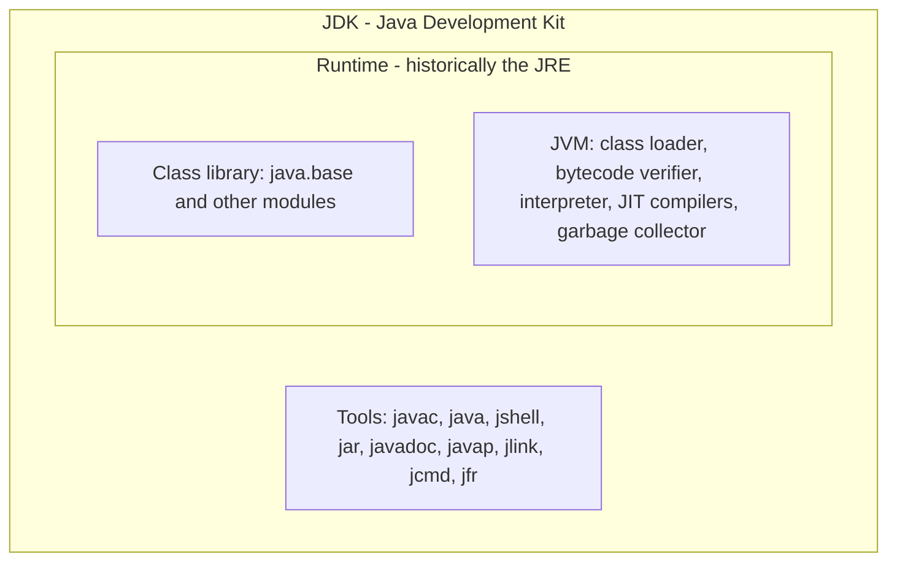
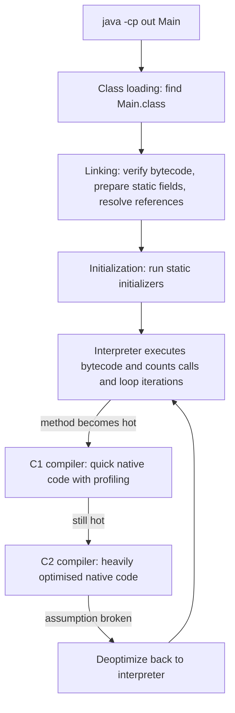
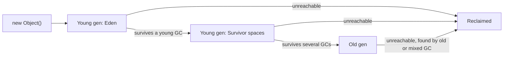

# Chapter 1 — Java and the JVM

What happens between typing `javac` (the Java compiler) and seeing output: setting up a JDK (Java Development Kit — compiler plus developer tools), three ways to **compile** (translate source code into a form a machine can execute) and run programs, what is inside a `.class` file, the Just-In-Time compiler and the garbage collector at work, `jshell`, and how Java versions and long-term-support releases work.

All code lives in [`code/`](code/), compiled with `javac --release 25` (the book targets **Java 25 LTS**) and run on JDK 26; machine-dependent output (timings, memory sizes) is flagged. Exam-level traps (class structure, `main` signatures, packages, GC eligibility): the OCP repo's [Chapter 1 — Building Blocks](../../../../ocp-java21-study/chapters/01-building-blocks/README.md).

---

## 1.1 What Java is

### What it is
Java is a **general-purpose, statically typed, object-oriented programming language** plus a **runtime platform** (the Java Virtual Machine) that runs compiled Java programs. A **runtime** is the software that must be present while a program runs, executing it and providing services such as memory management.

- *General-purpose*: not tied to one domain — banking back-ends, Android apps (historically), big-data engines, command-line tools.
- *Statically typed*: every variable has a type known at compile time, so the compiler rejects `int n = "five";` before the program runs.
- *Object-oriented*: code is organised into **classes** (blueprints) and **objects** (instances built from them). Modern Java also supports functional style — lambdas (short unnamed functions passed as values) and streams (pipelines that filter and transform data), Chapters 11–12.

Compiled Java runs on any machine with a JVM (Windows, macOS, Linux, containers — isolated packages such as Docker images that bundle an app with everything it needs): *"write once, run anywhere"*.

### A short history

| Year | Event |
|---|---|
| 1991–96 | James Gosling's team at Sun starts the "Green Project" (language: **Oak**); renamed **Java** and announced May 1995 (browser "applets" make it famous); JDK 1.0 January 1996. |
| 2004 | J2SE 5.0: generics, enhanced `for`, autoboxing, enums, annotations, varargs — the biggest language update until Java 8. |
| 2006–10 | Sun open-sources the JDK as **OpenJDK** (GPL v2 + Classpath Exception); Oracle acquires Sun (2010). |
| 2014 | Java 8: lambdas, streams, `java.time`. Still widely deployed. |
| 2017 | Java 9: the module system (JPMS — groups packages into named, sealed-off modules) and `jshell`. |
| 2018–21 | Java 10 starts the **six-month cadence** (March/September); Java 17 LTS (2021), LTS now every **two years**. |
| 2023 | Java 21 LTS: virtual threads, pattern matching for `switch`, record patterns. |
| 2025 | **Java 25 LTS** (16 Sept 2025): compact source files and instance `main`, flexible constructor bodies, module imports, scoped values. |
| 2026 | Java 26 (March) and Java 27 (15 Sept 2026) — non-LTS. |

### Design traits

| Trait | In practice | Caveat |
|---|---|---|
| Platform independence | Bytecode (the JVM's portable instruction format) runs on any OS/CPU with a JVM. | Target still needs a JVM or a native-image build (pre-compiled executable). |
| Static typing | Compiler catches type errors; IDEs refactor safely. | More declarations than Python/JS (softened by `var`, records). |
| Automatic memory management | A garbage collector frees unused objects; no `free()`/`delete`. | GC costs CPU/memory; you can still leak by keeping references (handles to objects). |
| Backward compatibility | Java 8 bytecode usually runs on Java 25. | Old APIs linger (`Date`, `Vector`). |
| Rich standard library | Collections, concurrency, networking, HTTP client, `java.time`, crypto. | Large; finding the modern API takes time. |
| Performance | The JIT turns hot (frequently run) code into optimised machine code. | Slower start-up/warm-up (mitigated by AOT — ahead-of-time — caches, native images). |
| Safety | No pointer arithmetic, bounds-checked arrays, verified bytecode. | Small cost. |

### Where Java is used
**Enterprise back-ends** (banks, airlines, retailers on Spring Boot / Jakarta EE — **frameworks**, large reusable libraries that structure an app); **big data** (Kafka, Cassandra, Elasticsearch, Hadoop, much of Flink); **developer tools** (IntelliJ IDEA, Eclipse, Maven, Gradle, Jenkins); **Android** (historically the Java *language* and much of its library on its own runtime, ART, not the JVM; Kotlin-first since 2019); Minecraft: Java Edition; Java Card on SIM and bank cards. **Kotlin, Scala, Groovy, Clojure** also compile to JVM bytecode and interoperate with Java libraries.

### TL;DR
Java = statically typed, object-oriented language + portable runtime (the JVM). Mature (1996), backward compatible, fast after warm-up, dominant in server-side and data infrastructure.

---

## 1.2 The Java ecosystem: SE, EE, OpenJDK and vendors

### What it is

| Name | What it is |
|---|---|
| **Java SE** (Standard Edition) | The *specification* of the language, JVM and core library (`java.lang`, `java.util`, …). Each version is defined through the Java Community Process (the formal process for agreeing changes). |
| **JDK** (Java Development Kit) | A concrete *implementation* of Java SE plus tools (`javac`, `jshell`, `jar`, `javadoc`, `jlink`…). |
| **OpenJDK** | The open-source project (openjdk.org) where the reference JDK is developed. Almost every downloadable JDK is built from it. |
| **Vendor builds** | Oracle JDK, Eclipse Temurin (Adoptium), Amazon Corretto, Azul Zulu, Microsoft Build of OpenJDK, Red Hat, BellSoft Liberica, SAP Machine. Same code base; different support, licensing, extras. |
| **Jakarta EE** (formerly Java EE) | Enterprise API specs on top of Java SE (servlets — handle web requests; JPA — persist objects to databases; CDI — wire objects together). Moved from Oracle to the Eclipse Foundation (2017) and renamed. |
| **Java ME / Java Card** | Small-device and smart-card editions. |
| **GraalVM** | Oracle JDK distribution with the Graal compiler and **Native Image**, which compiles Java ahead of time into a standalone native executable (no JVM needed). |

### Which vendor should I install?
For learning, any OpenJDK 25 build; **Eclipse Temurin** is a neutral choice. Companies choose by support contract, cloud (Corretto on AWS, Microsoft's build on Azure) or licensing. Oracle JDK 17+ uses the *Oracle No-Fee Terms and Conditions*: free **production** use for a limited period (JDK 25 updates free until September 2028), then later updates need a paid licence. Other vendors' OpenJDK builds are GPL.

### Common mistakes
- Thinking OpenJDK is lower quality than Oracle JDK — same source.
- Confusing Java with **JavaScript**; they share only a name and C-like syntax ([JavaScript Handbook](../../../javascript/)).

---

## 1.3 JDK, JRE and JVM

### What it is
Three nested layers:



| Layer | Contains | Who needs it |
|---|---|---|
| **JVM** (Java Virtual Machine) | Abstract machine that loads, verifies and executes bytecode (interpreting and JIT-compiling) and manages memory. **HotSpot** is the JVM in OpenJDK builds. | Every Java program at run time |
| **JRE** (Java Runtime Environment) | JVM + standard class library — enough to *run*, not compile. | End users (historically) |
| **JDK** | JRE + development tools (`javac`, `jshell`, `jar`, `javadoc`, debuggers, profilers). | Developers — **install this** |

*Virtual machine* here means a program that acts as a CPU with its own instruction set (bytecode) — not a VirtualBox-style whole-computer emulator.

### Why the JRE "disappeared"
Since JDK 11, Oracle ships no separate JRE. Java 9's module system introduced **`jlink`**, which builds a **custom runtime** containing only the modules (named groups of packages, such as `java.base`) your app needs. Some vendors (e.g. Temurin) still publish JRE-only builds, mainly for containers.

A runtime with only `java.base` is enough for `HelloWorld`:

```bash
jlink --add-modules java.base --strip-debug --no-header-files --no-man-pages --output rt
du -sh rt                      # 44M   (the full JDK folder here is 377M)
rt/bin/java -cp out ch01.hello.HelloWorld
```
Output:
```text
Hello, World!
Arguments received: 0
```

### In the interview
**Q: Difference between JDK, JRE and JVM?** The JVM executes bytecode and manages memory; the JRE is JVM + standard library (enough to run); the JDK is JRE + tools like `javac`. Developers install a JDK; production images often use a `jlink`-trimmed runtime.
- *Is the JVM platform-independent?* No — the **bytecode** is portable; each OS/CPU needs its own JVM build.
- *What is HotSpot?* OpenJDK's JVM, named for finding "hot" code and compiling it.
- *Is a JRE enough to compile?* No — you need the JDK (`javac`).

---

## 1.4 Installing a JDK and checking it works

### How it works
1. **Download** an OpenJDK 25 build (e.g. Temurin from adoptium.net), or use **SDKMAN!** (`sdk list java`, `sdk install java <identifier>`) or an OS package manager (`apt`, Homebrew).
2. **Set `JAVA_HOME`** to the JDK folder and put `$JAVA_HOME/bin` on `PATH` (build tools and IDEs read `JAVA_HOME`). An **environment variable** is a named setting the OS passes to every program; `PATH` lists folders searched for commands. macOS: `export JAVA_HOME=$(/usr/libexec/java_home -v 25)`; Linux: `export JAVA_HOME=/usr/lib/jvm/<jdk-folder>`; Windows: *System Properties → Environment Variables*, add `%JAVA_HOME%\bin` to `Path`.
3. **Verify** in a new terminal:

```bash
java -version
javac -version
```
Output (on the machine used for this book):
```text
openjdk version "26" 2026-03-17
OpenJDK Runtime Environment (build 26+35-2893)
OpenJDK 64-Bit Server VM (build 26+35-2893, mixed mode, sharing)
javac 26
```
*"mixed mode"* = the JVM both interprets and JIT-compiles; *"sharing"* = it uses Class Data Sharing (a pre-parsed archive of core classes that speeds start-up).

### Compiling for an older version: `--release`
`javac --release 25 …` checks code against the Java 25 language **and** API, so a newer JDK cannot let a Java 26 method slip in. That is how this book targets 25 on JDK 26. The older `-source`/`-target` pair does not check the API — prefer `--release`.

### Common mistakes
- Several JDKs installed, with `java` and `javac` on `PATH` from different ones — check both versions.
- `JAVA_HOME` pointing at `bin` instead of the JDK root.
- Installing only a JRE, then `javac`: "command not found".

---

## 1.5 Write → compile → run

### What it is
Java is **compiled in two stages**: `javac` turns source (`.java`) into platform-neutral **bytecode** (`.class` files); the `java` launcher starts a JVM that loads and runs it.


### The program
[`code/HelloWorld.java`](code/HelloWorld.java):
```java
package ch01.hello;

/** The classic first program: one public class, one entry point. */
public class HelloWorld {
    public static void main(String[] args) {
        System.out.println("Hello, World!");
        System.out.println("Arguments received: " + args.length);
    }
}
```

| Part | Meaning |
|---|---|
| `package ch01.hello;` | The **package** (namespace); must be the first statement. Fully qualified name: `ch01.hello.HelloWorld`. See [Chapter 5](../05-oop-classes-and-objects/README.md). |
| `/** … */` | **Javadoc comment**, turned into HTML API docs by `javadoc`. `//` is a line comment, `/* … */` a block comment. |
| `public class HelloWorld` | At most one **public** top-level class per file, and the file must be named after it. |
| `public static void main(String[] args)` | The **entry point**. `public` = callable from anywhere; `static` = no object needed; `void` = returns nothing; `args` = command-line arguments ([Chapter 4](../04-methods-and-arrays/README.md)). |
| `System.out.println(...)` | Prints a line to **standard output** (the terminal by default). `System` is in `java.lang` (imported automatically — an *import* lets you use a class by its short name); `out` is its static `PrintStream` field (a class-level variable holding a text-writing object). |
| `;` and `{ }` | Statements end with a semicolon; braces group blocks. Java ignores indentation. |

Since Java 25 a class may instead declare `void main()` (no `static`, no parameters) — see [1.10](#110-launching-source-files-directly). `public static void main(String[] args)` remains the standard and works in every version.

### How to compile and run
```bash
javac -d out HelloWorld.java             # compile; -d puts classes in out/ch01/hello/
java -cp out ch01.hello.HelloWorld        # run: class path + fully qualified class name
java -cp out ch01.hello.HelloWorld a b c
```
Output:
```text
Hello, World!
Arguments received: 0
Hello, World!
Arguments received: 3
```
1. `javac` parses the file, checks types and writes `out/ch01/hello/HelloWorld.class` (folders mirror the package).
2. `java` starts a JVM; `-cp` (class path) says where to look for classes.
3. The JVM loads `ch01.hello.HelloWorld`, finds `main`, and calls it with the arguments.

### Reading errors: compile-time vs run-time
`javac` reports compile errors with file, line and a caret:

```text
Hello.java:3: error: ';' expected
        System.out.println("hi")
                                ^
```
```text
Hello.java:1: error: class Greeting is public, should be declared in a file named Greeting.java
```
```text
Hello.java:3: error: incompatible types: String cannot be converted to int
        int n = "five";
                ^
```
Launcher errors happen when `java` cannot find the class:

| Command | Error | Fix |
|---|---|---|
| `java hello` | `NoClassDefFoundError: hello (wrong name: Hello)` on macOS/Windows (case-insensitive file systems); `ClassNotFoundException: hello` on Linux | Class names are case-sensitive. |
| `java Hello.class` | `ClassNotFoundException: Hello.class` | Pass the class **name**, not the file name. |
| `java HelloWorld` (class is in a package) | `Could not find or load main class HelloWorld` | Use the fully qualified name and the right `-cp`. |

### Packaging a JAR
A **JAR** (Java ARchive) is a ZIP of classes plus a manifest (metadata file); a `Main-Class` entry makes it runnable:
```bash
jar --create --file hello.jar --main-class ch01.hello.HelloWorld -C out .
java -jar hello.jar one two
```
Output:
```text
Hello, World!
Arguments received: 2
```
Real projects let Maven or Gradle build JARs ([Chapter 18](../18-testing-build-and-tooling/README.md)).

### Common mistakes
- File name ≠ public class name (case matters: `helloworld.java` fails for `HelloWorld`).
- Missing/wrong `-cp`, or running from inside the package folder.
- Misspelt `main` signature (e.g. `String args` without `[]`) in a traditional class — compiles, but the launcher reports no suitable main method.

### TL;DR
`javac` → bytecode; `java -cp <dir> <package.Class>` → JVM runs it. `-d out` puts `ch01.hello.HelloWorld` at `out/ch01/hello/HelloWorld.class`. One public top-level class per file, named like the file.

---

## 1.6 Bytecode and class files

### What it is
**Bytecode** is the JVM's instruction set: compact one-byte opcodes (operation codes such as `iload`, `iadd`, `invokevirtual`) for a **stack machine** — instructions push values onto an operand stack and pop them to compute. A `.class` file holds one class's bytecode plus a **constant pool** (names, strings, method references) and metadata.

### Why it matters
- It is the unit of portability: the same `.class` runs on every JVM.
- The JVM verifies it before running (no forged pointers, no operand-stack overflow/underflow, no jumps into the middle of an instruction).
- Tools — profilers (measure time/memory), mocking libraries (fake objects for tests), Spring, Hibernate — read or generate bytecode at run time.

### Looking inside with `javap`
[`code/Calculator.java`](code/Calculator.java):
```java
package ch01.bytecode;

public class Calculator {
    static int add(int a, int b) {
        return a + b;
    }

    public static void main(String[] args) {
        int total = add(2, 3);
        System.out.println("2 + 3 = " + total);
    }
}
```
`javap -c -cp out ch01.bytecode.Calculator` (the JDK's disassembler):
```text
public class ch01.bytecode.Calculator {
  public ch01.bytecode.Calculator();
    Code:
         0: aload_0
         1: invokespecial #1                  // Method java/lang/Object."<init>":()V
         4: return

  static int add(int, int);
    Code:
         0: iload_0
         1: iload_1
         2: iadd
         3: ireturn

  public static void main(java.lang.String[]);
    Code:
         0: iconst_2
         1: iconst_3
         2: invokestatic  #7                  // Method add:(II)I
         5: istore_1
         6: getstatic     #13                 // Field java/lang/System.out:Ljava/io/PrintStream;
         9: iload_1
        10: invokedynamic #19,  0             // InvokeDynamic #0:makeConcatWithConstants:(I)Ljava/lang/String;
        15: invokevirtual #23                 // Method java/io/PrintStream.println:(Ljava/lang/String;)V
        18: return
}
```
1. `javac` added a **default constructor** `Calculator()` (a constructor sets up a new object) that calls `Object`'s constructor — you did not write it.
2. `add`: `iload_0`/`iload_1` push the two `int` parameters, `iadd` pops both and pushes the sum, `ireturn` returns it (`i` = int).
3. `main`: pushes 2 and 3, calls `add` (`(II)I` = two ints in, int out), stores the result in local slot 1.
4. String concatenation compiles to `invokedynamic … makeConcatWithConstants` (since Java 9), letting the JVM choose the fastest strategy at run time.

### Class-file version
Every class file starts with the magic number `CAFEBABE` (fixed bytes identifying the file type), then a **major version**: major = 44 + Java version.

| Java | 8 | 11 | 17 | 21 | 25 | 26 |
|---|---|---|---|---|---|---|
| Major version | 52 | 55 | 61 | 65 | **69** | 70 |

```bash
javap -v -cp out ch01.bytecode.Calculator | grep major   # major version: 69
xxd out/ch01/bytecode/Calculator.class | head -1          # cafe babe 0000 0045 ...  (0x45 = 69)
```
An older JVM refuses newer class files with `UnsupportedClassVersionError` ("compiled by a more recent version of the Java Runtime (class file version 69.0), this version … only recognizes class file versions up to 65.0" — i.e. compiled by Java 25, run on 21). Fix: run on a newer JVM or compile with `--release <older>`.

---

## 1.7 How the JVM runs your code: class loading, interpreter, JIT

### How it works

1. **Class loading.** *Class loaders* turn `.class` bytes into classes, lazily (the first time a class is actively used). Three built-in loaders: **bootstrap** (core `java.base`), **platform** (other JDK modules), **application/system** (your class path). Each asks its parent first (*parent delegation*), so you cannot replace `java.lang.String`.
2. **Linking.** *Verification* checks the bytecode is type-safe and well-formed; *preparation* allocates static fields with default values; *resolution* turns symbolic names (e.g. `java/io/PrintStream.println`) into direct references (lazily).
3. **Initialization.** Static field initializers and `static { }` blocks run, once per class.
4. **Execution.** The **interpreter** runs bytecode instruction by instruction — instant start, slow — counting how often each method and loop runs.
5. **JIT compilation.** *Just-In-Time* compilation converts **hot** methods to native code while the program runs. HotSpot uses **tiered compilation** (default since Java 8):

| Tier | Who | What |
|---|---|---|
| 0 | Interpreter | Runs bytecode, gathers counts |
| 1–3 | **C1** ("client") compiler | Compiles fast, light optimisation; tier 3 adds profiling (which types and branches actually occur) |
| 4 | **C2** ("server") compiler | Uses the profile for aggressive optimisation |

C2's optimisations: **inlining** (copy a small method's body into the caller), **loop unrolling** (repeat the body several times per iteration to cut loop overhead), **escape analysis** (objects that never leave a method need not live on the heap), **dead-code removal** (delete work whose result is unused).

6. **Speculation and deoptimization.** C2 optimises for what it has *seen* (e.g. "this call always hits `ArrayList`"). If that breaks, the JVM discards the compiled code ("uncommon trap"), returns to the interpreter, and may recompile. This is why a JIT can beat a static compiler: it optimises for the types and branches actually seen.

### Watching the JIT
[`code/HotLoop.java`](code/HotLoop.java) calls a tiny method five million times:
```java
static long square(long x) { return x * x; }

public static void main(String[] args) {
    long sum = 0;
    for (long i = 0; i < 5_000_000; i++) {
        sum += square(i % 1000);
    }
    System.out.println("sum = " + sum);
}
```
`java -XX:+PrintCompilation -cp out ch01.jit.HotLoop | grep -E "HotLoop|sum ="` (real output; timestamps vary):
```text
15    9       3       ch01.jit.HotLoop::square (4 bytes)
15   10       4       ch01.jit.HotLoop::square (4 bytes)
15    9       3       ch01.jit.HotLoop::square (4 bytes)   made not entrant: not used
16   11 %     3       ch01.jit.HotLoop::main @ 4 (43 bytes)
16   12       3       ch01.jit.HotLoop::main (43 bytes)
16   13 %     4       ch01.jit.HotLoop::main @ 4 (43 bytes)
16   11 %     3       ch01.jit.HotLoop::main @ 4 (43 bytes)   made not entrant: OSR invalidation of lower level
19   13 %     4       ch01.jit.HotLoop::main @ 4 (43 bytes)   made not entrant: uncommon trap
sum = 1664167500000
```
Columns: ms since start, compile ID, flags, **tier**, method. `square` was compiled by C1 (tier 3) then C2 (tier 4) in the same millisecond, and the C1 version discarded ("made not entrant"). `%` = **on-stack replacement (OSR)**: `main` runs once but its loop is hot, so the JVM compiles the loop and switches to it *while the method is running*. The last line is a deoptimization.

### Start-up and warm-up: AOT caching
Starting in the interpreter makes a Java service slower for its first seconds (**warm-up**). Recent JDKs record an **ahead-of-time (AOT) cache** from a training run:
- JDK 24 (JEP 483 — a *JEP* is a numbered JDK Enhancement Proposal, [1.12](#112-java-releases-lts-and-jeps)): classes loaded and linked ahead of time into a cache.
- JDK 25 (JEP 514): one-step creation — `java -XX:AOTCacheOutput=app.aot …` on a training run, then `java -XX:AOTCache=app.aot …` in production.
- JDK 25 (JEP 515): the cache also stores method profiles, so the JIT optimises sooner.

**GraalVM Native Image** instead compiles the whole app to a native executable before it runs: very fast start-up and small memory, at the cost of long builds and restrictions on reflection (inspecting classes and calling methods by name at run time) and dynamic class loading.

### Trade-offs: interpreted vs JIT vs AOT

| Approach | Start-up | Peak speed | Portability | Example |
|---|---|---|---|---|
| Pure interpretation | Instant | Slow | High | Early JVMs, CPython |
| JIT (HotSpot) | Slower (warm-up) | Very high — uses live profiles | High (bytecode) | Normal `java` |
| AOT cache (JDK 24+) | Faster | Same as JIT | High | `-XX:AOTCache` |
| Native image | Very fast | Good, often a bit lower without profile data | One binary per OS/CPU | GraalVM `native-image` |

### In the interview
**Q: Is Java compiled or interpreted?** Both. `javac` compiles source to bytecode ahead of time; the JVM interprets it and JIT-compiles hot methods to native code using profiling data — so long-running services get faster after warm-up.
- *Tiered compilation?* Interpreter → C1 (fast compile, profiling) → C2 (optimising compile using the profile).
- *Deoptimization?* Discarding compiled code whose speculative assumption became false and returning to the interpreter.
- *Why is a simple timing-loop microbenchmark misleading?* It mixes interpreted, C1 and C2 phases and the JIT may remove "useless" work; use JMH (Java Microbenchmark Harness; [Chapter 16](../16-jvm-internals-and-performance/README.md)).

---

## 1.8 Memory and garbage collection — an overview

The picture you need now; algorithms, tuning and profiling are in [Chapter 16](../16-jvm-internals-and-performance/README.md).

### What it is
> **Key term — thread:** one independent sequence of instructions inside a program. A program can run many at once (e.g. one per web request); each has its own call stack but shares the heap. Covered in the concurrency chapters.

| Area | Holds | Lifetime |
|---|---|---|
| **Stack** (one per thread) | *Frames* per method call: locals, parameters, partial results. Primitive locals live here; for objects only the **reference** (pointer-like handle). | Frame disappears when the method returns |
| **Heap** (shared) | All objects and arrays (`new …`). | Until the GC reclaims them |
| **Metaspace** | Class metadata (methods, field layouts), in native memory (outside the Java heap). | While the class loader is alive |
| **Code cache** | JIT-compiled machine code. | Until evicted/deoptimized |

So in a method, `int x = 5;` lives on the stack; `new int[5]` lives on the heap with its reference on the stack.

**Garbage collection (GC)** automatically reclaims heap objects that are no longer **reachable** — no chain of references leads to them from a **GC root** (a local in an active frame, a static field, an active thread, a few JVM-internal references). Unreachable objects are garbage even if they point to each other, so reference cycles are collected.

### How it works (the common core)
1. **Mark**: from the roots, follow references and mark every reachable object.
2. **Sweep / compact / copy**: free unmarked memory; many collectors also move live objects together to avoid fragmentation (free memory scattered in gaps too small to use).
3. **Generations**: most objects die young (the *weak generational hypothesis* — e.g. temporary strings in a request). Generational collectors split the heap into a **young generation**, collected often and cheaply (most of it is dead; only the few live objects are copied), and an **old generation** for survivors, collected rarely.
4. **Pauses**: some work stops application threads (**stop-the-world** pause); modern collectors do most work **concurrently** with your threads.



### The collectors in JDK 25

| Collector | Flag | Design | Good for |
|---|---|---|---|
| **G1** (Garbage-First) | `-XX:+UseG1GC` | Generational, region-based (heap split into equal chunks), mostly concurrent marking; pause-time goal (default 200 ms) | **The default** — general servers and desktops |
| **ZGC** | `-XX:+UseZGC` | Concurrent, generational (the only mode since JDK 24); pauses typically under 1 ms regardless of heap size | Large heaps, latency-sensitive services (per-request time matters) |
| **Shenandoah** | `-XX:+UseShenandoahGC` | Concurrent compacting; generational mode became a product feature in JDK 25 | Low latency; in many OpenJDK builds (not Oracle JDK) |
| **Parallel** | `-XX:+UseParallelGC` | Stop-the-world, many threads; maximises throughput (work done per second) | Batch jobs where pauses do not matter |
| **Serial** | `-XX:+UseSerialGC` | Single-threaded, stop-the-world | Tiny heaps, small containers |
| **Epsilon** | experimental | Allocates, never collects | Testing, very short-lived jobs |

The JVM picks G1 unless the machine looks "small" (fewer than 2 CPUs or under 1792 MB), where it picks Serial; JDK 27 (JEP 523) makes G1 the default everywhere. Default max heap = ¼ of physical memory — `WhereAmI` below reports 12 288 MiB on a 48 GiB machine (1 MiB = 1024 × 1024 bytes, 1 GiB = 1024 MiB). **Latency** and **throughput** recur in [System Design Fundamentals](../../../system-design-patterns/modules/00-system-design-fundamentals/README.md).

### Watching the GC
[`code/GarbageMaker.java`](code/GarbageMaker.java) creates 200 000 short-lived 1 KiB arrays and keeps ten 1 MiB arrays:
```java
List<byte[]> keep = new ArrayList<>();          // long-lived: stays reachable
for (int i = 0; i < 200_000; i++) {
    byte[] temp = new byte[1024];                // short-lived: garbage after this iteration
    temp[0] = (byte) i;
    created++;
    if (i % 20_000 == 0) keep.add(new byte[1024 * 1024]);
}
```
`java -Xlog:gc -Xmx256m -cp out ch01.gc.GarbageMaker` (selected lines from one run; timings and sequence vary):
```text
[0.004s][info][gc] Using G1
[0.017s][info][gc] GC(0) Pause Young (Concurrent Start) (G1 Humongous Allocation) 1M->1M(10M) 0.407ms
[0.017s][info][gc] GC(1) Concurrent Mark Cycle
[0.018s][info][gc] GC(2) Pause Young (Normal) (G1 Evacuation Pause) 6M->3M(10M) 0.195ms
[0.022s][info][gc] GC(4) Pause Young (Prepare Mixed) (G1 Evacuation Pause) 22M->5M(30M) 0.580ms
[0.024s][info][gc] GC(5) Pause Young (Mixed) (G1 Evacuation Pause) 22M->5M(30M) 0.305ms
...
temporary arrays created: 200000
arrays still reachable  : 10
```
`22M->5M(30M) 0.580ms` = heap used before → after (current heap size), pause length. Young collections free most memory because the temporary arrays are dead. "Humongous" = an object at least half a G1 region (the 1 MiB arrays), allocated specially. With `-XX:+UseZGC` the first line reads `Using The Z Garbage Collector`.

Ask the JVM about itself with [`code/WhereAmI.java`](code/WhereAmI.java):
```java
Runtime.Version v = Runtime.version();
System.out.println("Feature release : " + v.feature());
System.out.println("class file ver. : " + System.getProperty("java.class.version"));
System.out.println("Max heap (MiB)  : " + Runtime.getRuntime().maxMemory() / (1024 * 1024));
```
Output (this machine; yours will differ):
```text
Feature release : 26
java.vendor     : Oracle Corporation
java.vm.name    : OpenJDK 64-Bit Server VM
class file ver. : 70.0
os.name         : Mac OS X
CPU cores seen  : 14
Max heap (MiB)  : 12288
```
Compiled for Java 25, running on JDK 26 — newer JVMs run older class files.

### Common mistakes
- Believing Java cannot leak: a static `Map` cache that only grows keeps every entry reachable forever — a **memory leak**.
- Calling `System.gc()` to "free memory": only a request, usually harmful.
- Relying on `finalize()`: deprecated for removal (JEP 421, Java 18). Use try-with-resources ([Chapter 8](../08-exceptions/README.md)).
- `-Xmx` (max heap) larger than the container's memory limit (the JVM reads container limits automatically; let it, or size explicitly).

### In the interview
**Q: How does Java GC decide what to free?** By reachability, not reference counting (counting references to each object): anything not reachable from GC roots (thread stacks, static fields, JNI handles — references held by native code via the Java Native Interface) is garbage, so cycles are collected. Most collectors are generational because most objects die young.
- *Default GC?* G1 since Java 9 on server-class machines.
- *When ZGC?* Large heaps or strict latency targets, where sub-millisecond pauses matter more than a little throughput.
- *Stack vs heap?* Stack: per-thread frames with locals, freed on return. Heap: shared objects, freed by GC.

### TL;DR
Stack = method frames; heap = objects. GC frees unreachable objects; generational collectors exploit "most objects die young". Default G1; ZGC/Shenandoah for low latency; Parallel for throughput.

---

## 1.9 jshell — the Java REPL

### What it is
`jshell` (Java 9, JEP 222) is a **REPL** — *Read-Evaluate-Print Loop*: type a snippet, see the result, no class or `main` needed. A scratchpad for trying APIs; anything you want to keep, test or share belongs in a source file.

### A session
```text
|  Welcome to JShell -- Version 26
|  For an introduction type: /help intro

jshell> int x = 21
x ==> 21

jshell> x * 2
$2 ==> 42

jshell> "Java".length()
$3 ==> 4

jshell> String shout(String s) { return s.toUpperCase() + "!"; }
|  created method shout(String)

jshell> shout("hi")
$5 ==> "HI!"

jshell> /vars
|    int x = 21
|    int $2 = 42
|    int $3 = 4
|    String $5 = "HI!"
```
- Unassigned expressions get reusable scratch names (`$2`, `$3`…).
- Semicolons are optional for single statements; methods can be declared at top level and redefined.

| Command | Does |
|---|---|
| `/help`, `/help intro` | Help |
| `/vars`, `/methods`, `/types`, `/imports` | List definitions/imports |
| `/list` | Show your snippets |
| `/edit <name>` | Open a snippet in an editor |
| `/save file.jsh`, `/open file.jsh` | Save/load a session |
| `/reset`, `/exit` | Clear state, quit |
| Tab | Completion and method signatures |

On JDK 26, `/imports` shows `import java.base`, so every public class in `java.base` is usable without imports.

---

## 1.10 Launching source files directly

### Single-file and multi-file source launch
Since **Java 11** (JEP 330) `java Hello.java` compiles a single file in memory and runs it; no `.class` files are written. Since **Java 22** (JEP 458) the program may use other source files in the same directory tree, compiled on demand.

[`code/launch/Main.java`](code/launch/Main.java) uses [`code/launch/Greeter.java`](code/launch/Greeter.java):
```java
// Main.java
public class Main {
    public static void main(String[] args) {
        System.out.println(Greeter.greet("launcher"));
    }
}
// Greeter.java
public class Greeter {
    static String greet(String who) {
        return "Hello from " + who + ", compiled in memory";
    }
}
```
```bash
cd code/launch && java Main.java
```
Output:
```text
Hello from launcher, compiled in memory
```
On Linux/macOS a single-file program can start with a **shebang** line (`#!` first line naming the program to run the file), e.g. `#!/usr/bin/env -S java --source 25`, in a file *without* the `.java` extension, and run as a script.

### Compact source files and instance `main` — Java 25
JEP 512 (final in **Java 25**, after previews — opt-in trial versions, [1.12](#112-java-releases-lts-and-jeps) — in 21–24):
- A **compact source file** may declare methods and fields with no enclosing class; the compiler wraps them in an implicit `final` class (cannot be extended).
- `main` may be a parameterless **instance method** (runs on an object, not the class): `void main()`.
- It automatically imports every public class of `java.base` (as if it began with `import module java.base;`), so `List`, `Map`, `Path` need no imports.
- New class **`java.lang.IO`**: `IO.println(…)`, `IO.print(…)`, `IO.println()`, `IO.readln(prompt)`/`IO.readln()` for simple console I/O (built on `System.out` and `System.in`).

[`code/compact/HelloCompact.java`](code/compact/HelloCompact.java) — the whole file:
```java
void main() {
    List<String> langs = List.of("Java", "Kotlin", "Scala");   // java.util.List without an import
    IO.println("Hello from a compact source file!");
    IO.println("JVM languages: " + langs);
}
```
```bash
cd code/compact && java HelloCompact.java
```
Output:
```text
Hello from a compact source file!
JVM languages: [Java, Kotlin, Scala]
```
How the launcher chooses `main`: `main(String[])` if present, else a no-argument `main()`. If the chosen method is not `static`, it first creates an instance with the no-argument constructor.

### Trade-offs

| Style | Best for | Limits |
|---|---|---|
| `javac` + `java` | Real applications, packages, dependencies | Two steps |
| `java File.java` | Scripts, examples, teaching, small tools | Compiles every run; no dependency management |
| Compact source file | First programs, quick utilities | No `package`; cannot be referenced by name from other code; becomes a normal class as it grows |

### Common mistakes
- Adding a `package` declaration to a compact source file (not allowed).
- Expecting instance `main` on Java 21 without `--enable-preview` — preview until Java 25.

---

## 1.11 IDEs, editors and build tools

### What they are
An **IDE** (Integrated Development Environment) combines editor, compiler integration, debugger (pauses a running program to step through and inspect variables), refactoring and test runner: **IntelliJ IDEA** (JetBrains; most popular, strongest refactoring; free and paid tiers), **Eclipse** (free, open source, its own incremental compiler), **VS Code** + *Extension Pack for Java* (lightweight, mixed-language work), **Apache NetBeans** (free, open source).

**Build tools** automate compiling, downloading **dependencies** (external libraries your project uses, at the right versions), testing and packaging: **Maven** (XML `pom.xml`, fixed lifecycle) and **Gradle** (Groovy/Kotlin DSL — a small build-script language; flexible and incremental, rebuilding only what changed). Both read `JAVA_HOME` and support *toolchains* to pin a JDK version. Details: [Chapter 18](../18-testing-build-and-tooling/README.md).

Suggested path: plain `javac`/`java`/`jshell` for Chapters 1–3; an IDE from Chapter 5 (multiple classes, packages); Maven/Gradle for anything with dependencies.

### Coding conventions (used throughout this book)

| Kind | Convention | Example |
|---|---|---|
| Class, interface, record, enum | `UpperCamelCase` noun | `OrderService`, `Shape` |
| Method, variable | `lowerCamelCase`; methods are verbs | `computeTotal()`, `itemCount` |
| Constant (`static final`) | `UPPER_SNAKE_CASE` | `MAX_RETRIES` |
| Package | all lowercase, reversed domain | `com.example.billing` |
| Indentation | 4 spaces; opening brace on the same line | `if (x) {` |

---

## 1.12 Java releases, LTS and JEPs

### How the release model works
- A **feature release** ships every six months, **March** and **September** (since Java 10, 2018). Version numbers are counters: 25, 26, 27…
- Each gets a couple of quarterly **update releases** (25.0.1, 25.0.2) from Oracle's OpenJDK builds; vendors keep patching the **LTS** ones.
- **Long-Term Support (LTS)** releases: **8, 11, 17, 21, 25** — every two years since 17; next expected September 2027 (Java 29). Oracle offers at least eight years of LTS support (five Premier + three Extended).
- Non-LTS releases (22, 23, 24, 26, 27…) are production-quality but supported only until the next release.


### JEPs and feature maturity
New features are proposed in **JEPs** (JDK Enhancement Proposals, openjdk.org/jeps), e.g. *JEP 512: Compact Source Files and Instance Main Methods*. Stages:

| Stage | Meaning | How to use it |
|---|---|---|
| **Incubator** | Experimental API in a `jdk.incubator.*` module (e.g. the Vector API, still incubating in 27) | `--add-modules jdk.incubator.vector` |
| **Preview** | Complete language/VM/API feature that may still change | `javac --release 25 --enable-preview …` and `java --enable-preview …` |
| **Final / permanent** | Standard, stable part of Java | Just use it |
| **Withdrawn** | Removed before final (e.g. *string templates*, previewed 21–22, dropped in 23) | — |

This book marks each modern feature with the version that **finalised** it (e.g. *records — Java 16*). Full tour: [Chapter 17](../17-modern-java-17-to-25/README.md).

### Which version should I use?
| Situation | Pick |
|---|---|
| New project, or learning | **Java 25 LTS** |
| Existing Java 17/21 service | Stay while supported; plan an upgrade to 25 (mostly smooth — run tests on the new JDK first) |
| Legacy Java 8 | 8 → 11 → 17 → 21/25 needs attention to removed Java EE modules and strong encapsulation of JDK internals (code can no longer reach the JDK's private implementation classes) |
| Library you publish | Compile with `--release` of the *oldest* Java you support |

### In the interview
**Q: What is an LTS release and why does it matter?** A feature release vendors support for many years (8, 11, 17, 21, 25); companies standardise on them to avoid upgrading every six months.
- *How often does Java release?* Every six months (March/September); LTS every two years. Java 26 is not LTS.
- *Preview feature?* Finished-but-not-final; opt in with `--enable-preview` on both `javac` and `java`; may change or be withdrawn.
- *Name three Java 21 features.* Virtual threads, pattern matching for `switch`, record patterns, sequenced collections.

---

## Chapter TL;DR
- **Java** = statically typed, object-oriented language + portable runtime. Current LTS **Java 25** (Sept 2025); releases every March/September, LTS every two years.
- **JDK ⊃ runtime (JRE) ⊃ JVM.** Install a JDK; ship a `jlink` runtime or container image.
- **`javac`** compiles `.java` → `.class` bytecode (major version 69 = Java 25); **`java`** runs it. `--release N` targets an older Java safely.
- The JVM **loads lazily, verifies, interprets, then JIT-compiles** hot code (C1 → C2) using profiles; AOT caches (JDK 24–25) and native images cut warm-up.
- **Stack** = frames and locals; **heap** = objects; **GC** frees unreachable objects. Default G1; ZGC/Shenandoah for low latency.
- **jshell** for experiments; **`java File.java`** runs sources directly (multi-file since 22); **compact source files + `void main()` + `IO`** final in **Java 25**.
- Exam traps: [OCP Chapter 1](../../../../ocp-java21-study/chapters/01-building-blocks/README.md). Next: [Chapter 2 — Basics: types, variables and operators](../02-basics-types-and-operators/README.md).
