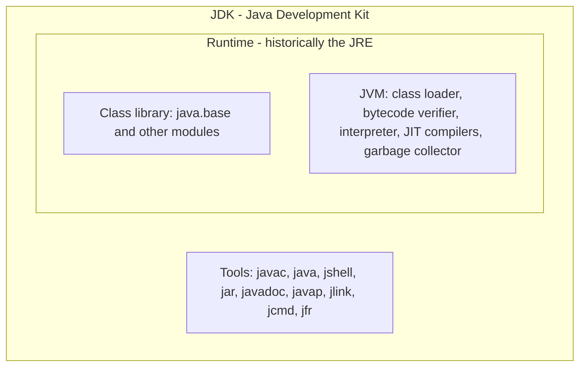
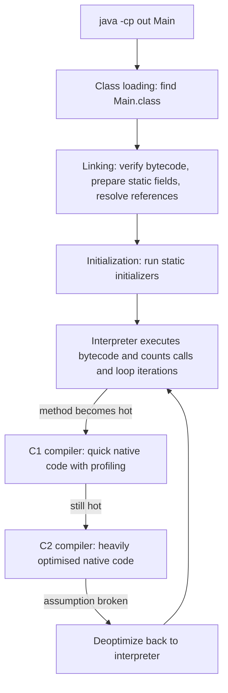
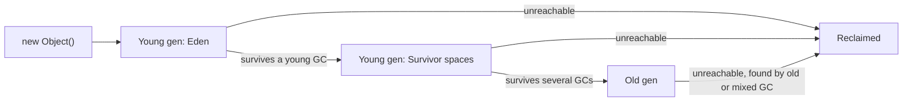

# Chapter 1 — Java and the JVM

This chapter explains what Java is and what actually happens between typing `javac` and seeing output. You will set up a JDK, write, compile and run programs three different ways, look inside a `.class` file, watch the Just-In-Time compiler and the garbage collector at work, experiment in `jshell`, and learn how Java versions and long-term-support releases work, so you can choose the right JDK for a project.

**What you'll learn**

| # | Topic | You will be able to… |
|---|---|---|
| 1.1 | What Java is | explain Java, its history and where it is used in one minute |
| 1.2 | The Java ecosystem | tell Java SE, Jakarta EE, OpenJDK and vendor builds apart |
| 1.3 | JDK, JRE and JVM | say what each one contains and which one you install |
| 1.4 | Installing a JDK | install Java 25, set `JAVA_HOME`, verify the tools |
| 1.5 | Write → compile → run | build `HelloWorld`, read compiler errors, package a JAR |
| 1.6 | Bytecode and class files | read `javap -c` output and class-file versions |
| 1.7 | How the JVM runs code | describe class loading, the interpreter, JIT tiers and AOT caching |
| 1.8 | Memory and garbage collection | explain stack vs heap, reachability, generations and the collectors |
| 1.9 | jshell | try code instantly in the REPL |
| 1.10 | Launching source files | run `.java` files directly, including compact source files (Java 25) |
| 1.11 | IDEs and build tools | pick an editor and know where Maven/Gradle fit |
| 1.12 | Releases, LTS and JEPs | choose a Java version and read a feature's status |

All code lives in [`code/`](code/). It was compiled with `javac --release 25` (the book targets **Java 25 LTS**) and run on the JDK 26 installed on the author's machine; where output depends on the machine (timings, memory sizes) that is stated. For exam-level detail and traps on this material (class structure, `main` signatures, packages, garbage-collection eligibility), see the OCP repo's [Chapter 1 — Building Blocks](../../../../ocp-java21-study/chapters/01-building-blocks/README.md).

---

## 1.1 What Java is

### What it is
Java is a **general-purpose, statically typed, object-oriented programming language** together with a **runtime platform** (the Java Virtual Machine) that runs compiled Java programs.

- *General-purpose*: not tied to one domain — the same language builds banking back-ends, Android apps (historically), big-data engines and command-line tools.
- *Statically typed*: every variable has a type known at compile time, so the compiler rejects `int n = "five";` before the program ever runs.
- *Object-oriented*: code is organised into **classes** (blueprints) and **objects** (instances built from them). Modern Java also supports functional style (lambdas, streams — Chapters 11–12).

Analogy: Java source is like a recipe written in one standard language; the JVM is a professional kitchen installed in every restaurant (Windows, macOS, Linux, containers). Write the recipe once and any kitchen can cook it. That is the origin of the slogan *"write once, run anywhere"*.

### A short history

| Year | Event |
|---|---|
| 1991 | James Gosling and a small team at Sun Microsystems start the "Green Project" for consumer devices. The language is first called **Oak**. |
| 1995 | Renamed **Java** and announced publicly (May 1995); browser "applets" make it famous. |
| 1996 | JDK 1.0 released (January 1996). |
| 2004 | J2SE 5.0: generics, enhanced `for`, autoboxing, enums, annotations, varargs — the biggest language update until Java 8. |
| 2006–07 | Sun open-sources the JDK as **OpenJDK** (GPL v2 with the Classpath Exception). |
| 2010 | Oracle acquires Sun and becomes Java's steward. |
| 2014 | Java 8: lambdas, streams, `java.time`. Still widely deployed. |
| 2017 | Java 9: the module system (JPMS) and `jshell`. |
| 2018 | Java 10 starts the **six-month release cadence** (a new feature release every March and September). |
| 2021 | Java 17 LTS; long-term-support releases now every **two years**. |
| 2023 | Java 21 LTS: virtual threads, pattern matching for `switch`, record patterns. |
| 2025 | **Java 25 LTS** (16 Sept 2025): compact source files and instance `main`, flexible constructor bodies, module imports, scoped values. |
| 2026 | Java 26 (March) and Java 27 (15 Sept 2026) — non-LTS feature releases. |

### Design traits

| Trait | What it means in practice | Honest caveat |
|---|---|---|
| Platform independence | Compiled bytecode runs on any OS/CPU that has a JVM. | You still need a JVM (or a native-image build) on the target. |
| Static typing | Type errors are caught by the compiler; IDEs can refactor safely. | More declarations than Python or JavaScript (softened by `var`, records). |
| Automatic memory management | A garbage collector frees unused objects; no `free()`/`delete`. | GC uses CPU and memory; you can still leak by keeping references. |
| Backward compatibility | Code compiled for Java 8 usually runs unchanged on Java 25. | Old APIs linger (e.g. `Date`, `Vector`) and old habits persist. |
| Rich standard library | Collections, concurrency, networking, HTTP client, `java.time`, crypto — all built in. | Large; learning which API is the modern one takes time. |
| Performance | The JIT compiler turns hot code into optimised machine code; long-running servers are fast. | Start-up and warm-up are slower than native languages (mitigated by AOT caches, native images). |
| Safety | No pointer arithmetic, array bounds are checked, bytecode is verified. | Checks have a (small) cost. |

### Where Java is used (real-world examples)
- **Enterprise back-ends**: banks, insurers, airlines and retailers run large Spring Boot / Jakarta EE services.
- **Big data and streaming**: Apache Kafka, Apache Cassandra, Elasticsearch, Apache Hadoop and much of Apache Flink run on the JVM (written in Java and Scala).
- **Developer tools**: IntelliJ IDEA, Eclipse, Maven, Gradle, Jenkins.
- **Android**: apps were historically written in Java (Android uses the Java *language* and much of its library, but its own runtime, ART, not the JVM); Google has recommended Kotlin first since 2019.
- **Games**: Minecraft: Java Edition.
- **Embedded and smart cards**: Java Card runs on SIM and bank cards.

Other languages also compile to JVM bytecode — **Kotlin, Scala, Groovy, Clojure** — and interoperate with Java libraries. Learning the JVM helps with all of them.

### TL;DR
Java = a statically typed, object-oriented language + a portable runtime (the JVM). It is mature (1996), backward compatible, fast after warm-up, and dominant in server-side and data infrastructure.

---

## 1.2 The Java ecosystem: SE, EE, OpenJDK and vendors

### What it is
"Java" can mean several things. This table untangles them.

| Name | What it is |
|---|---|
| **Java SE** (Standard Edition) | The *specification* of the language, JVM and core library (`java.lang`, `java.util`, …). Each version (SE 25) is defined through the Java Community Process. |
| **JDK** (Java Development Kit) | A concrete *implementation* of Java SE plus tools (`javac`, `jshell`, `jar`, `javadoc`, `jlink`…). |
| **OpenJDK** | The open-source project where the reference JDK is developed (openjdk.org). Almost every JDK you can download is built from it. |
| **Vendor builds** | Oracle JDK, Eclipse Temurin (Adoptium), Amazon Corretto, Azul Zulu, Microsoft Build of OpenJDK, Red Hat build of OpenJDK, BellSoft Liberica, SAP Machine. Same code base, different support/licensing and extras. |
| **Jakarta EE** (formerly Java EE) | Specifications for enterprise APIs (servlets, JPA persistence, CDI…) run on top of Java SE. Moved from Oracle to the Eclipse Foundation (2017) and renamed. |
| **Java ME / Java Card** | Small-device and smart-card editions. |
| **GraalVM** | A JDK distribution from Oracle with the Graal compiler and **Native Image**, which compiles Java ahead of time into a standalone native executable. |

### Which vendor should I install?
For learning, any OpenJDK build of version 25 is fine; **Eclipse Temurin** is a common neutral choice. Companies pick a vendor by support contract, cloud (Corretto on AWS, Microsoft's build on Azure) or licensing. Oracle JDK 17 and later are released under the *Oracle No-Fee Terms and Conditions*, which allow free production use for a limited period (for JDK 25, updates are free until September 2028), after which later updates need a paid licence; OpenJDK builds from other vendors are GPL-licensed.

### Common mistakes
- Thinking "OpenJDK" is lower quality than "Oracle JDK" — they are built from the same source.
- Confusing Java with **JavaScript**; they share only a name and C-like syntax. (See the [JavaScript Handbook](../../../javascript/).)

---

## 1.3 JDK, JRE and JVM

### What it is
Three nested layers:



| Layer | Contains | Who needs it |
|---|---|---|
| **JVM** (Java Virtual Machine) | An abstract machine that loads bytecode, verifies it and executes it (interpreting and JIT-compiling), and manages memory. **HotSpot** is the JVM inside OpenJDK builds. | Every Java program at run time |
| **JRE** (Java Runtime Environment) | JVM + standard class library — enough to *run* programs, not compile them. | End users (historically) |
| **JDK** | JRE + development tools (`javac` compiler, `jshell`, `jar`, `javadoc`, debuggers, profilers). | Developers — **install this** |

*Virtual machine* here means a program that pretends to be a CPU with its own instruction set (bytecode). It is not a VM like VirtualBox that emulates a whole computer.

### Why the JRE "disappeared"
Since JDK 11, Oracle no longer ships a separate JRE download. Java 9's module system introduced **`jlink`**, which builds a **custom runtime** containing only the modules your application needs. Some vendors (for example Temurin) still publish JRE-only builds for convenience, mainly for containers.

A real example from this machine — a runtime containing only `java.base` is enough to run `HelloWorld`:

```bash
jlink --add-modules java.base --strip-debug --no-header-files --no-man-pages --output rt
du -sh rt                      # 44M   (the full JDK folder here is 377M)
rt/bin/java -cp out ch01.hello.HelloWorld
```
Output:
```text
Hello, World!
Arguments received: 0
```

### In the interview
**Q: Difference between JDK, JRE and JVM?** The JVM executes bytecode and manages memory; the JRE is the JVM plus the standard library (enough to run programs); the JDK is the JRE plus development tools like `javac`. Developers install a JDK; production images often use a `jlink`-trimmed runtime.
- *Is the JVM platform-independent?* No — the **bytecode** is portable; each OS/CPU needs its own JVM build.
- *What is HotSpot?* The JVM implementation in OpenJDK, named for its strategy of finding "hot" code and compiling it.

### Self-check
1. You want to compile code. Is a JRE enough? → No, you need the JDK (`javac`).
2. What makes a Java program run on both Linux and Windows? → The same bytecode runs on each platform's own JVM.
3. What does `jlink` produce? → A trimmed runtime image containing only the modules you list.

---

## 1.4 Installing a JDK and checking it works

### How it works
1. **Download** an OpenJDK 25 build (e.g. Temurin from adoptium.net) or use a version manager such as **SDKMAN!** (`sdk list java`, then `sdk install java <identifier>`) on macOS/Linux, or your OS package manager.
2. **Set `JAVA_HOME`** to the JDK folder and put `$JAVA_HOME/bin` on your `PATH`. Build tools (Maven, Gradle) and IDEs read `JAVA_HOME`.
   - macOS: `export JAVA_HOME=$(/usr/libexec/java_home -v 25)`
   - Linux: `export JAVA_HOME=/usr/lib/jvm/<jdk-folder>`
   - Windows: *System Properties → Environment Variables*, then add `%JAVA_HOME%\bin` to `Path`.
3. **Verify** in a new terminal:

```bash
java -version
javac -version
```
Output (on the machine used for this book):
```text
openjdk version "26" 2026-03-17
OpenJDK Runtime Environment (build 26+35-2893)
OpenJDK 64-Bit Server VM (build 26+35-2893, mixed mode, sharing)
javac 26
```
*"mixed mode"* means the JVM both interprets and JIT-compiles; *"sharing"* means it uses Class Data Sharing (a pre-parsed archive of core classes that speeds start-up).

### Compiling for an older version: `--release`
A newer JDK can produce class files for an older Java version: `javac --release 25 …` checks your code against the Java 25 language **and** the Java 25 API, so you cannot accidentally use a Java 26 method. That is how this book's code targets Java 25 while running on JDK 26. (The older `-source`/`-target` pair does not check the API — prefer `--release`.)

### Common mistakes
- Having several JDKs installed and `java` on `PATH` pointing at a different one than `javac` — check both versions.
- Setting `JAVA_HOME` to the `bin` folder instead of the JDK root.
- Installing only a JRE and then wondering why `javac` is "command not found".

---

## 1.5 Write → compile → run

### What it is
Java is **compiled in two stages**: `javac` turns source code (`.java`) into platform-neutral **bytecode** (`.class` files); then the `java` launcher starts a JVM that loads and runs that bytecode.


### The program
[`code/HelloWorld.java`](code/HelloWorld.java):
```java
package ch01.hello;

/** The classic first program: one public class, one entry point. */
public class HelloWorld {
    public static void main(String[] args) {
        System.out.println("Hello, World!");
        System.out.println("Arguments received: " + args.length);
    }
}
```

| Part | Meaning |
|---|---|
| `package ch01.hello;` | The **package** (namespace) this class belongs to. It must be the first statement. The fully qualified class name becomes `ch01.hello.HelloWorld`. Packages are covered in [Chapter 5](../05-oop-classes-and-objects/README.md). |
| `/** … */` | A **Javadoc comment**; the `javadoc` tool turns these into HTML API docs. `//` is a line comment, `/* … */` a block comment. |
| `public class HelloWorld` | Declares a class. A file may contain at most one **public** top-level class, and the file must be named after it (`HelloWorld.java`). |
| `public static void main(String[] args)` | The **entry point** the launcher calls. `public` = callable from anywhere; `static` = no object needed; `void` = returns nothing; `args` = command-line arguments ([Chapter 4](../04-methods-and-arrays/README.md)). |
| `System.out.println(...)` | Prints a line to **standard output**. `System` is a class in `java.lang` (imported automatically), `out` is its static `PrintStream` field. |
| `;` and `{ }` | Every statement ends with a semicolon; braces group statements into blocks. Java ignores indentation, but you should not. |

Since Java 25 a class may also declare a simpler `void main()` (no `static`, no parameters) — see [1.10](#110-launching-source-files-directly). Traditional `public static void main(String[] args)` remains the standard for applications and works in every version.

### How to compile and run
```bash
javac -d out HelloWorld.java             # compile; -d puts classes in out/ch01/hello/
java -cp out ch01.hello.HelloWorld        # run: class path + fully qualified class name
java -cp out ch01.hello.HelloWorld a b c
```
Output:
```text
Hello, World!
Arguments received: 0
Hello, World!
Arguments received: 3
```
1. `javac` parses the file, checks types and writes `out/ch01/hello/HelloWorld.class` (the folder structure mirrors the package).
2. `java` starts a JVM; `-cp` (class path) tells it where to look for classes.
3. The JVM loads `ch01.hello.HelloWorld`, finds `main`, and calls it with the arguments.

### Reading errors: compile-time vs run-time
Compile-time errors are reported by `javac` with file, line and a caret. Real messages:

```text
Hello.java:3: error: ';' expected
        System.out.println("hi")
                                ^
```
```text
Hello.java:1: error: class Greeting is public, should be declared in a file named Greeting.java
```
```text
Hello.java:3: error: incompatible types: String cannot be converted to int
        int n = "five";
                ^
```
Launcher errors happen when `java` cannot find the class:

| Command | Error | Fix |
|---|---|---|
| `java hello` | `NoClassDefFoundError: hello (wrong name: Hello)` on macOS/Windows (case-insensitive file systems); `ClassNotFoundException: hello` on Linux | Class names are case-sensitive. |
| `java Hello.class` | `ClassNotFoundException: Hello.class` | Pass the class **name**, not the file name. |
| `java HelloWorld` (class is in a package) | `Could not find or load main class HelloWorld` | Use the fully qualified name and the right `-cp`. |

### Packaging a JAR
A **JAR** (Java ARchive) is a ZIP file of classes plus a manifest. With a `Main-Class` entry it becomes runnable:
```bash
jar --create --file hello.jar --main-class ch01.hello.HelloWorld -C out .
java -jar hello.jar one two
```
Output:
```text
Hello, World!
Arguments received: 2
```
Real projects let Maven or Gradle build JARs ([Chapter 18](../18-testing-build-and-tooling/README.md)).

### Common mistakes
- File name ≠ public class name (case matters: `helloworld.java` fails for `HelloWorld`).
- Forgetting `-cp`/wrong directory, or running from inside the package folder.
- Misspelling `main`'s signature (e.g. `String args` without `[]`) in a traditional class — it compiles, but the launcher reports no suitable main method.

### Self-check
1. What does `javac` produce? → `.class` files containing bytecode.
2. Why does `java Hello.class` fail? → The launcher wants a class name, not a file path.
3. Where does the compiled `ch01.hello.HelloWorld` go with `-d out`? → `out/ch01/hello/HelloWorld.class`.

### TL;DR
`javac` → bytecode; `java -cp <dir> <package.Class>` → JVM runs it. One public top-level class per file, named like the file.

---

## 1.6 Bytecode and class files

### What it is
**Bytecode** is the instruction set of the JVM: compact, one-byte opcodes (`iload`, `iadd`, `invokevirtual` …) for a **stack machine** — instructions push values onto an operand stack and pop them to compute. A `.class` file holds one class's bytecode plus a **constant pool** (names, strings, method references) and metadata.

### Why it matters
- It is the unit of portability: the same `.class` runs on every JVM.
- The JVM verifies it before running (no forged pointers, no operand-stack overflow or underflow, no jumps into the middle of an instruction from malformed code).
- Tools (profilers, mocking libraries, frameworks like Spring and Hibernate) read or generate bytecode at run time.

### Looking inside with `javap`
[`code/Calculator.java`](code/Calculator.java):
```java
package ch01.bytecode;

public class Calculator {
    static int add(int a, int b) {
        return a + b;
    }

    public static void main(String[] args) {
        int total = add(2, 3);
        System.out.println("2 + 3 = " + total);
    }
}
```
`javap -c -cp out ch01.bytecode.Calculator` (disassembler shipped with the JDK):
```text
public class ch01.bytecode.Calculator {
  public ch01.bytecode.Calculator();
    Code:
         0: aload_0
         1: invokespecial #1                  // Method java/lang/Object."<init>":()V
         4: return

  static int add(int, int);
    Code:
         0: iload_0
         1: iload_1
         2: iadd
         3: ireturn

  public static void main(java.lang.String[]);
    Code:
         0: iconst_2
         1: iconst_3
         2: invokestatic  #7                  // Method add:(II)I
         5: istore_1
         6: getstatic     #13                 // Field java/lang/System.out:Ljava/io/PrintStream;
         9: iload_1
        10: invokedynamic #19,  0             // InvokeDynamic #0:makeConcatWithConstants:(I)Ljava/lang/String;
        15: invokevirtual #23                 // Method java/io/PrintStream.println:(Ljava/lang/String;)V
        18: return
}
```
How to read it:
1. `javac` added a **default constructor** (`Calculator()`) that calls `Object`'s constructor — you did not write it.
2. `add`: `iload_0`/`iload_1` push the two `int` parameters, `iadd` pops both and pushes the sum, `ireturn` returns it. (`i` = int.)
3. `main`: pushes constants 2 and 3, calls `add` (`(II)I` = takes two ints, returns int), stores the result in local slot 1.
4. String concatenation compiles to `invokedynamic … makeConcatWithConstants` (since Java 9), which lets the JVM choose the fastest concatenation strategy at run time.

### Class-file version
Every class file starts with the magic number `CAFEBABE`, then a **major version** that says which Java produced it: major = 44 + Java version.

| Java | 8 | 11 | 17 | 21 | 25 | 26 |
|---|---|---|---|---|---|---|
| Major version | 52 | 55 | 61 | 65 | **69** | 70 |

```bash
javap -v -cp out ch01.bytecode.Calculator | grep major   # major version: 69
xxd out/ch01/bytecode/Calculator.class | head -1          # cafe babe 0000 0045 ...  (0x45 = 69)
```
An older JVM refuses newer class files with `UnsupportedClassVersionError` ("compiled by a more recent version of the Java Runtime (class file version 69.0), this version … only recognizes class file versions up to 65.0"). Fix: run on a newer JVM or compile with `--release <older>`.

### Self-check
1. What kind of machine does bytecode target? → A stack-based virtual machine.
2. You get `UnsupportedClassVersionError … 69.0`. Which Java compiled it? → Java 25.
3. Who wrote the `Calculator()` constructor? → The compiler (default constructor).

---

## 1.7 How the JVM runs your code: class loading, interpreter, JIT

### How it works

1. **Class loading.** *Class loaders* find `.class` bytes and turn them into classes, lazily (the first time a class is used). There are three built-in loaders: **bootstrap** (core `java.base` classes), **platform** (other JDK modules) and **application/system** (your class path). Each asks its parent first (*parent delegation*), so you cannot replace `java.lang.String` with your own.
2. **Linking.** *Verification* checks the bytecode is type-safe and well-formed; *preparation* allocates static fields with default values; *resolution* turns symbolic names (e.g. `java/io/PrintStream.println`) into direct references (done lazily).
3. **Initialization.** Static field initializers and `static { }` blocks run, once per class.
4. **Execution.** The **interpreter** runs bytecode instruction by instruction — starts instantly but is slow. It keeps counters of how often each method and loop runs.
5. **JIT compilation.** *Just-In-Time* compilation converts **hot** methods into native machine code while the program runs. HotSpot uses **tiered compilation** (default since Java 8):

| Tier | Who | What |
|---|---|---|
| 0 | Interpreter | Runs bytecode, gathers counts |
| 1–3 | **C1** ("client") compiler | Compiles fast with light optimisation; tier 3 adds profiling (which types and branches actually occur) |
| 4 | **C2** ("server") compiler | Uses the profile for aggressive optimisation: inlining, loop unrolling, escape analysis, dead-code removal |

6. **Speculation and deoptimization.** C2 optimises for what it has *seen* (e.g. "this call always hits `ArrayList`"). If that assumption later breaks, the JVM throws away the compiled code ("uncommon trap") and falls back to the interpreter, then may recompile.

### Watching the JIT
[`code/HotLoop.java`](code/HotLoop.java) calls a tiny method five million times:
```java
static long square(long x) { return x * x; }

public static void main(String[] args) {
    long sum = 0;
    for (long i = 0; i < 5_000_000; i++) {
        sum += square(i % 1000);
    }
    System.out.println("sum = " + sum);
}
```
`java -XX:+PrintCompilation -cp out ch01.jit.HotLoop | grep -E "HotLoop|sum ="` (real output; timestamps vary by machine):
```text
15    9       3       ch01.jit.HotLoop::square (4 bytes)
15   10       4       ch01.jit.HotLoop::square (4 bytes)
15    9       3       ch01.jit.HotLoop::square (4 bytes)   made not entrant: not used
16   11 %     3       ch01.jit.HotLoop::main @ 4 (43 bytes)
16   12       3       ch01.jit.HotLoop::main (43 bytes)
16   13 %     4       ch01.jit.HotLoop::main @ 4 (43 bytes)
16   11 %     3       ch01.jit.HotLoop::main @ 4 (43 bytes)   made not entrant: OSR invalidation of lower level
19   13 %     4       ch01.jit.HotLoop::main @ 4 (43 bytes)   made not entrant: uncommon trap
sum = 1664167500000
```
Columns: milliseconds since start, compile ID, flags, **tier**, method. `square` was compiled by C1 (tier 3) and within the same millisecond by C2 (tier 4), and the C1 version was discarded ("made not entrant"). `%` marks **on-stack replacement (OSR)**: `main` runs only once, but its loop is hot, so the JVM compiles the loop and switches to it *while the method is still running*. The final line is a deoptimization.

### Start-up and warm-up: AOT caching
Because the JVM starts in the interpreter, a Java service is slower for its first seconds (**warm-up**). Recent JDKs attack this with an **ahead-of-time (AOT) cache** recorded from a training run:
- JDK 24 (JEP 483): classes can be loaded and linked ahead of time into a cache.
- JDK 25 (JEP 514): one-step cache creation, `java -XX:AOTCacheOutput=app.aot …` on a training run, then `java -XX:AOTCache=app.aot …` in production.
- JDK 25 (JEP 515): the cache also stores method profiles, so the JIT can start optimising sooner.

Separately, **GraalVM Native Image** compiles the whole application to a native executable before it runs: very fast start-up and small memory, at the cost of long builds and restrictions on reflection and dynamic class loading.

### Trade-offs: interpreted vs JIT vs AOT

| Approach | Start-up | Peak speed | Portability | Example |
|---|---|---|---|---|
| Pure interpretation | Instant | Slow | High | Early JVMs, CPython |
| JIT (HotSpot) | Slower (warm-up) | Very high — uses live profiles | High (bytecode) | Normal `java` |
| AOT cache (JDK 24+) | Faster | Same as JIT | High | `-XX:AOTCache` |
| Native image | Very fast | Good, often a bit lower without profile data | One binary per OS/CPU | GraalVM `native-image` |

### In the interview
**Q: Is Java compiled or interpreted?** Both. `javac` compiles source to bytecode ahead of time; the JVM then interprets that bytecode and JIT-compiles hot methods to native code at run time, using profiling data. That is why long-running Java services get faster after warm-up.
- *What is tiered compilation?* Interpreter → C1 (fast compile, profiling) → C2 (optimising compile using the profile).
- *What is deoptimization?* Discarding compiled code whose speculative assumption became false and returning to the interpreter.
- *Why is a microbenchmark with a simple timing loop misleading?* It mixes interpreted, C1 and C2 phases and the JIT may remove "useless" work; use JMH ([Chapter 16](../16-jvm-internals-and-performance/README.md)).

### Self-check
1. When is a class loaded? → Lazily, the first time it is actively used.
2. What does `%` mean in `PrintCompilation` output? → On-stack replacement of a hot loop.
3. Why can a JIT beat a static compiler sometimes? → It optimises for the types and branches actually seen at run time.

---

## 1.8 Memory and garbage collection — an overview

This section gives the picture you need now; algorithms, tuning and profiling are in [Chapter 16](../16-jvm-internals-and-performance/README.md).

### What it is
The JVM divides memory into areas:

| Area | Holds | Lifetime |
|---|---|---|
| **Stack** (one per thread) | *Frames* for each method call: local variables, parameters, partial results. Primitive locals live here; for objects, only the **reference** (a pointer-like handle) lives here. | Frame disappears when the method returns |
| **Heap** (shared) | All objects and arrays (`new …`). | Until the garbage collector reclaims them |
| **Metaspace** | Class metadata (methods, field layouts), in native memory. | While the class loader is alive |
| **Code cache** | JIT-compiled machine code. | Until evicted/deoptimized |

**Garbage collection (GC)** is automatic reclamation of heap objects that are no longer **reachable**. An object is reachable if a chain of references leads to it from a **GC root** — a local variable in an active frame, a static field, an active thread and a few JVM-internal references. Anything not reachable is garbage, even if it still points to other objects (so reference cycles are collected too).

Analogy: a stadium cleaner removes any seat cushion no ticket-holder is still attached to — they do not ask the cushion whether it is needed.

### How it works (the common core)
1. **Mark**: starting from the roots, follow references and mark every reachable object.
2. **Sweep / compact / copy**: free the unmarked memory; many collectors also move live objects together to avoid fragmentation.
3. **Generations**: most objects die young (the *weak generational hypothesis* — think temporary strings in a request). Generational collectors therefore split the heap into a **young generation**, collected often and cheaply, and an **old generation** for survivors, collected rarely.
4. **Pauses**: some work needs application threads stopped (**stop-the-world** pause); modern collectors do most work **concurrently** with your threads.



### The collectors in JDK 25

| Collector | Flag | Design | Good for |
|---|---|---|---|
| **G1** (Garbage-First) | `-XX:+UseG1GC` | Generational, region-based, mostly concurrent marking; aims for a pause-time goal (default 200 ms) | **The default** — general-purpose servers and desktops |
| **ZGC** | `-XX:+UseZGC` | Concurrent, generational (the only mode since JDK 24); pauses typically under a millisecond regardless of heap size | Large heaps, latency-sensitive services |
| **Shenandoah** | `-XX:+UseShenandoahGC` | Concurrent compacting; generational mode became a product feature in JDK 25 | Low latency; included in many OpenJDK builds (not Oracle JDK) |
| **Parallel** | `-XX:+UseParallelGC` | Stop-the-world, many threads; maximises throughput | Batch jobs where pauses do not matter |
| **Serial** | `-XX:+UseSerialGC` | Single-threaded, stop-the-world | Tiny heaps, small containers |
| **Epsilon** | experimental | Allocates, never collects | Testing and very short-lived jobs |

The JVM picks G1 unless the machine looks "small" (fewer than 2 CPUs or under 1792 MB of memory), where it chooses Serial; JDK 27 (JEP 523) makes G1 the default everywhere. By default the maximum heap is ¼ of physical memory — `WhereAmI` below reports 12 288 MiB on a 48 GiB machine.

### Watching the GC
[`code/GarbageMaker.java`](code/GarbageMaker.java) creates 200 000 short-lived 1 KiB arrays and keeps ten 1 MiB arrays:
```java
List<byte[]> keep = new ArrayList<>();          // long-lived: stays reachable
for (int i = 0; i < 200_000; i++) {
    byte[] temp = new byte[1024];                // short-lived: garbage after this iteration
    temp[0] = (byte) i;
    created++;
    if (i % 20_000 == 0) keep.add(new byte[1024 * 1024]);
}
```
`java -Xlog:gc -Xmx256m -cp out ch01.gc.GarbageMaker` (selected lines from one real run; timings and the exact sequence of collections vary from run to run):
```text
[0.004s][info][gc] Using G1
[0.017s][info][gc] GC(0) Pause Young (Concurrent Start) (G1 Humongous Allocation) 1M->1M(10M) 0.407ms
[0.017s][info][gc] GC(1) Concurrent Mark Cycle
[0.018s][info][gc] GC(2) Pause Young (Normal) (G1 Evacuation Pause) 6M->3M(10M) 0.195ms
[0.022s][info][gc] GC(4) Pause Young (Prepare Mixed) (G1 Evacuation Pause) 22M->5M(30M) 0.580ms
[0.024s][info][gc] GC(5) Pause Young (Mixed) (G1 Evacuation Pause) 22M->5M(30M) 0.305ms
...
temporary arrays created: 200000
arrays still reachable  : 10
```
Reading a line: `22M->5M(30M) 0.580ms` = heap in use before → after the collection (current heap size), and the pause length. Young collections free most memory because the temporary arrays are already dead. "Humongous" means an object at least half a G1 region in size (the 1 MiB arrays) that G1 allocates specially. With `-XX:+UseZGC` the first line reads `Using The Z Garbage Collector`.

Ask the JVM about itself with [`code/WhereAmI.java`](code/WhereAmI.java):
```java
Runtime.Version v = Runtime.version();
System.out.println("Feature release : " + v.feature());
System.out.println("class file ver. : " + System.getProperty("java.class.version"));
System.out.println("Max heap (MiB)  : " + Runtime.getRuntime().maxMemory() / (1024 * 1024));
```
Output (this machine; yours will differ):
```text
Feature release : 26
java.vendor     : Oracle Corporation
java.vm.name    : OpenJDK 64-Bit Server VM
class file ver. : 70.0
os.name         : Mac OS X
CPU cores seen  : 14
Max heap (MiB)  : 12288
```
Note the program was *compiled* for Java 25 but *runs* on JDK 26 — newer JVMs run older class files.

### Common mistakes
- Believing Java cannot leak memory. A static `Map` cache that only grows keeps every entry reachable forever — a **memory leak**.
- Calling `System.gc()` to "free memory": it is only a request, and usually hurts.
- Relying on `finalize()` for cleanup: deprecated for removal (JEP 421, Java 18). Use try-with-resources ([Chapter 8](../08-exceptions/README.md)).
- Setting `-Xmx` larger than a container's memory limit (the JVM reads container limits automatically; let it, or size explicitly).

### In the interview
**Q: How does Java garbage collection decide what to free?** By reachability, not reference counting: anything not reachable from GC roots (thread stacks, static fields, JNI handles) is garbage, so cycles are collected. Most collectors are generational because most objects die young.
- *Default GC?* G1 since Java 9 on server-class machines.
- *When would you use ZGC?* Large heaps or strict latency targets, where sub-millisecond pauses matter more than a little throughput.
- *Stack vs heap?* Stack: per-thread frames with locals, freed on return. Heap: shared objects, freed by GC.

### Self-check
1. Two objects reference each other but nothing else references them. Are they collected? → Yes; they are unreachable.
2. Where does `int x = 5;` inside a method live? Where does `new int[5]` live? → `x` on the stack; the array on the heap (the reference to it on the stack).
3. Why are young collections cheap? → Most young objects are dead, and the collector only copies the few live ones.

### TL;DR
Stack = method frames; heap = objects. The GC frees unreachable objects; generational collectors exploit "most objects die young". Default is G1; ZGC/Shenandoah for low latency; Parallel for throughput.

---

## 1.9 jshell — the Java REPL

### What it is
`jshell` (Java 9, JEP 222) is a **REPL** — *Read-Evaluate-Print Loop*: type a snippet, see the result immediately, no class or `main` needed. Ideal for trying an API or checking an operator's behaviour.

### A session
Real session (lines after `jshell>` are what was typed):
```text
|  Welcome to JShell -- Version 26
|  For an introduction type: /help intro

jshell> int x = 21
x ==> 21

jshell> x * 2
$2 ==> 42

jshell> "Java".length()
$3 ==> 4

jshell> String shout(String s) { return s.toUpperCase() + "!"; }
|  created method shout(String)

jshell> shout("hi")
$5 ==> "HI!"

jshell> /vars
|    int x = 21
|    int $2 = 42
|    int $3 = 4
|    String $5 = "HI!"
```
- Expressions not assigned to a variable get scratch names (`$2`, `$3`…) you can reuse.
- Semicolons are optional for single statements.
- Methods can be declared at the top level and redefined.

| Command | Does |
|---|---|
| `/help`, `/help intro` | Help |
| `/vars`, `/methods`, `/types`, `/imports` | List what you have defined/imported |
| `/list` | Show your snippets |
| `/edit <name>` | Open a snippet in an editor |
| `/save file.jsh`, `/open file.jsh` | Save/load a session |
| `/reset`, `/exit` | Clear state, quit |
| Tab | Completion and method signatures |

On the JDK 26 used here, `/imports` shows `import java.base`, so every public class in the `java.base` module is usable without imports.

### When not to use it
For anything you want to keep, test or share, write a source file. jshell is a scratchpad.

---

## 1.10 Launching source files directly

### Single-file and multi-file source launch
Since **Java 11** (JEP 330) the launcher can compile a single `.java` file in memory and run it: `java Hello.java`. No `.class` files are written. Since **Java 22** (JEP 458) the launched program may use other source files in the same directory tree; they are compiled on demand.

[`code/launch/Main.java`](code/launch/Main.java) uses [`code/launch/Greeter.java`](code/launch/Greeter.java):
```java
// Main.java
public class Main {
    public static void main(String[] args) {
        System.out.println(Greeter.greet("launcher"));
    }
}
// Greeter.java
public class Greeter {
    static String greet(String who) {
        return "Hello from " + who + ", compiled in memory";
    }
}
```
```bash
cd code/launch && java Main.java
```
Output:
```text
Hello from launcher, compiled in memory
```
On Linux/macOS a single-file program can even start with a **shebang** line (`#!/usr/bin/env -S java --source 25`) in a file *without* the `.java` extension and be run as a script.

### Compact source files and instance `main` — Java 25
JEP 512 (final in **Java 25**, after previews in 21–24) removes the ceremony for small programs:
- A **compact source file** may declare methods and fields with no enclosing class; the compiler wraps them in an implicit, unnamed-to-you `final` class.
- `main` may be an **instance method** with no parameters: `void main()`.
- A compact source file automatically imports every public class of the `java.base` module (as if it began with `import module java.base;`), so `List`, `Map`, `Path` … need no imports.
- The new class **`java.lang.IO`** offers `IO.println(…)`, `IO.print(…)`, `IO.println()` and `IO.readln(prompt)`/`IO.readln()` for simple console I/O (built on `System.out` and `System.in`).

[`code/compact/HelloCompact.java`](code/compact/HelloCompact.java) — the whole file:
```java
void main() {
    List<String> langs = List.of("Java", "Kotlin", "Scala");   // java.util.List without an import
    IO.println("Hello from a compact source file!");
    IO.println("JVM languages: " + langs);
}
```
```bash
cd code/compact && java HelloCompact.java
```
Output:
```text
Hello from a compact source file!
JVM languages: [Java, Kotlin, Scala]
```
How the launcher chooses `main`: if the class has a `main(String[])`, that is used; otherwise a no-argument `main()`. If the chosen method is not `static`, the launcher first creates an instance with the no-argument constructor.

### Trade-offs

| Style | Best for | Limits |
|---|---|---|
| `javac` + `java` | Real applications, anything with packages or dependencies | Two steps |
| `java File.java` | Scripts, examples, teaching, small tools | Compiles every run; no build-tool dependency management |
| Compact source file | First programs, quick utilities | No `package`; cannot be referenced by name from other code; grows into a normal class as the program grows |

### Common mistakes
- Adding a `package` declaration to a compact source file (not allowed).
- Assuming instance `main` works on Java 21 without `--enable-preview` — it was preview until Java 25.

---

## 1.11 IDEs, editors and build tools

### What they are
An **IDE** (Integrated Development Environment) combines an editor, compiler integration, debugger, refactoring and test runner.

| Tool | Notes |
|---|---|
| **IntelliJ IDEA** (JetBrains) | The most popular Java IDE; strong refactoring and inspections. Free and paid tiers. |
| **Eclipse IDE** | Free, open source, long-standing; its own incremental compiler. |
| **VS Code** + Microsoft's *Extension Pack for Java* | Lightweight; good for mixed-language work. |
| **Apache NetBeans** | Free, open source. |

**Build tools** automate compiling, dependency download, testing and packaging: **Maven** (XML `pom.xml`, fixed lifecycle) and **Gradle** (Groovy/Kotlin DSL, flexible and incremental). Both read `JAVA_HOME` and support *toolchains* to pin a JDK version. Details: [Chapter 18](../18-testing-build-and-tooling/README.md).

### Recommended starting workflow
1. Chapters 1–3: plain `javac`/`java`, `java File.java` and `jshell` — you learn what the tools really do.
2. From Chapter 5 on (multiple classes, packages): an IDE.
3. Anything with dependencies: Maven or Gradle.

### Coding conventions (used throughout this book)

| Kind | Convention | Example |
|---|---|---|
| Class, interface, record, enum | `UpperCamelCase` noun | `OrderService`, `Shape` |
| Method, variable | `lowerCamelCase`; methods are verbs | `computeTotal()`, `itemCount` |
| Constant (`static final`) | `UPPER_SNAKE_CASE` | `MAX_RETRIES` |
| Package | all lowercase, reversed domain | `com.example.billing` |
| Indentation | 4 spaces; opening brace on the same line | `if (x) {` |

---

## 1.12 Java releases, LTS and JEPs

### How the release model works
- A **feature release** ships every six months: **March** and **September** (since Java 10, 2018). Version numbers are just counters: 25, 26, 27…
- Each feature release gets a couple of quarterly **update releases** (e.g. 25.0.1, 25.0.2) from Oracle's OpenJDK builds; vendors then continue patching the **LTS** ones.
- **Long-Term Support (LTS)** releases are the ones vendors support for years: **8, 11, 17, 21, 25** — every two years since 17. The next is expected in September 2027 (Java 29). Oracle offers at least eight years of support for an LTS (five years Premier + three Extended).
- Non-LTS releases (22, 23, 24, 26, 27…) are production-quality but supported only until the next release. Use them to try features early.


### JEPs and feature maturity
New features are proposed in **JEPs** (JDK Enhancement Proposals, openjdk.org/jeps) — numbered documents such as *JEP 512: Compact Source Files and Instance Main Methods*. A feature often goes through stages:

| Stage | Meaning | How to use it |
|---|---|---|
| **Incubator** | An experimental API in a `jdk.incubator.*` module (e.g. the Vector API, still incubating in 27) | `--add-modules jdk.incubator.vector` |
| **Preview** | A complete language/VM/API feature that may still change | `javac --release 25 --enable-preview …` and `java --enable-preview …` |
| **Final / permanent** | Standard, stable part of Java | Just use it |
| **Withdrawn** | Removed before becoming final (e.g. *string templates*, previewed in 21–22, dropped in 23) | — |

This book marks every modern feature with the version that **finalised** it (e.g. *records — Java 16*, *pattern matching for `switch` — Java 21*). A full tour is in [Chapter 17](../17-modern-java-17-to-25/README.md).

### Which version should I use?
| Situation | Pick |
|---|---|
| New project, or learning | **Java 25 LTS** |
| Existing Java 17/21 service | Stay on it while supported; plan an upgrade to 25 (mostly smooth — run tests with the new JDK first) |
| Legacy Java 8 | Upgrade path 8 → 11 → 17 → 21/25 needs attention to removed Java EE modules and strong encapsulation of JDK internals |
| Library you publish | Compile with `--release` of the *oldest* Java you support |

### In the interview
**Q: What is an LTS release and why does it matter?** A feature release that vendors support with updates for many years (8, 11, 17, 21, 25); companies standardise on them so they are not forced to upgrade every six months.
- *How often does Java release?* Every six months (March/September); LTS every two years.
- *What's a preview feature?* A finished-but-not-final feature you must opt into with `--enable-preview`; it may change or be withdrawn.
- *Name three Java 21 features.* Virtual threads, pattern matching for `switch`, record patterns, sequenced collections.

### Self-check
1. Is Java 26 an LTS? → No. 25 is the current LTS; 29 is the next expected.
2. What do you need to compile a preview feature on JDK 25? → `--release 25 --enable-preview` on both `javac` and `java`.
3. Where are new Java features proposed? → In JEPs on openjdk.org.

---

## Chapter TL;DR
- **Java** = statically typed, object-oriented language + portable runtime. Current LTS: **Java 25** (Sept 2025); releases every March/September, LTS every two years.
- **JDK ⊃ runtime (JRE) ⊃ JVM.** Install a JDK; ship a `jlink` runtime or container image.
- **`javac`** compiles `.java` → `.class` bytecode (major version 69 = Java 25); **`java`** runs it on the JVM. `--release N` targets an older Java safely.
- The JVM **loads lazily, verifies, interprets, then JIT-compiles** hot code (C1 → C2) using profiles; AOT caches (JDK 24–25) and native images cut warm-up.
- **Stack** holds frames and locals; **heap** holds objects; the **GC** frees unreachable objects. Default G1; ZGC/Shenandoah for low latency.
- **jshell** for experiments; **`java File.java`** to run sources directly (multi-file since 22); **compact source files + `void main()` + `IO`** are final in **Java 25**.
- Exam-trap depth on this chapter's basics: [OCP Chapter 1](../../../../ocp-java21-study/chapters/01-building-blocks/README.md). Next: [Chapter 2 — Basics: types, variables and operators](../02-basics-types-and-operators/README.md).
