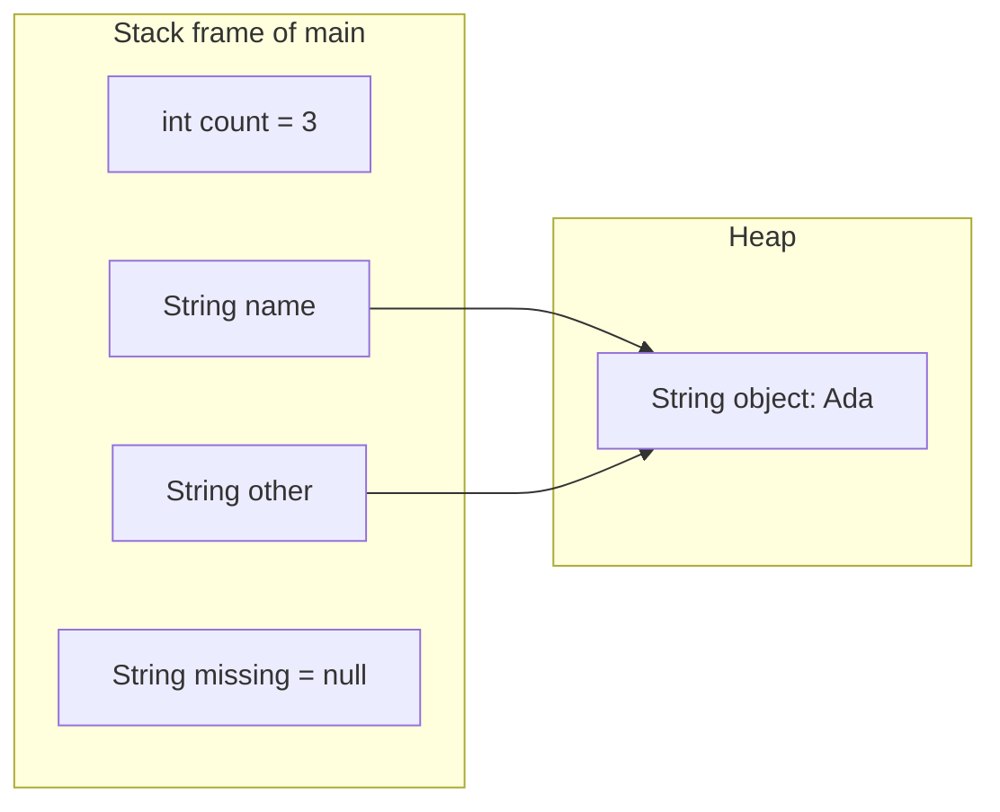
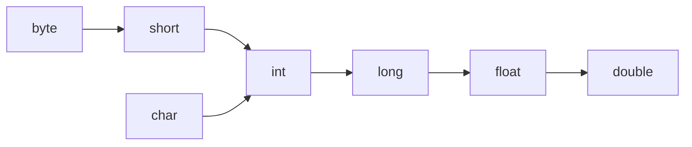

# Chapter 2 — Basics: Types, Variables and Operators

Every Java program is built from the same small parts: **variables** that hold **values** of some **type** (the kind of data — whole number, decimal, text, true/false — which decides what you can do with it), **operators** that combine them, and **statements** that tell the computer what to do in order. This chapter covers those parts precisely — including the places where Java silently does something you might not expect (integer overflow — a number too big for its type silently wrapping round; integer division — whole-number division that drops the remainder; floating-point rounding — decimals stored only approximately; `==` on strings). It ends with text blocks (multi-line strings), `String` basics and reading/writing the console (the text terminal the program runs in).

**What you'll learn**

| # | Topic | You will be able to… |
|---|---|---|
| 2.1 | Statements, identifiers, keywords, comments | read and name things legally |
| 2.2 | Variables | declare, initialise, scope and `final` variables |
| 2.3 | Primitive types | pick the right primitive and know its range |
| 2.4 | Literals | write numbers, characters and booleans in every legal form |
| 2.5 | Reference types and `null` | tell primitives from references |
| 2.6 | `var` | use local type inference well (and know its limits) |
| 2.7 | Conversions and casting | predict widening, narrowing, promotion and compound-assignment casts |
| 2.8 | Operators | use arithmetic, relational, logical, bitwise, ternary operators |
| 2.9 | Precedence and associativity | evaluate any expression by hand |
| 2.10 | Integer overflow | detect and prevent silent wrap-around |
| 2.11 | Floating point | explain `0.1 + 0.2`, NaN, infinity, and when to use `BigDecimal` |
| 2.12 | Strings and text blocks | use the core `String` operations and multi-line literals |
| 2.13 | Console output and input | `println`/`printf`, `Scanner`, `BufferedReader`, `Console`, `IO` |

Code: [`code/`](code/), compiled with `javac --release 25`, output pasted from real runs. Exam-level traps on this material live in the OCP repo: [Chapter 1 — Building Blocks](../../../../ocp-java21-study/chapters/01-building-blocks/README.md) (types, literals, `var`, text blocks, scope) and [Chapter 2 — Operators](../../../../ocp-java21-study/chapters/02-operators/README.md) (promotion, casting, precedence).

---

## 2.1 Statements, identifiers, keywords and comments

### What it is
- A **statement** is one complete instruction, ending in `;` (e.g. `int x = 5;`). A **block** `{ … }` groups statements and can appear wherever a statement can.
- An **expression** is code that produces a value (`x + 1`, `name.length()`, `a > b`). An *expression statement* is an expression used as a statement (`x++;`, `print(...)`).
- An **identifier** is a name you choose for a variable, method (a named block of code you can call), class (a blueprint describing a kind of object) or package (a named group of related classes, like a folder).

### Identifier rules
| Rule | Legal | Illegal |
|---|---|---|
| Starts with a letter, `$` or `_` | `total`, `$price`, `_temp` | `2fast` |
| Then letters, digits, `$`, `_` | `item2`, `max_value` | `my-name`, `a b` |
| Not a reserved keyword (a word the language uses itself) or the literals `true`, `false`, `null` | `klass`, `clazz` | `class`, `null` |
| A single `_` is not an identifier (it is a keyword; see *unnamed variables*, [Chapter 3](../03-control-flow/README.md)) | `__` | `_` |
| Case-sensitive | `count` ≠ `Count` | — |

Unicode (the worldwide standard that gives every character in every script a number) letters are allowed (`größe`), and `$` is legal but by convention reserved for generated code.

### Keywords
Java 25 has **51 reserved keywords** that can never be identifiers — e.g. `class`, `int`, `if`, `for`, `new`, `static`, `final`, `return`, `try`, plus `const` and `goto` (reserved but unused), `strictfp` (obsolete) and `_`. It also has **17 contextual keywords** that are keywords only in certain positions, so old code using them as names still compiles: `var`, `yield`, `record`, `sealed`, `non-sealed`, `permits`, `when`, and the module words `module`, `open`, `opens`, `exports`, `requires`, `transitive`, `uses`, `provides`, `to`, `with`. `true`, `false` and `null` are *literals* (values written directly in the code), not keywords, but are still unusable as names.

### Comments
```java
// line comment: to the end of the line
/* block comment:
   can span lines (cannot be nested) */
/** Javadoc comment: documents the next class, method or field. @param, @return tags… */
```
Write comments that explain **why**, not what the code already says.

---

## 2.2 Variables

### What it is
A **variable** is a named storage location with a fixed **type**. Think of a labelled box: the label is the name, the box's shape (type) decides what may go in.

### How it works
1. **Declare**: `type name;` — reserves the name and type.
2. **Initialise**: give it a first value (`name = value;`), often together: `int age = 30;`.
3. **Use/reassign**: read it in expressions, assign a new value of the same type.
4. The variable exists within its **scope** — the block `{ }` it was declared in, from the declaration to the closing brace.

[`code/Variables.java`](code/Variables.java):
```java
static int counter;          // field: gets a default value (0) automatically

public static void main(String[] args) {
    int age;                 // declaration
    age = 30;                // initialisation (assignment)
    int year = 2025, month = 9;   // declare + initialise several of the same type
    age = age + 1;           // reassignment
    final double TAX_RATE = 0.18; // final: can be assigned exactly once
    // TAX_RATE = 0.2;       // compile error: cannot assign a value to final variable TAX_RATE

    System.out.println("age=" + age + " year=" + year + " month=" + month);
    System.out.println("TAX_RATE=" + TAX_RATE + " counter (field default)=" + counter);

    {                                   // an inner block
        int inner = 5;                  // exists only inside these braces
        System.out.println("inner=" + inner + ", age visible here too: " + age);
    }
    // System.out.println(inner);      // compile error: cannot find symbol

    int count;
    if (age > 18) count = 1; else count = 0;   // definitely assigned on every path
    System.out.println("count=" + count);
}
```
Output:
```text
age=31 year=2025 month=9
TAX_RATE=0.18 counter (field default)=0
inner=5, age visible here too: 31
count=1
```

### Local variables vs fields
| | Local variable (inside a method/block) | Field (inside a class) |
|---|---|---|
| Default value | **None** — must be assigned before use, or compile error *"variable x might not have been initialized"* | Yes: `0`, `0.0`, `false`, `'\u0000'`, or `null` for references |
| Lifetime | Until the block ends | As long as the object (instance field — one copy per object) or class (`static` field — one copy shared by the whole class) |
| Modifiers | Only `final` | Access modifiers (`public`, `private`… — who may use it), `static`, `final`, … ([Chapter 5](../05-oop-classes-and-objects/README.md)) |

The compiler's **definite assignment** analysis checks that every path assigns a local before it is read — that is why `count` above compiles: both branches assign it.

### `final`
`final` means *assigned once*. For a primitive, the value can never change; for a reference, the variable cannot point elsewhere but the **object itself can still change** (`final List<String> xs = new ArrayList<>(); xs.add("ok");` is legal — `List`/`ArrayList` is a growable list of items, covered in [Chapter 10](../10-collections/README.md)). Use `final` for constants (`static final int MAX_RETRIES = 3;`) and wherever it clarifies intent.

### Common mistakes
- Reading a local before assigning it in every branch.
- Redeclaring a name already in scope (`int x = 1; { int x = 2; }` is a compile error — locals cannot shadow locals, i.e. hide an outer variable by reusing its name).
- Thinking `final` makes an object immutable (impossible to change after it is created).

### Self-check
1. Does `int n; System.out.println(n);` compile inside a method? → No — locals have no default value.
2. Can a `final List` have elements added? → Yes; only the reference is fixed.
3. What value does an uninitialised `boolean` field have? → `false`.

---

## 2.3 Primitive types

### What it is
Java has exactly **eight primitive types** — simple values stored directly (not as objects). Everything else is a reference type (objects). Sizes and ranges are fixed by the language on every platform, unlike C. Sizes are measured in **bits** — a bit is a single binary digit, 0 or 1; 8 bits make one **byte**.

[`code/Primitives.java`](code/Primitives.java) prints the real values from the wrapper classes (object versions of each primitive, see [2.5](#25-reference-types-and-null)):
```java
System.out.printf("%-8s %5d  %-22d %d%n", "int", Integer.SIZE, Integer.MIN_VALUE, Integer.MAX_VALUE);
// ... one line per type
```
Output:
```text
type      bits  min                    max
byte         8  -128                   127
short       16  -32768                 32767
int         32  -2147483648            2147483647
long        64  -9223372036854775808   9223372036854775807
char        16  0                      65535
float       32  1.4E-45                3.4028235E38
double      64  4.9E-324               1.7976931348623157E308
boolean  true or false (size not specified by the language)
```

| Type | Kind | Size | Range / precision | Default (fields) | Use it for |
|---|---|---|---|---|---|
| `byte` | signed integer | 8 bits | −128 … 127 | `0` | raw binary data, I/O buffers |
| `short` | signed integer | 16 bits | −32 768 … 32 767 | `0` | rarely — large arrays of small numbers |
| `int` | signed integer | 32 bits | about ±2.1 billion (−2³¹ … 2³¹−1) | `0` | **the default integer** — counts, indexes |
| `long` | signed integer | 64 bits | about ±9.2 × 10¹⁸ | `0L` | timestamps (ms since 1970), IDs, money in cents, big counters |
| `float` | IEEE 754 binary floating point | 32 bits | ~6–7 significant decimal digits, up to ±3.4 × 10³⁸ | `0.0f` | graphics, large arrays where memory matters |
| `double` | IEEE 754 binary floating point | 64 bits | ~15–16 significant digits, up to ±1.8 × 10³⁰⁸ | `0.0` | **the default decimal** — measurements, science |
| `char` | unsigned UTF-16 code unit | 16 bits | `'\u0000'` … `'\uFFFF'` (0 … 65 535) | `'\u0000'` | single characters |
| `boolean` | logical | not specified | `true`, `false` | `false` | conditions, flags |

Notes:
- *Signed* means the type can hold negative numbers; *unsigned* means zero and positives only. **IEEE 754** is the international standard for how computers store numbers with a decimal point. **UTF-16** is a text encoding that stores characters as 16-bit units. An *I/O buffer* is a block of memory used to hold data being read or written. *Epoch milliseconds* count milliseconds since 1 January 1970 UTC, the usual way computers store a point in time.
- `float`/`double` `MIN_VALUE` is the smallest **positive** value, not the most negative; the most negative is `-Double.MAX_VALUE`.
- A `char` is a UTF-16 *code unit*. Characters outside the Basic Multilingual Plane (the first 65 536 Unicode characters; many emoji lie beyond it) need two `char`s (a *surrogate pair*); see [Chapter 7](../07-core-apis/README.md).
- `boolean` is not a number: `if (1)` does not compile, and you cannot cast between `boolean` and `int`.

### Choosing a type
| Need | Use |
|---|---|
| Whole numbers that fit in ±2 billion | `int` |
| Bigger whole numbers, epoch milliseconds, file sizes | `long` |
| Decimal measurements where tiny rounding is fine | `double` |
| Money, exact decimal arithmetic | `long` cents or `BigDecimal` (Java's exact decimal-number class) — never `double` ([2.11](#211-floating-point-numbers)) |
| Arbitrary-size integers | `BigInteger` ([Chapter 7](../07-core-apis/README.md)) |
| Yes/no | `boolean` |

### Self-check
1. Largest `int`? → 2 147 483 647 (`Integer.MAX_VALUE`, 2³¹−1).
2. Is `char` signed? → No, it is unsigned 16-bit (0–65 535).
3. Why is `Double.MIN_VALUE` positive? → It is the smallest positive (subnormal — a tiny value below the normal range, stored with fewer digits of precision) double, not the most negative.

---

## 2.4 Literals

### What it is
A **literal** is a value written directly in source code. Its form decides its type. Numbers can be written in several bases: **hexadecimal** (base 16, digits 0–9 and A–F, prefix `0x`), **octal** (base 8, prefix `0`) and **binary** (base 2, prefix `0b`).

[`code/Literals.java`](code/Literals.java):
```java
int decimal = 255, hex = 0xFF, octal = 0377, binary = 0b1111_1111;
long big = 9_000_000_000L;              // L suffix: needed beyond int range
float price = 19.99f;                   // f suffix: literal is double otherwise
double sci = 6.022e23, plain = 3.14;
char letter = 'A', unicode = 'é', tab = '\t';
boolean ready = true;
String text = "He said \"hi\"\\n";      // escaped quote and backslash

System.out.println(decimal + " " + hex + " " + octal + " " + binary);
System.out.println(big + " " + price + " " + sci + " " + plain);
System.out.println(letter + " " + unicode + " [" + tab + "] " + ready);
System.out.println(text);
System.out.println("char 'A' as a number: " + (int) letter + ", 'A' + 1 = " + (letter + 1)
        + ", (char) ('A' + 1) = " + (char) (letter + 1));
```
Output:
```text
255 255 255 255
9000000000 19.99 6.022E23 3.14
A é [	] true
He said "hi"\n
char 'A' as a number: 65, 'A' + 1 = 66, (char) ('A' + 1) = B
Integer.toBinaryString(10) = 1010, toHexString(255) = ff
```

| Literal | Form | Type |
|---|---|---|
| Decimal integer | `42`, `1_000_000` | `int` |
| Long | `42L` (use capital `L`; `l` looks like `1`) | `long` |
| Hexadecimal | `0xFF`, `0xCAFE_BABE` | `int` (or `long` with `L`) |
| Octal | leading `0`: `0377` = 255 | `int` — beware: `010` is **8** |
| Binary | `0b1010` (Java 7) | `int` |
| Floating point | `3.14`, `1e-9`, `.5`, `2.` | `double` |
| Float | `3.14f` | `float` |
| Character | `'A'`, `'\n'`, `'é'` | `char` |
| Boolean | `true`, `false` | `boolean` |
| String | `"text"`, text blocks `"""…"""` | `String` |
| Null | `null` | the null type (assignable to any reference) |

**Underscores** (Java 7) may separate digits for readability — `1_000_000`, `0b1111_0000` — but not at the start or end of the digits, next to the decimal point, next to the `L`/`f` suffix, or directly after `0x`/`0b`.

**Escape sequences** in `char` and `String` literals: `\n` newline, `\t` tab, `\r` carriage return, `\b` backspace, `\f` form feed, `\"`, `\'`, `\\`, `\s` space (Java 15), octal `\0`–`\377`, and Unicode `\uXXXX`.

### Common mistakes
- `long big = 9000000000;` → compile error *"integer number too large"*: the literal is an `int` until you add `L`.
- `float f = 1.5;` → compile error (*possible lossy conversion from double to float*); write `1.5f`.
- Leading zeros for alignment: `int code = 010;` is 8.

---

## 2.5 Reference types and `null`

### What it is
Any type that is not one of the eight primitives is a **reference type**: classes (`String`, `Scanner`), interfaces (`List`), arrays (`int[]`), enums and records. (Interfaces, arrays, enums and records are each explained in Chapters 4–6; for now, just know they are all reference types.) A variable of a reference type holds a **reference** — a handle that points to an object on the heap (the memory area where all objects live; see [1.8](../01-java-and-the-jvm/README.md#18-memory-and-garbage-collection--an-overview)) — or the special value **`null`**, meaning "points to nothing".


- Assigning a reference (`other = name`) copies the **arrow**, not the object: both variables now point to the same `String`.
- Calling a method through `null` throws **`NullPointerException`** at run time. To *throw* an **exception** is to signal an error by creating an error object that stops normal execution unless some code catches it ([Chapter 8](../08-exceptions/README.md)). Since Java 14 (JEP 358, on by default from Java 15), these *helpful NullPointerException* messages name exactly what was null, e.g. *Cannot invoke "String.length()" because "name" is null*.

| | Primitive | Reference |
|---|---|---|
| Holds | the value itself | a pointer to an object, or `null` |
| Default (field) | `0`/`false`/`'\u0000'` | `null` |
| `==` compares | values | **identity** (same object?) |
| Has methods | no | yes (`name.length()`) |
| Name style | lowercase keyword (`int`) | a type name (`String`, `Integer`) |

Every primitive has a **wrapper class** (`Integer`, `Double`, `Character`, `Boolean`…) so it can be used where an object is required, e.g. in `List<Integer>` (a list of `Integer` objects; the `<…>` part is a *generic* type argument, [Chapter 9](../09-generics/README.md)). Java converts automatically (*autoboxing/unboxing*). The details — and the `Integer` cache trap — are in [Chapter 7](../07-core-apis/README.md).

---

## 2.6 `var` — local variable type inference (Java 10)

### What it is
`var` (Java 10, JEP 286) lets the compiler **infer** (work out by itself) a local variable's type from its initialiser (the `= value` part of the declaration). The variable is still statically typed — the type is fixed at compile time; you just do not write it.

[`code/VarDemo.java`](code/VarDemo.java):
```java
var count = 10;                          // int
var ratio = 10 / 4.0;                    // double
var name = "Ada";                        // String
var scores = new HashMap<String, List<Integer>>();   // HashMap<String, List<Integer>>
scores.put(name, new ArrayList<>(List.of(90, 85)));
for (var entry : scores.entrySet()) {    // Map.Entry<String, List<Integer>>
    System.out.println(entry.getKey() + " -> " + entry.getValue());
}
// count = "ten";                        // compile error: the type is fixed at int
var items = new ArrayList<>();           // careful: ArrayList<Object>
items.add(1); items.add("two");
System.out.println(count + " " + ratio + " " + items);
```
Output:
```text
Ada -> [90, 85]
10 2.5 [1, two]
{a=1}
```

### Where `var` is allowed
| Allowed | Not allowed |
|---|---|
| Local variables with an initialiser | Fields, method parameters, return types |
| `for` loop variables and for-each variables | Without initialiser: `var x;` |
| try-with-resources variables (auto-closing resources, [Chapter 8](../08-exceptions/README.md)) | `var x = null;` (no type to infer) |
| Lambda (short inline function) parameters (Java 11): `(var a, var b) -> a + b` — useful to add annotations (`@`-tags such as `@Override` that attach extra information) | Array initialiser alone: `var a = {1, 2};` |
| | Multiple variables: `var a = 1, b = 2;` |

`var` is a contextual keyword: `var var = 1;` compiles, but you cannot name a *type* `var`.

### Trade-offs and style
Use `var` when the type is obvious from the right-hand side (`new`, a well-named factory — a method that creates and returns objects) or long and noisy (generic types such as `Map<String, List<Integer>>`). Avoid it when the reader cannot see the type (`var result = service.process();`) or when the inferred type differs from what you want (`var list = new ArrayList<>()` becomes `ArrayList<Object>`; `var x = 1;` is `int`, not `long`). The OpenJDK team's *Local Variable Type Inference Style Guidelines* say the same: choose clarity for the reader.

---

## 2.7 Type conversion: widening, narrowing, casting, promotion

### What it is
Converting a value from one type to another. Java does **safe** conversions automatically and requires an explicit **cast** — `(type) value` — for risky ones.


Arrows show **widening primitive conversions**, done automatically (`int i = 'A'; long l = i; double d = l;`). Going against the arrows is **narrowing** and needs a cast.

### How it works
1. **Widening** (automatic): the target type can hold every value… *almost*. `int → float`, `long → float` and `long → double` can lose **precision** (exact digits), not magnitude (overall size): a `float` has 24 bits of mantissa (the part of a floating-point number that stores its significant digits).
2. **Narrowing** (needs a cast): `(int) 3.99` truncates (chops off the fraction) toward zero to `3`; `(byte) 300` keeps the low 8 bits (300 − 256 = 44). Floating → integer conversion clamps out-of-range values to MIN/MAX and turns NaN ("Not a Number", the result of undefined maths such as 0.0/0) into 0.
3. **Numeric promotion** in expressions: before a binary (two-input) arithmetic operator runs, `byte`, `short` and `char` operands (the values an operator works on) become `int`; if either operand is `long`, `float` or `double`, both are converted to the wider of these. So `byte + byte` is an `int`.
4. **Compile-time constants** (values the compiler can work out itself, such as literals or `final` variables set from literals) may be assigned to a narrower type if they fit: `byte b = 10 + 20;` is fine; `byte b = x + y;` (variables) is not.
5. **Compound assignment** (`+=`, `-=`, `*=`…) includes a hidden cast: `x += 5` means `x = (T) (x + 5)` where `T` is `x`'s type.

[`code/Conversions.java`](code/Conversions.java) (key lines):
```java
double pi = 3.99;
int truncated = (int) pi;          // narrowing needs a cast; drops the fraction
long rounded = Math.round(pi);     // rounding is a method, not a cast

byte b = (byte) 300;               // keeps only the low 8 bits: 300 - 256 = 44
int precise = 123_456_789;
float f = precise;                 // widening but LOSSY: float has 24 bits of precision

byte x = 10, y = 20;
// byte sum = x + y;               // compile error: x + y is an int
byte sum = (byte) (x + y);
x += 5;                            // compound assignment hides a cast: x = (byte) (x + 5)

long wrong = 1_000_000 * 1_000_000;       // int overflow BEFORE widening to long
long right = 1_000_000L * 1_000_000;
```
Output:
```text
widened: 100 100.0
(int) 3.99 = 3, Math.round(3.99) = 4
(byte) 300 = 44, (byte) 200 = -56
(int) 1e20 = 2147483647, (int) Double.NaN = 0
int 123456789 -> float -> int: 123456792
sum=30 sum2=30 x=15
constant=30 'a'+1=98 7/2=3 7/2.0=3.5
wrong=-727379968 right=1000000000000
```
The last line is the classic bug: the multiplication happens in `int` (both operands are `int`), overflows, and only then is the wrong result widened to `long`. Put `L` on the **first** operand.

### Common mistakes
- Expecting `(int)` to round. It truncates toward zero: `(int) -3.99` is `-3`. Use `Math.round`, `Math.floor`, `Math.ceil`.
- `7 / 2` is `3`: both operands are `int`, so the division is integer division. Write `7 / 2.0` or `(double) 7 / 2`. Note `(double) (7 / 2)` is `3.0` — the cast came too late.
- Assuming widening is always lossless: `int → float` can change the value.

### In the interview
**Q: Why doesn't `short s = 1; s = s + 1;` compile, but `s += 1;` does?** `s + 1` is promoted to `int`, and assigning an `int` to a `short` needs a cast. Compound assignment includes that cast implicitly.
- *What is `(byte) 200`?* −56: the low 8 bits `11001000` read as a signed byte.
- *Is `long → double` safe?* Magnitude yes, precision no: doubles have 53 bits of mantissa, longs 64.

### Self-check
1. `char c = 'a'; c + 1` — type and value? → `int`, 98.
2. `(int) 7.9 + (int) -7.9` → 7 + (−7) = 0.
3. Fix `long ms = 24 * 60 * 60 * 1000 * 365;` → `24L * 60 * 60 * 1000 * 365`.

---

## 2.8 Operators

### What it is
An **operator** is a symbol that computes a value from one (*unary*), two (*binary*) or three (*ternary*) operands.

### Arithmetic: `+ - * / %` and `++ --`
[`code/Arithmetic.java`](code/Arithmetic.java):
```java
System.out.println("17 / 5 = " + 17 / 5 + ", 17 % 5 = " + 17 % 5);
System.out.println("-17 / 5 = " + -17 / 5 + ", -17 % 5 = " + -17 % 5
        + ", Math.floorMod(-17, 5) = " + Math.floorMod(-17, 5));
System.out.println("17.0 / 5 = " + 17.0 / 5 + ", 5.5 % 2 = " + 5.5 % 2);
System.out.println("1.0 / 0 = " + 1.0 / 0 + ", 0.0 / 0 = " + 0.0 / 0);
try { System.out.println(1 / 0); }
catch (ArithmeticException e) { System.out.println("1 / 0 -> ArithmeticException: " + e.getMessage()); }

int a = 5;
int b = a++;     // post-increment: b gets the old value, then a becomes 6
int c = ++a;     // pre-increment: a becomes 7, then c gets 7
int n = 3;
int result = n++ + ++n;   // 3 + 5
```
Output:
```text
17 / 5 = 3, 17 % 5 = 2
-17 / 5 = -3, -17 % 5 = -2, Math.floorMod(-17, 5) = 3
17.0 / 5 = 3.4, 5.5 % 2 = 1.5
1.0 / 0 = Infinity, 0.0 / 0 = NaN
1 / 0 -> ArithmeticException: / by zero
a=7 b=5 c=7
n++ + ++n with n=3 -> 8, n=5
compound ops -> x=1
-(-5) = 5, +3 = 3
```

| Rule | Detail |
|---|---|
| Integer `/` truncates toward zero | `-17 / 5` is `-3`, not `-4` |
| `%` takes the sign of the **dividend** (the number being divided) | `-17 % 5` is `-2`. For a always-non-negative result (e.g. circular buffers — fixed-size arrays that wrap round to the start, "day of week"), use `Math.floorMod` |
| Integer division by zero | throws `ArithmeticException` |
| Floating division by zero | no exception: `Infinity`, `-Infinity` or `NaN` |
| `x++` vs `++x` | both add 1 to `x`; the *expression's value* is the old value (postfix) or the new value (prefix) |
| `+` with a `String` operand | means concatenation (joining text end to end) ([2.12](#212-strings-and-text-blocks)) |

Style: use `++`/`--` as standalone statements (`i++;`). Expressions like `n++ + ++n` are legal and deterministic (always give the same result; Java evaluates operands left to right) but unreadable.

### Assignment operators
`=`, and compound `+= -= *= /= %= &= |= ^= <<= >>= >>>=`. Assignment is itself an expression whose value is the assigned value, and it is right-associative: `a = b = c = 7` assigns 7 to all three.

### Relational and equality: `< <= > >= == !=`, `instanceof`
All return `boolean`. For **primitives**, `==` compares values. For **references**, `==` compares **identity** — whether both sides point to the *same object*. To compare contents, call `equals` (a method every object has for content comparison).

[`code/Comparison.java`](code/Comparison.java):
```java
String s1 = "java";
String s2 = new String("java");
System.out.println("s1 == s2: " + (s1 == s2) + ", s1.equals(s2): " + s1.equals(s2));
```
Output:
```text
s1 == s2: false, s1.equals(s2): true
```
`x instanceof Type` tests whether a reference points to an object of that type (false for `null`). The pattern form `x instanceof String s` is in [Chapter 3](../03-control-flow/README.md#35-pattern-matching-for-instanceof-java-16).

### Logical: `&& || !` and `& | ^`
| Operator | Name | Evaluates right side? |
|---|---|---|
| `&&` | conditional AND | only if left is `true` (**short-circuit**) |
| `\|\|` | conditional OR | only if left is `false` (short-circuit) |
| `!` | NOT | — |
| `&`, `\|` | logical AND / OR on booleans | **always** both sides |
| `^` | XOR (exactly one true) | always both |

```java
static boolean check(String label, boolean value) {
    System.out.println("  evaluated " + label);
    return value;
}
boolean r1 = check("left", false) && check("right", true);
boolean r2 = check("left", false) & check("right", true);

String name = null;
if (name != null && name.length() > 3) System.out.println("long name");   // safe: && stops at null
```
Output:
```text
&& short-circuits:
  evaluated left
& evaluates both:
  evaluated left
  evaluated right
r1=false r2=false true ^ true=false !true=false
null-safe check with && worked
```
Short-circuiting is what makes the *null guard* idiom (a common coding pattern) `x != null && x.foo()` safe. With `&` it would throw `NullPointerException`.

### Ternary `?:`
`condition ? valueIfTrue : valueIfFalse` is an **expression** (it produces a value), unlike `if`:
```java
String category = age < 13 ? "child" : age < 20 ? "teen" : "adult";   // "adult" for 20
```
Keep it to one level; nested ternaries become a puzzle — use `if` or a `switch` expression ([Chapter 3](../03-control-flow/README.md)).

### Bitwise and shift: `& | ^ ~ << >> >>>`
On integer types these work on individual bits. A *flag* is a yes/no setting stored in one bit; a *mask* is a value used with `&` to pick out particular bits. [`code/Bitwise.java`](code/Bitwise.java):
```java
static final int READ = 1, WRITE = 2, EXEC = 4;   // 001, 010, 100
int a = 0b1100, b = 0b1010;
System.out.println("a & b = " + bin(a & b) + ", a | b = " + bin(a | b)
        + ", a ^ b = " + bin(a ^ b) + ", ~a = " + (~a));
System.out.println("1 << 4 = " + (1 << 4) + ", 64 >> 2 = " + (64 >> 2));
System.out.println("-16 >> 2 = " + (-16 >> 2) + ", -16 >>> 28 = " + (-16 >>> 28));
int perms = READ | WRITE;                 // set two flags
perms &= ~WRITE;                          // clear a flag
```
Output:
```text
a & b = 1000, a | b = 1110, a ^ b = 110, ~a = -13
1 << 4 = 16, 64 >> 2 = 16
-16 >> 2 = -4, -16 >>> 28 = 15
1 << 32 = 1  (shift distance is taken mod 32 for int)
can write? true, can exec? false
after clearing WRITE: 1
is 12 even? true
```
| Operator | Meaning | Example |
|---|---|---|
| `&` | 1 where both bits are 1 | mask/test a flag: `(perms & WRITE) != 0` |
| `\|` | 1 where either is 1 | set a flag |
| `^` | 1 where bits differ | toggle; `a ^ a == 0` |
| `~` | flip every bit; `~x == -x - 1` | clear with `& ~FLAG` |
| `<<` | shift left, fill with 0; `x << n` = x·2ⁿ (until overflow) | `1 << k` = k-th bit |
| `>>` | *arithmetic* shift right, copies the sign bit (the top bit: 1 means negative) | `-16 >> 2 = -4` |
| `>>>` | *logical* shift right, fills with 0 | unsigned view of negatives |

The shift distance uses only the low 5 bits for `int` (6 for `long`), so `1 << 32 == 1`. Real uses: permission flags, hash functions (functions that turn a value into a number used to decide where to store it; `HashMap`, Java's key→value lookup table, mixes `h ^ (h >>> 16)`), `EnumSet`'s bit vector, network protocols, and bit tricks in interviews ([Chapter 19](../19-java-for-coding-interviews/README.md)).

### Self-check
1. `-7 / 2` and `-7 % 2`? → `-3` and `-1`.
2. Why is `if (s != null & s.isEmpty())` dangerous? → `&` evaluates both sides, so it throws when `s` is null.
3. `int x = 5; int y = x++ * 2;` → `y = 10`, `x = 6`.
4. Two strings print the same but `==` is false. Why? → They are different objects; use `equals`.

---

## 2.9 Operator precedence and associativity

### What it is
**Precedence** decides which operator binds first (`*` before `+`); **associativity** decides the order among equal-precedence operators (most are left-to-right; assignment and the ternary are right-to-left). Operands themselves are always **evaluated left to right**.

| Level (high → low) | Operators | Associativity |
|---|---|---|
| 1 Postfix | `expr++` `expr--` | left |
| 2 Unary | `++expr` `--expr` `+` `-` `~` `!` `(type)` cast | right |
| 3 Multiplicative | `*` `/` `%` | left |
| 4 Additive | `+` `-` (and string `+`) | left |
| 5 Shift | `<<` `>>` `>>>` | left |
| 6 Relational | `<` `>` `<=` `>=` `instanceof` | left |
| 7 Equality | `==` `!=` | left |
| 8 Bitwise AND | `&` | left |
| 9 Bitwise XOR | `^` | left |
| 10 Bitwise OR | `\|` | left |
| 11 Conditional AND | `&&` | left |
| 12 Conditional OR | `\|\|` | left |
| 13 Ternary | `? :` | right |
| 14 Assignment, lambda | `=` `+=` `-=` … `->` | right |

[`code/Precedence.java`](code/Precedence.java):
```java
System.out.println("2 + 3 * 4 = " + (2 + 3 * 4));
System.out.println("(2 + 3) * 4 = " + ((2 + 3) * 4));
System.out.println("10 - 4 - 3 = " + (10 - 4 - 3) + "  (left to right)");
int a, b, c;
a = b = c = 7;                                  // assignment is right-associative
System.out.println("a=" + a + " b=" + b + " c=" + c);
System.out.println(1 + 2 + "3" + 4 + 5);        // left to right: 3, then "33", "334", "3345"
System.out.println("true || false && false = " + (true || false && false));
int x = 6;
System.out.println("x & 1 == 0 needs parentheses: " + ((x & 1) == 0));
```
Output:
```text
2 + 3 * 4 = 14
(2 + 3) * 4 = 20
10 - 4 - 3 = 3  (left to right)
a=7 b=7 c=7
3345
true || false && false = true
5 > 3 == true: true
x & 1 == 0 needs parentheses: true
```
- `&&` binds tighter than `||`, so `true || false && false` is `true || (false && false)`.
- `==` binds tighter than `&`, so `x & 1 == 0` means `x & (1 == 0)` — a compile error for `int x`. Always parenthesise bitwise tests.
- `+` is left-associative, so `1 + 2 + "3"` adds first, then concatenates.

**Rule of thumb:** remember "unary → multiplicative → additive → comparison → equality → logical → ternary → assignment", and add parentheses whenever a reader might hesitate.

---

## 2.10 Integer overflow

### What it is
Integer arithmetic in Java is done modulo 2³² (`int`) or 2⁶⁴ (`long`) — that is, only the remainder after dividing by 2³² or 2⁶⁴ is kept. When a result exceeds the range it silently **wraps around** — no exception, no warning. This is **overflow**.

Analogy: a car odometer with six digits rolls from 999 999 to 000 000.

> **Key term — two's complement:** the way computers store negative integers. The top bit is the sign bit, and a negative number −n is stored as the bit pattern of 2³² − n (for `int`). This lets the same adding circuit handle positive and negative numbers, and it is why adding 1 to the largest `int` produces the most negative one.

### Why it matters
Overflow bugs are real and expensive: the binary-search (finding an item in sorted data by repeatedly halving the range) midpoint bug `(low + high) / 2` sat in the JDK's own `Arrays.binarySearch` for years (fixed in 2006), and timestamps multiplied in `int` produce negative durations.

[`code/Overflow.java`](code/Overflow.java):
```java
int max = Integer.MAX_VALUE;
System.out.println("MAX_VALUE + 1 = " + (max + 1));
System.out.println("Math.abs(Integer.MIN_VALUE) = " + Math.abs(Integer.MIN_VALUE));

int low = 2_000_000_000, high = 2_100_000_000;
System.out.println("(low + high) / 2 = " + (low + high) / 2 + "   <- overflow bug");
System.out.println("low + (high - low) / 2 = " + (low + (high - low) / 2));
System.out.println("(low + high) >>> 1 = " + ((low + high) >>> 1));

try { Math.addExact(max, 1); }
catch (ArithmeticException e) { System.out.println("Math.addExact(MAX, 1) -> " + e.getMessage()); }
long seconds = 30L * 24 * 60 * 60 * 1000;     // L on the first operand: all long math
```
Output:
```text
MAX_VALUE + 1 = -2147483648
Math.abs(Integer.MIN_VALUE) = -2147483648
-Integer.MIN_VALUE = -2147483648
(low + high) / 2 = -97483648   <- overflow bug
low + (high - low) / 2 = 2050000000
(low + high) >>> 1 = 2050000000
Math.addExact(MAX, 1) -> integer overflow
Math.toIntExact(3e9) -> integer overflow
30 days in ms (long) = 2592000000, as int math = -1702967296
```

### How to defend
| Technique | Example |
|---|---|
| Use a wider type early | `long total = (long) a * b;` or `30L * …` |
| Throw instead of wrapping | `Math.addExact`, `subtractExact`, `multiplyExact`, `incrementExact`, `negateExact`, `toIntExact` (Java 8), `absExact` (Java 15) |
| Rearrange the formula | `low + (high - low) / 2` |
| Unlimited size | `BigInteger` ([Chapter 7](../07-core-apis/README.md)) |

Note that `Math.abs(Integer.MIN_VALUE)` is still negative, because +2 147 483 648 does not fit in an `int`.

### In the interview
**Q: What happens when an `int` overflows in Java?** It wraps around silently using two's-complement arithmetic (`MAX_VALUE + 1 == MIN_VALUE`). Use `long`, `Math.*Exact` methods (which throw `ArithmeticException`), or `BigInteger`.
- *Where have you seen overflow in practice?* Binary-search midpoints, hash-code arithmetic (intentional), millisecond calculations, summing large arrays of `int`.

---

## 2.11 Floating-point numbers

### What it is
`float` and `double` follow **IEEE 754** binary floating point: a number is stored as sign × binary fraction (mantissa) × 2^exponent. Most decimal fractions (0.1, 0.2) have no exact binary form — just as 1/3 has no exact decimal form — so they are stored as the nearest representable value.

[`code/FloatingPoint.java`](code/FloatingPoint.java):
```java
System.out.println("0.1 + 0.2 = " + (0.1 + 0.2));
System.out.println("0.1 + 0.2 == 0.3: " + (0.1 + 0.2 == 0.3));
System.out.println("|diff| < 1e-9: " + (Math.abs((0.1 + 0.2) - 0.3) < 1e-9));
double nan = 0.0 / 0;
System.out.println("NaN == NaN: " + (nan == nan) + ", Double.isNaN: " + Double.isNaN(nan));
System.out.println("-0.0 == 0.0: " + (-0.0 == 0.0) + ", Double.compare(-0.0, 0.0): " + Double.compare(-0.0, 0.0));
double total = 0;
for (int i = 0; i < 10; i++) total += 0.1;
BigDecimal exact = new BigDecimal("0.1").add(new BigDecimal("0.2"));
```
Output:
```text
0.1 + 0.2 = 0.30000000000000004
0.1 + 0.2 == 0.3: false
|diff| < 1e-9: true
0.1f + 0.2f = 0.3
1.0 - 0.9 = 0.09999999999999998
NaN == NaN: false, Double.isNaN: true
-0.0 == 0.0: true, Double.compare(-0.0, 0.0): -1
1e308 * 10 = Infinity, Math.sqrt(-1) = NaN
16777217 as float = 1.6777216E7  (2^24 + 1 not representable)
0.1 added ten times = 0.9999999999999999
BigDecimal 0.1 + 0.2 = 0.3, new BigDecimal(0.1) = 0.1000000000000000055511151231257827021181583404541015625
Math.round(2.5)=3 Math.round(-2.5)=-2 Math.floor(-2.5)=-3.0 Math.ceil(-2.5)=-2.0
```
(`0.1f + 0.2f` *prints* as `0.3` only because `float`'s shorter printed form hides the error.)

### Special values
| Value | Produced by | Test with |
|---|---|---|
| `Infinity`, `-Infinity` | overflow (`1e308 * 10`), `1.0 / 0` | `Double.isInfinite(x)` |
| `NaN` (Not a Number) | `0.0 / 0`, `Math.sqrt(-1)` | `Double.isNaN(x)` — **never** `x == Double.NaN` (NaN is not equal to anything, even itself) |
| `-0.0` | `-1.0 / Double.POSITIVE_INFINITY`, rounding tiny negatives | equals `0.0` with `==`, but `Double.compare` and `Double.equals` distinguish it |

### How to handle it
1. **Compare with a tolerance**, not `==`: `Math.abs(a - b) < 1e-9` (choose the tolerance for your domain).
2. **Money**: use `long` minor units (cents) or `BigDecimal` constructed from a **String** (`new BigDecimal("0.1")`) or `BigDecimal.valueOf(0.1)` — `new BigDecimal(0.1)` captures the binary error exactly, as shown above.
3. **Rounding**: `Math.round` rounds half **up toward positive infinity** (`-2.5 → -2`); `Math.floor`/`ceil` return `double`. For decimal rounding modes (half-even — round a trailing 5 to the nearest even digit — as banks use), use `BigDecimal.setScale`.
4. **Loops**: never use a `double` as a loop counter compared with `==` — after ten additions of 0.1 you have 0.9999999999999999, not 1.0.
5. Since Java 17 (JEP 306) all floating-point arithmetic is strict IEEE 754 on every platform, so results are reproducible; the `strictfp` modifier is obsolete.

### In the interview
**Q: Why is `0.1 + 0.2 != 0.3` in Java?** 0.1 and 0.2 cannot be represented exactly in binary floating point; the stored approximations sum to 0.30000000000000004. Compare with a tolerance, or use `BigDecimal` for exact decimal arithmetic such as money.
- *How do you check for NaN?* `Double.isNaN(x)`; `x != x` also works because NaN is the only value not equal to itself.
- *Why not `new BigDecimal(0.1)`?* It converts the already-inexact double; use the String constructor or `BigDecimal.valueOf`.

### Self-check
1. What does `1 / 0.0` give? And `1 / 0`? → `Infinity`; `ArithmeticException`.
2. Best type for a bank balance? → `BigDecimal` (or `long` cents).
3. `Math.round(-0.5)`? → `0`.

---

## 2.12 Strings and text blocks

### What it is
A **`String`** is an object holding an immutable sequence of characters. It is a reference type with special support: literals (`"hi"`), the `+` concatenation operator, and a pool of shared literals. This section covers what you need for the next chapters; the full API, `StringBuilder` and formatting in depth are in [Chapter 7](../07-core-apis/README.md).

[`code/StringBasics.java`](code/StringBasics.java):
```java
String message = "Hello" + ", " + "Ada" + "!";
System.out.println(message + " length=" + message.length());
System.out.println("charAt(0)=" + message.charAt(0) + " indexOf(\"Ada\")=" + message.indexOf("Ada")
        + " substring(7, 10)=" + message.substring(7, 10));

String s = "java";
s.toUpperCase();                        // result thrown away: Strings are immutable
System.out.println("after s.toUpperCase(): " + s);
s = s.toUpperCase();                    // reassign the variable to the new String
System.out.println("after s = s.toUpperCase(): " + s);

String a = "hi", b = "hi", c = new String("hi");
System.out.println("a == b: " + (a == b) + " (same pooled literal), a == c: " + (a == c)
        + ", a.equals(c): " + a.equals(c) + ", \"HI\".equalsIgnoreCase(a): " + "HI".equalsIgnoreCase(a));
System.out.println("String.valueOf(42) + 1 = " + String.valueOf(42) + 1
        + ", Integer.parseInt(\"42\") + 1 = " + (Integer.parseInt("42") + 1));
System.out.println("'a' + 'b' = " + ('a' + 'b') + ", \"\" + 'a' + 'b' = " + ("" + 'a' + 'b'));
```
Output:
```text
Hello, Ada! length=11
charAt(0)=H indexOf("Ada")=7 substring(7, 10)=Ada
upper=HELLO, ADA! contains Ada? true
after s.toUpperCase(): java
after s = s.toUpperCase(): JAVA
a == b: true (same pooled literal), a == c: false, a.equals(c): true, "HI".equalsIgnoreCase(a): true
compareTo: -1, isBlank: true, strip: [pad], repeat: ababab
String.valueOf(42) + 1 = 421, Integer.parseInt("42") + 1 = 43
'a' + 'b' = 195, "" + 'a' + 'b' = ab
null concatenated: null
```

### Key facts
| Fact | Consequence |
|---|---|
| **Immutable** — no method changes a `String` | Methods return a *new* string; assign the result. Safe to share between threads (independent paths of execution running at the same time) and as `HashMap` keys (the lookup values in a map). |
| **String pool** — identical literals share one object | `"hi" == "hi"` is `true`, but `new String("hi")` makes a distinct object. Never rely on `==`; use `equals`. |
| Indexes are **0-based** (the first character is at index 0); `substring(begin, end)` excludes `end` | `"Hello".substring(1, 3)` is `"el"`; out-of-range throws `StringIndexOutOfBoundsException`. |
| `+` with any `String` operand concatenates | Numbers are converted with `String.valueOf`; `null` becomes `"null"`. Adding two `char`s is **numeric** (`'a' + 'b' == 195`). |
| Concatenating in a loop creates many objects | Use `StringBuilder` (a changeable, growable string) in loops ([Chapter 7](../07-core-apis/README.md)). |
| Converting | `String.valueOf(x)` / `"" + x` to text; `Integer.parseInt`, `Double.parseDouble` from text (throw `NumberFormatException` on bad input). |

Most-used methods (Java version for newer ones): `length`, `charAt`, `indexOf`, `substring`, `contains`, `startsWith`/`endsWith`, `toUpperCase`/`toLowerCase`, `trim`, `strip` (11), `isEmpty`, `isBlank` (11), `repeat` (11), `lines` (11), `replace`, `split`, `equals`, `equalsIgnoreCase`, `compareTo`, `String.join`, `formatted` (15).

### Text blocks (Java 15)
A **text block** (JEP 378, final in Java 15) is a multi-line string literal opened by `"""` followed by a line break and closed by `"""`. It is still an ordinary `String`.

[`code/TextBlocks.java`](code/TextBlocks.java):
```java
String json = """
        {
          "name": "Ada",
          "langs": ["Java", "SQL"]
        }
        """;
System.out.print(json);

String sql = """
    SELECT id, name
    FROM users
    WHERE active = true\
    """;                                     // \ at line end: no newline there
System.out.println("[" + sql + "]");

String spaces = """
    trailing kept:\s
    quote: \""" inside
    """;
System.out.print(spaces.replace(' ', '.'));

String html = """
    <p>Hello, %s!</p>
    """.formatted("World");
```
Output:
```text
{
  "name": "Ada",
  "langs": ["Java", "SQL"]
}
[SELECT id, name
FROM users
WHERE active = true]
trailing.kept:.
quote:.""".inside
<p>Hello, World!</p>
lines in json: 4
```
How the compiler processes a text block:
1. The content starts on the line **after** the opening `"""` (text on the same line is a compile error).
2. **Incidental indentation** is removed: the compiler finds the smallest indentation among non-blank lines *and the closing `"""` line*, and strips that much from every line. Move the closing delimiter (the `"""` marker) left to keep more indentation.
3. Trailing spaces on each line are stripped; line endings become `\n` whatever the OS.
4. Escapes are processed last. Two escapes were added for text blocks: `\<line-end>` joins lines (no newline), and `\s` is a single space that survives stripping.
5. If the closing `"""` is on its own line, the string ends with `\n`; if it follows text directly, it doesn't.

Use text blocks for embedded SQL (database query language), JSON (a text format for structured data), HTML (web-page markup) and test fixtures (fixed sample data used by tests). For exam-level indentation traps, see the OCP repo's [text blocks section](../../../../ocp-java21-study/chapters/01-building-blocks/README.md).

### Common mistakes
- `if (input == "yes")` — compares identity; use `"yes".equals(input)` (also null-safe).
- Calling `s.trim();` without assigning the result.
- `"Total: " + a + b` when `a`, `b` are numbers → concatenates both (`"Total: 12"`); write `"Total: " + (a + b)`.

### Self-check
1. `"abc".substring(1)`? → `"bc"`.
2. Why is `"yes".equals(input)` better than `input.equals("yes")`? → It does not throw if `input` is `null`.
3. Does a text block with the closing `"""` on its own line end with a newline? → Yes.

---

## 2.13 Console output and input

### Output: `print`, `println`, `printf`
`System.out` is a `PrintStream` (Java's class for writing text) connected to **standard output** (the program's normal output, the terminal by default); `System.err` to **standard error** (a separate stream — a channel that data flows through — shown in red by many IDEs, useful for diagnostics that should not mix with data output).

[`code/Formatting.java`](code/Formatting.java):
```java
System.out.print("print has no newline; ");
System.out.println("println adds one.");
System.out.printf("%-10s|%5d|%8.2f|%n", "Coffee", 3, 4.5);
System.out.printf("%-10s|%05d|%8.3e|%n", "Padded", 42, 12345.678);
System.out.printf("%s %b %c %x %o %%%n", "str", true, 'J', 255, 8);
System.out.printf(Locale.GERMANY, "German: %,.2f%n", 1234567.891);
System.out.printf(Locale.US, "US:     %,.2f%n", 1234567.891);
String line = String.format("Total: %.2f", qty * price);
String line2 = "Items: %d".formatted(qty);         // Java 15
System.err.println("(this line goes to standard error)");
```
Output:
```text
print has no newline; println adds one.
Coffee    |    3|    4.50|
Padded    |00042|1.235e+04|
str true J ff 10 %
German: 1.234.567,89
US:     1,234,567.89
Total: 13.50 / Items: 3
(this line goes to standard error)
```

| Specifier | Meaning | Flags/width examples |
|---|---|---|
| `%s` | any value via `toString()` (the method every object has that returns its text form) | `%-10s` left-align in 10 chars |
| `%d` | integer (`int`, `long`, `BigInteger`) | `%5d` width 5, `%05d` zero-pad, `%,d` grouping |
| `%f`, `%e` | decimal, scientific | `%.2f` two decimals (rounds half-up) |
| `%b`, `%c` | boolean, char | |
| `%x`, `%o` | hex, octal | `%08X` |
| `%n` | platform line separator (`\n` on Linux/macOS, `\r\n` on Windows) | prefer over `\n` in `printf` |
| `%%` | a literal `%` | |

Formatting is **locale-sensitive**: the default locale (a language-and-region setting such as German or US English) decides the decimal and grouping separators, which is why tests and machine-readable output should pass an explicit `Locale` (e.g. `Locale.ROOT` or `Locale.US`). A mismatched type (`%d` with a `double`) throws `IllegalFormatConversionException` at run time.

### Input: four options
| Option | Best for | Notes |
|---|---|---|
| `Scanner` (`java.util`) | Beginner programs, parsing numbers and words | Tokenises input (splits it into words, called tokens) by whitespace; `nextInt`, `nextDouble`, `next`, `nextLine`, `hasNextInt`… Slow for very large input. |
| `IO.readln(prompt)` (`java.lang.IO`, **Java 25**) | Simplest line input | Returns a line as `String` (or `null` at end of input); pairs with `IO.println`. |
| `BufferedReader` over `InputStreamReader(System.in)` | Fast line-by-line reading (competitive programming, large input) | `readLine()` returns `null` at end; you parse numbers yourself; throws `IOException`. |
| `System.console()` → `java.io.Console` | Passwords (`readPassword` does not echo, i.e. show, the typed characters) | Returns `null` when there is no interactive terminal (IDE consoles, redirected input — input fed from a file with `<` instead of the keyboard) — always check. |

**Pick one reader per program.** Each of them buffers `System.in` (reads ahead into its own memory); if a `Scanner` reads ahead, a `BufferedReader` created later will not see that input.

Deterministic `Scanner` demo reading from a `String` ([`code/ScannerDemo.java`](code/ScannerDemo.java)) — a real program would use `new Scanner(System.in)`:
```java
String fakeKeyboard = """
        Ada Lovelace
        36
        1.5 2.5 3.0
        done
        """;
Scanner in = new Scanner(fakeKeyboard);
String fullName = in.nextLine();          // whole line
int age = in.nextInt();                   // one token -> int
in.nextLine();                            // consume the rest of the "36" line!
double sum = 0;
while (in.hasNextDouble()) sum += in.nextDouble();
String word = in.next();                  // next token

Scanner trap = new Scanner("42\nAlan Turing\n");
int n = trap.nextInt();
String afterInt = trap.nextLine();        // returns the EMPTY rest of the first line

Scanner bad = new Scanner("forty-two");
if (!bad.hasNextInt()) System.out.println("not an int: " + bad.next());
```
Output:
```text
name=Ada Lovelace, age=36, sum=7.0, word=done
n=42, nextLine after nextInt=[], then=[Alan Turing]
not an int: forty-two
```
**The `nextInt` + `nextLine` trap:** `nextInt()` reads the number but leaves the line break; the following `nextLine()` returns the empty remainder of that line. Call an extra `nextLine()` after `nextInt()` (as above), or read every line with `nextLine()` and parse with `Integer.parseInt`. Calling `nextInt()` on non-numeric input throws `InputMismatchException` — guard with `hasNextInt()`.

The interactive version, [`code/Interactive.java`](code/Interactive.java), takes the reading style as an argument (`java -cp out ch02.io.Interactive scanner|io|reader|console`). Key part and a real run with the `console` mode in a terminal:
```java
Console console = System.console();          // null if not an interactive terminal
if (console == null) {
    System.out.println("No interactive console (IDE or redirected input).");
    return;
}
char[] secret = console.readPassword("Password (not echoed): ");
if (secret == null) return;                   // end of input (Ctrl+D)
System.out.println("Password length: " + secret.length);
Arrays.fill(secret, ' ');                     // wipe it from memory
```
```text
Password (not echoed):
Password length: 7
```
With input redirected (`… console < file.txt`) it prints `No interactive console (IDE or redirected input).` Passwords are returned as `char[]`, not `String`, so you can wipe them (a `String` stays in memory until garbage-collected, i.e. freed automatically by the JVM at some later time). (In JDK 22–24 `System.console()` could return a `Console` even when redirected; JDK 25 returns to the older default, and JDK 26 made `null` the rule whenever input or output is redirected.)

`java.lang.IO` also works in ordinary classes ([`code/IOClassDemo.java`](code/IOClassDemo.java)):
```java
IO.print("IO.print, ");
IO.println("IO.println");
IO.println(42);
IO.println();
IO.println("done");
```
Output:
```text
IO.print, IO.println
42

done
```

Command-line arguments (`String[] args`) are the other common input channel — see [Chapter 4](../04-methods-and-arrays/README.md).

### Self-check
1. After `int n = sc.nextInt();` the user's next line is skipped. Why and how to fix? → `nextInt` left the newline; call `sc.nextLine()` once, or read lines and parse.
2. Why is `readPassword` a `char[]`? → So it can be overwritten after use.
3. `System.console()` returns `null` in your IDE. Bug? → No; there is no interactive terminal. Handle `null`.

---

## Chapter TL;DR
- Eight primitives: `byte short int long` (8/16/32/64-bit signed), `float double` (IEEE 754), `char` (16-bit unsigned UTF-16 unit), `boolean`. Everything else is a reference (or `null`).
- Locals must be assigned before use; fields get defaults. `final` = assign once (the object can still change). `var` (Java 10) infers local types; the type is still fixed.
- Literals: `L` for long, `f` for float, `0x`/`0b`/leading-`0` for hex/binary/octal, `_` separators.
- Widening is automatic (but `int/long → float` can lose precision); narrowing needs a cast and truncates/wraps. `byte/short/char` promote to `int` in arithmetic; compound assignment hides a cast.
- Integer `/` truncates; `%` follows the dividend's sign (`Math.floorMod` otherwise); integer `/0` throws, floating `/0` gives Infinity/NaN.
- `&&`/`||` short-circuit; `&`/`|` do not. `==` on references compares identity — use `equals` for content.
- Precedence: unary → `* / %` → `+ -` → shifts → relational → equality → `&` `^` `|` → `&&` → `||` → `?:` → assignment. Parenthesise when in doubt.
- Overflow wraps silently: use `long`, `Math.*Exact`, or `BigInteger`. Floating point is approximate: compare with tolerance; money in `BigDecimal`/cents.
- `String` is immutable and pooled; text blocks (Java 15) for multi-line literals with incidental-indentation stripping.
- Output with `println`/`printf` (locale-aware); input with `Scanner` (mind the `nextLine` trap), `IO.readln` (Java 25), `BufferedReader`, or `Console` for passwords — one reader per program.
- Exam-trap depth: [OCP Chapter 1](../../../../ocp-java21-study/chapters/01-building-blocks/README.md), [OCP Chapter 2](../../../../ocp-java21-study/chapters/02-operators/README.md). Next: [Chapter 3 — Control flow](../03-control-flow/README.md).
