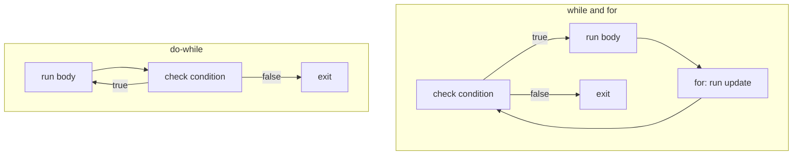

# Chapter 3 — Control Flow

By default a program runs statements top to bottom, once each. **Control flow** statements change that: they *choose* between paths (`if`, `switch`), *repeat* work (`for`, `while`, `do`), and *jump* (`break`, `continue`, `return`). Modern Java (16–21) also added **pattern matching**, which lets one construct both test the shape of a value and pull data out of it — turning long `if`/cast (an explicit type conversion written `(Type) value`) chains into short, compiler-checked `switch` expressions.

**What you'll learn**

| # | Topic | You will be able to… |
|---|---|---|
| 3.1 | `if` / `else` | write decision chains and avoid the dangling-else trap |
| 3.2 | The classic `switch` statement | use colon labels, `break`, fall-through and `default` |
| 3.3 | Arrow labels and `switch` expressions (Java 14) | return a value from a `switch`, use `yield`, rely on exhaustiveness |
| 3.4 | Choosing between `if`, ternary and `switch` | pick the clearest construct |
| 3.5 | Pattern matching for `instanceof` (Java 16) | test and bind in one step; understand flow scoping |
| 3.6 | Pattern matching for `switch` (Java 21) | type patterns, guards, `case null`, dominance, sealed exhaustiveness |
| 3.7 | Record patterns (Java 21) and unnamed patterns (Java 22) | deconstruct records, nest patterns, use `_` |
| 3.8 | Loops: `while`, `do`-`while`, `for`, enhanced `for` | choose and write the right loop |
| 3.9 | `break`, `continue` and labels | exit and skip iterations, including nested loops |
| 3.10 | Loop pitfalls | spot off-by-one, concurrent modification and other silent bugs |

Code: [`code/`](code/), compiled with `javac --release 25`, output pasted from real runs. Records (compact classes whose job is to carry data) and sealed interfaces (an *interface* declares methods that classes promise to provide; a *sealed* one lists every type allowed to implement it) appear here only as data for patterns; they are taught properly in [Chapter 6](../06-oop-inheritance-interfaces-and-more/README.md). For exam-level traps (which types a `switch` accepts, pattern-variable scope puzzles, loop-label trickery, unreachable code), see the OCP repo's [Chapter 3 — Making Decisions](../../../../ocp-java21-study/chapters/03-making-decisions/README.md).

---

## 3.1 `if`, `else if`, `else`

### What it is
`if (condition) statement` runs the statement only when the **boolean** (true/false) condition is `true`; an optional `else` runs otherwise. Chaining `else if` tests several conditions in order and runs the **first** branch whose condition holds.

Analogy: a receptionist checking a list top to bottom — the first rule that matches decides where you go.

### How it works
1. Evaluate the condition — it must have type `boolean` (or `Boolean`, its wrapper-object form). Unlike C or JavaScript, `if (x)` with an `int x` is a compile error: *incompatible types: int cannot be converted to boolean*.
2. If `true`, run the `if` body and skip every `else`.
3. Otherwise try the next `else if`; if none match, run the final `else` (if present).

[`code/IfElse.java`](code/IfElse.java):
```java
static String grade(int score) {
    if (score < 0 || score > 100) {
        return "invalid";
    } else if (score >= 90) {
        return "A";
    } else if (score >= 80) {
        return "B";
    } else if (score >= 70) {
        return "C";
    } else {
        return "F";
    }
}

// Dangling else: the else belongs to the NEAREST if, whatever the indentation says.
int x = 5, y = -1;
if (x > 0)
    if (y > 0)
        System.out.println("both positive");
else
    System.out.println("printed! this else pairs with 'if (y > 0)'");
```
Output:
```text
95 -> A
85 -> B
72 -> C
40 -> F
101 -> invalid
Beach day
printed! this else pairs with 'if (y > 0)'
minor
```
Order matters: because the chain stops at the first match, test the narrow or invalid cases first (`score >= 90` before `score >= 80`).

### Common mistakes
- **Dangling else** (above): Java ignores indentation; an `else` attaches to the closest unmatched `if`. Always use braces for nested `if`s.
- Omitting braces, then adding a second line that you think is inside the `if`:
  ```java
  if (loggedIn)
      showDashboard();
      audit();          // ALWAYS runs — only the first statement is controlled by the if
  ```
- `if (flag = true)` — assignment, not comparison; it compiles for `boolean` and is always true. Write `if (flag)`.
- Comparing strings with `==` in a condition ([Chapter 2](../02-basics-types-and-operators/README.md#28-operators)).
- Deep nesting. Prefer **guard clauses** — return early for invalid input so the main logic stays flat.

### Self-check
1. Does `if (count)` compile for `int count`? → No; conditions must be boolean.
2. In an `if`/`else if` chain, can two branches run? → No, only the first matching one.
3. How do you prevent the dangling-else problem? → Braces on every nested `if`.

---

## 3.2 The classic `switch` statement

### What it is
A `switch` compares one value (the **selector**) against constant **case labels** and jumps to the matching one. It replaces a long `if (x == 1) … else if (x == 2) …` chain when you are testing one variable for equality against constants.

### How it works (colon form, the original since Java 1.0)
1. Evaluate the selector once.
2. Jump to the `case` whose constant equals it, or to `default` if none does (if there is no `default`, nothing runs).
3. Execute statements from there **downwards** until a `break` (or `return`/`throw`) or the end of the `switch`. Running into the next case's statements is called **fall-through**.

[`code/SwitchStatement.java`](code/SwitchStatement.java):
```java
int month = 4;
int days;
switch (month) {
    case 2:
        days = 28;
        break;
    case 4: case 6: case 9: case 11:        // several labels share one body
        days = 30;
        break;
    default:
        days = 31;
}

int level = 2;
switch (level) {
    case 1:
        System.out.println("  unlock level 1 perks");
    case 2:
        System.out.println("  unlock level 2 perks");
    case 3:
        System.out.println("  unlock level 3 perks");   // runs too: no break above
        break;
    case 4:
        System.out.println("  not reached");
}
```
Output:
```text
month 4 has 30 days
stopping
Fall-through without break (level 2):
  unlock level 2 perks
  unlock level 3 perks
SAT is weekend
b is a consonant
```

### What can you switch on?
| Selector type | Since | Case labels |
|---|---|---|
| `char`, `byte`, `short`, `int` and their wrappers (object versions such as `Integer`) | Java 1.0 / 5 | compile-time constants (values fixed when compiling) that fit the type (`'a'`, `42`, `final` constants) |
| `enum` (a type with a fixed set of named constants) | Java 5 | constant names (`case SAT`); qualified names (`case Day.SAT`) also allowed since Java 21 |
| `String` | Java 7 | string literals; compared with `equals` (case-sensitive) |
| **Any reference type** (any non-primitive type) with patterns | Java 21 | type/record patterns, `null` ([3.6](#36-pattern-matching-for-switch-java-21)) |
| `long`, `float`, `double`, `boolean` | not allowed | (primitive patterns are only a *preview* — an opt-in trial feature; JEP 507, a numbered JDK Enhancement Proposal, in Java 25, still preview in 27) |

Labels must be unique, and a `String`/boxed (wrapper-object) selector that is `null` throws (raises as an error — see [Chapter 8](../08-exceptions/README.md)) `NullPointerException` unless there is a `case null` (Java 21).

### When fall-through is useful — and when not
Intentional fall-through (shared code for several labels, or cumulative steps like the perks example) is rare. Forgetting a `break` is a far more common bug, which is why the arrow form below exists. If you do fall through on purpose, comment it (`// fall through`).

### In the interview
**Q: What is fall-through in a `switch`?** In colon-style `switch`, execution continues from the matched label into the following labels' statements until a `break`. It is a frequent source of bugs; arrow labels (`case X ->`) never fall through.
- *Can you switch on a `String`? How does it compare?* Yes (Java 7); with `equals`, after a `hashCode` jump (`hashCode` is a number computed from the string's characters, used to narrow down the candidate labels quickly).
- *What happens with a `null` selector?* `NullPointerException`, unless a `case null` label is present (Java 21+).

---

## 3.3 Arrow labels and `switch` expressions (Java 14)

### What it is
Java 14 (JEP 361) finalised two related improvements:
- **Arrow labels** `case A, B -> …` — several constants per label, the right side is a single expression, block `{ }` or `throw`, and there is **no fall-through**. They can be used in `switch` *statements* too.
- **`switch` expressions** — a `switch` that **produces a value**, so you can write `int x = switch (…) { … };` or `return switch (…) { … };`.

### Why it matters
Classic `switch` used to compute a value needs a pre-declared variable, an assignment in every case, a `break` in every case and a `default` to keep the compiler happy about definite assignment (the compiler's check that a variable surely has a value before it is read). Each of those is a chance for a bug. The expression form removes all of them, and the compiler checks that **every possible value is handled** (*exhaustiveness*).

### How it works
1. The selector is evaluated; the matching label is chosen.
2. For `case … -> expression;` the expression's value becomes the switch's value.
3. For `case … -> { … }` the block must end by **`yield value;`** (or throw). `yield` means "this is the result of the switch" — it is not `return`, which would leave the whole method.
4. The switch expression must be **exhaustive**: for `int`/`String` selectors that means a `default`; for an `enum` it is enough to list every constant; for sealed types, every permitted subtype (a class or record that extends or implements the type; [3.6](#36-pattern-matching-for-switch-java-21)).

[`code/SwitchExpression.java`](code/SwitchExpression.java):
```java
enum Size { S, M, L, XL }

static int priceCents(Size size) {
    return switch (size) {                       // no default needed: all enum constants covered
        case S -> 250;
        case M -> 300;
        case L, XL -> 350;
    };
}

static String describe(int code) {
    return switch (code) {
        case 200, 201, 204 -> "success";
        case 301, 302 -> "redirect";
        case 404 -> "not found";
        default -> {
            String family = code >= 500 ? "server error" : "other";
            yield family + " (" + code + ")";    // yield returns a value from a block
        }
    };
}

// yield also works with old-style colon labels inside a switch expression
String kind = switch (letters % 2) {
    case 0:
        yield "even";
    default:
        yield "odd";
};
```
Output:
```text
S=250 M=300 L=350 XL=350 
200 -> success
302 -> redirect
404 -> not found
503 -> server error (503)
418 -> other (418)
WEDNESDAY has 9 letters
9 is odd
```
If one enum constant is missing, compilation fails:
```text
B.java:4: error: the switch expression does not cover all possible input values
        return switch (s) {
               ^
```
That is the real benefit: add `XXL` to `Size` later and the compiler points to every `switch` that must handle it. (If an enum gains a constant and a `switch` compiled against the old version meets it at run time, the JVM throws `MatchException`.)

### Statement vs expression, colon vs arrow

| | Colon labels `case X:` | Arrow labels `case X ->` |
|---|---|---|
| **Statement** | Classic; fall-through; `break` needed | No fall-through; one expression/block/throw per label |
| **Expression** | Allowed; must `yield` a value; fall-through possible | The usual modern form |
| Exhaustive? | Statement: only if it uses patterns or `null` (Java 21 rule). Expression: **always** | same |

You cannot mix colon and arrow labels in one `switch`.

### Common mistakes
- Forgetting the semicolon after the closing brace of a switch *expression* used in an assignment (`};`).
- Using `return` inside a switch-expression block to produce the value (compile error) — use `yield`.
- Adding `default` to an enum switch expression "just in case": it silences the exhaustiveness check that would have caught a newly added constant. Leave it out when you cover all constants.

### Self-check
1. What does `yield` do? → Supplies the value of a switch expression from a block.
2. Do arrow cases fall through? → Never.
3. Why may an enum switch expression omit `default`? → Listing all constants makes it exhaustive; the compiler verifies it.

---

## 3.4 Choosing between `if`, ternary and `switch`

| Situation | Best choice | Why |
|---|---|---|
| One condition, two actions | `if`/`else` | Clearest |
| One condition, pick one of two **values** | ternary `c ? a : b` | An expression; short |
| Ranges or unrelated conditions (`age < 13`, `isVip && total > 100`) | `if`/`else if` chain (or guarded patterns) | `switch` labels are constants/patterns, not ranges |
| One variable compared to many constants | `switch` with arrow labels | Readable, no fall-through |
| Compute a value from many cases | `switch` expression | Exhaustive, no temporary variable |
| Branch on the **type/shape** of an object | pattern `switch` (Java 21) | Replaces `instanceof` chains; compiler-checked for sealed types |
| Behaviour that varies per subtype and grows over time | **Polymorphism** (a method on each class; each class supplies its own version) | The OOP (object-oriented programming) alternative; see [Chapter 6](../06-oop-inheritance-interfaces-and-more/README.md) and the [LLD (low-level design) handbook](../../../lld/) |

The last two rows are a genuine design choice. A pattern `switch` over a *sealed* hierarchy keeps an operation in one place and makes adding an **operation** easy; virtual methods (methods whose version is picked at run time from the object's actual class) keep each type's code together and make adding a **type** easy. This is known as the *expression problem*.

---

## 3.5 Pattern matching for `instanceof` (Java 16)

### What it is
A **pattern** combines a *test* ("is this a `String`?") with *binding* ("…and if so, call it `s`"). `o instanceof String s` is a **type pattern** (JEP 394, final in Java 16): when the test succeeds, the **pattern variable** `s` is already cast and ready to use.

### The problem it solves
The old idiom repeats the type three times and allows mistakes (casting to the wrong type, forgetting the check):
```java
if (o instanceof String) {
    String s = (String) o;
    ...
}
```

### How it works — flow scoping
A pattern variable is in scope (usable by name) **only where the compiler can prove the match succeeded**:
1. Inside the `if` body when the condition is `o instanceof T t`.
2. On the right-hand side of `&&` (`o instanceof String s && !s.isEmpty()`), because `&&` only evaluates its right side when the left is true.
3. **After** the `if` when the `if` tests the *negation* and exits (`if (!(o instanceof String s)) return 0; … s.length()`).
4. **Not** with `||` — `o instanceof String s || s.isEmpty()` fails with *cannot find symbol*, because the right side runs precisely when the match failed.

[`code/InstanceofPattern.java`](code/InstanceofPattern.java):
```java
static String newStyle(Object o) {
    if (o instanceof String s && !s.isEmpty()) {     // s is in scope on the right of &&
        return "String of length " + s.length();
    }
    if (o instanceof Integer i) return "Integer, doubled " + (i * 2);
    return "something else: " + o;
}

static int lengthOrZero(Object o) {
    if (!(o instanceof String s)) {
        return 0;                                    // leave early when it is NOT a String
    }
    return s.length();                               // flow scoping: s is definitely a String here
}

record Money(long cents, String currency) {
    @Override public boolean equals(Object other) {  // a classic use: equals()
        return other instanceof Money m && cents == m.cents && currency.equals(m.currency);
    }
}
```
Output:
```text
String of length 5
String of length 5 | Integer, doubled 42 | something else:  | something else: null
lengthOrZero: 3, 0
true
```
Notes:
- `null instanceof X` is always `false`, so a pattern never binds `null`.
- The pattern variable is an ordinary local; it is not `final` unless you declare it `final String s`.
- An *unconditional* pattern — testing a `String` variable with `instanceof String s`, which can only fail for `null` — was a compile error in Java 16–20 and is allowed since Java 21.

### Real-world examples
`equals(Object)` implementations (as above), handling heterogeneous (mixed-type) JSON (a text format for structured data) nodes (`if (node instanceof ObjectNode obj)`), and exception (error-object, [Chapter 8](../08-exceptions/README.md)) handling code that inspects causes (`if (e.getCause() instanceof SQLException sql)`).

---

## 3.6 Pattern matching for `switch` (Java 21)

### What it is
Java 21 (JEP 441) lets `case` labels contain **patterns**, not just constants. A single `switch` can test the type of any object, bind variables, apply extra conditions and handle `null`.

### How it works
1. **Type pattern** — `case Integer i ->` matches when the selector is an `Integer` and binds `i`.
2. **Guard** — `case Integer i when i < 0 ->` adds a boolean condition (`when` is a contextual keyword — a keyword only in this position, still usable as a name elsewhere). The case only matches if the pattern matches **and** the guard is true.
3. **`case null`** — without it, a `null` selector throws `NullPointerException` (backward compatible — behaves exactly as old `switch` code expects). `case null, default ->` combines both.
4. **Order and dominance** — cases are tried top to bottom. A label is a compile error if an earlier label already matches everything it would (e.g. `CharSequence cs` before `String s`), so write **specific cases before general ones**, and guarded cases before the unguarded case of the same type.
5. **Exhaustiveness** — a pattern `switch` (expression *or* statement) must cover every possible value: add `default`, or cover all permitted subtypes of a **sealed** type.

[`code/SwitchPatterns.java`](code/SwitchPatterns.java):
```java
sealed interface Shape permits Circle, Square, Rectangle {}
record Circle(double radius) implements Shape {}
record Square(double side) implements Shape {}
record Rectangle(double width, double height) implements Shape {}

static double area(Shape shape) {
    return switch (shape) {                          // exhaustive: every permitted subtype covered
        case Circle c -> Math.PI * c.radius() * c.radius();
        case Square s -> s.side() * s.side();
        case Rectangle r -> r.width() * r.height();
    };
}

static String classify(Object o) {
    return switch (o) {
        case null -> "null!";                        // without this case, switch throws NPE
        case Integer i when i < 0 -> "negative int " + i;   // guard
        case Integer i -> "int " + i;
        case String s when s.isBlank() -> "blank string";
        case String s -> "string of " + s.length();
        case int[] arr -> "int array of " + arr.length;
        case Shape sh -> "shape with area " + String.format("%.2f", area(sh));
        default -> "other: " + o.getClass().getSimpleName();
    };
}
```
Output:
```text
negative int -7
int 42
blank string
string of 5
int array of 3
shape with area 3.14
shape with area 6.00
other: Double
null!
```
A **sealed** interface (Java 17) lists all its implementations with `permits`, so the compiler knows `area`'s three cases are complete — no `default`. Add a `Triangle` to `permits` and every such `switch` fails to compile until it handles triangles.

Real compiler errors you will meet:
```text
A.java:12: error: this case label is dominated by a preceding case label
            case String s -> "string";
                 ^
```
```text
B.java:10: error: the switch statement does not cover all possible input values
        switch (o) {
        ^
```

### Trade-offs
| Approach | Pros | Cons |
|---|---|---|
| `if`/`instanceof` chain | Works on any Java version ≥ 16 | Easy to forget a type; order-sensitive; verbose |
| Pattern `switch` + sealed types | Exhaustive, compact, a value-producing expression | Every `switch` must change when a subtype is added (which is the point) |
| Polymorphic method | Adding a type touches one place | Adding an operation touches every class |

### When not to use it
For a genuinely open hierarchy (plug-ins, user-defined subclasses — classes that extend another class) you cannot list the cases; a `default` branch or polymorphism fits better. And for equality against constants, the simple constant `switch` is still clearer.

### In the interview
**Q: What does pattern matching for `switch` give you over `instanceof` chains?** Type test, cast and binding in one label; guards with `when`; explicit `null` handling; and compile-time exhaustiveness and dominance checks — especially powerful with sealed hierarchies and records, where adding a subtype makes the compiler flag every switch that must be updated.
- *What is a guard?* A `when` boolean condition attached to a pattern label.
- *Why does label order matter?* The first matching label wins, and a label dominated by an earlier one is a compile error.
- *Does a pattern switch accept `null`?* Only with a `case null`; otherwise it throws `NullPointerException`.

### Self-check
1. Where must `case String s when s.isEmpty()` go relative to `case String s`? → Before it.
2. Why does `switch (shape)` above need no `default`? → `Shape` is sealed; all permitted subtypes are covered.
3. Is a pattern `switch` *statement* required to be exhaustive? → Yes (Java 21 rule for switches that use patterns or `null`).

---

## 3.7 Record patterns (Java 21) and unnamed patterns (Java 22)

### What it is
A **record** is a compact class whose purpose is to carry data (Java 16; [Chapter 6](../06-oop-inheritance-interfaces-and-more/README.md)): `record Point(int x, int y) {}` gets a constructor (the method that builds a new object), accessors `x()`/`y()` (methods that return each stored value), `equals`, `hashCode` and `toString` (the standard methods for comparing, hashing and printing an object) automatically. A **record pattern** (JEP 440, Java 21) matches a record **and deconstructs it** into its components (the values it carries) in one step: `o instanceof Point(int x, int y)`.

The **unnamed pattern** `_` (JEP 456, Java 22) matches anything and binds nothing — use it for components you do not care about. `_` can also name unused variables (`catch (Exception _)`, `for (var _ : list)`, lambda parameters `(_, v) -> v` — a lambda is a short inline function, [Chapter 11](../11-lambdas-and-functional-programming/README.md)).

### How it works
1. The value is tested against the record type (`null` never matches).
2. Each component is extracted through its accessor and matched against the nested pattern: a type (`int x`), `var x` (infer the type), another record pattern (nesting), or `_`.
3. Record patterns can be used in `instanceof` and in `switch`, with guards.

[`code/RecordPatterns.java`](code/RecordPatterns.java) — a tiny expression evaluator, a textbook use of sealed records plus patterns:
```java
record Point(int x, int y) {}
sealed interface Expr permits Num, Add, Mul, Neg {}
record Num(int value) implements Expr {}
record Add(Expr left, Expr right) implements Expr {}
record Mul(Expr left, Expr right) implements Expr {}
record Neg(Expr operand) implements Expr {}

static int eval(Expr e) {
    return switch (e) {
        case Num(int v) -> v;
        case Add(Expr l, Expr r) -> eval(l) + eval(r);
        case Mul(Num(var v), _) when v == 0 -> 0;          // nested pattern + unnamed _ + guard
        case Mul(Expr l, Expr r) -> eval(l) * eval(r);
        case Neg(var inner) -> -eval(inner);
    };
}

Object o = new Point(3, 4);
if (o instanceof Point(int x, int y)) {              // deconstruct in one step
    System.out.println("x=" + x + " y=" + y + " distance=" + Math.sqrt(x * x + y * y));
}
if (o instanceof Point(var x, _)) System.out.println("only care about x: " + x);
```
Output:
```text
x=3 y=4 distance=5.0
only care about x: 3
(2 + 3 * -4) = -10
0 * (1 + 2) = 0
```
The `Mul(Num(var v), _) when v == 0` case short-circuits multiplication by zero without evaluating the right side — a nested pattern reads like the data's shape. This style (sealed interface + records + exhaustive pattern switch) is how modern Java models **algebraic data types** (a type defined as a fixed set of alternative shapes, each carrying its own data): ASTs (abstract syntax trees — the tree a compiler builds from source code) in compilers, JSON values, commands/events, and results such as `Success | Failure`.

### Still in preview (don't rely on it yet)
**Primitive types in patterns, `instanceof` and `switch`** — e.g. `switch` on a `long` or `case int i` matching a `double` that fits — is a preview feature (JEP 507 in Java 25; still preview in 26 and 27). Without `--enable-preview`, switching on a `long` fails: *primitive patterns are a preview feature and are disabled by default*.

### Self-check
1. What does `case Add(var l, var r)` bind? → The two components of an `Add` record, with inferred types.
2. What does `_` mean in `Point(var x, _)`? → Match any `y` and ignore it (Java 22).
3. Does `null instanceof Point(int x, int y)` match? → No.

---

## 3.8 Loops

### What it is
A **loop** repeats a statement (the *body*) while a condition holds, or once per element of a collection (a group of objects such as a list or set). Each run of the body is an **iteration**.

| Loop | Checks condition | Runs at least once? | Typical use |
|---|---|---|---|
| `while (cond) body` | before each iteration | no | unknown number of repetitions: reading until end of input, waiting for a state |
| `do body while (cond);` | after each iteration | **yes** | menus, retry-until-success, input validation |
| `for (init; cond; update) body` | before each iteration | no | counting, index-based access |
| `for (T x : iterable) body` (enhanced for, Java 5) | — | no | visit every element of an array or `Iterable` (anything that can be looped over) |



[`code/Loops.java`](code/Loops.java):
```java
int n = 9075, digitSum = 0;
while (n > 0) {                       // condition checked BEFORE each iteration
    digitSum += n % 10;
    n /= 10;
}

int attempts = 0;
int[] fakeRolls = {2, 5, 6, 3};
int roll;
do {                                  // body runs at least once; condition checked AFTER
    roll = fakeRolls[attempts++];
    System.out.print("rolled " + roll + "; ");
} while (roll != 6);

long factorial = 1;
for (int i = 1; i <= 10; i++) {       // init; condition; update
    factorial *= i;
}

for (int i = 0, j = 10; i < j; i += 3, j -= 3) {   // several variables of one type
    System.out.print("(" + i + "," + j + ") ");
}
for (int i = 10; i > 0; i /= 2) System.out.print(i + " ");   // any update expression

int[] temps = {21, 25, 19, 30};
int max = Integer.MIN_VALUE;
for (int t : temps) max = Math.max(max, t);   // enhanced for over an array

Map<String, Integer> stock = new TreeMap<>(Map.of("apple", 3, "pear", 0, "fig", 7));
for (Map.Entry<String, Integer> e : stock.entrySet()) {
    System.out.print(e.getKey() + ":" + e.getValue() + " ");
}
```
Output:
```text
digit sum of 9075 = 21
rolled 2; rolled 5; rolled 6; got a 6 after 3 attempts
10! = 3628800
(0,10) (3,7) 
10 5 2 1 
max temp = 30
ADA GRACE LINUS 
apple:3 fig:7 pear:0 
1 2 Fizz 4 Buzz Fizz 7 8 Fizz Buzz 11 Fizz 13 14 FizzBuzz
```

### The `for` loop in detail
1. **Initialisation** runs once. It may declare several variables *of the same type* (`int i = 0, j = 10`); they are scoped to the loop.
2. **Condition** is checked before every iteration; if omitted, it is `true` (`for (;;)` is an infinite loop).
3. **Body** runs.
4. **Update** runs after each body (several expressions separated by commas are allowed), then back to step 2.

### The enhanced `for` in detail
`for (T x : source)` works for **arrays** and anything that implements **`Iterable`** (all collections). The compiler turns it into an index loop for arrays and an `Iterator` (an object that walks a collection one element at a time with `hasNext()`/`next()`) loop for collections. Use it whenever you need each element and not its index. Its limits:
- No index (use a classic `for`, or `IntStream.range` — [Chapter 12](../12-streams/README.md)).
- The loop variable is a **copy** for primitives: assigning to it does not change the array.
- You must not add/remove elements of the collection being iterated ([3.10](#310-loop-pitfalls)).
- Iterating a `Map` (a key→value lookup table) directly is impossible — iterate `entrySet()`, `keySet()` or `values()`.

### Loops vs streams
Many loops that filter, transform and aggregate (combine into one result, such as a sum or maximum) can be written as streams (pipelines of data-processing steps) ([Chapter 12](../12-streams/README.md)): `Arrays.stream(temps).max()`. Loops remain the right tool when you need early exits with complex state, index arithmetic, or maximum performance on primitive arrays; streams read better for pipelines of transformations.

### In the interview
**Q: `while` vs `do-while`?** `while` tests before the first iteration and may run zero times; `do-while` tests after, so it runs at least once — useful for "prompt until valid" loops.
- *When do you prefer the enhanced `for`?* Whenever you only need the elements, not indexes, and are not modifying the collection's structure.
- *How is the enhanced `for` compiled for a `List`?* Into an `Iterator` loop (`hasNext`/`next`).

### Self-check
1. How many times does `for (int i = 0; i < 10; i += 3)` run? → 4 (0, 3, 6, 9).
2. Can `for (int i = 0, long j = 0; …)` compile? → No; one declaration type only.
3. Which loop suits "ask for a password until it is valid"? → `do-while`.

---

## 3.9 `break`, `continue` and labels

### What it is
- **`break`** exits the innermost loop (or `switch`) immediately.
- **`continue`** skips the rest of the current iteration and proceeds with the next one (in a `for`, the update still runs).
- A **label** (`name:` before a loop) lets `break name;` or `continue name;` target an **outer** loop. `return` exits the whole method, which is often the cleanest way out of nested loops.

[`code/Branching.java`](code/Branching.java):
```java
for (int v : data) {
    if (v < 0) {
        System.out.println("found a negative, stopping");
        break;                                 // leave the loop entirely
    }
    System.out.println("processing " + v);
}

for (int i = 1; i <= 10; i++) {
    if (i % 3 != 0) continue;                  // skip the rest of this iteration
    System.out.print(i + " ");
}

search:                                        // a label names the outer loop
for (int r = 0; r < grid.length; r++) {
    for (int c = 0; c < grid[r].length; c++) {
        if (grid[r][c] == target) {
            foundRow = r;
            foundCol = c;
            break search;                      // exits BOTH loops
        }
    }
}

outer:
for (int i = 1; i <= 3; i++) {
    for (int j = 1; j <= 3; j++) {
        if (j == i) continue outer;            // jump to the next i
        System.out.print(i + "" + j + " ");
    }
}

while (true) {                                  // loop-and-a-half: exit in the middle
    String line = lines[idx++];
    if (line.isEmpty()) break;
    System.out.print(line + " ");
}
```
Output:
```text
processing 4
processing 8
found a negative, stopping
3 6 9 <- multiples of 3
42 found at (1,1)
21 31 32 <- pairs with j < i
alpha beta <- read until blank line
```

### Trade-offs
| Technique | Good for | Watch out |
|---|---|---|
| `break` / `continue` | Early exit, skipping invalid items | Many of them in one loop hide the control flow |
| Labelled `break` | Leaving nested loops (grid search) | Rarely needed; often clearer to extract a method and `return` |
| `while (true)` + `break` | "Loop-and-a-half": read, test, process | Make sure every path eventually breaks |
| `return` | Leaving everything once the answer is found | — |

Java has no `goto` (the word is reserved but unused); labels only work with `break`/`continue` on enclosing statements. Code directly after an unconditional `break`/`continue`/`return` in the same block is **unreachable** and a compile error.

### Self-check
1. In a `for` loop, does `continue` skip the update expression? → No, the update still runs.
2. How do you leave two nested loops at once? → A labelled `break`, or put the loops in a method and `return`.
3. What does `break` inside a `switch` inside a loop exit? → Only the `switch`.

---

## 3.10 Loop pitfalls

[`code/LoopPitfalls.java`](code/LoopPitfalls.java) — each compiles fine:
```java
int[] a = {10, 20, 30};
for (int i = 0; i <= a.length; i++) System.out.print(a[i] + " ");   // off-by-one: <= should be <

List<Integer> nums = new ArrayList<>(List.of(1, 2, 3, 4, 5, 6));
for (Integer x : nums) if (x % 2 == 0) nums.remove(x);   // structural change during for-each

for (Iterator<Integer> it = nums.iterator(); it.hasNext(); ) {
    if (it.next() % 2 == 0) it.remove();                       // fix 1: Iterator.remove
}
more.removeIf(x -> x % 2 == 0);                                // fix 2: removeIf (Java 8)

for (double d = 0.0; d != 1.0 && count < 20; d += 0.1) count++; // d never equals 1.0 exactly

for (int v : values) v *= 10;                  // changes the copy, not the array

for (int i = 0; i < 5; i++); { total++; }      // stray ';' = empty loop body
```
Output:
```text
10 20 30 
off-by-one -> Index 3 out of bounds for length 3
remove in for-each -> ConcurrentModificationException
after Iterator.remove: [1, 3, 5]
after removeIf: [1, 3, 5]
double counter ran 20 times (guard stopped it)
values after 'v *= 10' in for-each: [1, 2, 3]
stray semicolon: block ran 1 time(s)
```

| Pitfall | Why it happens | Fix |
|---|---|---|
| **Off-by-one** (`<=` with `length`) | Indexes run 0 … length−1 | `i < a.length`; prefer enhanced `for` |
| **`ConcurrentModificationException`** | Collections like `ArrayList` are *fail-fast*: their iterator detects structural changes (elements added or removed) made behind its back ([Chapter 10](../10-collections/README.md)). Detection is best-effort — removing the second-to-last element can even end the loop silently without the exception, leaving a wrong result. | `Iterator.remove()`, `removeIf`, or build a new list |
| **Floating-point loop counter** | 0.1 is inexact, so `d` never equals 1.0 ([Chapter 2](../02-basics-types-and-operators/README.md#211-floating-point-numbers)) | Loop over an `int` and compute `i * 0.1` |
| **Assigning the for-each variable** | It is a copy of the element | Index loop: `values[i] *= 10` |
| **Stray semicolon** after `for (…)` / `while (…)` | `;` is an empty statement that becomes the body | Always use braces; IDEs warn |
| **Infinite loop** | Condition never becomes false (forgot `i++`, or `while (x != 10)` when `x` jumps from 9 to 11) | Update the loop variable; prefer `<`/`>` over `!=` |
| **Integer overflow of the counter** | `for (int i = 0; i <= Integer.MAX_VALUE; i++)` never ends — `i` wraps negative | Use `<` or a `long` |
| **Expensive condition** | `for (int i = 0; i < list.size(); i++)` on a `LinkedList` (a chain of linked nodes, slow to index) with `get(i)` is O(n²) (Big-O notation: time grows with the square of the list size) | Enhanced `for`/iterator |

### Self-check
1. Why can removing inside a for-each fail? → The fail-fast iterator sees the list changed structurally and throws `ConcurrentModificationException`.
2. Two safe ways to remove matching elements while iterating? → `Iterator.remove()` or `Collection.removeIf`.
3. What does `for (int i = 0; i < 3; i++);` do? → Loops three times over an empty statement.

---

## Chapter TL;DR
- `if`/`else if`/`else`: first true branch wins; conditions must be `boolean`; use braces to avoid the dangling-else and "second statement" traps; prefer guard clauses to deep nesting.
- Classic `switch` (colon labels) falls through until `break`; works on `int`-like types, wrappers, `enum`, `String` — never `long`/`float`/`double`/`boolean` (primitive patterns are still preview).
- Arrow labels (Java 14) never fall through; **switch expressions** return a value, use `yield` inside blocks, and must be exhaustive (enum constants listed or `default`).
- `instanceof` patterns (Java 16) test + cast + bind; the variable is in scope only where the match is certain (`&&`, negated early-exit), not with `||`.
- Pattern `switch` (Java 21): type patterns, `when` guards, `case null`, dominance (specific before general) and exhaustiveness — with sealed types no `default` is needed and adding a subtype breaks every incomplete switch at compile time.
- Record patterns (Java 21) deconstruct records, nest, and use `var`; `_` (Java 22) ignores parts. Sealed interface + records + pattern switch = algebraic data types in Java.
- Loops: `while` (0+ times), `do-while` (1+ times), `for` (counting), enhanced `for` (every element of an array/`Iterable`, no index, no structural changes).
- `break` exits, `continue` skips, labels target outer loops; often a method + `return` is cleaner.
- Classic bugs: off-by-one, `ConcurrentModificationException`, floating counters, assigning the for-each variable, stray `;`.
- Exam-trap depth: [OCP Chapter 3](../../../../ocp-java21-study/chapters/03-making-decisions/README.md). Next: [Chapter 4 — Methods and arrays](../04-methods-and-arrays/README.md).
