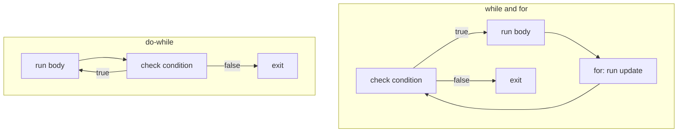

# Chapter 3 — Control Flow

Statements run top to bottom, once each, unless **control flow** changes that: *choosing* a path (`if`, `switch`), *repeating* (`for`, `while`, `do`) or *jumping* (`break`, `continue`, `return`). Modern Java (16–21) adds **pattern matching**: one construct tests a value's shape and extracts its data, turning `if`/cast chains (a cast is an explicit conversion, `(Type) value`) into short, compiler-checked `switch` expressions.

Code: [`code/`](code/), compiled with `javac --release 25`, output from real runs. Records (compact data-carrier classes) and sealed interfaces (an *interface* declares methods implementing classes must provide; a *sealed* one lists every type allowed to implement it) appear here only as data for patterns; they are taught in [Chapter 6](../06-oop-inheritance-interfaces-and-more/README.md). Exam traps (accepted `switch` types, pattern-scope puzzles, labels, unreachable code): OCP [Chapter 3 — Making Decisions](../../../../ocp-java21-study/chapters/03-making-decisions/README.md).

---

## 3.1 `if`, `else if`, `else`

### What it is
`if (condition) statement` runs the statement only when the **boolean** condition is `true`; an optional `else` runs otherwise. An `else if` chain tests conditions in order and runs only the **first** matching branch.

The condition must be `boolean` (or `Boolean`). Unlike C or JavaScript, `if (x)` with an `int x` is a compile error: *incompatible types: int cannot be converted to boolean*.

[`code/IfElse.java`](code/IfElse.java):
```java
static String grade(int score) {
    if (score < 0 || score > 100) {
        return "invalid";
    } else if (score >= 90) {
        return "A";
    } else if (score >= 80) {
        return "B";
    } else if (score >= 70) {
        return "C";
    } else {
        return "F";
    }
}

// Dangling else: the else belongs to the NEAREST if, whatever the indentation says.
int x = 5, y = -1;
if (x > 0)
    if (y > 0)
        System.out.println("both positive");
else
    System.out.println("printed! this else pairs with 'if (y > 0)'");
```
Output:
```text
95 -> A
85 -> B
72 -> C
40 -> F
101 -> invalid
Beach day
printed! this else pairs with 'if (y > 0)'
minor
```
Because the chain stops at the first match, test narrow or invalid cases first (`score >= 90` before `score >= 80`).

### Common mistakes
- **Dangling else** (above): Java ignores indentation; an `else` attaches to the closest unmatched `if`. Brace every nested `if`.
- Omitting braces, then adding a second line you think is inside the `if`:
  ```java
  if (loggedIn)
      showDashboard();
      audit();          // ALWAYS runs — only the first statement is controlled by the if
  ```
- `if (flag = true)` — assignment, always true for `boolean`. Write `if (flag)`.
- Comparing strings with `==` ([Chapter 2](../02-basics-types-and-operators/README.md#28-operators)).
- Deep nesting — prefer **guard clauses** (return early on invalid input so the main logic stays flat).

---

## 3.2 The classic `switch` statement

### What it is
A `switch` compares one value (the **selector**) against constant **case labels** and jumps to the match — replacing an `if (x == 1) … else if (x == 2) …` chain on one variable.

### How it works (colon form, since Java 1.0)
1. Evaluate the selector once.
2. Jump to the `case` whose constant equals it, else to `default` (no `default` → nothing runs).
3. Execute **downwards** until `break` (or `return`/`throw`) or the end. Running into the next case's statements is **fall-through**.

[`code/SwitchStatement.java`](code/SwitchStatement.java):
```java
int month = 4;
int days;
switch (month) {
    case 2:
        days = 28;
        break;
    case 4: case 6: case 9: case 11:        // several labels share one body
        days = 30;
        break;
    default:
        days = 31;
}

int level = 2;
switch (level) {
    case 1:
        System.out.println("  unlock level 1 perks");
    case 2:
        System.out.println("  unlock level 2 perks");
    case 3:
        System.out.println("  unlock level 3 perks");   // runs too: no break above
        break;
    case 4:
        System.out.println("  not reached");
}
```
Output:
```text
month 4 has 30 days
stopping
Fall-through without break (level 2):
  unlock level 2 perks
  unlock level 3 perks
SAT is weekend
b is a consonant
```

### What can you switch on?
| Selector type | Since | Case labels |
|---|---|---|
| `char`, `byte`, `short`, `int` and wrappers (`Integer`…) | Java 1.0 / 5 | compile-time constants that fit the type (`'a'`, `42`, `final` constants) |
| `enum` (fixed set of named constants) | Java 5 | constant names (`case SAT`); qualified `case Day.SAT` also since Java 21 |
| `String` | Java 7 | string literals; compared with `equals` (case-sensitive) after a `hashCode` jump |
| **Any reference type** with patterns | Java 21 | type/record patterns, `null` ([3.6](#36-pattern-matching-for-switch-java-21)) |
| `long`, `float`, `double`, `boolean` | not allowed | primitive patterns are only a *preview* (opt-in trial; JEP 507 in Java 25, still preview in 27) |

Labels must be unique. A `null` `String`/boxed selector throws `NullPointerException` ([Chapter 8](../08-exceptions/README.md)) unless there is a `case null` (Java 21).

Intentional fall-through (shared code, cumulative steps like the perks) is rare; a forgotten `break` is a common bug — hence the arrow form. Comment deliberate fall-through (`// fall through`).

### In the interview
**Q: What is fall-through?** In colon-style `switch`, execution continues from the matched label through following labels until a `break`. Arrow labels (`case X ->`) never fall through.
- *Switch on a `String`?* Yes (Java 7); `hashCode` (number computed from the characters) narrows candidates, then `equals` confirms.
- *`null` selector?* `NullPointerException`, unless `case null` is present (Java 21+).

---

## 3.3 Arrow labels and `switch` expressions (Java 14)

### What it is
Java 14 (JEP 361) finalised:
- **Arrow labels** `case A, B -> …` — several constants per label; the right side is one expression, block `{ }` or `throw`; **no fall-through**. Usable in `switch` statements too.
- **`switch` expressions** — a `switch` that **produces a value**: `int x = switch (…) { … };`, `return switch (…) { … };`.

### Why it matters
Computing a value with a classic `switch` needs a pre-declared variable, an assignment and `break` in every case, and a `default` to satisfy definite assignment — each a chance for a bug. The expression form removes them, and the compiler checks **every possible value is handled** (*exhaustiveness*).

### How it works
1. `case … -> expression;` — the expression's value is the switch's value.
2. `case … -> { … }` — the block must end with **`yield value;`** (or throw). `yield` gives the switch's result; `return` would leave the whole method (and is a compile error here).
3. The expression must be **exhaustive**: `default` for `int`/`String`; all constants for an `enum`; all permitted subtypes for a sealed type ([3.6](#36-pattern-matching-for-switch-java-21)).

[`code/SwitchExpression.java`](code/SwitchExpression.java):
```java
enum Size { S, M, L, XL }

static int priceCents(Size size) {
    return switch (size) {                       // no default needed: all enum constants covered
        case S -> 250;
        case M -> 300;
        case L, XL -> 350;
    };
}

static String describe(int code) {
    return switch (code) {
        case 200, 201, 204 -> "success";
        case 301, 302 -> "redirect";
        case 404 -> "not found";
        default -> {
            String family = code >= 500 ? "server error" : "other";
            yield family + " (" + code + ")";    // yield returns a value from a block
        }
    };
}

// yield also works with old-style colon labels inside a switch expression
String kind = switch (letters % 2) {
    case 0:
        yield "even";
    default:
        yield "odd";
};
```
Output:
```text
S=250 M=300 L=350 XL=350 
200 -> success
302 -> redirect
404 -> not found
503 -> server error (503)
418 -> other (418)
WEDNESDAY has 9 letters
9 is odd
```
A missing enum constant fails compilation:
```text
B.java:4: error: the switch expression does not cover all possible input values
        return switch (s) {
               ^
```
Add `XXL` to `Size` later and the compiler flags every `switch` that must handle it. (If a switch compiled against the old enum meets the new constant at run time, the JVM throws `MatchException`.)

### Statement vs expression, colon vs arrow

| | Colon labels `case X:` | Arrow labels `case X ->` |
|---|---|---|
| **Statement** | Classic; fall-through; `break` needed | No fall-through; one expression/block/throw per label |
| **Expression** | Allowed; must `yield`; fall-through possible | The usual modern form |
| Exhaustive? | Statement: only if it uses patterns or `null` (Java 21 rule). Expression: **always** | same |

Colon and arrow labels cannot be mixed in one `switch`.

### Common mistakes
- Missing `;` after a switch expression used in an assignment (`};`).
- `return` instead of `yield` inside a switch-expression block.
- Adding `default` to an enum switch expression "just in case": it silences the exhaustiveness check that would catch a new constant.

---

## 3.4 Choosing between `if`, ternary and `switch`

| Situation | Best choice | Why |
|---|---|---|
| One condition, two actions | `if`/`else` | Clearest |
| One condition, pick one of two **values** | ternary `c ? a : b` | An expression; short |
| Ranges or unrelated conditions (`age < 13`, `isVip && total > 100`) | `if`/`else if` (or guarded patterns) | `switch` labels are constants/patterns, not ranges |
| One variable vs many constants | arrow `switch` | Readable, no fall-through |
| Compute a value from many cases | `switch` expression | Exhaustive, no temporary variable |
| Branch on an object's **type/shape** | pattern `switch` (Java 21) | Replaces `instanceof` chains; checked for sealed types |
| Per-subtype behaviour that grows over time | **Polymorphism** (each class supplies its own method version) | The OOP alternative; [Chapter 6](../06-oop-inheritance-interfaces-and-more/README.md), [LLD handbook](../../../lld/) |

The last two rows are a real design choice (the *expression problem*): a pattern `switch` over a sealed hierarchy keeps an operation in one place, making new **operations** easy; virtual methods (version chosen at run time from the object's class) keep each type's code together, making new **types** easy.

---

## 3.5 Pattern matching for `instanceof` (Java 16)

### What it is
A **pattern** combines a *test* ("is this a `String`?") with *binding* ("…if so, call it `s`"). `o instanceof String s` is a **type pattern** (JEP 394, Java 16): on success the **pattern variable** `s` is already cast. It replaces the old idiom that repeats the type three times and invites wrong casts:
```java
if (o instanceof String) {
    String s = (String) o;
    ...
}
```

### How it works — flow scoping
A pattern variable is in scope **only where the compiler can prove the match succeeded**:
1. Inside the `if` body for `o instanceof T t`.
2. On the right of `&&` (`o instanceof String s && !s.isEmpty()`).
3. **After** an `if` that tests the *negation* and exits (`if (!(o instanceof String s)) return 0; … s.length()`).
4. **Not** with `||` — `o instanceof String s || s.isEmpty()` fails with *cannot find symbol*, since the right side runs exactly when the match failed.

[`code/InstanceofPattern.java`](code/InstanceofPattern.java):
```java
static String newStyle(Object o) {
    if (o instanceof String s && !s.isEmpty()) {     // s is in scope on the right of &&
        return "String of length " + s.length();
    }
    if (o instanceof Integer i) return "Integer, doubled " + (i * 2);
    return "something else: " + o;
}

static int lengthOrZero(Object o) {
    if (!(o instanceof String s)) {
        return 0;                                    // leave early when it is NOT a String
    }
    return s.length();                               // flow scoping: s is definitely a String here
}

record Money(long cents, String currency) {
    @Override public boolean equals(Object other) {  // a classic use: equals()
        return other instanceof Money m && cents == m.cents && currency.equals(m.currency);
    }
}
```
Output:
```text
String of length 5
String of length 5 | Integer, doubled 42 | something else:  | something else: null
lengthOrZero: 3, 0
true
```
- `null instanceof X` is always `false`, so a pattern never binds `null`.
- The pattern variable is an ordinary local, not `final` unless declared so.
- An *unconditional* pattern (testing a `String` variable with `instanceof String s`) was an error in Java 16–20; allowed since 21.

Typical uses: `equals(Object)` (above), mixed-type JSON nodes (`if (node instanceof ObjectNode obj)`), inspecting exception causes (`if (e.getCause() instanceof SQLException sql)`; [Chapter 8](../08-exceptions/README.md)).

---

## 3.6 Pattern matching for `switch` (Java 21)

### What it is
Java 21 (JEP 441) allows **patterns** in `case` labels: one `switch` can test any object's type, bind variables, add conditions and handle `null`.

### How it works
1. **Type pattern** — `case Integer i ->` matches an `Integer` and binds `i`.
2. **Guard** — `case Integer i when i < 0 ->` matches only if the pattern matches **and** the condition holds (`when` is a contextual keyword).
3. **`case null`** — without it a `null` selector throws `NullPointerException` (backward compatible). `case null, default ->` combines both.
4. **Dominance** — cases are tried top to bottom; a label already fully matched by an earlier one is a compile error (e.g. `CharSequence cs` before `String s`). Put **specific before general**, guarded before unguarded of the same type.
5. **Exhaustiveness** — a pattern `switch` (expression *or* statement) must cover every value: `default`, or all permitted subtypes of a **sealed** type.

[`code/SwitchPatterns.java`](code/SwitchPatterns.java):
```java
sealed interface Shape permits Circle, Square, Rectangle {}
record Circle(double radius) implements Shape {}
record Square(double side) implements Shape {}
record Rectangle(double width, double height) implements Shape {}

static double area(Shape shape) {
    return switch (shape) {                          // exhaustive: every permitted subtype covered
        case Circle c -> Math.PI * c.radius() * c.radius();
        case Square s -> s.side() * s.side();
        case Rectangle r -> r.width() * r.height();
    };
}

static String classify(Object o) {
    return switch (o) {
        case null -> "null!";                        // without this case, switch throws NPE
        case Integer i when i < 0 -> "negative int " + i;   // guard
        case Integer i -> "int " + i;
        case String s when s.isBlank() -> "blank string";
        case String s -> "string of " + s.length();
        case int[] arr -> "int array of " + arr.length;
        case Shape sh -> "shape with area " + String.format("%.2f", area(sh));
        default -> "other: " + o.getClass().getSimpleName();
    };
}
```
Output:
```text
negative int -7
int 42
blank string
string of 5
int array of 3
shape with area 3.14
shape with area 6.00
other: Double
null!
```
`Shape` is **sealed** (Java 17) — `permits` lists all implementations — so `area`'s three cases are complete without `default`. Add `Triangle` to `permits` and every such `switch` fails to compile until it handles it.

Compiler errors you will meet:
```text
A.java:12: error: this case label is dominated by a preceding case label
            case String s -> "string";
                 ^
```
```text
B.java:10: error: the switch statement does not cover all possible input values
        switch (o) {
        ^
```

### Trade-offs
| Approach | Pros | Cons |
|---|---|---|
| `if`/`instanceof` chain | Works on Java ≥ 16 | Easy to miss a type; order-sensitive; verbose |
| Pattern `switch` + sealed types | Exhaustive, compact, value-producing | Every `switch` changes when a subtype is added (the point) |
| Polymorphic method | Adding a type touches one place | Adding an operation touches every class |

For an open hierarchy (plug-ins, user subclasses) you cannot list cases — use `default` or polymorphism. For equality against constants, a constant `switch` is clearer.

### In the interview
**Q: What does pattern matching for `switch` give over `instanceof` chains?** Test, cast and bind in one label; `when` guards; explicit `null`; compile-time exhaustiveness and dominance checks — strongest with sealed records, where a new subtype flags every switch to update.
- *Guard?* A `when` condition on a pattern label.
- *Why does order matter?* First match wins; a dominated label is a compile error — so `case String s when s.isEmpty()` goes before `case String s`.
- *`null`?* Only with `case null`; otherwise `NullPointerException`.
- *Must a pattern switch* statement *be exhaustive?* Yes (Java 21 rule for switches using patterns or `null`).

---

## 3.7 Record patterns (Java 21) and unnamed patterns (Java 22)

### What it is
A **record** (Java 16; [Chapter 6](../06-oop-inheritance-interfaces-and-more/README.md)) is a compact data class: `record Point(int x, int y) {}` automatically gets a constructor, accessors `x()`/`y()`, `equals`, `hashCode` and `toString`. A **record pattern** (JEP 440, Java 21) matches a record **and deconstructs** its components in one step: `o instanceof Point(int x, int y)`.

The **unnamed pattern** `_` (JEP 456, Java 22) matches anything and binds nothing. `_` also names unused variables: `catch (Exception _)`, `for (var _ : list)`, lambda parameters `(_, v) -> v` ([Chapter 11](../11-lambdas-and-functional-programming/README.md)).

### How it works
1. The value is tested against the record type (`null` never matches).
2. Each component is extracted via its accessor and matched against a nested pattern: a type (`int x`), `var x` (inferred), another record pattern, or `_`.
3. Works in `instanceof` and `switch`, with guards.

[`code/RecordPatterns.java`](code/RecordPatterns.java) — a tiny expression evaluator:
```java
record Point(int x, int y) {}
sealed interface Expr permits Num, Add, Mul, Neg {}
record Num(int value) implements Expr {}
record Add(Expr left, Expr right) implements Expr {}
record Mul(Expr left, Expr right) implements Expr {}
record Neg(Expr operand) implements Expr {}

static int eval(Expr e) {
    return switch (e) {
        case Num(int v) -> v;
        case Add(Expr l, Expr r) -> eval(l) + eval(r);
        case Mul(Num(var v), _) when v == 0 -> 0;          // nested pattern + unnamed _ + guard
        case Mul(Expr l, Expr r) -> eval(l) * eval(r);
        case Neg(var inner) -> -eval(inner);
    };
}

Object o = new Point(3, 4);
if (o instanceof Point(int x, int y)) {              // deconstruct in one step
    System.out.println("x=" + x + " y=" + y + " distance=" + Math.sqrt(x * x + y * y));
}
if (o instanceof Point(var x, _)) System.out.println("only care about x: " + x);
```
Output:
```text
x=3 y=4 distance=5.0
only care about x: 3
(2 + 3 * -4) = -10
0 * (1 + 2) = 0
```
`Mul(Num(var v), _) when v == 0` short-circuits multiplication by zero without evaluating the right side. Sealed interface + records + exhaustive pattern switch is how modern Java models **algebraic data types** (a type defined as a fixed set of alternative shapes, each with its own data): compiler ASTs (abstract syntax trees), JSON values, commands/events, `Success | Failure` results.

### Still in preview
**Primitive types in patterns, `instanceof` and `switch`** (e.g. switching on a `long`, `case int i` matching a `double` that fits) is preview (JEP 507 in Java 25; still preview in 26 and 27). Without `--enable-preview`, switching on a `long` fails: *primitive patterns are a preview feature and are disabled by default*.

---

## 3.8 Loops

### What it is
A **loop** repeats a body while a condition holds, or once per element of a collection; each run is an **iteration**.

| Loop | Checks condition | Runs at least once? | Typical use |
|---|---|---|---|
| `while (cond) body` | before each iteration | no | unknown count: read until end of input, wait for a state |
| `do body while (cond);` | after each iteration | **yes** | menus, retry-until-success, "ask until valid" |
| `for (init; cond; update) body` | before each iteration | no | counting, index access |
| `for (T x : iterable) body` (enhanced for, Java 5) | — | no | every element of an array or `Iterable` |



[`code/Loops.java`](code/Loops.java):
```java
int n = 9075, digitSum = 0;
while (n > 0) {                       // condition checked BEFORE each iteration
    digitSum += n % 10;
    n /= 10;
}

int attempts = 0;
int[] fakeRolls = {2, 5, 6, 3};
int roll;
do {                                  // body runs at least once; condition checked AFTER
    roll = fakeRolls[attempts++];
    System.out.print("rolled " + roll + "; ");
} while (roll != 6);

long factorial = 1;
for (int i = 1; i <= 10; i++) {       // init; condition; update
    factorial *= i;
}

for (int i = 0, j = 10; i < j; i += 3, j -= 3) {   // several variables of one type
    System.out.print("(" + i + "," + j + ") ");
}
for (int i = 10; i > 0; i /= 2) System.out.print(i + " ");   // any update expression

int[] temps = {21, 25, 19, 30};
int max = Integer.MIN_VALUE;
for (int t : temps) max = Math.max(max, t);   // enhanced for over an array

Map<String, Integer> stock = new TreeMap<>(Map.of("apple", 3, "pear", 0, "fig", 7));
for (Map.Entry<String, Integer> e : stock.entrySet()) {
    System.out.print(e.getKey() + ":" + e.getValue() + " ");
}
```
Output:
```text
digit sum of 9075 = 21
rolled 2; rolled 5; rolled 6; got a 6 after 3 attempts
10! = 3628800
(0,10) (3,7) 
10 5 2 1 
max temp = 30
ADA GRACE LINUS 
apple:3 fig:7 pear:0 
1 2 Fizz 4 Buzz Fizz 7 8 Fizz Buzz 11 Fizz 13 14 FizzBuzz
```

### The `for` loop in detail
1. **Initialisation** runs once; it may declare several variables *of one type* (`int i = 0, j = 10` — `int i = 0, long j = 0` does not compile), scoped to the loop.
2. **Condition** is checked before every iteration; omitted means `true` (`for (;;)` is infinite).
3. **Body** runs, then the **update** (comma-separated expressions allowed), then back to 2. E.g. `for (int i = 0; i < 10; i += 3)` runs 4 times (0, 3, 6, 9).

### The enhanced `for` in detail
`for (T x : source)` works on **arrays** and any **`Iterable`** (all collections). It compiles to an index loop for arrays and an `Iterator` loop (`hasNext()`/`next()`) for collections. Limits:
- No index (use a classic `for` or `IntStream.range` — [Chapter 12](../12-streams/README.md)).
- For primitives the loop variable is a **copy**: assigning it does not change the array.
- No adding/removing elements of the collection being iterated ([3.10](#310-loop-pitfalls)).
- A `Map` is not `Iterable` — iterate `entrySet()`, `keySet()` or `values()`.

### Loops vs streams
Loops that filter, transform and aggregate can be streams ([Chapter 12](../12-streams/README.md)): `Arrays.stream(temps).max()`. Loops stay better for early exits with complex state, index arithmetic, or peak performance on primitive arrays; streams read better for transformation pipelines.

### In the interview
**Q: `while` vs `do-while`?** `while` tests first and may run zero times; `do-while` tests after, so it runs at least once — good for "prompt until valid".
- *When the enhanced `for`?* When you need only elements, not indexes, and don't change the collection's structure.
- *How is it compiled for a `List`?* Into an `Iterator` loop.

---

## 3.9 `break`, `continue` and labels

### What it is
- **`break`** exits the innermost loop or `switch` (inside a `switch` in a loop, it exits only the `switch`).
- **`continue`** skips to the next iteration (in a `for`, the update still runs).
- A **label** (`name:` before a loop) lets `break name;`/`continue name;` target an **outer** loop. `return` exits the whole method — often the cleanest way out of nested loops.

[`code/Branching.java`](code/Branching.java):
```java
for (int v : data) {
    if (v < 0) {
        System.out.println("found a negative, stopping");
        break;                                 // leave the loop entirely
    }
    System.out.println("processing " + v);
}

for (int i = 1; i <= 10; i++) {
    if (i % 3 != 0) continue;                  // skip the rest of this iteration
    System.out.print(i + " ");
}

search:                                        // a label names the outer loop
for (int r = 0; r < grid.length; r++) {
    for (int c = 0; c < grid[r].length; c++) {
        if (grid[r][c] == target) {
            foundRow = r;
            foundCol = c;
            break search;                      // exits BOTH loops
        }
    }
}

outer:
for (int i = 1; i <= 3; i++) {
    for (int j = 1; j <= 3; j++) {
        if (j == i) continue outer;            // jump to the next i
        System.out.print(i + "" + j + " ");
    }
}

while (true) {                                  // loop-and-a-half: exit in the middle
    String line = lines[idx++];
    if (line.isEmpty()) break;
    System.out.print(line + " ");
}
```
Output:
```text
processing 4
processing 8
found a negative, stopping
3 6 9 <- multiples of 3
42 found at (1,1)
21 31 32 <- pairs with j < i
alpha beta <- read until blank line
```

### Trade-offs
| Technique | Good for | Watch out |
|---|---|---|
| `break` / `continue` | Early exit, skipping invalid items | Many in one loop hide the flow |
| Labelled `break` | Leaving nested loops (grid search) | Often clearer to extract a method and `return` |
| `while (true)` + `break` | "Loop-and-a-half": read, test, process | Every path must eventually break |
| `return` | Leaving everything once the answer is found | — |

Java has no `goto` (reserved, unused); labels work only with `break`/`continue` on enclosing statements. Code directly after an unconditional `break`/`continue`/`return` in the same block is **unreachable** — a compile error.

---

## 3.10 Loop pitfalls

[`code/LoopPitfalls.java`](code/LoopPitfalls.java) — each compiles fine:
```java
int[] a = {10, 20, 30};
for (int i = 0; i <= a.length; i++) System.out.print(a[i] + " ");   // off-by-one: <= should be <

List<Integer> nums = new ArrayList<>(List.of(1, 2, 3, 4, 5, 6));
for (Integer x : nums) if (x % 2 == 0) nums.remove(x);   // structural change during for-each

for (Iterator<Integer> it = nums.iterator(); it.hasNext(); ) {
    if (it.next() % 2 == 0) it.remove();                       // fix 1: Iterator.remove
}
more.removeIf(x -> x % 2 == 0);                                // fix 2: removeIf (Java 8)

for (double d = 0.0; d != 1.0 && count < 20; d += 0.1) count++; // d never equals 1.0 exactly

for (int v : values) v *= 10;                  // changes the copy, not the array

for (int i = 0; i < 5; i++); { total++; }      // stray ';' = empty loop body
```
Output:
```text
10 20 30 
off-by-one -> Index 3 out of bounds for length 3
remove in for-each -> ConcurrentModificationException
after Iterator.remove: [1, 3, 5]
after removeIf: [1, 3, 5]
double counter ran 20 times (guard stopped it)
values after 'v *= 10' in for-each: [1, 2, 3]
stray semicolon: block ran 1 time(s)
```

| Pitfall | Why it happens | Fix |
|---|---|---|
| **Off-by-one** (`<=` with `length`) | Indexes run 0 … length−1 | `i < a.length`; prefer enhanced `for` |
| **`ConcurrentModificationException`** | `ArrayList` etc. are *fail-fast*: the iterator detects structural changes (adds/removes) made behind its back ([Chapter 10](../10-collections/README.md)). Best-effort only — removing the second-to-last element can end the loop silently with a wrong result. | `Iterator.remove()`, `removeIf`, or build a new list |
| **Floating-point counter** | 0.1 is inexact, so `d` never equals 1.0 ([Chapter 2](../02-basics-types-and-operators/README.md#211-floating-point-numbers)) | Loop over an `int`, compute `i * 0.1` |
| **Assigning the for-each variable** | It is a copy | Index loop: `values[i] *= 10` |
| **Stray semicolon** after `for (…)`/`while (…)` | `;` is an empty statement that becomes the body | Always use braces; IDEs warn |
| **Infinite loop** | Condition never false (forgot `i++`; `while (x != 10)` when `x` jumps 9 → 11) | Update the variable; prefer `<`/`>` over `!=` |
| **Counter overflow** | `for (int i = 0; i <= Integer.MAX_VALUE; i++)` never ends — `i` wraps negative | Use `<` or a `long` |
| **Expensive condition** | `get(i)` in an index loop over a `LinkedList` (chain of nodes, slow to index) is O(n²) — time grows with the square of the size | Enhanced `for`/iterator |

---

## Chapter TL;DR
- `if`/`else if`/`else`: first true branch wins; conditions must be `boolean`; braces avoid dangling-else and "second statement" traps; prefer guard clauses.
- Classic `switch` (colon labels) falls through until `break`; works on `int`-like types, wrappers, `enum`, `String` — never `long`/`float`/`double`/`boolean` (primitive patterns still preview).
- Arrow labels (Java 14) never fall through; **switch expressions** return a value, `yield` from blocks, and must be exhaustive.
- `instanceof` patterns (Java 16) test + cast + bind; the variable is in scope only where the match is certain (`&&`, negated early exit), not with `||`.
- Pattern `switch` (Java 21): type patterns, `when` guards, `case null`, dominance (specific first), exhaustiveness — sealed types need no `default`, and a new subtype breaks every incomplete switch at compile time.
- Record patterns (Java 21) deconstruct and nest, with `var`; `_` (Java 22) ignores parts. Sealed interface + records + pattern switch = algebraic data types.
- Loops: `while` (0+), `do-while` (1+), `for` (counting), enhanced `for` (elements, no index, no structural changes).
- `break` exits, `continue` skips, labels target outer loops; a method + `return` is often cleaner.
- Classic bugs: off-by-one, `ConcurrentModificationException`, floating counters, assigning the for-each variable, stray `;`.
- Exam traps: [OCP Chapter 3](../../../../ocp-java21-study/chapters/03-making-decisions/README.md). Next: [Chapter 4 — Methods and arrays](../04-methods-and-arrays/README.md).
