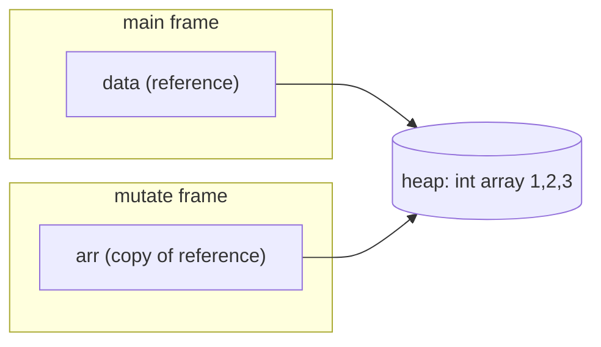
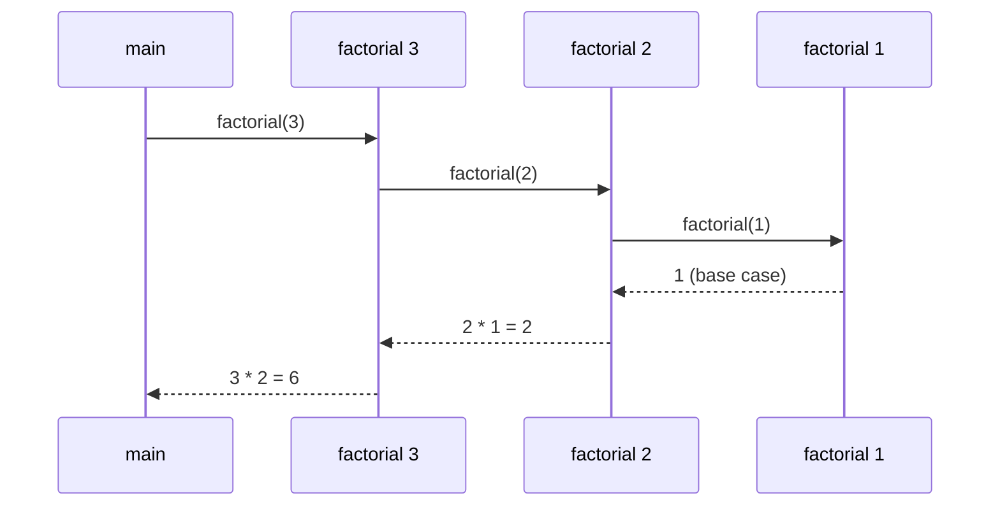
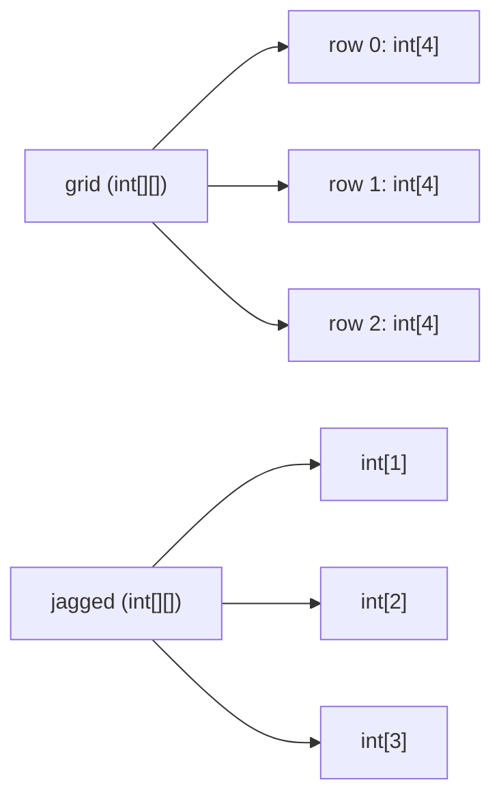

# Chapter 4 — Methods and Arrays

So far every program has been one long `main`. Real programs are built from small, named pieces of behaviour — **methods** — that take inputs, do one job and hand back a result. Real programs also work with many values at once, and the most basic container Java offers for that is the **array**. This chapter covers both, plus the two places they meet: passing arrays to methods, and the `String[] args` array that every classic `main` method receives.

**What you'll learn**

1. How to declare and call a method: modifiers, return type, parameters, `return`, `void`, static vs instance methods.
2. Why Java is *always* pass-by-value — and why that still lets a method change your array or list.
3. Overloading: several methods with one name, and exactly how the compiler picks one.
4. Varargs (`int... xs`): methods that accept any number of arguments.
5. Recursion: the call stack, base cases, `StackOverflowError`, memoization.
6. Arrays: creating, default values, indexing, looping, copying, covariance.
7. Two-dimensional and jagged arrays.
8. The `java.util.Arrays` toolbox: sort, search, fill, copy, compare, `asList`.
9. `main`, command-line arguments, and the Java 25 simpler `main` forms.

All runnable code is in [`code/`](code/) (package `ch04.*`). Every output shown was produced by compiling with `javac --release 25` and running on JDK 26.

> **Exam depth.** For OCP-style traps on method declarations, access modifiers, varargs, overloading and pass-by-value, see the OCP repo: [Chapter 5 — Methods](../../../../ocp-java21-study/chapters/05-methods/README.md). This chapter explains the concepts; that one drills the tricky questions.

---

## 4.1 Methods — declaring and calling

### What it is
A **method** is a named block of code that belongs to a class. You give it zero or more inputs (**parameters**), it runs its statements, and it may hand back one value (the **return value**). Other languages call this a *function*; in Java every function lives inside a class, so it is called a method.

Analogy: a method is a recipe card. The card's title is the method name, the ingredient list is the parameter list, the steps are the body, and the finished dish is the return value. Writing the card (declaring) does nothing by itself; cooking from it (calling) is what runs it.

### Why it matters
- **Reuse** — write the logic once, call it from many places.
- **Naming** — `isEven(n)` explains itself; `n % 2 == 0` scattered around does not.
- **Testing** — a small method with clear inputs and outputs is easy to test (Chapter 18).
- **Change** — fix a bug in one place, not twenty.

### How it works — anatomy of a declaration

```java
public static double area(double width, double height) throws IllegalArgumentException {
//  ^       ^     ^      ^    ^------------------------^   ^------------------------^
//  |       |     |      |    parameter list                optional throws clause
//  |       |     |      method name
//  |       |     return type (void = nothing)
//  |       optional specifier(s): static, final, abstract, synchronized ...
//  access modifier (public / protected / private / none)
    return width * height;       // method body
}
```

| Part | Required? | Notes |
|---|---|---|
| Access modifier | No | `public`, `protected`, `private`, or none (= package-private). Explained in [Chapter 5](../05-oop-classes-and-objects/README.md#56-access-modifiers). |
| Optional specifiers | No | `static`, `final`, `abstract`, `synchronized`, `native`, `strictfp` (the last has had no effect since Java 17). |
| Return type | **Yes** | Any type, or `void`. Constructors are the only "methods" without one. |
| Name | **Yes** | By convention a verb in lowerCamelCase: `calculateTotal`, `isEmpty`, `toString`. |
| Parameter list | **Yes** (parentheses) | Can be empty `()`. Each parameter has a type and a name. |
| `throws` clause | No | Lists checked exceptions the method may throw ([Chapter 8](../08-exceptions/README.md)). |
| Body | Yes, unless `abstract`/`native` | The code in `{ }`. |

The **method signature** is the *name plus the parameter types in order* — for example `area(double, double)`. The return type, parameter names and modifiers are **not** part of the signature. That matters for overloading (§4.3): two methods in one class cannot have the same signature.

Steps when a method is called:

1. The caller evaluates each argument expression, left to right.
2. The JVM creates a new **stack frame** — a private workspace holding the method's parameters and local variables.
3. Each argument value is **copied** into the matching parameter.
4. The body runs until a `return` statement or the closing brace.
5. The frame is discarded; the return value (if any) replaces the call expression in the caller.

**Parameters vs arguments.** A *parameter* is the variable in the declaration (`width`); an *argument* is the actual value passed at the call site (`3`).

### `return` and `void`
- A method with a non-`void` return type must `return` a value of a compatible type on **every** path; the compiler checks this ("missing return statement").
- A `void` method returns nothing. It may use a bare `return;` to leave early.
- The caller may ignore a return value — `area(1, 1);` is legal; the result is thrown away.
- A method returns exactly one value. To return several, return an object (a record, [Chapter 6](../06-oop-inheritance-interfaces-and-more/README.md#68-records)) or, for small same-typed results, an array.

### Static vs instance methods
- A **`static` method** belongs to the class. Call it as `ClassName.method()` (or just `method()` from inside the same class). It has no `this` object, so it cannot touch instance fields directly.
- An **instance method** (no `static`) runs *on an object* and can read and write that object's fields: `counter.countCall()`.

Chapter 5 explains `static` fully ([§5.5](../05-oop-classes-and-objects/README.md#55-static-members)). For now: helper utilities (`Math.max`, `Integer.parseInt`) are static; behaviour of a particular object (`list.add`, `account.deposit`) is instance.

```java
// code/ch04/methods/MethodBasics.java (key parts)
static double area(double width, double height) {
    return width * height;
}
static void greet(String name) {
    if (name == null || name.isBlank()) {
        System.out.println("Hello, stranger");
        return;                            // early exit from a void method
    }
    System.out.println("Hello, " + name);
}
static boolean isEven(int n) { return n % 2 == 0; }
static int max(int a, int b) { return a >= b ? a : b; }

private int calls;                         // instance field
int countCall() { return ++calls; }        // instance method

public static void main(String[] args) {
    double a = area(3, 4.5);               // int argument 3 is widened to double
    System.out.println("area = " + a);
    greet("Ada");
    greet("  ");
    System.out.println("isEven(7) = " + isEven(7) + ", max(3, 9) = " + max(3, 9));
    area(1, 1);                            // result ignored: legal
    MethodBasics counter = new MethodBasics();
    counter.countCall();
    System.out.println("calls = " + counter.countCall());
}
```

Output:
```text
area = 13.5
Hello, Ada
Hello, stranger
isEven(7) = false, max(3, 9) = 9
calls = 2
```

### Local variables and scope
- Variables declared inside a method (including parameters) are **local**: they exist only while the method runs and are visible only inside the block `{ }` where they are declared.
- Locals have **no default value**. Reading one before assigning it is a compile error ("variable might not have been initialized"). Fields and array elements, by contrast, do get defaults.
- Each call gets fresh copies of its locals — which is what makes recursion (§4.5) work.
- A parameter can be marked `final` to stop the body reassigning it: `void log(final String msg)`. It is optional documentation, not a performance trick.

### Common mistakes
- **Forgetting that the result must be used.** `name.toUpperCase();` alone does nothing useful — strings are immutable and the new string is discarded. Write `name = name.toUpperCase();`.
- **Calling an instance method from `static main`** without an object: "non-static method cannot be referenced from a static context". Create an object first, or make the helper `static`.
- **Methods that do too much.** If you need "and" to describe it (`validateAndSaveAndEmail`), split it. See clean-code guidance in the LLD handbook: [Clean code](../../../lld/chapters/06-clean-code/README.md).
- **Boolean flag parameters** (`print(report, true, false)`) make call sites unreadable; prefer two well-named methods or an enum.

### Real-world examples
`Math.max(a, b)`, `Integer.parseInt(s)`, `String.valueOf(x)` are static utilities; `list.size()`, `map.get(k)`, `builder.append(x)` are instance methods. Frameworks like Spring and JUnit discover your methods by name and annotations and call them for you.

### Self-check
1. Which parts make up a method signature? → The name and the ordered list of parameter types. Not the return type, not parameter names, not modifiers.
2. Can a `void` method contain `return`? → Yes, a bare `return;` to exit early. It cannot return a value.
3. Why does `static void main` fail to call `countCall()` directly? → `countCall` is an instance method; `main` has no `this` object to call it on.
4. Do local variables get default values? → No. Only fields and array elements do.

### TL;DR
A method = modifiers + return type + name + parameters + body. Signature = name + parameter types. Non-void methods must return on every path. Static methods belong to the class; instance methods run on an object. Locals live in the method's stack frame and must be initialised before use.

---

## 4.2 Parameters — Java is always pass-by-value

### What it is
When you call a method, Java **copies the value of each argument into the parameter**. That is *pass-by-value*. There is no pass-by-reference in Java — ever. The confusion comes from what the "value" is:

| Variable type | What the variable holds | What gets copied |
|---|---|---|
| Primitive (`int`, `double`, `boolean` …) | The number/boolean itself | The number — the method gets its own copy |
| Reference (`int[]`, `String`, `List`, any object) | A **reference** (think: the address of an object on the heap) | The reference — the method gets a copy of the *address*, which still points at the *same object* |

Analogy: you give a friend a photocopy of your house address. They can go to your house and repaint the door (mutate the object) and you will see it. But if they scribble a different address on their photocopy (reassign the parameter), your own copy still says your address.

### How it works
1. Primitive argument → the parameter is an independent copy. Changes inside the method are invisible to the caller.
2. Reference argument → the parameter is a copy of the reference.
   - **Mutating** the object through it (`arr[0] = 99`, `list.add(x)`) is visible to the caller, because there is only one object.
   - **Reassigning** the parameter (`arr = new int[]{…}`) only changes the method's local copy. The caller's variable still points to the original object.



```java
// code/ch04/methods/PassByValue.java (key parts)
static void addOne(int x) { x = x + 1; }                  // changes the local copy only
static void reassign(int[] arr) { arr = new int[] {99}; } // re-points the local copy only
static void mutate(int[] arr) { arr[0] = 99; }            // same array as the caller's
static void appendTo(List<String> list) { list.add("added"); }
static void swap(String a, String b) { String t = a; a = b; b = t; }  // cannot work in Java
```

Output:
```text
n after addOne:      5
data after reassign: [1, 2, 3]
data after mutate:   [99, 2, 3]
names after append:  [a, added]
after swap:          left right
```

The classic C-style `swap(a, b)` is impossible in Java: the method only swaps its own copies. To "swap", swap elements *inside* an array or object, or return the result.

### Why it matters
- It explains why a method can fill in or sort your array (`Arrays.sort(a)` sorts your array in place) but can never make your variable point to a different array.
- It is the root of **defensive copying**: if a method stores a list you passed in, later changes you make to that list leak into its state. Chapter 5 shows how to prevent that ([§5.9](../05-oop-classes-and-objects/README.md#59-immutability-basics)).
- Immutable types (`String`, `Integer`, records with immutable fields) are safe to pass around because nobody *can* mutate them.

### Common mistakes
- Saying "objects are passed by reference". They are not; *references are passed by value*. Interviewers probe exactly this difference with the swap example.
- Expecting `s = s.trim()` inside a method to change the caller's string. Return the new value instead.
- Returning `null` to signal "no results" from a method that returns an array or list; return an empty one (`new int[0]`, `List.of()`) so callers can loop safely (*Effective Java*, Item 54).

### In the interview
**30-second answer:** "Java is strictly pass-by-value. For primitives the value is the number. For objects the value is a reference, so the method gets a copy of the reference: it can mutate the shared object, but reassigning the parameter never affects the caller's variable. That's why a swap method can't work in Java."

- *Follow-up: So is `String` special?* → No. It behaves the same way; it only *looks* different because `String` is immutable, so there is no way to mutate it through the copied reference.
- *Follow-up: How do you return two values?* → Return a small record (`record MinMax(int min, int max)`) — clearest; or an array for same-typed values.

### Self-check
1. After `void f(int[] a) { a = null; }` and `f(arr)`, is `arr` null? → No. Only the local copy was set to null.
2. After `void g(List<Integer> l) { l.clear(); }`, is the caller's list empty? → Yes, the shared object was mutated.
3. Can a method change which object the caller's variable refers to? → No, never.

### TL;DR
Everything is passed by value. For references, the value is the reference: mutation through it is shared, reassignment is local.

---

## 4.3 Overloading

### What it is
**Overloading** means declaring several methods with the **same name but different parameter lists** in the same class (or inherited into it). The compiler picks which one to call at **compile time** from the argument types. This is sometimes called *compile-time* or *static polymorphism* (contrast with overriding in [Chapter 6](../06-oop-inheritance-interfaces-and-more/README.md#63-overriding)).

Examples you already use: `System.out.println` has ten overloads (`println(int)`, `println(String)`, `println(Object)`, …); `Math.max` has `int`, `long`, `float` and `double` versions.

### Rules
| Legal overload if the parameter lists differ in… | Not an overload (compile error "already defined") |
|---|---|
| Number of parameters: `sum(int,int)` vs `sum(int,int,int)` | Only the return type differs |
| Types: `sum(int,int)` vs `sum(double,double)` | Only parameter *names* differ |
| Order of types: `f(int,String)` vs `f(String,int)` | Only modifiers / `throws` differ |
| | `f(int[])` vs `f(int...)` — the same signature to the compiler |
| | Generic types that erase to the same type, e.g. `f(List<String>)` vs `f(List<Integer>)` ([Chapter 9](../09-generics/README.md)) |

### How it works — how the compiler chooses
The Java Language Specification (JLS §15.12.2) resolves an overloaded call in **three phases**. It stops at the first phase that finds any applicable method:

1. **Phase 1 — exact match or primitive widening / reference subtyping.** No boxing, no varargs. `byte → short → int → long → float → double`, `char → int`, `String → Object`.
2. **Phase 2 — allow boxing and unboxing** (`int ↔ Integer`), still no varargs.
3. **Phase 3 — allow varargs.**

If one phase finds several candidates, the **most specific** one wins (e.g. `int` over `long`, `String` over `Object`). If none is more specific than the others, the call is **ambiguous** — a compile error.

Consequences worth memorising: *widening beats boxing, and boxing beats varargs*.

```java
// code/ch04/methods/Overloading.java (key parts)
static String describe(int x)      { return "int"; }
static String describe(long x)     { return "long"; }
static String describe(Integer x)  { return "Integer"; }
static String describe(Object x)   { return "Object"; }
static String describe(int... xs)  { return "int..."; }

static String pick(long x)    { return "long (widening)"; }
static String pick(Integer x) { return "Integer (boxing)"; }

static String box(Object o)   { return "Object"; }
static String box(double d)   { return "double"; }
```

Output:
```text
describe(5)        -> int
describe(5L)       -> long
describe(b)        -> int
describe(c)        -> int
describe("hi")     -> Object
describe()         -> int...
describe(1, 2)     -> int...
pick(5)            -> long (widening)
box(5)             -> double
sum(1,2) sum(1,2,3) sum(1.5,2) -> 3 6 3.5
```

Reading the output: `describe(b)` with a `byte` finds `int` in phase 1 (widening; `int` is more specific than `long`). `pick(5)` chooses `long` over `Integer` because phase 1 already succeeds. `box(5)` chooses `double` over `Object` for the same reason — boxing `5` to `Integer` and then treating it as `Object` would need phase 2.

### Trade-offs
| Good use | Bad use |
|---|---|
| Same operation, different input types (`println(int)` / `println(String)`) | Same name, *different meaning* (`save(User)` saves; `save(String)` sends an email) |
| Convenience overloads with defaults: `connect(host)` calls `connect(host, 443)` — Java has no default parameter values, so this is the idiom | Overloads with the same number of parameters of related types (`f(Object)` vs `f(String)`), which surprise readers |

*Effective Java* (Item 52) advises: avoid two overloads with the same number of parameters when a call could reasonably fit both; give them different names instead (`writeInt`, `writeLong`).

### Common mistakes
- Believing a different return type is enough to overload.
- `list.remove(1)` on a `List<Integer>`: this calls `remove(int index)`, not `remove(Object)` — phase 1 finds the `int` version without boxing. Use `list.remove(Integer.valueOf(1))` to remove the value 1.
- Passing `null` when two reference overloads exist (`f(String)` and `f(Integer)`): ambiguous, compile error. Cast: `f((String) null)`.

### Self-check
1. `void f(long x)` and `void f(Integer x)`; which runs for `f(3)`? → `f(long)` — widening in phase 1 beats boxing.
2. Can `int f()` and `void f()` coexist? → No, same signature.
3. When does a varargs overload get chosen? → Only if no fixed-arity method applies, even with boxing.

### TL;DR
Overloads share a name and differ in parameter types, count or order. The compiler picks at compile time: exact/widening → boxing → varargs, then most specific.

---

## 4.4 Varargs

### What it is
A **varargs** (variable-arity) parameter, written `Type... name`, lets callers pass zero, one or many arguments of that type. Inside the method, the parameter is simply an **array** (`int... numbers` is an `int[]`). Varargs arrived in Java 5.

### How it works
1. The compiler collects the extra arguments into a new array and passes it.
2. Called with no extra arguments → an **empty array** (length 0), never `null`.
3. Called with an existing array of the right type → that array is passed as-is.
4. Rules: at most **one** varargs parameter per method, and it must be **last**: `join(String sep, String... parts)` is legal; `f(String... a, int b)` is not.

```java
// code/ch04/methods/Varargs.java (key parts)
static int sum(int... numbers) {
    int total = 0;
    for (int n : numbers) total += n;
    return total;
}
static String join(String separator, String... parts) { return String.join(separator, parts); }
static void inspect(Object... items) { /* prints length and contents */ }

sum();  sum(4);  sum(1, 2, 3, 4);  sum(new int[] {10, 20});
inspect(1, "two");  inspect((Object) null);  inspect((Object[]) null);
```

Output:
```text
0
4
10
30
a | b | c
cart has 3 items
inspect(1, "two"):
  length=2 -> [1, two]
inspect((Object) null):
  length=1 -> [null]
inspect((Object[]) null):
  length=null array -> null
```

The last two calls show the one real subtlety: with an `Object...` parameter, `(Object) null` means "one argument that happens to be null", while `(Object[]) null` means "the whole array is null". Code that accepts varargs from outside should tolerate a `null` array.

### Real-world examples
`String.format(String, Object...)`, `System.out.printf`, `List.of(E...)`, `Arrays.asList(T...)`, `Path.of(String, String...)`, SLF4J's `log.info("{} {}", a, b)`.

### Trade-offs and when not to use it
- Each call allocates an array. In hot paths, JDK APIs add fixed-arity overloads for the common small cases — `List.of` has overloads for 0 to 10 elements plus a varargs one for exactly this reason (*Effective Java*, Item 53).
- If a method needs **at least one** argument, declare it: `min(int first, int... rest)` — the compiler then enforces it instead of a runtime check.
- Mixing varargs with generics (`T...`) triggers "possible heap pollution" warnings; `@SafeVarargs` suppresses them for methods that don't store or expose the array ([Chapter 9](../09-generics/README.md)).

### Self-check
1. What is `numbers.length` in `sum()` called with no arguments? → 0.
2. Is `void f(int... a, String s)` legal? → No, varargs must be last.
3. Can a class have both `f(int[])` and `f(int...)`? → No, identical signatures.

### TL;DR
`T... x` = an array parameter the compiler fills for you. Last parameter only, one per method, empty array when no arguments.

---

## 4.5 Recursion

### What it is
A method is **recursive** when it calls itself. Each call solves a smaller version of the same problem until it reaches a case simple enough to answer directly.

Every correct recursive method has:
1. **A base case** — an input answered without recursion (e.g. `factorial(0) = 1`).
2. **A recursive case** — the method calls itself on a *smaller* input, moving towards the base case.

Analogy: Russian nesting dolls. You open a doll to find a smaller doll, and keep going until you reach the solid one in the middle (the base case). Then you close them back up in reverse order — that's the "return" phase.

### How it works — the call stack
Each call pushes a new **stack frame** with its own parameters and locals onto the thread's **call stack**. When a call returns, its frame is popped and the caller continues where it left off.



The stack has a fixed size per thread (set with `-Xss`; the default is platform-dependent, typically on the order of 1 MB on 64-bit systems). Recursion that never reaches a base case — or simply goes very deep — throws **`StackOverflowError`**. Java does **not** perform tail-call elimination, so even a "tail-recursive" method uses one frame per call.

```java
// code/ch04/methods/Recursion.java (key parts)
static long factorial(int n) {
    if (n < 0) throw new IllegalArgumentException("n must be >= 0");
    if (n <= 1) return 1;                 // base case
    return n * factorial(n - 1);          // recursive case
}
static long fibNaive(int n) { return n < 2 ? n : fibNaive(n - 1) + fibNaive(n - 2); }

static final Map<Integer, Long> memo = new HashMap<>();
static long fibMemo(int n) {              // memoization: cache each answer
    if (n < 2) return n;
    Long cached = memo.get(n);
    if (cached != null) return cached;
    long value = fibMemo(n - 1) + fibMemo(n - 2);
    memo.put(n, value);
    return value;
}
static long fibLoop(int n) {              // iterative: O(n) time, O(1) space
    long a = 0, b = 1;
    for (int i = 0; i < n; i++) { long t = a + b; a = b; b = t; }
    return a;
}
static int binarySearch(int[] a, int key, int lo, int hi) {
    if (lo > hi) return -1;
    int mid = lo + (hi - lo) / 2;         // avoids int overflow of (lo + hi)
    if (a[mid] == key) return mid;
    return a[mid] < key ? binarySearch(a, key, mid + 1, hi)
                        : binarySearch(a, key, lo, mid - 1);
}
static int depth = 0;
static void dive() { depth++; dive(); }   // no base case
```

Output (the depth in the last line differs from run to run and machine to machine):
```text
5! = 120, 20! = 2432902008176640000
fibNaive(30) = 832040
fibMemo(90)  = 2880067194370816120
fibLoop(90)  = 2880067194370816120
index of 23 = 5
StackOverflowError after roughly 38000+ calls
```

Notes on the output:
- The overflow depth depends on the JVM, the platform, `-Xss` and the frame size.
- `20!` is the largest factorial that fits in a `long`; `21!` silently overflows (integer overflow, [Chapter 2](../02-basics-types-and-operators/README.md)). Use `BigInteger` for bigger values ([Chapter 7](../07-core-apis/README.md)).
- `fibNaive(n)` makes roughly 1.6ⁿ calls — `fibNaive(30)` already makes about 2.7 million calls because the same subproblems are recomputed. **Memoization** (caching results of previous calls) cuts it to O(n) calls. This idea is the heart of *dynamic programming*.

### Trade-offs — recursion vs iteration
| | Recursion | Iteration (loops) |
|---|---|---|
| Fits naturally | Trees, nested structures, divide-and-conquer (merge sort, quicksort), backtracking, grammars | Linear scans, counters, simple accumulations |
| Readability | Often shorter and mirrors the definition | Can need an explicit stack for tree-like problems |
| Memory | One stack frame per active call; risk of `StackOverflowError` for deep inputs | Constant stack usage |
| Speed | Slight call overhead; exponential if subproblems repeat without memoization | Usually fastest |

### When not to use it
- When depth grows with input size and inputs can be large (a recursive walk of a 1-million-node linked list will overflow). Convert to a loop or use an explicit `ArrayDeque` as a stack.
- When a simple loop is just as clear (factorial, sum of an array).

### Common mistakes
- Missing or unreachable base case → infinite recursion → `StackOverflowError`.
- Recursive step that doesn't shrink the problem (`f(n)` calling `f(n)`), or shrinks past the base case (`n - 2` skipping `n == 1` when the base case is only `n == 1`).
- Catching `StackOverflowError` to "recover" in real code — it is an `Error`, signalling a bug or an unsuitable algorithm. (The demo catches it only to print a message.)

### Real-world examples
Directory trees are recursive structures (`Files.walkFileTree` visits them depth-first); JSON parsers are typically recursive-descent; compilers walk syntax trees recursively; `Arrays.sort` for objects uses a merge-based algorithm (TimSort) that is divide-and-conquer at heart.

### In the interview
**30-second answer:** "A recursive method calls itself on a smaller input until it hits a base case. Each call gets a stack frame, so depth costs memory, and Java has no tail-call optimization — very deep recursion throws StackOverflowError. For overlapping subproblems like Fibonacci I add memoization, turning exponential time into linear."

- *Follow-up: How do you make a deep recursion safe?* → Rewrite iteratively with an explicit stack (`ArrayDeque`), or bound the depth; increasing `-Xss` is a last resort.
- *Follow-up: Time complexity of naive Fibonacci?* → O(φⁿ) ≈ O(1.618ⁿ), commonly quoted as O(2ⁿ); memoized is O(n) time and O(n) space.

### Self-check
1. What two parts must every recursive method have? → A base case and a recursive case that moves towards it.
2. Why did `binarySearch` use `lo + (hi - lo) / 2`? → `(lo + hi)` can overflow `int` for huge arrays; this form cannot.
3. Does Java optimise tail calls? → No.

### TL;DR
Recursion = base case + smaller self-call. Each call costs a stack frame; too deep → `StackOverflowError`. Memoize repeated subproblems; switch to loops for deep linear recursion.

---

## 4.6 Arrays

### What it is
An **array** is a fixed-size, ordered container of elements that all have the same type, stored in one contiguous block and accessed by an integer **index** starting at 0. In Java an array is an **object**: it lives on the heap, a variable of array type holds a reference to it, and it has a `length` field.

Analogy: a row of numbered lockers. The number of lockers is fixed when the row is built; each locker holds one item of the declared kind; you open locker *i* directly without walking past the others.

### Why it matters
- **Speed**: reading or writing `a[i]` is O(1) — the address is computed from the index.
- **Foundation**: `ArrayList`, `HashMap`, `ArrayDeque`, `String` (internally a byte array) are all built on arrays.
- **Primitives without boxing**: an `int[]` stores raw ints; a `List<Integer>` stores objects. For large numeric data an array is several times smaller and faster.

### How it works
1. **Declare** a variable: `int[] scores;` (preferred style; `int scores[]` also compiles but is discouraged).
2. **Create** the array with a size: `scores = new int[4];` — the size can be any `int` expression computed at runtime, but cannot change afterwards.
3. Or **create and fill** with an initializer: `double[] prices = {9.99, 4.5, 12.0};` (only in a declaration) or `new char[] {'a','e','i'}` (anywhere).
4. New arrays are filled with **default values**:

| Element type | Default |
|---|---|
| `byte`, `short`, `int`, `long` | `0` |
| `float`, `double` | `0.0` |
| `char` | `'\u0000'` (the NUL character) |
| `boolean` | `false` |
| Any reference type (`String`, `Integer`, arrays, objects) | `null` |

5. **Access** with `a[i]`, where `0 ≤ i < a.length`. Any other index throws `ArrayIndexOutOfBoundsException` at runtime (Java checks bounds on every access — no silent memory corruption as in C).
6. **`length`** is a field, not a method: `a.length` (compare `s.length()` for strings and `list.size()` for collections).

```java
// code/ch04/arrays/ArrayBasics.java (key parts)
int[] scores = new int[4];
String[] names = new String[2];
boolean[] flags = new boolean[2];
double[] prices = {9.99, 4.5, 12.0};
char[] vowels = new char[] {'a', 'e', 'i'};

scores[0] = 90; scores[3] = 75;
for (int i = 0; i < prices.length; i++) prices[i] *= 2;   // index loop: can modify
double total = 0;
for (double p : prices) total += p;                      // enhanced for: read each element

try { scores[4] = 1; }
catch (ArrayIndexOutOfBoundsException e) { System.out.println("error: " + e.getMessage()); }

int[] alias = scores;          // copies the REFERENCE: one array, two names
int[] copy = scores.clone();   // a NEW array with the same elements
alias[1] = 50;
```

Output:
```text
defaults: [0, 0, 0, 0] [null, null] [false, false]
scores=[90, 0, 0, 75] length=4
last price = 12.0, vowels = aei
doubled total = 52.980000000000004
error: Index 4 out of bounds for length 4
scores=[90, 50, 0, 75] copy=[90, 0, 0, 75]
scores == alias? true, scores == copy? false, Arrays.equals(scores, copy)? false
println(array) prints an identity string, e.g. starts with: [I@
empty array length = 0
```

Things to notice:
- `52.980000000000004` is ordinary binary floating-point rounding ([Chapter 2](../02-basics-types-and-operators/README.md)); use `BigDecimal` for money.
- Printing an array directly prints something like `[I@1b6d3586` — the type code `[I` ("array of int") plus a hash. Use `Arrays.toString(a)` (or `Arrays.deepToString` for nested arrays).
- `==` compares references; use `Arrays.equals` to compare contents.
- The enhanced `for` gives you a *copy* of each element; assigning to the loop variable does not change the array. Use an index loop to modify elements.

### Copying arrays
| Technique | Result | Notes |
|---|---|---|
| `b = a` | Same array, two names | No copy at all |
| `a.clone()` | New array, same length | **Shallow**: for an array of objects, both arrays share the element objects |
| `Arrays.copyOf(a, n)` | New array of length `n` | Truncates or pads with defaults |
| `Arrays.copyOfRange(a, from, to)` | New array of elements `[from, to)` | `to` is exclusive |
| `System.arraycopy(src, srcPos, dst, dstPos, len)` | Copies into an **existing** array | Fastest low-level copy; handles overlapping ranges correctly |

### Arrays are covariant (and why that can bite)
Because `String` is a subtype of `Object`, Java lets you treat a `String[]` as an `Object[]`. But the array object remembers its real element type and checks every store at runtime:

```java
// code/ch04/arrays/Covariance.java (key parts)
String[] strings = {"a", "b"};
Object[] objects = strings;          // allowed: arrays are covariant
objects[0] = 42;                     // compiles, fails at runtime
```

Output:
```text
ArrayStoreException: java.lang.Integer
min=-2 max=17
[] is an empty array, never return null for 'no results'
```

Generic collections are *invariant* instead (`List<String>` is not a `List<Object>`), which turns this runtime failure into a compile error — one reason *Effective Java* (Item 28) says to prefer lists to arrays in APIs. See [Chapter 9](../09-generics/README.md).

### Trade-offs — array vs `ArrayList`
| | Array (`int[]`, `String[]`) | `ArrayList<E>` ([Chapter 10](../10-collections/README.md)) |
|---|---|---|
| Size | Fixed at creation | Grows automatically |
| Primitives | Stored directly | Must box (`Integer`) |
| Syntax | `a[i]`, `a.length` | `list.get(i)`, `list.size()` |
| Useful methods | Few (use `Arrays.*`) | Many (`add`, `remove`, `contains`, `sort` …) |
| Type safety | Covariant, runtime store checks | Invariant generics, compile-time checks |
| `toString`/`equals` | Identity-based (need `Arrays.*`) | Content-based |
| Best for | Fixed-size numeric data, performance-critical code, low-level buffers, `main(String[])` | Almost everything else in application code |

### Common mistakes
- **Off-by-one**: looping `i <= a.length` → `ArrayIndexOutOfBoundsException` on the last step.
- **Printing** with `println(a)` and seeing `[I@…`.
- **Comparing** with `==` or `a.equals(b)` (which is also identity for arrays) instead of `Arrays.equals`.
- **Assuming `b = a` copies** the array.
- **Returning `null`** for "nothing found" — return `new int[0]`.

### Self-check
1. What does `new String[3]` contain? → Three `null` references (no strings yet).
2. `a.length` or `a.length()`? → `a.length` — it is a field.
3. After `int[] b = a.clone(); b[0] = 9;`, has `a[0]` changed? → No, `clone` created a new array. (For an array of mutable objects the *elements* would be shared.)
4. Why does `Object[] o = new String[1]; o[0] = 1;` compile but fail? → Array covariance; the runtime store check throws `ArrayStoreException`.

### TL;DR
Arrays are fixed-size, zero-indexed, bounds-checked objects with a `length` field and default-filled elements. Assignment copies the reference; use `clone`/`copyOf`/`arraycopy` to copy, `Arrays.toString`/`Arrays.equals` to print and compare.

---

## 4.7 Multidimensional and jagged arrays

### What it is
Java has no true 2-D arrays; it has **arrays of arrays**. `int[][] grid` is an array whose elements are `int[]` references — each row is its own array object. Because rows are independent, they can have different lengths: a **jagged** (or ragged) array.



### How it works
1. `new int[3][4]` creates an outer array of 3 references and 3 inner `int[4]` arrays — a rectangular grid.
2. `new int[3][]` creates only the outer array; each row is `null` until you assign one (`jagged[0] = new int[1]`).
3. `grid.length` is the number of rows; `grid[r].length` is the length of row `r`.
4. Access with `grid[row][col]` — the first index picks the row array, the second the element in it.
5. Nested initializers work: `char[][] board = {{'X','O','X'}, …};`.

```java
// code/ch04/arrays/MultiDim.java (key parts)
int[][] grid = new int[3][4];
for (int r = 0; r < grid.length; r++)
    for (int c = 0; c < grid[r].length; c++)
        grid[r][c] = r * 10 + c;
System.out.println(Arrays.deepToString(grid));

int[][] jagged = new int[3][];
jagged[0] = new int[] {1};
jagged[1] = new int[] {1, 1};
jagged[2] = new int[] {1, 2, 1};

int n = 6;                                        // Pascal's triangle
int[][] pascal = new int[n][];
for (int i = 0; i < n; i++) {
    pascal[i] = new int[i + 1];
    pascal[i][0] = pascal[i][i] = 1;
    for (int j = 1; j < i; j++) pascal[i][j] = pascal[i - 1][j - 1] + pascal[i - 1][j];
}

char[][] board = { {'X','O','X'}, {' ','X','O'}, {'O',' ','X'} };
int[][] a = {{1, 2}, {3, 4}}, b = {{1, 2}, {3, 4}};
System.out.println("Arrays.equals: " + Arrays.equals(a, b) + ", Arrays.deepEquals: " + Arrays.deepEquals(a, b));
```

Output:
```text
[[0, 1, 2, 3], [10, 11, 12, 13], [20, 21, 22, 23]]
[1] len=1
[1, 1] len=2
[1, 2, 1] len=3
row 5 of Pascal: [1, 5, 10, 10, 5, 1]
X wins on the diagonal? true
unallocated row is null
Arrays.equals: false, Arrays.deepEquals: true
```

`Arrays.equals` on a 2-D array compares the *row references* (different objects → false); `Arrays.deepEquals` compares contents recursively.

### Real-world examples
Game boards (chess, tic-tac-toe, Sudoku), images as pixel grids, matrices in numeric code, dynamic-programming tables (`dp[i][j]` for edit distance or longest common subsequence), adjacency matrices for small graphs.

### Common mistakes
- Using `grid.length` for the column count — use `grid[r].length` (rows may differ).
- `NullPointerException` from a jagged array whose rows were never allocated.
- Looping column-first over a big 2-D array: each row is a separate array, so iterating row by row (`for r … for c …`) is much more cache-friendly.
- `Arrays.fill(grid, 0)` on an `int[][]` compiles (it picks `fill(Object[], Object)`) but throws `ArrayStoreException` at runtime, because each slot must hold an `int[]`. Fill each row instead: `for (int[] row : grid) Arrays.fill(row, 0);`.

### Self-check
1. After `int[][] m = new int[2][];`, what are `m.length` and `m[0]`? → `2` and `null` (the rows are not allocated yet).
2. How do you print a 2-D array? → `Arrays.deepToString(grid)`.

### TL;DR
A 2-D array is an array of row arrays; rows can differ in length (jagged). Use `deepToString`/`deepEquals`, iterate row-major.

---

## 4.8 The `java.util.Arrays` toolbox

### What it is
`java.util.Arrays` is a class of static helper methods for arrays — sorting, searching, filling, copying, comparing, converting. Learn these instead of writing loops.

| Method | What it does | Notes |
|---|---|---|
| `toString(a)` / `deepToString(a)` | Readable text `[1, 2, 3]` | Use `deep…` for nested arrays |
| `sort(a)` / `sort(a, from, to)` | Sorts in place, ascending | Primitives: Dual-Pivot Quicksort, O(n log n) typical. Objects: TimSort — **stable**, O(n log n) worst case |
| `sort(a, comparator)` | Sort objects by a `Comparator` | Comparators in [Chapter 10](../10-collections/README.md) and [Chapter 11](../11-lambdas-and-functional-programming/README.md) |
| `parallelSort(a)` | Sorts using multiple threads | Only pays off for large arrays |
| `binarySearch(a, key)` | O(log n) search in a **sorted** array | Returns the index, or `-(insertionPoint) - 1` if absent. Unsorted input → undefined result |
| `fill(a, v)` | Sets every element to `v` | For objects, every slot gets the *same* reference |
| `setAll(a, i -> …)` | Computes each element from its index | Java 8 |
| `copyOf`, `copyOfRange` | New array (truncate/pad, or a slice) | |
| `equals(a, b)` / `deepEquals` | Content equality | |
| `hashCode(a)` / `deepHashCode` | Content-based hash | Matches `equals` |
| `compare(a, b)` | Lexicographic comparison: negative, 0, positive | Java 9 |
| `mismatch(a, b)` | Index of first difference, or -1 | Java 9 |
| `asList(T...)` | Fixed-size `List` view **backed by** the array | Writes go through; `add`/`remove` throw |
| `stream(a)` | A stream over the array (`IntStream` for `int[]`) | Streams in [Chapter 12](../12-streams/README.md) |

```java
// code/ch04/arrays/ArraysUtil.java (key parts)
int[] nums = {42, 7, 19, 3, 25};
Arrays.sort(nums);
Arrays.binarySearch(nums, 19);   Arrays.binarySearch(nums, 20);
String[] words = {"pear", "Fig", "apple", "kiwi"};
Arrays.sort(words);
Arrays.sort(words, String.CASE_INSENSITIVE_ORDER);
Arrays.sort(words, Comparator.comparing(String::length).thenComparing(Comparator.reverseOrder()));
Arrays.fill(filled, -1);
Arrays.setAll(squares, i -> i * i);
System.arraycopy(nums, 0, dest, 2, nums.length);
List<String> view = Arrays.asList(backing);   view.set(0, "z");   view.add("d"); // throws
List<String> independent = List.of(backing);  backing[1] = "changed";
```

Output:
```text
sort:          [3, 7, 19, 25, 42]
binarySearch(19) = 2, binarySearch(20) = -4
sort strings:  [Fig, apple, kiwi, pear]
ignore case:   [apple, Fig, kiwi, pear]
by length:     [Fig, pear, kiwi, apple]
fill:          [-1, -1, -1, -1, -1]
setAll:        [0, 1, 4, 9, 16, 25]
copyOf(3):     [3, 7, 19]
copyOf(7):     [3, 7, 19, 25, 42, 0, 0]
copyOfRange:   [7, 19, 25]
arraycopy:     [0, 0, 3, 7, 19, 25, 42]
equals=false compare=-1 mismatch=2 hashCode equal? true
stream sum:    96, max: 42
asList view:   [z, b, c] array now [z, b, c]
asList add ->  UnsupportedOperationException
List.of copy:  [z, b, c]
```

Reading it:
- `binarySearch(nums, 20)` returns `-4`: 20 would be inserted at index 3, so the result is `-(3) - 1`. A negative result always means "not found".
- String natural order is by UTF-16 code unit, so uppercase `F` (70) sorts before lowercase `a` (97). Use `CASE_INSENSITIVE_ORDER` or a `Collator` for human-friendly order.
- `Arrays.asList` is a *view*: changes to the list show in the array and vice versa, and its size is fixed. `List.of(array)` takes a *copy* and is fully unmodifiable — the later `backing[1] = "changed"` did not affect it. Wrap with `new ArrayList<>(Arrays.asList(a))` when you need a growable list.

### Common mistakes
- `binarySearch` on an unsorted array.
- `Arrays.asList(intArray)` — with a primitive array you get a `List<int[]>` of **one** element, not a list of numbers. Use `Arrays.stream(intArray).boxed().toList()`.
- Expecting `Arrays.sort` on objects to handle `null` elements — it throws `NullPointerException` unless the comparator handles nulls (`Comparator.nullsFirst(...)`).

### Self-check
1. What does `Arrays.binarySearch(new int[]{1,3,5}, 4)` return? → `-3` (insertion point 2).
2. Is `Arrays.sort(String[])` stable? → Yes (TimSort) — equal elements keep their relative order.
3. What happens if you call `add` on the result of `Arrays.asList`? → `UnsupportedOperationException`.

### TL;DR
Don't hand-roll array loops for common tasks: `Arrays.toString/sort/binarySearch/fill/setAll/copyOf/equals/asList/stream` cover them.

---

## 4.9 `main`, command-line arguments, and simpler `main` (Java 25)

### What it is
The **entry point** of a Java program is a method named `main`. The classic form is:

```java
public static void main(String[] args)
```

- `public` — the launcher, outside your class, must be able to call it.
- `static` — no object exists yet when the program starts.
- `void` — the program's exit status is set with `System.exit(code)`, not by returning.
- `String[] args` — the **command-line arguments**: the words typed after the class name. `String... args` is also accepted.

### How it works — arguments
1. `java ch04.args.CommandLineArgs 3 7 --verbose` → `args` is `{"3", "7", "--verbose"}`.
2. With no arguments, `args` is an **empty array** (length 0), never `null`.
3. Every argument is a `String`; convert with `Integer.parseInt`, `Double.parseDouble`, etc., and handle `NumberFormatException`.
4. The shell splits on spaces; quote to keep spaces: `java App "New York"` gives one argument.
5. The program name is **not** in `args` (unlike C's `argv[0]`).

```java
// code/ch04/args/CommandLineArgs.java (key parts)
public static void main(String[] args) {
    if (args.length == 0) {
        args = new String[] {"3", "7", "x", "--verbose"};
        System.out.println("(no args given, using demo args)");
    }
    System.out.println("args = " + Arrays.toString(args) + ", count = " + args.length);
    boolean verbose = false;
    int sum = 0;
    for (String a : args) {
        if (a.equals("--verbose")) { verbose = true; continue; }
        try { sum += Integer.parseInt(a); }
        catch (NumberFormatException e) { System.out.println("skipping non-number: " + a); }
    }
    System.out.println("sum = " + sum + (verbose ? " (verbose mode)" : ""));
}
```

Output (run with no arguments, so the demo arguments are used):
```text
(no args given, using demo args)
args = [3, 7, x, --verbose], count = 4
skipping non-number: x
sum = 10 (verbose mode)
```

Real command-line tools use a parser library (picocli, JCommander) instead of hand-written loops once they have more than a couple of options.

### Simpler `main` — compact source files and instance `main` (Java 25, JEP 512)
[Chapter 1, §1.10](../01-java-and-the-jvm/README.md#110-launching-source-files-directly) introduced JEP 512 (final in Java 25). The parts that matter for `main`:

- `main` no longer has to be `public` or `static`, and the `String[]` parameter is optional. If a class has both, the launcher picks `main(String[])`; if the chosen method is an instance method, the launcher first creates an object with the class's non-private no-argument constructor.
- A **compact source file** holds just methods and fields; the compiler wraps them in an implicit `final` class that other code cannot name, and imports all of `java.base` for you. `IO.println`/`IO.readln` handle simple console I/O.

```java
// code/HelloCompact.java — the entire file
void main() {
    String name = "compact world";
    IO.println("Hello, " + name + "!");
    IO.println("Lists are auto-imported: " + List.of(1, 2, 3));
}
```

Output (`java HelloCompact.java`):
```text
Hello, compact world!
Lists are auto-imported: [1, 2, 3]
```

`java HelloCompact.java` compiles and runs the file in one step (source-file mode, Java 11). Compact files are for scripts, experiments and learning; anything that grows into several classes should become a normal class in a package — you can convert by simply wrapping the members in `class HelloCompact { … }` and adding imports.

### Common mistakes
- Misspelling the classic signature (`public void main(String[] args)` without `static`) — on Java 25 this now *runs* as an instance main, but on Java 21 or earlier it fails with "main method is not static". Keep the classic form in code meant to run on older JDKs.
- Reading `args[0]` without checking `args.length` → `ArrayIndexOutOfBoundsException`.
- Returning an exit code from `main` — use `System.exit(1)`.

### Self-check
1. What is `args.length` when no arguments are given? → 0.
2. On Java 25, which does the launcher pick if a class has both `static void main(String[] a)` and `void main()`? → The `String[]` version — it is preferred.
3. What does a compact source file import automatically? → Every exported package of the `java.base` module.

### TL;DR
Classic entry point: `public static void main(String[] args)`; `args` holds the command-line words as Strings (never null). Java 25 also accepts non-public, non-static, no-arg `main` and class-less compact source files with `IO.println`.

---

## Chapter TL;DR

| Topic | Remember |
|---|---|
| Method | modifiers + return type + name + params + body; signature = name + param types |
| `return` | every path of a non-void method; bare `return;` in void methods |
| Static vs instance | static = belongs to class, no `this`; instance = runs on an object |
| Pass-by-value | always; references are copied, so mutation is shared but reassignment is not |
| Overloading | same name, different params; resolved at compile time: widening → boxing → varargs → most specific |
| Varargs | `T... x` is an array; last param only; empty array when no args |
| Recursion | base case + smaller call; stack frames; no tail-call optimisation; memoize overlaps |
| Arrays | fixed size, 0-based, bounds-checked, default-filled, `length` field, covariant |
| 2-D arrays | arrays of arrays; can be jagged; `deepToString`, `deepEquals` |
| `Arrays` | `sort`, `binarySearch` (sorted!), `fill`, `setAll`, `copyOf`, `equals`, `asList` (fixed-size view) |
| `main` | classic `public static void main(String[] args)`; Java 25: instance/no-arg main, compact source files, `IO` |

**Where next:** objects and classes — how to bundle data and methods together ([Chapter 5](../05-oop-classes-and-objects/README.md)). For exam traps on this chapter's material see [OCP Chapter 5](../../../../ocp-java21-study/chapters/05-methods/README.md).
