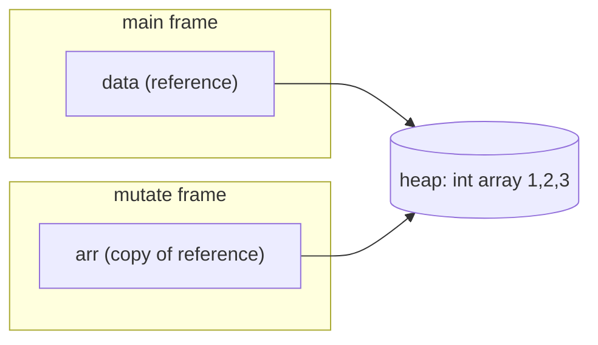
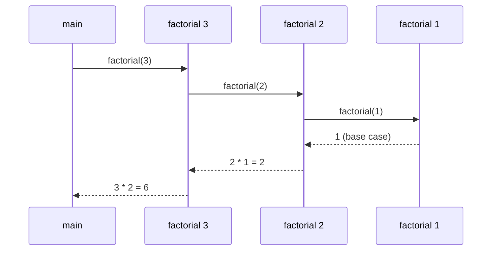
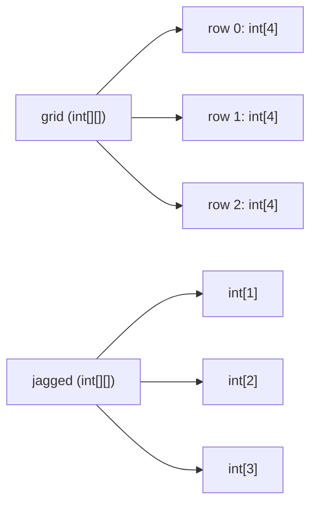

# Chapter 4 — Methods and Arrays

Real programs are built from small named pieces of behaviour — **methods** — that take inputs, do one job and return a result, and they handle many values at once with Java's most basic container, the **array**. This chapter covers both, plus where they meet: passing arrays to methods, and the `String[] args` every classic `main` receives.

Code: [`code/`](code/) (package `ch04.*`), compiled with `javac --release 25`, run on JDK 26. Exam traps on declarations, access modifiers, varargs, overloading and pass-by-value: OCP [Chapter 5 — Methods](../../../../ocp-java21-study/chapters/05-methods/README.md).

---

## 4.1 Methods — declaring and calling

### What it is
A **method** is a named block of code belonging to a class ([Chapter 5](../05-oop-classes-and-objects/README.md)). It takes zero or more inputs (**parameters**), runs its body, and may hand back one **return value**. Other languages say *function*; in Java every function lives in a class.

Why: **reuse** (write once, call anywhere), **naming** (`isEven(n)` explains itself), **testing** (small methods with clear inputs/outputs are easy to test, Chapter 18), **change** (fix a bug in one place).

### How it works — anatomy of a declaration

```java
public static double area(double width, double height) throws IllegalArgumentException {
//  ^       ^     ^      ^    ^------------------------^   ^------------------------^
//  |       |     |      |    parameter list                optional throws clause
//  |       |     |      method name
//  |       |     return type (void = nothing)
//  |       optional specifier(s): static, final, abstract, synchronized ...
//  access modifier (public / protected / private / none)
    return width * height;       // method body
}
```

| Part | Required? | Notes |
|---|---|---|
| Access modifier | No | `public`, `protected`, `private`, or none (= package-private, same package only). [Chapter 5](../05-oop-classes-and-objects/README.md#56-access-modifiers). |
| Specifiers | No | `static` (belongs to the class), `final` (cannot be overridden), `abstract` (no body; subclasses supply one), `synchronized` (one thread at a time), `native` (implemented in C etc.), `strictfp` (no effect since Java 17). |
| Return type | **Yes** | Any type, or `void`. Only constructors (which set up new objects) have none. |
| Name | **Yes** | A lowerCamelCase verb: `calculateTotal`, `isEmpty`. |
| Parameter list | **Yes** (parentheses) | May be empty `()`; each parameter has a type and name. |
| `throws` clause | No | Checked exceptions (error types callers are forced to handle) the method may throw ([Chapter 8](../08-exceptions/README.md)). |
| Body | Unless `abstract`/`native` | The code in `{ }`. |

The **method signature** is the *name plus the ordered parameter types* — `area(double, double)`. Return type, parameter names and modifiers are **not** part of it, and no two methods in a class may share a signature (§4.3).

When a method is called:
1. The caller evaluates the arguments left to right.
2. The JVM creates a new **stack frame** — a private workspace for the method's parameters and locals.
3. Each argument value is **copied** into its parameter.
4. The body runs until `return` or the closing brace.
5. The frame is discarded; the return value replaces the call expression.

A *parameter* is the declared variable (`width`); an *argument* is the value passed at the call site (`3`).

### `return` and `void`
- A non-`void` method must `return` a compatible value on **every** path ("missing return statement").
- A `void` method returns nothing; a bare `return;` leaves early.
- The caller may ignore a return value (`area(1, 1);` is legal).
- One return value only: for several, return a record ([Chapter 6](../06-oop-inheritance-interfaces-and-more/README.md#68-records)) — e.g. `record MinMax(int min, int max)` — or an array of same-typed values.

### Static vs instance methods
- A **`static` method** belongs to the class: `ClassName.method()` (or `method()` inside the class). It has no `this` (current object), so it cannot touch instance fields directly. Utilities: `Math.max`, `Integer.parseInt`.
- An **instance method** runs *on an object* and reads/writes its fields: `counter.countCall()`, `list.add`. Full treatment: [§5.5](../05-oop-classes-and-objects/README.md#55-static-members).

```java
// code/ch04/methods/MethodBasics.java (key parts)
static double area(double width, double height) {
    return width * height;
}
static void greet(String name) {
    if (name == null || name.isBlank()) {
        System.out.println("Hello, stranger");
        return;                            // early exit from a void method
    }
    System.out.println("Hello, " + name);
}
static boolean isEven(int n) { return n % 2 == 0; }
static int max(int a, int b) { return a >= b ? a : b; }

private int calls;                         // instance field
int countCall() { return ++calls; }        // instance method

public static void main(String[] args) {
    double a = area(3, 4.5);               // int argument 3 is widened to double
    System.out.println("area = " + a);
    greet("Ada");
    greet("  ");
    System.out.println("isEven(7) = " + isEven(7) + ", max(3, 9) = " + max(3, 9));
    area(1, 1);                            // result ignored: legal
    MethodBasics counter = new MethodBasics();
    counter.countCall();
    System.out.println("calls = " + counter.countCall());
}
```

Output:
```text
area = 13.5
Hello, Ada
Hello, stranger
isEven(7) = false, max(3, 9) = 9
calls = 2
```

### Local variables and scope
- Variables declared in a method (including parameters) are **local**: they live while the method runs and are visible only in their block.
- Locals have **no default value** (reading one first is a compile error); fields and array elements do get defaults.
- Each call gets fresh locals — which makes recursion (§4.5) work.
- `final` on a parameter (`void log(final String msg)`) stops reassignment; documentation, not a performance trick.

### Common mistakes
- **Discarding the result**: `name.toUpperCase();` alone does nothing (strings are immutable). Write `name = name.toUpperCase();`.
- **Calling an instance method from `static main`** without an object: "non-static method cannot be referenced from a static context". Create an object or make the helper `static`.
- **Methods that do too much** (`validateAndSaveAndEmail`) — split them ([Clean code](../../../lld/chapters/06-clean-code/README.md)).
- **Boolean flag parameters** (`print(report, true, false)`) — prefer two named methods or an enum.

Frameworks such as Spring and JUnit discover your methods by name and annotations (`@Test`) and call them for you.

### TL;DR
Method = modifiers + return type + name + parameters + body; signature = name + parameter types. Non-void methods return on every path. Static methods belong to the class; instance methods run on an object. Locals live in the stack frame and must be initialised before use.

---

## 4.2 Parameters — Java is always pass-by-value

### What it is
Java **copies each argument's value into the parameter** — *pass-by-value*, always; there is no pass-by-reference. What differs is what the "value" is:

| Variable type | Holds | What gets copied |
|---|---|---|
| Primitive (`int`, `double`, `boolean` …) | The value itself | The value — an independent copy; changes are invisible to the caller |
| Reference (`int[]`, `String`, `List`, any object) | A **reference** (address of an object on the heap) | The reference — the copy still points at the *same object* |

So through a copied reference:
- **Mutating** the object (`arr[0] = 99`, `list.add(x)`) is visible to the caller — there is one object.
- **Reassigning** the parameter (`arr = new int[]{…}`, `a = null`) changes only the local copy.



```java
// code/ch04/methods/PassByValue.java (key parts)
static void addOne(int x) { x = x + 1; }                  // changes the local copy only
static void reassign(int[] arr) { arr = new int[] {99}; } // re-points the local copy only
static void mutate(int[] arr) { arr[0] = 99; }            // same array as the caller's
static void appendTo(List<String> list) { list.add("added"); }
static void swap(String a, String b) { String t = a; a = b; b = t; }  // cannot work in Java
```

Output:
```text
n after addOne:      5
data after reassign: [1, 2, 3]
data after mutate:   [99, 2, 3]
names after append:  [a, added]
after swap:          left right
```

A C-style `swap(a, b)` is impossible: the method swaps only its copies. Swap elements *inside* an array/object, or return the result.

### Why it matters
- A method can sort or fill your array (`Arrays.sort(a)` sorts in place) but never make your variable point elsewhere.
- It is the root of **defensive copying**: a method that stores a list you passed sees your later changes ([§5.9](../05-oop-classes-and-objects/README.md#59-immutability-basics)).
- Immutable types (`String`, `Integer`, records with immutable fields) are safe to pass — nobody *can* mutate them.

### Common mistakes
- Saying "objects are passed by reference" — *references are passed by value*.
- Expecting `s = s.trim()` in a method to change the caller's string — return the new value.
- Returning `null` for "no results" from an array/list method — return an empty one (`new int[0]`, `List.of()`) so callers can loop safely (*Effective Java* — Joshua Bloch's Java best-practice book — Item 54).

### In the interview
**30-second answer:** "Java is strictly pass-by-value. For primitives the value is the number; for objects it is a reference, so the method gets a copy of the reference: it can mutate the shared object, but reassigning the parameter never affects the caller. That's why swap can't work."
- *Is `String` special?* No — it only looks different because it is immutable, so nothing can be mutated through the reference.
- *Return two values?* A small record, or an array for same-typed values.

---

## 4.3 Overloading

### What it is
**Overloading** = several methods with the **same name but different parameter lists** in one class (or inherited into it). The compiler picks one at **compile time** from the argument types — *static polymorphism*, unlike overriding (a subclass replacing an inherited method, resolved at run time — [Chapter 6](../06-oop-inheritance-interfaces-and-more/README.md#63-overriding)). `System.out.println` has ten overloads; `Math.max` has `int`/`long`/`float`/`double` versions.

### Rules
| Legal overload if parameter lists differ in… | Not an overload (compile error "already defined") |
|---|---|
| Count: `sum(int,int)` vs `sum(int,int,int)` | Only the return type differs (`int f()` vs `void f()`) |
| Types: `sum(int,int)` vs `sum(double,double)` | Only parameter *names* differ |
| Order: `f(int,String)` vs `f(String,int)` | Only modifiers / `throws` differ |
| | `f(int[])` vs `f(int...)` — same signature |
| | Generic types that erase to the same type, `f(List<String>)` vs `f(List<Integer>)` ([Chapter 9](../09-generics/README.md)) |

### How it works — how the compiler chooses
JLS §15.12.2 resolves a call in **three phases**, stopping at the first that finds an applicable method:
1. **Exact match, primitive widening or reference subtyping** — no boxing, no varargs. `byte → short → int → long → float → double`, `char → int`, `String → Object`.
2. **Boxing/unboxing** allowed (`int ↔ Integer`), still no varargs.
3. **Varargs** allowed.

Among several candidates in a phase the **most specific** wins (`int` over `long`, `String` over `Object`); if none is most specific, the call is **ambiguous** — a compile error. Memorise: *widening beats boxing, boxing beats varargs*.

```java
// code/ch04/methods/Overloading.java (key parts)
static String describe(int x)      { return "int"; }
static String describe(long x)     { return "long"; }
static String describe(Integer x)  { return "Integer"; }
static String describe(Object x)   { return "Object"; }
static String describe(int... xs)  { return "int..."; }

static String pick(long x)    { return "long (widening)"; }
static String pick(Integer x) { return "Integer (boxing)"; }

static String box(Object o)   { return "Object"; }
static String box(double d)   { return "double"; }
```

Output:
```text
describe(5)        -> int
describe(5L)       -> long
describe(b)        -> int
describe(c)        -> int
describe("hi")     -> Object
describe()         -> int...
describe(1, 2)     -> int...
pick(5)            -> long (widening)
box(5)             -> double
sum(1,2) sum(1,2,3) sum(1.5,2) -> 3 6 3.5
```

`describe(b)` (a `byte`) finds `int` in phase 1 (most specific widening). `pick(5)` takes `long` over `Integer`, and `box(5)` takes `double` over `Object`, because phase 1 succeeds before boxing is considered.

### Trade-offs
| Good use | Bad use |
|---|---|
| Same operation, different input types (`println(int)` / `println(String)`) | Same name, *different meaning* (`save(User)` saves; `save(String)` emails) |
| Defaults: `connect(host)` calls `connect(host, 443)` — Java has no default parameter values | Same-count overloads of related types (`f(Object)` vs `f(String)`) that surprise readers |

*Effective Java* Item 52: avoid same-arity overloads a call could plausibly fit both; use different names (`writeInt`, `writeLong`).

### Common mistakes
- Thinking a different return type is enough.
- `list.remove(1)` on a `List<Integer>` calls `remove(int index)` (phase 1, no boxing), not `remove(Object)`. Use `list.remove(Integer.valueOf(1))`.
- `null` with two reference overloads (`f(String)`, `f(Integer)`) is ambiguous; cast: `f((String) null)`.

### TL;DR
Overloads share a name and differ in parameter types, count or order. Compile-time choice: exact/widening → boxing → varargs, then most specific.

---

## 4.4 Varargs

### What it is
A **varargs** (variable-arity, Java 5) parameter `Type... name` accepts zero, one or many arguments; inside the method it is an **array** (`int... numbers` is an `int[]`).

### How it works
1. The compiler collects the extra arguments into a new array.
2. No extra arguments → an **empty array** (length 0), never `null`.
3. An existing array of the right type is passed as-is.
4. At most **one** varargs parameter, and it must be **last**: `join(String sep, String... parts)` is legal, `f(String... a, int b)` is not.

```java
// code/ch04/methods/Varargs.java (key parts)
static int sum(int... numbers) {
    int total = 0;
    for (int n : numbers) total += n;
    return total;
}
static String join(String separator, String... parts) { return String.join(separator, parts); }
static void inspect(Object... items) { /* prints length and contents */ }

sum();  sum(4);  sum(1, 2, 3, 4);  sum(new int[] {10, 20});
inspect(1, "two");  inspect((Object) null);  inspect((Object[]) null);
```

Output:
```text
0
4
10
30
a | b | c
cart has 3 items
inspect(1, "two"):
  length=2 -> [1, two]
inspect((Object) null):
  length=1 -> [null]
inspect((Object[]) null):
  length=null array -> null
```

The subtlety: with `Object...`, `(Object) null` is "one null argument", while `(Object[]) null` makes the whole array null. Code accepting varargs from outside should tolerate a `null` array.

Real examples: `String.format(String, Object...)`, `printf`, `List.of(E...)`, `Arrays.asList(T...)`, `Path.of(String, String...)`, SLF4J's `log.info("{} {}", a, b)`.

### Trade-offs
- Each call allocates an array; hot JDK APIs add fixed-arity overloads for small cases — `List.of` has 0–10-element overloads plus varargs (*Effective Java* Item 53).
- For **at least one** argument, declare it: `min(int first, int... rest)` — the compiler enforces it.
- Generic varargs (`T...`) trigger "possible heap pollution" warnings (a generic variable ending up holding the wrong type); `@SafeVarargs` suppresses them for methods that don't store or expose the array ([Chapter 9](../09-generics/README.md)).

### TL;DR
`T... x` = an array parameter the compiler fills. Last parameter only, one per method, empty array when no arguments.

---

## 4.5 Recursion

### What it is
A method is **recursive** when it calls itself on a smaller version of the problem. It needs:
1. **A base case** answered directly (`factorial(0) = 1`).
2. **A recursive case** calling itself on a *smaller* input, moving towards the base case.

### How it works — the call stack
Each call pushes a **stack frame** (own parameters and locals) onto the thread's **call stack** (a *thread* is one independent path of execution); returning pops it and the caller resumes.



The stack has a fixed size per thread (`-Xss`; platform-dependent default, typically about 1 MB on 64-bit). Missing base cases or very deep recursion throw **`StackOverflowError`**. Java does **not** do tail-call elimination (reusing the frame when the last action is a call), so even tail-recursive methods use one frame per call.

```java
// code/ch04/methods/Recursion.java (key parts)
static long factorial(int n) {
    if (n < 0) throw new IllegalArgumentException("n must be >= 0");
    if (n <= 1) return 1;                 // base case
    return n * factorial(n - 1);          // recursive case
}
static long fibNaive(int n) { return n < 2 ? n : fibNaive(n - 1) + fibNaive(n - 2); }

static final Map<Integer, Long> memo = new HashMap<>();
static long fibMemo(int n) {              // memoization: cache each answer
    if (n < 2) return n;
    Long cached = memo.get(n);
    if (cached != null) return cached;
    long value = fibMemo(n - 1) + fibMemo(n - 2);
    memo.put(n, value);
    return value;
}
static long fibLoop(int n) {              // iterative: O(n) time, O(1) space
    long a = 0, b = 1;
    for (int i = 0; i < n; i++) { long t = a + b; a = b; b = t; }
    return a;
}
static int binarySearch(int[] a, int key, int lo, int hi) {
    if (lo > hi) return -1;
    int mid = lo + (hi - lo) / 2;         // avoids int overflow of (lo + hi)
    if (a[mid] == key) return mid;
    return a[mid] < key ? binarySearch(a, key, mid + 1, hi)
                        : binarySearch(a, key, lo, mid - 1);
}
static int depth = 0;
static void dive() { depth++; dive(); }   // no base case
```

Output (the last line's depth varies by run, JVM, platform, `-Xss` and frame size):
```text
5! = 120, 20! = 2432902008176640000
fibNaive(30) = 832040
fibMemo(90)  = 2880067194370816120
fibLoop(90)  = 2880067194370816120
index of 23 = 5
StackOverflowError after roughly 38000+ calls
```

- `20!` is the largest factorial fitting a `long`; `21!` overflows silently ([Chapter 2](../02-basics-types-and-operators/README.md)) — use `BigInteger` ([Chapter 7](../07-core-apis/README.md)).
- `fibNaive(n)` makes ~1.6ⁿ calls (about 2.7 million for n = 30) because subproblems repeat. **Memoization** (caching earlier results) cuts it to O(n) — the heart of *dynamic programming* (combining stored answers to overlapping subproblems).

> **Key term — Big-O notation:** how an algorithm's time or memory grows with input size *n*, ignoring constants. O(1) constant; O(n) proportional; O(n²) square; O(log n) one extra step per doubling; O(2ⁿ) exponential.

### Trade-offs — recursion vs iteration
| | Recursion | Iteration (loops) |
|---|---|---|
| Fits naturally | Trees, nested structures, divide-and-conquer (split, solve, combine: merge sort, quicksort), backtracking (try, undo on dead end), grammars | Linear scans, counters, accumulations |
| Readability | Often shorter, mirrors the definition | May need an explicit stack for tree problems |
| Memory | One frame per active call; `StackOverflowError` risk | Constant stack |
| Speed | Call overhead; exponential if subproblems repeat without memoization | Usually fastest |

Avoid recursion when depth grows with large inputs (a recursive walk of a million-node linked list overflows — use a loop or an explicit `ArrayDeque` stack), or when a loop is just as clear (factorial, array sum).

### Common mistakes
- Missing/unreachable base case → `StackOverflowError`.
- A step that doesn't shrink the problem, or skips past the base case (`n - 2` jumping over `n == 1`).
- Catching `StackOverflowError` to "recover" — it is an `Error` (serious problems not meant to be caught), signalling a bug or unsuitable algorithm.

Real examples: `Files.walkFileTree` visits directory trees depth-first; JSON parsers are recursive-descent (one method per grammar rule); compilers walk syntax trees; `Arrays.sort` for objects uses TimSort, divide-and-conquer at heart.

### In the interview
**30-second answer:** "A recursive method calls itself on a smaller input until a base case. Each call costs a stack frame and Java has no tail-call optimization, so very deep recursion throws StackOverflowError. For overlapping subproblems like Fibonacci I memoize, turning exponential time into linear."
- *Make deep recursion safe?* Rewrite iteratively with an `ArrayDeque` stack, or bound the depth; raising `-Xss` is a last resort.
- *Naive Fibonacci complexity?* O(φⁿ) ≈ O(1.618ⁿ), commonly quoted as O(2ⁿ); memoized O(n) time and space.
- *Why `lo + (hi - lo) / 2`?* `(lo + hi)` can overflow `int` for huge arrays.

---

## 4.6 Arrays

### What it is
An **array** is a fixed-size, ordered container of same-typed elements in one contiguous memory block, accessed by an integer **index** from 0. An array is an **object**: it lives on the heap, array variables hold references, and it has a `length` field.

### Why it matters
- **Speed**: `a[i]` is O(1) — the address is computed from the index.
- **Foundation**: `ArrayList`, `HashMap`, `ArrayDeque` and `String` (internally a byte array) are built on arrays.
- **No boxing**: `int[]` stores raw ints; `List<Integer>` stores objects. For large numeric data arrays are several times smaller and faster.

### How it works
1. **Declare**: `int[] scores;` (`int scores[]` compiles but is discouraged).
2. **Create** with a size: `scores = new int[4];` — any runtime `int` expression, fixed afterwards.
3. Or **initialise**: `double[] prices = {9.99, 4.5, 12.0};` (declarations only) or `new char[] {'a','e','i'}` (anywhere).
4. New arrays hold **default values**: `0` for integer types, `0.0` for `float`/`double`, `'\u0000'` for `char`, `false` for `boolean`, `null` for references (`new String[3]` is three `null`s).
5. **Access** `a[i]` with `0 ≤ i < a.length`; anything else throws `ArrayIndexOutOfBoundsException` (bounds are checked on every access — no silent memory corruption as in C).
6. **`length`** is a field: `a.length` (vs `s.length()` for strings, `list.size()` for collections).

```java
// code/ch04/arrays/ArrayBasics.java (key parts)
int[] scores = new int[4];
String[] names = new String[2];
boolean[] flags = new boolean[2];
double[] prices = {9.99, 4.5, 12.0};
char[] vowels = new char[] {'a', 'e', 'i'};

scores[0] = 90; scores[3] = 75;
for (int i = 0; i < prices.length; i++) prices[i] *= 2;   // index loop: can modify
double total = 0;
for (double p : prices) total += p;                      // enhanced for: read each element

try { scores[4] = 1; }
catch (ArrayIndexOutOfBoundsException e) { System.out.println("error: " + e.getMessage()); }

int[] alias = scores;          // copies the REFERENCE: one array, two names
int[] copy = scores.clone();   // a NEW array with the same elements
alias[1] = 50;
```

Output:
```text
defaults: [0, 0, 0, 0] [null, null] [false, false]
scores=[90, 0, 0, 75] length=4
last price = 12.0, vowels = aei
doubled total = 52.980000000000004
error: Index 4 out of bounds for length 4
scores=[90, 50, 0, 75] copy=[90, 0, 0, 75]
scores == alias? true, scores == copy? false, Arrays.equals(scores, copy)? false
println(array) prints an identity string, e.g. starts with: [I@
empty array length = 0
```

- `52.980000000000004` is binary floating-point rounding ([Chapter 2](../02-basics-types-and-operators/README.md)).
- `println(a)` prints `[I@1b6d3586` — type code `[I` ("array of int") plus an identity hash. Use `Arrays.toString(a)` (`deepToString` for nested).
- `==` and `a.equals(b)` compare references; use `Arrays.equals` for contents.
- The enhanced `for` variable is a *copy*; modify through an index loop.

### Copying arrays
| Technique | Result | Notes |
|---|---|---|
| `b = a` | Same array, two names | No copy |
| `a.clone()` | New array, same length | **Shallow**: object elements are shared (after `b = a.clone(); b[0] = 9;`, `a[0]` is unchanged) |
| `Arrays.copyOf(a, n)` | New array of length `n` | Truncates or pads with defaults |
| `Arrays.copyOfRange(a, from, to)` | New array of `[from, to)` | `to` exclusive |
| `System.arraycopy(src, srcPos, dst, dstPos, len)` | Into an **existing** array | Fastest; handles overlapping ranges |

### Arrays are covariant (and why that can bite)
A `String[]` may be treated as an `Object[]`, but the array remembers its real element type and checks every store at run time:

```java
// code/ch04/arrays/Covariance.java (key parts)
String[] strings = {"a", "b"};
Object[] objects = strings;          // allowed: arrays are covariant
objects[0] = 42;                     // compiles, fails at runtime
```

Output:
```text
ArrayStoreException: java.lang.Integer
min=-2 max=17
[] is an empty array, never return null for 'no results'
```

Generic collections are *invariant* (`List<String>` is not a `List<Object>`), turning this runtime failure into a compile error — one reason *Effective Java* Item 28 prefers lists to arrays in APIs ([Chapter 9](../09-generics/README.md)).

### Trade-offs — array vs `ArrayList`
| | Array (`int[]`, `String[]`) | `ArrayList<E>` ([Chapter 10](../10-collections/README.md)) |
|---|---|---|
| Size | Fixed at creation | Grows automatically |
| Primitives | Stored directly | Must box (`Integer`) |
| Syntax | `a[i]`, `a.length` | `list.get(i)`, `list.size()` |
| Methods | Few (use `Arrays.*`) | Many (`add`, `remove`, `contains`, `sort` …) |
| Type safety | Covariant, runtime store checks | Invariant generics, compile-time checks |
| `toString`/`equals` | Identity-based | Content-based |
| Best for | Fixed-size numeric data, performance-critical code, buffers, `main(String[])` | Almost everything else |

### Common mistakes
- Off-by-one `i <= a.length`; printing with `println(a)`; comparing with `==`/`equals`; assuming `b = a` copies; returning `null` instead of `new int[0]`.

### TL;DR
Arrays are fixed-size, zero-indexed, bounds-checked objects with a `length` field and default-filled elements. Assignment copies the reference; `clone`/`copyOf`/`arraycopy` copy; `Arrays.toString`/`Arrays.equals` print and compare.

---

## 4.7 Multidimensional and jagged arrays

### What it is
Java has **arrays of arrays**, not true 2-D arrays: `int[][] grid` holds `int[]` references, each row its own object. Rows can differ in length — a **jagged** (ragged) array.



### How it works
1. `new int[3][4]` creates an outer array of 3 references plus 3 inner `int[4]` rows.
2. `new int[3][]` creates only the outer array; rows are `null` until assigned (`jagged[0] = new int[1]`).
3. `grid.length` = rows; `grid[r].length` = length of row `r`. Access `grid[row][col]`.
4. Nested initializers work: `char[][] board = {{'X','O','X'}, …};`.

```java
// code/ch04/arrays/MultiDim.java (key parts)
int[][] grid = new int[3][4];
for (int r = 0; r < grid.length; r++)
    for (int c = 0; c < grid[r].length; c++)
        grid[r][c] = r * 10 + c;
System.out.println(Arrays.deepToString(grid));

int[][] jagged = new int[3][];
jagged[0] = new int[] {1};
jagged[1] = new int[] {1, 1};
jagged[2] = new int[] {1, 2, 1};

int n = 6;                                        // Pascal's triangle
int[][] pascal = new int[n][];
for (int i = 0; i < n; i++) {
    pascal[i] = new int[i + 1];
    pascal[i][0] = pascal[i][i] = 1;
    for (int j = 1; j < i; j++) pascal[i][j] = pascal[i - 1][j - 1] + pascal[i - 1][j];
}

char[][] board = { {'X','O','X'}, {' ','X','O'}, {'O',' ','X'} };
int[][] a = {{1, 2}, {3, 4}}, b = {{1, 2}, {3, 4}};
System.out.println("Arrays.equals: " + Arrays.equals(a, b) + ", Arrays.deepEquals: " + Arrays.deepEquals(a, b));
```

Output:
```text
[[0, 1, 2, 3], [10, 11, 12, 13], [20, 21, 22, 23]]
[1] len=1
[1, 1] len=2
[1, 2, 1] len=3
row 5 of Pascal: [1, 5, 10, 10, 5, 1]
X wins on the diagonal? true
unallocated row is null
Arrays.equals: false, Arrays.deepEquals: true
```

`Arrays.equals` on 2-D arrays compares *row references*; `Arrays.deepEquals` compares contents recursively.

Uses: game boards, pixel grids, matrices, dynamic-programming tables (`dp[i][j]` for edit distance), adjacency matrices for small graphs.

### Common mistakes
- `grid.length` as the column count — use `grid[r].length`.
- `NullPointerException` from unallocated jagged rows.
- Column-first loops over big arrays: rows are separate arrays, so row-major (`for r … for c …`) is far more cache-friendly (the CPU loads neighbouring memory in blocks).
- `Arrays.fill(grid, 0)` on `int[][]` compiles (`fill(Object[], Object)`) but throws `ArrayStoreException`; fill each row: `for (int[] row : grid) Arrays.fill(row, 0);`.

### TL;DR
A 2-D array is an array of row arrays; rows can be jagged. Use `deepToString`/`deepEquals`; iterate row-major.

---

## 4.8 The `java.util.Arrays` toolbox

### What it is
`java.util.Arrays` holds static helpers for sorting, searching, filling, copying, comparing and converting arrays.

| Method | What it does | Notes |
|---|---|---|
| `toString(a)` / `deepToString(a)` | Readable `[1, 2, 3]` | `deep…` for nested |
| `sort(a)` / `sort(a, from, to)` | Sort in place, ascending | Primitives: Dual-Pivot Quicksort, O(n log n) typical. Objects: TimSort — **stable** (equal elements keep their order), O(n log n) worst case |
| `sort(a, comparator)` | Sort objects by a `Comparator` (decides which of two comes first) | [Chapter 10](../10-collections/README.md), [Chapter 11](../11-lambdas-and-functional-programming/README.md) |
| `parallelSort(a)` | Multi-threaded sort | Pays off only for large arrays |
| `binarySearch(a, key)` | O(log n) search of a **sorted** array | Index, or `-(insertionPoint) - 1` if absent; unsorted → undefined |
| `fill(a, v)` | Every element = `v` | Objects: every slot gets the *same* reference |
| `setAll(a, i -> …)` | Each element from its index | Java 8 |
| `copyOf`, `copyOfRange` | New array (truncate/pad, or slice) | |
| `equals` / `deepEquals`, `hashCode` / `deepHashCode` | Content equality and matching hash | |
| `compare(a, b)` | Lexicographic (element-by-element) comparison | Java 9 |
| `mismatch(a, b)` | Index of first difference, or -1 | Java 9 |
| `asList(T...)` | Fixed-size `List` view **backed by** the array | Writes go through; `add`/`remove` throw |
| `stream(a)` | Stream over the array (`IntStream` for `int[]`) | [Chapter 12](../12-streams/README.md) |

```java
// code/ch04/arrays/ArraysUtil.java (key parts)
int[] nums = {42, 7, 19, 3, 25};
Arrays.sort(nums);
Arrays.binarySearch(nums, 19);   Arrays.binarySearch(nums, 20);
String[] words = {"pear", "Fig", "apple", "kiwi"};
Arrays.sort(words);
Arrays.sort(words, String.CASE_INSENSITIVE_ORDER);
Arrays.sort(words, Comparator.comparing(String::length).thenComparing(Comparator.reverseOrder()));
Arrays.fill(filled, -1);
Arrays.setAll(squares, i -> i * i);
System.arraycopy(nums, 0, dest, 2, nums.length);
List<String> view = Arrays.asList(backing);   view.set(0, "z");   view.add("d"); // throws
List<String> independent = List.of(backing);  backing[1] = "changed";
```

Output:
```text
sort:          [3, 7, 19, 25, 42]
binarySearch(19) = 2, binarySearch(20) = -4
sort strings:  [Fig, apple, kiwi, pear]
ignore case:   [apple, Fig, kiwi, pear]
by length:     [Fig, pear, kiwi, apple]
fill:          [-1, -1, -1, -1, -1]
setAll:        [0, 1, 4, 9, 16, 25]
copyOf(3):     [3, 7, 19]
copyOf(7):     [3, 7, 19, 25, 42, 0, 0]
copyOfRange:   [7, 19, 25]
arraycopy:     [0, 0, 3, 7, 19, 25, 42]
equals=false compare=-1 mismatch=2 hashCode equal? true
stream sum:    96, max: 42
asList view:   [z, b, c] array now [z, b, c]
asList add ->  UnsupportedOperationException
List.of copy:  [z, b, c]
```

- `binarySearch(nums, 20)` = `-4`: insertion point 3 → `-(3) - 1`. Negative always means "not found".
- String natural order (a type's default ordering) is by UTF-16 code unit, so `F` (70) precedes `a` (97). Use `CASE_INSENSITIVE_ORDER` or a `Collator` (language-aware comparer) for human order.
- `Arrays.asList` is a fixed-size *view* (changes flow both ways); `List.of(array)` is an unmodifiable *copy* (unaffected by `backing[1] = "changed"`). Use `new ArrayList<>(Arrays.asList(a))` for a growable list.

### Common mistakes
- `binarySearch` on an unsorted array.
- `Arrays.asList(intArray)` gives a `List<int[]>` of **one** element; use `Arrays.stream(intArray).boxed().toList()`.
- `null` elements in `Arrays.sort` on objects throw `NullPointerException` unless the comparator handles them (`Comparator.nullsFirst(...)`).

---

## 4.9 `main`, command-line arguments, and simpler `main` (Java 25)

### What it is
The classic **entry point**:

```java
public static void main(String[] args)
```

- `public` — the launcher, outside your class, must call it.
- `static` — no object exists at start-up.
- `void` — the exit status (a number for the OS; 0 = success) is set with `System.exit(code)`, not returned.
- `String[] args` — the **command-line arguments** after the class name; `String... args` also works.

### How it works — arguments
1. `java ch04.args.CommandLineArgs 3 7 --verbose` → `args` = `{"3", "7", "--verbose"}`.
2. No arguments → an **empty array**, never `null`.
3. Every argument is a `String`; convert with `Integer.parseInt` etc. and handle `NumberFormatException`.
4. The shell splits on spaces; quote to keep them: `java App "New York"` is one argument.
5. The program name is **not** in `args` (unlike C's `argv[0]`).

```java
// code/ch04/args/CommandLineArgs.java (key parts)
public static void main(String[] args) {
    if (args.length == 0) {
        args = new String[] {"3", "7", "x", "--verbose"};
        System.out.println("(no args given, using demo args)");
    }
    System.out.println("args = " + Arrays.toString(args) + ", count = " + args.length);
    boolean verbose = false;
    int sum = 0;
    for (String a : args) {
        if (a.equals("--verbose")) { verbose = true; continue; }
        try { sum += Integer.parseInt(a); }
        catch (NumberFormatException e) { System.out.println("skipping non-number: " + a); }
    }
    System.out.println("sum = " + sum + (verbose ? " (verbose mode)" : ""));
}
```

Output (no arguments, so demo arguments are used):
```text
(no args given, using demo args)
args = [3, 7, x, --verbose], count = 4
skipping non-number: x
sum = 10 (verbose mode)
```

Real CLI tools use a parser library (picocli, JCommander) once they have more than a couple of options.

### Simpler `main` — compact source files and instance `main` (Java 25, JEP 512)
Introduced in [§1.10](../01-java-and-the-jvm/README.md#110-launching-source-files-directly). For `main`:
- It need not be `public` or `static`, and `String[]` is optional. If both exist the launcher picks `main(String[])`; for an instance `main` it first creates an object with the non-private no-argument constructor.
- A **compact source file** holds just methods and fields, wrapped in an implicit unnameable `final` class, with every exported package of `java.base` (`java.lang`, `java.util`…) auto-imported; `IO.println`/`IO.readln` handle console I/O.

```java
// code/HelloCompact.java — the entire file
void main() {
    String name = "compact world";
    IO.println("Hello, " + name + "!");
    IO.println("Lists are auto-imported: " + List.of(1, 2, 3));
}
```

Output (`java HelloCompact.java`):
```text
Hello, compact world!
Lists are auto-imported: [1, 2, 3]
```

`java HelloCompact.java` compiles and runs in one step (source-file mode, Java 11). Compact files suit scripts and learning; when the code grows, wrap the members in `class HelloCompact { … }` and add imports.

### Common mistakes
- `public void main(String[] args)` without `static` — runs as an instance main on Java 25, but fails on Java 21 or earlier ("main method is not static"). Keep the classic form for older JDKs.
- Reading `args[0]` without checking `args.length`.
- Returning an exit code from `main` — use `System.exit(1)`.

---

## Chapter TL;DR

| Topic | Remember |
|---|---|
| Method | modifiers + return type + name + params + body; signature = name + param types |
| `return` | every path of a non-void method; bare `return;` in void methods |
| Static vs instance | static = belongs to class, no `this`; instance = runs on an object |
| Pass-by-value | always; references are copied, so mutation is shared but reassignment is not |
| Overloading | same name, different params; compile time: widening → boxing → varargs → most specific |
| Varargs | `T... x` is an array; last param only; empty array when no args |
| Recursion | base case + smaller call; stack frames; no tail-call optimisation; memoize overlaps |
| Arrays | fixed size, 0-based, bounds-checked, default-filled, `length` field, covariant |
| 2-D arrays | arrays of arrays; can be jagged; `deepToString`, `deepEquals` |
| `Arrays` | `sort`, `binarySearch` (sorted!), `fill`, `setAll`, `copyOf`, `equals`, `asList` (fixed-size view) |
| `main` | classic `public static void main(String[] args)`; Java 25: instance/no-arg main, compact source files, `IO` |

**Next:** objects and classes ([Chapter 5](../05-oop-classes-and-objects/README.md)). Exam traps: [OCP Chapter 5](../../../../ocp-java21-study/chapters/05-methods/README.md).
