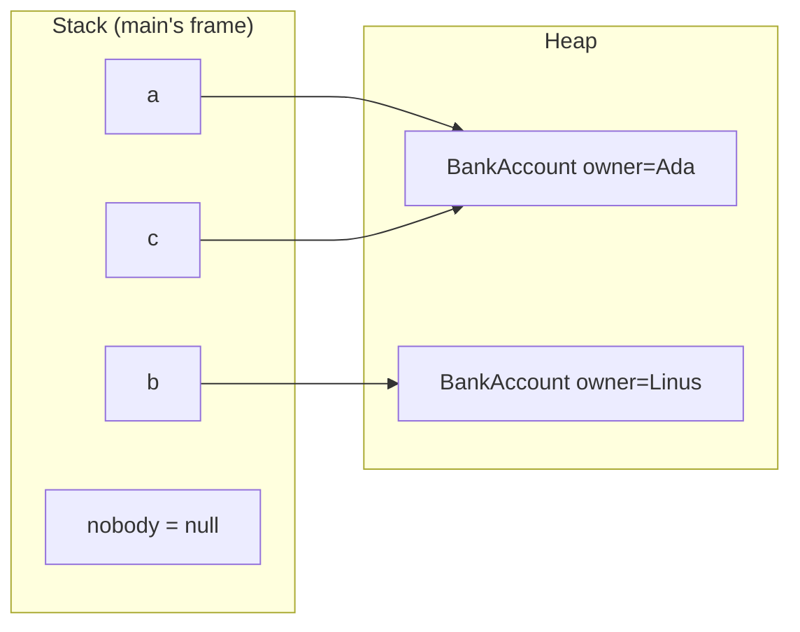
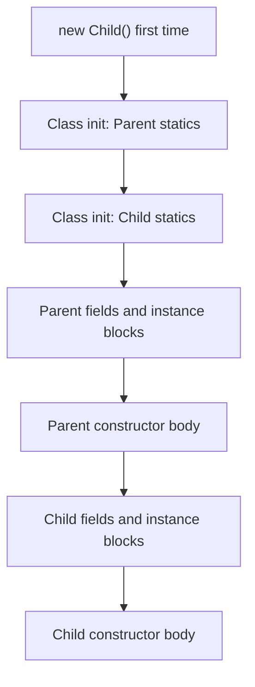

# Chapter 5 — OOP: Classes and Objects

Java is **object-oriented**: programs are built from *objects* that bundle data with the code that works on it. This chapter covers the mechanics — writing classes, creating and constructing objects, sharing state with `static` (class-level members shared by all objects), hiding details with access modifiers (keywords like `private` controlling visibility), packages, immutability (unchangeable after creation), and Java's exact initialisation order.

OOP *design* — relationships, SOLID (five classic OO design principles), patterns (named reusable solutions) — lives in the LLD (low-level design) handbook: [LLD Chapter 2 — OOP fundamentals](../../../lld/chapters/02-oop-fundamentals/README.md).

Code: [`code/`](code/) (package `ch05.*`), `javac --release 25`, run on JDK 26. Exam traps: constructors, init-order puzzles, `this`/`super`, immutability in [OCP Chapter 6 — Class design](../../../../ocp-java21-study/chapters/06-class-design/README.md); access and `static` in [OCP Chapter 5 — Methods](../../../../ocp-java21-study/chapters/05-methods/README.md).

---

## 5.1 Classes and objects

### What it is
- A **class** is a blueprint declaring what data each object holds (**fields**) and what it can do (**methods**). It is also a **type**.
- An **object** (**instance**) is one concrete thing built from it, with its own copy of the fields.
- **Instantiation** creates an object: `new BankAccount()`.

Grouping data with the behaviour that protects it keeps rules in one place: a `BankAccount` that knows how to `withdraw` can refuse to go negative; a bare `long balance` cannot.

### How it works
1. **Declare** the class (one public top-level class per file, named after it).
2. **Create** with `new ClassName(args)`: allocates memory on the **heap**, runs the constructor (§5.3), returns a **reference**.
3. **Store** the reference in a variable — the variable *points to* the object; it is not the object.
4. **Use** it with the dot operator: `a.deposit(100)`, `a.owner`.
5. Once no live reference reaches an object (from thread stacks, static fields, …) it is **unreachable** and the **garbage collector** (GC) eventually reclaims it. No `delete`/`free` ([Chapter 16](../16-jvm-internals-and-performance/README.md)).



```java
// code/ch05/classes/BankAccount.java
public class BankAccount {
    String owner;          // fields: each object gets its own copy
    long balanceCents;     // defaults: null and 0 until assigned

    void deposit(long cents) { balanceCents += cents; }

    boolean withdraw(long cents) {
        if (cents > balanceCents) return false;
        balanceCents -= cents;
        return true;
    }

    String summary() {
        return owner + ": " + balanceCents / 100 + "." + String.format("%02d", balanceCents % 100);
    }
}
```

```java
// code/ch05/classes/ClassesDemo.java (key parts)
BankAccount a = new BankAccount();
a.owner = "Ada";
a.deposit(10_050);
BankAccount b = new BankAccount();
b.owner = "Linus";
b.deposit(2_000);
System.out.println(a.summary() + " | " + b.summary());
System.out.println("withdraw 50.00 from Linus: " + b.withdraw(5_000) + " -> " + b.summary());

BankAccount c = a;                 // copies the reference, not the object
c.deposit(1);
System.out.println("via alias: " + a.summary() + ", same object? " + (a == c));

BankAccount fresh = new BankAccount();
System.out.println("defaults: owner=" + fresh.owner + ", balance=" + fresh.balanceCents);

BankAccount nobody = null;
nobody.deposit(1);                 // NullPointerException (caught in the file)
```

Output:
```text
Ada: 100.50 | Linus: 20.00
withdraw 50.00 from Linus: false -> Linus: 20.00
via alias: Ada: 100.51, same object? true
defaults: owner=null, balance=0
NPE: Cannot invoke "ch05.classes.BankAccount.deposit(long)" because "<local5>" is null
```

- `c = a` made a second name for the *same* object (one object, two references).
- **Fields get defaults** (`null`, `0`, `false`); locals do not.
- **`null`** = no object; calling through it throws `NullPointerException` ([Chapter 8](../08-exceptions/README.md)). Helpful NPE messages (Java 14, JEP 358; default since 15) say what was null — `<local5>` here because the class lacks debug info; compile with `javac -g` (IDEs and build tools do) to get `because "nobody" is null`.
- Money is `long` cents — never `double`.

### Common mistakes
- `==` on objects compares *references*; content equality is `equals` ([Chapter 6](../06-oop-inheritance-interfaces-and-more/README.md#613-object-methods-equals-hashcode-and-tostring)).
- Calling a method on an uninitialised object field (NPE).
- Public fields as here — anyone can set `balanceCents = -5` (fixed in §5.7).

### TL;DR
Class = blueprint and type; object = instance on the heap; variables hold references. `new` creates, GC reclaims unreachable objects, `null` means no object.

---

## 5.2 Fields, instance methods and `this`

### What it is
- An **instance field** is per-object state (`owner`, `balanceCents`).
- An **instance method** runs on one object and reads/writes its fields.
- **`this`** references *the current object*; it exists in instance methods and constructors, not static methods. A bare field name means `this.field` unless a local or parameter shadows it.

### The four uses of `this`
| Use | Example | Why |
|---|---|---|
| Reach a field **shadowed** by a parameter | `this.size = size;` | `size = size` would assign the parameter to itself |
| Pass the current object | `registry.register(this)` | Others can hold a reference to you |
| Return it for chaining | `return this;` → `pizza.addTopping("a").addTopping("b")` | Fluent APIs, builders ([LLD Builder](../../../lld/chapters/08-patterns-creational/README.md)) |
| Call another constructor | `this(size, false);` | Constructor chaining (§5.3) |

### Common mistakes
- `name = name` instead of `this.name = name` — compiles, does nothing; the field stays `null` (IDEs warn).
- `this` in a `static` method — compile error.
- Letting `this` **escape** a constructor (registering a listener, starting a thread with `this`) before construction finishes — others may see a half-built object; especially dangerous with threads ([Chapter 14](../14-concurrency-1/README.md)).

---

## 5.3 Constructors

### What it is
A **constructor** runs when `new` creates an object and puts it into a **valid** state. Unlike a method, its name is exactly the class name, it has **no return type** (adding `void` makes it an ordinary method), and it is **not inherited**.

### How it works
1. **Default constructor**: if you write *none*, the compiler adds a no-argument one calling `super()`, with the class's access. Write **any** constructor and no default is generated — `new X()` stops compiling unless you write it.
2. **Overloading**: several constructors with different parameter lists ([§4.3](../04-methods-and-arrays/README.md#43-overloading)).
3. **Chaining with `this(...)`**: put validation and assignments in one "full" constructor; others delegate with defaults.
4. **Every constructor first runs a superclass constructor** (the *superclass* is the parent class; the extender is the *subclass*) — explicit `super(...)` or an implicit `super()` ([Chapter 6](../06-oop-inheritance-interfaces-and-more/README.md#61-inheritance-and-super)). A constructor calls *either* `this(...)` *or* `super(...)`, at most once.
5. **Validate** and throw (`IllegalArgumentException`, or `NullPointerException` via `Objects.requireNonNull`) so an invalid object never exists — "fail fast" ([LLD design principles](../../../lld/chapters/05-design-principles/README.md)).

### Flexible constructor bodies (Java 25, JEP 513)
Until Java 24, `this(...)`/`super(...)` had to be the **first statement**, forcing helper static methods to validate or transform arguments first. **JEP 513, final in Java 25** (preview 22–24), allows statements *before* the call — the **prologue**:

| Allowed in the prologue | Not allowed |
|---|---|
| Locals, computations, `if`/loops | Using `this` explicitly or implicitly (reading fields, calling instance methods) |
| Validating arguments, throwing | `super.x` or `super.m()` |
| Assigning this class's fields that have no initialiser | Reading those fields |

```java
// code/ch05/constructors/Pizza.java (key parts)
public class Pizza {
    private final String size;
    private final boolean extraCheese;
    private final List<String> toppings = new ArrayList<>();

    public Pizza(String size, boolean extraCheese, String... toppings) {   // the "full" constructor
        if (!List.of("S", "M", "L").contains(size))
            throw new IllegalArgumentException("bad size: " + size);
        this.size = size;
        this.extraCheese = extraCheese;
        this.toppings.addAll(List.of(toppings));
    }
    public Pizza(String size) { this(size, false); }   // chaining
    public Pizza()            { this("M"); }

    // Java 25: statements BEFORE this(...) — parse and validate, without touching 'this'
    public Pizza(String order, char separator) {
        String[] parts = order.strip().split(String.valueOf(separator));
        if (parts.length == 0 || parts[0].isEmpty())
            throw new IllegalArgumentException("empty order");
        this(parts[0].toUpperCase(), false, Arrays.copyOfRange(parts, 1, parts.length));
    }

    public Pizza addTopping(String t) { toppings.add(t); return this; }  // fluent: returns this
    @Override public String toString() { /* Pizza[size, extra cheese?, toppings] */ }
}
```

```java
// code/ch05/constructors/ConstructorsDemo.java (key parts)
static class NoConstructorWritten { int x = 7; }            // compiler adds NoConstructorWritten() { super(); }
static class OnlyArgConstructor {
    final int x;
    OnlyArgConstructor(int x) { this.x = x; }               // now 'new OnlyArgConstructor()' will not compile
}

System.out.println(new Pizza());
System.out.println(new Pizza("L"));
System.out.println(new Pizza("S", true, "olives", "basil"));
System.out.println(new Pizza(" m,ham,pineapple ", ','));
System.out.println(new Pizza("M").addTopping("mushroom").addTopping("onion"));
new Pizza("XXL");                                            // throws, caught in the file
```

Output:
```text
Pizza[M, []]
Pizza[L, []]
Pizza[S, extra cheese, [olives, basil]]
Pizza[M, [ham, pineapple]]
Pizza[M, [mushroom, onion]]
default ctor gives x=7, arg ctor gives x=42
rejected: bad size: XXL
```

### Trade-offs — ways to create objects
| Approach | Good for | Weak spot |
|---|---|---|
| Telescoping constructors (each adds a parameter, like `Pizza`) | 1–3 optional parameters | Same-typed parameters are easy to swap |
| Static factory method (`Pizza.margherita()`, `List.of`, `Integer.valueOf`) | Descriptive names, caching, returning subtypes (*Effective Java* Item 1) | Less obvious in docs |
| Builder (`Pizza.builder().size("L").cheese(true).build()`) | Many optional parameters, readable calls (Item 2) | More code — [LLD Builder](../../../lld/chapters/08-patterns-creational/README.md) |
| Records ([Chapter 6](../06-oop-inheritance-interfaces-and-more/README.md#68-records)) | Plain data carriers | Canonical form takes every component |

### Common mistakes
- `public void Pizza() {}` is a *method*.
- Adding an argument constructor, then `new Pizza()` stops compiling.
- Duplicating validation instead of chaining.
- Calling overridable methods from a constructor — a subclass override can run before the subclass's fields are initialised (*Effective Java* Item 19; demo in [Chapter 6](../06-oop-inheritance-interfaces-and-more/README.md#63-overriding)).
- Recursive chaining (`A() { this(1); }  A(int x) { this(); }`) — "recursive constructor invocation".

### In the interview
**30-second answer:** "A constructor initialises a new object into a valid state. Declare none and Java adds a no-arg default; declare any and it disappears. I chain overloads with `this(...)` so validation lives in one place. Every constructor first runs a superclass constructor via `super(...)`, explicit or implicit. Since Java 25 I can validate before that call, as long as I don't touch `this`."
- *Private constructor?* Yes — singletons, static-factory-only classes, non-instantiable utility classes.
- *Inherited?* No; a subclass declares its own and calls a superclass one.

### TL;DR
Constructors: class name, no return type, not inherited. Default only if you write none. Chain with `this(...)`; one constructor validates. Java 25 allows code before `this(...)`/`super(...)`.

---

## 5.4 Packages and imports

### What it is
A **package** is a named group of related classes that maps to a folder. It provides **namespaces** (`java.util.Date` and `java.sql.Date` coexist), an **access boundary** (package-private members, §5.6) and **organisation** (`com.shop.orders`).

### How it works
1. The file's first statement declares it: `package ch05.access.bank;`. None → the **unnamed (default) package**: fine for scratch code, but other packages cannot import from it.
2. Folders must match: `ch05/access/bank/Vault.java` (classes compile to the same structure).
3. Convention: lowercase reversed domain, `com.example.shop.orders`.
4. The **fully qualified name** (package + name, `ch05.access.bank.Vault`) works without imports.
5. **Imports** allow the short name:

| Form | Example | Notes |
|---|---|---|
| Single-type | `import java.util.List;` | Preferred — explicit |
| On-demand (wildcard) | `import java.util.*;` | That package only, **not** subpackages (`java.util.function` needs its own) |
| Static | `import static java.lang.Math.max;` / `…Math.*;` | Static members; sparingly (constants, test assertions) |
| Module (Java 25, JEP 511) | `import module java.base;` | All public types of every package the module exports; single-type imports win clashes |

6. `java.lang` and your own package are imported automatically.
7. Imports are **compile-time only** — no code loaded, no runtime cost.
8. At run time classes are found via the **class path** (`java -cp out ch05.statics.StaticDemo`) or the **module path** ([Chapter 16](../16-jvm-internals-and-performance/README.md)).

### Common mistakes
- `java.util.*` + `java.sql.*` then `Date` — ambiguous; import one explicitly or fully qualify.
- Assuming `java.util.*` covers `java.util.concurrent.ConcurrentHashMap`.
- File path not matching the package — compiles, but the class isn't found at run time.

---

## 5.5 Static members

### What it is
`static` = **belongs to the class, not to any object**.
- A **static field** has **one copy**, shared by all instances (usable with none).
- A **static method** runs without an object; no `this`.
- A **static initialiser block** `static { … }` runs **once**, at class initialisation.
- A **constant** is a `static final` field in `UPPER_SNAKE_CASE`.

### How it works
1. Access via the class name: `Ticket.issuedSoFar()`, `Ticket.MAX_PER_ORDER` (via an object compiles but misleads; IDEs warn).
2. Static methods use only static members directly; instance methods use both.
3. **Class initialisation** (static initialisers and blocks, top to bottom) runs once, on first *active use*: creating an instance, calling a static method, reading a non-constant static field.
4. Reading a **compile-time constant** (`static final` primitive/`String` with a constant expression) does **not** initialise the class — the value is copied into the caller.

```java
// code/ch05/statics/Ticket.java
public class Ticket {
    public static final int MAX_PER_ORDER = 10;      // constant
    private static int issued;                       // ONE copy, shared
    private static final String PREFIX;

    static {                                         // runs once, at class initialisation
        PREFIX = "TKT-" + (2000 + 26);
        System.out.println("[Ticket class initialised]");
    }

    private final int number;                        // one copy PER object

    public Ticket() { issued++; number = issued; }
    public String id() { return PREFIX + "-" + number; }
    public static int issuedSoFar() { return issued; }
    public static boolean canBuy(int quantity) { return quantity > 0 && quantity <= MAX_PER_ORDER; }
}
```

```java
// code/ch05/statics/StaticDemo.java (key parts)
import static java.lang.Math.max;
import static java.lang.Math.PI;

System.out.println("before first use");
System.out.println("MAX_PER_ORDER = " + Ticket.MAX_PER_ORDER);  // constant: inlined, no class init
System.out.println("issued = " + Ticket.issuedSoFar());           // first real use: class init
Ticket t1 = new Ticket(), t2 = new Ticket(), t3 = new Ticket();
System.out.println(t1.id() + ", " + t2.id() + ", " + t3.id());
System.out.println("issued = " + Ticket.issuedSoFar() + ", canBuy(12) = " + Ticket.canBuy(12));
System.out.println("max(3, 8) = " + max(3, 8) + ", PI = " + PI);
```

Output:
```text
before first use
MAX_PER_ORDER = 10
[Ticket class initialised]
issued = 0
TKT-2026-1, TKT-2026-2, TKT-2026-3
issued = 3, canBuy(12) = false
max(3, 8) = 8, PI = 3.141592653589793
```

Reading `MAX_PER_ORDER` did *not* trigger the static block; `issuedSoFar()` did. Three tickets: one `issued`, three `number`s.

### When to use `static` — and when not
| Good fit | Poor fit |
|---|---|
| Constants (`MAX_PER_ORDER`, `Math.PI`) | Mutable global state (`static List<User> users`) — hidden coupling, hard to test, **not thread-safe** without synchronisation |
| Pure utilities, output depends only on inputs (`Math.max`, `Integer.parseInt`) | Behaviour that should vary by implementation — statics cannot be overridden ([Chapter 6](../06-oop-inheritance-interfaces-and-more/README.md#63-overriding)) |
| Static factories (`List.of`, `Integer.valueOf`) | Dependencies to swap in tests (`static Database db`) — pass objects in |
| Counters/ID generators — `AtomicInteger` if threads are involved | |

Utility classes (`Math`, `Collections`, `Arrays`) are `final` with a `private` constructor (*Effective Java* Item 4). Singleton pitfalls: [LLD Chapter 8](../../../lld/chapters/08-patterns-creational/README.md).

### Common mistakes
- "non-static variable cannot be referenced from a static context" — calling instance members from `main`.
- `issued++` is a **race condition** (outcome depends on thread timing) if two threads create tickets ([Chapter 14](../14-concurrency-1/README.md)).
- Static imports so heavy that readers can't tell where `of(...)` comes from.

### In the interview
**30-second answer:** "Static members belong to the class: one shared copy of a static field; static methods run without an instance, have no `this`, and can't be overridden — only hidden. Static initialisation happens once, lazily, on first active use. I use static for constants, pure utilities and factories, and avoid mutable static state: it's global, hard to test and needs synchronisation."
- *Static method reading an instance field?* Only through an object reference it is given or creates.
- *When does a static block run?* Once, at class initialisation — first instantiation, static method call, or non-constant static field access.

---

## 5.6 Access modifiers

### What it is
**Access modifiers** control *who can see* a class, field, method or constructor — Java's compile-time enforcement of encapsulation (§5.7).

| Modifier | Same class | Same package | Subclass in another package | Everywhere else |
|---|:-:|:-:|:-:|:-:|
| `private` | yes | no | no | no |
| *(none)* = **package-private** | yes | yes | no | no |
| `protected` | yes | yes | yes (through inheritance) | no |
| `public` | yes | yes | yes | yes |

Top-level classes can only be `public` or package-private; members (fields, methods, constructors, nested types) can use all four.

### How it works
```java
// code/ch05/access/bank/Vault.java
package ch05.access.bank;
public class Vault {
    public    String name = "Main vault";   // everyone
    protected int    floors = 3;            // same package + subclasses
              int    guards = 4;            // package-private: same package only
    private   String code = "0000";         // this class only
    public boolean open(String attempt) { return code.equals(attempt); }
}
```

```java
// code/ch05/access/bank/Teller.java — same package: sees everything except private
return v.name + ", floors=" + v.floors + ", guards=" + v.guards;
```

```java
// code/ch05/access/client/AccessDemo.java — different package
static class BranchVault extends Vault {
    int floorsPlusOne() { return floors + 1; }     // protected: visible through inheritance
}
Vault v = new Vault();
System.out.println("public name:        " + v.name);
// v.floors  -> compile error: protected, not accessed through a subclass
// v.guards  -> compile error: package-private, different package
// v.code    -> compile error: private
System.out.println("open(\"1234\"):       " + v.open("1234"));
System.out.println("Teller (same pkg):  " + Teller.inspect(v));
System.out.println("subclass protected: " + new BranchVault().floorsPlusOne());
```

Output:
```text
public name:        Main vault
open("1234"):       false
Teller (same pkg):  Main vault, floors=3, guards=4
subclass protected: 4
```

**The protected subtlety:** a subclass in another package may use a protected member only *through inheritance* — on `this` or references of its own subclass type — not on an arbitrary `Vault`. Hence `v.floors` fails while `BranchVault.floorsPlusOne()` works.

### Guidelines
1. **Make every field `private`** (constants excepted); expose behaviour, not data.
2. Start members private or package-private; widen only when needed (*Effective Java* Item 15). Every `public` member is a permanent promise.
3. `protected` is part of your API to subclassers — use deliberately.
4. Package-private suits helper classes other packages shouldn't depend on.
5. Module-level hiding (a `public` class other *modules* can't use): JPMS in [Chapter 16](../16-jvm-internals-and-performance/README.md).

### TL;DR
private < package-private < protected < public. Fields private, members as narrow as possible.

---

## 5.7 Encapsulation

### What it is
**Encapsulation** bundles data with the methods that operate on it and **hides the data** so it changes only through those methods. The object guards its **invariants** — conditions that must always hold ("5 ≤ target ≤ 30", "balance ≥ 0").

Why: **validity** (no nonsense states), **freedom to change** the internal representation (store Fahrenheit, add caching) without breaking callers, **debuggability** (every change passes through one method — one breakpoint).

### How it works
1. Make fields `private`.
2. Prefer **behaviour** methods (`raise`, `withdraw`) over raw setters ("tell, don't ask" — [LLD principles](../../../lld/chapters/05-design-principles/README.md)).
3. Where accessors are needed, a **getter** returns a value (`getTargetCelsius()`, `isActive()` for booleans) and a **setter** validates before changing.
4. Omit setters for read-only properties; compute derived values.

```java
// code/ch05/encapsulation/Thermostat.java
public class Thermostat {
    public static final double MIN = 5.0, MAX = 30.0;
    private double targetCelsius = 20.0;
    private int changes;

    public double getTargetCelsius() { return targetCelsius; }
    public void setTargetCelsius(double value) {
        if (Double.isNaN(value) || value < MIN || value > MAX)
            throw new IllegalArgumentException("target must be in [" + MIN + ", " + MAX + "]: " + value);
        targetCelsius = value;
        changes++;
    }
    public void raise(double delta) { setTargetCelsius(Math.min(MAX, targetCelsius + delta)); }
    public double getTargetFahrenheit() { return targetCelsius * 9 / 5 + 32; }   // derived
    public int getChanges() { return changes; }                                   // read-only
}
```

```java
// code/ch05/encapsulation/EncapsulationDemo.java (key parts)
static class OpenThermostat { public double targetCelsius; }   // no encapsulation
open.targetCelsius = -273;                                      // nothing stops nonsense
Thermostat t = new Thermostat();
t.setTargetCelsius(22.5);
t.raise(10);                                                    // clamped to MAX
t.setTargetCelsius(-273);                                       // rejected
```

Output:
```text
open thermostat: -273.0
target=30.0C = 86.0F, changes=2
rejected: target must be in [5.0, 30.0]: -273.0
```

### Trade-offs
Getters/setters for every field ("anaemic" objects) barely beat public fields: they keep room for later validation but express no behaviour. Prefer meaningful operations; for pure data, an immutable **record** ([Chapter 6](../06-oop-inheritance-interfaces-and-more/README.md#68-records)). Encapsulation vs abstraction, "tell don't ask", Law of Demeter: [LLD §2.3 Encapsulation](../../../lld/chapters/02-oop-fundamentals/README.md#23-encapsulation).

### Common mistakes
- A getter returning a mutable internal (`List`, `Date`, array) — callers can change it. Return an unmodifiable view or copy (§5.9).
- Setters that don't validate (private fields + unvalidated public setters is barely encapsulated).
- Generating accessors for every field by reflex.

### In the interview
**30-second answer:** "Encapsulation hides an object's state behind methods, so the object enforces its own invariants and can change internals without breaking callers. In Java: private fields, behaviour-oriented public methods, validated setters only where needed, no leaking of mutable internals through getters."

---

## 5.8 The `final` keyword

`final` = "cannot be changed after it is set"; what is fixed depends on where it appears:

| On | Meaning | Example |
|---|---|---|
| Local variable / parameter | Assigned exactly once | `final int max = 10;` |
| Instance field | Assigned exactly once — declaration, instance initialiser, or **every** constructor | `private final String size;` |
| Static field | Assigned once — declaration or static block | `static final String PREFIX;` |
| Method | Cannot be **overridden** | `public final void close()` |
| Class | Cannot be **extended** | `final class String`, `final class Money` |

- `final` on a reference stops **reassignment**, not **mutation**: a `final StringBuilder sb` can still `append`; a `final` array's elements can change.
- A never-reassigned variable is **effectively final**; lambdas and inner classes may only capture such variables ([Chapter 11](../11-lambdas-and-functional-programming/README.md)).
- `final` fields have a **Java Memory Model** guarantee (the rules for what one thread sees of another's writes): after a constructor finishes without leaking `this`, all threads see correct `final` values without synchronisation ([Chapter 15](../15-concurrency-2-modern/README.md)).
- Not to be confused with `finally` ([Chapter 8](../08-exceptions/README.md)) or deprecated `finalize()`.

---

## 5.9 Immutability basics

### What it is
An **immutable** object's observable state **never changes after construction** — `String`, `Integer`, `LocalDate`, `BigDecimal`, `Instant`, `UUID`, records with immutable components. To "change" one you create a new one (`s.toUpperCase()`).

### Why it matters
| Benefit | Why |
|---|---|
| Simple to reason about | One state, set and validated once |
| Thread-safe for free | Nothing to race on; share without locks |
| Safe to share and cache | `Integer.valueOf` caches; `String` literals are pooled ([Chapter 7](../07-core-apis/README.md)) |
| Safe as `HashMap` keys / `HashSet` elements | The hash code can't change after insertion |
| No defensive copies needed | Nobody can modify it |

*Effective Java* Item 17: "minimise mutability". Cost: a new object per change, which matters for large objects updated in tight loops (hence `StringBuilder` as `String`'s mutable companion). Design view: [LLD §2.13](../../../lld/chapters/02-oop-fundamentals/README.md#213-immutability-and-records), [LLD principle 14](../../../lld/chapters/05-design-principles/README.md#14-immutability).

### How it works — the five rules
1. **No methods that modify state** (no setters).
2. **Make the class `final`** (or constructors private) so a subclass can't add mutable state or override methods to behave mutably.
3. **All fields `private final`.**
4. **Validate in the constructor** — every instance valid from birth.
5. **Exclusive access to mutable components**: **defensive copies** of mutable inputs (lists, arrays, `Date`) in the constructor; never hand out mutable internals — return copies or unmodifiable views.

"Modifiers" return a **new** object (`plus`, `with…`).

```java
// code/ch05/immutable/Money.java
public final class Money {
    private final long cents;
    private final String currency;
    public Money(long cents, String currency) {
        this.cents = cents;
        this.currency = Objects.requireNonNull(currency, "currency");
    }
    public long cents() { return cents; }
    public String currency() { return currency; }
    public Money plus(Money other) {
        if (!currency.equals(other.currency)) throw new IllegalArgumentException("currency mismatch");
        return new Money(cents + other.cents, currency);   // new object
    }
    @Override public String toString() { return String.format("%d.%02d %s", cents / 100, cents % 100, currency); }
}
```

```java
// code/ch05/immutable/Playlist.java
public final class Playlist {
    private final String name;
    private final List<String> songs;
    public Playlist(String name, List<String> songs) {
        this.name = name;
        this.songs = List.copyOf(songs);          // defensive copy in; also unmodifiable
    }
    public List<String> songs() { return songs; } // safe to hand out
    public Playlist with(String song) {           // "wither": copy + change
        List<String> next = new ArrayList<>(songs);
        next.add(song);
        return new Playlist(name, next);
    }
}
```

```java
// code/ch05/immutable/ImmutabilityDemo.java (key parts)
static final class LeakyPlaylist {                 // final fields, but NOT immutable
    private final List<String> songs;
    LeakyPlaylist(List<String> songs) { this.songs = songs; }   // keeps the caller's list
    List<String> songs() { return songs; }                      // hands out the internal list
}

List<String> input = new ArrayList<>(List.of("Intro", "Verse"));
LeakyPlaylist leaky = new LeakyPlaylist(input);
input.add("SNEAKY");
leaky.songs().clear();

final StringBuilder sb = new StringBuilder("final ref");
sb.append(" but mutable object");
```

Output:
```text
19.99 EUR + 5.01 EUR = 25.00 EUR (price unchanged: 19.99 EUR)
leaky after outside changes: []
safe after outside change:   Mix[Intro, Verse]
safe.songs().clear() -> UnsupportedOperationException
with("Chorus"): Mix[Intro, Verse, Chorus], original: Mix[Intro, Verse]
final ref but mutable object
```

`LeakyPlaylist` has only `final` fields yet was changed twice from outside — **`final` fields are not enough**; rule 5 makes `Playlist` safe.

### Common mistakes
- Thinking `final` = immutable.
- `Collections.unmodifiableList(list)` without copying: a read-only *view* that still reflects the owner's changes. `List.copyOf` makes an independent copy.
- Returning an array field — return `array.clone()`.
- Mutable components like `java.util.Date` — prefer `java.time` ([Chapter 7](../07-core-apis/README.md)).

### In the interview
**30-second answer:** "An immutable class has fixed state after construction: final class, private final fields, no setters, constructor validation, defensive copies of mutable inputs and outputs. Benefits: thread safety without locks, safe sharing and caching, safe map keys. String, Integer and java.time are examples; records make simple immutable classes a one-liner if their components are immutable."
- *Why final class?* A subclass could add mutable state or override methods, breaking the guarantee for code holding the parent type.
- *Is a record deeply immutable* (nothing reachable can change)? No — fields are final, but a `List` component stays mutable unless copied in the compact constructor ([Chapter 6](../06-oop-inheritance-interfaces-and-more/README.md#68-records)).

### TL;DR
Immutable = final class, private final fields, no setters, validate in constructor, copy mutable stuff in and out. Changes return new objects. `final` ≠ immutable.

---

## 5.10 Initialisation order

### What it is
Java runs initialisation code in a **fixed order** when a class is first used and when an object is created — knowing it prevents "why is this field still null?" bugs, and it's a favourite exam/interview question. The kinds:
- **Static field initialisers** (`static int x = 5;`) and **static blocks** (`static { … }`) — class level.
- **Instance field initialisers** and **instance initialiser blocks** (`{ … }`) — object level.
- **Constructor bodies.**

### How it works
**Class initialisation** (once per class per class loader, on first active use):
1. Initialise the **superclass** first (recursively up to `Object`).
2. Run this class's static initialisers and blocks **in source order**.

**Object creation** (`new Child()`), every time:
1. Memory allocated; all fields get defaults.
2. The `Child` constructor starts by calling the superclass constructor (Java 25: prologue statements run before it).
3. The **superclass** runs its instance initialisers/blocks (source order), then its constructor body — recursively.
4. `Child`'s instance initialisers/blocks run **in source order**.
5. The rest of the `Child` constructor body runs.



```java
// code/ch05/init/InitOrder.java (key parts)
static class Parent {
    static { log("1. Parent static block"); }
    private final String p = log("3. Parent field initializer");
    { log("4. Parent instance block"); }
    Parent() { log("5. Parent constructor body"); }
}
static class Child extends Parent {
    static final String TAG = log("2. Child static field");
    private final String c = log("6. Child field initializer");
    { log("7. Child instance block"); }
    Child() {
        super();                                     // implicit if omitted
        log("8. Child constructor body");
    }
}
public static void main(String[] args) {
    System.out.println("--- first new Child() ---");
    new Child();
    System.out.println("--- second new Child(): static parts do not run again ---");
    new Child();
}
```

Output:
```text
--- first new Child() ---
1. Parent static block
2. Child static field
3. Parent field initializer
4. Parent instance block
5. Parent constructor body
6. Child field initializer
7. Child instance block
8. Child constructor body
--- second new Child(): static parts do not run again ---
3. Parent field initializer
4. Parent instance block
5. Parent constructor body
6. Child field initializer
7. Child instance block
8. Child constructor body
```

(`TAG` comes from a method call, so it is not a compile-time constant and runs during class initialisation.) Note the child's static part runs before the parent's instance blocks — all class init precedes object creation.

### Common mistakes
- A static field read by a static block declared *above* it still has its default (source order).
- An overridable method called from the parent constructor runs the child's override **before** the child's field initialisers, so it sees defaults ([§6.3](../06-oop-inheritance-interfaces-and-more/README.md#63-overriding)).
- Heavy work or I/O in static blocks: failures surface as `ExceptionInInitializerError` and later uses get `NoClassDefFoundError`.

### TL;DR
Statics once (parent first, source order). Per object: defaults → parent (fields/blocks, constructor body) → child (fields/blocks, constructor body).

---

## Chapter TL;DR

| Topic | Remember |
|---|---|
| Class vs object | Blueprint/type vs instance on the heap; variables hold references |
| `null` / NPE | No object; helpful NPE messages since Java 14 |
| `this` | Current object: shadowed fields, pass/return self, `this(...)` |
| Constructors | Name = class, no return type, not inherited; default only if none written; chain with `this(...)`; Java 25 prologue before `this`/`super` |
| Packages | Namespace + folder + access boundary; single-type imports; `java.lang` automatic; `import module` (25) |
| `static` | One per class; no `this`; init once on first active use; constants are `static final` |
| Access | private < package-private < protected < public; fields private |
| Encapsulation | Hide state, expose behaviour, protect invariants |
| `final` | Variable: assign once. Method: no override. Class: no subclass. Not the same as immutable |
| Immutability | Final class, private final fields, no setters, validate, defensive copies |
| Init order | Parent statics → child statics → (per object) parent fields/blocks → parent ctor → child fields/blocks → child ctor |

**Next:** inheritance, interfaces, polymorphism, records, enums and nested classes in [Chapter 6](../06-oop-inheritance-interfaces-and-more/README.md). OOP design: [LLD handbook](../../../lld/chapters/02-oop-fundamentals/README.md).
