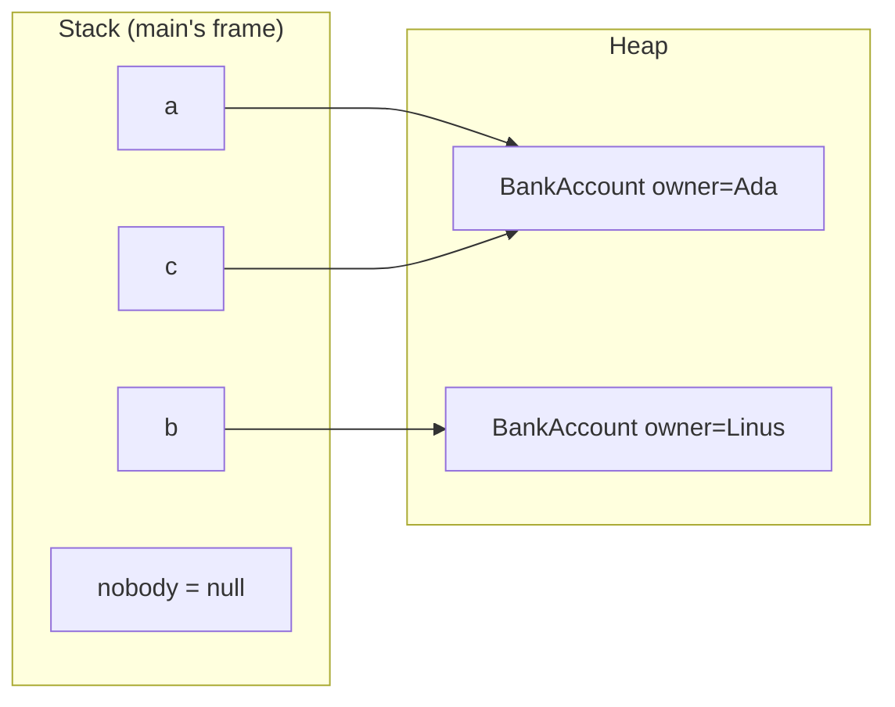
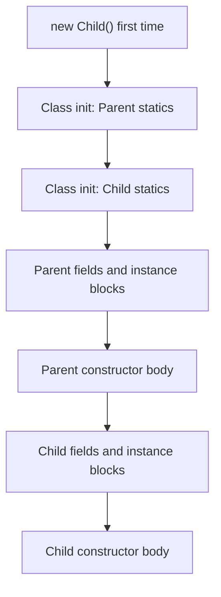

# Chapter 5 — OOP: Classes and Objects

Java is an **object-oriented** language: programs are built from *objects* that bundle data with the code that works on that data. This chapter teaches the mechanics — how to write a class, create objects, construct them correctly, share state with `static`, hide details with access modifiers, organise code in packages, make objects immutable, and understand exactly in what order Java initialises everything.

The *design* side of OOP — when to use which relationship, SOLID, patterns — is covered in depth in the LLD handbook; this chapter links there instead of repeating it: [LLD Chapter 2 — OOP fundamentals](../../../lld/chapters/02-oop-fundamentals/README.md).

**What you'll learn**

1. Classes vs objects, references, `new`, `null`, and where objects live (heap vs stack, garbage collection).
2. Fields, instance methods and the `this` keyword.
3. Constructors: the default constructor, overloading, `this(...)` chaining, and Java 25's flexible constructor bodies.
4. Packages and imports (including static imports and Java 25 module imports).
5. `static` fields, methods, constants and initialiser blocks.
6. The four access levels: `public`, `protected`, package-private, `private`.
7. Encapsulation: why fields are private and what getters/setters are for.
8. The `final` keyword on variables, fields, methods and classes.
9. Immutability basics: the five rules and defensive copying.
10. The exact initialisation order of a class and an object.

All runnable code is in [`code/`](code/) (package `ch05.*`), compiled with `javac --release 25` and run on JDK 26.

> **Exam depth.** Constructor rules, initialisation-order puzzles, `this`/`super` traps and immutability questions are drilled in [OCP Chapter 6 — Class design](../../../../ocp-java21-study/chapters/06-class-design/README.md); access modifiers and `static` traps in [OCP Chapter 5 — Methods](../../../../ocp-java21-study/chapters/05-methods/README.md).

---

## 5.1 Classes and objects

### What it is
- A **class** is a blueprint: it declares what data each object will hold (**fields**) and what it can do (**methods**). A class is also a **type** — you can declare variables of it.
- An **object** (or **instance**) is one concrete thing built from that blueprint, with its own copy of the fields.
- **Instantiation** is creating an object: `new BankAccount()`.

Analogy: a class is the architect's plan for a house; objects are the actual houses built from it. Every house has the same layout, but each has its own furniture (field values), and painting one house doesn't paint the others.

### Why it matters
Grouping data with the behaviour that protects it keeps rules in one place. A `BankAccount` that knows how to `withdraw` can refuse to go negative; a bare `long balance` passed around the program cannot.

### How it works
1. **Declare** the class (one public top-level class per file, file named after it: `BankAccount.java`).
2. **Create** objects with `new ClassName(args)`. `new` allocates memory on the **heap**, runs the constructor (§5.3), and returns a **reference** to the new object.
3. **Store** the reference in a variable of the class type. The variable is not the object; it *points to* it.
4. **Use** the object with the dot operator: `a.deposit(100)`, `a.owner`.
5. When no live variable references an object any more, it becomes **unreachable** and the **garbage collector** (GC) eventually reclaims its memory. Java has no `delete`/`free` — see GC in [Chapter 16](../16-jvm-internals-and-performance/README.md).



```java
// code/ch05/classes/BankAccount.java
public class BankAccount {
    String owner;          // fields: each object gets its own copy
    long balanceCents;     // defaults: null and 0 until assigned

    void deposit(long cents) { balanceCents += cents; }

    boolean withdraw(long cents) {
        if (cents > balanceCents) return false;
        balanceCents -= cents;
        return true;
    }

    String summary() {
        return owner + ": " + balanceCents / 100 + "." + String.format("%02d", balanceCents % 100);
    }
}
```

```java
// code/ch05/classes/ClassesDemo.java (key parts)
BankAccount a = new BankAccount();
a.owner = "Ada";
a.deposit(10_050);
BankAccount b = new BankAccount();
b.owner = "Linus";
b.deposit(2_000);
System.out.println(a.summary() + " | " + b.summary());
System.out.println("withdraw 50.00 from Linus: " + b.withdraw(5_000) + " -> " + b.summary());

BankAccount c = a;                 // copies the reference, not the object
c.deposit(1);
System.out.println("via alias: " + a.summary() + ", same object? " + (a == c));

BankAccount fresh = new BankAccount();
System.out.println("defaults: owner=" + fresh.owner + ", balance=" + fresh.balanceCents);

BankAccount nobody = null;
nobody.deposit(1);                 // NullPointerException (caught in the file)
```

Output:
```text
Ada: 100.50 | Linus: 20.00
withdraw 50.00 from Linus: false -> Linus: 20.00
via alias: Ada: 100.51, same object? true
defaults: owner=null, balance=0
NPE: Cannot invoke "ch05.classes.BankAccount.deposit(long)" because "<local5>" is null
```

What the output shows:
- `a` and `b` are independent objects; `c = a` created a second name for the *same* object.
- **Fields get default values** (`null`, `0`, `false`) — unlike local variables.
- **`null`** means "no object". Calling a method through it throws `NullPointerException`. Since Java 14 (JEP 358, on by default since 15) the message says exactly what was null. It shows `<local5>` here because the class was compiled without debug info; compile with `javac -g` (IDEs and build tools do) and it names the variable: `because "nobody" is null`.
- The money is kept in `long` cents — never `double` for money (Chapter 2/7).

### Common mistakes
- Confusing the reference with the object: `==` on objects compares *references* (same object?), not contents. Content equality is `equals`, covered in [Chapter 6](../06-oop-inheritance-interfaces-and-more/README.md#613-object-methods-equals-hashcode-and-tostring).
- Forgetting to initialise a field that holds an object, then calling a method on it (NPE).
- Public fields as in this first `BankAccount` — anyone can set `balanceCents = -5`. §5.7 fixes that.

### Self-check
1. How many `BankAccount` objects exist after `var x = new BankAccount(); var y = x;`? → One, with two references.
2. What value does an `int` field have before assignment? A local `int`? → `0`; a local has no value and cannot be read until assigned.
3. When is an object eligible for garbage collection? → When it is no longer reachable from any live reference (thread stacks, static fields, …).

### TL;DR
Class = blueprint and type; object = instance on the heap; variables hold references. `new` creates, GC reclaims unreachable objects, `null` means no object.

---

## 5.2 Fields, instance methods and `this`

### What it is
- An **instance field** (instance variable) is per-object state: `owner`, `balanceCents`.
- An **instance method** is behaviour that runs on one particular object and can read/write its fields.
- **`this`** is a reference to *the current object* — the one the method or constructor is running on. It exists in every instance method and constructor, and not in static methods.

### The four uses of `this`
| Use | Example | Why |
|---|---|---|
| Disambiguate a field hidden by a parameter | `this.size = size;` | The parameter **shadows** the field; `size = size` would just assign the parameter to itself |
| Pass the current object to someone else | `registry.register(this)` | Lets other objects hold a reference to you |
| Return the current object for chaining | `return this;` → `pizza.addTopping("a").addTopping("b")` | Fluent APIs, builders ([LLD Builder](../../../lld/chapters/08-patterns-creational/README.md)) |
| Call another constructor of the same class | `this(size, false);` | Constructor chaining (§5.3) |

Inside an instance method, a bare field name like `balanceCents` is shorthand for `this.balanceCents` unless a local variable or parameter with the same name shadows it.

### Common mistakes
- `this.name = name` written as `name = name` — compiles, does nothing; the field stays `null`. Many IDEs warn "assignment to itself".
- Using `this` inside a `static` method — compile error; there is no current object.
- Letting `this` **escape** from a constructor (registering a listener, starting a thread with `this`) before construction finishes — other code can then see a half-built object. Especially dangerous with threads ([Chapter 14](../14-concurrency-1/README.md)).

### TL;DR
Instance fields are per-object; `this` is the current object — used to reach shadowed fields, pass/return yourself, and chain constructors.

---

## 5.3 Constructors

### What it is
A **constructor** is special code that runs when an object is created with `new`. Its job is to put the new object into a **valid** state. It looks like a method but:
- its name is exactly the class name,
- it has **no return type** (not even `void` — adding one turns it into an ordinary method with a confusing name),
- it is not inherited.

### How it works
1. **Default constructor.** If you write *no* constructor, the compiler adds a no-argument one that just calls `super()`. Its access matches the class's access.
2. As soon as you write **any** constructor, no default is generated. If you still want `new X()`, write it yourself.
3. **Overloading.** A class can have many constructors with different parameter lists (same rules as method overloading, [Chapter 4 §4.3](../04-methods-and-arrays/README.md#43-overloading)).
4. **Chaining with `this(...)`.** One constructor can delegate to another. Put the real work (validation, assignments) in one "full" constructor and let the others supply defaults — no duplicated logic.
5. **Every constructor starts by running a superclass constructor** — either explicitly with `super(...)` or with an implicit `super()` the compiler inserts ([Chapter 6](../06-oop-inheritance-interfaces-and-more/README.md#61-inheritance-and-super)). A constructor calls *either* `this(...)` *or* `super(...)`, at most once.
6. **Validate** arguments and throw (usually `IllegalArgumentException` or `NullPointerException` via `Objects.requireNonNull`) so an invalid object never exists — "fail fast" ([LLD design principles](../../../lld/chapters/05-design-principles/README.md)).

### Flexible constructor bodies (Java 25, JEP 513)
Until Java 24, `this(...)` or `super(...)` had to be the **first statement**. That forced awkward code to validate or transform arguments before delegating (usually a helper static method). **JEP 513, final in Java 25** (previewed in 22–24), allows statements *before* the explicit `this(...)`/`super(...)` call. That part is called the **prologue**, and it has limits:

| Allowed in the prologue | Not allowed in the prologue |
|---|---|
| Local variables, computations, `if`/loops | Using `this` explicitly or implicitly (reading fields, calling instance methods) |
| Validating arguments and throwing exceptions | Using `super.x` or `super.m()` |
| Assigning fields of *this* class that have no initialiser (Java 25) | Reading those fields |

```java
// code/ch05/constructors/Pizza.java (key parts)
public class Pizza {
    private final String size;
    private final boolean extraCheese;
    private final List<String> toppings = new ArrayList<>();

    public Pizza(String size, boolean extraCheese, String... toppings) {   // the "full" constructor
        if (!List.of("S", "M", "L").contains(size))
            throw new IllegalArgumentException("bad size: " + size);
        this.size = size;
        this.extraCheese = extraCheese;
        this.toppings.addAll(List.of(toppings));
    }
    public Pizza(String size) { this(size, false); }   // chaining
    public Pizza()            { this("M"); }

    // Java 25: statements BEFORE this(...) — parse and validate, without touching 'this'
    public Pizza(String order, char separator) {
        String[] parts = order.strip().split(String.valueOf(separator));
        if (parts.length == 0 || parts[0].isEmpty())
            throw new IllegalArgumentException("empty order");
        this(parts[0].toUpperCase(), false, Arrays.copyOfRange(parts, 1, parts.length));
    }

    public Pizza addTopping(String t) { toppings.add(t); return this; }  // fluent: returns this
    @Override public String toString() { /* Pizza[size, extra cheese?, toppings] */ }
}
```

```java
// code/ch05/constructors/ConstructorsDemo.java (key parts)
static class NoConstructorWritten { int x = 7; }            // compiler adds NoConstructorWritten() { super(); }
static class OnlyArgConstructor {
    final int x;
    OnlyArgConstructor(int x) { this.x = x; }               // now 'new OnlyArgConstructor()' will not compile
}

System.out.println(new Pizza());
System.out.println(new Pizza("L"));
System.out.println(new Pizza("S", true, "olives", "basil"));
System.out.println(new Pizza(" m,ham,pineapple ", ','));
System.out.println(new Pizza("M").addTopping("mushroom").addTopping("onion"));
new Pizza("XXL");                                            // throws, caught in the file
```

Output:
```text
Pizza[M, []]
Pizza[L, []]
Pizza[S, extra cheese, [olives, basil]]
Pizza[M, [ham, pineapple]]
Pizza[M, [mushroom, onion]]
default ctor gives x=7, arg ctor gives x=42
rejected: bad size: XXL
```

### Trade-offs — ways to create objects
| Approach | Good for | Weak spot |
|---|---|---|
| Telescoping constructors (as `Pizza`) | 1–3 optional parameters | Many parameters of the same type are easy to swap by mistake |
| Static factory method (`Pizza.margherita()`, `List.of`, `Integer.valueOf`) | Descriptive names, caching, returning subtypes (*Effective Java*, Item 1) | Not obvious in docs that it replaces a constructor |
| Builder (`Pizza.builder().size("L").cheese(true).build()`) | Many optional parameters, readable call sites (*Effective Java*, Item 2) | More code — see [LLD Builder](../../../lld/chapters/08-patterns-creational/README.md) |
| Records ([Chapter 6](../06-oop-inheritance-interfaces-and-more/README.md#68-records)) | Plain data carriers | Fixed to "all components" canonical form |

### Common mistakes
- Adding a return type: `public void Pizza() {}` is a *method*, not a constructor.
- Adding an argument constructor and then being surprised `new Pizza()` stops compiling.
- Duplicating validation in every constructor instead of chaining to one.
- Calling overridable methods from a constructor — a subclass override can run before the subclass's fields are initialised (*Effective Java*, Item 19; demo in [Chapter 6](../06-oop-inheritance-interfaces-and-more/README.md#63-overriding)).
- Recursive chaining (`A() { this(1); }  A(int x) { this(); }`) — compile error "recursive constructor invocation".

### In the interview
**30-second answer:** "A constructor initialises a new object into a valid state. If you declare none, Java adds a no-arg default constructor; declare any and it disappears. Constructors overload, and I chain them with `this(...)` so validation lives in one place. Every constructor first runs a superclass constructor via `super(...)`, explicit or implicit. Since Java 25, I can validate arguments before that `this`/`super` call, as long as I don't touch `this`."

- *Follow-up: Can a constructor be private?* → Yes — for singletons, static-factory-only classes, and utility classes that must not be instantiated.
- *Follow-up: Are constructors inherited?* → No. A subclass must declare its own and call a superclass one.

### Self-check
1. Class `A` declares only `A(int x)`. Does `new A()` compile? → No; no default constructor is generated.
2. Where can `this(...)` appear before Java 25? In Java 25? → First statement only; in Java 25 it can follow prologue statements that don't use `this`.
3. What does `void Pizza()` inside class `Pizza` declare? → An ordinary method named `Pizza`.

### TL;DR
Constructors: class name, no return type, not inherited. Default constructor only if you write none. Chain with `this(...)`; one constructor does the validation. Java 25 allows validation code before `this(...)`/`super(...)`.

---

## 5.4 Packages and imports

### What it is
A **package** is a named group of related classes, like a folder — and it literally maps to a folder. Packages give you:
1. **Namespaces** — `java.util.Date` and `java.sql.Date` can coexist.
2. **Access control** — package-private members (§5.6) are visible only inside the package.
3. **Organisation** — `com.shop.orders`, `com.shop.payments`.

### How it works
1. The first statement of the file declares the package: `package ch05.access.bank;`. No declaration → the **unnamed (default) package**, fine for scratch code, not for real projects (other packages cannot import from it).
2. Directory structure must match: `ch05/access/bank/Vault.java`. Compiled classes land in the same structure (`ch05/access/bank/Vault.class`).
3. Naming convention: all lowercase, reversed internet domain: `com.example.shop.orders`.
4. The **fully qualified name** of a class is package + name: `ch05.access.bank.Vault`. You can always use it without importing.
5. **Imports** let you use the short name:

| Form | Example | Notes |
|---|---|---|
| Single-type import | `import java.util.List;` | Preferred — explicit, no ambiguity |
| Type-import-on-demand (wildcard) | `import java.util.*;` | Imports types of *that* package only, **not** subpackages (`java.util.function` needs its own import) |
| Static import | `import static java.lang.Math.max;` / `import static java.lang.Math.*;` | Imports static members; use sparingly (constants, test assertions) |
| Module import (Java 25, JEP 511) | `import module java.base;` | Imports all public types of every package the module exports; single-type imports win on name clashes |

6. `java.lang` (`String`, `Math`, `Integer`, `System`, …) and your own package are imported automatically.
7. Imports are purely a **compile-time** convenience: they don't load or include code, and have no runtime cost.
8. At runtime the JVM finds classes via the **class path** (`java -cp out ch05.statics.StaticDemo`) or the **module path** ([Chapter 16](../16-jvm-internals-and-performance/README.md)).

### Common mistakes
- Name clash: importing both `java.util.*` and `java.sql.*` then writing `Date` — ambiguous, compile error. Import one explicitly or use the fully qualified name.
- Assuming `import java.util.*;` covers `java.util.concurrent.ConcurrentHashMap` — it doesn't.
- File path not matching the package declaration — `javac` may compile it, but the class won't be found at runtime.

### Self-check
1. Do you need to import `String`? → No, `java.lang` is automatic.
2. Does `import java.util.*` import `java.util.function.Function`? → No.
3. Does a wildcard import make the program slower? → No, imports are compile-time only.

### TL;DR
Package = namespace + folder + access boundary. Import single types, avoid ambiguous wildcards, `java.lang` is free. Java 25 adds `import module`.

---

## 5.5 Static members

### What it is
`static` means **"belongs to the class, not to any object"**.
- A **static field** has exactly **one copy**, shared by all instances (and usable with no instance at all).
- A **static method** runs without an object; it has no `this`.
- A **static initialiser block** `static { … }` runs **once**, when the class is initialised.
- A **constant** is a `static final` field, named in `UPPER_SNAKE_CASE`.

Analogy: in a school (the class), each student (object) has their own backpack (instance fields), but there is one shared notice board in the hallway (static field) that every student reads and writes.

### How it works
1. Access statics through the class name: `Ticket.issuedSoFar()`, `Ticket.MAX_PER_ORDER`. (Accessing via an object reference compiles but is misleading — IDEs warn.)
2. A static method can use only static members directly. An instance method can use both.
3. **Class initialisation** (running static field initialisers and static blocks, top to bottom) happens once, the first time the class is *actively used*: creating an instance, calling a static method, or reading a non-constant static field.
4. Reading a **compile-time constant** (a `static final` primitive or `String` initialised with a constant expression) does **not** initialise the class — the compiler copies the value into the caller.

```java
// code/ch05/statics/Ticket.java
public class Ticket {
    public static final int MAX_PER_ORDER = 10;      // constant
    private static int issued;                       // ONE copy, shared
    private static final String PREFIX;

    static {                                         // runs once, at class initialisation
        PREFIX = "TKT-" + (2000 + 26);
        System.out.println("[Ticket class initialised]");
    }

    private final int number;                        // one copy PER object

    public Ticket() { issued++; number = issued; }
    public String id() { return PREFIX + "-" + number; }
    public static int issuedSoFar() { return issued; }
    public static boolean canBuy(int quantity) { return quantity > 0 && quantity <= MAX_PER_ORDER; }
}
```

```java
// code/ch05/statics/StaticDemo.java (key parts)
import static java.lang.Math.max;
import static java.lang.Math.PI;

System.out.println("before first use");
System.out.println("MAX_PER_ORDER = " + Ticket.MAX_PER_ORDER);  // constant: inlined, no class init
System.out.println("issued = " + Ticket.issuedSoFar());           // first real use: class init
Ticket t1 = new Ticket(), t2 = new Ticket(), t3 = new Ticket();
System.out.println(t1.id() + ", " + t2.id() + ", " + t3.id());
System.out.println("issued = " + Ticket.issuedSoFar() + ", canBuy(12) = " + Ticket.canBuy(12));
System.out.println("max(3, 8) = " + max(3, 8) + ", PI = " + PI);
```

Output:
```text
before first use
MAX_PER_ORDER = 10
[Ticket class initialised]
issued = 0
TKT-2026-1, TKT-2026-2, TKT-2026-3
issued = 3, canBuy(12) = false
max(3, 8) = 8, PI = 3.141592653589793
```

Notice that printing `MAX_PER_ORDER` did *not* trigger the static block; calling `issuedSoFar()` did.

### When to use `static` — and when not
| Good fit | Poor fit |
|---|---|
| Constants (`MAX_PER_ORDER`, `Math.PI`) | Mutable global state (`static List<User> users`) — hidden coupling, hard to test, **not thread-safe** without synchronisation |
| Pure utility functions: output depends only on inputs (`Math.max`, `Integer.parseInt`) | Behaviour that should vary by implementation — static methods cannot be overridden ([Chapter 6](../06-oop-inheritance-interfaces-and-more/README.md#63-overriding)) |
| Static factory methods (`List.of`, `Integer.valueOf`) | Dependencies you want to swap in tests (a `static Database db`) — prefer passing objects in |
| Counters/ID generators — but use `AtomicInteger` if threads are involved | |

Utility classes (`Math`, `Collections`, `Arrays`) are `final` with a `private` constructor so they can't be instantiated (*Effective Java*, Item 4). The Singleton pattern and its pitfalls are in [LLD Chapter 8](../../../lld/chapters/08-patterns-creational/README.md).

### Common mistakes
- "non-static variable cannot be referenced from a static context" — calling instance members from `main`. Create an object.
- The `issued++` counter above is a **race condition** if two threads create tickets at once ([Chapter 14](../14-concurrency-1/README.md)).
- Overusing static imports so readers can't tell where `of(...)` comes from.

### In the interview
**30-second answer:** "Static members belong to the class: one shared copy of a static field, and static methods run without an instance, so they have no `this` and can't be overridden — only hidden. Static initialisation happens once, lazily, when the class is first actively used. I use static for constants, pure utilities and factories, and avoid mutable static state because it's global, hard to test and needs synchronisation."

- *Follow-up: Can a static method access an instance field?* → Not directly; only through an object reference it is given or creates.
- *Follow-up: When does a static block run?* → Once, during class initialisation — on first instantiation, static method call, or non-constant static field access.

### Self-check
1. Three `Ticket`s exist. How many copies of `issued`? Of `number`? → One; three.
2. Why didn't reading `Ticket.MAX_PER_ORDER` print "[Ticket class initialised]"? → It's a compile-time constant; its value was inlined into `StaticDemo`.
3. Why are `Math`'s methods static? → They are pure functions with no per-object state.

### TL;DR
Static = one per class. Use for constants, pure utilities, factories. Static init runs once on first active use. Avoid mutable static state.

---

## 5.6 Access modifiers

### What it is
**Access modifiers** control *who can see* a class, field, method or constructor. They are how Java enforces encapsulation at compile time.

| Modifier | Same class | Same package | Subclass in another package | Everywhere else |
|---|:-:|:-:|:-:|:-:|
| `private` | yes | no | no | no |
| *(none)* = **package-private** | yes | yes | no | no |
| `protected` | yes | yes | yes (through inheritance) | no |
| `public` | yes | yes | yes | yes |

Top-level classes can only be `public` or package-private. Members (fields, methods, constructors, nested types) can use all four.

### How it works
```java
// code/ch05/access/bank/Vault.java
package ch05.access.bank;
public class Vault {
    public    String name = "Main vault";   // everyone
    protected int    floors = 3;            // same package + subclasses
              int    guards = 4;            // package-private: same package only
    private   String code = "0000";         // this class only
    public boolean open(String attempt) { return code.equals(attempt); }
}
```

```java
// code/ch05/access/bank/Teller.java — same package: sees everything except private
return v.name + ", floors=" + v.floors + ", guards=" + v.guards;
```

```java
// code/ch05/access/client/AccessDemo.java — different package
static class BranchVault extends Vault {
    int floorsPlusOne() { return floors + 1; }     // protected: visible through inheritance
}
Vault v = new Vault();
System.out.println("public name:        " + v.name);
// v.floors  -> compile error: protected, not accessed through a subclass
// v.guards  -> compile error: package-private, different package
// v.code    -> compile error: private
System.out.println("open(\"1234\"):       " + v.open("1234"));
System.out.println("Teller (same pkg):  " + Teller.inspect(v));
System.out.println("subclass protected: " + new BranchVault().floorsPlusOne());
```

Output:
```text
public name:        Main vault
open("1234"):       false
Teller (same pkg):  Main vault, floors=3, guards=4
subclass protected: 4
```

**The protected subtlety:** a subclass in another package can use a protected member only *through inheritance* — on `this` or on references of its own subclass type — not on an arbitrary `Vault` object. That's why `v.floors` fails in `AccessDemo` even though `BranchVault.floorsPlusOne()` works. The OCP chapter has more puzzles on this.

### Guidelines
1. **Make every field `private`** (constants excepted). Expose behaviour, not data.
2. Start members as **private or package-private** and widen only when needed. *Effective Java* (Item 15): "minimise the accessibility of classes and members". Every `public` member is a promise you must keep forever.
3. Use `protected` deliberately — it is part of your public API to subclassers.
4. Package-private is a great default for helper classes that other packages shouldn't depend on.
5. For stronger, module-level hiding (a `public` class that other *modules* still can't use), see JPMS in [Chapter 16](../16-jvm-internals-and-performance/README.md).

### Self-check
1. Which is wider: `protected` or package-private? → `protected` (package + subclasses).
2. Can a top-level class be `private`? → No; only `public` or package-private. Nested classes can be private.
3. What access does a member with no modifier have? → Package-private.

### TL;DR
private < package-private < protected < public. Fields private, members as narrow as possible.

---

## 5.7 Encapsulation

### What it is
**Encapsulation** is bundling an object's data with the methods that operate on it and **hiding the data** so that it can only change through those methods. The object then guards its own **invariants** — rules that must always hold (e.g. "5 ≤ target ≤ 30", "balance ≥ 0").

Analogy: a car's dashboard. You use the steering wheel and pedals (public methods); you don't reach into the engine to move the pistons (private fields). The manufacturer can redesign the engine without changing how you drive.

### Why it matters
- **Validity** — nobody can put the object into a nonsense state.
- **Freedom to change** — you can change the internal representation (store Fahrenheit, add caching) without breaking callers.
- **Debuggability** — every change passes through one method; put a breakpoint there.

### How it works
1. Make fields `private`.
2. Provide methods that express **behaviour** (`raise`, `withdraw`) rather than raw setters where possible ("tell, don't ask" — [LLD principles](../../../lld/chapters/05-design-principles/README.md)).
3. Where you do need accessors, a **getter** returns a value (`getTargetCelsius()`, `isActive()` for booleans) and a **setter** validates before changing (`setTargetCelsius(v)`).
4. Omit the setter for read-only properties; compute derived values instead of storing them.

```java
// code/ch05/encapsulation/Thermostat.java
public class Thermostat {
    public static final double MIN = 5.0, MAX = 30.0;
    private double targetCelsius = 20.0;
    private int changes;

    public double getTargetCelsius() { return targetCelsius; }
    public void setTargetCelsius(double value) {
        if (Double.isNaN(value) || value < MIN || value > MAX)
            throw new IllegalArgumentException("target must be in [" + MIN + ", " + MAX + "]: " + value);
        targetCelsius = value;
        changes++;
    }
    public void raise(double delta) { setTargetCelsius(Math.min(MAX, targetCelsius + delta)); }
    public double getTargetFahrenheit() { return targetCelsius * 9 / 5 + 32; }   // derived
    public int getChanges() { return changes; }                                   // read-only
}
```

```java
// code/ch05/encapsulation/EncapsulationDemo.java (key parts)
static class OpenThermostat { public double targetCelsius; }   // no encapsulation
open.targetCelsius = -273;                                      // nothing stops nonsense
Thermostat t = new Thermostat();
t.setTargetCelsius(22.5);
t.raise(10);                                                    // clamped to MAX
t.setTargetCelsius(-273);                                       // rejected
```

Output:
```text
open thermostat: -273.0
target=30.0C = 86.0F, changes=2
rejected: target must be in [5.0, 30.0]: -273.0
```

### Trade-offs
Getters/setters for every field ("anaemic" objects) are only slightly better than public fields: they keep the option to add validation later, but they don't express behaviour. Prefer meaningful operations; for pure data, prefer an immutable **record** ([Chapter 6](../06-oop-inheritance-interfaces-and-more/README.md#68-records)). The full discussion (encapsulation vs abstraction, "tell don't ask", Law of Demeter) is in [LLD §2.3 Encapsulation](../../../lld/chapters/02-oop-fundamentals/README.md#23-encapsulation).

### Common mistakes
- Private field but a getter that returns a mutable internal object (a `List`, `Date`, array) — callers can change it anyway. Return an unmodifiable view or copy (§5.9).
- Setters that don't validate.
- Generating getters/setters by reflex for every field.

### In the interview
**30-second answer:** "Encapsulation means hiding an object's state behind methods, so the object enforces its own invariants and can change its internals without breaking callers. In Java: private fields, behaviour-oriented public methods, validated setters only where needed, and no leaking of mutable internals through getters."

### Self-check
1. What is an invariant? → A condition about an object's state that must always be true (e.g. balance ≥ 0).
2. Is a class with private fields and a public setter for each, without validation, well encapsulated? → Barely; any value can still be set, and the class exposes its representation.

### TL;DR
Private state + methods that protect invariants. Prefer behaviour over getters/setters; never leak mutable internals.

---

## 5.8 The `final` keyword

`final` means "cannot be changed after it is set", but *what* can't change depends on where it's used:

| On | Meaning | Example |
|---|---|---|
| Local variable / parameter | Assigned exactly once | `final int max = 10;` |
| Instance field | Must be assigned exactly once — in its declaration, an instance initialiser, or **every** constructor | `private final String size;` |
| Static field | Assigned once, in its declaration or a static block | `static final String PREFIX;` |
| Method | Cannot be **overridden** by subclasses | `public final void close()` |
| Class | Cannot be **extended** | `final class String`, `final class Money` |

Key points:
- `final` on a reference stops **reassignment**, not **mutation** of the object: a `final StringBuilder sb` can still `append` (see output in §5.9). A `final` array's elements can still change.
- A variable that is never reassigned is **effectively final** even without the keyword; lambdas and inner classes may only capture such variables ([Chapter 11](../11-lambdas-and-functional-programming/README.md)).
- `final` fields also carry a **memory-model guarantee**: once a constructor finishes (without leaking `this`), other threads see the correct values of `final` fields without synchronisation ([Chapter 15](../15-concurrency-2-modern/README.md)).
- Don't confuse `final` with `finally` (exception handling, [Chapter 8](../08-exceptions/README.md)) or the deprecated `finalize()` method.

---

## 5.9 Immutability basics

### What it is
An **immutable** object's observable state **never changes after construction**. `String`, `Integer`, `LocalDate`, `BigDecimal` and records with immutable components are immutable. To "change" one you create a new object (`s.toUpperCase()` returns a new string).

Analogy: a printed banknote. You can't edit the number on it; to get a different amount you get a different note.

### Why it matters
| Benefit | Why |
|---|---|
| Simple to reason about | One state, set once, validated once |
| Thread-safe for free | Nothing to race on; share across threads with no locks |
| Safe to share and cache | `Integer.valueOf` caches; `String` literals are pooled ([Chapter 7](../07-core-apis/README.md)) |
| Safe as `HashMap` keys / `HashSet` elements | The hash code can't change after insertion |
| No defensive copies needed when passing around | Nobody can modify it |

*Effective Java*, Item 17: "minimise mutability". The trade-off: a new object per change, which can matter for very large objects updated in tight loops (that's why `StringBuilder` exists as the mutable companion of `String`). The design-level treatment is in [LLD §2.13 Immutability and records](../../../lld/chapters/02-oop-fundamentals/README.md#213-immutability-and-records) and [LLD principle 14](../../../lld/chapters/05-design-principles/README.md#14-immutability).

### How it works — the five rules
1. **Don't provide methods that modify state** (no setters).
2. **Make the class `final`** (or give it only private constructors) so a subclass can't add mutable behaviour.
3. **Make all fields `private final`.**
4. **Validate in the constructor**, so every instance is valid from birth.
5. **Ensure exclusive access to mutable components**: make **defensive copies** of mutable inputs (lists, arrays, `Date`) in the constructor, and never hand out references to mutable internals — return copies or unmodifiable views.

"Modifier" operations return a **new** object (`plus`, `with…`).

```java
// code/ch05/immutable/Money.java
public final class Money {
    private final long cents;
    private final String currency;
    public Money(long cents, String currency) {
        this.cents = cents;
        this.currency = Objects.requireNonNull(currency, "currency");
    }
    public long cents() { return cents; }
    public String currency() { return currency; }
    public Money plus(Money other) {
        if (!currency.equals(other.currency)) throw new IllegalArgumentException("currency mismatch");
        return new Money(cents + other.cents, currency);   // new object
    }
    @Override public String toString() { return String.format("%d.%02d %s", cents / 100, cents % 100, currency); }
}
```

```java
// code/ch05/immutable/Playlist.java
public final class Playlist {
    private final String name;
    private final List<String> songs;
    public Playlist(String name, List<String> songs) {
        this.name = name;
        this.songs = List.copyOf(songs);          // defensive copy in; also unmodifiable
    }
    public List<String> songs() { return songs; } // safe to hand out
    public Playlist with(String song) {           // "wither": copy + change
        List<String> next = new ArrayList<>(songs);
        next.add(song);
        return new Playlist(name, next);
    }
}
```

```java
// code/ch05/immutable/ImmutabilityDemo.java (key parts)
static final class LeakyPlaylist {                 // final fields, but NOT immutable
    private final List<String> songs;
    LeakyPlaylist(List<String> songs) { this.songs = songs; }   // keeps the caller's list
    List<String> songs() { return songs; }                      // hands out the internal list
}

List<String> input = new ArrayList<>(List.of("Intro", "Verse"));
LeakyPlaylist leaky = new LeakyPlaylist(input);
input.add("SNEAKY");
leaky.songs().clear();

final StringBuilder sb = new StringBuilder("final ref");
sb.append(" but mutable object");
```

Output:
```text
19.99 EUR + 5.01 EUR = 25.00 EUR (price unchanged: 19.99 EUR)
leaky after outside changes: []
safe after outside change:   Mix[Intro, Verse]
safe.songs().clear() -> UnsupportedOperationException
with("Chorus"): Mix[Intro, Verse, Chorus], original: Mix[Intro, Verse]
final ref but mutable object
```

`LeakyPlaylist` has only `final` fields yet its contents were changed twice from outside — **`final` fields are not enough**; rule 5 is what makes `Playlist` safe.

### Common mistakes
- Thinking `final` = immutable (see above).
- `Collections.unmodifiableList(list)` without copying: it is a read-only *view*; the owner of the original list can still change it. `List.copyOf` copies.
- Forgetting arrays: return `array.clone()`, never the field.
- Mutable components like `java.util.Date` — prefer immutable `java.time` types ([Chapter 7](../07-core-apis/README.md)).

### In the interview
**30-second answer:** "An immutable class has a fixed state after construction: final class, private final fields, no setters, validation in the constructor, and defensive copies of any mutable inputs and outputs. Benefits: thread safety without locks, safe sharing and caching, safe as map keys. String, Integer and java.time types are examples; records make simple immutable classes a one-liner if their components are immutable."

- *Follow-up: Why must the class be final?* → A subclass could add mutable state or override methods to behave mutably, breaking the guarantee for code holding a reference of the parent type.
- *Follow-up: Is a record automatically deeply immutable?* → No. Its fields are final, but a `List` component can still be mutated unless you copy it in the compact constructor ([Chapter 6](../06-oop-inheritance-interfaces-and-more/README.md#68-records)).

### Self-check
1. `final List<String> xs = new ArrayList<>(); xs.add("a");` — legal? → Yes; `final` stops reassignment only.
2. What's the difference between `List.copyOf(x)` and `Collections.unmodifiableList(x)`? → The first is an independent unmodifiable copy; the second is a read-only view that reflects changes to `x`.
3. Name three immutable JDK classes. → `String`, `Integer`, `LocalDate` (also `BigDecimal`, `Instant`, `UUID`).

### TL;DR
Immutable = final class, private final fields, no setters, validate in constructor, copy mutable stuff in and out. Changes return new objects. `final` ≠ immutable.

---

## 5.10 Initialisation order

### What it is
When a class is first used and when an object is created, Java runs several kinds of initialisation code in a **fixed order**. Knowing it prevents "why is this field still null?" bugs — and it's a favourite exam and interview question.

The kinds of initialisation code:
- **Static field initialisers** (`static int x = 5;`) and **static blocks** (`static { … }`) — class level.
- **Instance field initialisers** (`private List<String> xs = new ArrayList<>();`) and **instance initialiser blocks** (`{ … }`) — object level.
- **Constructor bodies.**

### How it works
**Class initialisation** (once per class, on first active use):
1. Initialise the **superclass** first (recursively, up to `Object`).
2. Run this class's static field initialisers and static blocks **in the order they appear in the source**.

**Object creation** (`new Child()`), every time:
1. Memory is allocated; all fields get their default values (`0`, `null`, `false`).
2. The `Child` constructor is called; its first action is the superclass constructor (`super(...)`, explicit or implicit). (Java 25: any prologue statements run before that call.)
3. The **superclass** runs its instance field initialisers and instance blocks (in source order), then its constructor body — recursively up the chain.
4. Back in `Child`: its instance field initialisers and instance blocks run **in source order**.
5. The rest of the `Child` constructor body runs.



```java
// code/ch05/init/InitOrder.java (key parts)
static class Parent {
    static { log("1. Parent static block"); }
    private final String p = log("3. Parent field initializer");
    { log("4. Parent instance block"); }
    Parent() { log("5. Parent constructor body"); }
}
static class Child extends Parent {
    static final String TAG = log("2. Child static field");
    private final String c = log("6. Child field initializer");
    { log("7. Child instance block"); }
    Child() {
        super();                                     // implicit if omitted
        log("8. Child constructor body");
    }
}
public static void main(String[] args) {
    System.out.println("--- first new Child() ---");
    new Child();
    System.out.println("--- second new Child(): static parts do not run again ---");
    new Child();
}
```

Output:
```text
--- first new Child() ---
1. Parent static block
2. Child static field
3. Parent field initializer
4. Parent instance block
5. Parent constructor body
6. Child field initializer
7. Child instance block
8. Child constructor body
--- second new Child(): static parts do not run again ---
3. Parent field initializer
4. Parent instance block
5. Parent constructor body
6. Child field initializer
7. Child instance block
8. Child constructor body
```

(`TAG` is initialised by a method call, so it is *not* a compile-time constant and runs as part of class initialisation.)

### Common mistakes
- A static field used by a static block declared *above* it — it still has its default value (source order matters).
- Calling an overridable method from the parent constructor: it runs the child's override **before** the child's field initialisers (step 3 comes before step 4), so the child sees default values. Demo in [Chapter 6 §6.3](../06-oop-inheritance-interfaces-and-more/README.md#63-overriding).
- Heavy work or I/O in static blocks: failures surface as `ExceptionInInitializerError`, and the class becomes unusable (`NoClassDefFoundError` on later use).

### Self-check
1. Which runs first: a parent's instance block or a child's static block? → The child's static block (all class init happens before any object creation).
2. Two instance blocks and a field initialiser — which order? → Source order, top to bottom.
3. How often does a static block run? → Once per class (per class loader).

### TL;DR
Statics once (parent first, source order). Per object: defaults → parent (fields/blocks, then constructor body) → child (fields/blocks, then constructor body).

---

## Chapter TL;DR

| Topic | Remember |
|---|---|
| Class vs object | Blueprint/type vs instance on the heap; variables hold references |
| `null` / NPE | No object; helpful NPE messages since Java 14 |
| `this` | Current object: shadowed fields, pass/return self, `this(...)` |
| Constructors | Name = class, no return type, not inherited; default only if none written; chain with `this(...)`; Java 25 prologue before `this`/`super` |
| Packages | Namespace + folder + access boundary; single-type imports; `java.lang` automatic; `import module` (25) |
| `static` | One per class; no `this`; init once on first active use; constants are `static final` |
| Access | private < package-private < protected < public; fields private |
| Encapsulation | Hide state, expose behaviour, protect invariants |
| `final` | Variable: assign once. Method: no override. Class: no subclass. Not the same as immutable |
| Immutability | Final class, private final fields, no setters, validate, defensive copies |
| Init order | Parent statics → child statics → (per object) parent fields/blocks → parent ctor → child fields/blocks → child ctor |

**Where next:** inheritance, interfaces, polymorphism, records, enums and nested classes in [Chapter 6](../06-oop-inheritance-interfaces-and-more/README.md). OOP design (SOLID, relationships, patterns): [LLD handbook](../../../lld/chapters/02-oop-fundamentals/README.md).
