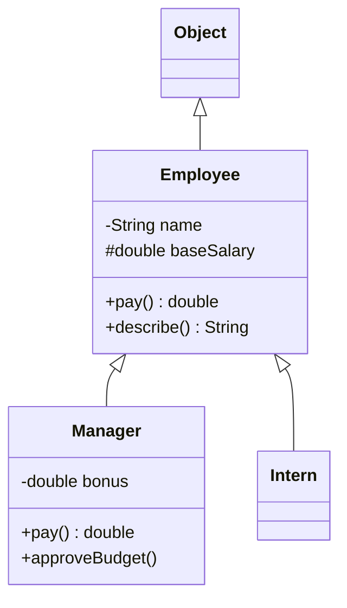

# Chapter 6 — OOP: Inheritance, Interfaces and More

Chapter 5 showed how to build a single class. This chapter is about **relationships between types**: how one class extends another, how different classes share a contract (a promise about which methods a type provides) through interfaces, and how Java calls the right code at runtime (polymorphism). Then it covers the modern type kinds every Java developer now uses daily — **sealed** hierarchies (with a closed list of allowed subtypes), **records** (compact data-carrying classes) and **enums** (types with a fixed set of named constants) — plus nested classes and the three `Object` methods (`equals`, `hashCode`, `toString`) that every class should get right.

This chapter is about the *language mechanics*. For *design* — when to inherit vs compose, SOLID (five classic object-oriented design principles), the Liskov Substitution Principle (a subclass must work anywhere its parent is expected), and patterns (named, reusable design solutions) built on these features — follow the links to the LLD handbook rather than re-reading it here.

**What you'll learn**

1. Inheritance with `extends`, `super(...)` and `super.method()`; what is and isn't inherited.
2. Overriding rules (return types, access, exceptions), `@Override`, and hiding of static methods and fields.
3. Polymorphism and dynamic dispatch; upcasting, downcasting and `instanceof` patterns.
4. Abstract classes and the template-method idea.
5. Interfaces: abstract, `default`, `static` and `private` methods; multiple inheritance of behaviour and conflict resolution.
6. Sealed classes and interfaces (Java 17) with exhaustive `switch`.
7. Records (Java 16): compact constructors, validation, defensive copies.
8. Enums: fields, constructors, per-constant behaviour, `switch`, `EnumSet`/`EnumMap`.
9. Nested, inner, local and anonymous classes (and when a lambda is better).
10. Choosing between abstract classes, interfaces, records and enums.
11. `equals`/`hashCode`/`toString` and their contracts.

All runnable code is in [`code/`](code/) (package `ch06.*`), compiled with `javac --release 25` and run on JDK 26.

> **Exam depth.** Overriding vs hiding puzzles, abstract-class rules and constructor chains: [OCP Chapter 6 — Class design](../../../../ocp-java21-study/chapters/06-class-design/README.md). Interfaces, enums, sealed types, records, nested classes, polymorphism and casting traps: [OCP Chapter 7 — Beyond classes](../../../../ocp-java21-study/chapters/07-beyond-classes/README.md).

---

## 6.1 Inheritance and `super`

### What it is
**Inheritance** lets a new class (the **subclass**, child or derived class) be defined as an extension of an existing class (the **superclass**, parent or base class). The subclass automatically gets the parent's accessible fields and methods, can add new ones, and can **override** (replace) inherited methods. It models an **"is-a"** relationship: a `Manager` *is an* `Employee`.

Analogy: a new car model built on an existing platform. It keeps the chassis and engine (inherited members), adds a sunroof (new members), and retunes the suspension (overridden methods).

### How it works
1. Declare with `extends`: `class Manager extends Employee`. Java allows **one** direct superclass (single inheritance of classes).
2. Every class without `extends` implicitly extends **`java.lang.Object`**, so every class has `toString`, `equals`, `hashCode`, `getClass` and friends.
3. **Constructors are not inherited.** Each subclass constructor must initialise the parent part first by calling a superclass constructor with **`super(args)`**. If you don't write one, the compiler inserts `super()` — which fails to compile if the parent has no no-argument constructor.
4. **`super.method()`** calls the parent's version of an overridden method — handy for extending rather than replacing behaviour.
5. **What the subclass can use:** `public` and `protected` members always; package-private members only if it's in the same package. `private` members exist inside the object but are not accessible — use the parent's public/protected methods to reach them.
6. A class marked **`final`** cannot be extended (`String`, `Integer`, records).

```java
// code/ch06/inheritance/InheritanceDemo.java (key parts)
static class Employee {
    private final String name;              // private: not accessible in subclasses
    protected double baseSalary;            // protected: accessible in subclasses
    Employee(String name, double baseSalary) { this.name = name; this.baseSalary = baseSalary; }
    String getName() { return name; }
    double pay() { return baseSalary; }
    String describe() { return getName() + " earns " + pay(); }
}

static class Manager extends Employee {     // Manager IS-AN Employee
    private final double bonus;
    Manager(String name, double baseSalary, double bonus) {
        super(name, baseSalary);            // initialise the Employee part first
        this.bonus = bonus;
    }
    @Override double pay() { return super.pay() + bonus; }   // extend the parent's version
    void approveBudget() { System.out.println(getName() + " approved the budget"); }
}

static class Intern extends Employee {
    Intern(String name) { super(name, 1_000); }              // inherits pay() unchanged
}
```

Output:
```text
Ana earns 3000.0
Bo earns 6500.0
Cy earns 1000.0
Bo approved the budget
m instanceof Employee? true, superclass of Manager: Employee, superclass of Employee: Object
```

Note line 2: `describe()` is written once in `Employee`, but for a `Manager` it calls `Manager.pay()`. That's **dynamic dispatch** (§6.3–6.4) — the heart of polymorphism.



### Trade-offs — inheritance vs composition
| | Inheritance (`extends`) | Composition (hold a reference to another object) |
|---|---|---|
| Relationship | is-a | has-a / uses-a |
| Coupling (how strongly one piece of code depends on another) | Tight: subclass depends on parent's implementation details | Loose: depends only on the other object's public API (the methods it exposes) |
| Flexibility | Fixed at compile time; one parent only | Can swap the part at runtime; combine many |
| Risk | **Fragile base class** — a change in the parent can break subclasses | Some forwarding boilerplate (repetitive code that just passes calls on) |

*Effective Java* Item 18 — "favour composition over inheritance" — and Item 19 — "design and document for inheritance or else prohibit it" (make classes `final` unless designed for extension). The full treatment, with worked examples, is in [LLD §2.11 Composition over inheritance](../../../lld/chapters/02-oop-fundamentals/README.md#211-composition-over-inheritance) and [LLD §3.6 Generalization](../../../lld/chapters/03-relationships-and-uml/README.md#36-generalization-inheritance).

### When not to use it
- Only to reuse code, when the "is-a" sentence is false (`Stack extends Vector` — `Vector` is an old, synchronised list class — in the JDK is the classic regret: a stack exposes `insertElementAt`).
- When a subclass would need to *disable* inherited behaviour (throwing `UnsupportedOperationException` from overrides is a Liskov violation — [LLD §4.8](../../../lld/chapters/04-solid-principles/README.md#48-liskov-substitution-principle-lsp)).
- Across package/team boundaries on classes not designed for it.

### Common mistakes
- Parent has only `Employee(String, double)`; subclass constructor forgets `super(...)` → "constructor Employee in class Employee cannot be applied to given types".
- Expecting to access a parent's `private` field from the child.
- Deep hierarchies (5+ levels) — hard to follow; prefer shallow hierarchies plus interfaces.

### Self-check
1. How many classes can a class extend directly? → One.
2. Are constructors inherited? → No; each subclass constructor calls one via `super(...)` (explicitly or implicitly).
3. What is the superclass of a class with no `extends`? → `java.lang.Object`.

### TL;DR
`extends` = is-a, single parent, everything ultimately extends `Object`. `super(...)` builds the parent part first; `super.m()` reuses the parent's method. Prefer composition unless the class is designed for extension.

---

## 6.2 What a subclass gets — members, hiding and `Object`

A quick reference of what inheritance does with each kind of member:

| Member in parent | In the subclass |
|---|---|
| `public` / `protected` instance method | Inherited; may be **overridden** |
| package-private instance method | Inherited only if subclass is in the same package |
| `private` method | Not inherited (a same-named method in the child is a *new* method, not an override) |
| `final` method | Inherited; cannot be overridden |
| `static` method | Inherited (callable via the subclass name); a same-signature static method in the child **hides** it |
| Field (static or instance) | Inherited if accessible; a same-named field in the child **hides** it (both exist) |
| Constructor | **Never** inherited |
| Static/instance initialiser blocks | Not inherited; the parent's still run during construction ([Chapter 5 §5.10](../05-oop-classes-and-objects/README.md#510-initialisation-order)) |

`java.lang.Object` gives every class these methods:

| Method | Purpose | Override? |
|---|---|---|
| `toString()` | Text form; default `ClassName@hexHash` | Usually yes (§6.13) |
| `equals(Object)` | Logical equality; default is identity (`==`, "the very same object") | For value-like classes (§6.13) |
| `hashCode()` | Hash (an `int` used to place objects) for `HashMap`/`HashSet` (hash-based lookup collections); must match `equals` | Whenever you override `equals` |
| `getClass()` | Runtime class object | `final`, can't |
| `clone()` | Field-by-field copy (needs the `Cloneable` marker interface) | Rarely; prefer copy constructors (constructors that copy another instance)/factories (*Effective Java*, Item 13) |
| `wait()`, `notify()`, `notifyAll()` | Low-level thread (independent path of execution) coordination | `final`; see [Chapter 14](../14-concurrency-1/README.md) |
| `finalize()` | Cleanup before GC (garbage collection) | Deprecated for removal (JEP 421, Java 18) — use try-with-resources / `Cleaner` |

---

## 6.3 Overriding

### What it is
**Overriding** means a subclass provides its own implementation of an inherited **instance** method with the **same signature** (same name and parameter types). At runtime, the JVM calls the version that belongs to the object's **actual (runtime) class**, not the variable's declared type. This is **dynamic dispatch**, also called *runtime polymorphism* (contrast with overloading, which is resolved at compile time — [Chapter 4 §4.3](../04-methods-and-arrays/README.md#43-overloading)).

### The rules
For `Dog.m` to override `Animal.m`:

| # | Rule | Example that fails |
|---|---|---|
| 1 | Same name and same parameter types | `speak(String)` vs `speak()` is an overload, not an override |
| 2 | Return type the same, or a **subtype** (covariant return — a more specific return type) for reference types; identical for primitives | Returning `Object` where parent returns `Animal` |
| 3 | Access **the same or wider** (`protected` → `public` is fine) | `private Dog reproduce()` overriding a `protected` method |
| 4 | Checked exceptions (ones the compiler forces callers to handle): none new, none broader (fewer or narrower is fine); unchecked (`RuntimeException` and its subclasses) are unrestricted | Parent throws `IOException`, child declares `Exception` |
| 5 | Can't override `final` methods | `String dna()` when parent's is `final` |
| 6 | `static` methods are **hidden**, not overridden; `private` methods aren't inherited at all | — |
| 7 | An instance method cannot "override" a static one, or vice versa | compile error |

Always write **`@Override`** (an annotation — a marker the compiler reads) — the compiler then *checks* that you really override something. Without it, a typo (`tostring()`) or a wrong parameter type (`equals(Book)` instead of `equals(Object)`) silently creates a new method.

```java
// code/ch06/overriding/OverridingRules.java (key parts)
static class Animal {
    protected Animal reproduce() { return new Animal(); }
    void speak() throws IOException { System.out.println("..."); }
    static String kind() { return "Animal (static)"; }
    String name = "animal field";
    final String dna() { return "ATGC"; }
}
static class Dog extends Animal {
    @Override public Dog reproduce() { return new Dog(); }    // covariant return + wider access
    @Override void speak() { System.out.println("Woof"); }    // throws fewer checked exceptions
    static String kind() { return "Dog (static)"; }           // HIDES Animal.kind()
    String name = "dog field";                                // HIDES Animal.name
    // String dna() {...}        -> compile error: final
    // private Dog reproduce()   -> compile error: weaker access
}

static class Base {
    Base() { init(); }                      // calls an overridable method: dangerous
    void init() { }
}
static class Derived extends Base {
    private String label = "ready";
    @Override void init() { System.out.println("Derived.init sees label = " + label); }
}

Animal a = new Dog();                       // declared type Animal, runtime type Dog
a.speak();
System.out.println("reproduce() -> " + a.reproduce());
System.out.println("a.kind()    -> " + a.kind() + "   (static method: picked by the declared type)");
System.out.println("Dog.kind()  -> " + Dog.kind());
System.out.println("a.name      -> " + a.name + " (fields use the STATIC type)");
System.out.println("((Dog) a).name -> " + ((Dog) a).name);
new Derived();
```

Output:
```text
Woof
reproduce() -> Dog
a.kind()    -> Animal (static)   (static method: picked by the declared type)
Dog.kind()  -> Dog (static)
a.name      -> animal field (fields use the STATIC type)
((Dog) a).name -> dog field
Derived.init sees label = null
```

What it shows:
- **Instance methods** are chosen by the **runtime** type (`Woof`).
- **Static methods and fields** are chosen by the **declared (compile-time)** type — that is *hiding*. Calling a static method through an instance (`a.kind()`) compiles, but is misleading; always call statics via the class name.
- **Never call overridable methods from a constructor.** `Base()` called `Derived.init()` *before* `Derived`'s field initialiser ran, so `label` was still `null` (see the initialisation order in [Chapter 5 §5.10](../05-oop-classes-and-objects/README.md#510-initialisation-order)). *Effective Java*, Item 19. Make such methods `private`, `final` or `static`.

### Common mistakes
- Overloading by accident: `public boolean equals(Book b)` does **not** override `equals(Object)`; `HashSet` will never call it. `@Override` catches this.
- Expecting field access to be polymorphic — it isn't; that's another reason fields should be private.
- Narrowing access in an override, or adding a checked exception.

### In the interview
**30-second answer:** "Overriding is a subclass redefining an inherited instance method with the same signature; the JVM picks the implementation from the object's runtime class — dynamic dispatch. The override may return a subtype, must not reduce visibility or add broader checked exceptions, and can't override final methods. Static methods and fields are hidden, not overridden — they're resolved by the declared type. I always use @Override."

- *Follow-up: Overloading vs overriding?* → Overloading: same name, different parameters, same or related class, chosen at compile time by argument types. Overriding: same signature in a subclass, chosen at runtime by object type.
- *Follow-up: Can you override a private method?* → No. It isn't inherited; a same-named method in the subclass is unrelated.

### Self-check
1. Parent: `Number get()`. Child: `Integer get()` — legal? → Yes, covariant return.
2. Parent: `public void run()`. Child: `void run()` — legal? → No, package-private is narrower than public.
3. `Animal a = new Dog(); a.name` — which field? → `Animal`'s: fields use the declared type.

### TL;DR
Override = same signature, compatible return, same-or-wider access, no broader checked exceptions, `@Override`. Instance methods dispatch on runtime type; statics and fields on declared type. Don't call overridable methods from constructors.

---

## 6.4 Polymorphism and casting

### What it is
**Polymorphism** ("many forms") means one piece of code can work with objects of many different classes through a common supertype (a parent class or interface they all share), and each object responds in its own way. You write `shape.area()` once; circles, rectangles and squares each compute their own area.

Key vocabulary:
- **Declared (static) type** — the type of the variable: `Shape s`.
- **Runtime (dynamic) type** — the class of the actual object: `new Circle(1)`.
- **Upcasting** — treating a subclass object as its supertype (`Shape s = new Circle(1)`). Always safe, always implicit.
- **Downcasting** — treating a supertype reference as a subtype (`(Rect) s`). Needs an explicit cast and is **checked at runtime**; wrong casts throw `ClassCastException`.

### How it works
1. The compiler decides **which methods you may call** from the declared type: `s.side()` doesn't compile if `s` is a `Shape`, even if the object is a `Square`.
2. The JVM decides **which implementation runs** from the runtime type (dynamic dispatch).
3. To use subtype-only methods, check and cast. Since Java 16 the idiomatic way is **pattern matching for `instanceof`**: `if (s instanceof Square sq) { sq.side(); }` — the test and the cast in one step, with a new *pattern variable* `sq` in scope only where the test is true (flow-scoping rules: [Chapter 3 §3.5](../03-control-flow/README.md#35-pattern-matching-for-instanceof-java-16)).
4. The compiler rejects casts that can *never* succeed (e.g. `(String) someInteger` between unrelated classes); casts that *might* succeed are compiled and checked at runtime.

```java
// code/ch06/polymorphism/Shapes.java (key parts)
static class Shape  { double area() { return 0; } String name() { return getClass().getSimpleName(); } }
static class Circle extends Shape { final double r; ... @Override double area() { return Math.PI * r * r; } }
static class Rect   extends Shape { final double w, h; ... @Override double area() { return w * h; } }
static class Square extends Rect  { Square(double side) { super(side, side); } double side() { return w; } }

List<Shape> shapes = List.of(new Circle(1), new Rect(2, 3), new Square(2));   // upcasting
for (Shape s : shapes) System.out.printf("%-6s area = %.2f%n", s.name(), s.area());

Shape s = shapes.get(2);
// s.side();              -> compile error: Shape has no side()
if (s instanceof Square sq) System.out.println("pattern variable: side = " + sq.side());
Rect r = (Rect) s;                               // downcast: OK, a Square is a Rect
Circle c = (Circle) s;                           // compiles, ClassCastException at runtime
```

Output:
```text
Circle area = 3.14
Rect   area = 6.00
Square area = 4.00
total = 13.14
pattern variable: side = 2.0
downcast to Rect ok: w=2.0
ClassCastException: class ch06.polymorphism.Shapes$Square cannot be cast to class ch06.polymorphism.Shapes$Circle
```

### Why it matters
Polymorphism is what makes code **open for extension**: add a `Triangle` class and the loop works unchanged. This is the Open/Closed Principle (code should be open to extension but closed to modification) and the basis of most design patterns (Strategy, State, Command…) — see [LLD §2.6 Polymorphism](../../../lld/chapters/02-oop-fundamentals/README.md#26-polymorphism-and-the-full-bank-example) and [LLD §4.7 OCP](../../../lld/chapters/04-solid-principles/README.md#47-openclosed-principle-ocp).

### When not to use casting
Chains of `if (x instanceof A) … else if (x instanceof B) …` over an *open* hierarchy are usually a sign the behaviour belongs in an overridden method. The modern exception: a **sealed** hierarchy with a `switch` over patterns (§6.7), where the compiler checks that every case is handled.

### Common mistakes
- Downcasting without checking → `ClassCastException`.
- Using the pattern variable outside its scope: in `if (!(s instanceof Square sq)) return; sq.side();` the variable *is* in scope after the `if` (flow scoping), but in an `else` branch of a positive test it isn't.
- Calling subtype methods on a supertype variable and being surprised it won't compile — the compiler only knows the declared type.

### Self-check
1. Which type decides what methods you may call? Which decides what code runs? → Declared type; runtime type.
2. Does `Object o = "hi"; Integer i = (Integer) o;` compile? Run? → Compiles; throws `ClassCastException`.
3. What does `x instanceof Foo f` do when `x` is `null`? → Evaluates to `false`; `instanceof` is never true for `null`.

### TL;DR
Code against the supertype; the runtime type picks the implementation. Upcasts are free; downcasts are checked — prefer `instanceof` patterns, and prefer overriding to type checks.

---

## 6.5 Abstract classes

### What it is
An **abstract class** is a class marked `abstract` that **cannot be instantiated** and may contain **abstract methods** — methods declared without a body, which concrete subclasses must implement. It's a *partially built* class: shared state and code live in it; the missing pieces are left to subclasses.

Analogy: a form template with some fields pre-printed (shared code) and some blank boxes (abstract methods) that each department fills in.

### How it works
1. `abstract class Report { … }` — `new Report()` is a compile error.
2. `protected abstract String body();` — no braces; ends with `;`.
3. A class with **any** abstract method must itself be declared `abstract`. An abstract class may also have **zero** abstract methods (just to prevent instantiation).
4. The first **concrete** (non-abstract) subclass must implement every inherited abstract method; an abstract subclass may leave them for later.
5. Abstract classes can have everything a normal class has: fields (including mutable state), constructors (called via `super(...)` from subclasses), static members, `final` methods.
6. `abstract` cannot be combined with `final` (can't be extended), `private` (can't be overridden) or `static` on a method.

A classic use is the **Template Method** pattern: a `final` method fixes the skeleton of an algorithm and calls abstract "steps" that subclasses fill in.

```java
// code/ch06/abstracts/AbstractDemo.java (key parts)
static abstract class Report {
    private final String title;
    protected Report(String title) { this.title = title; }
    public final String render() { return header() + "\n" + body() + "\n" + footer(); }   // template method
    protected String header() { return "== " + title + " =="; }   // default step
    protected abstract String body();                             // required step
    protected String footer() { return "-- end --"; }
}
static class SalesReport extends Report {
    private final int units;
    SalesReport(int units) { super("Sales"); this.units = units; }
    @Override protected String body() { return "units sold: " + units; }
}
static class AuditReport extends Report {
    AuditReport() { super("Audit"); }
    @Override protected String body() { return "no issues found"; }
    @Override protected String footer() { return "-- signed: auditor --"; }
}

Report[] reports = { new SalesReport(42), new AuditReport() };
for (Report r : reports) System.out.println(r.render());
Report adHoc = new Report("Ad hoc") {                  // anonymous subclass (§6.11)
    @Override protected String body() { return "one-off content"; }
};
```

Output:
```text
== Sales ==
units sold: 42
-- end --
== Audit ==
no issues found
-- signed: auditor --
== Ad hoc ==
one-off content
-- end --
```

### Real-world examples
`java.util.AbstractList` (implement `get` and `size`, get a whole `List`), `java.io.InputStream` (implement `read()`), `HttpServlet` (the base class for handling web requests; override `doGet`/`doPost`). Template Method in depth: [LLD §11.4 Template Method](../../../lld/chapters/11-patterns-behavioral-2/README.md#114-template-method).

### Self-check
1. Can an abstract class have a constructor? → Yes; subclasses call it with `super(...)`.
2. Can a class be `abstract` with no abstract methods? → Yes.
3. Can an abstract method be `private`? → No — nobody could implement it.

### TL;DR
Abstract class = shared state + shared code + abstract "holes"; can't be instantiated; subclasses fill the holes. Great for template methods and skeletal implementations.

---

## 6.6 Interfaces

### What it is
An **interface** is a named **contract**: a set of method signatures that implementing classes promise to provide. A class `implements` any number of interfaces; code can then depend on the interface type instead of a concrete class ("program to an interface" — [LLD principle 7](../../../lld/chapters/05-design-principles/README.md#7-program-to-an-interface-not-an-implementation)).

Analogy: a power socket standard. Any appliance with the right plug (implementation) works with any socket (caller) — neither needs to know the other's internals.

### What an interface may contain

| Member | Since | Implicit modifiers | Notes |
|---|---|---|---|
| Abstract method | Java 1.0 | `public abstract` | The contract; implementing classes must provide it |
| Constant field | 1.0 | `public static final` | Must be initialised; interfaces have **no instance fields** |
| `default` method | Java 8 | `public` | Has a body; inherited by implementers, which may override it. Lets APIs evolve without breaking implementers (e.g. `List.sort`, `Collection.stream`) |
| `static` method | Java 8 | `public` (if not marked `private`) | Called as `InterfaceName.m()` only — **not** inherited by implementing classes |
| `private` method (instance or static) | Java 9 | — | Helper for default/static methods; not visible outside |
| Nested types | 1.0 | `public static` | e.g. `Map.Entry` |

No constructors, no instance state. An interface can `extend` several other interfaces.

### How it works
1. Declare: `interface Payable { double amount(); }`.
2. Implement: `class Invoice implements Payable, Printable, Shippable { … }` — must implement all abstract methods (or be `abstract`). Implementations must be `public` (the interface methods are public).
3. Use the interface as a type: `List<Payable> bills`.
4. An interface with **exactly one abstract method** is a **functional interface** and can be implemented by a **lambda** (a short inline function, `() -> value`) — details in [Chapter 11](../11-lambdas-and-functional-programming/README.md). `@FunctionalInterface` asks the compiler to check this.

### Multiple inheritance and the diamond rules
The name comes from the *diamond* shape you get when one class inherits the same method along two different paths.
A class can inherit the same default method from two interfaces. Java resolves conflicts with three rules:
1. **Classes win.** A method declared in the class or any superclass beats any interface default.
2. **More specific interface wins.** If `B extends A` and both define `m()`, `B`'s version wins.
3. **Otherwise it's a compile error** until the class overrides the method. Inside the override, call a specific parent with **`InterfaceName.super.m()`**.

```java
// code/ch06/interfaces/InterfacesDemo.java (key parts)
interface Payable {
    double TAX_RATE = 0.2;                            // public static final
    double amount();                                  // public abstract
    default double amountAfterTax() { return round(amount() * (1 - TAX_RATE)); }   // Java 8
    static Payable of(double value) { return () -> value; }                       // Java 8, lambda
    private static double round(double v) { return Math.round(v * 100) / 100.0; } // Java 9
}
interface Printable { default String label() { return "printable"; } }
interface Shippable { default String label() { return "shippable"; } }

static class Invoice implements Payable, Printable, Shippable {
    private final double total;
    Invoice(double total) { this.total = total; }
    @Override public double amount() { return total; }
    @Override public String label() {                 // conflict: must override
        return Printable.super.label() + "+" + Shippable.super.label();
    }
}

bills.add(new Invoice(100));
bills.add(Payable.of(59.99));
bills.add(new Payable() {                             // anonymous implementation
    public double amount() { return 10; }
    public double amountAfterTax() { return 10; }     // overrides the default
});
```

Output:
```text
100.0 -> after tax 80.0
59.99 -> after tax 47.99
10.0 -> after tax 10.0
label: printable+shippable, TAX_RATE = 0.2
Invoice is a Printable? true
```

### Real-world examples
`Comparable<T>`, `Comparator<T>`, `Runnable`, `AutoCloseable` (try-with-resources), `Iterable<T>` (for-each), `List`/`Set`/`Map` ([Chapter 10](../10-collections/README.md)), `java.util.function.*` ([Chapter 11](../11-lambdas-and-functional-programming/README.md)). JDBC (Java Database Connectivity, the standard database API) is almost entirely interfaces (`Connection`, `ResultSet`) implemented by each database driver (the library that talks to one specific database product).

### Common mistakes
- Implementing an interface method with default (package) access → "attempting to assign weaker access privileges; was public".
- Trying to call an interface's static method through an implementing class or instance (`invoice.of(1)`) — static interface methods aren't inherited.
- Using an interface only to hold constants ("constant interface" anti-pattern — a common but harmful practice — *Effective Java* Item 22) — use a final class or an enum.
- Putting state-like logic into default methods; defaults can't hold state and are meant for convenience/evolution.

### Self-check
1. Can an interface have a constructor? Instance fields? → No and no.
2. Two interfaces both provide `default void hello()`; a class implements both. What happens? → Compile error until the class overrides `hello()`; it may call `A.super.hello()`.
3. Is an interface's `static` method inherited by implementing classes? → No.

### TL;DR
Interfaces = contracts. Abstract + constants + `default` (8) + `static` (8) + `private` (9) methods, no state. Many per class. Conflicts: class wins → more specific interface wins → else override and use `X.super.m()`.

---

## 6.7 Sealed classes and interfaces (Java 17)

### What it is
A **sealed** class or interface restricts **which** classes may extend or implement it, using a `permits` clause. It was finalised in **Java 17 (JEP 409)**. Sealing lets you model "a `Shape` is exactly a `Circle`, a `Rectangle` or a `Polygon` — nothing else", and lets the compiler use that knowledge.

Analogy: a club with a fixed guest list. The bouncer (compiler) knows everyone who can possibly be inside.

### Why it matters
- Between "anyone may extend" (normal class) and "nobody may extend" (`final`), sealing gives a **closed, known set** of subtypes — ideal for domain (the real-world area the software models) concepts like payment methods, AST (abstract syntax tree — the tree a compiler builds from code) nodes, or API results (`Success | Failure`).
- It makes **`switch` over patterns exhaustive**: if every permitted subtype is handled, no `default` is needed — and if you later add a subtype, every non-exhaustive `switch` fails to compile, pointing you at the code to update.

### How it works
1. Declare: `sealed interface Shape permits Circle, Rectangle, Polygon {}` (or `sealed class`).
2. Each permitted subclass must directly extend/implement it and must be exactly one of:
   - **`final`** — no further subclasses (records and enums are implicitly final),
   - **`sealed`** — with its own `permits` list,
   - **`non-sealed`** — reopens the hierarchy below it to any subclass.
3. Permitted subclasses must be in the **same module** (a named group of packages under the Java module system) — or, if the code is not in a named module, in the **same package**.
4. If all subclasses are in the same source file, the `permits` clause can be omitted; the compiler infers it.
5. Combine with **records** (§6.8) and **pattern matching for `switch`** (Java 21, JEP 441) including **record patterns** (Java 21, JEP 440) — see [Chapter 3](../03-control-flow/README.md) for the `switch` syntax.

```java
// code/ch06/sealed/SealedDemo.java (key parts)
sealed interface Shape permits Circle, Rectangle, Polygon {}
record Circle(double radius) implements Shape {}                 // implicitly final
record Rectangle(double w, double h) implements Shape {}
static non-sealed class Polygon implements Shape {               // open again below this point
    final int sides;
    Polygon(int sides) { this.sides = sides; }
}
static final class Triangle extends Polygon { Triangle() { super(3); } }

static String describe(Shape s) {
    return switch (s) {                                          // exhaustive: no default needed
        case Circle c                                  -> "circle r=" + c.radius();
        case Rectangle(double w, double h) when w == h -> "square " + w;          // record pattern + guard
        case Rectangle(double w, double h)             -> "rectangle " + w + "x" + h;
        case Polygon p                                 -> p.sides + "-sided polygon";
    };
}
```

Output:
```text
circle r=1.5
square 2.0
rectangle 2.0x5.0
3-sided polygon
Shape is sealed? true, permitted: 3
```

Sealed interfaces + records give Java **algebraic data types** (types built by combining "and" and "or"): records are the "and" (a rectangle has a width *and* a height), sealed interfaces are the "or" (a shape is a circle *or* a rectangle *or* …). This style is sometimes called *data-oriented programming*.

### Trade-offs
| Use sealed when… | Avoid when… |
|---|---|
| The set of variants is part of the domain and changes rarely | You're building an extension point for other teams/plugins (they can't add subtypes) |
| You want exhaustive `switch` checks | New variants are added often and callers shouldn't need updates — then prefer overriding methods (classic polymorphism) |

### Self-check
1. What three modifiers can a permitted subclass have? → `final`, `sealed` or `non-sealed`.
2. Why doesn't the `switch` in `describe` need a `default`? → The compiler knows all permitted subtypes and each is covered.
3. When can you omit `permits`? → When all permitted subclasses are declared in the same source file.

### TL;DR
`sealed … permits A, B, C` = closed set of subtypes (Java 17). Subtypes are `final`/`sealed`/`non-sealed`. Pair with records and pattern `switch` for exhaustive, compiler-checked handling.

---

## 6.8 Records

### What it is
A **record** (Java 16, JEP 395) is a special kind of class for **transparent, immutable data carriers** (their data is fully visible and can't change after creation). You declare the **components** in the header; the compiler generates the rest:

`record Point(int x, int y) {}` gives you:
1. `private final` fields `x` and `y`,
2. a **canonical constructor** `Point(int x, int y)`,
3. **accessor** methods `x()` and `y()` (no `get` prefix),
4. `equals` and `hashCode` based on all components,
5. `toString()` like `Point[x=3, y=4]`.

What would be ~40 lines of a hand-written immutable class (like `Money` in [Chapter 5 §5.9](../05-oop-classes-and-objects/README.md#59-immutability-basics)) becomes one line.

### Rules
| Records can | Records cannot |
|---|---|
| Implement interfaces | Extend another class (they implicitly extend `java.lang.Record`) |
| Declare static fields and methods, static factories | Declare **instance** fields beyond the components |
| Declare instance methods | Be extended — they're implicitly `final` |
| Add constructors — which must delegate to the canonical one with `this(...)` | Have setters that change components (fields are `final`) |
| Override any generated member (`toString`, accessor, `equals`) | Be `abstract` |
| Be nested (implicitly `static`) or **local** inside a method | |
| Be generic (take type parameters such as `<A, B>`): `record Pair<A, B>(A first, B second) {}` | |

### How it works — the compact constructor
To validate or normalise (convert to a standard form), write a **compact canonical constructor**: the record name with **no parameter list**. Its parameters are implicit, and the fields are assigned automatically **after** its body runs. You can reassign the *parameters* (e.g. to make a defensive copy — a private copy of a mutable input so outside changes can't affect the record), but you don't assign `this.x` yourself.

```java
// code/ch06/records/RecordsDemo.java (key parts)
record Point(int x, int y) {
    static final Point ORIGIN = new Point(0, 0);
    Point translate(int dx, int dy) { return new Point(x + dx, y + dy); }
    double distanceTo(Point o) { return Math.hypot(x - o.x, y - o.y); }
}

record Range(int start, int end) {
    Range {                                                // compact canonical constructor
        if (start > end) throw new IllegalArgumentException(start + " > " + end);
    }
    Range(int single) { this(single, single); }            // extra constructors must delegate
    int length() { return end - start; }
}

record Team(String name, List<String> members) {
    Team { members = List.copyOf(members); }               // defensive copy: reassign the PARAMETER
}

record Temperature(double celsius) {
    @Override public String toString() { return celsius + "°C"; }
    static Temperature ofFahrenheit(double f) { return new Temperature((f - 32) * 5 / 9); }
}

// inside main
record Pair(String key, int count) {}                     // local record
```

Output:
```text
Point[x=3, y=4] x=3 dist=5.0 moved=Point[x=4, y=5]
equals by value: true, set size: 1
Range[start=2, end=7] length 5, Range[start=5, end=5]
rejected: 9 > 1
Team[name=Core, members=[Ana, Bo]] (unchanged by the caller's add)
100.0°C
local record: [Pair[key=a, count=1]]
```

### Why it matters / Real-world examples
DTOs (data transfer objects) for REST APIs (web services that expose resources at URLs and use HTTP verbs such as GET and POST — see [System Design Fundamentals](../../../system-design-patterns/modules/00-system-design-fundamentals/README.md)), query results, map keys (`record CacheKey(String user, LocalDate day)`), multiple return values (`record MinMax(int min, int max)`), events and messages, and the "and" half of sealed hierarchies. Jackson (≥ 2.12; a JSON library) serialises (converts to and from text) records; Spring Boot (a popular application framework) binds configuration to them.

### Trade-offs — record vs regular class
| Choose a record when… | Choose a class when… |
|---|---|
| The type *is* its data: two instances with equal components are interchangeable | Objects have identity and a lifecycle (a `BankAccount`, a `User` session) |
| Immutable is fine | You need mutable state or JPA entities (objects that JPA, the Java Persistence API, maps to database tables; JPA requires a no-arg constructor and non-final fields) |
| All components should be public via accessors | You need to hide the representation |

### Common mistakes
- Believing records are **deeply** immutable. Components are final references; a `List` or array component can still be mutated unless you copy it (`List.copyOf`) in the compact constructor. Arrays in records also break value-equality (arrays use identity `equals`).
- Assigning `this.start = start` inside a compact constructor — compile error; assign the parameter instead, or nothing.
- Writing `getX()` out of habit — the accessor is `x()`.

### In the interview
**30-second answer:** "A record is a final, immutable data carrier (Java 16). From the component list the compiler generates private final fields, the canonical constructor, accessors, and equals/hashCode/toString based on all components. I use a compact constructor for validation and defensive copies. Records can implement interfaces and have static members and methods, but can't extend classes or add instance fields. They pair with sealed interfaces and record patterns for data-oriented code."

- *Follow-up: Are records deeply immutable?* → Only if their components are; copy mutable components in the compact constructor.
- *Follow-up: Can a record be a JPA entity?* → Not with standard JPA (needs no-arg constructor and mutable proxies — generated stand-in subclasses); records work well as DTOs/projections (read-only views of selected columns) instead.

### Self-check
1. What's the accessor for component `name`? → `name()`.
2. Where are fields assigned when you use a compact constructor? → Automatically, after the compact constructor body.
3. Can a record extend another record? → No; records are final and implicitly extend `java.lang.Record`.

### TL;DR
`record R(a, b) {}` = final immutable data class with constructor, accessors, `equals`/`hashCode`/`toString`. Validate and copy in the compact constructor. Not deeply immutable by default.

---

## 6.9 Enums

### What it is
An **enum** (enumerated type, Java 5) is a class with a **fixed set of named instances** — its constants — created once when the enum class initialises: `enum Day { MON, TUE, … }`. Each constant is a full object (a singleton — the one and only instance — of its kind), so enums can have fields, constructors, methods, and even per-constant behaviour.

Analogy: a restaurant menu printed once. The dishes are fixed; you can't invent a new dish at the table, but each dish carries its own price and description.

### Why it matters
Compared to `int` or `String` constants (`static final int MONDAY = 0`):
- **Type safety** — a method taking `Day` can't be passed `42` or `"Mnday"`.
- **Namespaced, printable** — `Day.MON` prints `MON`.
- **Can carry data and behaviour** — a `Planet` knows its mass; an `Operation` knows how to apply itself.
- **Safe with `==`** — each constant exists exactly once (per class loader, the JVM component that loads classes).
- **Great tooling** — `switch`, `EnumSet`, `EnumMap`.

### How it works
1. Every enum implicitly extends `java.lang.Enum`, so it **can't extend another class**, but it **can implement interfaces**.
2. Constants are listed first, separated by commas; if anything follows, end the list with `;`.
3. Constructors are implicitly **private** — you can't `new` an enum. Each constant's arguments are passed to it: `EARTH(5.976e+24, 6.37814e6)`.
4. Built-in methods:

| Method | Returns |
|---|---|
| `values()` (static) | A **new** array of all constants in declaration order |
| `valueOf(String)` (static) | Constant with that exact name, or `IllegalArgumentException` |
| `name()` | The declared name (`"FRI"`) — use this for persistence (saving to a database or file) rather than `toString`, which can be overridden |
| `ordinal()` | Zero-based position — don't persist or rely on it (*Effective Java* Item 35); reordering constants changes it |
| `compareTo(e)` | Order by ordinal (enums are `Comparable`, i.e. have a natural order) |

5. **Constant-specific bodies:** a constant can have its own class body `{ … }` to override methods — commonly implementing an `abstract` method declared in the enum.
6. **`switch`** on an enum uses bare constant names (`case SAT, SUN ->`). A `switch` *expression* must be exhaustive; covering all constants satisfies that without `default`.
7. **`EnumSet`** (bit-vector set — one bit per constant) and **`EnumMap`** (array-backed map) are the fastest, most compact collections for enum keys.
8. A single-element enum is the simplest robust **singleton** (*Effective Java*, Item 3) — safe against reflection (code that inspects and creates objects at run time) and serialisation (turning objects into bytes and back) tricks. See [LLD Singleton](../../../lld/chapters/08-patterns-creational/README.md#88-singleton).

```java
// code/ch06/enums/EnumsDemo.java (key parts)
enum Day { MON, TUE, WED, THU, FRI, SAT, SUN;
    boolean isWeekend() { return this == SAT || this == SUN; }
}
enum Planet {
    MERCURY(3.303e+23, 2.4397e6), EARTH(5.976e+24, 6.37814e6), JUPITER(1.9e+27, 7.1492e7);
    private static final double G = 6.67300E-11;
    private final double mass, radius;
    Planet(double mass, double radius) { this.mass = mass; this.radius = radius; }   // implicitly private
    double surfaceGravity() { return G * mass / (radius * radius); }
}
enum Operation {
    PLUS("+")  { int apply(int a, int b) { return a + b; } },
    TIMES("*") { int apply(int a, int b) { return a * b; } };
    final String symbol;
    Operation(String symbol) { this.symbol = symbol; }
    abstract int apply(int a, int b);
}
static String plan(Day d) {
    return switch (d) {
        case SAT, SUN -> "rest";
        case FRI -> "wrap up";
        case MON, TUE, WED, THU -> "work";
    };
}
EnumSet<Day> weekend = EnumSet.of(Day.SAT, Day.SUN);
EnumSet<Day> weekdays = EnumSet.complementOf(weekend);
Map<Day, Integer> hours = new EnumMap<>(Day.class);
```

Output:
```text
MON(0) TUE(1) WED(2) THU(3) FRI(4) SAT(5)* SUN(6)* 
FRI -> wrap up, compareTo(MON) = 4, == works: true
valueOf("Friday") -> IllegalArgumentException
MERCURY  g =  3.70 m/s^2
EARTH    g =  9.80 m/s^2
JUPITER  g = 24.81 m/s^2
6 + 7 = 13
6 * 7 = 42
weekdays=[MON, TUE, WED, THU, FRI] hours={MON=8, TUE=8, WED=8, THU=8, FRI=6}
```

### Real-world examples
`java.time.DayOfWeek`, `Month`, `ChronoUnit`; `java.util.concurrent.TimeUnit` (each constant converts durations); `RetentionPolicy`; order/state machines (models where something moves between a fixed set of states: `OrderStatus.PLACED → SHIPPED`, see [LLD state machines](../../../lld/chapters/03-relationships-and-uml/README.md#314-state-machine-diagrams)); HTTP methods (`GET`, `POST`… — the verbs of web requests) in web frameworks. Enums with fields and behaviour in design: [LLD §2.10](../../../lld/chapters/02-oop-fundamentals/README.md#210-enums-with-fields-and-behaviour).

### Common mistakes
- Persisting `ordinal()` to a database — inserting a new constant in the middle silently corrupts data. Store `name()` or an explicit code field.
- `valueOf` with user input without handling `IllegalArgumentException` (and case differences).
- Mutable fields in enums — they're global singletons; mutable state there is shared global state.
- Calling `values()` in a hot loop — it allocates a new array each time; cache it in a `static final` field if needed.

### Self-check
1. Can an enum extend a class? Implement an interface? → No; yes.
2. What's wrong with storing `ordinal()`? → It changes when constants are reordered or inserted.
3. Why can you compare enums with `==`? → Each constant is a single instance.

### TL;DR
Enums = fixed set of singleton instances with type safety. They can have fields, private constructors, methods and per-constant bodies. Use `name()` not `ordinal()` for storage; `EnumSet`/`EnumMap` for collections; exhaustive `switch` without `default`.

---

## 6.10 Nested classes: static nested and inner

### What it is
A **nested class** is a class declared inside another class. There are four kinds:

| Kind | Declared | Tied to an outer *instance*? | Typical use |
|---|---|---|---|
| **Static nested class** | As a member, with `static` | No | Helpers that belong with the outer class: `Map.Entry`, builders, `Node` in a linked list |
| **Inner class** (non-static member) | As a member, no `static` | **Yes** — each instance holds a hidden reference to an outer instance | Iterators (objects that step through a collection) and views that read the outer object's state |
| **Local class** | Inside a method/block | Yes if declared in an instance context | One-off helper used only in that method (§6.11) |
| **Anonymous class** | Inside an expression, no name | Yes if in an instance context | One-off implementation of an interface/abstract class (§6.11) |

Nested records, enums and interfaces are always implicitly `static`.

### How it works
1. Nested classes can access **all** members of the enclosing class, including `private` ones — and vice versa.
2. Create a static nested class like any class: `new Outer.Node(...)` (or `new Node(...)` inside `Outer`).
3. Create an inner class **from an outer instance**: `outer.new ReverseIterator()`. Inside an instance method of `Outer`, plain `new ReverseIterator()` uses `this` as the outer instance.
4. Inside an inner class, `this` is the inner object; **`Outer.this`** is the enclosing object — needed when names clash.
5. Since Java 16, inner classes may also declare `static` members.

```java
// code/ch06/nested/NestedDemo.java (key parts)
static class Node {                                   // static nested
    final String value;
    Node(String value) { this.value = value; }
}

private final List<String> items = new ArrayList<>(List.of("a", "b", "c"));
private final String owner;

class ReverseIterator implements Iterator<String> {   // inner: tied to an outer instance
    private int i = items.size() - 1;                 // reads the outer object's field
    public boolean hasNext() { return i >= 0; }
    public String next() { return items.get(i--) + "@" + NestedDemo.this.owner; }
}

Node n = new Node("static nested");
NestedDemo outer = new NestedDemo("list1");
NestedDemo.ReverseIterator it = outer.new ReverseIterator();
```

Output (first two lines):
```text
static nested
c@list1 b@list1 a@list1 
```

### Common mistakes
- **Using an inner class when a static nested one would do.** Every inner instance keeps its outer object alive — a classic **memory leak** (memory that can't be freed because something still references it) when inner objects (listeners, tasks) outlive the outer one. *Effective Java* Item 24: "favour static member classes over nonstatic". Default to `static`.
- Trying `new Outer.Inner()` from a static context without an outer instance → compile error.

---

## 6.11 Local classes, anonymous classes and lambdas

### What it is
- A **local class** is declared inside a method body. It can use the method's **effectively final** local variables (variables never reassigned after initialisation) — it *captures* their values.
- An **anonymous class** is declared and instantiated in a single expression, `new SomeInterface() { … }` or `new SomeClass(args) { … }`. It has no name, so it can't have a constructor and can be used only at that one spot.
- A **lambda** (Java 8) is a compact way to implement a **functional interface** (one abstract method). For that case, it replaces most anonymous classes — see [Chapter 11](../11-lambdas-and-functional-programming/README.md).

```java
// code/ch06/nested/NestedDemo.java (continued)
Supplier<String> counterDescription() {
    int size = items.size();                          // effectively final
    class Describer implements Supplier<String> {     // local class
        public String get() { return owner + " has " + size + " items"; }
    }
    return new Describer();
}

Comparator<String> byLengthAnon = new Comparator<>() {             // anonymous class
    @Override public int compare(String a, String b) { return Integer.compare(a.length(), b.length()); }
};
Comparator<String> byLengthLambda = (a, b) -> Integer.compare(a.length(), b.length());   // lambda
```

Output (remaining lines):
```text
list1 has 3 items
anonymous: [fig, kiwi, banana]
lambda reversed: [banana, kiwi, fig]
```

### Anonymous class vs lambda
| | Anonymous class | Lambda |
|---|---|---|
| Can implement | Any interface (any number of methods) or extend a class (even abstract) | Only a functional interface |
| Can have state (fields) | Yes | No |
| `this` means | The anonymous object | The enclosing instance |
| Verbosity | High | Low |
| Use when | Several methods to implement, extending a class (like `new Report("Ad hoc") {…}` in §6.5), or needing own state | Single-method callbacks (code handed over to be called later), comparators, stream operations |

### Common mistakes
- Modifying a captured local variable (`size++`) inside a local/anonymous class or lambda → "local variables referenced from an inner class must be final or effectively final".
- Serialising anonymous/inner classes — they carry hidden references to the outer instance and synthetic (compiler-generated) names; avoid.

### Self-check (6.10–6.11)
1. Which nested kind has no hidden reference to an outer instance? → Static nested (and nested records/enums/interfaces).
2. How do you refer to the outer object from an inner class when names clash? → `Outer.this`.
3. Can a lambda implement an interface with two abstract methods? → No; use an anonymous class or a named class.

### TL;DR (6.10–6.11)
Static nested = grouping, no outer link (default choice). Inner = tied to an outer instance (`outer.new Inner()`, `Outer.this`). Local and anonymous classes capture effectively final locals; lambdas replace anonymous classes for functional interfaces.

---

## 6.12 Choosing: abstract class, interface, record, enum or plain class

| Need | Reach for | Why |
|---|---|---|
| A capability many unrelated classes share (`Comparable`, `Closeable`) | **Interface** | A class can implement many; no state forced on implementers |
| A contract plus a partial implementation with **shared state** or constructors | **Abstract class** (often implementing an interface) | Interfaces can't hold instance state |
| Evolve a published contract without breaking implementers | Interface **default** method | Added in Java 8 for exactly this |
| A fixed, known set of variants with different data | **Sealed interface + records** | Exhaustive `switch`, compiler-checked |
| A fixed set of instances known at compile time | **Enum** | Type-safe constants with behaviour |
| Immutable data where equal values are interchangeable | **Record** | Minimal code, correct `equals`/`hashCode` |
| Mutable object with identity and lifecycle | **Class** (usually `final` unless designed for extension) | Full control over encapsulation |

Abstract class vs interface in one line: **an interface says what a type *can do*; an abstract class says what a family of classes *is* and shares.** Modern Java style is "interface first", with an optional skeletal abstract class (`AbstractList` alongside `List`, *Effective Java* Item 20). For the design discussion, including ISP (Interface Segregation: keep interfaces small) and DIP (Dependency Inversion: depend on abstractions), see [LLD §2.9 Abstract classes vs interfaces](../../../lld/chapters/02-oop-fundamentals/README.md#29-abstract-classes-vs-interfaces), [LLD §4.9 ISP](../../../lld/chapters/04-solid-principles/README.md#49-interface-segregation-principle-isp) and [LLD §4.10 DIP](../../../lld/chapters/04-solid-principles/README.md#410-dependency-inversion-principle-dip).

### In the interview
**Question: "Abstract class or interface?"**
**30-second answer:** "An interface defines a contract a class can adopt alongside others; since Java 8 it can carry default and static methods, and since 9 private helpers, but never instance state or constructors. An abstract class can have state, constructors and any access level, but a class can extend only one. I start with an interface for the abstraction clients depend on and add an abstract base class only if implementations share real state or code."

- *Follow-up: Why can Java have multiple interface inheritance but not multiple class inheritance?* → Classes carry state and constructors, so multiple parents would create ambiguous state and initialisation (the diamond problem). Interfaces carry no instance state, and default-method conflicts have explicit resolution rules.

---

## 6.13 Object methods: equals, hashCode and toString

### What it is
Every class inherits three methods from `Object` that you'll override constantly:
- **`equals(Object o)`** — "are these two objects *logically* the same?" The default is identity (`this == o`).
- **`hashCode()`** — an `int` summarising the object, used by hash-based collections to pick a bucket (one slot in the collection's internal array). The default is typically derived from identity.
- **`toString()`** — a human-readable description, used by `println`, string concatenation, loggers (libraries that write diagnostic messages) and debuggers. The default is `ClassName@hexHashCode`.

**Identity vs equality:** `a == b` asks "same object in memory?"; `a.equals(b)` asks "same value?". Two `new Book("123", "Dune")` objects are different objects but should be equal.

### The contracts
**`equals`** must be (from the `Object` Javadoc, the official API documentation):
1. **Reflexive**: `x.equals(x)` is true.
2. **Symmetric**: `x.equals(y)` ⇔ `y.equals(x)`.
3. **Transitive**: if `x.equals(y)` and `y.equals(z)`, then `x.equals(z)`.
4. **Consistent**: repeated calls return the same result while the objects don't change.
5. **Non-null**: `x.equals(null)` is false (never throws).

**`hashCode`** must satisfy:
1. **Equal objects ⇒ equal hash codes.** (This is the rule people break.)
2. Unequal objects *may* share a hash code (a collision) — allowed, but fewer collisions = faster maps.
3. Consistent during one execution while the object doesn't change.

**Hence: override `equals` ⇒ override `hashCode`**, using the *same* fields.

### How it works — writing them
1. `if (this == o) return true;` — fast path.
2. `if (!(o instanceof Book other)) return false;` — type check + cast in one (also returns false for `null`).
3. Compare the significant fields: `==` for primitives (`Double.compare`/`Float.compare` for floating point), `equals` for objects, `Objects.equals(a, b)` for nullable ones, `Arrays.equals` for arrays.
4. `hashCode`: `Objects.hash(field1, field2, …)` — simple and correct (it allocates a varargs array; hand-roll `31 * h + …` only in hot paths).
5. `toString`: include the fields that help debugging; never secrets (passwords, tokens).
6. Or use a **record**, which generates all three correctly (§6.8). IDEs can also generate them.

```java
// code/ch06/objectmethods/EqualsHashCode.java (key parts)
static class EqualsOnly {                                   // BROKEN: equals without hashCode
    final String isbn;
    @Override public boolean equals(Object o) { return o instanceof EqualsOnly other && isbn.equals(other.isbn); }
}

static final class Book {                                   // correct
    private final String isbn;
    private final String title;
    @Override public boolean equals(Object o) {
        if (this == o) return true;
        if (!(o instanceof Book other)) return false;
        return isbn.equals(other.isbn) && Objects.equals(title, other.title);
    }
    @Override public int hashCode() { return Objects.hash(isbn, title); }
    @Override public String toString() { return "Book[isbn=" + isbn + ", title=" + title + "]"; }
}
```

Output:
```text
NoEquals:   equals=false, toString=ch06.objectmethods.EqualsHashCode$NoEquals@<hash>
EqualsOnly: equals=true, set.contains(equal copy)=false  <- hashCode not overridden
Book:       equals=true, same hash=true, set.contains(equal copy)=true, == false
toString:   Book[isbn=123, title=Dune]
equals(null)=false, Objects.equals(null, null)=true
```

Line 2 is the classic bug: the two `EqualsOnly` objects are `equals`, but their default hash codes differ, so `HashSet` looks in the wrong bucket and never even calls `equals`. How `HashMap` uses `hashCode` then `equals` is explained in [Chapter 10](../10-collections/README.md).

### `instanceof` or `getClass()` in equals?
| | `instanceof` (used above) | `getClass() != o.getClass()` |
|---|---|---|
| Subclass instance equal to parent instance? | Can be | Never |
| Risk | Breaks symmetry/transitivity if a subclass adds fields to `equals` | Breaks Liskov substitution: a harmless subclass is never equal to its parent |
| Common advice | Use it, and make the class `final` (as `Book`) — records do the equivalent | Used by some frameworks (e.g. code aware of Hibernate proxies — Hibernate is a popular database-mapping library) |

*Effective Java* Item 10: there is no way to extend an instantiable class, add a value component, and keep the `equals` contract — favour composition, or make value classes final.

### Common mistakes
- Overriding `equals` but not `hashCode` (above).
- `public boolean equals(Book other)` — an overload, not an override. Use `@Override`.
- Using **mutable** fields in `equals`/`hashCode` and then mutating an object while it's inside a `HashSet`/`HashMap` key — it becomes unfindable. Prefer immutable keys.
- Comparing `double` fields with `==` (`NaN`, `-0.0` edge cases) — use `Double.compare`.
- Comparing strings with `==` ([Chapter 7](../07-core-apis/README.md)).

### In the interview
**30-second answer:** "`==` compares references; `equals` compares logical value. equals must be reflexive, symmetric, transitive, consistent and return false for null. If two objects are equal they must have the same hashCode, otherwise hash-based collections break — they bucket by hashCode first. So I always override both together from the same immutable fields, typically with `Objects.equals`/`Objects.hash`, or just use a record."

- *Follow-up: Can two unequal objects have the same hashCode?* → Yes, that's a collision; it's legal but degrades performance.
- *Follow-up: What happens if a key's hashCode changes after insertion into a HashMap?* → Lookups search the wrong bucket; the entry is effectively lost until the key changes back.
- *Follow-up: Why 31 in hand-written hash codes?* → An odd prime that spreads values well, and `31 * h` can be optimised to `(h << 5) - h`; it's convention from *Effective Java* and `String.hashCode`.

### Self-check
1. `a.equals(b)` is true. What must be true of their hash codes? → They must be equal.
2. Why does `EqualsOnly` fail in a `HashSet`? → Different default hash codes send lookups to a different bucket.
3. What does `Objects.equals(null, null)` return? → `true`.
4. What should `toString` never include? → Sensitive data (passwords, tokens, personal data).

### TL;DR
`==` = same object; `equals` = same value. Override `equals` and `hashCode` together, from the same (ideally immutable) fields; follow the five `equals` rules; always `@Override`. Records do it for you.

---

## Chapter TL;DR

| Topic | Remember |
|---|---|
| Inheritance | `extends`, one parent, root is `Object`; constructors not inherited, `super(...)` first; prefer composition |
| Overriding | Same signature, covariant return, same/wider access, no broader checked exceptions, `@Override`; not final/static/private |
| Hiding | Static methods and fields resolve by declared type |
| Polymorphism | Declared type decides what you may call; runtime type decides what runs. Downcasts checked at runtime; use `instanceof` patterns |
| Abstract class | Can't instantiate; state + constructors + abstract methods; template method |
| Interface | Contract; abstract + `default`/`static` (8) + `private` (9); no state; many per class; conflicts → override + `X.super.m()` |
| Sealed (17) | `permits` closed set; subtypes `final`/`sealed`/`non-sealed`; exhaustive `switch` |
| Records (16) | Final immutable data carriers; compact constructor for validation/copies; not deeply immutable |
| Enums (5) | Fixed singleton instances; fields, private constructors, per-constant bodies; `EnumSet`/`EnumMap`; don't persist `ordinal()` |
| Nested | Prefer static nested; inner needs outer instance (`outer.new Inner()`, `Outer.this`); lambdas for functional interfaces |
| `equals`/`hashCode` | Override together, same fields, contract rules; `toString` for humans |

**Where next:** the core APIs you'll use in every class — `String`, `StringBuilder`, wrappers, `BigDecimal`, `java.time` — in [Chapter 7](../07-core-apis/README.md). Design with these tools: [LLD SOLID](../../../lld/chapters/04-solid-principles/README.md), [LLD relationships and UML](../../../lld/chapters/03-relationships-and-uml/README.md), and the pattern chapters starting at [LLD Chapter 8](../../../lld/chapters/08-patterns-creational/README.md). Exam traps: [OCP Chapter 6](../../../../ocp-java21-study/chapters/06-class-design/README.md) and [OCP Chapter 7](../../../../ocp-java21-study/chapters/07-beyond-classes/README.md).
