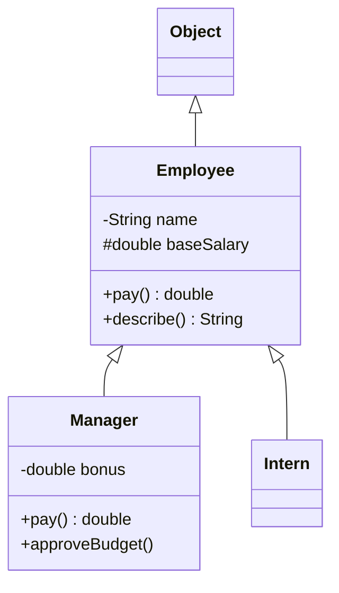

# Chapter 6 — OOP: Inheritance, Interfaces and More

Chapter 5 built single classes; this chapter covers **relationships between types**: extending a class, sharing a contract (a promise of which methods a type provides) through interfaces, and how Java picks the right code at run time (polymorphism). Then the modern type kinds — **sealed** hierarchies (closed list of subtypes), **records** (compact data carriers), **enums** (fixed named constants) — plus nested classes and the `Object` methods `equals`, `hashCode`, `toString`.

This is *language mechanics*. *Design* — inherit vs compose, SOLID, the Liskov Substitution Principle (a subclass must work wherever its parent is expected), patterns — is in the LLD handbook (linked below).

Code: [`code/`](code/) (package `ch06.*`), `javac --release 25`, run on JDK 26. Exam traps: overriding vs hiding, abstract classes, constructor chains in [OCP Chapter 6 — Class design](../../../../ocp-java21-study/chapters/06-class-design/README.md); interfaces, enums, sealed types, records, nested classes, casting in [OCP Chapter 7 — Beyond classes](../../../../ocp-java21-study/chapters/07-beyond-classes/README.md).

---

## 6.1 Inheritance and `super`

### What it is
**Inheritance** defines a new class (the **subclass** / child / derived class) as an extension of an existing one (the **superclass** / parent / base class). The subclass gets the parent's accessible fields and methods, can add new ones, and can **override** (replace) inherited methods. It models **"is-a"**: a `Manager` *is an* `Employee`.

### How it works
1. `class Manager extends Employee` — **one** direct superclass only (single inheritance of classes).
2. A class without `extends` implicitly extends **`java.lang.Object`**, so every class has `toString`, `equals`, `hashCode`, `getClass`…
3. **Constructors are not inherited.** Each subclass constructor first initialises the parent part via **`super(args)`**; if omitted, the compiler inserts `super()` — a compile error if the parent has no no-arg constructor.
4. **`super.method()`** calls the parent's version of an overridden method — to extend rather than replace behaviour.
5. **Accessible:** `public`/`protected` members always; package-private only in the same package. `private` members exist in the object but are reachable only through the parent's methods.
6. A **`final`** class cannot be extended (`String`, `Integer`, records).

```java
// code/ch06/inheritance/InheritanceDemo.java (key parts)
static class Employee {
    private final String name;              // private: not accessible in subclasses
    protected double baseSalary;            // protected: accessible in subclasses
    Employee(String name, double baseSalary) { this.name = name; this.baseSalary = baseSalary; }
    String getName() { return name; }
    double pay() { return baseSalary; }
    String describe() { return getName() + " earns " + pay(); }
}

static class Manager extends Employee {     // Manager IS-AN Employee
    private final double bonus;
    Manager(String name, double baseSalary, double bonus) {
        super(name, baseSalary);            // initialise the Employee part first
        this.bonus = bonus;
    }
    @Override double pay() { return super.pay() + bonus; }   // extend the parent's version
    void approveBudget() { System.out.println(getName() + " approved the budget"); }
}

static class Intern extends Employee {
    Intern(String name) { super(name, 1_000); }              // inherits pay() unchanged
}
```

Output:
```text
Ana earns 3000.0
Bo earns 6500.0
Cy earns 1000.0
Bo approved the budget
m instanceof Employee? true, superclass of Manager: Employee, superclass of Employee: Object
```

Line 2: `describe()` is written once in `Employee`, yet for a `Manager` it calls `Manager.pay()` — **dynamic dispatch** (§6.3–6.4).



### Trade-offs — inheritance vs composition
| | Inheritance (`extends`) | Composition (hold a reference to another object) |
|---|---|---|
| Relationship | is-a | has-a / uses-a |
| Coupling (how strongly code depends on other code) | Tight: depends on the parent's implementation details | Loose: depends only on the other object's public API |
| Flexibility | Fixed at compile time; one parent | Swap parts at run time; combine many |
| Risk | **Fragile base class** — parent changes break subclasses | Forwarding boilerplate |

*Effective Java* Item 18 "favour composition over inheritance"; Item 19 "design and document for inheritance or else prohibit it" (make classes `final` unless designed for extension). Full treatment: [LLD §2.11](../../../lld/chapters/02-oop-fundamentals/README.md#211-composition-over-inheritance), [LLD §3.6](../../../lld/chapters/03-relationships-and-uml/README.md#36-generalization-inheritance).

Don't inherit just to reuse code when "is-a" is false (JDK's `Stack extends Vector` regret: a stack exposing `insertElementAt`), when a subclass would *disable* inherited behaviour (throwing `UnsupportedOperationException` violates Liskov — [LLD §4.8](../../../lld/chapters/04-solid-principles/README.md#48-liskov-substitution-principle-lsp)), or across team boundaries on classes not designed for it.

### Common mistakes
- Forgetting `super(...)` when the parent has only `Employee(String, double)` → "constructor Employee in class Employee cannot be applied to given types".
- Expecting access to the parent's `private` field.
- Deep hierarchies (5+ levels); prefer shallow ones plus interfaces.

### TL;DR
`extends` = is-a, single parent, root `Object`. `super(...)` builds the parent part first; `super.m()` reuses the parent's method. Prefer composition unless designed for extension.

---

## 6.2 What a subclass gets — members, hiding and `Object`

| Member in parent | In the subclass |
|---|---|
| `public` / `protected` instance method | Inherited; may be **overridden** |
| package-private instance method | Inherited only in the same package |
| `private` method | Not inherited (a same-named child method is a *new* method) |
| `final` method | Inherited; cannot be overridden |
| `static` method | Inherited (callable via the subclass name); a same-signature child static **hides** it |
| Field (static or instance) | Inherited if accessible; a same-named child field **hides** it (both exist) |
| Constructor | **Never** inherited |
| Initialiser blocks | Not inherited; the parent's still run during construction ([§5.10](../05-oop-classes-and-objects/README.md#510-initialisation-order)) |

`java.lang.Object` gives every class:

| Method | Purpose | Override? |
|---|---|---|
| `toString()` | Text form; default `ClassName@hexHash` | Usually (§6.13) |
| `equals(Object)` | Logical equality; default identity (`==`) | For value-like classes (§6.13) |
| `hashCode()` | `int` used by `HashMap`/`HashSet` to place objects; must match `equals` | Whenever you override `equals` |
| `getClass()` | Runtime class object | `final` |
| `clone()` | Field-by-field copy (needs the `Cloneable` marker interface) | Rarely; prefer copy constructors/factories (*Effective Java* Item 13) |
| `wait()`, `notify()`, `notifyAll()` | Low-level thread coordination | `final`; [Chapter 14](../14-concurrency-1/README.md) |
| `finalize()` | Cleanup before GC | Deprecated for removal (JEP 421, Java 18) — use try-with-resources / `Cleaner` |

---

## 6.3 Overriding

### What it is
**Overriding**: a subclass re-implements an inherited **instance** method with the **same signature**. At run time the JVM calls the version of the object's **actual (runtime) class**, not the variable's declared type — **dynamic dispatch** / *runtime polymorphism* (overloading, by contrast, is resolved at compile time — [§4.3](../04-methods-and-arrays/README.md#43-overloading)).

### The rules
For `Dog.m` to override `Animal.m`:

| # | Rule | Example that fails |
|---|---|---|
| 1 | Same name and parameter types | `speak(String)` vs `speak()` is an overload |
| 2 | Return type the same or a **subtype** (covariant return) for references; identical for primitives (`Number get()` → `Integer get()` is fine) | Returning `Object` where the parent returns `Animal` |
| 3 | Access **same or wider** | `private Dog reproduce()` over a `protected` method; `void run()` over `public void run()` |
| 4 | Checked exceptions: none new or broader (fewer/narrower fine); unchecked unrestricted | Parent throws `IOException`, child declares `Exception` |
| 5 | Can't override `final` methods | `String dna()` when the parent's is `final` |
| 6 | `static` methods are **hidden**, not overridden; `private` methods aren't inherited | — |
| 7 | An instance method can't "override" a static one or vice versa | compile error |

Always write **`@Override`**: the compiler then checks you really override something. Without it a typo (`tostring()`) or wrong parameter (`equals(Book)` instead of `equals(Object)`) silently creates a new method.

```java
// code/ch06/overriding/OverridingRules.java (key parts)
static class Animal {
    protected Animal reproduce() { return new Animal(); }
    void speak() throws IOException { System.out.println("..."); }
    static String kind() { return "Animal (static)"; }
    String name = "animal field";
    final String dna() { return "ATGC"; }
}
static class Dog extends Animal {
    @Override public Dog reproduce() { return new Dog(); }    // covariant return + wider access
    @Override void speak() { System.out.println("Woof"); }    // throws fewer checked exceptions
    static String kind() { return "Dog (static)"; }           // HIDES Animal.kind()
    String name = "dog field";                                // HIDES Animal.name
    // String dna() {...}        -> compile error: final
    // private Dog reproduce()   -> compile error: weaker access
}

static class Base {
    Base() { init(); }                      // calls an overridable method: dangerous
    void init() { }
}
static class Derived extends Base {
    private String label = "ready";
    @Override void init() { System.out.println("Derived.init sees label = " + label); }
}

Animal a = new Dog();                       // declared type Animal, runtime type Dog
a.speak();
System.out.println("reproduce() -> " + a.reproduce());
System.out.println("a.kind()    -> " + a.kind() + "   (static method: picked by the declared type)");
System.out.println("Dog.kind()  -> " + Dog.kind());
System.out.println("a.name      -> " + a.name + " (fields use the STATIC type)");
System.out.println("((Dog) a).name -> " + ((Dog) a).name);
new Derived();
```

Output:
```text
Woof
reproduce() -> Dog
a.kind()    -> Animal (static)   (static method: picked by the declared type)
Dog.kind()  -> Dog (static)
a.name      -> animal field (fields use the STATIC type)
((Dog) a).name -> dog field
Derived.init sees label = null
```

- **Instance methods** dispatch on the **runtime** type (`Woof`).
- **Static methods and fields** resolve by the **declared** type — *hiding*. `a.kind()` compiles but misleads; call statics via the class name. Field access is never polymorphic — another reason for private fields.
- **Never call overridable methods from a constructor**: `Base()` ran `Derived.init()` *before* `Derived`'s field initialiser, so `label` was `null` ([§5.10](../05-oop-classes-and-objects/README.md#510-initialisation-order); *Effective Java* Item 19). Make such methods `private`, `final` or `static`.

### Common mistakes
- Accidental overload: `public boolean equals(Book b)` doesn't override `equals(Object)`; `HashSet` never calls it. `@Override` catches this.
- Narrowing access or adding a checked exception in an override.

### In the interview
**30-second answer:** "Overriding is a subclass redefining an inherited instance method with the same signature; the JVM picks the implementation from the object's runtime class. The override may return a subtype, must not reduce visibility or add broader checked exceptions, and can't override final methods. Static methods and fields are hidden, not overridden — resolved by the declared type. I always use @Override."
- *Overloading vs overriding?* Overloading: same name, different parameters, chosen at compile time by argument types. Overriding: same signature in a subclass, chosen at run time by object type.
- *Override a private method?* No — it isn't inherited; a same-named subclass method is unrelated.

---

## 6.4 Polymorphism and casting

### What it is
**Polymorphism** ("many forms"): code written against a common supertype works with many classes, each responding its own way — `shape.area()` once, every shape computing its own.

- **Declared (static) type** — the variable's type: `Shape s`.
- **Runtime (dynamic) type** — the object's class: `new Circle(1)`.
- **Upcasting** — subclass object as supertype (`Shape s = new Circle(1)`): always safe, implicit.
- **Downcasting** — supertype reference as subtype (`(Rect) s`): explicit, **checked at run time**, `ClassCastException` if wrong.

### How it works
1. The **declared type** decides which methods you may call (`s.side()` won't compile on a `Shape`, even holding a `Square`).
2. The **runtime type** decides which implementation runs.
3. For subtype-only methods use **pattern matching for `instanceof`** (Java 16): `if (s instanceof Square sq) { sq.side(); }` — test and cast in one, with flow-scoped `sq` ([§3.5](../03-control-flow/README.md#35-pattern-matching-for-instanceof-java-16)). `null instanceof Foo f` is `false`.
4. Casts that can *never* succeed (unrelated classes, `(String) someInteger`) are compile errors; casts that *might* succeed compile and are checked at run time (`Object o = "hi"; (Integer) o` compiles, then throws).

```java
// code/ch06/polymorphism/Shapes.java (key parts)
static class Shape  { double area() { return 0; } String name() { return getClass().getSimpleName(); } }
static class Circle extends Shape { final double r; ... @Override double area() { return Math.PI * r * r; } }
static class Rect   extends Shape { final double w, h; ... @Override double area() { return w * h; } }
static class Square extends Rect  { Square(double side) { super(side, side); } double side() { return w; } }

List<Shape> shapes = List.of(new Circle(1), new Rect(2, 3), new Square(2));   // upcasting
for (Shape s : shapes) System.out.printf("%-6s area = %.2f%n", s.name(), s.area());

Shape s = shapes.get(2);
// s.side();              -> compile error: Shape has no side()
if (s instanceof Square sq) System.out.println("pattern variable: side = " + sq.side());
Rect r = (Rect) s;                               // downcast: OK, a Square is a Rect
Circle c = (Circle) s;                           // compiles, ClassCastException at runtime
```

Output:
```text
Circle area = 3.14
Rect   area = 6.00
Square area = 4.00
total = 13.14
pattern variable: side = 2.0
downcast to Rect ok: w=2.0
ClassCastException: class ch06.polymorphism.Shapes$Square cannot be cast to class ch06.polymorphism.Shapes$Circle
```

### Why it matters
Add a `Triangle` and the loop works unchanged — code **open for extension**: the Open/Closed Principle and the basis of Strategy, State, Command… ([LLD §2.6](../../../lld/chapters/02-oop-fundamentals/README.md#26-polymorphism-and-the-full-bank-example), [LLD §4.7 OCP](../../../lld/chapters/04-solid-principles/README.md#47-openclosed-principle-ocp)).

`instanceof` chains over an *open* hierarchy usually mean the behaviour belongs in an overridden method. Exception: a **sealed** hierarchy with a pattern `switch` (§6.7), checked exhaustive by the compiler.

### Common mistakes
- Downcasting without checking.
- Pattern-variable scope: after `if (!(s instanceof Square sq)) return;` `sq` *is* in scope; in the `else` of a positive test it isn't.

### TL;DR
Code against the supertype; the runtime type picks the implementation. Upcasts are free; downcasts are checked — prefer `instanceof` patterns, and overriding to type checks.

---

## 6.5 Abstract classes

### What it is
An **abstract class** is marked `abstract`, **cannot be instantiated**, and may declare **abstract methods** (no body) that concrete subclasses must implement — a *partially built* class holding shared state and code, with the gaps left to subclasses.

### How it works
1. `abstract class Report { … }` — `new Report()` is a compile error.
2. `protected abstract String body();` — no braces, ends with `;`.
3. Any abstract method ⇒ the class must be `abstract`; an abstract class may have **zero** abstract methods (just to block instantiation).
4. The first **concrete** subclass implements every inherited abstract method; abstract subclasses may defer.
5. Abstract classes have everything normal classes have: mutable fields, constructors (called via `super(...)`), static members, `final` methods.
6. `abstract` can't combine with `final`, `private` or (on methods) `static`.

The classic use is **Template Method**: a `final` method fixes an algorithm's skeleton and calls abstract "steps" subclasses fill in.

```java
// code/ch06/abstracts/AbstractDemo.java (key parts)
static abstract class Report {
    private final String title;
    protected Report(String title) { this.title = title; }
    public final String render() { return header() + "\n" + body() + "\n" + footer(); }   // template method
    protected String header() { return "== " + title + " =="; }   // default step
    protected abstract String body();                             // required step
    protected String footer() { return "-- end --"; }
}
static class SalesReport extends Report {
    private final int units;
    SalesReport(int units) { super("Sales"); this.units = units; }
    @Override protected String body() { return "units sold: " + units; }
}
static class AuditReport extends Report {
    AuditReport() { super("Audit"); }
    @Override protected String body() { return "no issues found"; }
    @Override protected String footer() { return "-- signed: auditor --"; }
}

Report[] reports = { new SalesReport(42), new AuditReport() };
for (Report r : reports) System.out.println(r.render());
Report adHoc = new Report("Ad hoc") {                  // anonymous subclass (§6.11)
    @Override protected String body() { return "one-off content"; }
};
```

Output:
```text
== Sales ==
units sold: 42
-- end --
== Audit ==
no issues found
-- signed: auditor --
== Ad hoc ==
one-off content
-- end --
```

Real examples: `java.util.AbstractList` (implement `get` and `size`, get a whole `List`), `java.io.InputStream` (implement `read()`), `HttpServlet` (override `doGet`/`doPost`). Template Method in depth: [LLD §11.4](../../../lld/chapters/11-patterns-behavioral-2/README.md#114-template-method).

### TL;DR
Abstract class = shared state + shared code + abstract "holes"; not instantiable; subclasses fill the holes. Good for template methods and skeletal implementations.

---

## 6.6 Interfaces

### What it is
An **interface** is a named **contract**: method signatures implementing classes promise to provide. A class `implements` any number of them, and callers depend on the interface type instead of a concrete class ("program to an interface" — [LLD principle 7](../../../lld/chapters/05-design-principles/README.md#7-program-to-an-interface-not-an-implementation)).

### What an interface may contain

| Member | Since | Implicit modifiers | Notes |
|---|---|---|---|
| Abstract method | 1.0 | `public abstract` | The contract |
| Constant field | 1.0 | `public static final` | Must be initialised; **no instance fields** |
| `default` method | Java 8 | `public` | Has a body; inherited, overridable. Lets APIs evolve without breaking implementers (`List.sort`, `Collection.stream`) |
| `static` method | Java 8 | `public` (unless `private`) | Called only as `InterfaceName.m()` — **not** inherited by implementers |
| `private` method (instance or static) | Java 9 | — | Helper for default/static methods |
| Nested types | 1.0 | `public static` | `Map.Entry` |

No constructors, no instance state. An interface can `extend` several interfaces.

### How it works
1. `interface Payable { double amount(); }`
2. `class Invoice implements Payable, Printable, Shippable { … }` — implement all abstract methods (or be `abstract`); implementations must be `public`.
3. Use as a type: `List<Payable> bills`.
4. Exactly **one abstract method** = a **functional interface**, implementable by a **lambda** (`() -> value`; [Chapter 11](../11-lambdas-and-functional-programming/README.md)). `@FunctionalInterface` makes the compiler check it.

### Multiple inheritance and the diamond rules
When a class inherits the same default method along two paths (the *diamond*), Java resolves it:
1. **Classes win**: a method in the class or any superclass beats any interface default.
2. **More specific interface wins**: if `B extends A` and both define `m()`, `B`'s wins.
3. **Otherwise a compile error** until the class overrides; inside, call a parent with **`InterfaceName.super.m()`**.

```java
// code/ch06/interfaces/InterfacesDemo.java (key parts)
interface Payable {
    double TAX_RATE = 0.2;                            // public static final
    double amount();                                  // public abstract
    default double amountAfterTax() { return round(amount() * (1 - TAX_RATE)); }   // Java 8
    static Payable of(double value) { return () -> value; }                       // Java 8, lambda
    private static double round(double v) { return Math.round(v * 100) / 100.0; } // Java 9
}
interface Printable { default String label() { return "printable"; } }
interface Shippable { default String label() { return "shippable"; } }

static class Invoice implements Payable, Printable, Shippable {
    private final double total;
    Invoice(double total) { this.total = total; }
    @Override public double amount() { return total; }
    @Override public String label() {                 // conflict: must override
        return Printable.super.label() + "+" + Shippable.super.label();
    }
}

bills.add(new Invoice(100));
bills.add(Payable.of(59.99));
bills.add(new Payable() {                             // anonymous implementation
    public double amount() { return 10; }
    public double amountAfterTax() { return 10; }     // overrides the default
});
```

Output:
```text
100.0 -> after tax 80.0
59.99 -> after tax 47.99
10.0 -> after tax 10.0
label: printable+shippable, TAX_RATE = 0.2
Invoice is a Printable? true
```

Real examples: `Comparable`, `Comparator`, `Runnable`, `AutoCloseable`, `Iterable`, `List`/`Set`/`Map` ([Chapter 10](../10-collections/README.md)), `java.util.function.*`. JDBC (the standard database API) is mostly interfaces (`Connection`, `ResultSet`) implemented by each database driver.

### Common mistakes
- Implementing an interface method with package access → "attempting to assign weaker access privileges; was public".
- Calling a static interface method via an implementer or instance (`invoice.of(1)`) — not inherited.
- "Constant interface" anti-pattern (an interface only for constants, *Effective Java* Item 22) — use a final class or enum.
- State-like logic in defaults; defaults can't hold state and exist for convenience/evolution.

### TL;DR
Interfaces = contracts: abstract + constants + `default` (8) + `static` (8) + `private` (9) methods; no state or constructors; many per class. Conflicts: class wins → more specific interface wins → else override and use `X.super.m()`.

---

## 6.7 Sealed classes and interfaces (Java 17)

### What it is
A **sealed** class or interface restricts **which** classes may extend/implement it via `permits` (**Java 17, JEP 409**): "a `Shape` is exactly a `Circle`, `Rectangle` or `Polygon` — nothing else".

### Why it matters
- Between "anyone may extend" and `final`, sealing gives a **closed, known set** of subtypes — for domain concepts like payment methods, AST nodes, `Success | Failure` results.
- It makes **pattern `switch` exhaustive** without `default`; adding a subtype breaks every incomplete `switch` at compile time ([§3.6](../03-control-flow/README.md#36-pattern-matching-for-switch-java-21)).

### How it works
1. `sealed interface Shape permits Circle, Rectangle, Polygon {}` (or `sealed class`).
2. Each permitted subtype directly extends/implements it and is exactly one of **`final`** (records and enums implicitly are), **`sealed`** (own `permits`), or **`non-sealed`** (reopens the hierarchy below it).
3. Permitted subtypes live in the **same module** — or, outside named modules, the **same package**.
4. If all are in the same source file, `permits` may be omitted (inferred).
5. Pairs with records (§6.8), pattern `switch` (Java 21, JEP 441) and record patterns (JEP 440) — syntax in [Chapter 3](../03-control-flow/README.md).

```java
// code/ch06/sealed/SealedDemo.java (key parts)
sealed interface Shape permits Circle, Rectangle, Polygon {}
record Circle(double radius) implements Shape {}                 // implicitly final
record Rectangle(double w, double h) implements Shape {}
static non-sealed class Polygon implements Shape {               // open again below this point
    final int sides;
    Polygon(int sides) { this.sides = sides; }
}
static final class Triangle extends Polygon { Triangle() { super(3); } }

static String describe(Shape s) {
    return switch (s) {                                          // exhaustive: no default needed
        case Circle c                                  -> "circle r=" + c.radius();
        case Rectangle(double w, double h) when w == h -> "square " + w;          // record pattern + guard
        case Rectangle(double w, double h)             -> "rectangle " + w + "x" + h;
        case Polygon p                                 -> p.sides + "-sided polygon";
    };
}
```

Output:
```text
circle r=1.5
square 2.0
rectangle 2.0x5.0
3-sided polygon
Shape is sealed? true, permitted: 3
```

Sealed interfaces + records = **algebraic data types**: records are the "and" (width *and* height), sealed interfaces the "or" (circle *or* rectangle) — *data-oriented programming* ([§3.7](../03-control-flow/README.md#37-record-patterns-java-21-and-unnamed-patterns-java-22)).

### Trade-offs
| Use sealed when… | Avoid when… |
|---|---|
| The variants are part of the domain and change rarely | Building an extension point for other teams/plugins (they can't add subtypes) |
| You want exhaustive `switch` checks | New variants come often and callers shouldn't need updates — prefer overriding |

### TL;DR
`sealed … permits A, B, C` = closed set of subtypes (Java 17), each `final`/`sealed`/`non-sealed`. Pair with records and pattern `switch` for exhaustive, compiler-checked handling.

---

## 6.8 Records

### What it is
A **record** (Java 16, JEP 395) is a class for **transparent, immutable data carriers**. Declare the **components** in the header; `record Point(int x, int y) {}` generates:
1. `private final` fields `x`, `y`;
2. a **canonical constructor** `Point(int x, int y)`;
3. **accessors** `x()`, `y()` (no `get` prefix);
4. `equals`/`hashCode` over all components;
5. `toString()` like `Point[x=3, y=4]`.

~40 lines of hand-written immutable class (like `Money`, [§5.9](../05-oop-classes-and-objects/README.md#59-immutability-basics)) become one.

### Rules
| Records can | Records cannot |
|---|---|
| Implement interfaces | Extend a class (they implicitly extend `java.lang.Record`) |
| Declare static fields, methods, factories | Declare **instance** fields beyond the components |
| Declare instance methods | Be extended — implicitly `final` |
| Add constructors that delegate to the canonical one via `this(...)` | Have setters (fields are `final`) |
| Override any generated member | Be `abstract` |
| Be nested (implicitly `static`) or **local** in a method | |
| Be generic: `record Pair<A, B>(A first, B second) {}` | |

### How it works — the compact constructor
To validate or normalise, write a **compact canonical constructor**: the record name with **no parameter list**. Parameters are implicit, and fields are assigned automatically **after** its body. You may reassign the *parameters* (e.g. a defensive copy) but never `this.x`.

```java
// code/ch06/records/RecordsDemo.java (key parts)
record Point(int x, int y) {
    static final Point ORIGIN = new Point(0, 0);
    Point translate(int dx, int dy) { return new Point(x + dx, y + dy); }
    double distanceTo(Point o) { return Math.hypot(x - o.x, y - o.y); }
}

record Range(int start, int end) {
    Range {                                                // compact canonical constructor
        if (start > end) throw new IllegalArgumentException(start + " > " + end);
    }
    Range(int single) { this(single, single); }            // extra constructors must delegate
    int length() { return end - start; }
}

record Team(String name, List<String> members) {
    Team { members = List.copyOf(members); }               // defensive copy: reassign the PARAMETER
}

record Temperature(double celsius) {
    @Override public String toString() { return celsius + "°C"; }
    static Temperature ofFahrenheit(double f) { return new Temperature((f - 32) * 5 / 9); }
}

// inside main
record Pair(String key, int count) {}                     // local record
```

Output:
```text
Point[x=3, y=4] x=3 dist=5.0 moved=Point[x=4, y=5]
equals by value: true, set size: 1
Range[start=2, end=7] length 5, Range[start=5, end=5]
rejected: 9 > 1
Team[name=Core, members=[Ana, Bo]] (unchanged by the caller's add)
100.0°C
local record: [Pair[key=a, count=1]]
```

Uses: DTOs (data transfer objects) for REST APIs ([System Design Fundamentals](../../../system-design-patterns/modules/00-system-design-fundamentals/README.md)), query results, map keys (`record CacheKey(String user, LocalDate day)`), multiple return values, events/messages, the "and" half of sealed hierarchies. Jackson (≥ 2.12) serialises records; Spring Boot binds configuration to them.

### Trade-offs — record vs regular class
| Choose a record when… | Choose a class when… |
|---|---|
| The type *is* its data: equal components are interchangeable | Objects have identity and a lifecycle (`BankAccount`, a session) |
| Immutable is fine | You need mutable state, or JPA entities (JPA maps objects to tables and needs a no-arg constructor and non-final fields) |
| All components may be public via accessors | You need to hide the representation |

### Common mistakes
- Believing records are **deeply** immutable: a `List` or array component stays mutable unless copied (`List.copyOf`) in the compact constructor; array components also break value equality (identity `equals`).
- `this.start = start` in a compact constructor — compile error.
- Writing `getX()` — the accessor is `x()`.

### In the interview
**30-second answer:** "A record is a final, immutable data carrier (Java 16). From the components the compiler generates private final fields, the canonical constructor, accessors, and equals/hashCode/toString over all components. I use a compact constructor for validation and defensive copies. Records can implement interfaces and have static members and methods, but can't extend classes or add instance fields. They pair with sealed interfaces and record patterns."
- *Deeply immutable?* Only if the components are.
- *JPA entity?* Not with standard JPA (needs a no-arg constructor and mutable proxies); records suit DTOs/projections (read-only views of selected columns).

### TL;DR
`record R(a, b) {}` = final immutable data class with constructor, accessors, `equals`/`hashCode`/`toString`. Validate and copy in the compact constructor. Not deeply immutable by default.

---

## 6.9 Enums

### What it is
An **enum** (Java 5) is a class with a **fixed set of named instances** created once at class initialisation: `enum Day { MON, TUE, … }`. Each constant is a full object (a singleton of its kind), so enums can have fields, constructors, methods and per-constant behaviour.

Versus `int`/`String` constants: **type safety** (a `Day` parameter can't receive `42` or `"Mnday"`), namespaced and printable (`Day.MON` prints `MON`), carry data and behaviour, **safe with `==`** (one instance per constant per class loader), and great tooling (`switch`, `EnumSet`, `EnumMap`).

### How it works
1. Every enum implicitly extends `java.lang.Enum` — **can't extend a class**, **can implement interfaces**.
2. Constants come first, comma-separated; end with `;` if anything follows.
3. Constructors are implicitly **private**; each constant passes its arguments: `EARTH(5.976e+24, 6.37814e6)`.
4. Built-ins:

| Method | Returns |
|---|---|
| `values()` (static) | A **new** array of all constants in order (cache it if used in a hot loop) |
| `valueOf(String)` (static) | Constant with that exact name, else `IllegalArgumentException` |
| `name()` | Declared name — use this for persistence, not the overridable `toString` |
| `ordinal()` | Zero-based position — never persist or rely on it (*Effective Java* Item 35); reordering changes it |
| `compareTo(e)` | Order by ordinal (enums are `Comparable`) |

5. **Constant-specific bodies** `{ … }` override methods — typically an `abstract` method declared in the enum.
6. **`switch`** uses bare names (`case SAT, SUN ->`); listing all constants makes a switch expression exhaustive without `default`.
7. **`EnumSet`** (one bit per constant) and **`EnumMap`** (array-backed) are the fastest, most compact enum collections.
8. A single-element enum is the most robust **singleton** (*Effective Java* Item 3) — safe against reflection and serialisation attacks ([LLD Singleton](../../../lld/chapters/08-patterns-creational/README.md#88-singleton)).

```java
// code/ch06/enums/EnumsDemo.java (key parts)
enum Day { MON, TUE, WED, THU, FRI, SAT, SUN;
    boolean isWeekend() { return this == SAT || this == SUN; }
}
enum Planet {
    MERCURY(3.303e+23, 2.4397e6), EARTH(5.976e+24, 6.37814e6), JUPITER(1.9e+27, 7.1492e7);
    private static final double G = 6.67300E-11;
    private final double mass, radius;
    Planet(double mass, double radius) { this.mass = mass; this.radius = radius; }   // implicitly private
    double surfaceGravity() { return G * mass / (radius * radius); }
}
enum Operation {
    PLUS("+")  { int apply(int a, int b) { return a + b; } },
    TIMES("*") { int apply(int a, int b) { return a * b; } };
    final String symbol;
    Operation(String symbol) { this.symbol = symbol; }
    abstract int apply(int a, int b);
}
static String plan(Day d) {
    return switch (d) {
        case SAT, SUN -> "rest";
        case FRI -> "wrap up";
        case MON, TUE, WED, THU -> "work";
    };
}
EnumSet<Day> weekend = EnumSet.of(Day.SAT, Day.SUN);
EnumSet<Day> weekdays = EnumSet.complementOf(weekend);
Map<Day, Integer> hours = new EnumMap<>(Day.class);
```

Output:
```text
MON(0) TUE(1) WED(2) THU(3) FRI(4) SAT(5)* SUN(6)* 
FRI -> wrap up, compareTo(MON) = 4, == works: true
valueOf("Friday") -> IllegalArgumentException
MERCURY  g =  3.70 m/s^2
EARTH    g =  9.80 m/s^2
JUPITER  g = 24.81 m/s^2
6 + 7 = 13
6 * 7 = 42
weekdays=[MON, TUE, WED, THU, FRI] hours={MON=8, TUE=8, WED=8, THU=8, FRI=6}
```

Real examples: `DayOfWeek`, `Month`, `ChronoUnit`, `TimeUnit`, `RetentionPolicy`, state machines (`OrderStatus.PLACED → SHIPPED`; [LLD state machines](../../../lld/chapters/03-relationships-and-uml/README.md#314-state-machine-diagrams)), HTTP methods. Design use: [LLD §2.10](../../../lld/chapters/02-oop-fundamentals/README.md#210-enums-with-fields-and-behaviour).

### Common mistakes
- Persisting `ordinal()` — inserting a constant silently corrupts data. Store `name()` or an explicit code.
- `valueOf` on user input without handling `IllegalArgumentException` and case.
- Mutable fields in enums — shared global state.

### TL;DR
Enums = fixed singleton instances with type safety; fields, private constructors, methods, per-constant bodies. Store `name()` not `ordinal()`; `EnumSet`/`EnumMap`; exhaustive `switch` without `default`.

---

## 6.10 Nested classes: static nested and inner

### What it is
A **nested class** is declared inside another class. Four kinds:

| Kind | Declared | Tied to an outer *instance*? | Typical use |
|---|---|---|---|
| **Static nested** | Member with `static` | No | Helpers belonging to the outer class: `Map.Entry`, builders, a list `Node` |
| **Inner** (non-static member) | Member, no `static` | **Yes** — hidden reference to an outer instance | Iterators and views reading the outer object's state |
| **Local** | Inside a method/block | Yes in an instance context | One-off helper for that method (§6.11) |
| **Anonymous** | Inside an expression, no name | Yes in an instance context | One-off implementation of an interface/abstract class (§6.11) |

Nested records, enums and interfaces are implicitly `static`.

### How it works
1. Nested and enclosing classes see **all** each other's members, `private` included.
2. Static nested: `new Outer.Node(...)` (or `new Node(...)` inside `Outer`).
3. Inner: created **from an outer instance**: `outer.new ReverseIterator()`; inside an `Outer` instance method, `new ReverseIterator()` uses `this`.
4. In an inner class, `this` is the inner object; **`Outer.this`** is the enclosing one (needed on name clashes).
5. Since Java 16 inner classes may declare `static` members.

```java
// code/ch06/nested/NestedDemo.java (key parts)
static class Node {                                   // static nested
    final String value;
    Node(String value) { this.value = value; }
}

private final List<String> items = new ArrayList<>(List.of("a", "b", "c"));
private final String owner;

class ReverseIterator implements Iterator<String> {   // inner: tied to an outer instance
    private int i = items.size() - 1;                 // reads the outer object's field
    public boolean hasNext() { return i >= 0; }
    public String next() { return items.get(i--) + "@" + NestedDemo.this.owner; }
}

Node n = new Node("static nested");
NestedDemo outer = new NestedDemo("list1");
NestedDemo.ReverseIterator it = outer.new ReverseIterator();
```

Output (first two lines):
```text
static nested
c@list1 b@list1 a@list1 
```

### Common mistakes
- **Inner where static nested would do**: each inner instance keeps its outer object alive — a **memory leak** when inner objects (listeners, tasks) outlive the outer. *Effective Java* Item 24: default to `static`.
- `new Outer.Inner()` from a static context without an outer instance → compile error.

---

## 6.11 Local classes, anonymous classes and lambdas

### What it is
- A **local class** is declared in a method body and may use the method's **effectively final** locals (never reassigned) — it *captures* their values.
- An **anonymous class** is declared and instantiated in one expression, `new SomeInterface() { … }` or `new SomeClass(args) { … }`; no name, so no constructor, single use.
- A **lambda** (Java 8) implements a **functional interface** compactly and replaces most anonymous classes ([Chapter 11](../11-lambdas-and-functional-programming/README.md)).

```java
// code/ch06/nested/NestedDemo.java (continued)
Supplier<String> counterDescription() {
    int size = items.size();                          // effectively final
    class Describer implements Supplier<String> {     // local class
        public String get() { return owner + " has " + size + " items"; }
    }
    return new Describer();
}

Comparator<String> byLengthAnon = new Comparator<>() {             // anonymous class
    @Override public int compare(String a, String b) { return Integer.compare(a.length(), b.length()); }
};
Comparator<String> byLengthLambda = (a, b) -> Integer.compare(a.length(), b.length());   // lambda
```

Output (remaining lines):
```text
list1 has 3 items
anonymous: [fig, kiwi, banana]
lambda reversed: [banana, kiwi, fig]
```

### Anonymous class vs lambda
| | Anonymous class | Lambda |
|---|---|---|
| Can implement | Any interface (any number of methods) or extend a class (even abstract) | Only a functional interface |
| State (fields) | Yes | No |
| `this` means | The anonymous object | The enclosing instance |
| Verbosity | High | Low |
| Use when | Several methods, extending a class (`new Report("Ad hoc") {…}`, §6.5), own state | Single-method callbacks, comparators, stream operations |

### Common mistakes
- Modifying a captured local (`size++`) → "local variables referenced from an inner class must be final or effectively final".
- Serialising anonymous/inner classes — hidden outer references and synthetic names; avoid.

### TL;DR (6.10–6.11)
Static nested = grouping, no outer link (default). Inner = tied to an outer instance (`outer.new Inner()`, `Outer.this`). Local and anonymous classes capture effectively final locals; lambdas replace anonymous classes for functional interfaces.

---

## 6.12 Choosing: abstract class, interface, record, enum or plain class

| Need | Reach for | Why |
|---|---|---|
| A capability many unrelated classes share (`Comparable`, `Closeable`) | **Interface** | Many per class; no state forced on implementers |
| Contract plus partial implementation with **shared state** or constructors | **Abstract class** (often implementing an interface) | Interfaces can't hold instance state |
| Evolve a published contract without breaking implementers | Interface **default** method | Java 8's reason for defaults |
| Fixed, known variants carrying different data | **Sealed interface + records** | Exhaustive, compiler-checked `switch` |
| Fixed set of instances known at compile time | **Enum** | Type-safe constants with behaviour |
| Immutable data where equal values are interchangeable | **Record** | Minimal code, correct `equals`/`hashCode` |
| Mutable object with identity and lifecycle | **Class** (`final` unless designed for extension) | Full encapsulation control |

**An interface says what a type *can do*; an abstract class says what a family of classes *is* and shares.** Modern style is interface first, with an optional skeletal abstract class (`AbstractList` beside `List`, *Effective Java* Item 20). Design discussion incl. ISP (keep interfaces small) and DIP (depend on abstractions): [LLD §2.9](../../../lld/chapters/02-oop-fundamentals/README.md#29-abstract-classes-vs-interfaces), [LLD §4.9 ISP](../../../lld/chapters/04-solid-principles/README.md#49-interface-segregation-principle-isp), [LLD §4.10 DIP](../../../lld/chapters/04-solid-principles/README.md#410-dependency-inversion-principle-dip).

### In the interview
**Q: "Abstract class or interface?"** "An interface defines a contract a class can adopt alongside others; since Java 8 it can carry default and static methods, since 9 private helpers, but never instance state or constructors. An abstract class can have state, constructors and any access level, but a class extends only one. I start with an interface for the abstraction clients depend on, and add an abstract base only if implementations share real state or code."
- *Why multiple interface but not class inheritance?* Classes carry state and constructors, so multiple parents would make state and initialisation ambiguous (the diamond problem). Interfaces have no instance state, and default-method conflicts have explicit rules.

---

## 6.13 Object methods: equals, hashCode and toString

### What it is
- **`equals(Object o)`** — "logically the same?" Default: identity (`this == o`).
- **`hashCode()`** — an `int` summary used by hash-based collections to pick a bucket (a slot in their internal array). Default: typically identity-derived.
- **`toString()`** — readable description for `println`, concatenation, loggers, debuggers. Default: `ClassName@hexHashCode`.

**Identity vs equality:** `a == b` = same object; `a.equals(b)` = same value. Two `new Book("123", "Dune")` are different objects but should be equal.

### The contracts
**`equals`** (per the `Object` Javadoc) must be:
1. **Reflexive**: `x.equals(x)`.
2. **Symmetric**: `x.equals(y)` ⇔ `y.equals(x)`.
3. **Transitive**: `x.equals(y)` and `y.equals(z)` ⇒ `x.equals(z)`.
4. **Consistent**: same result while unchanged.
5. **Non-null**: `x.equals(null)` is false, never throws.

**`hashCode`**:
1. **Equal objects ⇒ equal hash codes** (the rule people break).
2. Unequal objects *may* collide — legal, but fewer collisions = faster maps.
3. Consistent within one execution while unchanged.

**Override `equals` ⇒ override `hashCode`**, from the *same* fields.

### How it works — writing them
1. `if (this == o) return true;` — fast path.
2. `if (!(o instanceof Book other)) return false;` — type check + cast (false for `null`).
3. Compare significant fields: `==` for primitives (`Double.compare`/`Float.compare` for floating point — `NaN`, `-0.0`), `equals` for objects, `Objects.equals(a, b)` for nullables (`Objects.equals(null, null)` is `true`), `Arrays.equals` for arrays.
4. `hashCode`: `Objects.hash(f1, f2, …)` (allocates a varargs array; hand-roll `31 * h + …` only in hot paths).
5. `toString`: fields useful for debugging; never secrets (passwords, tokens, personal data).
6. Or use a **record** (§6.8); IDEs also generate them.

```java
// code/ch06/objectmethods/EqualsHashCode.java (key parts)
static class EqualsOnly {                                   // BROKEN: equals without hashCode
    final String isbn;
    @Override public boolean equals(Object o) { return o instanceof EqualsOnly other && isbn.equals(other.isbn); }
}

static final class Book {                                   // correct
    private final String isbn;
    private final String title;
    @Override public boolean equals(Object o) {
        if (this == o) return true;
        if (!(o instanceof Book other)) return false;
        return isbn.equals(other.isbn) && Objects.equals(title, other.title);
    }
    @Override public int hashCode() { return Objects.hash(isbn, title); }
    @Override public String toString() { return "Book[isbn=" + isbn + ", title=" + title + "]"; }
}
```

Output:
```text
NoEquals:   equals=false, toString=ch06.objectmethods.EqualsHashCode$NoEquals@<hash>
EqualsOnly: equals=true, set.contains(equal copy)=false  <- hashCode not overridden
Book:       equals=true, same hash=true, set.contains(equal copy)=true, == false
toString:   Book[isbn=123, title=Dune]
equals(null)=false, Objects.equals(null, null)=true
```

Line 2 is the classic bug: equal `EqualsOnly` objects have different default hash codes, so `HashSet` searches the wrong bucket and never calls `equals`. How `HashMap` uses `hashCode` then `equals`: [Chapter 10](../10-collections/README.md).

### `instanceof` or `getClass()` in equals?
| | `instanceof` (used above) | `getClass() != o.getClass()` |
|---|---|---|
| Subclass equal to parent instance? | Can be | Never |
| Risk | Breaks symmetry/transitivity if a subclass adds fields to `equals` | Breaks Liskov: a harmless subclass never equals its parent |
| Common advice | Use it and make the class `final` (as `Book`; records do the equivalent) | Used by some frameworks (e.g. Hibernate-proxy-aware code) |

*Effective Java* Item 10: you cannot extend an instantiable class, add a value component, and keep the `equals` contract — favour composition or final value classes.

### Common mistakes
- `equals` without `hashCode`; `equals(Book other)` overload (use `@Override`).
- **Mutable** fields in `equals`/`hashCode`, then mutating a `HashSet` element or `HashMap` key — it becomes unfindable. Prefer immutable keys.
- `==` on `double` fields or on strings ([Chapter 7](../07-core-apis/README.md)).

### In the interview
**30-second answer:** "`==` compares references; `equals` compares logical value. equals must be reflexive, symmetric, transitive, consistent, and false for null. Equal objects must have equal hashCodes, or hash-based collections break — they bucket by hashCode first. So I override both from the same immutable fields, typically with `Objects.equals`/`Objects.hash`, or use a record."
- *Unequal objects with the same hashCode?* Legal (a collision), but slower.
- *Key's hashCode changes after insertion?* Lookups search the wrong bucket; the entry is effectively lost until the key changes back.
- *Why 31?* An odd prime that spreads values, and `31 * h` optimises to `(h << 5) - h`; convention from *Effective Java* and `String.hashCode`.

### TL;DR
`==` = same object; `equals` = same value. Override `equals` and `hashCode` together from the same (ideally immutable) fields; follow the five rules; `@Override`. Records do it for you.

---

## Chapter TL;DR

| Topic | Remember |
|---|---|
| Inheritance | `extends`, one parent, root is `Object`; constructors not inherited, `super(...)` first; prefer composition |
| Overriding | Same signature, covariant return, same/wider access, no broader checked exceptions, `@Override`; not final/static/private |
| Hiding | Static methods and fields resolve by declared type |
| Polymorphism | Declared type decides what you may call; runtime type decides what runs. Downcasts checked at run time; use `instanceof` patterns |
| Abstract class | Not instantiable; state + constructors + abstract methods; template method |
| Interface | Contract; abstract + `default`/`static` (8) + `private` (9); no state; many per class; conflicts → override + `X.super.m()` |
| Sealed (17) | `permits` closed set; subtypes `final`/`sealed`/`non-sealed`; exhaustive `switch` |
| Records (16) | Final immutable data carriers; compact constructor for validation/copies; not deeply immutable |
| Enums (5) | Fixed singleton instances; fields, private constructors, per-constant bodies; `EnumSet`/`EnumMap`; don't persist `ordinal()` |
| Nested | Prefer static nested; inner needs outer instance (`outer.new Inner()`, `Outer.this`); lambdas for functional interfaces |
| `equals`/`hashCode` | Override together, same fields, contract rules; `toString` for humans |

**Next:** core APIs — `String`, `StringBuilder`, wrappers, `BigDecimal`, `java.time` — in [Chapter 7](../07-core-apis/README.md). Design: [LLD SOLID](../../../lld/chapters/04-solid-principles/README.md), [LLD relationships and UML](../../../lld/chapters/03-relationships-and-uml/README.md), patterns from [LLD Chapter 8](../../../lld/chapters/08-patterns-creational/README.md). Exam traps: [OCP Chapter 6](../../../../ocp-java21-study/chapters/06-class-design/README.md), [OCP Chapter 7](../../../../ocp-java21-study/chapters/07-beyond-classes/README.md).
