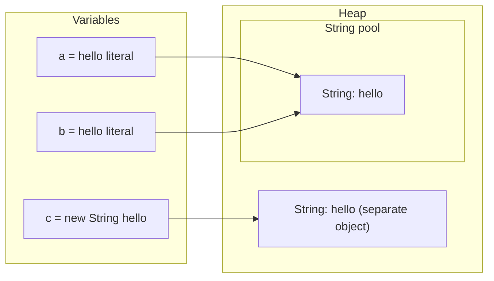
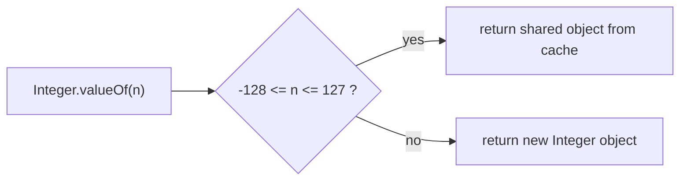
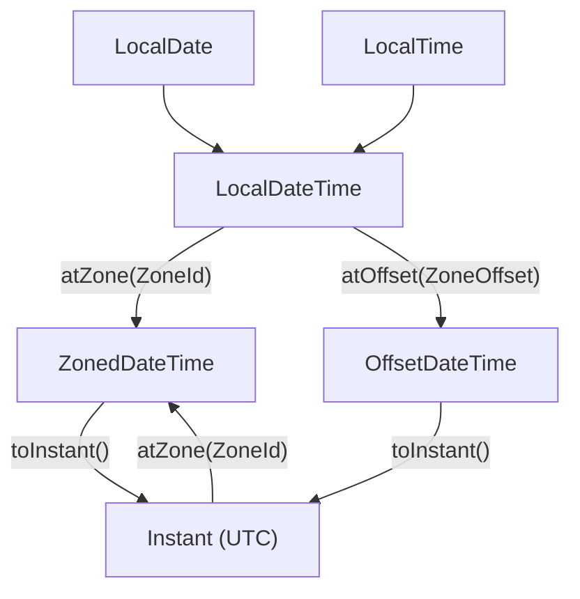

# Chapter 7 — Core APIs: Strings, Numbers, Dates and Randomness

Nearly every class touches a few library types: `String`/`StringBuilder` for text, `Math` and the wrapper classes (object versions of primitives: `Integer`, `Double`…) for numbers, `BigDecimal` for money, `java.time` for dates, `Random` for simulations and tests — all in the JDK (`java.lang`, `java.math`, `java.time`, `java.text`, `java.util`), no dependencies needed.

Each API is covered as you'll use it, with the mistakes that cause real bugs (`==` on strings, the `Integer` cache, `new BigDecimal(0.1)`, `YYYY` in date patterns, daylight-saving gaps — the skipped hour when clocks "spring forward"). `String` basics and text blocks are in [§2.12](../02-basics-types-and-operators/README.md#212-strings-and-text-blocks), floating-point error in [§2.11](../02-basics-types-and-operators/README.md#211-floating-point-numbers); this chapter goes deeper.

Code: [`code/`](code/) (package `ch07.*`), `javac --release 25`, run on JDK 26; every "Output:" is from a real run. Exam traps: `String`/`StringBuilder` chains, `Math` return types, date arithmetic in [OCP Chapter 4 — Core APIs](../../../../ocp-java21-study/chapters/04-core-apis/README.md); locale formatting and resource bundles in [OCP Chapter 11](../../../../ocp-java21-study/chapters/11-exceptions-localization/README.md) (sections 5–8).

---

## 7.1 Strings: immutability, the pool and memory

### What it is
A `String` holds a fixed sequence of characters. **Immutable**: once created its contents never change; every "modifying" method (`toUpperCase`, `replace`, `concat`, `strip`…) returns a **new** `String`. `String` is also `final`, so no subclass can break that guarantee.

### Why it matters
| Benefit | Why immutability enables it |
|---|---|
| Safe sharing | Many variables and threads can share one `String` with no locking. |
| Safe `HashMap` keys | The hash code can't change after insertion; `String` even caches its `hashCode` after the first call. |
| Security | A path or class name checked by security code can't be altered afterwards. |
| The string pool | Identical literals can share one object only because nobody can modify it. |

### How it works — the string pool
1. Every string **literal** (`"hello"`) is stored once in the **string pool** (*intern pool*), a table on the heap (moved there from PermGen in Java 7, so unreachable pooled strings are garbage-collected).
2. Identical literals anywhere refer to the **same** pooled object.
3. **Compile-time constant expressions** (literals joined with `+`, `final` variables initialised with constants) are folded into one literal at compile time, so are pooled too.
4. Strings computed **at run time** (non-final variable concatenation, input, `new String(...)`) are ordinary new heap objects.
5. `s.intern()` returns the pooled copy, adding it if necessary.



[`code/ch07/strings/StringPool.java`](code/ch07/strings/StringPool.java):
```java
String a = "hello";                      // literal -> string pool
String b = "hello";                      // same pooled object
String c = new String("hello");          // always a new heap object
String d = c.intern();                   // pooled copy
String e = "hel" + "lo";                 // constant expression, folded at compile time
String part = "hel";
String f = part + "lo";                  // computed at run time -> new object
final String constPart = "hel";
String g = constPart + "lo";             // final + literal initialiser = constant -> pooled
```
Output:
```text
a == b: true
a == c: false, a.equals(c): true
a == c.intern(): true
a == "hel" + "lo": true
a == part + "lo": false
a == constPart + "lo": true
s=java, upper=JAVA, same object? false
"x".equals(null)=false, Objects.equals(null,null)=true
```

**Lesson:** `==` compares references; because of the pool it *sometimes* works on strings — then fails on the first string from user input or a database. Use `equals`, `Objects.equals(a, b)` when either may be `null`, or literal-first `"yes".equals(answer)`.

### How strings are stored (Java 9+)
**Compact strings** (Java 9, JEP 254): characters live in a `byte[]` — one byte each when all fit in Latin-1 (Western European one-byte set), otherwise two (UTF-16) — roughly halving memory for mostly-ASCII text, invisibly. Also since Java 9 (JEP 280) `a + b + c` compiles to an optimised `invokedynamic` call, so a *single* concatenation expression is already efficient; only concatenation *in loops* needs `StringBuilder` (§7.3).

### Common mistakes
- Ignoring the result: `s.trim();` / `s.concat("b");` change nothing — assign it.
- `==` comparisons, including `if (cmd == "quit")` chains.
- `intern()` everywhere "to save memory" — the pool is a shared table, and G1 (the default GC) has optional string deduplication. Intern only with measurements.

### In the interview
**30-second answer:** "`String` is immutable and final. That makes it thread-safe, lets it cache its hash code so it's a good map key, keeps security checks valid, and allows the JVM to pool identical literals. Literals and compile-time constants are pooled, runtime strings aren't, so `==` is unreliable — I always use `equals`."
- *Objects created by `new String("hi")`?* Up to two: the pooled literal (if not already pooled at class loading) and the new heap `String`.
- *Is `"ab" == "a" + "b"`?* Yes — a folded constant expression.

---

## 7.2 The `String` API toolkit

### What it is
`String` has ~100 methods; about 30 matter. Indexes are **0-based**, ranges **half-open**: `substring(begin, end)` includes `begin`, excludes `end` (length `end - begin`).

### The methods, by purpose
| Job | Methods (version if newer than 8) | Notes |
|---|---|---|
| Size & emptiness | `length()`, `isEmpty()`, `isBlank()` (11) | `isBlank`: `""` or whitespace only |
| Read characters | `charAt(i)`, `toCharArray()`, `chars()` (9), `codePointAt(i)`, `codePoints()` (9) | `charAt` returns a UTF-16 unit (Unicode below) |
| Search | `indexOf`, `lastIndexOf`, `contains`, `startsWith`, `endsWith`, `indexOf(ch/str, begin, end)` (21) | `indexOf` returns **-1** if absent; `"banana".indexOf("an", 2)` is 3 |
| Extract | `substring(begin)`, `substring(begin, end)`, `subSequence` | `StringIndexOutOfBoundsException` on bad indexes |
| Whitespace | `trim()`, `strip()` (11), `stripLeading()`/`stripTrailing()` (11), `stripIndent()` (15) | `trim` removes chars ≤ U+0020; `strip` uses Unicode `Character.isWhitespace` (non-breaking/ideographic spaces) — prefer `strip` |
| Case | `toUpperCase()`, `toLowerCase()`, `Locale` overloads | `toLowerCase(Locale.ROOT)` for identifiers |
| Replace | `replace(char, char)`, `replace(CharSequence, CharSequence)`, `replaceAll(regex, repl)`, `replaceFirst(regex, repl)` | `replace` is **literal**, `replaceAll` **regex** (regular expression, a pattern language) |
| Compare | `equals`, `equalsIgnoreCase`, `compareTo`, `compareToIgnoreCase`, `contentEquals`, `regionMatches`, `matches(regex)` | `compareTo` returns <0/0/>0, not necessarily ±1 |
| Split & join | `split(regex)`, `split(regex, limit)`, `splitWithDelimiters` (21), `String.join`, `lines()` (11) | `split` takes a **regex** |
| Build new text | `concat`, `repeat` (11), `indent` (12), `formatted` (15), `transform` (12), `String.valueOf(x)`, `String.format` | `valueOf(null object)` → `"null"` |
| Other | `hashCode`, `intern`, `translateEscapes` (15) | |

### Code
[`code/ch07/strings/StringApi.java`](code/ch07/strings/StringApi.java) (key parts):
```java
String s = "  Hello, Java World  ";
String t = s.strip();                                  // "Hello, Java World"
t.indexOf('o'); t.lastIndexOf('o'); t.indexOf("Kotlin");          // 4, 13, -1
t.substring(7); t.substring(7, 11);                               // "Java World", "Java"
t.replace('o', '0'); t.replaceAll("[aeiou]", "*");                // literal vs regex
"apple".compareTo("banana"); "Z".compareTo("a");                  // -1, -7
"a,b,,c,,".split(",");  "a,b,,c,,".split(",", -1);                // trailing empties dropped vs kept
"1.2.3".split(".");     "1.2.3".split("\\.");                     // regex dot matches everything!
"a+b-c".splitWithDelimiters("[+-]", 0);                           // Java 21
"education".chars().filter(c -> "aeiou".indexOf(c) >= 0).count(); // count vowels
String emoji = "I ❤ Jäva 😀";                  // heart, a-umlaut, grinning face
emoji.length(); emoji.codePointCount(0, emoji.length());
```
Output:
```text
length=21 isEmpty=false isBlank("  ")=true
strip -> [Hello, Java World] charAt(7)=J
indexOf('o')=4 lastIndexOf('o')=13 indexOf("Java")=7 indexOf("Kotlin")=-1
contains=true startsWith=true endsWith=true
substring(7)=Java World substring(7, 11)=Java
replace=Hell0, Java W0rld | replaceAll=H*ll*, J*v* W*rld
upper=HELLO, JAVA WORLD lower=hello, java world
repeat=ababab join=a-b-c joinList=usr/local/bin
equals=false equalsIgnoreCase=true compareTo("apple","banana")=-1 compareTo("b","a")=1 compareTo("Z","a")=-7 compareToIgnoreCase=25
split(",")=[a, b, , c]
split(",", -1)=[a, b, , c, , ]
split("\\s+")=[one, two, three]
split(".") on 1.2.3 -> 0 parts; split("\\.") -> [1, 2, 3]
splitWithDelimiters=[a, +, b, -, c]
palindrome(level)=true toCharArray=[a, b, c] vowels=5
lines=[a, b, c] indent=[  x\n]
formatted=Ada is 36 valueOf(3.5)=3.5 valueOf(char[])=hi
I ❤ Jäva 😀 length=11 codePoints=10 charAt(9) is high surrogate? true
```

- **`compareTo`** returns the difference of the first differing characters (`'Z'` 90 − `'a'` 97 = −7), or the length difference if one is a prefix. It is **case-sensitive; uppercase sorts first** (`"Zebra"` before `"apple"`). For human sorting use `String.CASE_INSENSITIVE_ORDER` or a `java.text.Collator`.
- **`split` takes a regex**: `.` means "any character", so `"1.2.3".split(".")` splits everywhere and returns an empty array. Escape (`"\\."`) or `Pattern.quote(".")`; `|`, `+`, `*`, `?`, `(`, `[`, `$`, `^`, `\` are also special.
- **`split` drops trailing empty strings** (`"a:b:".split(":").length` is 2) unless the limit is negative (`split(",", -1)`) — matters for CSV lines with empty last fields.
- **`replace` vs `replaceAll`**: both replace *all* occurrences; literal vs regex. `replaceAll("$", "")` doesn't remove dollar signs; `replace("$", "")` does. For `.` → `-`, use `replace(".", "-")`.

### Unicode: `length()` is not "number of characters"
A `char` is a 16-bit **UTF-16 code unit**. Characters beyond the Basic Multilingual Plane (first 65 536) — many emoji, some CJK and historic scripts — need **two** `char`s, a **surrogate pair**. A **code point** is the actual Unicode character number. Above, 10 visible characters give `length()` 11 because 😀 takes two units.
- `charAt`, `substring` and index-based reversal can split a pair (`StringBuilder.reverse` is surrogate-aware; manual loops usually aren't).
- Iterate real characters with `s.codePoints()`; count with `s.codePointCount(0, s.length())`.
- User-perceived characters (flags, family emoji = several code points) need `java.text.BreakIterator`.

### Common mistakes
| Mistake | Fix |
|---|---|
| `"TITLE".toLowerCase()` in a Turkish locale gives `"tıtle"` (dotless ı) | `toLowerCase(Locale.ROOT)` for keys, protocols, extensions |
| `split(".")`, `split("|")` | Escape or `Pattern.quote` |
| Missing `-1` limit with empty trailing fields | `line.split(",", -1)` |
| `s.substring(0, 10)` on a shorter string | `s.substring(0, Math.min(10, s.length()))` |
| `trim` on Unicode spaces | `strip()` |
| `+=` in a loop | `StringBuilder` (§7.3) |

Real use: `line.split("\\s+", 4)` for logs (limit keeps the message whole); `email.strip().toLowerCase(Locale.ROOT)` before lookup; `startsWith("https://")`, `endsWith(".json")` for routing.

### TL;DR
Half-open ranges; `indexOf` → -1; `split`/`replaceAll`/`matches` take regexes; `compareTo` is case-sensitive; `length()` counts UTF-16 units. Prefer `strip`, `isBlank`, `repeat`, `lines` (11+).

---

## 7.3 `StringBuilder`, `StringBuffer` and `StringJoiner`

### What it is
A **`StringBuilder`** is a *mutable* character sequence: append, insert, delete and replace in place, then `toString()` once.

### Why it matters
`result += piece` in a loop creates a new `String` each time, copying everything so far — O(n²) for *n* pieces. A `StringBuilder` grows an internal buffer (default capacity 16, or 16 + initial string length; roughly doubles when full), so appends are amortised O(1) (constant on average despite occasional copies) and the build is O(n). A single expression like `"Hello, " + name + "!"` is already efficient (§7.1).

### How it works
1. Create: `new StringBuilder()`, `new StringBuilder("start")`, `new StringBuilder(expectedCapacity)`.
2. Mutators **return the same builder** (chainable): `append`, `insert`, `delete`, `deleteCharAt`, `replace`, `reverse`, `repeat` (21). `setCharAt` and `setLength` return `void`.
3. Read: `length()`, `charAt`, `indexOf`, `substring` (returns a `String`; the builder is unchanged).
4. Finish with `toString()`.

[`code/ch07/strings/BuilderDemo.java`](code/ch07/strings/BuilderDemo.java) (key parts):
```java
StringBuilder sb = new StringBuilder("Java");
sb.append(' ').append(25).append(" LTS");          // methods return this -> chaining
sb.insert(0, ">> ");
sb.replace(3, 7, "JAVA");                          // replace [3, 7) with "JAVA"
sb.delete(0, 3);
sb.deleteCharAt(sb.length() - 1).setCharAt(0, 'j');
new StringBuilder("stressed").reverse();
new StringBuilder().repeat("=-", 5).repeat('!', 2);    // Java 21

StringBuilder x = new StringBuilder("abc"), y = new StringBuilder("abc");
x.equals(y);                                       // false! identity comparison

StringBuilder csv = new StringBuilder();
for (int i = 1; i <= 5; i++) {
    if (!csv.isEmpty()) csv.append(',');
    csv.append(i * i);
}
StringJoiner joiner = new StringJoiner(", ", "[", "]");
```
Output:
```text
append:  Java 25 LTS (length 11)
insert:  >> Java 25 LTS
replace: >> JAVA 25 LTS
delete:  JAVA 25 LTS
deleteCharAt+setCharAt: jAVA 25 LT
reverse: desserts
indexOf("25")=5 charAt(1)=A
repeat (21): =-=-=-=-=-!!
x.equals(y)=false x.toString().equals(y.toString())=true x.compareTo(y)=0 "abc".contentEquals(x)=true
loop: 1,4,9,16,25
StringJoiner: [Java, Kotlin, Scala]
capacity=1000 length=0
```

### Trade-offs
| | `String` + `+` | `StringBuilder` | `StringBuffer` | `StringJoiner` / `String.join` / `Collectors.joining` |
|---|---|---|---|---|
| Mutable | No | Yes | Yes | builds internally |
| Thread-safe | Yes (immutable) | **No** | Yes (every method `synchronized`) | No |
| Use for | one-off expressions | loops, incremental building | legacy only | joining with delimiter/prefix/suffix |

`StringBuffer` (Java 1.0) predates `StringBuilder` (Java 5); its locking is almost never useful — sharing a half-built string between threads is rarely sensible.

### Common mistakes
- `sb1.equals(sb2)` — no value-based `equals`/`hashCode` (identity). Compare `toString()`s, `sb1.compareTo(sb2) == 0` (Java 11), or `"abc".contentEquals(sb)`. Never use a builder as a map key or set element.
- `sb.append(a + b + c)` in a loop builds a temporary; chain `.append(a).append(b).append(c)`.
- Sharing one builder between threads.
- `new StringBuilder('x')` — the `char` widens to `int` and becomes the **capacity** (empty builder). Use `"x"`.

### In the interview
**30-second answer:** "Strings are immutable, so `+=` in a loop copies everything each time — O(n²). `StringBuilder` is a growable mutable buffer with amortised O(1) appends. `StringBuffer` is the synchronized legacy version. A single `+` expression is fine; the compiler optimises it."
- *`new StringBuilder("abc").reverse().insert(1, "-")`?* `"c-ba"`.

---

## 7.4 Formatting text and numbers

### What it is
**Formatting** turns values into text with controlled width, alignment, decimals, grouping and symbols. Main tool: the `java.util.Formatter` mini-language behind `String.format`, `"...".formatted(...)` (Java 15) and `printf` (basic specifier table in [§2.13](../02-basics-types-and-operators/README.md#213-console-output-and-input)). Locale-aware business formatting: `java.text.NumberFormat`/`DecimalFormat`; bytes: `java.util.HexFormat` (Java 17).

### How it works — format specifiers
Shape: `%[argument_index$][flags][width][.precision]conversion`.

| Part | Examples | Meaning |
|---|---|---|
| conversion | `s`, `d`, `f`, `e`, `x`/`X`, `o`, `c`, `b`, `n`, `%%` | value kind |
| width | `%10s`, `%8d` | minimum characters, right-aligned by default |
| flags | `-` left-align, `0` zero-pad, `,` grouping, `+` always sign, `(` negatives in parentheses | layout |
| precision | `%.2f`, `%.2s` | decimals for numbers, max length for strings |
| argument index | `%2$s` | 2nd argument (reuse/reorder) |

[`code/ch07/format/Formatting.java`](code/ch07/format/Formatting.java) (key parts):
```java
String.format("|%s|%10s|%-10s|%.2s|", name, name, name, name);
String.format("|%d|%8d|%-8d|%08d|%,d|%+d|", 42, 42, 42, 42, 1234567, 42);
String.format("|%f|%.2f|%10.3f|%-10.1f|%e|", price, price, price, price, 12345.678);
String.format("|%x|%X|%o|%c|%b|%%|", 255, 255, 8, 'J', null);
String.format("|%2$s %1$s|%s|", "world", "hello");
"%s bought %d items for $%.2f".formatted(name, 3, 9.5);             // Java 15
String.format(Locale.US, "US: %,.2f", 1234567.891);
String.format(Locale.GERMANY, "DE: %,.2f", 1234567.891);
NumberFormat.getCurrencyInstance(Locale.US).format(new BigDecimal("1234.5"));
NumberFormat.getPercentInstance(Locale.US).format(0.256);
NumberFormat.getCompactNumberInstance(Locale.US, NumberFormat.Style.SHORT).format(1_250_000); // Java 12
new DecimalFormat("#,##0.00", DecimalFormatSymbols.getInstance(Locale.US)).format(1234.5);
HexFormat.ofDelimiter(":").withUpperCase().formatHex(new byte[]{10, -1, 127});        // Java 17
```
Output:
```text
|Ada|       Ada|Ada       |Ad|
|42|      42|42      |00000042|1,234,567|+42|
|3.141590|3.14|     3.142|3.1       |1.234568e+04|
|ff|FF|10|J|false|%|
|hello world|world|
Ada bought 3 items for $9.50
printf with %n line ending
US: 1,234,567.89
DE: 1.234.567,89
currency=$1,234.50 percent=26% compact=1M
DecimalFormat: 1,234.50 0.50 -7.00
HexFormat: 0A:FF:7F
```

- `%f` defaults to **6** decimals; `%.2f` **rounds** HALF_UP (ties away from zero). Width includes the dot: `"%05.1f"` of 3.14159 is `"003.1"`; `"%-5s|"` of `"ab"` is `"ab   |"`.
- `%b` prints `false` for `null` and `true` for *any* other non-Boolean — not a truthiness check.
- In `|%2$s %1$s|%s|` the plain `%s` takes the *first* ordinary argument (`"world"`); don't mix styles.
- Type mismatch (`String.format("%d", 3.5)`) → `IllegalFormatConversionException`; missing arguments → `MissingFormatArgumentException`.
- **Locale matters**: `String.format` uses the JVM default, so a German server prints `1.234.567,89`. For CSV, JSON, parsed logs pass `Locale.ROOT`/`Locale.US`. `Locale.of("de", "DE")` (Java 19) replaces the deprecated `new Locale(...)` constructors.
- `DecimalFormat` patterns: `0` digit always shown, `#` digit hidden if zero, `,` grouping, `.` decimal point, `%` ×100. **Not thread-safe** — one per use or per thread (`DateTimeFormatter`, §7.11, is immutable and safe).
- Compact formatting rounds to whole units by default (`1.25M` → `1M`); with `setMinimumFractionDigits(1)` and its `HALF_EVEN` mode, 1,250,000 prints `1.2M`, 1,260,000 `1.3M`.

### When not to use it
- Money *arithmetic* — compute with `BigDecimal`/`long` cents (§7.7), format only at the edge.
- Building SQL/HTML from user input — use prepared statements (placeholders filled safely by the driver) or escaping templates.
- Hot logging — logger placeholders (`log.info("user {} logged in", id)`) skip formatting when the level is off.

### TL;DR
`%[index$][flags][width][.precision]conv`. Explicit `Locale` for machine output; `NumberFormat` for currency/percent/compact, `HexFormat` for bytes.

---

## 7.5 `Math`

### What it is
`java.lang.Math` is a non-instantiable utility class (private constructor) of `static` methods on primitives; mostly `double`-based; the `*Exact` methods throw on overflow instead of wrapping.

| Group | Methods | Return type & behaviour |
|---|---|---|
| Absolute, min, max | `abs`, `min`, `max` | argument type after promotion (`min(2.5, -1)` → `-1.0`; [§2.7](../02-basics-types-and-operators/README.md#27-type-conversion-widening-narrowing-casting-promotion)) |
| Powers & roots | `pow(a, b)`, `sqrt`, `cbrt`, `hypot(x, y)`, `exp`, `log`, `log10` | `double` |
| Rounding | `round` → `long` (`int` for `float`), `floor`/`ceil`/`rint` → `double` | `round`: ties toward +∞ (`-2.5` → `-2`); `rint`: ties to **even** |
| Integer division | `floorDiv`, `floorMod` (8), `ceilDiv`, `ceilMod` (18) | round toward −∞ / +∞ instead of 0 |
| Limiting | `clamp(value, min, max)` (21) | keep within a range |
| Overflow-safe | `addExact`, `subtractExact`, `multiplyExact`, `incrementExact`, `negateExact`, `toIntExact` (8), `absExact` (15), `divideExact` (18), `powExact` (25) | throw `ArithmeticException` |
| Trig | `sin`, `cos`, `tan`, `atan2`, `toRadians`, `toDegrees`, `PI`, `E` | radians |
| Misc | `signum`, `random()` | `random()`: `double` in [0.0, 1.0) |

[`code/ch07/math/MathDemo.java`](code/ch07/math/MathDemo.java) output:
```text
abs(-7)=7 max(3,9)=9 min(2.5,-1)=-1.0
pow(2,10)=1024.0 sqrt(144)=12.0 cbrt(27)=3.0 hypot(3,4)=5.0
round(2.5)=3 round(-2.5)=-2 rint(2.5)=2.0 floor(-1.1)=-2.0 ceil(-1.1)=-1.0
7/2=3 -7/2=-3 floorDiv(-7,2)=-4 ceilDiv(7,2)=4 floorMod(-7,3)=2
clamp(150,0,100)=100 clamp(-3.5,0.0,1.0)=0.0
signum(-4.2)=-1.0 log10(1000)=3.0 exp(1)=2.7182818284590455
PI=3.141592653589793 sin(PI/2)=1.0 toDegrees(PI)=180.0
multiplyExact overflow -> ArithmeticException: integer overflow
pages=6 (same as (items + perPage - 1) / perPage = 6)
Math.random() in [0,1)? true
```

- `pow` returns `double`; for large integer powers use `BigInteger.pow` or `Math.powExact` (25).
- Integer `/` truncates toward zero (`-7/2 = -3`); `floorDiv` gives `-4`. `floorMod` for wrap-around indexes (`floorMod(-1, 7)` = 6), since `%` keeps the dividend's sign.
- **Paging:** `Math.ceilDiv(items, perPage)` (18) replaces `(items + perPage - 1) / perPage`, which can overflow.
- `Math.abs(Integer.MIN_VALUE)` stays negative ([§2.10](../02-basics-types-and-operators/README.md#210-integer-overflow)); `absExact` throws.
- `StrictMath` is bit-identical everywhere; since Java 17 (JEP 306) all floating point is strict anyway, though `Math` may use faster JIT intrinsics for functions like `sin`.

### TL;DR
`round` → `long`, ties up; `floor`/`ceil`/`rint` → `double`. `floorDiv`/`floorMod`/`ceilDiv` for negatives and paging, `clamp` (21), `*Exact` for overflow.

---

## 7.6 Wrapper classes and autoboxing

### What it is
Each primitive has an immutable **wrapper class**: `byte→Byte`, `short→Short`, `int→Integer`, `long→Long`, `float→Float`, `double→Double`, `char→Character`, `boolean→Boolean`. Needed wherever an *object* is required: collections (`List<Integer>`), generics ([Chapter 9](../09-generics/README.md)), possibly-absent (`null`) values.

**Autoboxing** (Java 5): the compiler converts primitive → wrapper (`Integer x = 5;` → `Integer.valueOf(5)`); **unboxing** the reverse (`int y = x;` → `x.intValue()`).

### How it works
1. **Boxing calls `valueOf`**, which returns **cached shared objects** for `Integer`, `Short`, `Byte`, `Long` (−128…127), `Character` (0…127) and `Boolean`. JLS §5.1.7 guarantees this for boxed `int`/`short`/`byte` in −128…127, `char` ≤ 127 and `true`/`false`; the `Long` cache is a JDK choice. `-XX:AutoBoxCacheMax=<n>` raises `Integer`'s upper bound. `Float`/`Double` have no cache.
2. **Unboxing** calls `xxxValue()` — `NullPointerException` if the reference is `null`.
3. Arithmetic and `<`/`>` unbox first. **`==` between two wrappers compares references**; wrapper `==` primitive unboxes.
4. `new Integer(5)`-style constructors are deprecated since Java 9 (and `new Integer(5) == new Integer(5)` is always false) — use `valueOf` or autobox.



[`code/ch07/wrappers/WrappersDemo.java`](code/ch07/wrappers/WrappersDemo.java) (key parts):
```java
Integer a = 127, b = 127, c = 128, d = 128;
(a == b); (c == d); c.equals(d);                   // true, false, true

Long big = 42L;
big.equals(42);                                    // false: 42 boxes to Integer, a different class
big == 42;                                         // true: big is unboxed, numeric comparison

Map<String, Integer> stock = new HashMap<>();
int apples = stock.get("apples");                  // get returns null -> NPE while unboxing

List<Integer> list = new ArrayList<>(List.of(10, 20, 30));
list.remove(1);                                    // remove(int index)  -> [10, 30]
list.remove(Integer.valueOf(10));                  // remove(Object o)   -> [30]

Integer maybe = null;
Integer result = true ? maybe : 0;                 // mixed boxed/primitive ternary unboxes -> NPE

Long total = 0L;
for (long i = 0; i < 1_000; i++) total += i;       // unbox, add, re-box: 1,000 allocations
```
Output:
```text
boxed then unboxed: 5
127 == 127: true, 128 == 128: false, 128 equals 128: true
parseInt=42 valueOf=42 parseInt("ff",16)=255 toBinaryString(10)=1010 Double.parseDouble("1e3")=1000.0 Boolean.parseBoolean("YES")=false
NumberFormatException: For input string: "4 2"
Integer.MAX_VALUE=2147483647 Integer.compare(3,7)=-1 Integer.sum(2,3)=5 Integer.bitCount(255)=8 Character.isDigit('7')=true Character.toUpperCase('q')=Q Character.getNumericValue('9')=9
Long(42).equals(Integer 42): false, big == 42: true
NPE: Cannot invoke "java.lang.Integer.intValue()" because the return value of "java.util.Map.get(Object)" is null
safe: 0
after remove(1) and remove(Integer.valueOf(10)): [30]
ternary unboxing NPE
total=499500
```

### Parsing and converting
| You have | You want | Use |
|---|---|---|
| `String` | `int` | `Integer.parseInt(s)` (radix overload: `parseInt("ff", 16)`) |
| `String` | `Integer` | `Integer.valueOf(s)` |
| `int` | `String` | `String.valueOf(i)`, `Integer.toString(i)`, `toBinaryString`/`toHexString` |
| `String` | `boolean` | `Boolean.parseBoolean(s)` — `true` **only** for `"true"` (any case, so `"True"` works); `"YES"` is `false` |
| `double` | `int` | `(int) d` (truncates) or `Math.round` |

Bad numeric text throws unchecked **`NumberFormatException`**; parsers don't trim (`" 42"` fails) — validate or catch at the input boundary.

Handy statics: `MAX_VALUE`/`MIN_VALUE`, `Integer.compare(a, b)` (instead of overflow-prone `a - b` in comparators), `Integer.sum/max/min` (as method references, `Integer::sum`), `Character.isDigit/isLetter/isWhitespace/toUpperCase/getNumericValue`.

### Trade-offs — primitive vs wrapper
| | `int` | `Integer` |
|---|---|---|
| Memory | 4 bytes | object header + value (typically 16 bytes) + reference |
| `null` | No (default 0) | Yes — "unknown", dangerous when unboxed |
| Collections/generics | Not allowed | Required |
| `==` | values | references |
| Hot loops | fast | boxing allocates (except cached values) |

Use primitives for locals, counters and arithmetic — the `Long total` loop allocates every iteration (*Effective Java* Item 61). For large numeric data prefer `int[]` or `IntStream` over `List<Integer>`.

### Common mistakes
1. `==` on wrappers — passes tests with small values, fails at 128.
2. `Long.equals(Integer)` is always false (`Short s = 100; s.equals(100)` too); `map.get(42)` on a `Map<Long, …>` returns `null` — use `42L`.
3. Unboxing `null`: `Map.get`, nullable DB columns, mixed `Integer`/`int` ternaries.
4. `List<Integer>.remove(1)` removes by **index**; `remove(Integer.valueOf(1))` by value.
5. `synchronized (count)` on a wrapper — cached instances are shared JVM-wide; `javac` warns about locking on *value-based* classes (instances meant as plain values, not identities).

### In the interview
**30-second answer:** "Wrappers let primitives live in collections and generics. Autoboxing calls `valueOf`, which caches −128 to 127, so `==` on two `Integer`s is true for 127 and false for 128 — always use `equals`. Unboxing `null` throws NPE, which bites with `Map.get` and mixed ternaries. Primitives for arithmetic, wrappers only where an object or null is needed."
- *`Integer i1 = 1000, i2 = 1000; i1 == i2` guaranteed false?* Not guaranteed (the cache bound is configurable), false by default — it's reference comparison either way.

---

## 7.7 `BigInteger` and `BigDecimal`

### What it is
Immutable `java.math` classes for numbers primitives can't hold exactly:
- **`BigInteger`** — integers of *any* size (memory-bound), beyond `long` (~9.2 × 10¹⁸): factorials, cryptography, combinatorics.
- **`BigDecimal`** — exact decimals: arbitrary-precision **unscaled value** + **scale** (digits after the point). `12.30` = unscaled `1230`, scale `2`. For money and anything matching human decimal arithmetic.

### How it works
1. **Immutable**, no operators: `add`, `subtract`, `multiply`, `divide`, `pow`, `negate`, `abs`, `compareTo` return new objects — assign (`total = total.add(x);`).
2. **Create `BigDecimal` from a `String`** (`new BigDecimal("0.10")`) or `BigDecimal.valueOf(double)` (via `Double.toString`, so `valueOf(1.10).scale()` is 1). `new BigDecimal(0.1)` copies the double's exact binary value — 55 digits of noise.
3. **Division** needs rounding when non-terminating: `divide(divisor, scale, RoundingMode)` or `divide(divisor, MathContext)` (precision + rounding mode). Plain `divide` throws `ArithmeticException` for 10/3.
4. **Rounding** is explicit: `setScale(2, RoundingMode.HALF_EVEN)`. Modes: `UP`/`DOWN` (away from/toward zero), `CEILING`/`FLOOR` (toward +∞/−∞), `HALF_UP` (school), `HALF_DOWN`, `HALF_EVEN` (**banker's rounding**: ties to the even neighbour, avoiding upward bias — `-1.5` → `-2`), `UNNECESSARY` (throws if rounding is needed).
5. **`equals` compares value *and scale*** (`2.0` ≠ `2.00`); **`compareTo` compares value only** — use `compareTo(...) == 0`.

[`code/ch07/big/BigNumbers.java`](code/ch07/big/BigNumbers.java) (key parts):
```java
BigInteger f = BigInteger.ONE;
for (int i = 2; i <= 30; i++) f = f.multiply(BigInteger.valueOf(i));      // 30!
BigInteger.TWO.pow(100);
BigInteger.valueOf(3).modPow(BigInteger.valueOf(200), BigInteger.valueOf(1000));
f.longValueExact();                                     // throws: doesn't fit

new BigDecimal("0.1").add(new BigDecimal("0.2"));       // 0.3 exactly
new BigDecimal(0.1);                                    // the double's binary value
new BigDecimal("2.0").equals(new BigDecimal("2.00"));   // false (scale differs)
ten.divide(three);                                      // ArithmeticException
ten.divide(three, 4, RoundingMode.HALF_UP);             // 3.3333

BigDecimal price = new BigDecimal("19.99");
BigDecimal subtotal = price.multiply(BigDecimal.valueOf(3));
BigDecimal tax = subtotal.multiply(new BigDecimal("0.0825")).setScale(2, RoundingMode.HALF_EVEN);
```
Output:
```text
30! = 265252859812191058636308480000000 (108 bits)
2^100 = 1267650600228229401496703205376
gcd(84,36)=12 3^200 mod 1000=1 isProbablePrime(97)=true sqrt(10^20)=10000000000
30!.longValueExact(): BigInteger out of long range
double 0.1+0.2=0.30000000000000004 BigDecimal=0.3
new BigDecimal(0.1)=0.1000000000000000055511151231257827021181583404541015625
BigDecimal.valueOf(0.1)=0.1
2.0 equals 2.00? false, compareTo == 0? true, scales 1 vs 2, stripTrailingZeros equal? true
10/3: Non-terminating decimal expansion; no exact representable decimal result.
10/3 scale 4 HALF_UP=3.3333 MathContext.DECIMAL64=3.333333333333333
2.345 -> HALF_UP 2.35, HALF_EVEN 2.34, DOWN 2.34, FLOOR 2.34
2.355 -> HALF_UP 2.36, HALF_EVEN 2.36, DOWN 2.35, FLOOR 2.35
-2.345 -> HALF_UP -2.35, HALF_EVEN -2.34, DOWN -2.34, FLOOR -2.35
subtotal=59.97 tax=4.95 total=64.92
share=33.33 leftover cent(s)=0.01 (divideAndRemainder: 33.00 r 1.00)
```

For `2.345` the tie goes *up* with `HALF_UP` (2.35) but to the *even* digit with `HALF_EVEN` (2.34); for `2.355` both give 2.36. `FLOOR` differs from `DOWN` only for negatives. Last line: $100.00 split three ways leaves **one cent**; real systems allocate the remainder explicitly (e.g. first share 33.34).

### Trade-offs
| | `double` | `long` cents | `BigDecimal` |
|---|---|---|---|
| Exact decimals | No | Yes (fixed 2 places) | Yes (any scale) |
| Speed | Fastest | Fast | Much slower, allocates |
| Range | Huge, approximate | ±9.2 × 10¹⁶ dollars | Unlimited |
| Good for | Science, graphics, statistics | Single-currency payments, high throughput | Finance, tax, FX, accounting |

### Common mistakes
- `new BigDecimal(0.1)`; unassigned `total.add(x);`; unbounded `divide`.
- `equals` for numeric comparison. **`HashSet`/`HashMap` use `equals`** (`2.0`, `2.00` are different keys) while `TreeSet` uses `compareTo` (one key) — normalise with `stripTrailingZeros()` or fixed `setScale`.
- Rounding too early vs at the end — follow domain (often legal) rules; tax is frequently rounded per invoice line.
- `BigInteger`/`BigDecimal` in tight loops where `long` suffices.

Real use: payment platforms store integer minor units *or* `DECIMAL(19,4)` columns (exact SQL type: 19 digits, 4 after the point) mapped to `BigDecimal`; RSA key generation uses `BigInteger.modPow` and `isProbablePrime`.

### In the interview
**30-second answer:** "For money I use `BigDecimal` built from strings, or long minor units — doubles are binary fractions, so 0.1 isn't representable. `BigDecimal` is immutable, needs an explicit scale and `RoundingMode` for division — usually `HALF_EVEN` for finance — and I compare with `compareTo` because `equals` also checks scale."
- *`new BigDecimal("1.0").equals(new BigDecimal("1.00"))`?* False — scale differs; `compareTo` is 0.

### TL;DR
`BigInteger` for huge integers, `BigDecimal` for exact decimals. Build from `String`, assign every result, give `divide` a scale + `RoundingMode`, compare with `compareTo`, `HALF_EVEN` for money.

---

## 7.8 The `java.time` model

### What it is
`java.time` (JSR 310, **Java 8**, designed by Joda-Time's author) replaced `java.util.Date`, `Calendar` and `SimpleDateFormat` — mutable, not thread-safe, 0-based months, conflating "a moment" with "a calendar date". All `java.time` types are **immutable** and **thread-safe**.

**Different questions need different types.** A birthday has no time zone (a region's rules for its offset from UTC, including daylight saving time — DST — shifts). A payment is an exact moment. "The 9:00 meeting in Tokyo" needs a zone.

| Type | Holds | Example | Use for |
|---|---|---|---|
| `LocalDate` | year-month-day | `2025-09-16` | birthdays, holidays, due dates |
| `LocalTime` | hour-minute-second-nanos | `09:30` | opening hours, alarms |
| `LocalDateTime` | date + time, **no zone** | `2025-09-16T09:30` | wall-clock time whose zone is implied elsewhere |
| `ZonedDateTime` | date + time + `ZoneId` with DST rules | `2026-03-20T09:00-04:00[America/New_York]` | scheduling in a region, display |
| `OffsetDateTime` | date + time + fixed offset | `2026-03-20T09:00-04:00` | APIs, DB `timestamp with time zone`, logs |
| `Instant` | point on the UTC timeline (seconds + nanos since 1970-01-01T00:00Z) | `2025-09-16T05:20:00Z` | event timestamps, "when" |
| `Duration` | **time** amount (seconds + nanos) | `PT2H15M30S` | timeouts, elapsed time |
| `Period` | **calendar** amount (years, months, days) | `P1Y2M3D` | ages, subscriptions, "add one month" |
| `ZoneId` / `ZoneOffset` | region `Europe/London` / fixed `+05:30` | | zone conversion |
| Also | `Year`, `YearMonth`, `MonthDay`, `DayOfWeek`, `Month` (enums), `Clock` | | |



### How to choose
1. *When something happened* (logs, orders, audit) → `Instant`, stored in UTC, converted for display.
2. Date with no time → `LocalDate` (not midnight UTC, which shifts the day for users west of Greenwich).
3. Future appointment in a place → `LocalDateTime` + `ZoneId`, not `Instant`: if DST rules change before the meeting, it should still be 9:00 local.
4. Machine elapsed time → `System.nanoTime()` or `Duration.between(a, b)`; calendar arithmetic → `Period`.

### Common API conventions
| Prefix | Meaning | Example |
|---|---|---|
| `of` | from parts | `LocalDate.of(2025, 9, 16)` |
| `now` | current value (optionally from a `Clock`/zone) | `LocalDate.now(clock)` |
| `parse` | from text | `LocalDate.parse("2025-09-16")` |
| `get` | read a field | `getDayOfWeek()` |
| `with` | copy with one field changed | `withDayOfMonth(1)` |
| `plus` / `minus` | copy shifted | `plusMonths(1)` |
| `to` / `at` | convert | `toLocalDate()`, `atZone(zone)` |
| `is` | query | `isBefore`, `isLeapYear` |

Months are **1-based** (`Month.JANUARY` = 1), unlike `Calendar`.

### Legacy interop
Convert `Date` at the boundary: `Date.from(instant)`, `date.toInstant()`, `GregorianCalendar.from(zdt)`, `java.sql.Timestamp.from(instant)`. JDBC 4.2+ drivers read/write `LocalDate`, `LocalDateTime`, `OffsetDateTime` directly via `getObject(col, LocalDate.class)`.

---

## 7.9 Local dates, times, adjusters and `Period`

### How it works
1. **Create**: `LocalDate.of(2025, Month.SEPTEMBER, 16)`, `LocalTime.of(9, 30)`, `LocalDateTime.of(date, time)`, `LocalDate.parse("2023-09-19")`; invalid values throw `DateTimeException` immediately.
2. **Read**: `getYear`, `getMonth`/`getMonthValue`, `getDayOfMonth`, `getDayOfWeek`, `getDayOfYear`, `isLeapYear`, `lengthOfMonth`.
3. **Adjust** (new object): `plusDays/Weeks/Months/Years`, `minus…`, `withDayOfMonth`, **`TemporalAdjusters`** ("last day of month", "next Friday").
4. **Compare**: `isBefore`, `isAfter`, `isEqual`, `equals`, `compareTo`.
5. **Measure**: `Period.between(a, b)` → years + months + days; `ChronoUnit.DAYS.between(a, b)` → one total.

[`code/ch07/time/LocalDates.java`](code/ch07/time/LocalDates.java) (key parts):
```java
LocalDate release = LocalDate.of(2025, Month.SEPTEMBER, 16);     // Java 25 GA date
LocalDate d = LocalDate.of(2024, 1, 31);
d.plusDays(1);                                                   // result ignored -> d unchanged
d.plusMonths(1);                                                 // 2024-02-29
release.with(TemporalAdjusters.lastDayOfMonth());
release.with(TemporalAdjusters.next(DayOfWeek.FRIDAY));
Period gap = Period.between(LocalDate.of(2023, 9, 19), release);
ChronoUnit.DAYS.between(LocalDate.of(2023, 9, 19), release);
Period.between(LocalDate.of(1990, 2, 28), LocalDate.of(2026, 2, 27)).getYears();   // age
LocalDate.of(2026, 3, 2).datesUntil(LocalDate.of(2026, 3, 9))                     // Java 9
         .filter(x -> x.getDayOfWeek().getValue() <= 5) ...
LocalDate.of(2025, 2, 29);                                       // DateTimeException
```
Output:
```text
date=2025-09-16 time=09:30 dateTime=2025-09-16T09:30
dayOfWeek=TUESDAY dayOfYear=259 month=SEPTEMBER monthValue=9 leapYear=false lengthOfMonth=30
d after ignored plusDays: 2024-01-31
2024-01-31 plusMonths(1)=2024-02-29 (clamped to month end, leap year)
2025-01-31 plusMonths(1)=2025-02-28
withDayOfMonth(1)=2025-09-01 lastDayOfMonth=2025-09-30 nextFriday=2025-09-19
isBefore=true isAfter=false equals=true
Period between Java 21 and 25 GA: P1Y11M28D = 1y 11m 28d; total days=728 total months=23
age on 2026-02-27 = 35
weekdays in week of 2026-03-02: 2 3 4 5 6 
YearMonth 2028-02 has 29 days
DateTimeException: Invalid date 'February 29' as '2025' is not a leap year
```

- **Month arithmetic clamps** to the last valid day (Jan 31 + 1 month = Feb 28/29; `2024-03-31.minusMonths(1)` = `2024-02-29`), so `plusMonths(1).minusMonths(1)` may not round-trip. Billing must define "monthly on the 31st".
- **`Period` vs totals**: `P1Y11M28D` isn't 728 days re-expressed (months vary). `Period` for display (Jan 15 → Apr 15 is `P3M`), `ChronoUnit.X.between` for one count (90 days).
- The age is 35 the day *before* the 36th birthday — `Period.between` gets this right; subtracting years doesn't.
- `datesUntil` (Java 9) excludes the end, like most Java ranges (2026-03-02 → 03-09 is 7 days).

### Common mistakes
- Ignoring return values (`date.plusDays(1);`).
- `LocalDateTime` for event timestamps — no zone, so no instant. Use `Instant` or `OffsetDateTime`.
- `LocalDate.now()` inside business logic — tests become date-dependent. Inject a `Clock` (§7.10).

---

## 7.10 Zones, instants, `Duration` and daylight saving

### What it is
A **time zone** (`ZoneId`, `America/New_York`) is a region's rules: its UTC offset and when it changes (**DST**). An **offset** (`ZoneOffset`, `-04:00`) is a fixed amount. Rules come from the IANA time-zone database shipped with the JDK and refreshed in JDK updates.

### How it works
1. `instant.atZone(zone)` shows one moment locally: the same `Instant` is 01:20 New York, 10:50 Kolkata, 14:20 Tokyo (equal instants, different local readings).
2. `zdt.withZoneSameInstant(otherZone)` converts (same moment, different clock); `withZoneSameLocal` keeps the clock and changes the moment — rarely wanted.
3. **DST gap** (spring forward): nonexistent local times shift forward by the gap. **Overlap** (fall back): repeated times default to the earlier offset (`withLaterOffsetAtOverlap()` for the other).
4. **`Duration` is exact time; `Period` is calendar time.** Across DST, `plus(Period.ofDays(1))` keeps the local clock time (a 23-hour "day"); `plus(Duration.ofDays(1))` adds exactly 24 hours.
5. A **`Clock`** supplies "now": `Clock.systemUTC()`/`systemDefaultZone()` in production, `Clock.fixed(...)`/`Clock.offset` in tests.

[`code/ch07/time/ZonesAndInstants.java`](code/ch07/time/ZonesAndInstants.java) (key parts):
```java
Instant t = Instant.ofEpochSecond(1_758_000_000L);
t.atZone(ZoneId.of("America/New_York")); // and Asia/Kolkata, Asia/Tokyo
ZonedDateTime call = ZonedDateTime.of(LocalDateTime.of(2026, 3, 20, 9, 0), ny);
call.withZoneSameInstant(kolkata).toLocalTime();
ZonedDateTime gap = ZonedDateTime.of(LocalDateTime.of(2026, 3, 8, 2, 30), ny);     // doesn't exist
ZonedDateTime before = ZonedDateTime.of(LocalDateTime.of(2026, 3, 7, 12, 0), ny);
before.plus(Period.ofDays(1));  before.plus(Duration.ofDays(1));
Duration.between(before, before.plusDays(1)).toHours();
Clock fixed = Clock.fixed(Instant.parse("2026-01-01T00:00:00Z"), ZoneOffset.UTC);
LocalDate.now(fixed);
```
Output:
```text
epoch=1970-01-01T00:00:00Z t=2025-09-16T05:20:00Z t.toEpochMilli()=1758000000000
NY:      2025-09-16T01:20-04:00[America/New_York]
Kolkata: 2025-09-16T10:50+05:30[Asia/Kolkata]
Tokyo:   2025-09-16T14:20+09:00[Asia/Tokyo]
9:00 NY call in Kolkata: 18:30; withZoneSameLocal keeps 09:00 but changes the instant: 2026-03-20T09:00+05:30[Asia/Kolkata]
02:30 in the gap becomes: 2026-03-08T03:30-04:00[America/New_York]
plus(Period.ofDays(1)) = 2026-03-08T12:00-04:00[America/New_York]
plus(Duration.ofDays(1)) = 2026-03-08T13:00-04:00[America/New_York]
hours between noon and noon next day: 23
Duration PT2H15M30S = 2h 15m 30s; Period.of(1,2,3)=P1Y2M3D Period.ofWeeks(2)=P14D
OffsetDateTime=2026-03-20T09:00-04:00 toInstant=2026-03-20T13:00:00Z
LocalDate.now(fixedClock)=2026-01-01 Instant.now(fixedClock)=2026-01-01T00:00:00Z
Date.from(t).getTime()==t.toEpochMilli(): true, back to Instant: 2025-09-16T05:20:00Z
```

US clocks spring forward on Sunday 8 March 2026 at 02:00: 02:30 becomes 03:30 EDT and Saturday noon → Sunday noon is 23 hours (the fall-back day, 1–2 November 2026, is 25). Offsets aren't always whole hours (Kolkata `+05:30`); `Period.ofWeeks(2)` is stored as `P14D`.

### Trade-offs — which "now"?
| Need | Use |
|---|---|
| Timestamp to store/send | `Instant.now(clock)` |
| How long code took | `System.nanoTime()` (monotonic; `Instant.now()` can jump when the clock is adjusted) |
| Today's date for a user | `LocalDate.now(clock.withZone(userZone))` — "today" depends on the zone |
| Testable logic | Inject `Clock`; tests use `Clock.fixed`/`Clock.offset` |

### Common mistakes
- Implicit `ZoneId.systemDefault()` — servers are often UTC, users aren't.
- Abbreviations like `"EST"`/`"IST"` (IST = India, Ireland, Israel) — use region IDs (`Asia/Kolkata`).
- `Duration.ofDays(1)` when you mean "same time tomorrow".
- Future local events stored as `Instant` (break on DST rule changes); past events as `LocalDateTime` (lose the moment).

### In the interview
**30-second answer:** "I store moments as `Instant` in UTC and convert to `ZonedDateTime` with the user's `ZoneId` only for display. Dates without time are `LocalDate`. `Duration` is exact seconds, `Period` calendar units — they differ across DST. java.time is immutable and thread-safe, and I inject a `Clock` so time-dependent code is testable."
- *`ZonedDateTime` vs `OffsetDateTime`?* Zoned knows the region's DST rules; Offset has a fixed offset — better for serialising a moment unambiguously.
- *Why was `SimpleDateFormat` a problem?* Mutable and not thread-safe; a shared static instance corrupted results under load. `DateTimeFormatter` is immutable.

### TL;DR
`Instant` for moments, `LocalDate` for dates, `ZonedDateTime` for local time in a region. Convert with `atZone`/`withZoneSameInstant`. DST: gaps shift forward, overlaps take the earlier offset. `Duration` ≠ `Period`. Inject `Clock`.

---

## 7.11 Formatting and parsing dates

### How it works
1. Every `java.time` `toString()` prints **ISO-8601** (`2025-12-29T14:05:09`) and `parse(text)` reads it back — ideal for JSON, logs, databases.
2. `DateTimeFormatter` offers predefined formatters (`ISO_LOCAL_DATE`, `ISO_OFFSET_DATE_TIME`, `BASIC_ISO_DATE`, `RFC_1123_DATE_TIME`…), localized styles (`ofLocalizedDate(FormatStyle.MEDIUM)`) and patterns (`ofPattern("dd MMM uuuu")`).
3. `value.format(formatter)`; `LocalDate.parse(text, formatter)`; bad text → `DateTimeParseException`.
4. `DateTimeFormatter` is **immutable and thread-safe** — keep it in a `static final` field (building one parses the pattern).

### Pattern letters you need
| Letter | Meaning | Example (2025-12-29 14:05:09) |
|---|---|---|
| `uuuu` / `yyyy` | year / year-of-era | 2025 |
| `YYYY` | **week-based year** — almost never wanted | 2026 (!) |
| `MM` / `MMM` / `MMMM` | month number / short / full | 12 / Dec / December |
| `dd` | day of month | 29 |
| `D` | day of year | 363 |
| `EEE` / `EEEE` | day name short / full | Mon / Monday |
| `HH` / `hh` + `a` | hour 0–23 / 1–12 + AM/PM | 14 / 02 PM |
| `mm` | **minute** (not month) | 05 |
| `ss`, `SSS` | second, fraction | 09, 000 |
| `VV`, `z`, `XXX` | zone ID, zone name, offset | Europe/London, GMT, Z |
| `'text'` | literal | `'T'` |

[`code/ch07/time/DateFormatting.java`](code/ch07/time/DateFormatting.java) output:
```text
toString (ISO-8601): 2025-12-29T14:05:09
ISO_LOCAL_DATE: 2025-12-29
BASIC_ISO_DATE: 20251229
custom: 29 Dec 2025, 02:05 PM
EEEE d MMMM (fr): lundi 29 décembre
MEDIUM (US): Dec 29, 2025
yyyy-MM-dd: 2025-12-29   YYYY-MM-dd: 2026-12-29
MM=12 mm=05
parsed=2026-03-08 SUNDAY
DateTimeParseException: Text '2026-13-01' could not be parsed: Invalid value for MonthOfYear (valid values 1 - 12): 13
ISO_OFFSET_DATE_TIME: 2025-12-29T14:05:09Z | zone pattern: 14:05 Europe/London (GMT)
```

**The `YYYY` bug:** 29 December 2025 is a Monday in the week containing 1 January 2026, so (US week rules) its *week-based year* is 2026 and `YYYY-MM-dd` prints `2026-12-29` — a year ahead. This has caused real outages (expired certificates, broken bookings) in late December. Use `uuuu`/`yyyy`; `YYYY` only with ISO week numbers (`ww`).

`u` is the proleptic year (extends back through year 0 into negatives); `y` is year-of-era (needs era `G` under `ResolverStyle.STRICT`). With the default smart resolver both work for modern dates; use `uuuu` with strict parsing.

### Common mistakes
- `MM` vs `mm`, `HH` vs `hh`, `YYYY` vs `yyyy`, `DD` (day of year) vs `dd`. (`08/03/2026` meaning 3 August is `MM/dd/uuuu`.)
- Parsing names without a `Locale` — `ofPattern("MMM", Locale.US)`, else the default locale decides "Dec" vs "déc.".
- Time fields in a pattern used on a `LocalDate` → `UnsupportedTemporalTypeException`.
- Hand-rolled ISO formats instead of `toString()`/`parse()`/`ISO_*`.

### TL;DR
ISO `toString`/`parse` for machines; `DateTimeFormatter.ofPattern(..., Locale)` for humans. `uuuu`/`yyyy` year, `MM` month, `mm` minute, `HH` 24-hour. Never `YYYY`.

---

## 7.12 Random numbers

### What it is
A **pseudo-random number generator** (PRNG) produces random-looking numbers fully determined by a **seed**: same seed → same sequence — great for reproducible tests and simulations, terrible for security.

| Class | Since | Thread-safe? | Use for |
|---|---|---|---|
| `Math.random()` | 1.0 | yes (one shared generator) | quick scripts; `double` in [0, 1) |
| `java.util.Random` | 1.0 | yes, but contended across threads | seeded, reproducible sequences |
| `ThreadLocalRandom.current()` | 7 | per-thread instance, no contention | general randomness in concurrent code |
| `SplittableRandom` | 8 | no — split per task | parallel computations (Fork/Join) |
| `SecureRandom` | 1.1 | yes | **security**: tokens, passwords, keys, API keys, session IDs |
| `RandomGenerator` + `RandomGeneratorFactory` | 17 (JEP 356) | per algorithm | modern algorithms (LXM family) by name |

Java 17 made all of these implement `java.util.random.RandomGenerator`, adding `nextInt(origin, bound)`/`nextLong(origin, bound)` everywhere (`nextInt(10, 20)` → 10…19). `Random.from(RandomGenerator)` (Java 19) adapts a new-style generator to `Random`-taking APIs.

[`code/ch07/random/RandomDemo.java`](code/ch07/random/RandomDemo.java) (key parts):
```java
Random r1 = new Random(42), r2 = new Random(42);          // same seed -> same sequence
r1.nextInt(100);                                          // [0, 100)
new Random(7).nextInt(1, 7);                              // dice: [1, 7), Java 17
Collections.shuffle(deck, new Random(1));                 // reproducible shuffle
new Random(3).ints(5, 0, 10).boxed().toList();            // stream of 5 ints in [0, 10)
RandomGeneratorFactory.of("L64X128MixRandom").create(42L);
ThreadLocalRandom.current().nextInt(1, 7);
new SecureRandom().nextBytes(token);
```
Output:
```text
seed 42 twice: 30/30 63/63 48/48 84/84 70/70 
nextInt(1,7) dice: 5 3 4 | nextBoolean=false | nextDouble in [0,1)? true
nextGaussian (mean 0, sd 1): 0.5840
shuffle with seed 1: [C, D, B, E, A]
ints stream: [4, 0, 0, 1, 8]
L64X128MixRandom seeded: 98 1
default algorithm: L32X64MixRandom
ThreadLocalRandom roll in 1..6? true
SecureRandom token bytes: 16
```
Seeded lines are identical on every run and JVM (the `Random` algorithm is specified). The default `RandomGenerator` algorithm is an implementation detail — don't rely on `L32X64MixRandom`.

### Common mistakes
- `Math.abs(random.nextInt()) % n` — biased, and `Math.abs(Integer.MIN_VALUE)` is negative. Use `nextInt(n)`/`nextInt(origin, bound)`.
- `(int) (Math.random() * 6) + 1` works; `ThreadLocalRandom.current().nextInt(1, 7)` states the range clearly.
- `new Random()` inside a loop — keep one.
- `Random`/`Math.random` for passwords, reset tokens, session IDs — predictable; use `SecureRandom`.
- Upper bounds are **exclusive**: `nextInt(1, 6)` never returns 6.

### TL;DR
Seeded `Random` for reproducible tests; `ThreadLocalRandom` in concurrent code; `SecureRandom` for security; upper bounds exclusive.

---

## Chapter TL;DR

| Topic | Remember |
|---|---|
| `String` | Immutable, pooled literals, compare with `equals`; methods return new strings |
| `String` API | 0-based, half-open; `indexOf` → -1; `split`/`replaceAll` use regex; `length()` counts UTF-16 units; prefer `strip`/`isBlank` |
| `StringBuilder` | Mutable, chainable, for loops; no value `equals`; `StringBuffer` is legacy |
| Formatting | `%[i$][flags][width][.prec]conv`; explicit `Locale` for machine output; `NumberFormat`, `DecimalFormat` (not thread-safe), `HexFormat` (17) |
| `Math` | `round` → long, half up; `floorDiv`/`floorMod`/`ceilDiv` (18); `clamp` (21); `*Exact` throws on overflow |
| Wrappers | Autobox = `valueOf`; cache −128…127 makes `==` unreliable; null unboxing → NPE; `remove(int)` vs `remove(Object)` |
| `BigDecimal` | Build from `String`; assign results; `divide` needs scale + `RoundingMode`; `compareTo` not `equals`; `HALF_EVEN` for money |
| `java.time` | Immutable, thread-safe; `Instant` = moment, `LocalDate` = date, `ZonedDateTime` = local time in a region; `Duration` ≠ `Period` across DST; inject `Clock` |
| Date patterns | `uuuu-MM-dd HH:mm`; never `YYYY`; pass a `Locale` for names |
| Random | Seeded `Random` for tests, `ThreadLocalRandom` for concurrency, `SecureRandom` for security |

**Next:** when these APIs fail — `NumberFormatException`, `DateTimeParseException`, `ArithmeticException` — and designing error handling: [Chapter 8 — Exceptions](../08-exceptions/README.md). Collections: [Chapter 10](../10-collections/README.md). Exam traps: [OCP Chapter 4](../../../../ocp-java21-study/chapters/04-core-apis/README.md), [OCP Chapter 11](../../../../ocp-java21-study/chapters/11-exceptions-localization/README.md).
