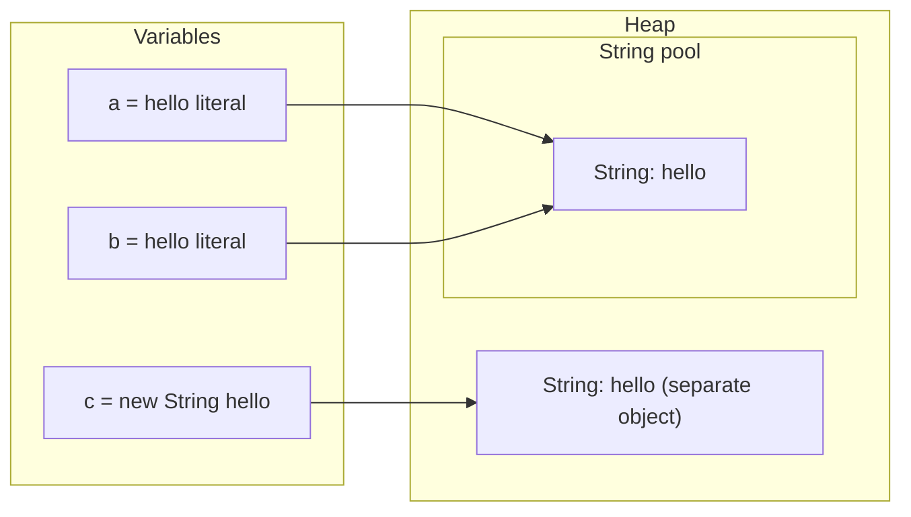
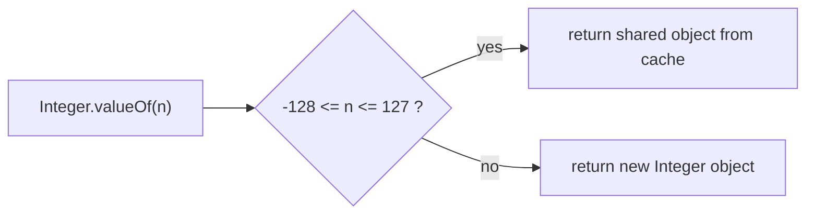
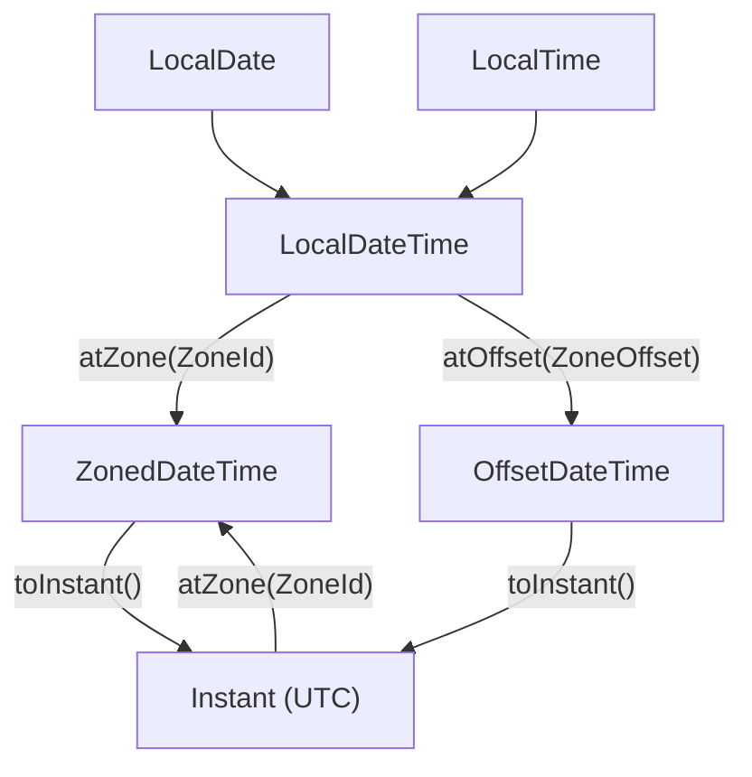

# Chapter 7 — Core APIs: Strings, Numbers, Dates and Randomness

Almost every Java class you write will touch a handful of library types: `String` and `StringBuilder` for text, `Math` and the wrapper classes (object versions of the primitive types: `Integer`, `Double`…) for numbers, `BigDecimal` for money, `java.time` for dates, and `Random` for simulations and tests. These live in `java.lang`, `java.math`, `java.time`, `java.text` and `java.util`, and they are part of every JDK — no dependencies (external libraries you would have to download) needed.

This chapter teaches each API the way you'll actually use it: what it is, how it behaves, the handful of methods that matter, and the mistakes that cause real bugs (comparing strings with `==`, the `Integer` cache, `new BigDecimal(0.1)`, `YYYY` in date patterns, daylight-saving gaps — the clock hour that is skipped when clocks "spring forward"). [Chapter 2 §2.12](../02-basics-types-and-operators/README.md#212-strings-and-text-blocks) already introduced `String` basics and text blocks, and [§2.11](../02-basics-types-and-operators/README.md#211-floating-point-numbers) explained why `0.1 + 0.2 != 0.3`; here we go deeper instead of repeating.

**What you'll learn**

| § | Topic | You'll be able to… |
|---|---|---|
| 7.1 | String immutability and the pool | explain why `String` is immutable, how the pool and `intern` work, and when `==` "works" by accident |
| 7.2 | The `String` API | pick the right method for searching, splitting, comparing and transforming text; handle Unicode correctly |
| 7.3 | `StringBuilder`, `StringJoiner` | build text efficiently and know when `+` is fine |
| 7.4 | Formatting text and numbers | use `format`/`formatted`/`printf` specifiers, locales, `NumberFormat`, `DecimalFormat`, `HexFormat` |
| 7.5 | `Math` | round, divide, clamp and detect overflow correctly |
| 7.6 | Wrapper classes and autoboxing | avoid the `Integer` cache, null-unboxing and `remove(int)` traps |
| 7.7 | `BigInteger` and `BigDecimal` | do exact arithmetic and money with the right rounding |
| 7.8 | The `java.time` model | choose between `LocalDate`, `ZonedDateTime`, `Instant`, `Duration`, `Period` |
| 7.9 | Local dates and times | create, adjust, compare and measure calendar values |
| 7.10 | Zones, instants and DST | convert between zones and survive daylight-saving changes |
| 7.11 | Formatting and parsing dates | write safe patterns (and avoid `YYYY`) |
| 7.12 | Random numbers | pick between `Random`, `ThreadLocalRandom`, `SecureRandom` and `RandomGenerator` |

All runnable code is in [`code/`](code/) (package `ch07.*`), compiled with `javac --release 25` and run on JDK 26; every "Output:" block below is pasted from a real run.

> **Exam depth.** Tricky `String`/`StringBuilder` method-chain puzzles, `Math` return types and date-time arithmetic questions are drilled in [OCP Chapter 4 — Core APIs](../../../../ocp-java21-study/chapters/04-core-apis/README.md). Number and date formatting with locales and resource bundles: [OCP Chapter 11 — Exceptions and localization](../../../../ocp-java21-study/chapters/11-exceptions-localization/README.md) (sections 5–8).

---

## 7.1 Strings: immutability, the pool and memory

### What it is
A `String` is an object that holds a fixed sequence of characters. **Immutable** means that once a `String` object is created, nothing can change its contents: every method that looks like it modifies a string (`toUpperCase`, `replace`, `concat`, `strip`…) actually returns a **new** `String`.

Analogy: a printed page. You can photocopy it and write on the copy, but the original page never changes — anyone else holding the original still sees the same text.

### Why it matters
Immutability is a deliberate design choice with several pay-offs:

| Benefit | Why immutability enables it |
|---|---|
| Safe sharing | Many variables (and threads — independent paths of execution running at the same time) can point to one `String` with no risk that one of them changes it — no locking (making other threads wait their turn) needed. |
| Safe `HashMap` keys | A key's hash code (an `int` computed from its contents, used by a hash table to find it) can't change after insertion, so lookups keep working. `String` even caches its `hashCode` after the first call. |
| Security | A file path or class name checked by security code can't be altered afterwards by the caller. |
| The string pool | Identical literals can share one object only because nobody can modify it. |

### How it works — the string pool
1. Every string **literal** in your source code (`"hello"`) is stored once in the **string pool** (also called the *intern pool*), a table the JVM keeps on the heap (the memory area where objects live; it moved there from PermGen, an older separate area for class data, in Java 7).
2. Two identical literals anywhere in the program refer to the **same** pooled object.
3. **Compile-time constant expressions** — literals joined with `+`, or `final` variables initialised with constants — are folded (computed and joined at compile time) by the compiler into one literal, so they are pooled too.
4. Strings computed **at run time** (concatenating a non-final variable, reading input, `new String(...)`) are ordinary new heap objects, not pooled.
5. `s.intern()` returns the pooled copy of `s`'s contents, adding it to the pool if necessary.



[`code/ch07/strings/StringPool.java`](code/ch07/strings/StringPool.java):
```java
String a = "hello";                      // literal -> string pool
String b = "hello";                      // same pooled object
String c = new String("hello");          // always a new heap object
String d = c.intern();                   // pooled copy
String e = "hel" + "lo";                 // constant expression, folded at compile time
String part = "hel";
String f = part + "lo";                  // computed at run time -> new object
final String constPart = "hel";
String g = constPart + "lo";             // final + literal initialiser = constant -> pooled
```
Output:
```text
a == b: true
a == c: false, a.equals(c): true
a == c.intern(): true
a == "hel" + "lo": true
a == part + "lo": false
a == constPart + "lo": true
s=java, upper=JAVA, same object? false
"x".equals(null)=false, Objects.equals(null,null)=true
```

**The lesson:** `==` compares *references* (same object?), `equals` compares *contents*. Because of the pool, `==` sometimes *appears* to work on strings — then fails on the first string that came from user input or a database. Always use `equals` (or `Objects.equals(a, b)` when either side may be `null`, or put the literal first: `"yes".equals(answer)`).

### How strings are stored (Java 9+)
Since Java 9 (**compact strings**, JEP 254 — a JEP is a numbered JDK Enhancement Proposal) a `String` stores its characters in a `byte[]`: one byte per character when every character fits in Latin-1 (a one-byte character set for Western European languages), otherwise two bytes per character (UTF-16). This roughly halves memory for mostly-ASCII (the basic 128 English letters, digits and symbols) text and is invisible to your code. Also since Java 9 (JEP 280), `a + b + c` is compiled to an optimised `invokedynamic` call (a bytecode instruction that lets the JVM choose the implementation at run time), so a *single* concatenation expression is already efficient — only concatenation *inside loops* needs `StringBuilder` (§7.3).

### Common mistakes
- Calling a "modifying" method and ignoring the result: `s.trim();` does nothing useful — write `s = s.trim();`.
- Comparing with `==` (see above), including `switch`-like `if (cmd == "quit")` chains.
- Calling `intern()` everywhere "to save memory" — the pool is a shared table; modern JVMs already deduplicate where it pays (G1, the default garbage collector, has an optional string-deduplication flag). Intern only with measurements.

### In the interview
**30-second answer:** "`String` is immutable and final (no subclasses allowed). That makes it thread-safe (safe to share between threads), lets it cache its hash code so it's a good map key, keeps security checks valid, and allows the JVM to pool identical literals. Literals and compile-time constants are pooled, runtime strings aren't, so `==` is unreliable — I always compare with `equals`."

- *Follow-up: How many objects does `new String("hi")` create?* → Up to two: the pooled literal `"hi"` (if it isn't already in the pool from class loading) and the new heap `String`.
- *Follow-up: Why is `String` final?* → So no subclass can break its immutability guarantees (e.g., a mutable "String" passed to security code).
- *Follow-up: Where is the pool?* → On the heap since Java 7, so pooled strings are garbage-collected like other objects when unreachable.

### Self-check
1. `String s = "a"; s.concat("b");` — what is `s`? → `"a"`; `concat` returned a new string that was discarded.
2. Is `"ab" == "a" + "b"` true? → Yes: a constant expression, folded at compile time.
3. Safest way to compare a possibly-null `input` to `"yes"`? → `"yes".equals(input)`.

### TL;DR
Strings never change; methods return new strings. Literals and constants are pooled, so `==` may coincidentally be `true` — never rely on it; use `equals`.

---

## 7.2 The `String` API toolkit

### What it is
`String` has around 100 methods. You need about 30. This section groups them by job, shows them in one program, and flags the ones with surprising behaviour. Indexes are **0-based** and ranges are **half-open**: `substring(begin, end)` includes `begin` and excludes `end`, so its length is `end - begin`.

### The methods, by purpose
| Job | Methods (Java version if newer than 8) | Notes |
|---|---|---|
| Size & emptiness | `length()`, `isEmpty()`, `isBlank()` (11) | `isBlank` is true for `""` and whitespace-only strings |
| Read characters | `charAt(i)`, `toCharArray()`, `chars()` (9), `codePointAt(i)`, `codePoints()` (9) | `charAt` returns a UTF-16 unit, see Unicode below |
| Search | `indexOf`, `lastIndexOf`, `contains`, `startsWith`, `endsWith`, `indexOf(ch/str, begin, end)` (21) | `indexOf` returns **-1** when not found |
| Extract | `substring(begin)`, `substring(begin, end)`, `subSequence` | throws `StringIndexOutOfBoundsException` for bad indexes |
| Whitespace | `trim()`, `strip()` (11), `stripLeading()`, `stripTrailing()` (11), `stripIndent()` (15) | `trim` removes chars ≤ U+0020; `strip` uses Unicode `Character.isWhitespace` — prefer `strip` |
| Case | `toUpperCase()`, `toLowerCase()`, with `Locale` (language/region setting) overloads | use `toLowerCase(Locale.ROOT)` for identifiers (see mistakes) |
| Replace | `replace(char, char)`, `replace(CharSequence, CharSequence)`, `replaceAll(regex, repl)`, `replaceFirst(regex, repl)` | `replace` is **literal**, `replaceAll` is **regex** (regular expression — a mini-language of text-matching patterns) |
| Compare | `equals`, `equalsIgnoreCase`, `compareTo`, `compareToIgnoreCase`, `contentEquals`, `regionMatches`, `matches(regex)` | `compareTo` < 0, 0, > 0 — not necessarily -1/1 |
| Split & join | `split(regex)`, `split(regex, limit)`, `splitWithDelimiters` (21), `String.join`, `lines()` (11) | `split` takes a **regex** |
| Build new text | `concat`, `repeat` (11), `indent` (12), `formatted` (15), `transform` (12), `String.valueOf(x)`, `String.format` | `valueOf(null object)` → `"null"` |
| Other | `hashCode`, `intern`, `translateEscapes` (15) | |

### Code
[`code/ch07/strings/StringApi.java`](code/ch07/strings/StringApi.java) (key parts):
```java
String s = "  Hello, Java World  ";
String t = s.strip();                                  // "Hello, Java World"
t.indexOf('o'); t.lastIndexOf('o'); t.indexOf("Kotlin");          // 4, 13, -1
t.substring(7); t.substring(7, 11);                               // "Java World", "Java"
t.replace('o', '0'); t.replaceAll("[aeiou]", "*");                // literal vs regex
"apple".compareTo("banana"); "Z".compareTo("a");                  // -1, -7
"a,b,,c,,".split(",");  "a,b,,c,,".split(",", -1);                // trailing empties dropped vs kept
"1.2.3".split(".");     "1.2.3".split("\\.");                     // regex dot matches everything!
"a+b-c".splitWithDelimiters("[+-]", 0);                           // Java 21
"education".chars().filter(c -> "aeiou".indexOf(c) >= 0).count(); // count vowels
String emoji = "I ❤ Jäva 😀";                  // heart, a-umlaut, grinning face
emoji.length(); emoji.codePointCount(0, emoji.length());
```
Output:
```text
length=21 isEmpty=false isBlank("  ")=true
strip -> [Hello, Java World] charAt(7)=J
indexOf('o')=4 lastIndexOf('o')=13 indexOf("Java")=7 indexOf("Kotlin")=-1
contains=true startsWith=true endsWith=true
substring(7)=Java World substring(7, 11)=Java
replace=Hell0, Java W0rld | replaceAll=H*ll*, J*v* W*rld
upper=HELLO, JAVA WORLD lower=hello, java world
repeat=ababab join=a-b-c joinList=usr/local/bin
equals=false equalsIgnoreCase=true compareTo("apple","banana")=-1 compareTo("b","a")=1 compareTo("Z","a")=-7 compareToIgnoreCase=25
split(",")=[a, b, , c]
split(",", -1)=[a, b, , c, , ]
split("\\s+")=[one, two, three]
split(".") on 1.2.3 -> 0 parts; split("\\.") -> [1, 2, 3]
splitWithDelimiters=[a, +, b, -, c]
palindrome(level)=true toCharArray=[a, b, c] vowels=5
lines=[a, b, c] indent=[  x\n]
formatted=Ada is 36 valueOf(3.5)=3.5 valueOf(char[])=hi
I ❤ Jäva 😀 length=11 codePoints=10 charAt(9) is high surrogate? true
```

What to notice:
- **`compareTo`** compares character by character and returns the *difference* of the first differing characters (`'Z'` is 90, `'a'` is 97, so -7), or the length difference if one string is a prefix of the other. It is **case-sensitive and uppercase sorts before lowercase** — `"Zebra"` comes before `"apple"`. For human-facing sorting use `String.CASE_INSENSITIVE_ORDER` or a locale-aware `java.text.Collator`.
- **`split` takes a regular expression.** `.` means "any character", so `"1.2.3".split(".")` splits at every character and — because trailing empty strings are removed — returns an empty array. Escape (`"\\."`) or use `Pattern.quote(".")`. Likewise `|`, `+`, `*`, `?`, `(`, `[`, `$`, `^` and `\` are special.
- **`split` drops trailing empty strings** unless you pass a negative limit (`split(",", -1)`) — important when parsing CSV-like (comma-separated values, a plain-text table format) lines where the last fields may be empty.
- **`replace` vs `replaceAll`:** both replace *all* occurrences; the difference is literal vs regex. `replaceAll("$", "")` doesn't remove dollar signs; `replace("$", "")` does.

### Unicode: `length()` is not "number of characters"
Java `char` is a 16-bit **UTF-16 code unit**. Most characters fit in one `char`, but characters outside the Basic Multilingual Plane (the first 65 536 Unicode characters) — many emoji, some CJK (Chinese, Japanese, Korean) and historic scripts — need **two** `char`s, called a **surrogate pair**. A **code point** is the actual Unicode character number.

In the output above, the string has 10 visible characters but `length()` is 11, because 😀 takes two `char`s. Consequences:
- `charAt`, `substring` and `reverse` by index can cut a surrogate pair in half. (`StringBuilder.reverse` is surrogate-aware; manual loops usually aren't.)
- To iterate real characters use `s.codePoints()`; to count them, `s.codePointCount(0, s.length())`.
- Even code points aren't "what the user sees": a flag or a family emoji is several code points. For user-perceived characters (grapheme clusters) use `java.text.BreakIterator`.

### Common mistakes
| Mistake | Fix |
|---|---|
| `"TITLE".toLowerCase()` in Turkish locale gives `"tıtle"` (dotless ı) | Use `toLowerCase(Locale.ROOT)` for keys, protocols, file extensions |
| `split(".")`, `split("|")` | Escape the regex or `Pattern.quote` |
| Forgetting `-1` limit when trailing fields may be empty | `line.split(",", -1)` |
| `s.substring(0, 10)` on a shorter string | Check `length()` first, or `s.substring(0, Math.min(10, s.length()))` |
| Using `trim` on text with Unicode spaces (e.g. non-breaking or ideographic spaces) | `strip()` |
| Building a string in a loop with `+=` | `StringBuilder` (§7.3) |

### Real-world examples
- Log parsing: `line.split("\\s+", 4)` — limit the split so the free-text message stays in one piece.
- Normalising user input: `email.strip().toLowerCase(Locale.ROOT)` before looking up an account.
- `startsWith("https://")`, `endsWith(".json")` for quick routing checks.

### Self-check
1. `"banana".indexOf("an", 2)`? → 3.
2. `"a:b:".split(":").length`? → 2 (trailing empty string removed).
3. Why can `length()` exceed the number of emoji-containing characters you see? → It counts UTF-16 units; supplementary characters use two.
4. Literal replacement of `.` with `-` in `"1.2.3"`? → `replace(".", "-")` (not `replaceAll`).

### TL;DR
Know the half-open ranges, that `indexOf` returns -1, that `split`/`replaceAll`/`matches` take regexes, that `compareTo` is case-sensitive, and that `length()` counts UTF-16 units. Prefer `strip`, `isBlank`, `repeat`, `lines` (Java 11+).

---

## 7.3 `StringBuilder`, `StringBuffer` and `StringJoiner`

### What it is
A **`StringBuilder`** is a *mutable* (changeable) sequence of characters: you can append, insert, delete and replace in place, then call `toString()` once at the end. It's the tool for building text step by step.

Analogy: a `String` is a printed page; a `StringBuilder` is a whiteboard you keep editing, then photograph (`toString()`) when finished.

### Why it matters
Because strings are immutable, `result += piece` inside a loop creates a brand-new `String` each iteration and copies all the previous characters into it. For *n* pieces that's O(n²) character copying (Big-O notation: the work grows with the square of *n*). A `StringBuilder` grows an internal buffer (a block of memory it writes into; default capacity 16, roughly doubling when full), so appending is amortised O(1) (constant time on average, even though an occasional append must copy everything) and the whole build is O(n).

When is `+` fine? For a single expression like `"Hello, " + name + "!"` — the compiler already produces efficient code (§7.1). Use `StringBuilder` when you concatenate **in a loop** or across many statements.

### How it works
1. Create: `new StringBuilder()`, `new StringBuilder("start")`, or `new StringBuilder(expectedCapacity)`.
2. Mutate with methods that **return the same builder** (so they chain): `append`, `insert`, `delete`, `deleteCharAt`, `replace`, `reverse`, `repeat` (21). `setCharAt` and `setLength` return `void`.
3. Read with `length()`, `charAt`, `indexOf`, `substring` (returns a `String`, doesn't change the builder).
4. Finish with `toString()`.

[`code/ch07/strings/BuilderDemo.java`](code/ch07/strings/BuilderDemo.java) (key parts):
```java
StringBuilder sb = new StringBuilder("Java");
sb.append(' ').append(25).append(" LTS");          // methods return this -> chaining
sb.insert(0, ">> ");
sb.replace(3, 7, "JAVA");                          // replace [3, 7) with "JAVA"
sb.delete(0, 3);
sb.deleteCharAt(sb.length() - 1).setCharAt(0, 'j');
new StringBuilder("stressed").reverse();
new StringBuilder().repeat("=-", 5).repeat('!', 2);    // Java 21

StringBuilder x = new StringBuilder("abc"), y = new StringBuilder("abc");
x.equals(y);                                       // false! identity comparison

StringBuilder csv = new StringBuilder();
for (int i = 1; i <= 5; i++) {
    if (!csv.isEmpty()) csv.append(',');
    csv.append(i * i);
}
StringJoiner joiner = new StringJoiner(", ", "[", "]");
```
Output:
```text
append:  Java 25 LTS (length 11)
insert:  >> Java 25 LTS
replace: >> JAVA 25 LTS
delete:  JAVA 25 LTS
deleteCharAt+setCharAt: jAVA 25 LT
reverse: desserts
indexOf("25")=5 charAt(1)=A
repeat (21): =-=-=-=-=-!!
x.equals(y)=false x.toString().equals(y.toString())=true x.compareTo(y)=0 "abc".contentEquals(x)=true
loop: 1,4,9,16,25
StringJoiner: [Java, Kotlin, Scala]
capacity=1000 length=0
```

### Trade-offs
| | `String` + `+` | `StringBuilder` | `StringBuffer` | `StringJoiner` / `String.join` / `Collectors.joining` |
|---|---|---|---|---|
| Mutable | No | Yes | Yes | builds internally |
| Thread-safe | Yes (immutable) | **No** | Yes (every method `synchronized` — only one thread at a time may run it) | No |
| Use for | one-off expressions | loops, incremental building | legacy code only | joining a sequence with delimiter/prefix/suffix |

`StringBuffer` is the Java 1.0 version of `StringBuilder` (added in Java 5). Its locking is almost never what you want — sharing one half-built string between threads is rarely a sensible design — so use `StringBuilder`.

### Common mistakes
- `sb1.equals(sb2)` — `StringBuilder` does **not** override `equals`/`hashCode`, so this is identity. Compare `sb1.toString().equals(sb2.toString())`, `sb1.compareTo(sb2) == 0` (Java 11), or `"abc".contentEquals(sb)`.
- Using a `StringBuilder` as a `HashMap` key or in a `HashSet` (same reason, and it's mutable).
- `sb.append(a + b + c)` in a loop — the inner `+` builds a temporary string; write `.append(a).append(b).append(c)`.
- Sharing one `StringBuilder` between threads.
- `new StringBuilder('x')` — a `char` is widened to `int` and treated as the **capacity**, giving an empty builder. Use `new StringBuilder("x")`.

### In the interview
**30-second answer:** "Strings are immutable, so repeated `+=` in a loop copies everything each time — O(n²). `StringBuilder` is a growable mutable buffer with amortised O(1) appends. `StringBuffer` is the same but synchronized, which is legacy. A single `+` expression is fine; the compiler optimises it."

- *Follow-up: Does `StringBuilder` override `equals`?* → No; compare via `toString()` or `compareTo`.
- *Follow-up: Default capacity?* → 16 characters (or 16 + initial string length); it grows automatically.

### Self-check
1. `new StringBuilder("abc").reverse().insert(1, "-")`? → `"c-ba"`.
2. Does `sb.substring(1)` change `sb`? → No, it returns a `String`.
3. Why not `StringBuffer`? → Unneeded synchronisation; `StringBuilder` is the modern default.

### TL;DR
Loop-building text → `StringBuilder`; joining a list → `String.join`/`StringJoiner`/`Collectors.joining`; one-line concatenation → `+`. `StringBuilder` has no value-based `equals`.

---

## 7.4 Formatting text and numbers

### What it is
**Formatting** turns values into text with a controlled layout: width, alignment, decimal places, thousands separators, currency symbols. Java's main tool is the `java.util.Formatter` mini-language used by `String.format(...)`, `"...".formatted(...)` (Java 15) and `System.out.printf(...)`. For locale-aware business formatting there's `java.text.NumberFormat`/`DecimalFormat`, and for bytes `java.util.HexFormat` (Java 17).

### How it works — format specifiers
A specifier has the shape `%[argument_index$][flags][width][.precision]conversion`:

| Part | Examples | Meaning |
|---|---|---|
| conversion | `s` string, `d` integer, `f` fixed decimal, `e` scientific, `x`/`X` hex, `o` octal, `c` char, `b` boolean, `n` line separator, `%%` literal % | what kind of value |
| width | `%10s`, `%8d` | minimum characters; right-aligned by default |
| flags | `-` left-align, `0` zero-pad, `,` grouping separators, `+` always show sign, `(` negatives in parentheses | layout tweaks |
| precision | `%.2f` (2 decimals), `%.2s` (max 2 chars) | decimals for numbers, max length for strings |
| argument index | `%2$s` | use the 2nd argument (lets you reuse or reorder) |

[`code/ch07/format/Formatting.java`](code/ch07/format/Formatting.java) (key parts):
```java
String.format("|%s|%10s|%-10s|%.2s|", name, name, name, name);
String.format("|%d|%8d|%-8d|%08d|%,d|%+d|", 42, 42, 42, 42, 1234567, 42);
String.format("|%f|%.2f|%10.3f|%-10.1f|%e|", price, price, price, price, 12345.678);
String.format("|%x|%X|%o|%c|%b|%%|", 255, 255, 8, 'J', null);
String.format("|%2$s %1$s|%s|", "world", "hello");
"%s bought %d items for $%.2f".formatted(name, 3, 9.5);             // Java 15
String.format(Locale.US, "US: %,.2f", 1234567.891);
String.format(Locale.GERMANY, "DE: %,.2f", 1234567.891);
NumberFormat.getCurrencyInstance(Locale.US).format(new BigDecimal("1234.5"));
NumberFormat.getPercentInstance(Locale.US).format(0.256);
NumberFormat.getCompactNumberInstance(Locale.US, NumberFormat.Style.SHORT).format(1_250_000); // Java 12
new DecimalFormat("#,##0.00", DecimalFormatSymbols.getInstance(Locale.US)).format(1234.5);
HexFormat.ofDelimiter(":").withUpperCase().formatHex(new byte[]{10, -1, 127});        // Java 17
```
Output:
```text
|Ada|       Ada|Ada       |Ad|
|42|      42|42      |00000042|1,234,567|+42|
|3.141590|3.14|     3.142|3.1       |1.234568e+04|
|ff|FF|10|J|false|%|
|hello world|world|
Ada bought 3 items for $9.50
printf with %n line ending
US: 1,234,567.89
DE: 1.234.567,89
currency=$1,234.50 percent=26% compact=1M
DecimalFormat: 1,234.50 0.50 -7.00
HexFormat: 0A:FF:7F
```

What to notice:
- `%f` defaults to **6** decimals; `%.2f` **rounds** (HALF_UP — a trailing 5 rounds away from zero) rather than truncates.
- `%b` prints `false` for `null`, and `true` for *any* other non-Boolean object — it is not a "truthiness" check.
- In `|%2$s %1$s|%s|` the plain `%s` after indexed ones takes the *first* ordinary argument, `"world"` — mixing styles is confusing; pick one.
- `%n` produces the platform line separator (`\n` on macOS/Linux, `\r\n` on Windows); prefer it in `printf`.
- Wrong specifier for the type throws at run time: `String.format("%d", 3.5)` → `IllegalFormatConversionException`. Missing arguments → `MissingFormatArgumentException`.
- **Locale matters.** `String.format` uses the JVM's default locale, so a server running in Germany prints `1.234.567,89`. For machine-readable output (CSV, JSON, logs parsed by tools) pass `Locale.ROOT` or `Locale.US` explicitly. `Locale.of("de", "DE")` (Java 19) replaces the deprecated (officially discouraged and liable to be removed) `new Locale(...)` constructors.
- `DecimalFormat` patterns: `0` = digit, always shown; `#` = digit, hidden if zero; `,` grouping; `.` decimal point; `%` multiply by 100. `DecimalFormat` is **not thread-safe** — create one per use or per thread. (`DateTimeFormatter` from §7.11, in contrast, is immutable and thread-safe.)
- Compact number formatting rounds to a whole unit by default (`1.25M` → `1M`); `setMinimumFractionDigits(1)` keeps one decimal. Its rounding mode is `HALF_EVEN`, so 1,250,000 then prints `1.2M` while 1,260,000 prints `1.3M`.

### When not to use it
- Money *arithmetic* — format only at the edge; compute with `BigDecimal` or `long` cents (§7.7).
- Building SQL or HTML by formatting user input — use prepared statements (SQL with placeholders that the database driver fills in safely) / templating that escapes special characters.
- Hot logging paths — use your logger's placeholders (`log.info("user {} logged in", id)`), which skip formatting when the level is disabled.

### Self-check
1. `String.format("%05.1f", 3.14159)`? → `"003.1"` (width 5 includes the dot).
2. `String.format("%-5s|", "ab")`? → `"ab   |"`.
3. Why pass a `Locale` to `format` in a CSV exporter? → So decimal separators don't change with the server's locale.

### TL;DR
`%[index$][flags][width][.precision]conv`. `%s %d %.2f %,d %08d %-10s %x %n`. Be explicit about `Locale` for machine output; use `NumberFormat` for currency/percent/compact, `HexFormat` for bytes.

---

## 7.5 `Math`

### What it is
`java.lang.Math` is a utility class of `static` methods for arithmetic and trigonometry on primitives. You never create it (`Math` has a private constructor). Everything below is `double`-based unless noted, and the `*Exact` methods throw on overflow instead of wrapping silently.

### The methods you'll use
| Group | Methods | Return type & behaviour |
|---|---|---|
| Absolute, min, max | `abs`, `min`, `max` | same type as the arguments (after promotion) |
| Powers & roots | `pow(a, b)`, `sqrt`, `cbrt`, `hypot(x, y)`, `exp`, `log`, `log10` | `double` |
| Rounding | `round` → `long` (or `int` for `float`), `floor`/`ceil`/`rint` → `double` | `round` = nearest integer, ties toward +∞ (`-2.5` → `-2`); `rint` = ties to **even** |
| Integer division | `floorDiv`, `floorMod` (8), `ceilDiv`, `ceilMod` (18) | round toward −∞ / +∞ instead of toward 0 |
| Limiting | `clamp(value, min, max)` (21) | keeps a value inside a range |
| Overflow-safe | `addExact`, `subtractExact`, `multiplyExact`, `incrementExact`, `negateExact`, `toIntExact` (8), `absExact` (15), `divideExact` (18), `powExact` (25) | throw `ArithmeticException` on overflow |
| Trig & angles | `sin`, `cos`, `tan`, `atan2`, `toRadians`, `toDegrees`, constants `PI`, `E` | radians |
| Misc | `signum`, `random()` | `random()` returns a `double` in [0.0, 1.0) |

[`code/ch07/math/MathDemo.java`](code/ch07/math/MathDemo.java) output:
```text
abs(-7)=7 max(3,9)=9 min(2.5,-1)=-1.0
pow(2,10)=1024.0 sqrt(144)=12.0 cbrt(27)=3.0 hypot(3,4)=5.0
round(2.5)=3 round(-2.5)=-2 rint(2.5)=2.0 floor(-1.1)=-2.0 ceil(-1.1)=-1.0
7/2=3 -7/2=-3 floorDiv(-7,2)=-4 ceilDiv(7,2)=4 floorMod(-7,3)=2
clamp(150,0,100)=100 clamp(-3.5,0.0,1.0)=0.0
signum(-4.2)=-1.0 log10(1000)=3.0 exp(1)=2.7182818284590455
PI=3.141592653589793 sin(PI/2)=1.0 toDegrees(PI)=180.0
multiplyExact overflow -> ArithmeticException: integer overflow
pages=6 (same as (items + perPage - 1) / perPage = 6)
Math.random() in [0,1)? true
```

What to notice:
- `min(2.5, -1)` printed `-1.0`: the `int` was promoted to `double` first ([Chapter 2 §2.7](../02-basics-types-and-operators/README.md#27-type-conversion-widening-narrowing-casting-promotion)).
- `pow` always returns `double` — `(int) Math.pow(10, 2)` is fine for small values, but for big integer powers use `BigInteger.pow` or `Math.powExact` (Java 25) to avoid rounding and overflow.
- `/` on integers truncates toward zero (`-7/2 = -3`); `floorDiv` rounds toward negative infinity (`-4`). Use `floorMod` for "wrap-around" indexes (clock arithmetic, circular buffers), because `%` keeps the dividend's sign.
- **Paging:** `Math.ceilDiv(items, perPage)` (Java 18) replaces the classic `(items + perPage - 1) / perPage` trick, which can overflow for huge values.
- `Math.abs(Integer.MIN_VALUE)` is still negative — see [Chapter 2 §2.10](../02-basics-types-and-operators/README.md#210-integer-overflow); `absExact` throws instead.
- `StrictMath` gives bit-for-bit identical results on every platform; since Java 17 (JEP 306) all floating-point arithmetic is strict anyway, and `Math` may still use faster intrinsics (CPU-specific implementations the JIT compiler swaps in) for functions like `sin`.

### Self-check
1. Type of `Math.round(2.7)`? → `long` (3). `Math.round(2.7f)`? → `int`.
2. `Math.floorMod(-1, 7)`? → 6.
3. How do you detect that `a * b` overflowed an `int`? → `Math.multiplyExact(a, b)` throws `ArithmeticException`.

### TL;DR
`round` → `long`, half up; `floor`/`ceil`/`rint` → `double`. `floorDiv`/`floorMod`/`ceilDiv` for correct negative and paging arithmetic, `clamp` (21) for ranges, `*Exact` for overflow detection.

---

## 7.6 Wrapper classes and autoboxing

### What it is
Each primitive has a **wrapper class** — an immutable object holding one value: `byte→Byte`, `short→Short`, `int→Integer`, `long→Long`, `float→Float`, `double→Double`, `char→Character`, `boolean→Boolean`. You need them wherever Java requires an *object*: collections (`List<Integer>`, not `List<int>`), generics ([Chapter 9](../09-generics/README.md)), and fields that may be "absent" (`null`).

**Autoboxing** (Java 5) is the compiler automatically converting a primitive to its wrapper (`Integer x = 5;` becomes `Integer.valueOf(5)`); **unboxing** is the reverse (`int y = x;` becomes `x.intValue()`).

Analogy: a primitive is a coin; a wrapper is the coin in a small labelled envelope. Collections only accept envelopes; Java puts coins in and takes them out for you — but an empty envelope (`null`) has no coin to take out.

### How it works
1. **Boxing** calls `valueOf`. For `Integer`, `Short`, `Byte`, `Long` (−128 to 127), `Character` (0 to 127) and `Boolean`, `valueOf` returns **cached, shared objects**. The Java Language Specification (§5.1.7; the official rulebook of the language) guarantees this for boxed `int`, `short` and `byte` values in −128…127, `char` values up to 127, and `true`/`false`; the `Long` cache is a JDK implementation choice. `Integer`'s upper bound can be raised with `-XX:AutoBoxCacheMax=<n>`. `Float` and `Double` have no cache.
2. **Unboxing** calls `xxxValue()` — which throws `NullPointerException` (NPE; throwing an exception signals an error, [Chapter 8](../08-exceptions/README.md)) if the reference is `null`.
3. **Arithmetic and `<`/`>`** on wrappers unbox first. **`==` between two wrappers compares references**, not values. `==` between a wrapper and a primitive unboxes the wrapper.
4. The `new Integer(5)` style constructors have been deprecated since Java 9 — always use `valueOf` (or just autobox).



[`code/ch07/wrappers/WrappersDemo.java`](code/ch07/wrappers/WrappersDemo.java) (key parts):
```java
Integer a = 127, b = 127, c = 128, d = 128;
(a == b); (c == d); c.equals(d);                   // true, false, true

Long big = 42L;
big.equals(42);                                    // false: 42 boxes to Integer, a different class
big == 42;                                         // true: big is unboxed, numeric comparison

Map<String, Integer> stock = new HashMap<>();
int apples = stock.get("apples");                  // get returns null -> NPE while unboxing

List<Integer> list = new ArrayList<>(List.of(10, 20, 30));
list.remove(1);                                    // remove(int index)  -> [10, 30]
list.remove(Integer.valueOf(10));                  // remove(Object o)   -> [30]

Integer maybe = null;
Integer result = true ? maybe : 0;                 // mixed boxed/primitive ternary unboxes -> NPE

Long total = 0L;
for (long i = 0; i < 1_000; i++) total += i;       // unbox, add, re-box: 1,000 allocations
```
Output:
```text
boxed then unboxed: 5
127 == 127: true, 128 == 128: false, 128 equals 128: true
parseInt=42 valueOf=42 parseInt("ff",16)=255 toBinaryString(10)=1010 Double.parseDouble("1e3")=1000.0 Boolean.parseBoolean("YES")=false
NumberFormatException: For input string: "4 2"
Integer.MAX_VALUE=2147483647 Integer.compare(3,7)=-1 Integer.sum(2,3)=5 Integer.bitCount(255)=8 Character.isDigit('7')=true Character.toUpperCase('q')=Q Character.getNumericValue('9')=9
Long(42).equals(Integer 42): false, big == 42: true
NPE: Cannot invoke "java.lang.Integer.intValue()" because the return value of "java.util.Map.get(Object)" is null
safe: 0
after remove(1) and remove(Integer.valueOf(10)): [30]
ternary unboxing NPE
total=499500
```

### Parsing and converting
| You have | You want | Use |
|---|---|---|
| `String` | `int` | `Integer.parseInt(s)` (radix — number base — overload: `parseInt("ff", 16)`) |
| `String` | `Integer` | `Integer.valueOf(s)` |
| `int` | `String` | `String.valueOf(i)`, `Integer.toString(i)`, `Integer.toBinaryString/HexString` |
| `String` | `boolean` | `Boolean.parseBoolean(s)` — `true` **only** for `"true"` (any case); everything else, including `"YES"`, is `false` |
| `double` | `int` | cast `(int) d` (truncates) or `Math.round` |

Invalid numeric text throws the unchecked (the compiler doesn't force you to catch it) **`NumberFormatException`**. The parse methods don't trim: `" 42"` fails. Since the parser is strict, validate or catch at the boundary where text enters your program.

Handy statics: `Integer.MAX_VALUE`/`MIN_VALUE`, `Integer.compare(a, b)` (use this instead of `a - b` in comparators — objects that decide the order of two values — which can overflow), `Integer.sum/max/min` (useful as method references, the `Integer::sum` shorthand for a lambda), `Character.isDigit/isLetter/isWhitespace/toUpperCase`, `Character.getNumericValue`.

### Trade-offs — primitive vs wrapper
| | `int` | `Integer` |
|---|---|---|
| Memory | 4 bytes | object header (bookkeeping data the JVM stores in every object) + value (typically 16 bytes) + reference |
| Can be `null` | No (default 0) | Yes — useful for "unknown", dangerous when unboxed |
| Collections/generics | Not allowed | Required |
| `==` | compares values | compares references |
| Speed in hot loops | fast | boxing allocates (except cached values) |

### When not to use wrappers
- Local variables, counters, loop indexes, arithmetic — use primitives. The `Long total` loop above allocates on every iteration (*Effective Java*, Item 61: prefer primitives to boxed primitives).
- Large numeric arrays/collections in performance-sensitive code — prefer `int[]` or primitive streams (`IntStream`) over `List<Integer>`.

### Common mistakes
1. `==` on wrappers — works for small cached values in tests, fails in production at 128. Use `equals` or unbox.
2. `Long.equals(Integer)` is always false — the classes differ. Watch `map.get(42)` on a `Map<Long, …>` (it returns `null`; use `42L`).
3. Unboxing `null`: from `Map.get`, from a nullable database column, or in a ternary (`cond ? a : b`) mixing `Integer` and `int`.
4. `List<Integer>.remove(1)` removes by **index**; use `remove(Integer.valueOf(1))` for the value.
5. Synchronising on a wrapper (`synchronized (count)`) — cached instances are shared JVM-wide; `javac` warns about synchronising on (using as a lock) these *value-based* classes (classes whose instances are meant to be treated as plain values, not distinct identities).

### In the interview
**30-second answer:** "Wrappers let primitives live in collections and generics. Autoboxing calls `valueOf`, which caches −128 to 127, so `==` on two `Integer`s is true for 127 and false for 128 — always use `equals`. Unboxing `null` throws an NPE, which bites with `Map.get` and mixed ternaries. I use primitives for arithmetic and wrappers only where an object or null is needed."

- *Follow-up: Is `Integer i1 = 1000, i2 = 1000; i1 == i2` guaranteed false?* → Not guaranteed — the cache upper bound is configurable, but by default it's false. The point is it's *reference* comparison, so never rely on it.
- *Follow-up: `new Integer(5) == new Integer(5)`?* → Always false (two objects); the constructor is deprecated anyway.

### Self-check
1. `Integer x = null; int y = x;` → ? → `NullPointerException`.
2. `Short s = 100; s.equals(100)`? → `false` — `100` boxes to `Integer`.
3. `Boolean.parseBoolean("True")`? → `true` (case-insensitive).

### TL;DR
Autoboxing = `valueOf`, unboxing = `xxxValue()`. Cache −128…127 makes `==` lie; use `equals`. Null unboxing → NPE. `remove(int)` vs `remove(Object)`. Primitives for math, wrappers for collections.

---

## 7.7 `BigInteger` and `BigDecimal`

### What it is
Two immutable classes in `java.math` for numbers that primitives can't represent exactly:
- **`BigInteger`** — whole numbers of *any* size (limited only by memory). Use when values exceed `long` (about 9.2 × 10¹⁸): factorials, cryptography, exact combinatorics.
- **`BigDecimal`** — exact *decimal* numbers: an arbitrary-precision (as many digits as needed) integer **unscaled value** plus a **scale** (the number of digits after the decimal point). `12.30` is unscaled `1230`, scale `2`. Use for money and anything that must match human decimal arithmetic.

Analogy: `double` is a ruler with fine but binary tick marks — 0.1 falls between two ticks. `BigDecimal` is counting coins: exact, but slower.

### How it works
1. Both are **immutable**: `a.add(b)` returns a new object — assign the result (`total = total.add(x);`). There are no operators; you call `add`, `subtract`, `multiply`, `divide`, `pow`, `negate`, `abs`, `compareTo`.
2. **Create `BigDecimal` from a `String`** (`new BigDecimal("0.10")`) or `BigDecimal.valueOf(double)` (which goes through `Double.toString`, giving the short decimal you expect). `new BigDecimal(0.1)` copies the double's exact binary value — 55 digits of noise.
3. **Division** must say how to round when the result doesn't terminate: `divide(divisor, scale, RoundingMode)` or `divide(divisor, MathContext)` (an object bundling a precision and a rounding mode). Plain `divide(divisor)` throws `ArithmeticException` for 10/3.
4. **Rounding** is explicit: `setScale(2, RoundingMode.HALF_EVEN)`. Modes: `UP`/`DOWN` (away from / toward zero), `CEILING`/`FLOOR` (toward +∞ / −∞), `HALF_UP` (school rounding), `HALF_DOWN`, `HALF_EVEN` (**banker's rounding**: ties go to the even neighbour, which avoids systematic upward bias over many operations), `UNNECESSARY` (throws if rounding would be needed).
5. **`equals` compares value *and scale*** (`2.0` ≠ `2.00`); **`compareTo` compares value only**. Use `compareTo(...) == 0` for numeric equality.

[`code/ch07/big/BigNumbers.java`](code/ch07/big/BigNumbers.java) (key parts):
```java
BigInteger f = BigInteger.ONE;
for (int i = 2; i <= 30; i++) f = f.multiply(BigInteger.valueOf(i));      // 30!
BigInteger.TWO.pow(100);
BigInteger.valueOf(3).modPow(BigInteger.valueOf(200), BigInteger.valueOf(1000));
f.longValueExact();                                     // throws: doesn't fit

new BigDecimal("0.1").add(new BigDecimal("0.2"));       // 0.3 exactly
new BigDecimal(0.1);                                    // the double's binary value
new BigDecimal("2.0").equals(new BigDecimal("2.00"));   // false (scale differs)
ten.divide(three);                                      // ArithmeticException
ten.divide(three, 4, RoundingMode.HALF_UP);             // 3.3333

BigDecimal price = new BigDecimal("19.99");
BigDecimal subtotal = price.multiply(BigDecimal.valueOf(3));
BigDecimal tax = subtotal.multiply(new BigDecimal("0.0825")).setScale(2, RoundingMode.HALF_EVEN);
```
Output:
```text
30! = 265252859812191058636308480000000 (108 bits)
2^100 = 1267650600228229401496703205376
gcd(84,36)=12 3^200 mod 1000=1 isProbablePrime(97)=true sqrt(10^20)=10000000000
30!.longValueExact(): BigInteger out of long range
double 0.1+0.2=0.30000000000000004 BigDecimal=0.3
new BigDecimal(0.1)=0.1000000000000000055511151231257827021181583404541015625
BigDecimal.valueOf(0.1)=0.1
2.0 equals 2.00? false, compareTo == 0? true, scales 1 vs 2, stripTrailingZeros equal? true
10/3: Non-terminating decimal expansion; no exact representable decimal result.
10/3 scale 4 HALF_UP=3.3333 MathContext.DECIMAL64=3.333333333333333
2.345 -> HALF_UP 2.35, HALF_EVEN 2.34, DOWN 2.34, FLOOR 2.34
2.355 -> HALF_UP 2.36, HALF_EVEN 2.36, DOWN 2.35, FLOOR 2.35
-2.345 -> HALF_UP -2.35, HALF_EVEN -2.34, DOWN -2.34, FLOOR -2.35
subtotal=59.97 tax=4.95 total=64.92
share=33.33 leftover cent(s)=0.01 (divideAndRemainder: 33.00 r 1.00)
```

Read the rounding rows: for `2.345`, the tie goes *up* with `HALF_UP` (2.35) but to the *even* digit with `HALF_EVEN` (2.34); for `2.355` both give 2.36 because 6 is even. `FLOOR` differs from `DOWN` only for negatives.

The last line shows a classic money problem: $100.00 split three ways is 33.33 each with **one cent left over**. Real systems allocate the remainder explicitly (e.g., the first account gets 33.34) rather than letting it vanish.

### Trade-offs
| | `double` | `long` cents | `BigDecimal` |
|---|---|---|---|
| Exact decimals | No | Yes (fixed 2 places) | Yes (any scale) |
| Speed | Fastest (hardware) | Fast | Much slower, allocates |
| Range | Huge, approximate | ±9.2 × 10¹⁶ dollars | Unlimited |
| Good for | Science, graphics, statistics | Payments in one currency, high throughput | Finance, tax, currency conversion, accounting |

### Common mistakes
- `new BigDecimal(0.1)` → use the `String` constructor or `valueOf`.
- `total.add(x);` without assignment (immutable!).
- `equals` for numeric comparison; also, **`HashSet`/`HashMap` use `equals`**, so `2.0` and `2.00` are different keys, while a `TreeSet` (a sorted set; uses `compareTo`) treats them as one. Normalise with `stripTrailingZeros()` or a fixed `setScale` before using as keys.
- Unbounded `divide` → `ArithmeticException`; always pass a scale/rounding or a `MathContext`.
- Rounding too early (per line item) vs. at the end — follow your domain's (often legal) rules; tax is frequently rounded per invoice line.
- Using `BigInteger`/`BigDecimal` in tight numeric loops where `long` suffices.

### Real-world examples
- Payment platforms store amounts as integer minor units (cents) *or* `DECIMAL(19,4)` columns (an exact SQL number type: 19 digits, 4 after the decimal point) mapped to `BigDecimal` — see the SQL handbook's data types chapter for `NUMERIC` in PostgreSQL.
- RSA (a public-key encryption algorithm) keys and `KeyPairGenerator` internals use `BigInteger.modPow` and `isProbablePrime`.

### In the interview
**30-second answer:** "For money I use `BigDecimal` built from strings, or long minor units. Doubles are binary fractions, so 0.1 isn't representable. `BigDecimal` is immutable, needs an explicit scale and `RoundingMode` for division — usually `HALF_EVEN` for finance — and I compare with `compareTo` because `equals` also checks scale."

- *Follow-up: Why is `new BigDecimal("1.0").equals(new BigDecimal("1.00"))` false?* → `equals` includes scale; `compareTo` returns 0.
- *Follow-up: What's banker's rounding?* → `HALF_EVEN`: ties round to the even neighbour, eliminating the upward bias of always rounding .5 up.

### Self-check
1. `BigDecimal.valueOf(1.10).scale()`? → 1 (`Double.toString(1.10)` is `"1.1"`).
2. What does `divide` without rounding do for 1/3? → Throws `ArithmeticException`.
3. `new BigDecimal("-1.5").setScale(0, RoundingMode.HALF_EVEN)`? → `-2`.

### TL;DR
`BigInteger` for huge integers, `BigDecimal` for exact decimals. Build from `String`, assign every result, give `divide` a scale + `RoundingMode`, compare with `compareTo`, and prefer `HALF_EVEN` for money.

---

## 7.8 The `java.time` model

### What it is
`java.time` (JSR 310 — a Java Specification Request, the formal proposal for a new API — **Java 8**, designed by the author of the Joda-Time library, the popular earlier date library) is Java's date-and-time API. It replaced `java.util.Date`, `Calendar` and `SimpleDateFormat`, which were mutable, not thread-safe, used 0-based months, and mixed up "a point in time" with "a date on a calendar". All `java.time` types are **immutable** and **thread-safe**.

The key idea: **different questions need different types.** "What's the user's birthday?" has no time zone (a region's rules for its offset from UTC — Coordinated Universal Time, the world reference clock — including daylight saving time, DST, when clocks move forward or back an hour). "When did this payment happen?" is an exact moment. "What time does the 9:00 meeting start in Tokyo?" needs a zone.

| Type | Holds | Example | Use for |
|---|---|---|---|
| `LocalDate` | year-month-day | `2025-09-16` | birthdays, holidays, due dates |
| `LocalTime` | hour-minute-second-nanos | `09:30` | opening hours, alarm times |
| `LocalDateTime` | date + time, **no zone** | `2025-09-16T09:30` | a wall-clock time (what a clock on the wall shows) whose zone is implied elsewhere |
| `ZonedDateTime` | date + time + zone (`ZoneId`) with DST rules | `2026-03-20T09:00-04:00[America/New_York]` | scheduling in a region, displaying to users |
| `OffsetDateTime` | date + time + fixed offset | `2026-03-20T09:00-04:00` | APIs, databases (`timestamp with time zone` values), logs |
| `Instant` | a point on the UTC timeline (seconds + nanos since 1970-01-01T00:00Z) | `2025-09-16T05:20:00Z` | event timestamps, storing "when", measuring machine time |
| `Duration` | an amount of **time** (seconds + nanos) | `PT2H15M30S` | timeouts, elapsed time |
| `Period` | an amount of **calendar** time (years, months, days) | `P1Y2M3D` | ages, subscriptions, "add one month" |
| `ZoneId` / `ZoneOffset` | region like `Europe/London` / fixed `+05:30` | | converting between zones |
| Also | `Year`, `YearMonth`, `MonthDay`, `DayOfWeek`, `Month` (enums), `Clock` | | |



### How to choose
1. Storing *when something happened* (logs, orders, audit — records kept for later checking) → `Instant` (store in UTC; convert for display).
2. A date with no time (birthday, invoice date) → `LocalDate`. Don't store it as midnight UTC — that shifts the day for users west of Greenwich.
3. A future appointment in a place → store `LocalDateTime` + `ZoneId` (not an `Instant`): if the government changes DST rules before the meeting, the meeting should still be at 9:00 local.
4. Machine elapsed time → `System.nanoTime()` or `Duration.between(instantA, instantB)`; calendar arithmetic → `Period`.

### Common API conventions
| Prefix | Meaning | Example |
|---|---|---|
| `of` | create from parts | `LocalDate.of(2025, 9, 16)` |
| `now` | current value (optionally from a `Clock` or zone) | `LocalDate.now(clock)` |
| `parse` | from text | `LocalDate.parse("2025-09-16")` |
| `get` | read a field | `getDayOfWeek()` |
| `with` | copy with one field changed | `withDayOfMonth(1)` |
| `plus` / `minus` | copy shifted by an amount | `plusMonths(1)` |
| `to` / `at` | convert to another type | `toLocalDate()`, `atZone(zone)` |
| `is` | query | `isBefore`, `isLeapYear` |

Months are **1-based** (`Month.JANUARY` = 1), unlike `Calendar`.

### Legacy interop
You'll meet `Date` in older libraries. Convert at the boundary: `Date.from(instant)`, `date.toInstant()`, `GregorianCalendar.from(zdt)`, `java.sql.Timestamp.from(instant)`. With JDBC (Java Database Connectivity, the standard database API) 4.2+ drivers you can read and write `LocalDate`, `LocalDateTime`, `OffsetDateTime` directly with `getObject(col, LocalDate.class)`.

---

## 7.9 Local dates, times, adjusters and `Period`

### How it works
1. **Create**: `LocalDate.of(2025, Month.SEPTEMBER, 16)`, `LocalTime.of(9, 30)`, `LocalDateTime.of(date, time)`, `LocalDate.parse("2023-09-19")`. Invalid values throw `DateTimeException` immediately.
2. **Read**: `getYear`, `getMonth`/`getMonthValue`, `getDayOfMonth`, `getDayOfWeek`, `getDayOfYear`, `isLeapYear`, `lengthOfMonth`.
3. **Adjust** (always returns a new object): `plusDays/Weeks/Months/Years`, `minus…`, `withDayOfMonth`, and **`TemporalAdjusters`** for rules like "last day of month" or "next Friday".
4. **Compare**: `isBefore`, `isAfter`, `isEqual`, `equals`, `compareTo`.
5. **Measure**: `Period.between(a, b)` gives years + months + days; `ChronoUnit.DAYS.between(a, b)` gives a single total.

[`code/ch07/time/LocalDates.java`](code/ch07/time/LocalDates.java) (key parts):
```java
LocalDate release = LocalDate.of(2025, Month.SEPTEMBER, 16);     // Java 25 GA date
LocalDate d = LocalDate.of(2024, 1, 31);
d.plusDays(1);                                                   // result ignored -> d unchanged
d.plusMonths(1);                                                 // 2024-02-29
release.with(TemporalAdjusters.lastDayOfMonth());
release.with(TemporalAdjusters.next(DayOfWeek.FRIDAY));
Period gap = Period.between(LocalDate.of(2023, 9, 19), release);
ChronoUnit.DAYS.between(LocalDate.of(2023, 9, 19), release);
Period.between(LocalDate.of(1990, 2, 28), LocalDate.of(2026, 2, 27)).getYears();   // age
LocalDate.of(2026, 3, 2).datesUntil(LocalDate.of(2026, 3, 9))                     // Java 9
         .filter(x -> x.getDayOfWeek().getValue() <= 5) ...
LocalDate.of(2025, 2, 29);                                       // DateTimeException
```
Output:
```text
date=2025-09-16 time=09:30 dateTime=2025-09-16T09:30
dayOfWeek=TUESDAY dayOfYear=259 month=SEPTEMBER monthValue=9 leapYear=false lengthOfMonth=30
d after ignored plusDays: 2024-01-31
2024-01-31 plusMonths(1)=2024-02-29 (clamped to month end, leap year)
2025-01-31 plusMonths(1)=2025-02-28
withDayOfMonth(1)=2025-09-01 lastDayOfMonth=2025-09-30 nextFriday=2025-09-19
isBefore=true isAfter=false equals=true
Period between Java 21 and 25 GA: P1Y11M28D = 1y 11m 28d; total days=728 total months=23
age on 2026-02-27 = 35
weekdays in week of 2026-03-02: 2 3 4 5 6 
YearMonth 2028-02 has 29 days
DateTimeException: Invalid date 'February 29' as '2025' is not a leap year
```

What to notice:
- **Month arithmetic clamps** to the last valid day: Jan 31 + 1 month = Feb 28 (or 29). So `d.plusMonths(1).minusMonths(1)` may not return `d`. Billing systems must decide what "monthly on the 31st" means.
- **`Period` vs total units:** `P1Y11M28D` is not "728 days expressed differently" — months have different lengths. Use `Period` for human display ("1 year, 11 months"), `ChronoUnit.X.between` for a single count.
- The age calculation gives 35 on the day *before* the 36th birthday — `Period.between` handles this correctly; subtracting years does not.
- `datesUntil` (Java 9) streams dates with the end **exclusive**, like most Java ranges.

### Common mistakes
- Ignoring return values (`date.plusDays(1);`) — the object is immutable.
- Using `LocalDateTime` for timestamps of events: it has no zone, so it can't identify an instant. Use `Instant` or `OffsetDateTime`.
- Calling `LocalDate.now()` directly inside business logic (the code that implements the application's real rules) — tests become date-dependent. Inject a `Clock` (pass it in from outside instead of creating it inside; §7.10).

### Self-check
1. `LocalDate.of(2024, 3, 31).minusMonths(1)`? → `2024-02-29`.
2. Days in the half-open range from 2026-03-02 to 2026-03-09? → 7.
3. Which gives "3 months" between Jan 15 and Apr 15: `Period` or `ChronoUnit.DAYS`? → `Period` (`P3M`); `DAYS` gives 90.

---

## 7.10 Zones, instants, `Duration` and daylight saving

### What it is
A **time zone** (`ZoneId`, e.g. `America/New_York`) is a region's set of rules: its offset from UTC and when that offset changes (**daylight saving time**, DST). An **offset** (`ZoneOffset`, e.g. `-04:00`) is just a fixed number of hours/minutes. Zone rules come from the IANA (Internet Assigned Numbers Authority) time-zone database, shipped with the JDK and updated in JDK updates when governments change rules.

### How it works
1. `instant.atZone(zone)` shows one moment as local time in a zone. The same `Instant` is 01:20 in New York, 10:50 in Kolkata, 14:20 in Tokyo.
2. `zdt.withZoneSameInstant(otherZone)` converts a meeting to another zone (same moment, different clock reading). `withZoneSameLocal` keeps the clock reading and changes the moment — rarely what you want.
3. **DST gap** (spring forward): local times that don't exist are shifted forward by the gap length. **DST overlap** (fall back): local times that occur twice default to the earlier offset (`withLaterOffsetAtOverlap()` picks the other).
4. **`Duration` is exact time; `Period` is calendar time.** Across a DST change, `plus(Period.ofDays(1))` keeps the same local clock time (a "day" of 23 hours), while `plus(Duration.ofDays(1))` adds exactly 24 hours.
5. A **`Clock`** is the source of "now". Production uses `Clock.systemUTC()` or `systemDefaultZone()`; tests pass `Clock.fixed(...)`.

[`code/ch07/time/ZonesAndInstants.java`](code/ch07/time/ZonesAndInstants.java) (key parts):
```java
Instant t = Instant.ofEpochSecond(1_758_000_000L);
t.atZone(ZoneId.of("America/New_York")); // and Asia/Kolkata, Asia/Tokyo
ZonedDateTime call = ZonedDateTime.of(LocalDateTime.of(2026, 3, 20, 9, 0), ny);
call.withZoneSameInstant(kolkata).toLocalTime();
ZonedDateTime gap = ZonedDateTime.of(LocalDateTime.of(2026, 3, 8, 2, 30), ny);     // doesn't exist
ZonedDateTime before = ZonedDateTime.of(LocalDateTime.of(2026, 3, 7, 12, 0), ny);
before.plus(Period.ofDays(1));  before.plus(Duration.ofDays(1));
Duration.between(before, before.plusDays(1)).toHours();
Clock fixed = Clock.fixed(Instant.parse("2026-01-01T00:00:00Z"), ZoneOffset.UTC);
LocalDate.now(fixed);
```
Output:
```text
epoch=1970-01-01T00:00:00Z t=2025-09-16T05:20:00Z t.toEpochMilli()=1758000000000
NY:      2025-09-16T01:20-04:00[America/New_York]
Kolkata: 2025-09-16T10:50+05:30[Asia/Kolkata]
Tokyo:   2025-09-16T14:20+09:00[Asia/Tokyo]
9:00 NY call in Kolkata: 18:30; withZoneSameLocal keeps 09:00 but changes the instant: 2026-03-20T09:00+05:30[Asia/Kolkata]
02:30 in the gap becomes: 2026-03-08T03:30-04:00[America/New_York]
plus(Period.ofDays(1)) = 2026-03-08T12:00-04:00[America/New_York]
plus(Duration.ofDays(1)) = 2026-03-08T13:00-04:00[America/New_York]
hours between noon and noon next day: 23
Duration PT2H15M30S = 2h 15m 30s; Period.of(1,2,3)=P1Y2M3D Period.ofWeeks(2)=P14D
OffsetDateTime=2026-03-20T09:00-04:00 toInstant=2026-03-20T13:00:00Z
LocalDate.now(fixedClock)=2026-01-01 Instant.now(fixedClock)=2026-01-01T00:00:00Z
Date.from(t).getTime()==t.toEpochMilli(): true, back to Instant: 2025-09-16T05:20:00Z
```

In 2026, US clocks spring forward on Sunday 8 March at 02:00, so 02:30 doesn't exist and becomes 03:30 EDT; the "day" from Saturday noon to Sunday noon is 23 hours long. Note also the Kolkata offset is `+05:30` — offsets aren't always whole hours. `Period.ofWeeks(2)` is stored as 14 days (`P14D`).

### Trade-offs — which "now"?
| Need | Use |
|---|---|
| Timestamp to store/send | `Instant.now(clock)` |
| Measuring how long code took | `System.nanoTime()` (monotonic — only ever moves forward; `Instant.now()` can jump if the system clock is adjusted) |
| Today's date for a user | `LocalDate.now(clock.withZone(userZone))` — "today" depends on the zone |
| Testable business logic | Inject `Clock`; in tests use `Clock.fixed` or `Clock.offset` |

### Common mistakes
- Using the server's default zone (`ZoneId.systemDefault()`) implicitly — servers are often UTC while users aren't. Pass zones explicitly.
- Abbreviations like `"EST"`/`"IST"` — ambiguous (IST is India, Ireland and Israel). Use region IDs (`Asia/Kolkata`).
- Adding `Duration.ofDays(1)` when you mean "same time tomorrow".
- Storing future local events as `Instant` (breaks when DST rules change) or past events as `LocalDateTime` (loses the moment).

### In the interview
**30-second answer:** "I store moments as `Instant` in UTC and convert to `ZonedDateTime` with the user's `ZoneId` only for display. Dates without time are `LocalDate`. `Duration` is exact seconds, `Period` is calendar units, and they differ across DST. All java.time types are immutable and thread-safe, and I inject a `Clock` so time-dependent code is testable."

- *Follow-up: Difference between `ZonedDateTime` and `OffsetDateTime`?* → Zoned knows the region's DST rules; Offset has only a fixed offset — better for serialising (turning into text or bytes to send or store) a moment unambiguously.
- *Follow-up: Why was `SimpleDateFormat` a problem?* → Mutable and not thread-safe; sharing one in a static field corrupted results under load. `DateTimeFormatter` is immutable.

### Self-check
1. Same `Instant`, two zones — equal instants? → Yes; only the local representation differs.
2. How many hours between 2026-11-01T00:00 and 2026-11-02T00:00 in New York? → 25 (fall-back day).
3. Why inject a `Clock`? → To control "now" in tests and avoid hidden dependence on the system clock/zone.

### TL;DR
`Instant` for moments, `LocalDate` for dates, `ZonedDateTime` for local times in a region. Convert with `atZone`/`withZoneSameInstant`. DST: gaps shift forward, overlaps pick the earlier offset. `Duration` ≠ `Period`. Inject `Clock`.

---

## 7.11 Formatting and parsing dates

### How it works
1. Every `java.time` type's `toString()` prints **ISO-8601** (the international standard text format for dates and times) (`2025-12-29T14:05:09`), and `parse(text)` reads it back — ideal for JSON, logs and databases.
2. `DateTimeFormatter` has predefined formatters (`ISO_LOCAL_DATE`, `ISO_OFFSET_DATE_TIME`, `BASIC_ISO_DATE`, `RFC_1123_DATE_TIME`…), localized styles (`ofLocalizedDate(FormatStyle.MEDIUM)`), and custom patterns (`ofPattern("dd MMM uuuu")`).
3. Format with `value.format(formatter)`; parse with `LocalDate.parse(text, formatter)`. Bad text throws `DateTimeParseException`.
4. `DateTimeFormatter` is **immutable and thread-safe**, so store it in a `static final` field.

### Pattern letters you need
| Letter | Meaning | Example (2025-12-29 14:05:09) |
|---|---|---|
| `uuuu` / `yyyy` | year / year-of-era | 2025 |
| `YYYY` | **week-based year** — almost never what you want | 2026 (!) |
| `MM` / `MMM` / `MMMM` | month number / short / full name | 12 / Dec / December |
| `dd` | day of month | 29 |
| `D` | day of year | 363 |
| `EEE` / `EEEE` | day name short / full | Mon / Monday |
| `HH` / `hh` + `a` | hour 0–23 / hour 1–12 + AM/PM | 14 / 02 PM |
| `mm` | **minute** (not month) | 05 |
| `ss`, `SSS` | second, fraction | 09, 000 |
| `VV`, `z`, `XXX` | zone ID, zone name, offset | Europe/London, GMT, Z |
| `'text'` | literal text | `'T'` |

[`code/ch07/time/DateFormatting.java`](code/ch07/time/DateFormatting.java) output:
```text
toString (ISO-8601): 2025-12-29T14:05:09
ISO_LOCAL_DATE: 2025-12-29
BASIC_ISO_DATE: 20251229
custom: 29 Dec 2025, 02:05 PM
EEEE d MMMM (fr): lundi 29 décembre
MEDIUM (US): Dec 29, 2025
yyyy-MM-dd: 2025-12-29   YYYY-MM-dd: 2026-12-29
MM=12 mm=05
parsed=2026-03-08 SUNDAY
DateTimeParseException: Text '2026-13-01' could not be parsed: Invalid value for MonthOfYear (valid values 1 - 12): 13
ISO_OFFSET_DATE_TIME: 2025-12-29T14:05:09Z | zone pattern: 14:05 Europe/London (GMT)
```

**The `YYYY` bug:** 29 December 2025 is a Monday in the week that contains 1 January 2026, so in the US week definition it belongs to *week-based year* 2026. `YYYY-MM-dd` therefore prints `2026-12-29` — a date a year in the future. This has caused real production outages (expired certificates, broken booking systems) during the last days of December. Use `uuuu` (or `yyyy`) — never `YYYY` unless you're printing ISO week numbers with `ww`.

`uuuu` vs `yyyy`: `u` is the proleptic year (a year count extended backwards through year 0 into negatives), `y` is year-of-era (needs an era `G` — AD/BC — with `ResolverStyle.STRICT`). With the default (smart) resolver both work for modern dates; use `uuuu` if you switch to strict parsing.

### Common mistakes
- `MM` vs `mm`, `HH` vs `hh`, `YYYY` vs `yyyy`, `DD` (day of year) vs `dd`.
- Parsing month/day names without a `Locale` — `ofPattern("MMM", Locale.US)`, otherwise the JVM default locale decides whether "Dec" or "déc." is expected.
- Formatting a `LocalDate` with a pattern containing time fields → `UnsupportedTemporalTypeException`.
- Rolling your own ISO format instead of `toString()`/`parse()` or `ISO_*` constants.

### Self-check
1. Pattern for `08/03/2026` meaning 3 August? → `MM/dd/uuuu`.
2. Why store formatters in `static final` fields? → They're immutable and thread-safe, and building one parses the pattern.
3. What's wrong with `ofPattern("YYYY-MM-dd")`? → Week-based year; wrong in late December/early January.

### TL;DR
ISO `toString`/`parse` for machines; `DateTimeFormatter.ofPattern(..., Locale)` for humans. `uuuu`/`yyyy` for year, `MM` month, `mm` minute, `HH` 24-hour. Never `YYYY`.

---

## 7.12 Random numbers

### What it is
A **pseudo-random number generator** (PRNG) produces a sequence of numbers that looks random but is fully determined by a starting value, the **seed**. Same seed → same sequence, which is great for reproducible tests and simulations and terrible for security.

### The options
| Class | Since | Thread-safe? | Use for |
|---|---|---|---|
| `Math.random()` | 1.0 | yes (one shared generator) | quick scripts; a `double` in [0, 1) |
| `java.util.Random` | 1.0 | yes, but contended (threads must wait for each other) across threads | seeded, reproducible sequences |
| `ThreadLocalRandom.current()` | 7 | per-thread instance, no contention | general randomness in concurrent code (code where several threads run at once) |
| `SplittableRandom` | 8 | no — split per task | parallel computations (e.g. Fork/Join, Java's framework for splitting work across CPU cores) |
| `SecureRandom` | 1.1 | yes | **security**: tokens, passwords, keys, session IDs (secret random strings that identify a logged-in user) |
| `RandomGenerator` interface + `RandomGeneratorFactory` | 17 (JEP 356) | depends on algorithm | choosing modern algorithms (LXM family — a modern design of fast generators) by name |

Java 17 made all of these implement a common `java.util.random.RandomGenerator` interface, which also added `nextInt(origin, bound)` and `nextLong(origin, bound)` to every generator. `Random.from(RandomGenerator)` (Java 19) adapts a new-style generator for APIs that still want a `Random`.

[`code/ch07/random/RandomDemo.java`](code/ch07/random/RandomDemo.java) (key parts):
```java
Random r1 = new Random(42), r2 = new Random(42);          // same seed -> same sequence
r1.nextInt(100);                                          // [0, 100)
new Random(7).nextInt(1, 7);                              // dice: [1, 7), Java 17
Collections.shuffle(deck, new Random(1));                 // reproducible shuffle
new Random(3).ints(5, 0, 10).boxed().toList();            // stream of 5 ints in [0, 10)
RandomGeneratorFactory.of("L64X128MixRandom").create(42L);
ThreadLocalRandom.current().nextInt(1, 7);
new SecureRandom().nextBytes(token);
```
Output:
```text
seed 42 twice: 30/30 63/63 48/48 84/84 70/70 
nextInt(1,7) dice: 5 3 4 | nextBoolean=false | nextDouble in [0,1)? true
nextGaussian (mean 0, sd 1): 0.5840
shuffle with seed 1: [C, D, B, E, A]
ints stream: [4, 0, 0, 1, 8]
L64X128MixRandom seeded: 98 1
default algorithm: L32X64MixRandom
ThreadLocalRandom roll in 1..6? true
SecureRandom token bytes: 16
```
The seeded lines are identical on every run and every JVM (the `Random` algorithm is specified). The default `RandomGenerator` algorithm is an implementation detail — don't rely on it being `L32X64MixRandom` forever.

### Common mistakes
- `Math.abs(random.nextInt()) % n` — biased, and `Math.abs(Integer.MIN_VALUE)` is negative. Use `nextInt(n)` or `nextInt(origin, bound)`.
- `(int) (Math.random() * 6) + 1` works, but `ThreadLocalRandom.current().nextInt(1, 7)` states the range clearly.
- Creating `new Random()` inside a loop — wasteful; keep one.
- Using `Random` or `Math.random` for passwords, reset tokens or session IDs — predictable. Use `SecureRandom`.
- Forgetting that bounds are **exclusive** at the top: `nextInt(1, 6)` never returns 6.

### Self-check
1. Two `Random(99)` objects — same first `nextInt()`? → Yes, same seed, same sequence.
2. Which class for generating an API key? → `SecureRandom`.
3. Range of `nextInt(10, 20)`? → 10 to 19.

### TL;DR
Seeded `Random` for reproducible tests; `ThreadLocalRandom` in concurrent code; `SecureRandom` for anything security-related; upper bounds are exclusive.

---

## Chapter TL;DR

| Topic | Remember |
|---|---|
| `String` | Immutable, pooled literals, compare with `equals`; methods return new strings |
| `String` API | 0-based, half-open ranges; `indexOf` → -1; `split`/`replaceAll` use regex; `length()` counts UTF-16 units; prefer `strip`/`isBlank` |
| `StringBuilder` | Mutable, chainable, for loops; no value `equals`; `StringBuffer` is legacy |
| Formatting | `%[i$][flags][width][.prec]conv`; explicit `Locale` for machine output; `NumberFormat`, `DecimalFormat` (not thread-safe), `HexFormat` (17) |
| `Math` | `round` → long, half up; `floorDiv`/`floorMod`/`ceilDiv` (18); `clamp` (21); `*Exact` throws on overflow |
| Wrappers | Autobox = `valueOf`; cache −128…127 makes `==` unreliable; null unboxing → NPE; `remove(int)` vs `remove(Object)` |
| `BigDecimal` | Build from `String`; assign results; `divide` needs scale + `RoundingMode`; `compareTo` not `equals`; `HALF_EVEN` for money |
| `java.time` | Immutable, thread-safe; `Instant` = moment, `LocalDate` = date, `ZonedDateTime` = local time in a region; `Duration` ≠ `Period` across DST; inject `Clock` |
| Date patterns | `uuuu-MM-dd HH:mm`; never `YYYY`; pass a `Locale` for names |
| Random | Seeded `Random` for tests, `ThreadLocalRandom` for concurrency, `SecureRandom` for security |

**Where next:** what happens when these APIs fail — `NumberFormatException`, `DateTimeParseException`, `ArithmeticException` — and how to design your own error handling: [Chapter 8 — Exceptions](../08-exceptions/README.md). Collections of these values: [Chapter 10](../10-collections/README.md). Exam traps: [OCP Chapter 4 — Core APIs](../../../../ocp-java21-study/chapters/04-core-apis/README.md) and [OCP Chapter 11](../../../../ocp-java21-study/chapters/11-exceptions-localization/README.md) for localization.
