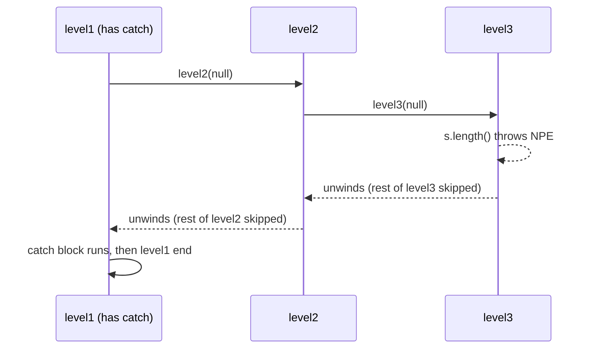
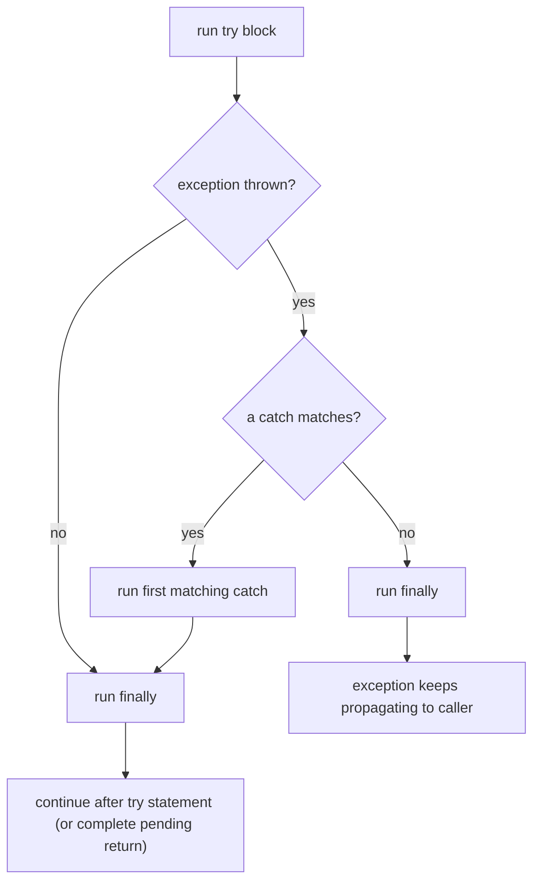
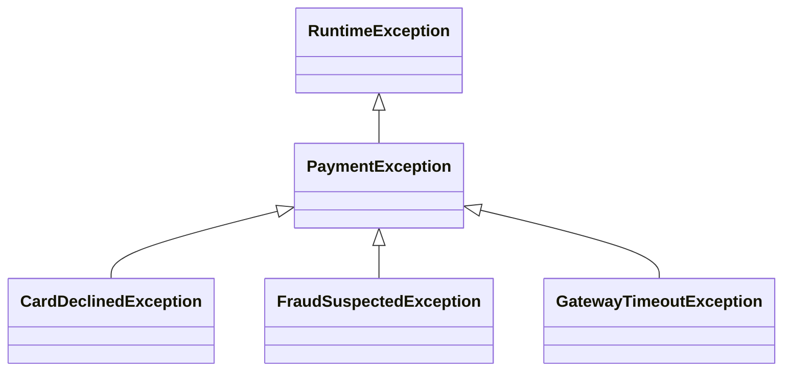

# Chapter 8 — Exceptions

Programs fail: files go missing, users type "forty-two" for a number, networks time out, code has bugs. An **exception** is Java's way to report failure *without* every method returning an error code. This chapter covers the mechanism (how an exception travels up the call stack — the chain of in-progress method calls), the hierarchy (checked vs unchecked vs errors), the syntax (`try`/`catch`/`finally`, multi-catch, try-with-resources, `throw`, `throws`), custom exceptions, and the practices that keep failures visible.

Already met: `NumberFormatException` from `Integer.parseInt`, `ArithmeticException` from `Math.addExact` ([Chapter 2](../02-basics-types-and-operators/README.md)), `ArrayIndexOutOfBoundsException` ([Chapter 4](../04-methods-and-arrays/README.md)), and overriding methods not throwing broader checked exceptions ([§6.3](../06-oop-inheritance-interfaces-and-more/README.md#63-overriding)).

Code: [`code/`](code/) (package `ch08.*`), `javac --release 25`, run on JDK 26; outputs from real runs. Exam traps (unreachable catches, `finally` returns, resource scope, suppressed exceptions, overriding and `throws`): [OCP Chapter 11](../../../../ocp-java21-study/chapters/11-exceptions-localization/README.md) (sections 1–4). Service-level strategy (retries — see [System Design Fundamentals](../../../system-design-patterns/modules/00-system-design-fundamentals/README.md) — error codes at API boundaries, logging): [LLD Clean Code §6](../../../lld/chapters/06-clean-code/README.md#6-error-handling) and [§16](../../../lld/chapters/06-clean-code/README.md#16-error-handling-strategy-best-practices-for-real-services).

---

## 8.1 What an exception is

### What it is
An **exception** is an object describing an abnormal event, plus the act of **throwing** it: the JVM stops the current code and jumps to the nearest matching **handler** (`catch` block). If no method on the call stack handles it, the thread dies and the JVM prints a **stack trace** (the method calls active at the time, §8.9).

Versus C-style error codes, exceptions **separate** normal logic from error handling, **can't be silently ignored** by a forgotten check, **propagate automatically** to the level that knows what to do (a request handler, a UI, a retry loop), and **carry information** (type, message, cause, call path).

### How it works
1. Something fails: the JVM detects it (division by zero, `null` dereference, bad index) or code runs `throw new SomeException(...)`.
2. The current block stops; remaining statements are skipped.
3. The JVM looks for an enclosing `try` whose `catch` type matches (the object is an instance of it). That catch runs, then execution continues **after the whole `try` statement** — not back at the throw point.
4. If none in this method, the method ends abruptly and the exception is rethrown at the call site in the **caller** — repeating up the stack (**stack unwinding**), running `finally` blocks on the way.
5. At the top of a thread, its *uncaught exception handler* prints the trace and the thread ends. If that was `main` and no non-daemon threads (daemon = background helpers that don't keep the JVM alive) remain, the program exits with status 1 (non-zero = failure).

[`code/ch08/basics/FirstException.java`](code/ch08/basics/FirstException.java) (key parts):
```java
static int average(int[] values) {
    int sum = 0;
    for (int v : values) sum += v;
    return sum / values.length;            // length 0 -> ArithmeticException
}

try {
    System.out.println("before the call");
    int avg = average(new int[0]);         // throws; the rest of the try block is skipped
    System.out.println("never printed " + avg);
} catch (ArithmeticException e) {
    System.out.println("caught " + e.getClass().getName() + ": " + e.getMessage());
}
System.out.println("program continues normally");

static void setAge(int age) {
    if (age < 0) throw new IllegalArgumentException("age must be >= 0, was " + age);
    ...
}
```
Output:
```text
average {4, 8} = 6
before the call
caught java.lang.ArithmeticException: / by zero
program continues normally
caught IllegalArgumentException: age must be >= 0, was -5
```

### Propagation through the call stack
[`code/ch08/basics/Propagation.java`](code/ch08/basics/Propagation.java) calls `level1 → level2 → level3`; only `level1` catches:
```java
static void level3(String s) {
    System.out.println("  level3 start");
    System.out.println("  length = " + s.length());   // NPE when s is null
    System.out.println("  level3 end");
}
static void level2(String s) { System.out.println(" level2 start"); level3(s); System.out.println(" level2 end"); }
static void level1(String s) {
    System.out.println("level1 start");
    try { level2(s); }
    catch (NullPointerException e) { System.out.println("level1 caught: " + e.getMessage()); }
    System.out.println("level1 end");
}
```
Output:
```text
level1 start
 level2 start
  level3 start
  length = 2
  level3 end
 level2 end
level1 end
---
level1 start
 level2 start
  level3 start
level1 caught: Cannot invoke "String.length()" because "<parameter1>" is null
level1 end
```
With `null`, "level3 end" and "level2 end" never print — both methods were abandoned as the exception unwound.



`"<parameter1>"` appears because the runner compiles without debug info; with **`javac -g`** (IDEs and Maven/Gradle default) it reads `because "s" is null`. **Helpful NullPointerException messages**: Java 14 (JEP 358), on by default since 15.

---

## 8.2 The `Throwable` hierarchy: checked, unchecked and errors

### What it is
Only **`java.lang.Throwable`** and subclasses can be thrown. Two branches:
- **`Error`** — serious JVM/environment problems applications shouldn't handle: `OutOfMemoryError`, `StackOverflowError`, `NoClassDefFoundError`, `ExceptionInInitializerError`.
- **`Exception`** — conditions a program may handle; its subclass **`RuntimeException`** is special.

The compiler sorts them into:
- **Checked**: `Exception` and subclasses *except* the `RuntimeException` branch. The compiler **forces** handle-or-declare (§8.3). They model recoverable external problems: I/O failures, network errors, "file not found", `InterruptedException` (a waiting thread asked to stop).
- **Unchecked**: `RuntimeException` and subclasses **plus** `Error` and subclasses. No enforcement. `RuntimeException`s usually signal **programming errors** — a violated precondition (a condition required before the call): `null` argument, bad index, illegal state.


(`NoSuchFileException`, in `java.nio.file`, actually extends `FileSystemException`, which extends `IOException`.)

[`code/ch08/hierarchy/Hierarchy.java`](code/ch08/hierarchy/Hierarchy.java) walks `getSuperclass()` for common types (selected lines):
```text
NumberFormatException [unchecked]
    extends IllegalArgumentException > RuntimeException > Exception > Throwable
ArrayIndexOutOfBoundsException [unchecked]
    extends IndexOutOfBoundsException > RuntimeException > Exception > Throwable
UncheckedIOException [unchecked]
    extends RuntimeException > Exception > Throwable
FileNotFoundException [CHECKED]
    extends IOException > Exception > Throwable
SQLException [CHECKED]
    extends Exception > Throwable
InterruptedException [CHECKED]
    extends Exception > Throwable
CloneNotSupportedException [CHECKED]
    extends Exception > Throwable
StackOverflowError [error, unchecked]
    extends VirtualMachineError > Error > Throwable
```

### The exceptions you'll meet most
| Exception | Kind | Typical cause |
|---|---|---|
| `NullPointerException` | unchecked | method/field on `null`, unboxing `null` |
| `IllegalArgumentException` | unchecked | a method rejects an argument value |
| `NumberFormatException` | unchecked (IAE subclass) | `Integer.parseInt("abc")` |
| `IllegalStateException` | unchecked | call at the wrong time (`iterator.remove()` twice, using a closed object) |
| `IndexOutOfBoundsException` (+ `Array…`, `String…`) | unchecked | bad index |
| `ClassCastException` | unchecked | invalid downcast |
| `ArithmeticException` | unchecked | integer `/ 0`, `*Exact` overflow, non-terminating `BigDecimal` division |
| `UnsupportedOperationException` | unchecked | modifying an immutable collection (`List.of(...).add(x)`) |
| `ConcurrentModificationException` | unchecked | changing a collection while iterating ([Chapter 10](../10-collections/README.md)) |
| `NoSuchElementException` | unchecked | `iterator.next()` past the end; `Optional.get()`/`orElseThrow()` on empty |
| `DateTimeException`, `DateTimeParseException` | unchecked | invalid date values/text ([Chapter 7](../07-core-apis/README.md)) |
| `IOException` (+ `FileNotFoundException`, `NoSuchFileException`…) | checked | file/network I/O |
| `InterruptedException` | checked | a blocked thread was interrupted ([Chapter 14](../14-concurrency-1/README.md)) |
| `SQLException` | checked | database errors (JDBC) |
| `ExecutionException`, `TimeoutException` | checked | a `Future` (handle to a background task's result) failed / waited too long |
| `ExceptionInInitializerError` | error | exception in a `static` initialiser |
| `StackOverflowError`, `OutOfMemoryError` | error | runaway recursion; heap exhausted |

### Trade-offs — checked vs unchecked
| | Checked | Unchecked |
|---|---|---|
| Compiler enforcement | Catch or declare | None |
| Signals | Recoverable external condition | Programming error or unrecoverable state |
| API cost | Every caller must deal with it, even if it can't help | Callers may ignore it; `@throws` docs matter more |
| Lambdas/streams | Poor — `java.util.function` interfaces declare none ([Chapter 11](../11-lambdas-and-functional-programming/README.md)) | Fine |
| Examples | `IOException`, `SQLException` | `IllegalArgumentException`, `NullPointerException` |

Java is unusual in having checked exceptions (C#, Kotlin, Python, JavaScript don't). *Effective Java* Items 70–71: checked for conditions the caller can **recover** from, runtime for programming errors, avoid checked when the caller can't do anything useful. Spring, JPA/Hibernate wrap checked exceptions in unchecked ones for this reason.

### In the interview
**30-second answer:** "Everything thrown is a `Throwable`. `Error`s are JVM-level problems you don't catch. `Exception`s are checked — compiler-enforced catch-or-declare, for recoverable external failures like `IOException` — or unchecked `RuntimeException`s for programming errors like `IllegalArgumentException`. I use unchecked for precondition violations and checked only when the caller can genuinely recover."
- *Is `Error` checked?* No — `Error` and `RuntimeException` (and subclasses) are unchecked.
- *Catch `Throwable`?* Only at the very top of a thread/request to log and fail cleanly — it also catches `OutOfMemoryError`, after which continuing may be unsafe.

### TL;DR
`Throwable` → `Error` (don't catch) and `Exception`; `RuntimeException` + `Error` = unchecked; the rest of `Exception` = checked (handle or declare).

---

## 8.3 Handle or declare: checked exceptions and `throws`

### What it is
The **handle-or-declare rule** ("catch or specify"): if code in a method can throw a **checked** exception, the method must **handle** it (`try` with a matching `catch`) or **declare** it in its **`throws` clause**, passing responsibility to callers. Otherwise: *"unreported exception IOException; must be caught or declared to be thrown"* (e.g. `void m() { Thread.sleep(10); }` doesn't compile).

**`throw`** is a statement throwing one object now (`throw new IOException("x")`); **`throws`** is part of the method declaration listing exception *types* (`void read() throws IOException, SQLException`).

### How it works
[`code/ch08/checked/CheckedDemo.java`](code/ch08/checked/CheckedDemo.java):
```java
// "Declare": this method does not handle IOException, it passes it to the caller
static String readConfig(Path path) throws IOException {
    return Files.readString(path);
}

// "Handle": this method catches and decides what to do
static String readConfigOrDefault(Path path) {
    try {
        return readConfig(path);
    } catch (NoSuchFileException e) {            // more specific first
        System.out.println("no such file: " + e.getFile() + " -> using defaults");
        return "mode=default";
    } catch (IOException e) {                    // any other I/O problem
        System.out.println("I/O failure: " + e);
        return "mode=default";
    }
}

public static void main(String[] args) throws IOException {   // main may declare too
    Path tmp = Files.createTempFile("ch08-", ".properties");
    Files.writeString(tmp, "mode=fast");
    System.out.println("existing file: " + readConfigOrDefault(tmp));
    Files.delete(tmp);
    System.out.println("deleted file:  " + readConfigOrDefault(Path.of("missing-config.properties")));
    for (String in : new String[]{"42", "forty-two"}) {
        try { System.out.println("parsed " + Integer.parseInt(in)); }
        catch (NumberFormatException e) { System.out.println("bad number '" + in + "': " + e.getMessage()); }
    }
}
```
Output:
```text
existing file: mode=fast
no such file: missing-config.properties -> using defaults
deleted file:  mode=default
parsed 42
bad number 'forty-two': For input string: "forty-two"
```

### The rules in one table
| Rule | Detail |
|---|---|
| Checked exceptions must be caught or declared | including those from methods you call |
| Unchecked *may* be declared | documentation only; the compiler ignores it — prefer Javadoc `@throws` |
| Can't catch a checked exception the `try` body can't throw | *"exception IOException is never thrown in body of corresponding try statement"* — except `Exception`/`Throwable`, which may hide unchecked ones (so `catch (Exception e)` after an empty `try` compiles) |
| Overrides may not throw **new or broader** checked exceptions | fewer, narrower or unchecked are fine ([§6.3](../06-oop-inheritance-interfaces-and-more/README.md#63-overriding)) |
| Lambdas | may throw a checked exception only if the functional interface method declares it; `Runnable`, `Function` don't ([Chapter 11](../11-lambdas-and-functional-programming/README.md)) |
| Initialiser blocks | `static` initialisers can't throw checked (unchecked are wrapped in `ExceptionInInitializerError`); instance initialisers can only if every constructor declares it |

### When to handle vs declare
- **Handle** where you can act: retry, fall back, re-ask the user, translate (§8.8).
- **Declare** when this layer can't fix it and the caller has more context. Low-level helpers declare; boundaries (request handler, `main`, UI handler) handle.
- Never "handle" by catching and doing nothing (§8.10).

---

## 8.4 `try` / `catch` / `finally` and control flow

### What it is
**`finally`** runs after the `try` (and any `catch` that ran) **however** the `try` ended — normally, by exception (caught or not), or by `return`/`break`/`continue`. It is for cleanup that must always happen (release a lock, reset a flag; for resources §8.6 is better).

### How it works — the syntax rules
1. A `try` needs at least one `catch` **or** a `finally` (or resources); `try { } finally { }` is legal.
2. Order: `try`, zero or more `catch`, at most one `finally`. Braces always required.
3. At most one `catch` runs — the **first** match.
4. `finally` runs after that `catch`, or right after `try` if nothing was thrown or nothing matched (then the exception keeps propagating **after** `finally`).

[`code/ch08/finallyflow/FinallyDemo.java`](code/ch08/finallyflow/FinallyDemo.java) (key parts):
```java
static int returnInTry() {
    int x = 1;
    try {
        return x;             // the value 1 is saved here...
    } finally {
        x = 99;               // ...so changing x in finally does not change the returned value
        System.out.println("finally ran before the method returned");
    }
}

static int finallyOverrides() {
    try {
        throw new RuntimeException("lost!");
    } finally {
        return -1;            // BAD: discards the exception and any return value from try
    }
}
```
Output:
```text
no failure: try try-end finally
failure:    try catch finally
finally ran before the method returned
returnInTry() = 1
finallyOverrides() = -1 (the RuntimeException vanished)
inner finally runs even though nobody here catches
outer caught: inner
```



### The tricky cases
| Situation | What happens |
|---|---|
| `return` in `try`, `finally` changes the variable | The return **value** was already evaluated: `try { return "a"; } finally { print("b"); }` prints `b`, returns `"a"` (a returned object's *contents* can still be mutated) |
| `return` in `finally` | Overrides the `try`'s return **and silently discards any exception** — never (javac `-Xlint:finally` warns) |
| `finally` throws | The new exception replaces and loses the original |
| `catch` throws | `finally` still runs, then the new exception propagates |
| `System.exit()` in `try`, JVM crash/halt, power loss, `try` never finishes | `finally` does **not** run |

### Common mistakes
- Returning or throwing from `finally`.
- Manual resource closing in `finally` with nested `try`s — use try-with-resources.
- Confusing `final` (no reassignment), `finally` (always-run block), `finalize()` (deprecated for removal since Java 18, JEP 421).

---

## 8.5 Multi-catch, catch order and rethrowing

### What it is
- **Multi-catch** (Java 7): one `catch` for several unrelated types: `catch (NumberFormatException | IndexOutOfBoundsException e)`.
- **Catch order**: the first match wins, so a subclass must come **before** its superclass, else the subclass block is unreachable (compile error).
- **Precise rethrow** (Java 7): catch broadly and rethrow the same (effectively final) variable; the compiler knows it can only be the checked types the `try` really throws — so you can log broadly yet keep a narrow `throws`.
- **Unnamed variable `_`** (Java 22, JEP 456): `catch (NumberFormatException _)` when the object isn't used.

[`code/ch08/multicatch/MultiCatch.java`](code/ch08/multicatch/MultiCatch.java) (key parts):
```java
try {
    risky(i);        // 0: parseInt("x")  1: List.of(1,2).get(5)  2: IOException  3: fine
} catch (NumberFormatException | IndexOutOfBoundsException e) {     // multi-catch
    System.out.println(i + ": bad input -> " + e.getClass().getSimpleName());
} catch (java.io.IOException e) {
    System.out.println(i + ": I/O -> " + e.getMessage());
} finally {
    System.out.println(i + ": finally");
}

try { Integer n = (Integer) (Object) "text"; }
catch (ClassCastException e) { System.out.println("ClassCastException first"); }   // specific first
catch (RuntimeException e)   { System.out.println("RuntimeException"); }           // then general

try { value = Integer.parseInt(input); }
catch (NumberFormatException _) { value = -1; }                                    // Java 22

static void rethrow(boolean io) throws java.io.IOException, java.util.concurrent.TimeoutException {
    try {
        if (io) throw new java.io.IOException("io failed");
        throw new java.util.concurrent.TimeoutException("too slow");
    } catch (Exception e) {
        System.out.println("log and rethrow: " + e);
        throw e;                    // compiler knows e is IOException | TimeoutException
    }
}
```
Output:
```text
0: bad input -> NumberFormatException
0: finally
1: bad input -> IndexOutOfBoundsException
1: finally
2: I/O -> disk full
2: finally
  no problem
3: finally
ClassCastException first
value = -1
log and rethrow: java.util.concurrent.TimeoutException: too slow
caller got TimeoutException
```

### Compiler rules (real `javac` messages)
| You write | Result |
|---|---|
| `catch (RuntimeException e) {} catch (ClassCastException e) {}` | *exception ClassCastException has already been caught* |
| `catch (IllegalArgumentException \| NumberFormatException e)` (or `IOException \| FileNotFoundException`) | *Alternatives in a multi-catch statement cannot be related by subclassing* — catch the parent |
| `catch (IllegalStateException \| ArithmeticException e) { e = null; }` | *multi-catch parameter e may not be assigned* (implicitly `final`) |
| `catch (java.io.IOException e)` around code that can't throw it | *exception IOException is never thrown in body of corresponding try statement* |

A multi-catch variable's type is the alternatives' closest common supertype, so only shared methods (usually `Throwable`'s) are callable.

---

## 8.6 try-with-resources

### What it is
A **resource** must be closed after use — files, sockets, DB connections, streams, closeable locks. **try-with-resources** (Java 7) declares them in parentheses after `try` and closes them automatically however the block ends.

Any **`java.lang.AutoCloseable`** (`void close() throws Exception`) qualifies. **`java.io.Closeable`** is the older I/O sub-interface whose `close()` throws `IOException` and must be idempotent (a second call has no further effect).

Before Java 7, correct cleanup needed `finally` with a null check and a nested `try` around `close()`, and a `close()` failure could *replace* the real error. *Effective Java* Item 9: "Prefer try-with-resources to try-finally."

### How it works
1. Resources initialise left to right; each is implicitly `final` (reassigning: *"auto-closeable resource r may not be assigned"*).
2. The body runs.
3. Resources are **closed in reverse order** (`a, b, c` → `c, b, a`) — **before** any `catch`/`finally` of the same statement. `catch`/`finally` are optional.
4. If an initialisation fails, only already-opened resources are closed; `null` resources are skipped.
5. If the body throws *and* `close()` throws, the body's exception is **primary**; close failures are attached as **suppressed** (`getSuppressed()`; traces print them under "Suppressed:").
6. Java 9: an existing **effectively final** variable can be used directly: `try (reader) { ... }`.

[`code/ch08/resources/TryWithResources.java`](code/ch08/resources/TryWithResources.java) (key parts):
```java
static class Res implements AutoCloseable {
    Res(String name, boolean failOnClose) { ...; System.out.println("open " + name); }
    void use(boolean fail) { System.out.println("use " + name); if (fail) throw new IllegalStateException("use of " + name + " failed"); }
    @Override public void close() {
        System.out.println("close " + name);
        if (failOnClose) throw new IllegalStateException("close of " + name + " failed");
    }
}

try (Res a = new Res("A", false); Res b = new Res("B", false)) { a.use(false); b.use(false); }

try (Res a = new Res("A", false)) { a.use(true); }
catch (IllegalStateException e) { System.out.println("catch: " + e.getMessage()); }
finally { System.out.println("finally"); }

try (Res a = new Res("A", true); Res b = new Res("B", true)) { b.use(true); }
catch (IllegalStateException e) {
    System.out.println("primary: " + e.getMessage());
    for (Throwable s : e.getSuppressed()) System.out.println("suppressed: " + s.getMessage());
}

BufferedReader reader = new BufferedReader(new StringReader("line one\nline two"));
try (reader) { System.out.println("first line: " + reader.readLine()); }     // Java 9
```
Output:
```text
-- 1. normal: closed in reverse order
open A
open B
use A
use B
close B
close A
-- 2. body fails: resources closed BEFORE catch runs
open A
use A
close A
catch: use of A failed
finally
-- 3. body AND close fail: close exception is suppressed
open A
open B
use B
close B
close A
primary: use of B failed
suppressed: close of B failed
suppressed: close of A failed
-- 4. Java 9: effectively final variable as a resource
first line: line one
after close: Stream closed
```

Real-world use (not run — needs a database; JDBC in [Chapter 18](../18-testing-build-and-tooling/README.md)):
```java
try (Connection con = dataSource.getConnection();
     PreparedStatement ps = con.prepareStatement("SELECT name FROM users WHERE id = ?")) {
    ps.setLong(1, id);
    try (ResultSet rs = ps.executeQuery()) { ... }
}   // rs, ps, con closed in that order — even if the query throws
```

### Common mistakes
- Opening a resource *outside* `try (...)` without passing it in — leaks if something fails in between.
- Returning a resource out of the `try` (e.g. a `Stream` from `Files.lines`) — closed before the caller uses it. `Files.lines`/`Files.walk` must themselves be in try-with-resources ([Chapter 13](../13-io-and-nio/README.md)).
- Wrapped streams: `try (var in = new BufferedReader(new FileReader(f)))` closes both, but if the *outer* constructor throws, the inner leaks. For strictness, declare each as its own resource.

### In the interview
**30-second answer:** "try-with-resources closes any `AutoCloseable` automatically, in reverse order, before catch and finally run. If both the body and `close` throw, the body's exception wins and close failures are attached as suppressed exceptions, so nothing is lost. It replaced error-prone `finally { if (x != null) x.close(); }`."
- *`AutoCloseable` vs `Closeable`?* `Closeable` (java.io) extends `AutoCloseable`, throws `IOException`, and should be idempotent.

### TL;DR
Anything `AutoCloseable` goes in `try (...)`. Reverse-order close, before catch/finally; secondary failures are suppressed, not lost.

---

## 8.7 Throwing exceptions and writing custom ones

### Reuse standard exceptions first
*Effective Java* Item 72: readers already know the standard ones.

| Situation | Throw |
|---|---|
| Invalid argument value (`setAge(-5)`) | `IllegalArgumentException` |
| Required argument is `null` | `NullPointerException` — `Objects.requireNonNull(x, "x")` |
| Index out of range | `IndexOutOfBoundsException` — `Objects.checkIndex(i, size)` (Java 9) |
| Object in the wrong state (`start()` twice) | `IllegalStateException` |
| Operation not supported by this implementation | `UnsupportedOperationException` |
| Lookup found nothing and must return a value | `NoSuchElementException` (or return `Optional`, §8.10) |
| Concurrent modification detected | `ConcurrentModificationException` |

Don't throw `Exception`, `RuntimeException`, `Throwable` or `Error` directly — callers can't distinguish your failure.

### When to write your own
When callers must **distinguish** it or it should **carry data** (account ID, shortfall, error code):
1. Name it `…Exception`.
2. Extend `RuntimeException` for programming/state errors and most domain rule violations; extend `Exception` only if callers should recover and the compiler should remind them.
3. Provide `(String message)` and `(String message, Throwable cause)` — the cause constructor enables chaining (§8.8).
4. `final` fields with getters, so handlers act on data without parsing messages. Exceptions are `Serializable`; strict linting (`-Xlint:serial`) wants a `serialVersionUID`.
5. Messages carry failure-capture details (*Effective Java* Item 75) — the offending values, not "Error occurred"; never passwords or personal data.

[`code/ch08/custom/CustomExceptions.java`](code/ch08/custom/CustomExceptions.java) (key parts):
```java
// Checked: the caller is expected to recover (e.g. show "insufficient funds" to the user)
static class InsufficientFundsException extends Exception {
    private final BigDecimal shortfall;
    InsufficientFundsException(BigDecimal shortfall) {
        super("insufficient funds: short by " + shortfall);
        this.shortfall = shortfall;
    }
    BigDecimal getShortfall() { return shortfall; }
}

// Unchecked: a programming/state error in our domain
static class AccountFrozenException extends RuntimeException {
    AccountFrozenException(String accountId) { super("account " + accountId + " is frozen"); }
}

void withdraw(BigDecimal amount) throws InsufficientFundsException {
    if (amount.signum() <= 0) throw new IllegalArgumentException("amount must be positive: " + amount);
    if (frozen) throw new AccountFrozenException(id);
    if (amount.compareTo(balance) > 0) throw new InsufficientFundsException(amount.subtract(balance));
    balance = balance.subtract(amount);
}
```
Output (first four lines):
```text
withdrew 30.00, balance 70.00
insufficient funds: short by 430.00 (shortfall field = 430.00)
rejected: amount must be positive: -1
rejected: account ACC-1 is frozen
```

`withdraw` checks every condition **before** changing `balance` — **failure atomicity** (*Effective Java* Item 76): a failed call leaves the object as it was.

### Custom exception hierarchies
A small hierarchy lets callers catch broadly or narrowly:

Keep it shallow — three or four types callers handle differently beat twenty nobody catches. A sealed interface or an error-code enum field also works.

---

## 8.8 Chaining and exception translation

### What it is
**Chaining** stores the original exception as the **cause** of a new one: `new ReportException("could not build report", e)`. **Translation** (*Effective Java* Item 73): a higher layer (web → service → data access) catches low-level exceptions and throws ones meaningful at *its* abstraction — a `ReportService` shouldn't leak `SQLException`/`IOException`. The trace prints the high-level exception, then **"Caused by:"** with the original.

### How it works
1. Catch the low-level exception.
2. Throw a new one with the original as `cause` (constructor, or `initCause` for old types without one).
3. Callers use `getCause()` (repeatedly, for the root); logs show the whole chain.
4. To pass a checked exception through code that can't declare it (lambdas, `Runnable`), wrap it in an unchecked one — **`UncheckedIOException`** for `IOException`.

```java
static String buildReport(String name) throws ReportException {
    try {
        return loadTemplate(name);                        // throws IOException
    } catch (IOException e) {
        throw new ReportException("could not build report " + name, e);   // translate + chain
    }
}

java.util.List.of("a").forEach(n -> {
    try { loadTemplate(n); }
    catch (IOException e) { throw new UncheckedIOException(e); }         // lambda can't throw IOException
});
```
Output (last three lines of `CustomExceptions`):
```text
error: could not build report monthly
cause: java.io.IOException: template 'monthly' not found on disk
unwrapped cause: template 'a' not found on disk
```

### Common mistakes
- `throw new ReportException("failed: " + e.getMessage());` — loses the original type and trace. **Always pass `e` as the cause.**
- Log-and-rethrow at every layer — one failure, five log entries. Log once, where handled.
- Bare `RuntimeException` wrapping with no message — say what the operation was.

---

## 8.9 Reading stack traces

### What it is
A **stack trace** lists the active method calls (**frames**) when the exception was *created*, most recent first, each as `class.method(File.java:line)` — Java's most useful debugging artefact.

[`code/ch08/stacktrace/StackTraces.java`](code/ch08/stacktrace/StackTraces.java):
```java
static int parsePort(String text) { return Integer.parseInt(text); }

static int loadPort(String text) {
    try {
        return parsePort(text);
    } catch (NumberFormatException e) {
        throw new ServiceException("invalid port setting", e);
    }
}
// in main:
try { loadPort("80a"); }
catch (ServiceException e) { e.printStackTrace(System.out); ... }
```
Output (line numbers in `java.base` frames depend on the JDK build — these are JDK 26):
```text
ch08.stacktrace.StackTraces$ServiceException: invalid port setting
	at ch08.stacktrace.StackTraces.loadPort(StackTraces.java:17)
	at ch08.stacktrace.StackTraces.main(StackTraces.java:23)
Caused by: java.lang.NumberFormatException: For input string: "80a"
	at java.base/java.lang.NumberFormatException.forInputString(NumberFormatException.java:67)
	at java.base/java.lang.Integer.parseInt(Integer.java:527)
	at java.base/java.lang.Integer.parseInt(Integer.java:624)
	at ch08.stacktrace.StackTraces.parsePort(StackTraces.java:10)
	at ch08.stacktrace.StackTraces.loadPort(StackTraces.java:15)
	... 1 more
top frame: ch08.stacktrace.StackTraces.loadPort line 17
caught StackOverflowError (an Error: normally you do NOT catch these)
```

### How to read one
1. **First line**: class + message — *what* happened.
2. **Frames**: *where*, most recent first; the first frame in **your** code is usually the place to look (`loadPort`, line 17).
3. **"Caused by:"**: the underlying exception. **Go to the last one** — the root cause (`"80a"` from `parsePort` line 10).
4. **`... 1 more`**: remaining frames identical to the enclosing trace's, elided.
5. **`java.base/`**: the module ([Chapter 16](../16-jvm-internals-and-performance/README.md)); `$` marks a nested class.
6. **"Suppressed:"**: exceptions attached by try-with-resources (§8.6).

### Tools
| API | Use |
|---|---|
| `e.getMessage()`, `e.toString()` | message; class name + message |
| `e.printStackTrace()` | to `System.err` — fine for learning; applications use a logger (`log.error("msg", e)`), which records the trace |
| `e.getStackTrace()` | `StackTraceElement[]` for inspection |
| `e.getCause()`, `e.getSuppressed()` | navigate the chain |
| `StackWalker` (Java 9) | lazily inspect the *current* stack without an exception |
| `Thread.setDefaultUncaughtExceptionHandler` | last-chance logging for dying threads |

The trace is captured at **construction**, costing time proportional to stack depth — one reason not to use exceptions for control flow (§8.10). Frameworks sometimes pre-allocate exceptions or disable capture via the protected `Throwable(String, Throwable, boolean enableSuppression, boolean writableStackTrace)` constructor — a niche optimisation.

---

## 8.10 Best practices and anti-patterns

### The rules (with *Effective Java* item numbers)
| # | Practice | Why |
|---|---|---|
| 1 | **Exceptions only for exceptional conditions** (Item 69), never normal control flow | Slower (stack capture), obscures logic, hides bugs |
| 2 | **Checked for recoverable, runtime for programming errors** (Item 70); avoid needless checked (Item 71) | Don't force callers to catch what they can't handle |
| 3 | **Prefer standard exceptions** (Item 72) | Familiar meaning |
| 4 | **Throw exceptions appropriate to the abstraction** (Item 73) — translate and chain | Decoupled layers, cause preserved |
| 5 | **Document every exception** with `@throws` (Item 74), including relevant unchecked ones | The compiler can't tell callers |
| 6 | **Failure details in the message** (Item 75) | Self-explanatory traces |
| 7 | **Failure atomicity** (Item 76): validate before mutating | No half-updated state |
| 8 | **Don't ignore exceptions** (Item 77) | Swallowed errors = silent corruption |
| 9 | **Fail fast**: validate at the start of public methods/constructors | Error surfaces near its cause |
| 10 | **Catch the most specific type you can handle**; broad only at boundaries | Don't catch bugs by accident |
| 11 | **Log or rethrow, not both**; log once with the exception object | No duplicates; trace kept |
| 12 | **try-with-resources** for anything closeable (Item 9) | Correct cleanup |

[`code/ch08/practices/BestPractices.java`](code/ch08/practices/BestPractices.java) (key parts):
```java
record User(String name, String email) {
    User {
        Objects.requireNonNull(name, "name");                                  // fail fast
        if (email == null || !email.contains("@")) throw new IllegalArgumentException("bad email: " + email);
    }
}

static Optional<String> findUser(int id) { return Optional.ofNullable(USERS.get(id)); }   // absence is normal
static String getUser(int id) {                                                          // absence is a bug
    String u = USERS.get(id);
    if (u == null) throw new NoSuchElementException("no user with id " + id);
    return u;
}

System.out.println("bounds check instead of catching: " + (i < data.length ? data[i] : "out of range"));

try {
    Thread.sleep(1);
} catch (InterruptedException e) {
    Thread.currentThread().interrupt();        // restore the interrupt flag
    ...
}
```
The *interrupt flag* is a per-thread "please stop" marker; catching `InterruptedException` clears it, so set it again.
Output:
```text
findUser(3) -> guest
getUser(3) -> no user with id 3
requireNonNull -> NPE: name
validation -> bad email: not-an-email
helpful NPE: Cannot invoke "String.toUpperCase()" because "<local1>[1]" is null
bounds check instead of catching: out of range
done
```
(With `javac -g` the NPE names the variable: `because "names[1]" is null`.)

### Exception or `Optional` or special value?
| Situation | Return / throw |
|---|---|
| "Not found" is normal (search, cache lookup, a `findById` that often misses) | `Optional<T>` ([Chapter 11](../11-lambdas-and-functional-programming/README.md)) or an empty collection — never `null` for collections |
| Caller broke the contract (null argument, bad index) | Unchecked exception |
| External failure the caller can act on (file missing, remote service down) | Checked, or unchecked with clear docs |
| User-input validation with many possible errors | A result object listing all errors (throwing on the first is poor UX) |

### Anti-patterns
```java
// 1. Swallowing: the failure disappears
try { save(order); } catch (Exception e) { }

// 2. Pokemon catching ("gotta catch 'em all") deep inside business logic
catch (Throwable t) { ... }                 // also catches OutOfMemoryError, StackOverflowError

// 3. Losing the cause
catch (IOException e) { throw new RuntimeException("failed"); }       // pass e!

// 4. Exceptions as control flow
try { int i = 0; while (true) arr[i++].process(); } catch (ArrayIndexOutOfBoundsException e) { }

// 5. Returning from finally (hides exceptions) — see 8.4

// 6. Swallowing InterruptedException without restoring the flag
catch (InterruptedException e) { }          // callers can no longer see the interrupt
```
If ignoring is genuinely right (closing during shutdown), name the variable `ignored` or `_` and comment why.

### Assertions — a note
`assert condition : "message";` throws `AssertionError` when false — **only with `-ea`** (off by default). Use for internal invariants during development/testing; never for public-method argument validation or anything with side effects.

### Real-world examples
- Spring's `@ControllerAdvice` maps exceptions at the request boundary to HTTP statuses ([System Design Fundamentals](../../../system-design-patterns/modules/00-system-design-fundamentals/README.md)): `IllegalArgumentException` → 400, custom `NotFoundException` → 404, anything else → 500 with a logged trace.
- Frameworks translate checked JDBC/file exceptions into unchecked hierarchies (Spring's `DataAccessException`) to keep business code clean.
- `Objects.requireNonNull` at the top of constructors throughout the JDK.

### In the interview
**30-second answer:** "I validate early and throw standard unchecked exceptions for contract violations, use checked exceptions only for recoverable external failures, translate low-level exceptions at layer boundaries while chaining the cause, never swallow exceptions or return from `finally`, use try-with-resources for anything closeable, and handle — log once, map to a response — at the boundary. For expected absence I return `Optional`."
- *What's wrong with `catch (Exception e) {}`?* It hides every failure, including bugs, leaving unknown state.
- *`final` vs `finally` vs `finalize`?* Modifier; always-run block; deprecated GC hook (JEP 421, Java 18) — use try-with-resources or `Cleaner`.
- *Why restore the interrupt flag?* So code further up sees cancellation was requested ([Chapter 14](../14-concurrency-1/README.md)).

### TL;DR
Validate early, standard unchecked exceptions for bugs, checked only when recovery is realistic, translate with a cause at boundaries, never swallow, log once, `Optional` for normal absence.

---

## Chapter TL;DR

| Topic | Remember |
|---|---|
| Mechanism | `throw` stops the block; the stack unwinds to the first matching `catch`; uncaught → thread dies with a stack trace |
| Hierarchy | `Throwable` → `Error` (don't catch) / `Exception`; `RuntimeException` + `Error` unchecked; rest checked |
| Handle or declare | Checked exceptions caught or listed in `throws`; overriding can't widen checked exceptions |
| `finally` | Always runs (except `System.exit`/crash); return value already evaluated; never `return`/`throw` from it |
| Catch rules | First match wins; subclass first; multi-catch types unrelated, variable final; precise rethrow; `catch (X _)` (22) |
| try-with-resources | `AutoCloseable`; reverse-order close before catch/finally; close failures suppressed; `try (existingVar)` (9) |
| Custom exceptions | Standard ones first; custom when callers must distinguish or need data; detailed message; cause constructor |
| Chaining | Always pass the cause; translate to your layer's abstraction; `UncheckedIOException` for lambdas |
| Stack traces | Top line, first frame in your code, then the last "Caused by:"; `-g` for variable names in NPE messages |
| Practices | Exceptions for exceptional cases, fail fast, failure atomicity, don't swallow, log once, `Optional` for normal absence |

**Next:** [Chapter 9 — Generics](../09-generics/README.md). Checked exceptions in lambdas and `Optional`: [Chapter 11](../11-lambdas-and-functional-programming/README.md). Exceptions in threads, `ExecutionException`: [Chapter 15](../15-concurrency-2-modern/README.md). Exam traps: [OCP Chapter 11](../../../../ocp-java21-study/chapters/11-exceptions-localization/README.md). Service-level error handling: [LLD Clean Code §16](../../../lld/chapters/06-clean-code/README.md#16-error-handling-strategy-best-practices-for-real-services).
