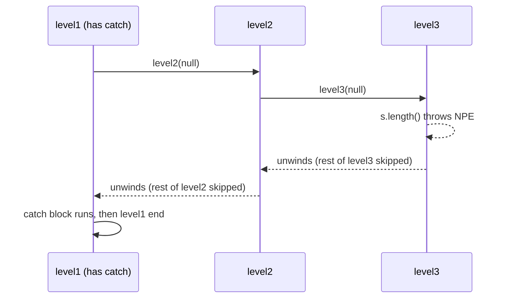
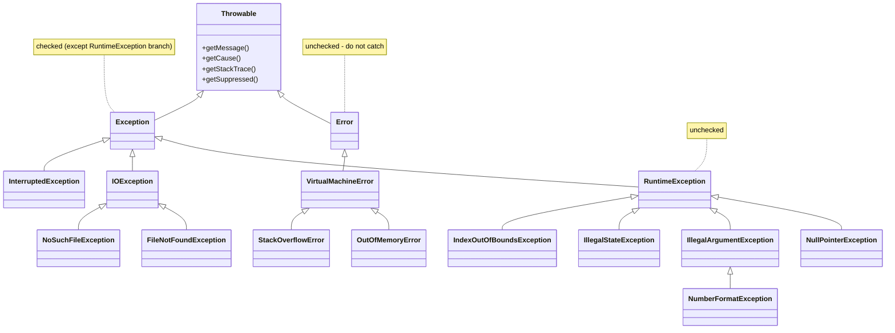
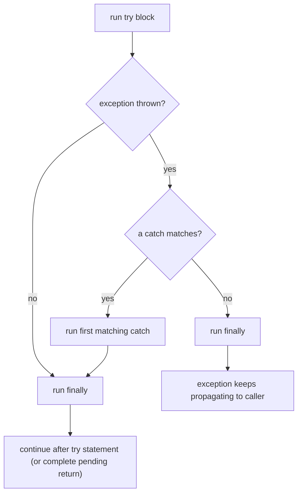
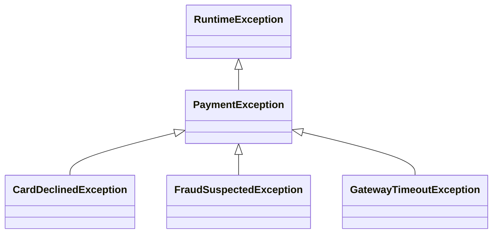

# Chapter 8 — Exceptions

Programs fail: files go missing, users type "forty-two" where a number belongs, networks time out, and code has bugs. An **exception** is Java's way of reporting that something went wrong *without* forcing every method to return an error code. This chapter explains the mechanism (how an exception travels up the call stack), the type hierarchy (checked vs unchecked vs errors), every piece of syntax (`try`/`catch`/`finally`, multi-catch, try-with-resources, `throw`, `throws`), how to design your own exceptions, and the practices that separate robust code from code that hides its failures.

You've already met exceptions in passing: `NumberFormatException` from `Integer.parseInt`, `ArithmeticException` from `Math.addExact` ([Chapter 2](../02-basics-types-and-operators/README.md)), `ArrayIndexOutOfBoundsException` ([Chapter 4](../04-methods-and-arrays/README.md)), and the rule that an overriding method can't throw broader checked exceptions ([Chapter 6 §6.3](../06-oop-inheritance-interfaces-and-more/README.md#63-overriding)).

**What you'll learn**

| § | Topic | You'll be able to… |
|---|---|---|
| 8.1 | What an exception is | throw and catch one, and trace how it propagates up the call stack |
| 8.2 | The `Throwable` hierarchy | tell checked, unchecked and errors apart and know the common ones |
| 8.3 | Handle or declare | satisfy the compiler for checked exceptions with `try`/`catch` or `throws` |
| 8.4 | `finally` and control flow | predict exactly what runs, and what gets returned, in every case |
| 8.5 | Multi-catch, catch order, rethrow | write compact handlers that compile |
| 8.6 | try-with-resources | close files, sockets and locks correctly, including suppressed exceptions |
| 8.7 | Throwing and custom exceptions | choose a standard exception or design your own |
| 8.8 | Chaining and translation | wrap low-level causes without losing them |
| 8.9 | Reading stack traces | find the real cause in a trace in seconds |
| 8.10 | Best practices and anti-patterns | apply the *Effective Java* rules and avoid swallowed or misused exceptions |

All runnable code is in [`code/`](code/) (package `ch08.*`), compiled with `javac --release 25` and run on JDK 26. Outputs are pasted from real runs.

> **Exam depth.** "Does this compile?" puzzles about unreachable catch blocks, `finally` return values, try-with-resources scope and suppressed exceptions, plus overriding and `throws`: [OCP Chapter 11 — Exceptions and localization](../../../../ocp-java21-study/chapters/11-exceptions-localization/README.md) (sections 1–4). For error-handling *strategy* in services (retries, error codes at API boundaries, logging), see [LLD Clean Code §6 Error handling](../../../lld/chapters/06-clean-code/README.md#6-error-handling) and [§16 Error-handling strategy](../../../lld/chapters/06-clean-code/README.md#16-error-handling-strategy-best-practices-for-real-services).

---

## 8.1 What an exception is

### What it is
An **exception** is an object that describes an abnormal event, plus the act of **throwing** it: the JVM stops executing the current code and jumps to the nearest matching **handler** (a `catch` block). If no method on the call stack handles it, the thread dies and the JVM prints a **stack trace**.

Analogy: a factory production line. When a worker finds a defect they can't fix, they don't carry on building; they pull the alarm cord (throw). Supervisors up the chain (callers) each get a chance to deal with it (catch). If nobody does, the line stops (the thread terminates).

### The problem it solves
Without exceptions (as in C), every function returns an error code that every caller must check — and forgetting one check silently corrupts data. Exceptions:
1. **Separate** normal logic from error handling.
2. **Can't be silently ignored** by forgetting a check — an unhandled exception is loud.
3. **Propagate automatically** to the level that knows what to do (a web request handler, a UI, a retry loop).
4. **Carry information**: type, message, cause, and the exact call path (stack trace).

### How it works
1. Something goes wrong: the JVM detects it (division by zero, `null` dereference, bad array index) or your code executes `throw new SomeException(...)`.
2. Execution of the current block stops immediately — remaining statements are skipped.
3. The JVM looks for an enclosing `try` whose `catch` type matches (the thrown object is an instance of it). If found, that catch block runs, then execution continues **after** the whole `try` statement.
4. If not found in this method, the method ends abruptly and the exception is re-thrown in the **caller**, at the point of the call. This repeats up the stack (**stack unwinding**), running `finally` blocks on the way.
5. If it reaches the top of a thread's stack, the thread's *uncaught exception handler* prints the stack trace and the thread ends. If that was the `main` thread and no other non-daemon threads are running, the program exits with status 1.

[`code/ch08/basics/FirstException.java`](code/ch08/basics/FirstException.java) (key parts):
```java
static int average(int[] values) {
    int sum = 0;
    for (int v : values) sum += v;
    return sum / values.length;            // length 0 -> ArithmeticException
}

try {
    System.out.println("before the call");
    int avg = average(new int[0]);         // throws; the rest of the try block is skipped
    System.out.println("never printed " + avg);
} catch (ArithmeticException e) {
    System.out.println("caught " + e.getClass().getName() + ": " + e.getMessage());
}
System.out.println("program continues normally");

static void setAge(int age) {
    if (age < 0) throw new IllegalArgumentException("age must be >= 0, was " + age);
    ...
}
```
Output:
```text
average {4, 8} = 6
before the call
caught java.lang.ArithmeticException: / by zero
program continues normally
caught IllegalArgumentException: age must be >= 0, was -5
```

### Propagation through the call stack
[`code/ch08/basics/Propagation.java`](code/ch08/basics/Propagation.java) calls `level1 → level2 → level3`; only `level1` has a `try`/`catch`:
```java
static void level3(String s) {
    System.out.println("  level3 start");
    System.out.println("  length = " + s.length());   // NPE when s is null
    System.out.println("  level3 end");
}
static void level2(String s) { System.out.println(" level2 start"); level3(s); System.out.println(" level2 end"); }
static void level1(String s) {
    System.out.println("level1 start");
    try { level2(s); }
    catch (NullPointerException e) { System.out.println("level1 caught: " + e.getMessage()); }
    System.out.println("level1 end");
}
```
Output:
```text
level1 start
 level2 start
  level3 start
  length = 2
  level3 end
 level2 end
level1 end
---
level1 start
 level2 start
  level3 start
level1 caught: Cannot invoke "String.length()" because "<parameter1>" is null
level1 end
```
With `null`, "level3 end" and "level2 end" never print: both methods were abandoned mid-way as the exception unwound to `level1`.



The message says `"<parameter1>"` because the runner compiles without debug info. Compile with **`javac -g`** (IDEs and Maven/Gradle do this by default) and the same line reads `because "s" is null`. These **helpful NullPointerException messages** arrived in Java 14 (JEP 358) and are on by default since Java 15.

### Self-check
1. After a `catch` block finishes, where does execution continue? → After the entire `try` statement, not back at the throw point.
2. What happens to statements after the throwing line in the same `try`? → Skipped.
3. What happens if nobody catches an exception in `main`? → The stack trace is printed and the thread ends (exit status 1 if nothing else is running).

---

## 8.2 The `Throwable` hierarchy: checked, unchecked and errors

### What it is
Only objects of class **`java.lang.Throwable`** (or its subclasses) can be thrown. It has two branches:
- **`Error`** — serious problems in the JVM or environment that an application normally shouldn't try to handle: `OutOfMemoryError`, `StackOverflowError`, `NoClassDefFoundError`, `ExceptionInInitializerError`.
- **`Exception`** — conditions a program might want to handle. Its subclass **`RuntimeException`** is special.

The compiler divides throwables into two kinds:
- **Checked exceptions**: `Exception` and its subclasses, *except* `RuntimeException` and its subclasses. The compiler **forces** you to handle or declare them (§8.3). They model problems outside the program's control that a caller can reasonably recover from: I/O failures, network errors, "file not found", `InterruptedException`.
- **Unchecked exceptions**: `RuntimeException` and its subclasses, **plus** `Error` and its subclasses. No compiler enforcement. `RuntimeException`s usually signal **programming errors** — a violated precondition such as a `null` argument, a bad index, an illegal state.


(`NoSuchFileException` is in `java.nio.file` and actually extends `FileSystemException`, which extends `IOException`.)

[`code/ch08/hierarchy/Hierarchy.java`](code/ch08/hierarchy/Hierarchy.java) walks `getSuperclass()` for common types:
```text
NullPointerException [unchecked]
    extends RuntimeException > Exception > Throwable
IllegalArgumentException [unchecked]
    extends RuntimeException > Exception > Throwable
NumberFormatException [unchecked]
    extends IllegalArgumentException > RuntimeException > Exception > Throwable
ArrayIndexOutOfBoundsException [unchecked]
    extends IndexOutOfBoundsException > RuntimeException > Exception > Throwable
IllegalStateException [unchecked]
    extends RuntimeException > Exception > Throwable
UnsupportedOperationException [unchecked]
    extends RuntimeException > Exception > Throwable
ClassCastException [unchecked]
    extends RuntimeException > Exception > Throwable
ArithmeticException [unchecked]
    extends RuntimeException > Exception > Throwable
UncheckedIOException [unchecked]
    extends RuntimeException > Exception > Throwable
IOException [CHECKED]
    extends Exception > Throwable
FileNotFoundException [CHECKED]
    extends IOException > Exception > Throwable
SQLException [CHECKED]
    extends Exception > Throwable
InterruptedException [CHECKED]
    extends Exception > Throwable
CloneNotSupportedException [CHECKED]
    extends Exception > Throwable
StackOverflowError [error, unchecked]
    extends VirtualMachineError > Error > Throwable
OutOfMemoryError [error, unchecked]
    extends VirtualMachineError > Error > Throwable
```

### The exceptions you'll meet most
| Exception | Kind | Typical cause |
|---|---|---|
| `NullPointerException` | unchecked | calling a method/field on `null`, unboxing `null` |
| `IllegalArgumentException` | unchecked | a method rejects an argument's value |
| `NumberFormatException` | unchecked (IAE subclass) | `Integer.parseInt("abc")` |
| `IllegalStateException` | unchecked | a call at the wrong time (e.g. `iterator.remove()` twice, using a closed object) |
| `IndexOutOfBoundsException` (+ `Array…`, `String…`) | unchecked | bad index |
| `ClassCastException` | unchecked | invalid downcast |
| `ArithmeticException` | unchecked | integer `/ 0`, `*Exact` overflow, non-terminating `BigDecimal` division |
| `UnsupportedOperationException` | unchecked | modifying an immutable collection (`List.of(...).add(x)`) |
| `ConcurrentModificationException` | unchecked | changing a collection while iterating it ([Chapter 10](../10-collections/README.md)) |
| `NoSuchElementException` | unchecked | `iterator.next()` past the end, `Optional.get()`/`orElseThrow()` on empty |
| `DateTimeException`, `DateTimeParseException` | unchecked | invalid date values/text ([Chapter 7](../07-core-apis/README.md)) |
| `IOException` (+ `FileNotFoundException`, `NoSuchFileException`…) | checked | file/network I/O failures |
| `InterruptedException` | checked | a blocked thread was interrupted ([Chapter 14](../14-concurrency-1/README.md)) |
| `SQLException` | checked | database errors (JDBC) |
| `ExecutionException`, `TimeoutException` | checked | a `Future` task failed / waited too long |
| `ExceptionInInitializerError` | error | exception in a `static` initialiser |
| `StackOverflowError`, `OutOfMemoryError` | error | runaway recursion; heap exhausted |

### Trade-offs — checked vs unchecked
| | Checked | Unchecked |
|---|---|---|
| Compiler enforcement | Must catch or declare | None |
| Signals | Recoverable external condition | Programming error (bug) or unrecoverable state |
| API cost | Every caller must deal with it — even when they can't do anything useful | Callers can ignore it; documentation (`@throws`) matters more |
| Works with lambdas/streams | Poorly — `java.util.function` interfaces declare no checked exceptions ([Chapter 11](../11-lambdas-and-functional-programming/README.md)) | Fine |
| Examples | `IOException`, `SQLException` | `IllegalArgumentException`, `NullPointerException` |

Java is unusual in having checked exceptions (C#, Kotlin, Python, JavaScript don't). *Effective Java* Items 70–71: use checked exceptions for conditions the caller can **recover** from, runtime exceptions for programming errors, and avoid checked exceptions when the caller can't do anything useful anyway. Most modern frameworks (Spring, JPA/Hibernate) wrap checked exceptions in unchecked ones for this reason.

### In the interview
**30-second answer:** "Everything thrown is a `Throwable`. `Error`s are JVM-level problems you don't catch. `Exception`s are either checked — the compiler forces catch-or-declare, used for recoverable external failures like `IOException` — or unchecked `RuntimeException`s, used for programming errors like `IllegalArgumentException` or `NullPointerException`. I use unchecked for precondition violations and checked only when the caller can genuinely recover."

- *Follow-up: Is `Error` checked?* → No; `Error` and `RuntimeException` (and subclasses) are the unchecked ones.
- *Follow-up: Should you catch `Throwable`?* → Only at the very top of a thread/request to log and fail cleanly — it also catches `Error`s like `OutOfMemoryError` where continuing may be unsafe.

### Self-check
1. Is `FileNotFoundException` checked? → Yes (it's an `IOException`).
2. Is `NumberFormatException` a subclass of `IllegalArgumentException`? → Yes.
3. Which branch does `StackOverflowError` belong to? → `Error` (via `VirtualMachineError`).

### TL;DR
`Throwable` → `Error` (don't catch) and `Exception`; `RuntimeException` + `Error` = unchecked; the rest of `Exception` = checked (must handle or declare).

---

## 8.3 Handle or declare: checked exceptions and `throws`

### What it is
The **handle-or-declare rule** (sometimes called "catch or specify"): if code inside a method can throw a **checked** exception, the method must either
- **handle** it — wrap the code in `try` with a matching `catch`; or
- **declare** it — list it in the method's **`throws` clause**, passing the responsibility to its callers.

Otherwise the program doesn't compile: *"unreported exception IOException; must be caught or declared to be thrown"*.

`throw` vs `throws`: **`throw`** is a statement that throws one exception object now (`throw new IOException("x")`). **`throws`** is part of a method signature listing exception *types* the method may throw (`void read() throws IOException, SQLException`).

### How it works
[`code/ch08/checked/CheckedDemo.java`](code/ch08/checked/CheckedDemo.java):
```java
// "Declare": this method does not handle IOException, it passes it to the caller
static String readConfig(Path path) throws IOException {
    return Files.readString(path);
}

// "Handle": this method catches and decides what to do
static String readConfigOrDefault(Path path) {
    try {
        return readConfig(path);
    } catch (NoSuchFileException e) {            // more specific first
        System.out.println("no such file: " + e.getFile() + " -> using defaults");
        return "mode=default";
    } catch (IOException e) {                    // any other I/O problem
        System.out.println("I/O failure: " + e);
        return "mode=default";
    }
}

public static void main(String[] args) throws IOException {   // main may declare too
    Path tmp = Files.createTempFile("ch08-", ".properties");
    Files.writeString(tmp, "mode=fast");
    System.out.println("existing file: " + readConfigOrDefault(tmp));
    Files.delete(tmp);
    System.out.println("deleted file:  " + readConfigOrDefault(Path.of("missing-config.properties")));
    for (String in : new String[]{"42", "forty-two"}) {
        try { System.out.println("parsed " + Integer.parseInt(in)); }
        catch (NumberFormatException e) { System.out.println("bad number '" + in + "': " + e.getMessage()); }
    }
}
```
Output:
```text
existing file: mode=fast
no such file: missing-config.properties -> using defaults
deleted file:  mode=default
parsed 42
bad number 'forty-two': For input string: "forty-two"
```

### The rules in one table
| Rule | Detail |
|---|---|
| Checked exceptions must be caught or declared | including those thrown by methods you call |
| Unchecked exceptions *may* be declared | useful as documentation, but the compiler ignores it; document with Javadoc `@throws` |
| You can't catch a checked exception that the `try` body can't throw | *"exception IOException is never thrown in body of corresponding try statement"* — except `Exception` and `Throwable`, which could always hide an unchecked one |
| Overriding methods may not throw **new or broader** checked exceptions | they may throw fewer, narrower, or any unchecked ones ([Chapter 6 §6.3](../06-oop-inheritance-interfaces-and-more/README.md#63-overriding)) |
| Lambdas | a lambda body can throw a checked exception only if the functional interface's method declares it; `Runnable`, `Function` etc. don't ([Chapter 11](../11-lambdas-and-functional-programming/README.md)) |
| Initialiser blocks | a `static` initialiser may not throw a checked exception (unchecked ones are wrapped in `ExceptionInInitializerError`); an instance initialiser may, only if every constructor declares it |

### When to handle vs declare
- **Handle** where you can do something meaningful: retry, fall back to a default, ask the user again, translate to a better exception (§8.8).
- **Declare** when this layer can't fix it and the caller has more context. Low-level helpers usually declare; boundaries (a request handler, `main`, a UI event handler) usually handle.
- Never "handle" by catching and doing nothing (§8.10).

### Self-check
1. `void m() { Thread.sleep(10); }` compiles? → No: `InterruptedException` is checked.
2. Must you declare `throws IllegalArgumentException`? → No, it's unchecked (you may, for documentation).
3. Can `catch (Exception e)` appear after a `try` that throws nothing? → Yes — `Exception` includes unchecked types.

---

## 8.4 `try` / `catch` / `finally` and control flow

### What it is
A **`finally`** block runs after the `try` (and any `catch` that ran) **no matter how** the `try` ended: normally, by an exception (caught or not), or by `return`/`break`/`continue`. It exists for cleanup that must always happen — releasing a lock, resetting a flag, closing a resource (though for resources §8.6 is better).

### How it works — the syntax rules
1. A `try` must be followed by at least one `catch` **or** a `finally` (or be a try-with-resources).
2. Order is fixed: `try`, then zero or more `catch`, then at most one `finally`.
3. At most one `catch` runs — the **first** one whose type matches.
4. `finally` runs after that `catch`, or directly after `try` if nothing was thrown or nothing matched (in which case the exception continues propagating **after** `finally`).
5. Braces are required even for one statement.

[`code/ch08/finallyflow/FinallyDemo.java`](code/ch08/finallyflow/FinallyDemo.java) (key parts):
```java
static int returnInTry() {
    int x = 1;
    try {
        return x;             // the value 1 is saved here...
    } finally {
        x = 99;               // ...so changing x in finally does not change the returned value
        System.out.println("finally ran before the method returned");
    }
}

static int finallyOverrides() {
    try {
        throw new RuntimeException("lost!");
    } finally {
        return -1;            // BAD: discards the exception and any return value from try
    }
}
```
Output:
```text
no failure: try try-end finally
failure:    try catch finally
finally ran before the method returned
returnInTry() = 1
finallyOverrides() = -1 (the RuntimeException vanished)
inner finally runs even though nobody here catches
outer caught: inner
```



### The tricky cases
| Situation | What happens |
|---|---|
| `return` in `try`, `finally` modifies the variable | The return **value** was already evaluated; a primitive result is unchanged (a returned object's *contents* can still be mutated) |
| `return` in `finally` | Overrides the `try`'s return **and silently discards any exception** — never do this (javac `-Xlint:finally` warns) |
| `finally` throws | The new exception replaces the original one, which is lost |
| `catch` throws | `finally` still runs, then the new exception propagates |
| `System.exit()` in `try`, JVM crash, power loss, infinite loop in `try` | `finally` does **not** run |

### Common mistakes
- Returning or throwing from `finally` (hides the real failure).
- Closing resources manually in `finally` with nested `try`s — verbose and easy to get wrong; use try-with-resources.
- Confusing `final` (can't reassign), `finally` (always-run block) and `finalize()` (deprecated for removal since Java 18, JEP 421).

### Self-check
1. `try { return "a"; } finally { System.out.print("b"); }` — output and return value? → Prints `b`, returns `"a"`.
2. Is `try { } finally { }` legal? → Yes.
3. When doesn't `finally` run? → `System.exit`, JVM halt/crash, or the `try` never finishes.

---

## 8.5 Multi-catch, catch order and rethrowing

### What it is
- **Multi-catch** (Java 7): one `catch` block for several unrelated exception types, separated by `|`: `catch (NumberFormatException | IndexOutOfBoundsException e)`.
- **Catch order**: because the first matching `catch` wins, a subclass must be caught **before** its superclass; otherwise the subclass block is unreachable and the code doesn't compile.
- **Precise rethrow** (Java 7): if you catch a broad type and rethrow the same (effectively final) variable, the compiler knows it can only be one of the checked types the `try` actually throws.
- **Unnamed variable `_`** (Java 22, JEP 456): write `catch (NumberFormatException _)` when the handler doesn't use the exception object.

[`code/ch08/multicatch/MultiCatch.java`](code/ch08/multicatch/MultiCatch.java) (key parts):
```java
try {
    risky(i);        // 0: parseInt("x")  1: List.of(1,2).get(5)  2: IOException  3: fine
} catch (NumberFormatException | IndexOutOfBoundsException e) {     // multi-catch
    System.out.println(i + ": bad input -> " + e.getClass().getSimpleName());
} catch (java.io.IOException e) {
    System.out.println(i + ": I/O -> " + e.getMessage());
} finally {
    System.out.println(i + ": finally");
}

try { Integer n = (Integer) (Object) "text"; }
catch (ClassCastException e) { System.out.println("ClassCastException first"); }   // specific first
catch (RuntimeException e)   { System.out.println("RuntimeException"); }           // then general

try { value = Integer.parseInt(input); }
catch (NumberFormatException _) { value = -1; }                                    // Java 22

static void rethrow(boolean io) throws java.io.IOException, java.util.concurrent.TimeoutException {
    try {
        if (io) throw new java.io.IOException("io failed");
        throw new java.util.concurrent.TimeoutException("too slow");
    } catch (Exception e) {
        System.out.println("log and rethrow: " + e);
        throw e;                    // compiler knows e is IOException | TimeoutException
    }
}
```
Output:
```text
0: bad input -> NumberFormatException
0: finally
1: bad input -> IndexOutOfBoundsException
1: finally
2: I/O -> disk full
2: finally
  no problem
3: finally
ClassCastException first
value = -1
log and rethrow: java.util.concurrent.TimeoutException: too slow
caller got TimeoutException
```

### Compiler rules (real `javac` messages)
| You write | Result |
|---|---|
| `catch (RuntimeException e) {} catch (ClassCastException e) {}` | error: *exception ClassCastException has already been caught* |
| `catch (IllegalArgumentException \| NumberFormatException e)` | error: *Alternatives in a multi-catch statement cannot be related by subclassing* — just catch the parent |
| `catch (IllegalStateException \| ArithmeticException e) { e = null; }` | error: *multi-catch parameter e may not be assigned* (it's implicitly `final`) |
| `catch (java.io.IOException e)` around code that can't throw it | error: *exception IOException is never thrown in body of corresponding try statement* |

In a multi-catch, the variable's static type is the closest common supertype of the alternatives, so you can only call methods they share (usually those from `Throwable`).

### Self-check
1. Why can't you write `catch (IOException | FileNotFoundException e)`? → `FileNotFoundException` is a subclass of `IOException`; catch `IOException` alone.
2. What's the benefit of precise rethrow? → You can catch broadly (to log) yet keep a narrow `throws` clause.
3. When is `catch (X _)` appropriate? → When the type alone tells you what to do and the object isn't needed (Java 22+).

---

## 8.6 try-with-resources

### What it is
A **resource** is an object that must be closed when you're done — files, sockets, database connections, streams, locks wrapped as closeables. **try-with-resources** (Java 7) declares resources in parentheses after `try`; Java closes them automatically when the block ends, however it ends.

Any class implementing **`java.lang.AutoCloseable`** (single method `void close() throws Exception`) can be used. **`java.io.Closeable`** is the older sub-interface for I/O, whose `close()` throws `IOException` and must be idempotent (safe to call twice).

### Why it matters
Before Java 7, correct cleanup needed a `finally` with a null check and a nested `try` around `close()`, and a failure in `close()` could *replace* the real error. try-with-resources fixes both. *Effective Java* Item 9: "Prefer try-with-resources to try-finally."

### How it works
1. Resources are initialised left to right in the header; each is implicitly `final`.
2. The body runs.
3. When the body finishes (normally or by exception), resources are **closed in reverse order** of declaration — **before** any `catch` or `finally` block of the same statement runs.
4. If a resource's initialisation failed, only the ones already opened are closed; `null` resources are skipped.
5. If the body throws *and* `close()` throws, the body's exception is the **primary** one; the close exceptions are attached to it as **suppressed** exceptions (`getSuppressed()`), never lost.
6. Java 9: you can use an existing **effectively final** variable directly: `try (reader) { ... }`.

[`code/ch08/resources/TryWithResources.java`](code/ch08/resources/TryWithResources.java) (key parts):
```java
static class Res implements AutoCloseable {
    Res(String name, boolean failOnClose) { ...; System.out.println("open " + name); }
    void use(boolean fail) { System.out.println("use " + name); if (fail) throw new IllegalStateException("use of " + name + " failed"); }
    @Override public void close() {
        System.out.println("close " + name);
        if (failOnClose) throw new IllegalStateException("close of " + name + " failed");
    }
}

try (Res a = new Res("A", false); Res b = new Res("B", false)) { a.use(false); b.use(false); }

try (Res a = new Res("A", false)) { a.use(true); }
catch (IllegalStateException e) { System.out.println("catch: " + e.getMessage()); }
finally { System.out.println("finally"); }

try (Res a = new Res("A", true); Res b = new Res("B", true)) { b.use(true); }
catch (IllegalStateException e) {
    System.out.println("primary: " + e.getMessage());
    for (Throwable s : e.getSuppressed()) System.out.println("suppressed: " + s.getMessage());
}

BufferedReader reader = new BufferedReader(new StringReader("line one\nline two"));
try (reader) { System.out.println("first line: " + reader.readLine()); }     // Java 9
```
Output:
```text
-- 1. normal: closed in reverse order
open A
open B
use A
use B
close B
close A
-- 2. body fails: resources closed BEFORE catch runs
open A
use A
close A
catch: use of A failed
finally
-- 3. body AND close fail: close exception is suppressed
open A
open B
use B
close B
close A
primary: use of B failed
suppressed: close of B failed
suppressed: close of A failed
-- 4. Java 9: effectively final variable as a resource
first line: line one
after close: Stream closed
```

Real-world use:
```java
try (Connection con = dataSource.getConnection();
     PreparedStatement ps = con.prepareStatement("SELECT name FROM users WHERE id = ?")) {
    ps.setLong(1, id);
    try (ResultSet rs = ps.executeQuery()) { ... }
}   // rs, ps, con closed in that order — even if the query throws
```
(Not run — needs a database; JDBC is covered in [Chapter 18](../18-testing-build-and-tooling/README.md).)

### Common mistakes
- Opening a resource *outside* the `try (...)` without passing it in — it won't be closed if something fails in between.
- Returning a resource (e.g. a `Stream` from `Files.lines`) out of the `try` — it's closed by the time the caller uses it. Stream-returning I/O methods like `Files.lines`/`Files.walk` must themselves be used in try-with-resources ([Chapter 13](../13-io-and-nio/README.md)).
- Reassigning a resource variable: *"auto-closeable resource r may not be assigned"*.
- Wrapping streams: `try (var in = new BufferedReader(new FileReader(f)))` closes the outer reader, which closes the inner one; but if the *outer* constructor throws, the inner one leaks. For strictness, declare each as its own resource.

### In the interview
**30-second answer:** "try-with-resources closes any `AutoCloseable` automatically, in reverse order, before catch and finally run. If both the body and `close` throw, the body's exception wins and the close failures are attached as suppressed exceptions, so nothing is lost. It replaced error-prone `finally { if (x != null) x.close(); }` code."

- *Follow-up: `AutoCloseable` vs `Closeable`?* → `Closeable` (java.io) extends `AutoCloseable`, throws `IOException`, and its `close` should be idempotent.
- *Follow-up: How do you see a suppressed exception?* → `e.getSuppressed()`; stack traces print them under "Suppressed:".

### Self-check
1. Three resources `a, b, c` — close order? → `c, b, a`.
2. Does `catch` run before or after `close`? → After.
3. Can a try-with-resources have no `catch`/`finally`? → Yes.

### TL;DR
Anything `AutoCloseable` goes in `try (...)`. Reverse-order close, before catch/finally; secondary failures become suppressed, not lost.

---

## 8.7 Throwing exceptions and writing custom ones

### Reuse standard exceptions first
*Effective Java* Item 72: favour standard exceptions — readers already know what they mean.

| Situation | Throw |
|---|---|
| An argument value is invalid | `IllegalArgumentException` |
| A required argument is `null` | `NullPointerException` — `Objects.requireNonNull(x, "x")` |
| An index is out of range | `IndexOutOfBoundsException` — `Objects.checkIndex(i, size)` (Java 9) |
| The object is in the wrong state for this call | `IllegalStateException` |
| The operation isn't supported by this implementation | `UnsupportedOperationException` |
| A lookup found nothing and the method must return a value | `NoSuchElementException` (or return `Optional`, §8.10) |
| Concurrent modification detected | `ConcurrentModificationException` |

Don't throw `Exception`, `RuntimeException`, `Throwable` or `Error` directly — callers can't tell your failure apart from anything else.

### When to write your own
Create a custom exception when callers need to **distinguish** it (catch it specifically) or when it should **carry data** (an account ID, a shortfall amount, an error code). Guidelines:
1. Name it `…Exception`.
2. Extend `RuntimeException` for programming/state errors and most domain rule violations in modern code; extend `Exception` only if callers are expected to recover and you want the compiler to remind them.
3. Provide the standard constructors you need: `(String message)` and `(String message, Throwable cause)`; the cause constructor is essential for chaining (§8.8).
4. Make added fields `final` and expose getters. Exceptions are `Serializable`; strict linting (`-Xlint:serial`) asks for a `serialVersionUID`.
5. Build a message with the failure-capture details (*Effective Java* Item 75): the values that caused it, not "Error occurred". Never include passwords or personal data.

[`code/ch08/custom/CustomExceptions.java`](code/ch08/custom/CustomExceptions.java) (key parts):
```java
// Checked: the caller is expected to recover (e.g. show "insufficient funds" to the user)
static class InsufficientFundsException extends Exception {
    private final BigDecimal shortfall;
    InsufficientFundsException(BigDecimal shortfall) {
        super("insufficient funds: short by " + shortfall);
        this.shortfall = shortfall;
    }
    BigDecimal getShortfall() { return shortfall; }
}

// Unchecked: a programming/state error in our domain
static class AccountFrozenException extends RuntimeException {
    AccountFrozenException(String accountId) { super("account " + accountId + " is frozen"); }
}

void withdraw(BigDecimal amount) throws InsufficientFundsException {
    if (amount.signum() <= 0) throw new IllegalArgumentException("amount must be positive: " + amount);
    if (frozen) throw new AccountFrozenException(id);
    if (amount.compareTo(balance) > 0) throw new InsufficientFundsException(amount.subtract(balance));
    balance = balance.subtract(amount);
}
```
Output (first four lines):
```text
withdrew 30.00, balance 70.00
insufficient funds: short by 430.00 (shortfall field = 430.00)
rejected: amount must be positive: -1
rejected: account ACC-1 is frozen
```

Note `withdraw` checks every condition **before** changing `balance`. That's **failure atomicity** (*Effective Java* Item 76): a failed call should leave the object as it was.

### Custom exception hierarchies
For a library or service, a small hierarchy lets callers catch broadly or narrowly:

Keep it shallow; three or four types that callers actually handle differently beat twenty that nobody catches individually. A sealed interface or an error-code enum field can also work.

### Self-check
1. Which exception for `setAge(-5)`? → `IllegalArgumentException`.
2. Which for calling `start()` twice on an engine? → `IllegalStateException`.
3. Why add fields to a custom exception? → So handlers can act on data (e.g. shortfall) without parsing the message.

---

## 8.8 Chaining and exception translation

### What it is
**Exception chaining** stores the original exception as the **cause** of a new one: `new ReportException("could not build report", e)`. **Exception translation** (*Effective Java* Item 73) means a higher layer catches low-level exceptions and throws ones that make sense at *its* level of abstraction — a `ReportService` shouldn't leak `SQLException` or `IOException` to its callers.

Chaining keeps the full story: the stack trace prints the high-level exception, then **"Caused by:"** with the original.

### How it works
1. Catch the low-level exception.
2. Throw a new exception, passing the original as `cause` (constructor argument, or `initCause` for old exception types without a cause constructor).
3. Callers use `getCause()` to inspect the root, and logs show the whole chain.
4. To pass a checked exception through code that can't declare it (lambdas, `Runnable`), wrap it in an unchecked one — the JDK provides **`UncheckedIOException`** for `IOException`.

```java
static String buildReport(String name) throws ReportException {
    try {
        return loadTemplate(name);                        // throws IOException
    } catch (IOException e) {
        throw new ReportException("could not build report " + name, e);   // translate + chain
    }
}

java.util.List.of("a").forEach(n -> {
    try { loadTemplate(n); }
    catch (IOException e) { throw new UncheckedIOException(e); }         // lambda can't throw IOException
});
```
Output (last three lines of `CustomExceptions`):
```text
error: could not build report monthly
cause: java.io.IOException: template 'monthly' not found on disk
unwrapped cause: template 'a' not found on disk
```

### Common mistakes
- `throw new ReportException("failed: " + e.getMessage());` — loses the original type and stack trace. **Always pass `e` as the cause.**
- Log-and-rethrow at every layer — the same failure appears five times in the logs. Log once, where it's handled.
- Wrapping everything in `RuntimeException` without a message — at least say what the operation was.

### Self-check
1. How do you get the original exception from a wrapper? → `getCause()` (repeatedly, for the root).
2. What does "Caused by:" in a trace mean? → The next exception down the cause chain.

---

## 8.9 Reading stack traces

### What it is
A **stack trace** lists the chain of method calls (**frames**) that were active when the exception was *created*, most recent first. Each frame shows `class.method(File.java:line)`. It's the single most useful debugging artefact in Java.

[`code/ch08/stacktrace/StackTraces.java`](code/ch08/stacktrace/StackTraces.java):
```java
static int parsePort(String text) { return Integer.parseInt(text); }

static int loadPort(String text) {
    try {
        return parsePort(text);
    } catch (NumberFormatException e) {
        throw new ServiceException("invalid port setting", e);
    }
}
// in main:
try { loadPort("80a"); }
catch (ServiceException e) { e.printStackTrace(System.out); ... }
```
Output (the line numbers inside `java.base` frames depend on the exact JDK build — these are from JDK 26):
```text
ch08.stacktrace.StackTraces$ServiceException: invalid port setting
	at ch08.stacktrace.StackTraces.loadPort(StackTraces.java:17)
	at ch08.stacktrace.StackTraces.main(StackTraces.java:23)
Caused by: java.lang.NumberFormatException: For input string: "80a"
	at java.base/java.lang.NumberFormatException.forInputString(NumberFormatException.java:67)
	at java.base/java.lang.Integer.parseInt(Integer.java:527)
	at java.base/java.lang.Integer.parseInt(Integer.java:624)
	at ch08.stacktrace.StackTraces.parsePort(StackTraces.java:10)
	at ch08.stacktrace.StackTraces.loadPort(StackTraces.java:15)
	... 1 more
top frame: ch08.stacktrace.StackTraces.loadPort line 17
caught StackOverflowError (an Error: normally you do NOT catch these)
```

### How to read one
1. **First line**: exception class + message — *what* happened (`ServiceException: invalid port setting`).
2. **Frames below it**: *where*, most recent call first. The first frame in **your** code is usually where to look (`loadPort`, line 17).
3. **"Caused by:"**: the underlying exception. **Scroll to the last "Caused by:"** — the root cause is usually the real problem (`"80a"` isn't a number, from `parsePort` line 10).
4. **`... 1 more`**: the remaining frames are identical to the enclosing trace's frames, so they're elided.
5. **`java.base/`** prefix: the module the class belongs to ([Chapter 16](../16-jvm-internals-and-performance/README.md)). `$` in a class name means a nested class.
6. **"Suppressed:"** sections list exceptions attached by try-with-resources (§8.6).

### Tools
| API | Use |
|---|---|
| `e.getMessage()`, `e.toString()` | message; class name + message |
| `e.printStackTrace()` | to `System.err` — fine for learning; in applications use a logger (`log.error("msg", e)`) which records the trace |
| `e.getStackTrace()` | `StackTraceElement[]` for programmatic inspection |
| `e.getCause()`, `e.getSuppressed()` | navigate the chain |
| `StackWalker` (Java 9) | lazily inspect the *current* thread's stack without creating an exception |
| `Thread.setDefaultUncaughtExceptionHandler` | last-chance logging for threads that die from uncaught exceptions |

The stack trace is captured when the exception object is **constructed**, which costs time proportional to stack depth. That's one reason not to use exceptions for normal control flow (§8.10). Frameworks sometimes pre-allocate exceptions or disable trace capture via the protected `Throwable(String, Throwable, boolean enableSuppression, boolean writableStackTrace)` constructor — a niche optimisation.

### Self-check
1. Which "Caused by:" is usually the real problem? → The last one (the root cause).
2. Where does `printStackTrace()` write by default? → `System.err`.
3. What does `... 3 more` mean? → Three frames identical to the enclosing exception's frames were omitted.

---

## 8.10 Best practices and anti-patterns

### The rules (with *Effective Java* item numbers)
| # | Practice | Why |
|---|---|---|
| 1 | **Use exceptions only for exceptional conditions** (Item 69) — never for normal control flow such as ending a loop | Slower (stack capture), obscures logic, can hide real bugs |
| 2 | **Checked for recoverable conditions, runtime for programming errors** (Item 70); avoid needless checked exceptions (Item 71) | Don't force callers to catch what they can't handle |
| 3 | **Prefer standard exceptions** (Item 72) | Familiar semantics |
| 4 | **Throw exceptions appropriate to the abstraction** (Item 73) — translate and chain | Layers stay decoupled; the cause is preserved |
| 5 | **Document every exception** with `@throws` (Item 74), including unchecked ones that callers should know about | The compiler can't tell callers about unchecked ones |
| 6 | **Put failure details in the message** (Item 75): the offending values | Traces become self-explanatory |
| 7 | **Strive for failure atomicity** (Item 76): validate before mutating | A failed call doesn't leave half-updated state |
| 8 | **Don't ignore exceptions** (Item 77) | Swallowed errors become silent data corruption |
| 9 | **Fail fast**: validate arguments at the start of public methods/constructors | The error surfaces near its cause |
| 10 | **Catch the most specific type you can handle**; catch broadly only at boundaries | Avoid accidentally catching bugs |
| 11 | **Log or rethrow, not both**, and log once with the exception object | No duplicate log noise; keep the trace |
| 12 | **Use try-with-resources** for anything closeable (Item 9) | Correct cleanup, suppressed exceptions |

[`code/ch08/practices/BestPractices.java`](code/ch08/practices/BestPractices.java) (key parts):
```java
record User(String name, String email) {
    User {
        Objects.requireNonNull(name, "name");                                  // fail fast
        if (email == null || !email.contains("@")) throw new IllegalArgumentException("bad email: " + email);
    }
}

static Optional<String> findUser(int id) { return Optional.ofNullable(USERS.get(id)); }   // absence is normal
static String getUser(int id) {                                                          // absence is a bug
    String u = USERS.get(id);
    if (u == null) throw new NoSuchElementException("no user with id " + id);
    return u;
}

System.out.println("bounds check instead of catching: " + (i < data.length ? data[i] : "out of range"));

try {
    Thread.sleep(1);
} catch (InterruptedException e) {
    Thread.currentThread().interrupt();        // restore the interrupt flag
    ...
}
```
Output:
```text
findUser(3) -> guest
getUser(3) -> no user with id 3
requireNonNull -> NPE: name
validation -> bad email: not-an-email
helpful NPE: Cannot invoke "String.toUpperCase()" because "<local1>[1]" is null
bounds check instead of catching: out of range
done
```
(With `javac -g`, the helpful NPE line names the variable: `because "names[1]" is null`.)

### Exception or `Optional` or special value?
| The situation | Return / throw |
|---|---|
| "Not found" is a normal outcome (search, cache lookup) | `Optional<T>` ([Chapter 11](../11-lambdas-and-functional-programming/README.md)) or an empty collection — never `null` for collections |
| The caller broke the contract (null argument, bad index) | Unchecked exception |
| An external failure the caller can act on (file missing, remote service down) | Checked exception, or unchecked with clear docs |
| Validation of user input with many possible errors | A result object listing all errors (throwing on the first one gives a poor user experience) |

### Anti-patterns
```java
// 1. Swallowing: the failure disappears
try { save(order); } catch (Exception e) { }

// 2. Pokemon catching ("gotta catch 'em all") deep inside business logic
catch (Throwable t) { ... }                 // also catches OutOfMemoryError, StackOverflowError

// 3. Losing the cause
catch (IOException e) { throw new RuntimeException("failed"); }       // pass e!

// 4. Exceptions as control flow
try { int i = 0; while (true) arr[i++].process(); } catch (ArrayIndexOutOfBoundsException e) { }

// 5. Returning from finally (hides exceptions) — see 8.4

// 6. Swallowing InterruptedException without restoring the flag
catch (InterruptedException e) { }          // callers can no longer see the interrupt
```
If ignoring really is correct (e.g., closing something during shutdown), name the variable `ignored` or `_` and add a comment explaining why.

### Assertions — a note
`assert condition : "message";` throws `AssertionError` if the condition is false, **but only when the JVM runs with `-ea`** (enable assertions); they're off by default. Use them for internal invariants during development and testing, never for validating arguments of public methods or for anything with side effects.

### Real-world examples
- Web frameworks (e.g. Spring's `@ControllerAdvice`) catch exceptions at the request boundary and map them to HTTP statuses: `IllegalArgumentException` → 400, a custom `NotFoundException` → 404, anything else → 500 with a logged trace.
- JDBC and file APIs throw checked exceptions; frameworks translate them into unchecked hierarchies (Spring's `DataAccessException`) so business code isn't cluttered.
- `Objects.requireNonNull` at the top of constructors is used throughout the JDK itself.

### In the interview
**30-second answer:** "I validate early and throw standard unchecked exceptions for contract violations, use checked exceptions only for recoverable external failures, translate low-level exceptions at layer boundaries while chaining the cause, never swallow exceptions or return from `finally`, use try-with-resources for anything closeable, and handle — log once, map to a response — at the boundary. For expected absence I return `Optional` instead of throwing."

- *Follow-up: What's wrong with `catch (Exception e) {}`?* → It hides every failure, including bugs, leaving the system in an unknown state.
- *Follow-up: `final` vs `finally` vs `finalize`?* → Modifier; always-run block; deprecated GC hook (JEP 421, Java 18) — use try-with-resources or `Cleaner`.
- *Follow-up: Why restore the interrupt flag?* → Catching `InterruptedException` clears it; re-setting lets code further up see that cancellation was requested ([Chapter 14](../14-concurrency-1/README.md)).

### Self-check
1. Should a `findById` that often finds nothing throw? → Usually no — return `Optional`.
2. What's failure atomicity? → A failed operation leaves the object in its prior state.
3. Are assertions enabled by default? → No; they need `-ea`.

### TL;DR
Validate early, throw standard unchecked exceptions for bugs, checked only when recovery is realistic, translate with a cause at boundaries, never swallow, log once, and use `Optional` for normal absence.

---

## Chapter TL;DR

| Topic | Remember |
|---|---|
| Mechanism | `throw` stops the block; the stack unwinds to the first matching `catch`; uncaught → thread dies with a stack trace |
| Hierarchy | `Throwable` → `Error` (don't catch) / `Exception`; `RuntimeException` + `Error` unchecked; rest checked |
| Handle or declare | Checked exceptions must be caught or listed in `throws`; overriding can't widen checked exceptions |
| `finally` | Always runs (except `System.exit`/crash); return value already evaluated; never `return`/`throw` from it |
| Catch rules | First match wins; subclass before superclass; multi-catch types unrelated, variable final; precise rethrow; `catch (X _)` (22) |
| try-with-resources | `AutoCloseable`; reverse-order close before catch/finally; close failures suppressed; `try (existingVar)` (9) |
| Custom exceptions | Reuse standard ones first; custom when callers must distinguish or need data; message with details; cause constructor |
| Chaining | Always pass the cause; translate to your layer's abstraction; `UncheckedIOException` for lambdas |
| Stack traces | Read top line, first frame in your code, then the last "Caused by:"; compile with `-g` for variable names in NPE messages |
| Practices | Exceptions for exceptional cases, fail fast, failure atomicity, don't swallow, log once, `Optional` for normal absence |

**Where next:** type-safe, reusable code with [Chapter 9 — Generics](../09-generics/README.md). Checked exceptions inside lambdas and `Optional`: [Chapter 11](../11-lambdas-and-functional-programming/README.md). Exceptions in threads and `ExecutionException`: [Chapter 15](../15-concurrency-2-modern/README.md). Exam traps: [OCP Chapter 11](../../../../ocp-java21-study/chapters/11-exceptions-localization/README.md). Service-level error handling: [LLD Clean Code §16](../../../lld/chapters/06-clean-code/README.md#16-error-handling-strategy-best-practices-for-real-services).
