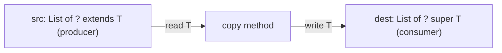
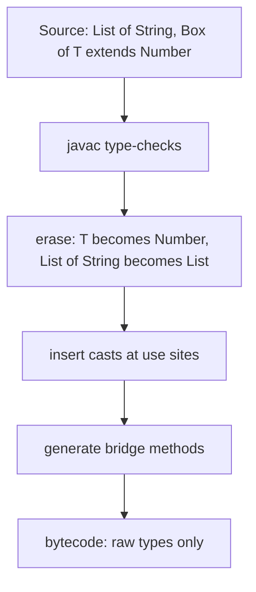

# Chapter 9 — Generics

Every time you write `List<String>` or `Map<Long, Order>`, you're using **generics**: types and methods that take *other types* as parameters. Generics (Java 5) let one piece of code — a list, a cache (a store that keeps recently used values for quick reuse; see [System Design Fundamentals](../../../system-design-patterns/modules/00-system-design-fundamentals/README.md)), a repository (an object that saves and loads data), a `max` function — work with many types while the compiler still checks that you never put an `Integer` where a `String` belongs. They're the reason modern Java code has almost no casts (explicit `(Type) value` conversions).

This chapter covers writing your own generic classes, interfaces and methods; restricting type parameters with bounds (limits on which types are allowed); making APIs flexible with wildcards (`?`, standing for an unknown type) (and the **PECS** rule); and **type erasure** — the compiler removing generic type information after checking it, which is how generics are implemented, which explains every strange restriction (no `new T()`, no `new List<String>[10]`, no `instanceof List<String>` on an `Object`). It ends with the design rules from *Effective Java* (Joshua Bloch's best-practice book; Items 26–33) and how to read intimidating JDK signatures like `<T extends Comparable<? super T>>`.

Collections are the main *users* of generics; they get their own chapter ([Chapter 10](../10-collections/README.md)). Arrays' covariance (a `String[]` counts as an `Object[]`) and why generics are invariant (a `List<String>` does not count as a `List<Object>`) was previewed in [Chapter 4 §4.6](../04-methods-and-arrays/README.md#46-arrays).

**What you'll learn**

| § | Topic | You'll be able to… |
|---|---|---|
| 9.1 | Why generics | explain the problem raw types had and the vocabulary (type parameter, type argument, diamond) |
| 9.2 | Generic classes and records | write `Box<T>`, `Pair<K, V>` and a generic record |
| 9.3 | Generic interfaces | implement a generic interface with a fixed or generic type argument |
| 9.4 | Generic methods and inference | write `static <T> …` methods and understand how the compiler infers `T` |
| 9.5 | Bounded type parameters | use `<T extends Number>`, multiple bounds and recursive bounds |
| 9.6 | Invariance, wildcards and PECS | choose between `List<T>`, `List<? extends T>`, `List<? super T>` and `List<?>` |
| 9.7 | Type erasure | describe what the compiler does and what exists at run time (bridge methods) |
| 9.8 | Restrictions and workarounds | handle "no `new T()`", generic arrays, heap pollution and `@SafeVarargs` |
| 9.9 | Designing generic APIs | apply *Effective Java* Items 26–33 and read JDK signatures |

All runnable code is in [`code/`](code/) (package `ch09.*`), compiled with `javac --release 25` and run on JDK 26. Outputs are pasted from real runs; compile errors quoted in comments are real `javac` messages.

> **Exam depth.** Diamond/`var` combinations, wildcard "does this compile?" puzzles and bounded-type questions are drilled in [OCP Chapter 9 — Collections and generics](../../../../ocp-java21-study/chapters/09-collections-generics/README.md) (sections 2 and 10). Generics in object design: [LLD §2.15 Generics basics for LLD](../../../lld/chapters/02-oop-fundamentals/README.md#215-generics-basics-for-lld).

---

## 9.1 Why generics

### What it is
**Generics** let you write a class, interface or method with a placeholder for a type — a **type parameter**, conventionally a single capital letter like `T` — which each user fills in with a concrete **type argument**. `List<E>` is declared once; `List<String>` and `List<Order>` are two **parameterized types** made from it.

Analogy: a labelled storage box. A plain box accepts anything, and you must check what you pulled out. A box labelled "Screws only" is checked at the door — the wrong item never gets in, and you know exactly what comes out.

### The problem it solves
Before Java 5, collections held `Object`. Nothing stopped a wrong type going in, and every read needed a cast that could fail far from the bug that caused it.

[`code/ch09/why/WhyGenerics.java`](code/ch09/why/WhyGenerics.java):
```java
List raw = new ArrayList();               // raw type: no type argument
raw.add("Ada");
raw.add(42);                              // compiles: nothing stops a wrong type going in
for (Object o : raw) {
    String s = (String) o;                // fails at RUN time on the Integer
    System.out.println("raw: " + s.toUpperCase());
}

List<String> names = new ArrayList<>();   // diamond <> (Java 7) infers <String>
names.add("Ada");
// names.add(42);                         // compile error: incompatible types: int cannot be converted to String
String first = names.get(0);              // no cast
```
Output:
```text
raw: ADA
raw list -> ClassCastException: class java.lang.Integer cannot be cast to class java.lang.String (java.lang.Integer and java.lang.String are in module java.base of loader 'bootstrap')
generic: ADA
```
Generics move the error from **run time** (a `ClassCastException` — the error thrown when a cast fails — in production, the live system real users depend on) to **compile time** (a red underline in your IDE), and remove the casts.

### Vocabulary
| Term | Example | Meaning |
|---|---|---|
| Generic type | `class Box<T>` | a class/interface declared with type parameters |
| Type parameter | `T` in `Box<T>` | the placeholder |
| Type argument | `String` in `Box<String>` | the concrete type supplied by the user |
| Parameterized type | `Box<String>` | generic type + arguments |
| Raw type | `Box` | the generic type used **without** arguments — legacy only |
| Diamond | `new Box<>("x")` | let the compiler infer the type arguments (Java 7; with anonymous classes — unnamed one-off classes — since Java 9) |
| Generic method | `static <T> T first(List<T> xs)` | a method with its own type parameter |
| Bound | `<T extends Number>` | a restriction on the type parameter |
| Wildcard | `List<?>`, `List<? extends Number>` | an unknown type argument at the use site |

### Raw types
A **raw type** exists only for compatibility with pre-2004 code. Using one turns off generic checking for that expression and produces "unchecked" warnings. *Effective Java* Item 26: **don't use raw types** in new code. If you truly don't care about the element type, use the unbounded wildcard `List<?>` (§9.6), which stays type-safe (you can't add arbitrary things to it).

Two exceptions where the raw name is required: class literals (`List.class`, not `List<String>.class` — the object that represents a class at run time) and `instanceof` checks against a non-reifiable type (one whose full generic type isn't known at run time, §9.7) (write `instanceof List<?>` or `instanceof List`).

### Self-check
1. What does `<>` do in `new HashMap<>()`? → Asks the compiler to infer the type arguments from the context.
2. When does a raw-type mistake fail? → At run time, typically a `ClassCastException` at a read far from the bad write.
3. What should you write instead of raw `List` when the element type doesn't matter? → `List<?>`.

---

## 9.2 Generic classes and records

### How it works
1. Declare type parameters in angle brackets after the class name: `class Box<T>`, `class Pair<K, V>`.
2. Inside the class, use `T` like any type: field types, parameter types, return types, local variables.
3. Users supply the arguments: `Box<String>`, `Pair<String, Integer>`. With `var` or the diamond you rarely write them twice.
4. Type arguments must be **reference types** (class, interface or array types — not primitives) — `Box<int>` doesn't compile (*"unexpected type"*); use `Box<Integer>` (autoboxing, [Chapter 7 §7.6](../07-core-apis/README.md#76-wrapper-classes-and-autoboxing)).
5. Records (Java 16) and enums' surrounding classes can be generic too; enums themselves can't declare type parameters.

### Naming conventions
| Letter | Usually means | JDK example |
|---|---|---|
| `T` (then `U`, `V`, `S`) | Type | `Optional<T>`, `BiFunction<T, U, R>` |
| `E` | Element (collections) | `List<E>`, `Set<E>` |
| `K`, `V` | Key, Value | `Map<K, V>` |
| `R` | Result/return type | `Function<T, R>` |
| `N` | Number | |
| `ID` or longer names | when single letters confuse | `Repository<T, ID>` (Spring Data style — a library that generates database repositories) |

[`code/ch09/classes/GenericClasses.java`](code/ch09/classes/GenericClasses.java) (key parts):
```java
static final class Box<T> {
    private T value;
    Box(T value) { this.value = value; }
    T get() { return value; }
    void set(T value) { this.value = value; }
    <R> Box<R> map(Function<? super T, ? extends R> f) {     // generic method inside a generic class
        return new Box<>(f.apply(value));
    }
}

record Pair<K, V>(K key, V value) {                          // generic record (Java 16)
    static <K, V> Pair<K, V> of(K k, V v) { return new Pair<>(k, v); }
    Pair<V, K> swap() { return new Pair<>(value, key); }
}

Box<String> s = new Box<>("hello");
Box<Integer> len = s.map(String::length);
Pair<String, Integer> p = Pair.of("age", 36);
var nested = new Box<List<Pair<String, Integer>>>(List.of(p));   // type arguments can nest
```
Output (first three lines):
```text
Box[hello] -> Box[5], len.get() + 1 = 6
Pair[key=age, value=36] swapped Pair[key=36, value=age]
nested: age
```

What to notice:
- `len.get() + 1` needs no cast: the compiler knows `get()` returns `Integer`.
- `map` declares its **own** type parameter `R` in addition to the class's `T` — a generic method in a generic class. Its parameter uses wildcards (`? super T`, `? extends R`); §9.6 explains why that makes it more flexible.
- The static factory `Pair.of` declares its own `<K, V>`: static members can't use the class's type parameters (§9.8), so static generic factories always redeclare them.

### When not to use it
- Don't make a class generic "just in case". If every user passes the same type, a plain class is simpler.
- If the type parameter appears only once in a method signature and nowhere else, a wildcard is usually clearer (§9.9).

### Self-check
1. Can you write `new Box<int>(5)`? → No — type arguments must be reference types; use `Box<Integer>`.
2. Why does `Pair.of` declare `<K, V>` again? → Static methods can't see the class's type parameters.

---

## 9.3 Generic interfaces

### What it is
Interfaces take type parameters exactly like classes: `Comparable<T>`, `Iterable<T>`, `Function<T, R>`, `Repository<T, ID>`. A class implementing one can:
1. **Fix the type argument** — `class StringStack implements Container<String>` (the class is not generic);
2. **Pass its own type parameter through** — `class Queue<T> implements Container<T>` (the class stays generic);
3. Be an **anonymous class or lambda** (a short inline function) with the type inferred.

[`code/ch09/interfaces/GenericInterfaces.java`](code/ch09/interfaces/GenericInterfaces.java) (key parts):
```java
@FunctionalInterface
interface Transformer<A, B> {
    B apply(A input);
    default <C> Transformer<A, C> andThen(Transformer<? super B, ? extends C> next) {
        return a -> next.apply(apply(a));
    }
}

record Version(int major, int minor) implements Comparable<Version> {    // concrete type argument
    public int compareTo(Version o) {
        int c = Integer.compare(major, o.major);
        return c != 0 ? c : Integer.compare(minor, o.minor);
    }
}

interface Container<T> { void put(T item); T take(); boolean isEmpty(); }
static class StringStack implements Container<String> { ... }             // 1. fixed
static class Queue<T> implements Container<T> { ... }                     // 2. stays generic
Container<Runnable> tasks = new Container<>() { ... };                    // 3. anonymous + diamond (Java 9)

static <T> List<T> drain(Container<T> c) { ... }                          // works for all three
```
Output:
```text
8 chars
natural order: [8.0, 17.2, 21.0, 21.1]
by minor, then descending: [21.0, 8.0, 21.1, 17.2]
stack drains LIFO: [c, b, a], queue drains FIFO: [1, 2, 3]
task ran
```

And from `GenericClasses.java`, the repository pattern — a generic interface, a generic implementation and a subclass that fixes the types:
```java
interface Repository<T, ID> {
    void save(ID id, T item);
    Optional<T> findById(ID id);
    List<T> findAll();
}
static class InMemoryRepository<T, ID> implements Repository<T, ID> {
    private final Map<ID, T> store = new HashMap<>();
    ...
}
static class BookRepository extends InMemoryRepository<Book, String> {
    List<String> titles() { return findAll().stream().map(Book::title).sorted().toList(); }
}
```
Output:
```text
findById: Effective Java | missing: false | titles: [Effective Java, Java Concurrency in Practice]
numbers: [100]
```
This is the shape of Spring Data's `CrudRepository<T, ID>`: write the persistence (saving to and loading from a database) logic once, reuse it for every entity type (a class whose objects are stored as database rows). On the design side, a repository is the class that owns persistence so domain classes (classes modelling the business concepts) don't have to — see the `EmployeeRepository` example in the LLD handbook's [Single Responsibility Principle section](../../../lld/chapters/04-solid-principles/README.md#42-single-responsibility-principle-srp).

### Why `Comparable<Version>` and not raw `Comparable`
Implementing `Comparable<Version>` gives `compareTo(Version o)` — no cast, and comparing a `Version` to a `String` is a compile error. Raw `Comparable` would force `compareTo(Object o)` with a cast inside. `Comparable` and `Comparator` are covered fully in [Chapter 10](../10-collections/README.md); functional interfaces like `Function<T, R>` in [Chapter 11](../11-lambdas-and-functional-programming/README.md).

### Self-check
1. `class Celsius implements Comparable<Celsius>` — what's `compareTo`'s parameter type? → `Celsius`.
2. Can a non-generic class implement a generic interface? → Yes, by fixing the type argument.

---

## 9.4 Generic methods and type inference

### What it is
A **generic method** declares its own type parameters, written in angle brackets **before the return type**: `static <T> void swap(T[] arr, int i, int j)`. It can live in any class, generic or not. The JDK is full of them: `List.of`, `Collections.sort`, `Arrays.asList`, `Optional.of`, `Stream.map`.

**Type inference** is the compiler working out `T` from the arguments and from the **target type** (the type the result is assigned to or passed as), so you rarely write it.

### How it works
1. Declare: `static <T> List<T> repeat(T item, int times)`.
2. Call normally: `repeat("hi", 3)` — `T` is inferred as `String` from the argument.
3. With no arguments to infer from, the target type decides: `List<String> empty = Collections.emptyList();`.
4. If needed, give an explicit **type witness**: `GenericMethods.<Number>repeat(1, 2)` (the class or `this.` prefix is required before `<…>`).
5. When arguments have different types, the compiler infers their most specific common supertype, which may be an *intersection type* (a type that is several types at once) like `Number & Comparable<…>`.

[`code/ch09/methods/GenericMethods.java`](code/ch09/methods/GenericMethods.java) (key parts):
```java
static <T> void swap(T[] arr, int i, int j) { T tmp = arr[i]; arr[i] = arr[j]; arr[j] = tmp; }
static <T> List<T> repeat(T item, int times) { ... }
static <T> T firstOrDefault(List<T> list, T fallback) { return list.isEmpty() ? fallback : list.get(0); }

swap(words, 0, 2);                                   // T inferred as String
swap(nums, 0, 1);                                    // T inferred as Integer
List<String> empty = Collections.emptyList();        // T = String from the assignment
List<Number> mixed = GenericMethods.<Number>repeat(1, 2);   // explicit witness
mixed.add(2.5);
var list = Arrays.asList(1, 2.0, 3L);                // List<Number & Comparable<...>>
```
Output:
```text
[c, b, a] [2, 1, 3]
repeat: [hi, hi, hi]
firstOrDefault: none
witness <Number>: [1, 1, 2.5]
Arrays.asList(1, 2.0, 3L) element types: [Integer, Double, Long]
```
Without the witness, `repeat(1, 2)` would infer `List<Integer>` — then `add(2.5)` wouldn't compile. (Writing `List<Number> mixed = repeat(1, 2);` also works, because the target type drives inference.)

### Common mistakes
- Putting `<T>` in the wrong place: it goes **after modifiers and before the return type** — `public static <T> T pick(...)`, not `public static T <T> pick(...)`.
- Declaring a method `<T>` in a generic class `Box<T>` — the method's `T` **shadows** (hides) the class's `T`; they're unrelated. Use a different letter.
- Writing `<T> void print(List<T> list)` when `T` is used once — `void print(List<?> list)` says the same thing more simply.

### Self-check
1. How does the compiler infer `T` for `Collections.emptyList()` with no arguments? → From the target type of the assignment/parameter.
2. Syntax for an explicit type argument on a static generic method? → `ClassName.<Type>method(args)`.

---

## 9.5 Bounded type parameters

### What it is
An unbounded `T` could be anything, so inside the code you can only call `Object` methods on it. A **bound** restricts which types are allowed — and in exchange lets you use the bound's methods:
- **Upper bound** `<T extends Number>`: `T` must be `Number` or a subtype (a class that extends it or implements it), so `t.doubleValue()` compiles. (`extends` is used for both classes and interfaces here.)
- **Multiple bounds** `<T extends Number & Comparable<T>>`: `T` must satisfy all. At most one class, and it must come **first**; the rest are interfaces.
- **Recursive bound** `<T extends Comparable<T>>`: "T can be compared with itself" — the pattern behind sorting and `max`.

(Type *parameters* have only upper bounds; `super` appears only in *wildcards*, §9.6.)

[`code/ch09/bounds/Bounded.java`](code/ch09/bounds/Bounded.java) (key parts):
```java
static <T extends Number> double sum(List<T> values) {
    double total = 0;
    for (T v : values) total += v.doubleValue();       // allowed because T extends Number
    return total;
}

static <T extends Comparable<? super T>> T max(List<? extends T> list) {
    T best = list.get(0);
    for (T x : list) if (x.compareTo(best) > 0) best = x;
    return best;
}

static <T extends Number & Comparable<T>> T clamp(T value, T lo, T hi) { ... }

static class Stats<T extends Number> {                  // bounded generic class
    double average() { return data.isEmpty() ? 0 : sum(data) / data.size(); }
}
// sum(List.of("a"));            // compile error: String is not within bound Number
```
Output:
```text
sum ints=6.0 sum doubles=4.0
max words=zucchini max ints=9
clamp(15, 0, 10)=10 clamp(2.5, 0.0, 1.0)=1.0
Stats average=5.0
```

### Reading `<T extends Comparable<? super T>>`
This is the signature of `Collections.max` and `Collections.sort` (simplified), and it looks scary. Read it in pieces:
1. `T extends Comparable<…>` — elements must be comparable.
2. `Comparable<? super T>` — comparable to `T` **or to some supertype of `T`**.

Why the `? super`? Suppose `class Fruit implements Comparable<Fruit>` and `class Apple extends Fruit`. `Apple` is `Comparable<Fruit>`, not `Comparable<Apple>`. With the simpler bound `<T extends Comparable<T>>`, you couldn't find the max of a `List<Apple>`; with `? super T` you can. Same story for `java.time`: `LocalDate` implements `Comparable<ChronoLocalDate>`.

### Self-check
1. `<T extends Runnable & Serializable & Number>` — legal? → No; the class (`Number`) must come first.
2. Why can `sum` call `doubleValue()` on `T`? → The bound guarantees every `T` is a `Number`.
3. Why `Comparable<? super T>` instead of `Comparable<T>`? → To accept types that inherit `compareTo` from a supertype.

---

## 9.6 Invariance, wildcards and PECS

### What it is
**Invariance:** even though `Integer` is a subtype of `Number`, **`List<Integer>` is *not* a subtype of `List<Number>`**. If it were, you could do this:
```java
List<Integer> ints = new ArrayList<>();
List<Number> nums = ints;        // imagine this compiled...
nums.add(3.14);                  // ...then a Double would sit in a List<Integer>
```
So the compiler rejects the assignment: *"incompatible types: ArrayList<Integer> cannot be converted to List<Number>"*.

Arrays made the opposite choice (they're **covariant**: `String[]` *is* an `Object[]`), and pay for it with a run-time check — `ArrayStoreException` ([Chapter 4 §4.6](../04-methods-and-arrays/README.md#46-arrays)). Generics catch the same mistake at compile time.

**Wildcards** restore flexibility safely. A wildcard `?` means "some specific type I don't know":
| Wildcard | Read as | You can **read** elements as | You can **add** | Accepts |
|---|---|---|---|---|
| `List<? extends Number>` | a list of *some* subtype of Number | `Number` | nothing (except `null`) | `List<Number>`, `List<Integer>`, `List<Double>` |
| `List<? super Integer>` | a list of *some* supertype of Integer | `Object` only | `Integer` (and subtypes) | `List<Integer>`, `List<Number>`, `List<Object>` |
| `List<?>` | a list of *some* type | `Object` | nothing (except `null`) | any `List` |
| `List<Number>` | exactly a list of Number | `Number` | any `Number` | only `List<Number>` |

### PECS: Producer `extends`, Consumer `super`
The rule (coined by Joshua Bloch, *Effective Java* Item 31) for choosing a wildcard on a **method parameter**:
- If the parameter **produces** values your method reads → `? extends T`.
- If the parameter **consumes** values your method writes into it → `? super T`.
- If it does both → no wildcard, use exact `T`.
- If you only use `Object` methods / `size()` → `?`.



[`code/ch09/wildcards/Wildcards.java`](code/ch09/wildcards/Wildcards.java) (key parts):
```java
static double total(Collection<? extends Number> source) {       // producer
    double t = 0;
    for (Number n : source) t += n.doubleValue();
    // source.add(1);                   // compile error: can't add to ? extends (except null)
    return t;
}

static void fillWithSquares(List<? super Integer> sink, int n) {  // consumer
    for (int i = 1; i <= n; i++) sink.add(i * i);
    Object o = sink.get(0);                 // reading gives only Object
}

static <T> void copy(List<? super T> dest, List<? extends T> src) {   // both: shape of Collections.copy
    for (T item : src) dest.add(item);
}

static int countNulls(List<?> list) { ... }                       // unbounded

static void swapFirstLast(List<?> list) { swapHelper(list); }     // wildcard capture
private static <T> void swapHelper(List<T> list) {
    T first = list.get(0);
    list.set(0, list.get(list.size() - 1));
    list.set(list.size() - 1, first);
}
```
Output:
```text
total(ints)=6.0 total(doubles)=0.75
view.get(0).intValue()=1
numbers=[1, 4, 9] objects=[1, 4]
copy -> [start, 1, 2, 3]
countNulls=2
swapFirstLast=[z, y, x]
arrays: ArrayStoreException java.lang.Integer
```
`total` accepts both `List<Integer>` and `List<Double>`; `fillWithSquares` accepts `List<Number>` and `List<Object>`. Without wildcards, each method would accept exactly one list type.

The commented-out `source.add(1)` fails with *"incompatible types: int cannot be converted to CAP#1"*. **CAP#1** is the compiler's name for the captured unknown type — it can't prove that 1 fits "some unknown subtype of Number" (the list might be a `List<Double>`).

### Wildcard capture
You can't `set` into a `List<?>` because the element type is unknown. The **capture helper** trick passes it to a private generic method, where the unknown type gets a name (`T`), and reading-then-writing the same `T` is provably safe. This is how you'd implement something like `Collections.swap(List<?>, int, int)` — whose public signature uses `List<?>` precisely so callers don't need a type parameter. (The JDK's own implementation takes a shortcut with a raw type internally; a comment in its source notes that capturing the wildcard with a private helper would be the type-safe alternative.)

### `List<?>` vs `List<Object>` vs raw `List`
| | Accepts a `List<String>`? | Can add a `String`? | Type-safe? |
|---|---|---|---|
| `List<Object>` | No (invariance) | Yes | Yes |
| `List<?>` | Yes | No (only `null`) | Yes |
| raw `List` | Yes | Yes (with a warning) | **No** |

### When not to use wildcards
- **Not in return types.** `List<? extends Number> getValues()` forces every caller to deal with wildcards. Return `List<Number>` or `List<T>`.
- Not when the method both reads and writes the same parameter with type `T` — use `T`.

### In the interview
**30-second answer:** "Generics are invariant: `List<Integer>` isn't a `List<Number>`, otherwise you could add a `Double` to a list of integers. Wildcards make APIs flexible: PECS — if a parameter produces values I read, use `? extends T`; if it consumes values I write, use `? super T`. `Collections.copy(List<? super T> dest, List<? extends T> src)` is the textbook example. `List<?>` is a read-only-ish list of unknown type, safer than a raw `List`."

- *Follow-up: Why can't you add to `List<? extends Number>`?* → It might be a `List<Double>`, so adding an `Integer` could break it; the compiler only allows `null`.
- *Follow-up: What can you read from `List<? super Integer>`?* → Only `Object`, because the list could be a `List<Object>`.
- *Follow-up: Arrays vs generics?* → Arrays are covariant and reified (checked at run time, `ArrayStoreException`); generics are invariant and erased (checked at compile time).

### Self-check
1. Parameter type for a method that sums a collection of any numeric type? → `Collection<? extends Number>`.
2. Parameter type for a method that adds `Integer`s to a caller's list? → `List<? super Integer>`.
3. Is `List<Object> x = new ArrayList<String>();` legal? → No.
4. Is `List<?> x = new ArrayList<String>();` legal? → Yes.

### TL;DR
Generics are invariant. Producer → `extends`, consumer → `super`, both → exact `T`, don't care → `?`. Wildcards on parameters, never on return types.

---

## 9.7 Type erasure: how generics really work

### What it is
Java implements generics by **type erasure**: the compiler checks the generic types, then **removes** (erases) them from the bytecode (the compiled instructions the JVM runs). At run time, `List<String>` and `List<Integer>` are both just `ArrayList` — the JVM has no idea what the type argument was. Generic types are therefore **non-reifiable** (their full type isn't available at run time), unlike arrays, which *are* reified (`String[]` knows it holds `String`s).

Why? **Migration compatibility.** When generics arrived in Java 5 (2004), billions of lines of code and existing class files used raw collections. Erasure let new generic code and old non-generic code call each other, and let the JVM stay unchanged.

### How it works
1. The compiler type-checks all uses of generic types.
2. Each type parameter is replaced by its **erasure**: its first bound (`<T extends Comparable<T>>` → `Comparable`), or `Object` if unbounded.
3. Parameterized types become raw types (`List<String>` → `List`).
4. The compiler **inserts casts** where a generic value is used as a specific type (`String s = list.get(0)` becomes `String s = (String) list.get(0)` in bytecode). These casts can never fail if you had no unchecked warnings.
5. Where erasure changes a method's signature so that overriding would break, the compiler generates a **bridge method**.



[`code/ch09/erasure/Erasure.java`](code/ch09/erasure/Erasure.java) (key parts):
```java
List<String> strings = new ArrayList<>();
List<Integer> ints = new ArrayList<>();
strings.getClass() == ints.getClass();              // true: one class at run time

static class Node<T extends Comparable<T>> implements Comparable<Node<T>> {
    public int compareTo(Node<T> o) { return value.compareTo(o.value); }
}
for (Method m : Node.class.getDeclaredMethods())
    if (m.getName().equals("compareTo")) System.out.println(... m.isBridge());
```
Output (relevant lines):
```text
same runtime class? true -> java.util.ArrayList
o instanceof List<?>: true
compareTo(Node) bridge=false
compareTo(Object) bridge=true
```
`Comparable<T>` erases to `Comparable` with method `compareTo(Object)`. Our `compareTo(Node)` doesn't override that erased method, so the compiler adds a **bridge** `compareTo(Object o) { return compareTo((Node) o); }` to keep polymorphism (calling the right override for the object's actual class) working. You'll occasionally see bridge methods in stack traces (the list of active method calls printed with an error).

### What survives erasure
Erasure removes type arguments from *objects and local variables*, but generic **declarations** keep their signatures in the class file (the `Signature` attribute). That's why reflection (code that inspects classes, fields and methods at run time) can tell you a field is declared `List<String>`, and why frameworks like Jackson and Gson (JSON libraries) use the **super type token** trick (`new TypeReference<List<User>>() {}`) — an anonymous subclass records its generic superclass, which *is* preserved.

### Trade-offs — erasure vs reification (e.g. C#)
| | Java (erasure) | C# (reified generics) |
|---|---|---|
| Runtime knows `List<String>`? | No | Yes |
| `new T()`, `T[]`, `is List<string>` | Not allowed | Allowed |
| Primitives as type arguments | No (boxing) | Yes (`List<int>` without boxing) |
| Old/new code interoperability | Seamless | Separate generic collection types were added |

Project Valhalla (OpenJDK) is working toward value types (objects without identity, stored as compactly as primitives) and better generics over primitives, but in Java 25 type arguments must still be reference types.

### Self-check
1. What is `List<String>` at run time? → A plain `List`/`ArrayList` — type arguments are erased.
2. What does `<T extends Number>` erase to? → `Number`.
3. Why do bridge methods exist? → To preserve overriding after erasure changes method signatures.

---

## 9.8 Restrictions and workarounds (consequences of erasure)

Every restriction below follows from "the type argument doesn't exist at run time". Messages are real `javac` output.

| You can't… | `javac` says | Workaround |
|---|---|---|
| Use primitives: `List<int>` | *unexpected type* | Wrapper types (`List<Integer>`) or primitive specialisations (`IntStream`, `int[]`) |
| Create an instance: `new T()` | *unexpected type* | Pass a `Supplier<T>` (a function that produces a value: `StringBuilder::new`) or a `Class<T>` token |
| Create a generic array: `new T[10]`, `new List<String>[10]` | *generic array creation* | Use `List<T>`/`ArrayList<T>`; or `Array.newInstance(type, n)` with a `Class<T>`; or `(T[]) new Object[n]` inside a class that never exposes it (as `ArrayList` does) |
| Use `T` in a static context: `static T shared;` | *non-static type variable T cannot be referenced from a static context* | Static generic methods declare their own `<T>` |
| `instanceof` a parameterized type from an unrelated static type: `o instanceof List<String>` | *Object cannot be safely cast to List<String>* | `o instanceof List<?>`; (since Java 16, `instanceof ArrayList<String>` **is** allowed when the static type is already `List<String>`, because it's provably safe) |
| Overload on type arguments: `f(List<String>)` and `f(List<Integer>)` | *name clash: … have the same erasure* | Use different method names |
| Make a generic exception: `class Bad<X> extends Exception` | *a generic class may not extend java.lang.Throwable* | Store the extra data as a field of a concrete type; `catch` needs a runtime type |
| Use `.class` on a parameterized type: `List<String>.class` | syntax error | `List.class` |

### Workarounds in code
```java
// Factory instead of new T()
static <T> List<T> fill(int n, Supplier<T> factory) { ... }            // fill(3, StringBuilder::new)

// Class token
static <T> T create(Class<T> type) throws ReflectiveOperationException {
    return type.getDeclaredConstructor().newInstance();
}

// Generic array via reflection
@SuppressWarnings("unchecked")
static <T> T[] newArray(Class<T> type, int n) {
    return (T[]) java.lang.reflect.Array.newInstance(type, n);
}
```
Output:
```text
fill: 3 builders, create: ""
newArray component type: String[2]
```

### Heap pollution and unchecked warnings
**Heap pollution** is when a variable of a parameterized type refers to an object that isn't of that type — e.g. a `List<Integer>` that actually contains a `String`. It can only happen through **unchecked** operations (ones the compiler can't verify: raw types, unchecked casts, generic varargs — `T...` parameters that accept any number of arguments), which is exactly why the compiler warns about them. The failure appears later, at an innocent-looking line where the compiler's inserted cast runs.

```java
List<Object> objs = new ArrayList<>(List.of("text"));
@SuppressWarnings("unchecked")
List<Integer> lie = (List<Integer>) (List<?>) objs;   // compiles with a warning, no check at run time
Integer n = lie.get(0);                               // ClassCastException HERE, far from the lie
```
Output:
```text
heap pollution -> ClassCastException on read
```

*Effective Java* Item 27: **eliminate every unchecked warning** you can. If you've proved a cast is safe, suppress the warning on the **smallest possible scope** (a single local variable declaration, as above — not the whole class) and add a comment explaining why it's safe.

### Generic varargs and `@SafeVarargs`
A varargs parameter `T... items` is really an array `T[]`, and generic arrays can't be created safely — so the compiler creates an `Object[]` (the erasure) and warns: *"Possible heap pollution from parameterized vararg type T"*. The array is dangerous if the method **stores** it or **returns** it:
```java
static <T> T[] toArray(T... items) { return items; }          // returns the varargs array: UNSAFE
static <T> T[] pickTwo(T a, T b) { return toArray(a, b); }    // T erased -> creates Object[]
String[] two = pickTwo("x", "y");                             // ClassCastException: Object[] is not String[]
```
Output:
```text
pickTwo -> ClassCastException: generic varargs array escaped
```
A varargs method is **safe** if it only *reads* the array's elements and never lets the array escape. Then annotate it **`@SafeVarargs`** to silence the warning at every call site:
```java
@SafeVarargs
static <T> List<T> listOf(T... items) { return new ArrayList<>(Arrays.asList(items)); }
```
`@SafeVarargs` is allowed only on methods that can't be overridden: `static`, `final`, constructors, and (since Java 9) `private` methods. `List.of(E...)`, `Arrays.asList` and `Stream.of` are all `@SafeVarargs`. *Effective Java* Item 32: combine generics and varargs judiciously; Item 28: prefer lists to arrays.

### Self-check
1. How do you create a `T` inside a generic method? → Take a `Supplier<T>` or `Class<T>` parameter.
2. Why can't you have both `void f(List<String>)` and `void f(List<Integer>)`? → Same erasure, `f(List)`.
3. When is a generic varargs method safe? → When it doesn't store or expose the varargs array, only reads it.
4. What is heap pollution? → A parameterized-type variable referring to an object of the wrong type, caused by unchecked operations.

---

## 9.9 Designing generic APIs

### Best practices (*Effective Java* Items 26–33)
| Item | Rule | In one line |
|---|---|---|
| 26 | Don't use raw types | `List<?>` if you don't care about the type |
| 27 | Eliminate unchecked warnings | suppress only proven-safe cases, narrowly, with a comment |
| 28 | Prefer lists to arrays | lists are invariant and compile-time checked |
| 29 | Favour generic types | make containers generic instead of `Object`-based |
| 30 | Favour generic methods | especially static utilities and factories |
| 31 | Use bounded wildcards to increase API flexibility | PECS on parameters; never wildcards in return types |
| 32 | Combine generics and varargs judiciously | `@SafeVarargs` only when truly safe |
| 33 | Consider typesafe heterogeneous containers (holding values of many different types safely) | `Map<Class<?>, Object>` keyed by `Class<T>` tokens, e.g. `<T> T get(Class<T> key)` |

More guidelines:
- **Type parameter vs wildcard:** if a type parameter appears only once in the signature, replace it with a wildcard (`void printAll(List<?> xs)` instead of `<T> void printAll(List<T> xs)`). Use a type parameter when it links two things — a parameter and the return type, or two parameters.
- **Return concrete generic types**, not wildcards.
- **Prefer `List<T>` over `T[]`** in public APIs.
- Keep type parameter lists short; three or more parameters is a smell (a hint the design could be simpler) unless it's a genuine tuple (fixed group of values)/function type (`BiFunction<T, U, R>`).

### Reading JDK signatures
| Signature | How to read it |
|---|---|
| `static <T> void sort(List<T> list, Comparator<? super T> c)` | Sort a list of `T` using a comparator that can compare `T` or any supertype (a `Comparator<Object>` or `Comparator<Fruit>` works for a `List<Apple>`) |
| `static <T extends Object & Comparable<? super T>> T max(Collection<? extends T> coll)` | Elements must be comparable to themselves or a supertype; `& Object` is there so the *erasure* of `T` stays `Object` for binary compatibility (already compiled code keeps working without recompiling) with pre-Java-5 code |
| `<R> Stream<R> map(Function<? super T, ? extends R> mapper)` | The function may accept any supertype of `T` (consumer of `T`) and return any subtype of `R` (producer of `R`) — PECS on a function |
| `static <T, U extends Comparable<? super U>> Comparator<T> comparing(Function<? super T, ? extends U> keyExtractor)` | Build a `Comparator<T>` from a function extracting a comparable key `U` from each `T` |
| `boolean addAll(Collection<? extends E> c)` | Accept any collection whose elements are `E` or subtypes |

Once PECS clicks, these stop being noise: every `? super` is something that **takes** your values, every `? extends` is something that **gives** you values.

### Common mistakes
- Using raw types (often by forgetting `<>`: `new ArrayList()` → a raw-type warning).
- `List<Object>` parameters where `List<?>` or a type parameter was meant — callers with `List<String>` can't pass it.
- Wildcards in return types.
- Suppressing unchecked warnings at class level.
- Forgetting that generics give **no runtime checks** — data from reflection, serialization or raw-typed legacy code can still pollute the heap. `Collections.checkedList(list, String.class)` adds runtime checks when you need to find where bad data enters.

### Real-world examples
- `Optional<T>`, `CompletableFuture<T>` (the future result of background work), `Stream<T>`, `Map<K, V>` — the whole modern JDK API is generic.
- Spring Data `JpaRepository<T, ID>`, Jackson `TypeReference<T>`, JUnit's (the standard Java testing library) `assertThrows(Class<T> expectedType, Executable)` returning `T` — note the `Class<T>` token letting the method return the right exception type without a cast.
- Event buses (objects that deliver events to subscribers) and dependency-injection containers (frameworks that create objects and hand each one the objects it needs) use typesafe heterogeneous containers keyed by `Class<T>` (Item 33).

### In the interview
**30-second answer:** "Generics give compile-time type safety and remove casts. They're implemented by erasure: type arguments are checked and then removed, so at run time a `List<String>` is just a `List`. That's why you can't do `new T()`, create generic arrays, use primitives as type arguments, or overload on `List<String>` vs `List<Integer>`. They're invariant, so I use bounded wildcards with PECS to make APIs flexible."

- *Follow-up: What is a bridge method?* → A synthetic (not written by you) method the compiler generates so that overriding still works after erasure changes a signature.
- *Follow-up: How do libraries get the full generic type at run time?* → Super type tokens — an anonymous subclass of `TypeReference<List<User>>` keeps its generic superclass in the class file, readable via reflection.
- *Follow-up: `<T extends Comparable<T>>` vs `<T extends Comparable<? super T>>`?* → The second also accepts types that inherit `compareTo` from a supertype (e.g. `Apple extends Fruit implements Comparable<Fruit>`).

### Self-check
1. `<T> void log(List<T> xs)` — better signature? → `void log(List<?> xs)`.
2. Why does `Collections.max` use `T extends Object & Comparable<? super T>`? → So the erased signature returns `Object`, preserving binary compatibility with pre-generics code.
3. What does `Collections.checkedList` do? → Wraps a list with runtime type checks on insertion to catch heap pollution at its source.

### TL;DR
Generic types/methods for reuse with type safety; bounds to use a type's methods; PECS wildcards on parameters; erasure explains every restriction; no raw types, no unchecked warnings left unexplained, lists over arrays.

---

## Chapter TL;DR

| Topic | Remember |
|---|---|
| Purpose | Compile-time type safety, no casts; raw types are legacy — use `List<?>` if unsure |
| Syntax | `class Box<T>`, `record Pair<K, V>`, `interface Repo<T, ID>`, `static <T> T m(...)`; diamond `<>` (7, anonymous classes 9) |
| Inference | From arguments and target type; explicit witness `Cls.<T>m()` |
| Bounds | `<T extends Number>`, `<T extends A & I1 & I2>` (class first), recursive `<T extends Comparable<? super T>>` |
| Invariance | `List<Integer>` is not a `List<Number>`; arrays are covariant (runtime `ArrayStoreException`) |
| Wildcards | PECS: producer `? extends`, consumer `? super`, both → `T`, don't care → `?`; not in return types |
| Erasure | Type args removed after checking; `T` → bound or `Object`; casts inserted; bridge methods |
| Restrictions | No primitives, `new T()`, `new T[]`, static `T`, `instanceof List<String>` (from `Object`), overload by type arg, generic exceptions |
| Heap pollution | From unchecked operations; fix warnings; `@SafeVarargs` only for non-escaping varargs arrays |
| Design | *Effective Java* 26–33; lists over arrays; wildcard if a type param appears once |

**Where next:** the biggest consumer of generics — [Chapter 10 — Collections](../10-collections/README.md) — then generic functional interfaces in [Chapter 11 — Lambdas and functional programming](../11-lambdas-and-functional-programming/README.md). Exam traps: [OCP Chapter 9 — Collections and generics](../../../../ocp-java21-study/chapters/09-collections-generics/README.md).
