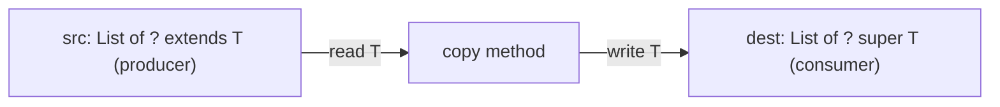
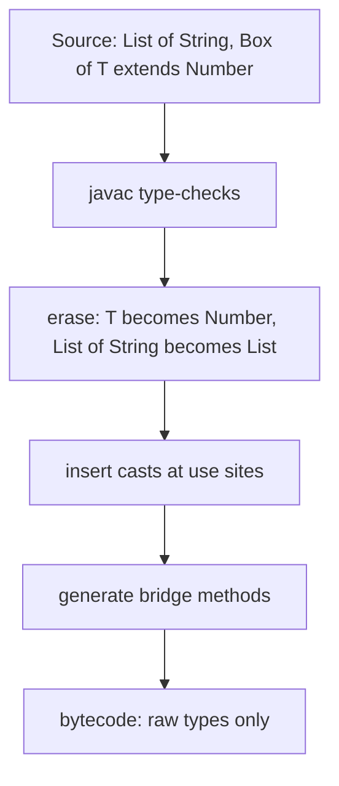

# Chapter 9 — Generics

`List<String>` and `Map<Long, Order>` use **generics** (Java 5): types and methods that take *other types* as parameters, so one piece of code — a list, a cache, a repository (object that saves and loads data), a `max` function — works with many types while the compiler checks you never put an `Integer` where a `String` belongs. They're why modern Java has almost no casts.

Covered: generic classes, interfaces and methods; bounds (limits on allowed types); wildcards (`?`, an unknown type) and **PECS**; **type erasure** — the compiler removing generic type information after checking it — which explains every odd restriction (no `new T()`, no `new List<String>[10]`, no `instanceof List<String>` on an `Object`); and *Effective Java* Items 26–33, including how to read signatures like `<T extends Comparable<? super T>>`. Collections, the main *users* of generics, are [Chapter 10](../10-collections/README.md); array covariance vs generic invariance was previewed in [§4.6](../04-methods-and-arrays/README.md#46-arrays).

Code: [`code/`](code/) (package `ch09.*`), `javac --release 25`, run on JDK 26; quoted compile errors are real `javac` messages. Exam traps (diamond/`var`, wildcard puzzles, bounds): [OCP Chapter 9](../../../../ocp-java21-study/chapters/09-collections-generics/README.md) (sections 2 and 10). Generics in object design: [LLD §2.15](../../../lld/chapters/02-oop-fundamentals/README.md#215-generics-basics-for-lld).

---

## 9.1 Why generics

### What it is
A generic class, interface or method has a placeholder — a **type parameter**, conventionally one capital letter like `T` — that each user fills with a concrete **type argument**. `List<E>` is declared once; `List<String>` and `List<Order>` are **parameterized types** made from it.

### The problem it solves
Before Java 5 collections held `Object`: nothing stopped a wrong type going in, and every read needed a cast that could fail far from the bug.

[`code/ch09/why/WhyGenerics.java`](code/ch09/why/WhyGenerics.java):
```java
List raw = new ArrayList();               // raw type: no type argument
raw.add("Ada");
raw.add(42);                              // compiles: nothing stops a wrong type going in
for (Object o : raw) {
    String s = (String) o;                // fails at RUN time on the Integer
    System.out.println("raw: " + s.toUpperCase());
}

List<String> names = new ArrayList<>();   // diamond <> (Java 7) infers <String>
names.add("Ada");
// names.add(42);                         // compile error: incompatible types: int cannot be converted to String
String first = names.get(0);              // no cast
```
Output:
```text
raw: ADA
raw list -> ClassCastException: class java.lang.Integer cannot be cast to class java.lang.String (java.lang.Integer and java.lang.String are in module java.base of loader 'bootstrap')
generic: ADA
```
Generics move the error from **run time** (a `ClassCastException` in production) to **compile time**, and remove the casts.

### Vocabulary
| Term | Example | Meaning |
|---|---|---|
| Generic type | `class Box<T>` | class/interface declared with type parameters |
| Type parameter | `T` in `Box<T>` | the placeholder |
| Type argument | `String` in `Box<String>` | the concrete type supplied |
| Parameterized type | `Box<String>` | generic type + arguments |
| Raw type | `Box` | generic type **without** arguments — legacy only |
| Diamond | `new Box<>("x")` | compiler infers the arguments from context (Java 7; with anonymous classes since Java 9) |
| Generic method | `static <T> T first(List<T> xs)` | method with its own type parameter |
| Bound | `<T extends Number>` | restriction on the type parameter |
| Wildcard | `List<?>`, `List<? extends Number>` | unknown type argument at the use site |

### Raw types
Raw types exist only for pre-2004 compatibility; they switch off generic checking and produce "unchecked" warnings. *Effective Java* Item 26: **don't use raw types**. If the element type doesn't matter, use `List<?>` (§9.6), which stays type-safe. The raw name is required only for class literals (`List.class`, not `List<String>.class`) and `instanceof` against a non-reifiable type (§9.7): write `instanceof List<?>` or `instanceof List`.

---

## 9.2 Generic classes and records

### How it works
1. Declare type parameters after the class name: `class Box<T>`, `class Pair<K, V>`.
2. Use `T` like any type inside: fields, parameters, return types, locals.
3. Users supply arguments (`Box<String>`); with `var` or the diamond you rarely write them twice.
4. Type arguments must be **reference types** — `Box<int>` gives *"unexpected type"*; use `Box<Integer>` (autoboxing, [§7.6](../07-core-apis/README.md#76-wrapper-classes-and-autoboxing)).
5. Records (Java 16) and classes enclosing enums can be generic; enums can't declare type parameters.

### Naming conventions
| Letter | Usually means | JDK example |
|---|---|---|
| `T` (then `U`, `V`, `S`) | Type | `Optional<T>`, `BiFunction<T, U, R>` |
| `E` | Element | `List<E>`, `Set<E>` |
| `K`, `V` | Key, Value | `Map<K, V>` |
| `R` | Result | `Function<T, R>` |
| `N` | Number | |
| `ID` or longer | when single letters confuse | `Repository<T, ID>` (Spring Data style) |

[`code/ch09/classes/GenericClasses.java`](code/ch09/classes/GenericClasses.java) (key parts):
```java
static final class Box<T> {
    private T value;
    Box(T value) { this.value = value; }
    T get() { return value; }
    void set(T value) { this.value = value; }
    <R> Box<R> map(Function<? super T, ? extends R> f) {     // generic method inside a generic class
        return new Box<>(f.apply(value));
    }
}

record Pair<K, V>(K key, V value) {                          // generic record (Java 16)
    static <K, V> Pair<K, V> of(K k, V v) { return new Pair<>(k, v); }
    Pair<V, K> swap() { return new Pair<>(value, key); }
}

Box<String> s = new Box<>("hello");
Box<Integer> len = s.map(String::length);
Pair<String, Integer> p = Pair.of("age", 36);
var nested = new Box<List<Pair<String, Integer>>>(List.of(p));   // type arguments can nest
```
Output (first three lines):
```text
Box[hello] -> Box[5], len.get() + 1 = 6
Pair[key=age, value=36] swapped Pair[key=36, value=age]
nested: age
```

- `len.get() + 1` needs no cast — `get()` returns `Integer`.
- `map` declares its **own** `R` beside the class's `T`; its wildcard parameter types are explained in §9.6.
- Static members can't use the class's type parameters (§9.8), so the factory `Pair.of` redeclares `<K, V>`.

Don't make a class generic "just in case" — if every user passes the same type, a plain class is simpler.

---

## 9.3 Generic interfaces

### What it is
Interfaces take type parameters like classes: `Comparable<T>`, `Iterable<T>`, `Function<T, R>`, `Repository<T, ID>`. An implementer can:
1. **Fix the argument** — `class StringStack implements Container<String>` (not generic itself);
2. **Pass its own parameter through** — `class Queue<T> implements Container<T>`;
3. Be an **anonymous class or lambda** with the type inferred.

[`code/ch09/interfaces/GenericInterfaces.java`](code/ch09/interfaces/GenericInterfaces.java) (key parts):
```java
@FunctionalInterface
interface Transformer<A, B> {
    B apply(A input);
    default <C> Transformer<A, C> andThen(Transformer<? super B, ? extends C> next) {
        return a -> next.apply(apply(a));
    }
}

record Version(int major, int minor) implements Comparable<Version> {    // concrete type argument
    public int compareTo(Version o) {
        int c = Integer.compare(major, o.major);
        return c != 0 ? c : Integer.compare(minor, o.minor);
    }
}

interface Container<T> { void put(T item); T take(); boolean isEmpty(); }
static class StringStack implements Container<String> { ... }             // 1. fixed
static class Queue<T> implements Container<T> { ... }                     // 2. stays generic
Container<Runnable> tasks = new Container<>() { ... };                    // 3. anonymous + diamond (Java 9)

static <T> List<T> drain(Container<T> c) { ... }                          // works for all three
```
Output:
```text
8 chars
natural order: [8.0, 17.2, 21.0, 21.1]
by minor, then descending: [21.0, 8.0, 21.1, 17.2]
stack drains LIFO: [c, b, a], queue drains FIFO: [1, 2, 3]
task ran
```

The repository pattern (from `GenericClasses.java`) — generic interface, generic implementation, subclass fixing the types:
```java
interface Repository<T, ID> {
    void save(ID id, T item);
    Optional<T> findById(ID id);
    List<T> findAll();
}
static class InMemoryRepository<T, ID> implements Repository<T, ID> {
    private final Map<ID, T> store = new HashMap<>();
    ...
}
static class BookRepository extends InMemoryRepository<Book, String> {
    List<String> titles() { return findAll().stream().map(Book::title).sorted().toList(); }
}
```
Output:
```text
findById: Effective Java | missing: false | titles: [Effective Java, Java Concurrency in Practice]
numbers: [100]
```
This is Spring Data's `CrudRepository<T, ID>` shape: persistence logic written once, reused for every entity type. Design view (a repository owns persistence so domain classes don't): [LLD SRP](../../../lld/chapters/04-solid-principles/README.md#42-single-responsibility-principle-srp).

Implementing `Comparable<Version>` (not raw `Comparable`) gives `compareTo(Version o)` — no cast, and comparing to a `String` is a compile error. `Comparable`/`Comparator`: [Chapter 10](../10-collections/README.md); `Function<T, R>`: [Chapter 11](../11-lambdas-and-functional-programming/README.md).

---

## 9.4 Generic methods and type inference

### What it is
A **generic method** declares its own type parameters **before the return type**: `static <T> void swap(T[] arr, int i, int j)`, in any class, generic or not (`List.of`, `Collections.sort`, `Arrays.asList`, `Optional.of`, `Stream.map`). **Type inference** works out `T` from the arguments and the **target type** (what the result is assigned to or passed as).

### How it works
1. Declare: `static <T> List<T> repeat(T item, int times)`.
2. Call: `repeat("hi", 3)` — `T` = `String` from the argument.
3. No arguments → target type decides: `List<String> empty = Collections.emptyList();`.
4. Explicit **type witness** if needed: `GenericMethods.<Number>repeat(1, 2)` (a class or `this.` prefix is required before `<…>`).
5. Mixed argument types infer the most specific common supertype, possibly an *intersection type* like `Number & Comparable<…>`.

[`code/ch09/methods/GenericMethods.java`](code/ch09/methods/GenericMethods.java) (key parts):
```java
static <T> void swap(T[] arr, int i, int j) { T tmp = arr[i]; arr[i] = arr[j]; arr[j] = tmp; }
static <T> List<T> repeat(T item, int times) { ... }
static <T> T firstOrDefault(List<T> list, T fallback) { return list.isEmpty() ? fallback : list.get(0); }

swap(words, 0, 2);                                   // T inferred as String
swap(nums, 0, 1);                                    // T inferred as Integer
List<String> empty = Collections.emptyList();        // T = String from the assignment
List<Number> mixed = GenericMethods.<Number>repeat(1, 2);   // explicit witness
mixed.add(2.5);
var list = Arrays.asList(1, 2.0, 3L);                // List<Number & Comparable<...>>
```
Output:
```text
[c, b, a] [2, 1, 3]
repeat: [hi, hi, hi]
firstOrDefault: none
witness <Number>: [1, 1, 2.5]
Arrays.asList(1, 2.0, 3L) element types: [Integer, Double, Long]
```
Without the witness `repeat(1, 2)` infers `List<Integer>`, and `add(2.5)` fails. (`List<Number> mixed = repeat(1, 2);` also works — the target type drives inference.)

### Common mistakes
- `<T>` misplaced: it goes **after modifiers, before the return type** — `public static <T> T pick(...)`.
- A method `<T>` inside `Box<T>` **shadows** the class's `T`; they're unrelated. Use another letter.
- `<T> void print(List<T> list)` with `T` used once — `void print(List<?> list)` is simpler.

---

## 9.5 Bounded type parameters

### What it is
An unbounded `T` allows only `Object` methods. A **bound** restricts the allowed types and in exchange unlocks the bound's methods:
- **Upper bound** `<T extends Number>`: `T` is `Number` or a subtype, so `t.doubleValue()` compiles (`extends` covers interfaces too).
- **Multiple bounds** `<T extends Number & Comparable<T>>`: all must hold; at most one class, and it comes **first** (`<T extends Runnable & Serializable & Number>` is illegal).
- **Recursive bound** `<T extends Comparable<T>>`: "T comparable with itself" — behind sorting and `max`.

Type *parameters* have only upper bounds; `super` appears only in *wildcards* (§9.6).

[`code/ch09/bounds/Bounded.java`](code/ch09/bounds/Bounded.java) (key parts):
```java
static <T extends Number> double sum(List<T> values) {
    double total = 0;
    for (T v : values) total += v.doubleValue();       // allowed because T extends Number
    return total;
}

static <T extends Comparable<? super T>> T max(List<? extends T> list) {
    T best = list.get(0);
    for (T x : list) if (x.compareTo(best) > 0) best = x;
    return best;
}

static <T extends Number & Comparable<T>> T clamp(T value, T lo, T hi) { ... }

static class Stats<T extends Number> {                  // bounded generic class
    double average() { return data.isEmpty() ? 0 : sum(data) / data.size(); }
}
// sum(List.of("a"));            // compile error: String is not within bound Number
```
Output:
```text
sum ints=6.0 sum doubles=4.0
max words=zucchini max ints=9
clamp(15, 0, 10)=10 clamp(2.5, 0.0, 1.0)=1.0
Stats average=5.0
```

### Reading `<T extends Comparable<? super T>>`
`Collections.max`/`sort`'s (simplified) signature, in pieces:
1. `T extends Comparable<…>` — elements are comparable.
2. `Comparable<? super T>` — comparable to `T` **or a supertype of `T`**.

Why: if `class Fruit implements Comparable<Fruit>` and `class Apple extends Fruit`, `Apple` is `Comparable<Fruit>`, not `Comparable<Apple>`. With `<T extends Comparable<T>>` you couldn't take the max of a `List<Apple>`; with `? super T` you can. Likewise `LocalDate` implements `Comparable<ChronoLocalDate>`.

---

## 9.6 Invariance, wildcards and PECS

### What it is
**Invariance:** although `Integer` is a subtype of `Number`, **`List<Integer>` is *not* a `List<Number>`** — otherwise:
```java
List<Integer> ints = new ArrayList<>();
List<Number> nums = ints;        // imagine this compiled...
nums.add(3.14);                  // ...then a Double would sit in a List<Integer>
```
The compiler rejects it: *"incompatible types: ArrayList<Integer> cannot be converted to List<Number>"* (likewise `List<Object> x = new ArrayList<String>();`). Arrays chose **covariance** (`String[]` is an `Object[]`) and pay with a run-time `ArrayStoreException` ([§4.6](../04-methods-and-arrays/README.md#46-arrays)); generics catch the mistake at compile time.

**Wildcards** restore flexibility safely; `?` means "some specific type I don't know":
| Wildcard | Read as | **Read** elements as | **Add** | Accepts |
|---|---|---|---|---|
| `List<? extends Number>` | some subtype of Number | `Number` | nothing (except `null`) | `List<Number>`, `List<Integer>`, `List<Double>` |
| `List<? super Integer>` | some supertype of Integer | `Object` only | `Integer` (and subtypes) | `List<Integer>`, `List<Number>`, `List<Object>` |
| `List<?>` | some type | `Object` | nothing (except `null`) | any `List` (`List<?> x = new ArrayList<String>()` is legal) |
| `List<Number>` | exactly Number | `Number` | any `Number` | only `List<Number>` |

### PECS: Producer `extends`, Consumer `super`
Joshua Bloch's rule (*Effective Java* Item 31) for **method parameters**:
- Parameter **produces** values you read → `? extends T` (summing any numbers: `Collection<? extends Number>`).
- Parameter **consumes** values you write → `? super T` (adding `Integer`s to a caller's list: `List<? super Integer>`).
- Both → exact `T`.
- Only `Object` methods / `size()` → `?`.



[`code/ch09/wildcards/Wildcards.java`](code/ch09/wildcards/Wildcards.java) (key parts):
```java
static double total(Collection<? extends Number> source) {       // producer
    double t = 0;
    for (Number n : source) t += n.doubleValue();
    // source.add(1);                   // compile error: can't add to ? extends (except null)
    return t;
}

static void fillWithSquares(List<? super Integer> sink, int n) {  // consumer
    for (int i = 1; i <= n; i++) sink.add(i * i);
    Object o = sink.get(0);                 // reading gives only Object
}

static <T> void copy(List<? super T> dest, List<? extends T> src) {   // both: shape of Collections.copy
    for (T item : src) dest.add(item);
}

static int countNulls(List<?> list) { ... }                       // unbounded

static void swapFirstLast(List<?> list) { swapHelper(list); }     // wildcard capture
private static <T> void swapHelper(List<T> list) {
    T first = list.get(0);
    list.set(0, list.get(list.size() - 1));
    list.set(list.size() - 1, first);
}
```
Output:
```text
total(ints)=6.0 total(doubles)=0.75
view.get(0).intValue()=1
numbers=[1, 4, 9] objects=[1, 4]
copy -> [start, 1, 2, 3]
countNulls=2
swapFirstLast=[z, y, x]
arrays: ArrayStoreException java.lang.Integer
```
`total` accepts `List<Integer>` and `List<Double>`; `fillWithSquares` accepts `List<Number>` and `List<Object>`. The commented `source.add(1)` fails with *"incompatible types: int cannot be converted to CAP#1"* — **CAP#1** is the compiler's name for the captured unknown type; it can't prove 1 fits (the list might be `List<Double>`).

### Wildcard capture
You can't `set` into a `List<?>`. The **capture helper** passes it to a private generic method where the unknown type gets a name (`T`), so read-then-write of the same `T` is provably safe — how a `Collections.swap(List<?>, int, int)`-style API keeps a parameter-free public signature. (The JDK's own implementation uses a raw type internally; its source comment notes a private capture helper would be the type-safe alternative.)

### `List<?>` vs `List<Object>` vs raw `List`
| | Accepts a `List<String>`? | Can add a `String`? | Type-safe? |
|---|---|---|---|
| `List<Object>` | No (invariance) | Yes | Yes |
| `List<?>` | Yes | No (only `null`) | Yes |
| raw `List` | Yes | Yes (with a warning) | **No** |

Never put wildcards in **return types** (`List<? extends Number> getValues()` burdens every caller) — return `List<Number>`/`List<T>`. When a method reads and writes the same parameter, use `T`.

### In the interview
**30-second answer:** "Generics are invariant: `List<Integer>` isn't a `List<Number>`, otherwise you could add a `Double` to a list of integers. Wildcards add flexibility via PECS — a parameter that produces values I read is `? extends T`; one that consumes values I write is `? super T`. `Collections.copy(List<? super T> dest, List<? extends T> src)` is the textbook case. `List<?>` is a read-only-ish list of unknown type, safer than raw `List`."
- *Why can't you add to `List<? extends Number>`?* It might be a `List<Double>`; only `null` is allowed.
- *What can you read from `List<? super Integer>`?* Only `Object` — it could be a `List<Object>`.
- *Arrays vs generics?* Arrays are covariant and reified (run-time `ArrayStoreException`); generics invariant and erased (compile-time checks).

### TL;DR
Generics are invariant. Producer → `extends`, consumer → `super`, both → `T`, don't care → `?`. Wildcards on parameters, never return types.

---

## 9.7 Type erasure: how generics really work

### What it is
Java implements generics by **type erasure**: the compiler checks generic types, then **removes** them from the bytecode. At run time `List<String>` and `List<Integer>` are both just `ArrayList`. Generic types are therefore **non-reifiable** (full type unavailable at run time), unlike arrays, which *are* reified (`String[]` knows its element type).

Why: **migration compatibility**. In 2004 vast amounts of code and class files used raw collections; erasure let generic and non-generic code interoperate and left the JVM unchanged.

### How it works
1. The compiler type-checks every use.
2. Each type parameter becomes its **erasure**: its first bound (`<T extends Comparable<T>>` → `Comparable`), or `Object` if unbounded (`<T extends Number>` → `Number`).
3. Parameterized types become raw (`List<String>` → `List`).
4. The compiler **inserts casts** at use sites (`String s = list.get(0)` → `(String) list.get(0)`); with no unchecked warnings these can never fail.
5. Where erasure would break overriding, it generates a **bridge method**.



[`code/ch09/erasure/Erasure.java`](code/ch09/erasure/Erasure.java) (key parts):
```java
List<String> strings = new ArrayList<>();
List<Integer> ints = new ArrayList<>();
strings.getClass() == ints.getClass();              // true: one class at run time

static class Node<T extends Comparable<T>> implements Comparable<Node<T>> {
    public int compareTo(Node<T> o) { return value.compareTo(o.value); }
}
for (Method m : Node.class.getDeclaredMethods())
    if (m.getName().equals("compareTo")) System.out.println(... m.isBridge());
```
Output (relevant lines):
```text
same runtime class? true -> java.util.ArrayList
o instanceof List<?>: true
compareTo(Node) bridge=false
compareTo(Object) bridge=true
```
`Comparable<T>` erases to `compareTo(Object)`, which our `compareTo(Node)` doesn't override, so the compiler adds a synthetic **bridge** `compareTo(Object o) { return compareTo((Node) o); }` to keep polymorphism working. Bridges occasionally show up in stack traces.

### What survives erasure
Type arguments vanish from *objects and locals*, but generic **declarations** keep their signatures in the class file (the `Signature` attribute). So reflection can see a field declared `List<String>`, and Jackson/Gson use the **super type token** trick (`new TypeReference<List<User>>() {}`) — an anonymous subclass records its generic superclass, which is preserved.

### Trade-offs — erasure vs reification (e.g. C#)
| | Java (erasure) | C# (reified generics) |
|---|---|---|
| Runtime knows `List<String>`? | No | Yes |
| `new T()`, `T[]`, `is List<string>` | Not allowed | Allowed |
| Primitives as type arguments | No (boxing) | Yes (`List<int>` without boxing) |
| Old/new code interoperability | Seamless | Separate generic collection types were added |

Project Valhalla (OpenJDK) is working toward value types (identity-free objects stored like primitives) and better generics over primitives; in Java 25 type arguments must still be reference types.

---

## 9.8 Restrictions and workarounds (consequences of erasure)

Each follows from "the type argument doesn't exist at run time" (real `javac` messages):

| You can't… | `javac` says | Workaround |
|---|---|---|
| Use primitives: `List<int>` | *unexpected type* | Wrappers (`List<Integer>`) or specialisations (`IntStream`, `int[]`) |
| Instantiate: `new T()` | *unexpected type* | Take a `Supplier<T>` (`StringBuilder::new`) or a `Class<T>` token |
| Create generic arrays: `new T[10]`, `new List<String>[10]` | *generic array creation* | `List<T>`; `Array.newInstance(type, n)` with a `Class<T>`; or `(T[]) new Object[n]` inside a class that never exposes it (as `ArrayList` does) |
| Use `T` statically: `static T shared;` | *non-static type variable T cannot be referenced from a static context* | Static generic methods declare their own `<T>` |
| `instanceof` a parameterized type from an unrelated static type: `o instanceof List<String>` | *Object cannot be safely cast to List<String>* | `o instanceof List<?>`; since Java 16 `instanceof ArrayList<String>` **is** allowed when the static type is already `List<String>` (provably safe) |
| Overload on type arguments: `f(List<String>)` and `f(List<Integer>)` | *name clash: … have the same erasure* | Different method names |
| Generic exceptions: `class Bad<X> extends Exception` | *a generic class may not extend java.lang.Throwable* | Concrete-typed field; `catch` needs a runtime type |
| `.class` on a parameterized type: `List<String>.class` | syntax error | `List.class` |

### Workarounds in code
```java
// Factory instead of new T()
static <T> List<T> fill(int n, Supplier<T> factory) { ... }            // fill(3, StringBuilder::new)

// Class token
static <T> T create(Class<T> type) throws ReflectiveOperationException {
    return type.getDeclaredConstructor().newInstance();
}

// Generic array via reflection
@SuppressWarnings("unchecked")
static <T> T[] newArray(Class<T> type, int n) {
    return (T[]) java.lang.reflect.Array.newInstance(type, n);
}
```
Output:
```text
fill: 3 builders, create: ""
newArray component type: String[2]
```

### Heap pollution and unchecked warnings
**Heap pollution**: a parameterized-type variable refers to an object of the wrong type (a `List<Integer>` holding a `String`). Only **unchecked** operations — raw types, unchecked casts, generic varargs — can cause it, which is why the compiler warns. The failure appears later, where an inserted cast runs.

```java
List<Object> objs = new ArrayList<>(List.of("text"));
@SuppressWarnings("unchecked")
List<Integer> lie = (List<Integer>) (List<?>) objs;   // compiles with a warning, no check at run time
Integer n = lie.get(0);                               // ClassCastException HERE, far from the lie
```
Output:
```text
heap pollution -> ClassCastException on read
```

*Effective Java* Item 27: **eliminate every unchecked warning** you can; suppress a proven-safe one on the **smallest scope** (one local declaration, not the class) with a comment explaining why.

### Generic varargs and `@SafeVarargs`
`T... items` is an array `T[]`, which can't be created safely, so the compiler makes an `Object[]` and warns: *"Possible heap pollution from parameterized vararg type T"*. It's dangerous if the method **stores** or **returns** the array:
```java
static <T> T[] toArray(T... items) { return items; }          // returns the varargs array: UNSAFE
static <T> T[] pickTwo(T a, T b) { return toArray(a, b); }    // T erased -> creates Object[]
String[] two = pickTwo("x", "y");                             // ClassCastException: Object[] is not String[]
```
Output:
```text
pickTwo -> ClassCastException: generic varargs array escaped
```
A varargs method that only *reads* the elements and never lets the array escape is **safe**; annotate it **`@SafeVarargs`** to silence call-site warnings:
```java
@SafeVarargs
static <T> List<T> listOf(T... items) { return new ArrayList<>(Arrays.asList(items)); }
```
`@SafeVarargs` is allowed only on non-overridable methods: `static`, `final`, constructors, and (Java 9) `private`. `List.of(E...)`, `Arrays.asList`, `Stream.of` use it. *Effective Java* Item 32 (generics + varargs judiciously), Item 28 (prefer lists to arrays).

---

## 9.9 Designing generic APIs

### Best practices (*Effective Java* Items 26–33)
| Item | Rule | In one line |
|---|---|---|
| 26 | Don't use raw types | `List<?>` if you don't care |
| 27 | Eliminate unchecked warnings | suppress only proven-safe cases, narrowly, with a comment |
| 28 | Prefer lists to arrays | invariant, compile-time checked |
| 29 | Favour generic types | generic containers, not `Object`-based |
| 30 | Favour generic methods | especially static utilities and factories |
| 31 | Bounded wildcards for flexibility | PECS on parameters; never in return types |
| 32 | Combine generics and varargs judiciously | `@SafeVarargs` only when truly safe |
| 33 | Typesafe heterogeneous containers (values of many types, safely) | `Map<Class<?>, Object>` keyed by `Class<T>`, `<T> T get(Class<T> key)` |

- **Type parameter vs wildcard:** if a type parameter appears once, use a wildcard (`void log(List<?> xs)`, not `<T> void log(List<T> xs)`); use a type parameter when it links a parameter to the return type or two parameters.
- **Prefer `List<T>` over `T[]`** in public APIs.
- Three or more type parameters is a smell unless it's a genuine tuple/function type (`BiFunction<T, U, R>`).

### Reading JDK signatures
| Signature | How to read it |
|---|---|
| `static <T> void sort(List<T> list, Comparator<? super T> c)` | Sort `T`s with a comparator for `T` or any supertype (a `Comparator<Fruit>` sorts a `List<Apple>`) |
| `static <T extends Object & Comparable<? super T>> T max(Collection<? extends T> coll)` | Elements comparable to themselves or a supertype; `Object &` keeps the *erasure* of `T` as `Object`, preserving binary compatibility (old compiled code keeps working) with pre-Java-5 code |
| `<R> Stream<R> map(Function<? super T, ? extends R> mapper)` | The function consumes any supertype of `T` and produces any subtype of `R` — PECS on a function |
| `static <T, U extends Comparable<? super U>> Comparator<T> comparing(Function<? super T, ? extends U> keyExtractor)` | Build a `Comparator<T>` from a function extracting a comparable key `U` |
| `boolean addAll(Collection<? extends E> c)` | Any collection of `E` or subtypes |

Every `? super` **takes** your values; every `? extends` **gives** you values.

### Common mistakes
- Raw types, often by forgetting `<>` (`new ArrayList()`).
- `List<Object>` parameters where `List<?>` or a type parameter was meant — `List<String>` callers can't pass.
- Wildcards in return types; class-level `@SuppressWarnings("unchecked")`.
- Assuming runtime checks: data from reflection, serialization or raw legacy code can still pollute the heap. `Collections.checkedList(list, String.class)` checks insertions at run time to find where bad data enters.

Real use: `Optional<T>`, `CompletableFuture<T>`, `Stream<T>`, `Map<K, V>`; Spring Data `JpaRepository<T, ID>`; Jackson `TypeReference<T>`; JUnit's `assertThrows(Class<T>, Executable)` returning `T` via a `Class<T>` token; event buses and dependency-injection containers keyed by `Class<T>` (Item 33).

### In the interview
**30-second answer:** "Generics give compile-time type safety and remove casts. They're implemented by erasure: type arguments are checked then removed, so at run time a `List<String>` is just a `List`. That's why there's no `new T()`, no generic arrays, no primitive type arguments, no overloading on `List<String>` vs `List<Integer>`. They're invariant, so I use bounded wildcards with PECS for flexible APIs."
- *Bridge method?* A synthetic method the compiler generates so overriding still works after erasure changes a signature.
- *Full generic type at run time?* Super type tokens — an anonymous `TypeReference<List<User>>` subclass keeps its generic superclass in the class file.
- *`<T extends Comparable<T>>` vs `<T extends Comparable<? super T>>`?* The second also accepts types inheriting `compareTo` from a supertype (`Apple extends Fruit implements Comparable<Fruit>`).

### TL;DR
Generic types/methods for type-safe reuse; bounds to use a type's methods; PECS wildcards on parameters; erasure explains every restriction; no raw types, no unexplained unchecked warnings, lists over arrays.

---

## Chapter TL;DR

| Topic | Remember |
|---|---|
| Purpose | Compile-time type safety, no casts; raw types are legacy — `List<?>` if unsure |
| Syntax | `class Box<T>`, `record Pair<K, V>`, `interface Repo<T, ID>`, `static <T> T m(...)`; diamond `<>` (7, anonymous classes 9) |
| Inference | From arguments and target type; explicit witness `Cls.<T>m()` |
| Bounds | `<T extends Number>`, `<T extends A & I1 & I2>` (class first), recursive `<T extends Comparable<? super T>>` |
| Invariance | `List<Integer>` is not a `List<Number>`; arrays are covariant (runtime `ArrayStoreException`) |
| Wildcards | PECS: producer `? extends`, consumer `? super`, both → `T`, don't care → `?`; not in return types |
| Erasure | Type args removed after checking; `T` → bound or `Object`; casts inserted; bridge methods |
| Restrictions | No primitives, `new T()`, `new T[]`, static `T`, `instanceof List<String>` (from `Object`), overload by type arg, generic exceptions |
| Heap pollution | From unchecked operations; fix warnings; `@SafeVarargs` only for non-escaping varargs arrays |
| Design | *Effective Java* 26–33; lists over arrays; wildcard if a type param appears once |

**Next:** [Chapter 10 — Collections](../10-collections/README.md), then generic functional interfaces in [Chapter 11](../11-lambdas-and-functional-programming/README.md). Exam traps: [OCP Chapter 9](../../../../ocp-java21-study/chapters/09-collections-generics/README.md).
