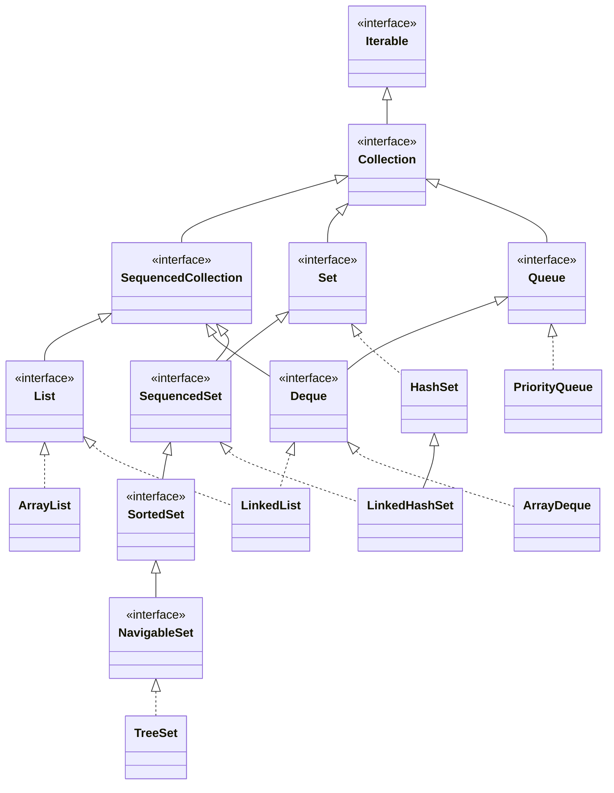
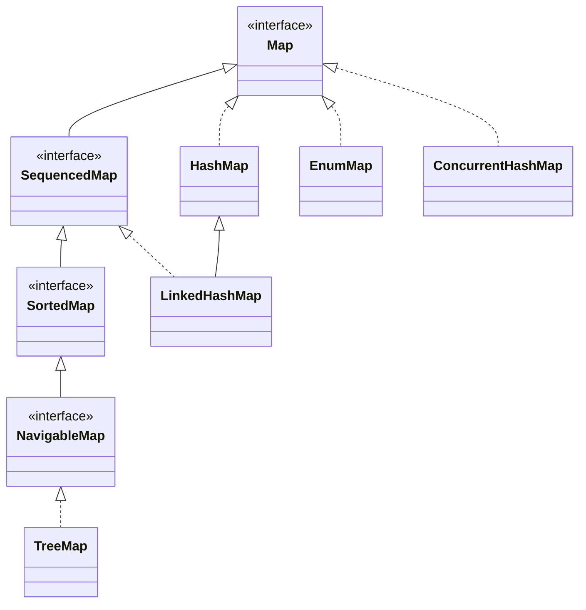
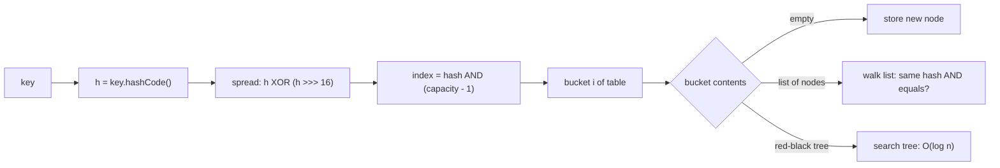
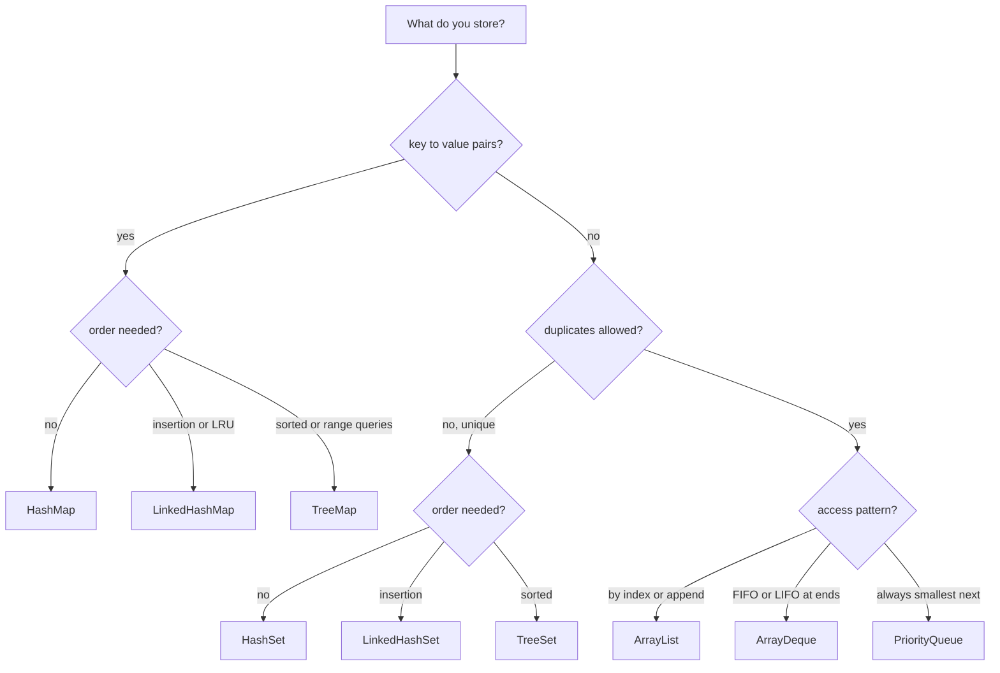

# Chapter 10 — Collections

Almost every real program holds *groups* of things: the items in a cart, the users online, the word counts of a document, the jobs waiting to run. Arrays ([Chapter 4](../04-methods-and-arrays/README.md#46-arrays)) have a fixed length and almost no behaviour. The **Java Collections Framework** (in `java.util`) gives you resizable lists, duplicate-free sets, key→value maps, queues, stacks and priority queues — all sharing a small set of interfaces so you can swap one implementation for another without rewriting code.

This chapter teaches what each collection is, **how it works inside** (so the big-O costs make sense rather than being memorised), which one to pick, and the traps that cause real bugs. It leans on generics (`List<String>`, `? extends T`) from [Chapter 9](../09-generics/README.md) and on `equals`/`hashCode` from [§6.13](../06-oop-inheritance-interfaces-and-more/README.md#613-object-methods-equals-hashcode-and-tostring). Lambdas such as `n -> n % 2 == 0` appear in a few examples; they are explained fully in [Chapter 11](../11-lambdas-and-functional-programming/README.md) — for now read them as "a small function".

**What you'll learn**

1. The collection hierarchy: `Iterable`, `Collection`, `List`, `Set`, `Queue`, `Deque`, and why `Map` stands apart.
2. `ArrayList` vs `LinkedList` — internals, costs and the classic traps.
3. `HashSet`, `LinkedHashSet`, `TreeSet` and navigation queries.
4. The `Map` API (`merge`, `computeIfAbsent`, …), `LinkedHashMap` (LRU cache), `TreeMap`.
5. **`HashMap` internals**: hashing, buckets, load factor, resizing, treeification — with a measured collision demo.
6. `Queue`, `Deque` (`ArrayDeque` as stack and queue) and `PriorityQueue` (a heap).
7. Iterators, fail-fast behaviour and safe removal.
8. `Comparable` vs `Comparator` and comparator composition.
9. The `Collections` utility class, unmodifiable views vs immutable copies (`List.of`, `copyOf`).
10. Sequenced collections (Java 21).
11. A big-O table, a measured performance demo, and a decision guide for choosing a collection.

All runnable code is in [`code/`](code/) (package `ch10.*`), compiled with `javac --release 25` and run on JDK 26.

> **Exam depth.** `List.of` vs `Arrays.asList` puzzles, `remove(int)` vs `remove(Object)`, `TreeSet`/`TreeMap` ordering questions, `Comparator` chaining and generics wildcards are drilled in [OCP Chapter 9 — Collections and generics](../../../../ocp-java21-study/chapters/09-collections-generics/README.md) (see its *Gotchas & exam traps* section). This chapter focuses on understanding and real use.

---

## 10.1 The Collections Framework and its hierarchy

### What it is
A **collection** is an object that groups other objects (its **elements**). The **Collections Framework** is three things:

1. **Interfaces** — abstract contracts such as `List` ("ordered, indexable, duplicates allowed") and `Set` ("no duplicates").
2. **Implementations** — concrete classes such as `ArrayList` and `HashSet` that fulfil those contracts with a particular data structure.
3. **Algorithms** — reusable static methods (sorting, searching, shuffling) in `Collections` and `Arrays`.

Analogy: the interface is the job description, the implementation the person hired — you can hire someone else without rewriting the description.

### How it is organised





| Interface | Promise | Main implementations |
|---|---|---|
| `Iterable<T>` | Can be looped over with for-each | every collection |
| `Collection<E>` | A group of elements: `add`, `remove`, `contains`, `size`, `iterator`, `stream` | (root of the element-based types) |
| `List<E>` | Ordered by index, duplicates allowed | `ArrayList`, `LinkedList` |
| `Set<E>` | No duplicates (by `equals`) | `HashSet`, `LinkedHashSet`, `TreeSet`, `EnumSet` |
| `Queue<E>` | Elements wait to be processed, usually FIFO | `ArrayDeque`, `LinkedList`, `PriorityQueue` |
| `Deque<E>` | "Double-ended queue": add/remove at both ends; also a stack | `ArrayDeque`, `LinkedList` |
| `Map<K,V>` | Unique keys, each mapped to one value | `HashMap`, `LinkedHashMap`, `TreeMap`, `EnumMap` |
| `SequencedCollection` / `SequencedMap` (21) | Has a defined first and last element | `List`, `Deque`, `LinkedHashSet`, `TreeSet`, `LinkedHashMap`, `TreeMap` (§10.11) |

Key terms used throughout:
- **Ordered / encounter order** — iteration visits elements in a defined sequence (index order, insertion order or sorted order).
- **Sorted** — ordered by comparing elements (natural order or a `Comparator`, §10.8).
- **Structural modification** — a change in size (add/remove), as opposed to replacing an element with `set`.
- **Optional operation** — an interface method an implementation may reject with `UnsupportedOperationException` (e.g. `add` on an unmodifiable list).

**`Map` is not a `Collection`.** A map stores pairs, so `add(E)` makes no sense for it. Instead it offers three **views** that *are* collections: `keySet()`, `values()` and `entrySet()`.

### Program to the interface

```java
// code/ch10/hierarchy/HierarchyDemo.java (key parts)
Collection<String> langs = new ArrayList<>();          // declared type = interface
langs.add("Java"); langs.add("Go"); langs.add("Java"); // lists allow duplicates
langs.addAll(List.of("Rust", "Kotlin"));
langs.remove("Java");                                  // removes the FIRST match only
langs.removeIf(s -> s.length() <= 2);                  // bulk remove by condition (Java 8)

Collection<String> unique = new HashSet<>(List.of("Java", "Go", "Rust"));
System.out.println("add duplicate to set -> " + unique.add("Java"));   // add returns false

String[] arr = langs.toArray(String[]::new);           // typed array (Java 11 form)
Map<String, Integer> ages = new TreeMap<>(Map.of("ana", 31, "bo", 25));
System.out.println("keys=" + ages.keySet() + " values=" + ages.values() + " entries=" + ages.entrySet());
```

Output:
```
list-backed: [Java, Go, Java, Rust, Kotlin] size=5
contains Go? true
after removes: [Java, Rust, Kotlin]
add duplicate to set -> false
array: [Java, Rust, Kotlin] isEmpty=false
keys=[ana, bo] values=[31, 25] entries=[ana=31, bo=25]
Map is a Collection? false
```

Declaring variables and parameters as `List`, `Set`, `Map` (not `ArrayList`…) means the method works with any implementation and you can change your mind in one place. Use the concrete type only when you need its extra methods (e.g. `TreeMap.floorKey`, `LinkedList.addFirst` before Java 21).

### Legacy classes you will still meet
`Vector` (synchronized `ArrayList`), `Stack` (extends `Vector`), `Hashtable` (synchronized map, no nulls) and `Enumeration` date from Java 1.0. They still work but every method takes a lock, and `Stack` inherits index methods a stack should not have. Use `ArrayList`, `ArrayDeque`, `HashMap`, and — when threads share the collection — the `java.util.concurrent` classes ([Chapter 14](../14-concurrency-1/README.md)).

### Self-check
1. Which interface lets a class be used in a for-each loop? → `Iterable`.
2. Is `Map` a `Collection`? → No; it provides collection *views* (`keySet`, `values`, `entrySet`).
3. Why declare `List<String> xs = new ArrayList<>()` rather than `ArrayList<String>`? → Code depends only on the contract, so the implementation can change without touching callers.

### TL;DR
Interfaces (`List`, `Set`, `Queue`, `Deque`, `Map`) describe behaviour; classes (`ArrayList`, `HashSet`, `ArrayDeque`, `HashMap`, `TreeMap`) pick the data structure. Program to the interface. Avoid `Vector`, `Stack`, `Hashtable`.

---

## 10.2 Lists: `ArrayList` and `LinkedList`

### What it is
A **`List`** is an ordered sequence you can index into (`get(i)`), like a numbered shopping list. It allows duplicates and (for most implementations) `null`.

- **`ArrayList`** — a resizable array. Analogy: a row of numbered lockers; jumping to locker 500 is instant, but inserting a new locker at position 0 means shifting every locker one place.
- **`LinkedList`** — a **doubly linked list**: each element sits in a small *node* object holding pointers to the previous and next node. Analogy: a treasure hunt — each clue tells you where the next one is, so reaching clue 500 means following 500 clues.

### How `ArrayList` works
1. It holds an internal `Object[] elementData` and an `int size`.
2. `new ArrayList<>()` starts with a shared empty array; the first `add` allocates capacity **10**.
3. `add(e)` puts `e` at `elementData[size++]`. When the array is full it allocates a new one about **1.5×** larger (`old + old >> 1`) and copies everything across. Because growth is geometric, the total copying is proportional to n, so `add` at the end is **amortised O(1)** (occasionally O(n), on average constant).
4. `get(i)` / `set(i, e)` are one array access: **O(1)**.
5. `add(i, e)` and `remove(i)` shift the tail with `System.arraycopy`: **O(n − i)**.
6. `contains`/`indexOf` scan linearly with `equals`: **O(n)**.
7. It never shrinks on its own; `trimToSize()` releases unused capacity. `new ArrayList<>(expectedSize)` or `ensureCapacity(n)` avoid repeated growth.

### How `LinkedList` works
1. Each element is wrapped in a `Node { item, prev, next }`; the list keeps `first`, `last` and `size`.
2. Adding or removing at either end rewires two pointers: **O(1)**.
3. `get(i)` walks from whichever end is closer: **O(n)**.
4. Inserting in the middle is O(1) *only once you are already there* (via a `ListIterator`); getting there is O(n).
5. Each node is a separate heap object (about 24 bytes of overhead each on a typical 64-bit JVM with compressed pointers), and nodes are scattered in memory, which defeats the CPU cache.

`LinkedList` also implements `Deque`, so it can act as a queue or stack — but `ArrayDeque` does that job faster (§10.6). In practice **`ArrayList` is the right default for almost every list**; the measured demo in §10.12 shows why.

### Code

```java
// code/ch10/lists/ListDemo.java (key parts)
List<String> todo = new ArrayList<>(List.of("write", "test", "ship"));
todo.add(1, "review");                 // insert at index 1, shifts the rest right
todo.set(0, "design");                 // replace; returns the old value

List<Integer> nums = new ArrayList<>(List.of(10, 20, 30, 1));
nums.remove(1);                        // int argument -> remove(int index): removes 20
nums.remove(Integer.valueOf(1));       // object argument -> remove(Object): removes the value 1

List<String> firstTwo = todo.subList(0, 2);
firstTwo.clear();                      // subList is a VIEW: clears those elements from todo

String[] arr = {"a", "b", "c"};
List<String> view = Arrays.asList(arr); // fixed-size view backed by the array
view.set(0, "z");                       // writes through to arr
view.add("d");                          // UnsupportedOperationException

LinkedList<String> ll = new LinkedList<>(List.of("b", "c"));
ll.addFirst("a"); ll.addLast("d");

List<String> names = new ArrayList<>(List.of("mia", "Al", "zoe", "Bob", "ann"));
names.sort(null);                       // null comparator = natural order
names.sort(String.CASE_INSENSITIVE_ORDER);
```

Output:
```
[design, review, test, ship] get(2)=test indexOf(ship)=3
nums=[10, 30]
after subList.clear(): [test, ship]
array now [z, b, c]
asList.add -> UnsupportedOperationException
linked=[a, b, c, d] removeFirst=a peekLast=d
natural (uppercase first): [Al, Bob, ann, mia, zoe]
case-insensitive: [Al, ann, Bob, mia, zoe]
ArrayList equals LinkedList? true
```

Notes on the output:
- `remove(1)` on a `List<Integer>` picks the **`remove(int index)`** overload because `1` is an `int` and no boxing is needed ([overload resolution, §4.3](../04-methods-and-arrays/README.md#43-overloading)). Box explicitly to remove by value.
- Natural `String` order compares UTF-16 code units, so every uppercase letter sorts before every lowercase one.
- `List.equals` is defined by the interface: same elements in the same order, regardless of implementation.

### Trade-offs

| Operation | `ArrayList` | `LinkedList` |
|---|---|---|
| `get(i)` / `set(i, e)` | **O(1)** | O(n) |
| `add(e)` at end | amortised **O(1)** | O(1) |
| `add(0, e)` / `remove(0)` | O(n) (shift) | **O(1)** |
| insert/remove in middle | O(n) shift | O(n) to find + O(1) to link |
| `contains` / `indexOf` | O(n) | O(n) |
| Memory per element | one reference (+ spare capacity) | node object ≈ 24 B + reference |
| Cache friendliness | high (contiguous) | low (pointer chasing) |

### When not to use them
- Frequent "is x in here?" checks → use a `Set` (O(1) or O(log n)) instead of `list.contains` (O(n)).
- Queue/stack work (add/remove at the ends) → `ArrayDeque`, not `ArrayList.remove(0)`.
- Fixed-size numeric data in hot loops → a primitive array (`int[]`) avoids boxing each element into an `Integer`.

### Common mistakes
- `remove(int)` vs `remove(Object)` on a `List<Integer>` (above).
- Holding a `subList` and then structurally modifying the parent: the sublist becomes invalid and throws `ConcurrentModificationException` on next use.
- Expecting `Arrays.asList(...)` to be growable. Wrap it: `new ArrayList<>(Arrays.asList(...))`.
- `Arrays.asList(intArray)` gives a `List<int[]>` with **one** element — generics can't hold primitives.
- Calling `list.get(i)` in a loop over a `LinkedList` — O(n²) overall; use for-each or an iterator.

### In the interview
**30-second answer:** "ArrayList is a growable array: O(1) random access, amortised O(1) append, O(n) inserts or removes in the middle because it shifts elements. LinkedList is a doubly linked list: O(1) at the ends but O(n) to reach an index, more memory per element and poor cache locality. I default to ArrayList, and use ArrayDeque when I need a queue or stack."

- *Follow-up: How does ArrayList grow?* → Starts at 10 on first add, then about 1.5× each time with an array copy; geometric growth makes append amortised O(1).
- *Follow-up: When would LinkedList actually win?* → Many inserts/removals at positions you are already at via a `ListIterator`, in a very long list — rare in practice; measure first.
- *Follow-up: Difference between `List.of` and `Arrays.asList`?* → `List.of` is fully unmodifiable and rejects nulls; `Arrays.asList` is a fixed-size, writable view of an array that allows nulls (§10.10).

### Self-check
1. What is the cost of `list.add(0, x)` on an `ArrayList` of n elements? → O(n) — every element shifts.
2. `List<Integer> l = new ArrayList<>(List.of(5, 6, 7)); l.remove(2);` — what's left? → `[5, 6]` (index 2 removed).

### TL;DR
`ArrayList` = array + 1.5× growth: fast index and append, slow front/middle edits. `LinkedList` = linked nodes: fast ends, slow indexing, heavy. Default to `ArrayList`.

---

## 10.3 Sets: `HashSet`, `LinkedHashSet`, `TreeSet`

### What it is
A **`Set`** holds each element at most once — "at most once" meaning no two elements are `equals`. Analogy: a guest list; writing a name twice doesn't add a second guest.

| Class | Built on | Order | `add`/`contains`/`remove` | Nulls |
|---|---|---|---|---|
| `HashSet` | a `HashMap` (elements are the keys) | none guaranteed | **O(1)** average | one `null` allowed |
| `LinkedHashSet` | a `LinkedHashMap` | insertion order | O(1) average | one `null` |
| `TreeSet` | a `TreeMap` (red-black tree) | sorted | **O(log n)** | no `null` with natural order |
| `EnumSet` | a bit vector | enum declaration order | O(1), extremely fast | no `null` ([§6.9](../06-oop-inheritance-interfaces-and-more/README.md#69-enums)) |

### How it works
- **`HashSet`** literally stores each element as a key in an internal `HashMap`, with a shared dummy object as the value. So everything in §10.5 applies: it uses `hashCode()` to find a bucket and `equals()` to confirm a match.
- **`LinkedHashSet`** adds a doubly linked list through the entries, remembering insertion order (re-adding an existing element does not move it).
- **`TreeSet`** keeps elements in a **red-black tree**, a self-balancing binary search tree whose height stays O(log n). It never calls `equals` or `hashCode`: two elements are "the same" when `compareTo`/`compare` returns 0.

### Code

```java
// code/ch10/sets/SetDemo.java (key parts)
List<String> visits = List.of("home", "cart", "home", "search", "cart", "about");
new HashSet<>(visits);  new LinkedHashSet<>(visits);  new TreeSet<>(visits);

Set<String> union = new TreeSet<>(a); union.addAll(b);      // A ∪ B
Set<String> inter = new TreeSet<>(a); inter.retainAll(b);   // A ∩ B
Set<String> diff  = new TreeSet<>(a); diff.removeAll(b);    // A − B

TreeSet<Integer> prices = new TreeSet<>(List.of(5, 12, 20, 35, 50));
prices.floor(19); prices.ceiling(19); prices.lower(20); prices.higher(20);
prices.headSet(20); prices.tailSet(20); prices.subSet(10, 40);

List<String> key = new ArrayList<>(List.of("x"));
Set<List<String>> set = new HashSet<>(); set.add(key);
key.add("y");                                               // mutates a key already in the set
```

Output:
```
HashSet       [search, about, cart, home]  (order not guaranteed)
LinkedHashSet [home, cart, search, about]  (insertion order)
TreeSet       [about, cart, home, search]  (sorted)
union=[docker, git, java, sql] intersection=[git] difference=[java, sql]
floor(19)=12 ceiling(19)=20 lower(20)=12 higher(20)=35
headSet(20)=[5, 12] tailSet(20)=[20, 35, 50] subSet(10,40)=[12, 20, 35]
first=5 pollLast=50 descending=[35, 20, 12, 5]
contains mutated key? false, size=1
HashSet null ok=true, TreeSet.add(null) -> NPE
```

**Navigation methods** (`NavigableSet`): `floor(x)` = greatest element ≤ x, `ceiling(x)` = least ≥ x, `lower`/`higher` = strictly < / >. `headSet(x)` is exclusive of x, `tailSet(x)` inclusive, `subSet(from, to)` is `[from, to)`. These range views are *live*: changes show through both ways.

The mutated-key line is the most important bug in this section: after `key.add("y")` the list's `hashCode` changed, so `contains` looks in a different bucket and reports `false` even though the object is in the set. **Never mutate an object while it is a set element or map key** — use immutable keys (strings, records of immutable fields).

### Common mistakes
- Putting objects whose class overrides `equals` but not `hashCode` into a `HashSet` → duplicates appear ([§6.13](../06-oop-inheritance-interfaces-and-more/README.md#613-object-methods-equals-hashcode-and-tostring)).
- A `TreeSet` comparator that returns 0 for different elements silently drops them (§10.8).
- Relying on `HashSet` print order in tests — it can change between JDK versions or after a resize.

### Real-world examples
Unique visitors per day (`HashSet<UserId>`), de-duplicating while keeping first-seen order (`LinkedHashSet`), a leaderboard or an index of time-stamped events that needs "next event after t" (`TreeSet.ceiling`), feature flags (`EnumSet`).

### Self-check
1. Which set gives insertion order? → `LinkedHashSet`.
2. What does `TreeSet` use to detect duplicates? → `compareTo`/`compare` returning 0, not `equals`.
3. `new TreeSet<>(List.of(1, 5, 9)).floor(4)`? → `1`.

### TL;DR
`HashSet` for fast membership, `LinkedHashSet` to also keep insertion order, `TreeSet` for sorted order and range/nearest queries (O(log n)). Keys must not change while inside.

---

## 10.4 Maps: `HashMap`, `LinkedHashMap`, `TreeMap`

### What it is
A **`Map<K,V>`** associates each unique **key** with one **value** — a dictionary: look up a word (key), get its definition (value). Putting a second value under an existing key *replaces* the old value.

### The everyday API

| Method | Does | Returns |
|---|---|---|
| `put(k, v)` | insert or replace | previous value or `null` |
| `get(k)` / `getOrDefault(k, d)` | look up | value, or `null` / `d` if absent |
| `containsKey(k)` / `containsValue(v)` | test | `boolean` (`containsValue` is O(n)) |
| `remove(k)` | delete | removed value or `null` |
| `putIfAbsent(k, v)` | insert only if missing (or mapped to `null`) | existing value or `null` |
| `merge(k, v, fn)` | if absent put `v`, else put `fn(old, v)`; `null` result removes | new value |
| `compute(k, fn)` | `fn(k, oldOrNull)`; `null` result removes | new value |
| `computeIfAbsent(k, fn)` | if missing, compute and store `fn(k)` | current value |
| `computeIfPresent(k, fn)` | if present, recompute; `null` removes | new value |
| `forEach((k, v) -> …)`, `replaceAll((k, v) -> …)` | iterate / transform all values | — |
| `keySet()`, `values()`, `entrySet()` | live views | collections |

The `merge`/`compute*` methods arrived in Java 8 and replace most "get, check for null, put" boilerplate.

### Code

```java
// code/ch10/maps/MapDemo.java (key parts)
Map<String, Integer> stock = new HashMap<>();
stock.put("apple", 5);
Integer old = stock.put("apple", 7);                    // replaces, returns 5
stock.putIfAbsent("pear", 3);
stock.merge("apple", 10, Integer::sum);                 // 7 + 10
stock.merge("plum", 1, Integer::sum);                   // absent -> puts 1
stock.compute("pear", (k, v) -> v == null ? 1 : v * 2);
stock.computeIfPresent("plum", (k, v) -> null);         // null result REMOVES plum

Map<String, Integer> counts = new TreeMap<>();          // word count idiom
for (String w : "to be or not to be".split(" ")) counts.merge(w, 1, Integer::sum);

Map<Character, List<String>> byInitial = new TreeMap<>(); // multimap idiom
for (String n : List.of("ana", "bo", "al", "cy", "ben"))
    byInitial.computeIfAbsent(n.charAt(0), c -> new ArrayList<>()).add(n);

for (Map.Entry<String, Integer> e : counts.entrySet())  // iterate entries, not keys + get
    if (e.getValue() > 1) System.out.print(e.getKey() + "x" + e.getValue() + " ");

TreeMap<Integer, String> bracket = new TreeMap<>(Map.of(0, "10%", 11_000, "12%", 44_725, "22%", 95_375, "24%"));
bracket.floorEntry(50_000).getValue();                  // bracket whose start <= 50,000

Map<String, String> lru = new LinkedHashMap<>(16, 0.75f, true) {   // true = access order
    @Override protected boolean removeEldestEntry(Map.Entry<String, String> eldest) { return size() > 3; }
};
lru.put("a", "A"); lru.put("b", "B"); lru.put("c", "C");
lru.get("a");       // a becomes most recently used
lru.put("d", "D");  // evicts b
```

Output:
```
old=5 get=7 missing=null default=0
stock={apple=17, pear=6}
counts={be=2, not=1, or=1, to=2}
byInitial={a=[ana, al], b=[bo, ben], c=[cy]}
bex2 tox2 
income 50000 -> 22%, first bracket above 50000 starts at 95375, headMap(44725)={0=10%, 11000=12%}
LRU keys=[c, a, d]
HashMap null key -> 0
```

(The brackets are illustrative numbers in the style of a progressive income-tax table, not current law.)

### The three main implementations

| | `HashMap` | `LinkedHashMap` | `TreeMap` |
|---|---|---|---|
| Structure | array of buckets (§10.5) | `HashMap` + doubly linked list of entries | red-black tree |
| Iteration order | unspecified | insertion order (or access order) | sorted by key |
| `get`/`put`/`remove` | **O(1)** average | O(1) average | **O(log n)** |
| `null` key | one allowed | one allowed | not with natural ordering |
| Extras | — | `removeEldestEntry` hook → LRU cache | `floorKey`, `ceilingEntry`, `headMap`, `tailMap`, `subMap`, `firstKey`, `descendingMap` |

Other maps worth knowing: **`EnumMap`** (enum keys, backed by an array indexed by `ordinal()` — very fast), **`IdentityHashMap`** (compares keys with `==`, used for object-graph algorithms like serialization), **`WeakHashMap`** (keys held weakly, so an entry disappears once nothing else references its key — for caches of metadata), **`ConcurrentHashMap`** (thread-safe, no null keys/values — [Chapter 14](../14-concurrency-1/README.md); a simplified build is in [LLD §13.7](../../../lld/chapters/13-concurrency-problems/README.md#137-design-a-simplified-concurrent-hashmap--lock-striping)).

### Common mistakes
- `if (map.get(k) != null)` to test presence — wrong if `null` values are allowed; use `containsKey`.
- `for (K k : map.keySet()) use(map.get(k))` — two lookups per entry; iterate `entrySet()` or use `map.forEach`.
- `map.get(k) + 1` when `k` is absent → `NullPointerException` from unboxing `null`. Use `merge` or `getOrDefault`.
- In `computeIfAbsent`, the mapping function must not modify the same map (for `HashMap` this throws `ConcurrentModificationException` since Java 9). This bites recursive memoisation — see [§11.8](../11-lambdas-and-functional-programming/README.md#118-functional-style-in-everyday-java).

### Real-world examples
HTTP headers and configuration (`Map<String,String>`), caches keyed by ID, word or event counts (`merge`), grouping orders by customer (`computeIfAbsent`), an LRU cache for thumbnails (`LinkedHashMap`), time-series lookups and rate tables (`TreeMap.floorEntry`).

### Self-check
1. What does `map.put(k, v)` return when `k` was already present? → The previous value.
2. How do you count occurrences in one line per element? → `counts.merge(word, 1, Integer::sum)`.
3. Which map gives "the entry with the largest key ≤ x"? → `TreeMap.floorEntry(x)`.
4. What does returning `null` from a `compute` function do? → Removes the key.

### TL;DR
Map = unique keys → values. `HashMap` default, `LinkedHashMap` for predictable order or LRU, `TreeMap` for sorted keys and range queries. Use `merge`, `computeIfAbsent`, `getOrDefault` instead of null-check boilerplate.

---

## 10.5 `HashMap` internals

### What it is
`HashMap` is a **hash table**: an array of **buckets** (also called *bins*), where a key's **hash code** decides which bucket it goes into. Analogy: a coat check with 16 numbered hooks. The attendant computes a number from your ticket, hangs your coat on that hook, and later goes straight to that hook — no searching through every coat. If two coats land on the same hook, they hang one behind the other, and the attendant checks each ticket on that hook.

### Why it matters
Average **O(1)** `get`/`put` makes `HashMap`/`HashSet` the most-used collections — and a favourite interview topic. The internals also explain real bugs: slow maps from bad `hashCode`, lost keys from mutation, surprising iteration order, wasted resizes.

### How it works (JDK 8 and later)



1. **Hash.** `put(key, value)` calls `key.hashCode()` (a 32-bit `int`). A `null` key is given hash 0 (so it lives in bucket 0).
2. **Spread.** `HashMap.hash()` XORs the high 16 bits into the low 16: `h ^ (h >>> 16)`. The next step only looks at the low bits, and without spreading, keys whose hash codes differ only in high bits would all collide.
3. **Index.** The table length `n` is always a **power of two** (default **16**), so `hash & (n − 1)` equals `hash mod n` but is a single cheap AND instruction.
4. **Store.** Each bucket holds a chain of `Node{hash, key, value, next}`. If the bucket is empty, the node goes straight in. Otherwise the map walks the chain: a node matches when **the hashes are equal and** (`==` or `equals`). A match gets its value replaced (and `put` returns the old value); no match → a new node is appended at the tail.
5. **Load factor and resize.** The **load factor** (default **0.75**) is the fullness at which the table grows. The **threshold** = capacity × load factor (16 × 0.75 = **12**). When `size` exceeds the threshold, the table **doubles** (16 → 32 → 64 …) and every node is redistributed. Because capacity is a power of two, each node either stays at index `i` or moves to `i + oldCapacity`, decided by one bit of its hash (`hash & oldCapacity`), so the split is cheap and keeps chain order.
6. **Treeification (Java 8).** If a single bucket's chain reaches **8** nodes (`TREEIFY_THRESHOLD`) and another is added, the chain is converted into a **red-black tree** of `TreeNode`s, turning that bucket's worst case from O(n) into **O(log n)**. But if the whole table is smaller than **64** buckets (`MIN_TREEIFY_CAPACITY`), the map **resizes instead**, because a small table crowded in one bucket is better fixed by spreading keys out. When a resize split leaves a tree bucket with **≤ 6** nodes (`UNTREEIFY_THRESHOLD`), it turns back into a list. With a decent hash function and load factor 0.75, a bucket of 8 is astronomically unlikely (the JDK source comment estimates about 6 in 100 million), so trees are a defence against bad or malicious hash codes, not a normal case.
7. **Inside a tree bucket**, nodes are ordered by hash; for equal hashes, by `compareTo` **if the keys are `Comparable` and of the same class**. Otherwise the tree cannot tell them apart and a lookup may have to search both subtrees — which is why the non-`Comparable` case in the demo below stays slow.
8. **Get** repeats steps 1–3 and searches only that one bucket.

The constants, straight from `java/util/HashMap.java` in JDK 26:

| Constant | Value | Meaning |
|---|---|---|
| `DEFAULT_INITIAL_CAPACITY` | 16 | buckets allocated on first `put` (the table is created lazily) |
| `DEFAULT_LOAD_FACTOR` | 0.75 | resize when size > capacity × 0.75 |
| `TREEIFY_THRESHOLD` | 8 | chain length that triggers list → tree |
| `UNTREEIFY_THRESHOLD` | 6 | tree → list when a resize split leaves this few |
| `MIN_TREEIFY_CAPACITY` | 64 | below this table size, resize instead of treeifying |
| `MAXIMUM_CAPACITY` | 2^30 | table never grows beyond this |

**Why 0.75?** It's a time/space trade-off: a lower load factor means fewer collisions but more empty buckets (memory); a higher one packs buckets tighter but lengthens chains. 0.75 keeps chains very short on average while wasting at most about a quarter of the table.

### Watching it happen: a teaching-size hash map
`TinyHashMap` below implements steps 1–5 in ~60 lines (no trees, no null keys) and prints what it does. It starts with 4 buckets so we can watch two resizes.

```java
// code/ch10/maps/TinyHashMap.java (key parts)
static int spread(Object key) { int h = key.hashCode(); return h ^ (h >>> 16); }

void put(K key, V value) {
    int h = spread(key), i = h & (table.length - 1);          // bucket index
    for (Node<K, V> n = table[i]; n != null; n = n.next())
        if (n.hash() == h && n.key().equals(key)) { table[i] = replace(table[i], key, value); return; }
    table[i] = new Node<>(h, key, value, table[i]);           // new node in bucket i
    if (++size > table.length * loadFactor) resize();         // threshold = capacity * 0.75
}

private void resize() {                                       // double and re-bucket every node
    Node<K, V>[] old = table;
    table = (Node<K, V>[]) new Node[old.length * 2];
    for (Node<K, V> head : old)
        for (Node<K, V> n = head; n != null; n = n.next()) {
            int i = n.hash() & (table.length - 1);            // stays at i or moves to i + oldCapacity
            table[i] = new Node<>(n.hash(), n.key(), n.value(), table[i]);
        }
}
```

Output:
```
put apple   hashCode=   93029210 spread=   93030097 index(n=4)=1
put banana  hashCode=-1396355227 spread=-1396317280 index(n=4)=0
put cherry  hashCode=-1361513063 spread=-1361552575 index(n=4)=1
put date    hashCode=    3076014 spread=    3075968 index(n=4)=0
  resize: size=4 exceeded threshold 3 -> capacity 4 -> 8
put elder   hashCode=   96592394 spread=   96593867 index(n=8)=3
put fig     hashCode=     101380 spread=     101381 index(n=8)=5
put grape   hashCode=   98615627 spread=   98616491 index(n=8)=3
  resize: size=7 exceeded threshold 6 -> capacity 8 -> 16
final table (capacity 16):
  bucket  0: date -> banana -> null
  bucket  1: cherry -> apple -> null
  bucket  5: fig -> null
  bucket 11: elder -> grape -> null
get(fig)=99 get(kiwi)=null size=7
```

Read it like this: with 4 buckets, `apple` and `cherry` collide in bucket 1. After the 4th key, size 4 > 4 × 0.75 = 3, so the table doubles. After the final resize to 16, `elder` and `grape` still share bucket 11 because their spread hashes agree in the lowest 4 bits. `put("fig", 99)` finds the existing key and replaces the value, so size stays 7. (`String.hashCode` is a fixed, documented formula — `s[0]·31^(n−1) + … + s[n−1]` — so these numbers are the same on every JVM.)

### What bad hash codes cost (measured)
`HashCollisionDemo` puts 20,000 keys into a `HashMap` whose `hashCode()` returns the constant 42 — every key collides into one bucket — and times 60,000 lookups. **Timings are machine-dependent** (this run: Apple M4 Pro, JDK 26); compare the ratios.

```java
// code/ch10/maps/HashCollisionDemo.java (key parts)
record CmpKey(int id) implements Comparable<CmpKey> {           // constant hash, but Comparable
    @Override public int hashCode() { return 42; }
    @Override public int compareTo(CmpKey o) { return Integer.compare(id, o.id); }
}
record PlainKey(int id) { @Override public int hashCode() { return 42; } }  // constant hash, not Comparable
record GoodKey(int id) {}                                        // record's generated hashCode
```

Output:
```
good hashCode (GoodKey)            n=20,000  3n lookups:      0.7 ms
constant hash, Comparable (tree)   n=20,000  3n lookups:      6.5 ms
constant hash, not Comparable      n=20,000  3n lookups:   1648.2 ms
```

- **Good hash:** keys spread across buckets → O(1) each.
- **Constant hash + `Comparable`:** one giant bucket, but it was treeified and ordered by `compareTo` → O(log n) each; ~10× slower than good hashing, still fast.
- **Constant hash, not `Comparable`:** the tree can't order equal-hash keys, so lookups degrade toward a linear scan → O(n) each, **thousands of times slower**. This is the scenario hash-flooding denial-of-service attacks exploit, and the reason Java 8 added treeification (and why `String` — being `Comparable` — is well protected as a key).

### Sizing a map correctly
`new HashMap<>(100)` does **not** mean "room for 100 entries". The argument is an initial *capacity*, rounded up to a power of two (128); the threshold is then 128 × 0.75 = 96, so the 97th `put` still triggers a resize. To pre-size for an expected number of **entries**, use the Java 19 factories, which do the load-factor maths for you:

```java
Map<String, User> users = HashMap.newHashMap(100);       // Java 19: capacity for 100 mappings without resizing
Set<String> seen        = HashSet.newHashSet(100);        // also LinkedHashMap.newLinkedHashMap, LinkedHashSet.newLinkedHashSet
```

### Thread safety
`HashMap` is **not** thread-safe. Concurrent `put`s can lose entries or corrupt a bucket (in Java 7 and earlier, a concurrent resize could even link a chain into a cycle so `get` spun forever). Use `ConcurrentHashMap` for shared maps ([Chapter 14](../14-concurrency-1/README.md)). `Collections.synchronizedMap` works but locks the whole map on every call.

### Trade-offs

| | `HashMap` | `TreeMap` |
|---|---|---|
| Needs | good `hashCode` + consistent `equals` | `Comparable` keys or a `Comparator` |
| Average `get`/`put` | O(1) | O(log n) |
| Worst case | O(log n) per bucket if keys are `Comparable`, else O(n) | O(log n) guaranteed |
| Order | none | sorted |
| Memory | table + a node per entry | a tree node per entry (more pointers) |

### Common mistakes
- Overriding `equals` without `hashCode` (or using different fields in each) → "equal" keys land in different buckets.
- `hashCode` that returns a constant or uses only a low-variety field (e.g. a boolean) → every lookup scans.
- Relying on iteration order: it follows bucket order and can change after a resize or between JDK versions. Use `LinkedHashMap` or `TreeMap` when order matters.

### In the interview
**30-second answer:** "HashMap is an array of buckets. It takes the key's hashCode, spreads the high bits into the low bits, and ANDs with capacity minus one to pick a bucket. Collisions chain in a linked list; since Java 8 a bucket with more than 8 entries becomes a red-black tree if the table has at least 64 buckets, so the worst case is O(log n) instead of O(n). When size passes capacity × 0.75 the table doubles and entries are re-bucketed — each moves to index i or i + oldCapacity. Lookups compare hash first, then equals, which is why equals and hashCode must agree and keys shouldn't be mutable."

- *Follow-up: Why is the capacity a power of two?* → So `hash & (n−1)` replaces a slower modulo, and resizing splits each bucket into exactly two predictable positions.
- *Follow-up: Can HashMap have a null key?* → Yes, one, with hash 0; `Hashtable` and `ConcurrentHashMap` reject nulls.
- *Follow-up: What happens if two keys have the same hashCode but aren't equal?* → Both are stored in the same bucket; lookup distinguishes them with `equals`. Correct but slower.

### Self-check
1. Default capacity, load factor and first resize threshold? → 16, 0.75, 12.
2. When does a bucket become a tree? → When adding to a bucket that already holds 8 nodes, provided the table has at least 64 buckets (else it resizes).
3. During a resize from 16 to 32, where can the entry in bucket 5 go? → Bucket 5 or bucket 21.

### TL;DR
hashCode → spread → `& (n−1)` → bucket; match by hash then `equals`. Load factor 0.75 triggers doubling; buckets over 8 become red-black trees (table ≥ 64). Good, stable hash codes = O(1); bad ones = slow maps. Pre-size with `HashMap.newHashMap(n)`. Not thread-safe.

---

## 10.6 Queues, deques and priority queues

### What it is
- A **queue** holds elements waiting to be processed — normally **FIFO** (first in, first out), like a line at a till.
- A **deque** ("deck", double-ended queue) allows adding and removing at both ends, so it can be a FIFO queue *or* a **LIFO stack** (last in, first out, like a stack of plates).
- A **priority queue** always hands out the *smallest* element next (by natural order or a comparator), like a hospital triage desk.

### Two method families
`Queue` offers each operation twice: one throws when it can't proceed, the other returns a special value. Prefer the special-value versions for ordinary control flow.

| Operation | Throws exception | Returns special value |
|---|---|---|
| Insert at tail | `add(e)` | `offer(e)` → `false` if full (bounded queues) |
| Remove head | `remove()` | `poll()` → `null` if empty |
| Examine head | `element()` | `peek()` → `null` if empty |

`Deque` adds `First`/`Last` versions of each (`offerFirst`, `pollLast`, `peekFirst`…) plus the stack methods `push` (= `addFirst`), `pop` (= `removeFirst`) and `peek`.

### How the implementations work
- **`ArrayDeque`** — a resizable **circular array** with `head` and `tail` indexes that wrap around. Adding/removing at either end is amortised **O(1)** with no node allocations. It rejects `null` (because `null` is how `poll` signals "empty"). The Javadoc notes it is likely faster than `Stack` as a stack and faster than `LinkedList` as a queue. **Use it for both.**
- **`PriorityQueue`** — a **binary min-heap** stored in an array: a complete binary tree where each parent ≤ its children, and element *i*'s children sit at *2i+1* and *2i+2*. `offer` appends at the end and "sifts up"; `poll` moves the last element to the root and "sifts down". Both are **O(log n)**; `peek` is O(1); `contains`/`remove(Object)` are O(n). Building one from a collection (heapify) is O(n). The array is *not* sorted — only the root is guaranteed smallest — so `toString()` and the iterator show heap order, not sorted order.

### Code

```java
// code/ch10/queues/QueueDemo.java (key parts)
Queue<String> printer = new ArrayDeque<>();
printer.offer("doc1"); printer.offer("doc2"); printer.offer("doc3");

Deque<Character> stack = new ArrayDeque<>();                 // balanced-brackets check
for (char c : "{[()]}(".toCharArray()) {
    if ("([{".indexOf(c) >= 0) stack.push(c);
    else if (!stack.isEmpty() && "([{".indexOf(stack.peek()) == ")]}".indexOf(c)) stack.pop();
    else { stack.push('!'); break; }
}

PriorityQueue<Integer> heap = new PriorityQueue<>(List.of(7, 3, 9, 1, 5));
while (!heap.isEmpty()) out.append(heap.poll()).append(' ');

PriorityQueue<Task> jobs = new PriorityQueue<>(
        Comparator.comparingInt(Task::priority).reversed().thenComparing(Task::name));

int k = 3; PriorityQueue<Integer> topK = new PriorityQueue<>();  // top-k largest with a min-heap
for (int x : new int[]{15, 2, 99, 42, 8, 77, 23}) { topK.offer(x); if (topK.size() > k) topK.poll(); }
```

Output:
```
peek=doc1 poll=doc1 left=[doc2, doc3]
empty.poll()=null empty.peek()=null
empty.remove() -> NoSuchElementException
{[()]}( balanced? false (left on stack: [(])
ArrayDeque.push(null) -> NPE
heap toString (NOT sorted): [1, 3, 9, 7, 5]
poll order: 1 3 5 7 9 
backup deploy lint email 
top-3 = [99, 77, 42]
```

The top-k trick keeps a heap of only *k* elements: each new element costs O(log k), and the smallest of the current top k is evicted. Total O(n log k) instead of sorting everything in O(n log n) — a staple of coding interviews ([Chapter 19](../19-java-for-coding-interviews/README.md)).

### When not to use them
- Threads producing and consuming → a `BlockingQueue` (`ArrayBlockingQueue`, `LinkedBlockingQueue`) that waits instead of returning `null` ([Chapter 14](../14-concurrency-1/README.md)).
- You need all elements in sorted order once → just sort a list; a heap shines when elements keep arriving.
- Changing an element's priority after insertion is not supported — remove and re-add it (O(n)), or insert a new entry and skip stale ones when polled.

### Common mistakes
- Using `Stack` or `LinkedList` where `ArrayDeque` fits.
- Printing a `PriorityQueue` and expecting sorted output; iterate with `poll()` instead.
- Mixing `add`/`remove` (exceptions) with `offer`/`poll` expectations.
- Using `push` then `pollLast` — `push` adds at the **front** of a deque.

### Self-check
1. Which call returns `null` rather than throwing on an empty queue? → `poll()` / `peek()`.
2. What does `PriorityQueue.poll()` return? → The smallest element per its ordering.
3. Why can't `ArrayDeque` hold `null`? → `null` is the "empty" return value of `poll`/`peek`.

### TL;DR
`ArrayDeque` for FIFO queues and LIFO stacks; `PriorityQueue` (binary heap) when the next item is "the smallest": O(log n) add/poll, O(1) peek, unsorted iteration.

---

## 10.7 Iterators and fail-fast behaviour

### What it is
An **`Iterator<E>`** is a cursor over a collection with three methods: `hasNext()`, `next()` and the optional `remove()`. The enhanced for loop is compiler shorthand for using one. **`ListIterator`** adds `hasPrevious`/`previous`, index queries, `set` and `add`.

### How fail-fast works
Most `java.util` collections keep a **modification counter** (`modCount`) that increments on every structural change. An iterator records the count when created and re-checks it on each `next()`. If the collection was changed by anything *other than the iterator itself*, `next()` throws **`ConcurrentModificationException`** (CME). Despite the name, this happens in single-threaded code too. It is "best effort": it catches bugs early but is not a thread-safety guarantee.

**Fail-safe** iterators (in `java.util.concurrent`) iterate over a snapshot or a weakly consistent view and never throw CME. `CopyOnWriteArrayList` copies the whole array on every write, so it suits read-mostly lists like event listeners.

### Code

```java
// code/ch10/iteration/IteratorDemo.java (key parts)
for (Integer n : nums) if (n % 2 == 0) nums.remove(n);          // WRONG: CME

for (Iterator<Integer> it = nums.iterator(); it.hasNext(); )    // RIGHT: iterator's own remove
    if (it.next() % 2 == 0) it.remove();

nums.removeIf(n -> n % 2 == 0);                                 // SIMPLEST (Java 8)

for (ListIterator<String> li = words.listIterator(); li.hasNext(); ) {
    String w = li.next();
    li.set(w.toUpperCase());
    if (w.equals("b")) li.add("b2");                            // inserted after the cursor
}
scores.entrySet().removeIf(e -> e.getValue() < 50);             // remove map entries by condition

List<String> listeners = new CopyOnWriteArrayList<>(List.of("L1", "L2"));
for (String l : listeners) listeners.add(l + "'");              // iterates the old snapshot
```

Output:
```
for-each + list.remove -> ConcurrentModificationException, list now [1, 3, 4, 5, 6]
iterator.remove -> [1, 3, 5]
removeIf        -> [1, 3, 5]
listIterator set/add -> [A, B, b2, C]
backwards -> Cb2BA
passed -> {bo=90, cy=55}
CopyOnWriteArrayList -> [L1, L2, L1', L2']
```

The first line shows the list was already changed (`2` removed) before the exception — fail-fast stops you *after* the first bad change, so don't rely on catching CME.

### Common mistakes
- Removing inside for-each (above). Also: calling `it.remove()` twice per `next()`, or before the first `next()` → `IllegalStateException`.
- Believing CME means "a threading problem" — usually it is a loop modifying its own collection.
- Removing via index in a forward `for (int i…)` loop and skipping the element that shifted into position `i`; loop backwards or use `removeIf`.

### Self-check
1. Name two safe ways to remove while iterating. → `Iterator.remove()` and `Collection.removeIf`.
2. Does CME need two threads? → No.
3. Why doesn't `CopyOnWriteArrayList` throw CME? → Its iterator walks an immutable snapshot of the array.

### TL;DR
Don't structurally modify a collection while for-each-ing over it. Use `removeIf`, `Iterator.remove`, or collect changes and apply them after. Fail-fast = bug detector, not a lock.

---

## 10.8 Ordering: `Comparable` and `Comparator`

### What it is
Sorting needs a rule for "which comes first".
- **`Comparable<T>`** — the class defines its **natural order** by implementing `int compareTo(T other)`. `String`, `Integer`, `LocalDate` and enums (declaration order) are `Comparable`.
- **`Comparator<T>`** — a separate object with `int compare(T a, T b)` that defines *any* order you want, without changing the class. Analogy: `Comparable` is a book's own shelf number; a `Comparator` is you choosing to arrange books by colour today.

Both return a **negative** number if the first comes before the second, **zero** if they tie, and **positive** if it comes after. Only the sign matters.

### The contract
`compareTo`/`compare` must be **antisymmetric** (sign of `a.compareTo(b)` is the opposite of `b.compareTo(a)`), **transitive**, and ideally **consistent with equals** (`compareTo == 0` exactly when `equals` is true). Sorted collections (`TreeSet`, `TreeMap`) use the comparison *instead of* `equals`, so an inconsistent comparator makes them drop or merge elements. (`BigDecimal` is a famous JDK exception: `2.0` and `2.00` compare equal but aren't `equals`.)

### Building comparators (Java 8+)

| Factory / method | Meaning |
|---|---|
| `Comparator.comparing(Employee::name)` | by a `Comparable` key |
| `comparingInt/Long/Double(keyFn)` | by a primitive key (no boxing) |
| `comparing(keyFn, keyComparator)` | by a key using a given comparator |
| `.thenComparing(...)` | tie-breaker |
| `.reversed()` | flip the whole comparator so far |
| `Comparator.naturalOrder()` / `reverseOrder()` | natural / reverse natural |
| `nullsFirst(c)` / `nullsLast(c)` | tolerate nulls |
| `String.CASE_INSENSITIVE_ORDER` | ready-made |

### Code

```java
// code/ch10/sorting/SortingDemo.java (key parts)
record Employee(int id, String name, String dept, double salary) implements Comparable<Employee> {
    @Override public int compareTo(Employee o) { return Integer.compare(id, o.id); }   // natural order: id
}
Collections.sort(staff);                                              // uses compareTo
staff.sort(Comparator.comparing(Employee::name).reversed());
staff.sort(Comparator.comparing(Employee::dept)
        .thenComparing(Employee::salary, Comparator.reverseOrder())   // reverse just this key
        .thenComparing(Employee::name));
staff.sort(Comparator.comparingDouble(Employee::salary));
cities.sort(Comparator.nullsLast(String.CASE_INSENSITIVE_ORDER));

Comparator<Integer> bad = (a, b) -> a - b;                            // overflow bug
Set<String> byLength = new TreeSet<>(Comparator.comparingInt(String::length));
byLength.addAll(List.of("kiwi", "pear", "fig", "plum", "banana"));
```

Output:
```
by id:      [Ana, Bo, Cy, Dee]
name desc:  [Dee, Cy, Bo, Ana]
dept,salary desc,name: [Bo, Cy, Dee, Ana]
salary asc: [Ana, Cy, Dee, Bo]
nullsLast, case-insensitive: [Accra, lima, Oslo, null]
bad.compare(MIN_VALUE, 1) = 2147483647 (positive, so MIN_VALUE looks BIGGER), Integer.compare = -1
TreeSet by length keeps only [fig, kiwi, banana]  (pear and plum were dropped!)
stable (dept, then previous name order): [Bo, Cy, Dee, Ana]
```

- `reversed()` applies to **everything chained before it**; to reverse only one key, pass `Comparator.reverseOrder()` as that key's comparator (as done for salary).
- `a - b` overflows for large magnitudes (`MIN_VALUE − 1` wraps to `MAX_VALUE`). Always use `Integer.compare`, `Long.compare`, `Double.compare` or `comparingInt`.
- The `TreeSet` ordered by length considers `"kiwi"`, `"pear"` and `"plum"` duplicates (length 4 ties), keeping only the first. Add a tie-breaker: `comparingInt(String::length).thenComparing(Comparator.naturalOrder())`.
- **Stability.** `List.sort`/`Collections.sort` (TimSort, O(n log n)) are **stable**: equal elements keep their relative order. That's why sorting by name, then by dept, leaves each dept sorted by name.

### Common mistakes
- Subtraction comparators; comparing `double` fields with `<`/`>` and forgetting `NaN` (use `Double.compare`).
- `Comparable` whose natural order disagrees with `equals` used as `TreeMap` keys.
- Putting non-`Comparable` objects into a `TreeSet` without a comparator → `ClassCastException` on the first add.

### In the interview
**30-second answer:** "Comparable is the class's single natural order via compareTo; Comparator is an external strategy for any number of orders. Since Java 8 I build comparators with comparing, thenComparing and reversed, use primitive variants to avoid boxing, and never subtract to compare. Sorted collections treat compare == 0 as equality, so the order should be consistent with equals."

- *Follow-up: Is `Collections.sort` stable?* → Yes (TimSort for objects).
- *Follow-up: How do you sort descending by one key but ascending by another?* → `comparing(a).thenComparing(b, reverseOrder())`.

### Self-check
1. What does a negative return from `compare(a, b)` mean? → `a` sorts before `b`.
2. How to sort `List<String>` by length, then alphabetically? → `list.sort(comparingInt(String::length).thenComparing(naturalOrder()))`.
3. Why is `(a, b) -> a - b` dangerous? → Integer overflow can flip the sign.

### TL;DR
`Comparable` = one built-in order; `Comparator` = any order, composable with `comparing`/`thenComparing`/`reversed`/`nullsLast`. Keep it consistent with `equals` for sorted collections. Sorting objects is stable.

---

## 10.9 The `Collections` utility class

`java.util.Collections` (plural, with an *s*) holds static algorithms and wrappers — the collection counterpart of `java.util.Arrays` ([§4.8](../04-methods-and-arrays/README.md#48-the-javautilarrays-toolbox)).

```java
// code/ch10/utilities/CollectionsUtilDemo.java (key parts)
Collections.max(xs); Collections.min(xs); Collections.frequency(xs, 3);
Collections.sort(xs); Collections.binarySearch(xs, 8);    // binarySearch needs a sorted list
Collections.reverse(xs); Collections.swap(xs, 0, xs.size() - 1);
Collections.rotate(xs, 2); Collections.shuffle(xs, new Random(42));   // seeded -> repeatable
Collections.nCopies(3, "ab"); Collections.disjoint(List.of(1, 2), List.of(3));
Collections.addAll(letters, "d", "b");

List<String> view = Collections.unmodifiableList(source);  // read-only VIEW
List<String> copy = List.copyOf(source);                   // immutable COPY
source.add("y");

List<Integer> sync = Collections.synchronizedList(new ArrayList<>(List.of(1, 2)));
synchronized (sync) { for (int v : sync) System.out.print("sync " + v + " "); }   // lock while iterating
```

Output:
```
max=9 min=1 frequency(3)=2
sorted=[1, 3, 3, 5, 8, 9] binarySearch(8)=4 binarySearch(4)=-4 (negative: -(insertionPoint)-1)
reverse=[9, 8, 5, 3, 3, 1]
swap ends=[1, 8, 5, 3, 3, 9]
rotate 2=[3, 9, 1, 8, 5, 3]
shuffle(seed 42)=[9, 3, 5, 3, 8, 1]
nCopies=[ab, ab, ab] disjoint=true
addAll varargs=[c, a, d, b]
view sees change: [x, y]  copy does not: [x]
view.add -> UnsupportedOperationException
emptyList=[] singleton=[only]
sync 1 sync 2 
```

| Group | Methods |
|---|---|
| Algorithms | `sort`, `binarySearch`, `reverse`, `shuffle`, `swap`, `rotate`, `fill`, `copy`, `min`, `max`, `frequency`, `disjoint`, `addAll`, `nCopies` |
| Read-only wrappers (views) | `unmodifiableList/Set/Map/Collection`, `unmodifiableSequencedCollection/Set/Map` (21), sorted/navigable variants |
| Synchronized wrappers | `synchronizedList/Set/Map/...` — each call locks; you must lock manually around iteration |
| Constants and singletons | `emptyList/Set/Map`, `singletonList/singleton/singletonMap` (immutable) |
| Type-checked wrappers | `checkedList(list, String.class)` — catches heap pollution from raw types at insertion time ([Chapter 9](../09-generics/README.md)) |
| Other | `reverseOrder()`, `newSetFromMap(map)`, `list(enumeration)`, `enumeration(coll)` |

`binarySearch` returns the index if found, otherwise `-(insertionPoint) - 1` — always negative, so "not found" can't be confused with index 0. Here 4 would be inserted at index 3, so the result is −4.

### Self-check
1. `Collections.binarySearch` on an unsorted list? → Undefined result — sort first.
2. What's the difference between `unmodifiableList(l)` and `List.copyOf(l)`? → The first is a read-only view that reflects later changes to `l`; the second is an independent immutable snapshot.

---

## 10.10 Unmodifiable and immutable collections

### What it is
- **Unmodifiable** — the collection object rejects changes (`add`, `set`, `remove` throw `UnsupportedOperationException`).
- **Immutable** — it is unmodifiable *and* nothing else can change it either (no backing collection behind it).
- A **view** is a wrapper over another collection; it can be unmodifiable yet still change when the underlying collection changes.

### Why it matters
Returning an immutable collection from a method (or storing one in a record) means callers can't corrupt your object's state, the collection is automatically safe to share across threads, and intent is explicit. *Effective Java* Item 17 ("minimise mutability") and Item 50 ("make defensive copies when needed") both point here.

### The factory methods

| Factory | Since | Nulls | Duplicates | Order |
|---|---|---|---|---|
| `List.of(...)` | 9 | NPE | allowed | as given |
| `Set.of(...)` | 9 | NPE | **IllegalArgumentException** | unspecified (randomised per JVM run) |
| `Map.of(k1, v1, … up to 10 pairs)` / `Map.ofEntries(Map.entry(k, v), …)` | 9 | NPE | duplicate key → IAE | unspecified |
| `List.copyOf` / `Set.copyOf` / `Map.copyOf` | 10 | NPE | `Set.copyOf` drops duplicates | — |
| `Stream.toList()` | 16 | allowed | allowed | encounter order |
| `Collectors.toUnmodifiableList/Set/Map` | 10 | NPE | — | — |
| `Arrays.asList(...)` | 1.2 | allowed | allowed | fixed-size, **`set` works**, write-through to the array |
| `Collections.unmodifiableX(c)` | 1.2 | as `c` | as `c` | read-only **view** of `c` |

### Code

```java
// code/ch10/immutable/ImmutableDemo.java (key parts)
List<String> days = List.of("Mon", "Tue", "Wed");
attempt("List.of(...).add", () -> days.add("Thu"));
attempt("List.of with null", () -> List.of("a", null));
attempt("List.of(...).contains(null)", () -> days.contains(null));
attempt("Set.of duplicate", () -> Set.of("a", "a"));
attempt("Map.of duplicate key", () -> Map.of("k", 1, "k", 2));
List<String> snap = List.copyOf(src); src.add("b");
List<Integer> t = Stream.of(3, 1, 2).toList();
List<StringBuilder> sbs = List.of(new StringBuilder("hi")); sbs.get(0).append("!");
```

Output:
```
List.of(...).add -> UnsupportedOperationException
List.of(...).set -> UnsupportedOperationException
List.of with null -> NullPointerException
List.of(...).contains(null) -> NullPointerException
Set.of duplicate -> IllegalArgumentException
Map.of duplicate key -> IllegalArgumentException
Map.ofEntries get = 404
Arrays.asList set -> ok
Arrays.asList add -> UnsupportedOperationException
copyOf snapshot=[a] src=[a, b] copyOf(List.of) same object? true
Stream.toList().add -> UnsupportedOperationException
element mutated inside an 'immutable' list: [hi!]
Set.of size=3 (print order may differ between runs)
```

Points to remember:
- These collections are **shallowly** immutable: the list can't change, but mutable elements inside can. Store immutable elements (strings, records of immutable fields) for true immutability.
- `List.of(...).contains(null)` throws `NullPointerException` — a surprise when code passes a nullable value to `contains`.
- `copyOf` is free when its argument is already an unmodifiable `List.of`-style list (it returns the same object).
- `Collectors.toList()` makes no promise about mutability (today it returns an `ArrayList`); if you want an unmodifiable result, say so with `Stream.toList()` ([Chapter 12](../12-streams/README.md)).

**Defensive copy in a record** — records are shallowly immutable ([§6.8](../06-oop-inheritance-interfaces-and-more/README.md#68-records)), so copy collection components in the compact constructor:

```java
record Team(String name, List<String> members) {
    Team { members = List.copyOf(members); }   // callers can't change our list later, and we reject nulls
}
```

### Self-check
1. Which factory throws on a duplicate element? → `Set.of` (and `Map.of` on a duplicate key).
2. Can you `set(0, x)` on `Arrays.asList(...)`? → Yes; you can't `add`/`remove`.
3. Is `List.of(new StringBuilder())` deeply immutable? → No — the builder inside is still mutable.

### TL;DR
Prefer `List.of`/`Set.of`/`Map.of` for constants and `List.copyOf` for defensive copies; they reject nulls and are shallowly immutable. `unmodifiableList` is only a view. `Arrays.asList` is fixed-size but writable.

---

## 10.11 Sequenced collections (Java 21)

### The problem it solves
Before Java 21 "get the first/last element" or "iterate in reverse" had a different spelling for every type: `list.get(0)` and `list.get(list.size() - 1)`, `deque.getFirst()`, `sortedSet.first()`/`last()`, and for a `LinkedHashSet` no direct way to get the last element at all. There was also no common type meaning "a collection with a defined order".

### What it is
**JEP 431** (final in Java 21) added three interfaces that capture "has a well-defined encounter order":

| Interface | New methods | Retrofitted onto |
|---|---|---|
| `SequencedCollection<E>` | `addFirst`, `addLast`, `getFirst`, `getLast`, `removeFirst`, `removeLast`, `reversed()` | `List`, `Deque` |
| `SequencedSet<E>` | `reversed()` returns a `SequencedSet` | `LinkedHashSet`, `SortedSet` (so `TreeSet`) |
| `SequencedMap<K,V>` | `firstEntry`, `lastEntry`, `pollFirstEntry`, `pollLastEntry`, `putFirst`, `putLast`, `reversed()`, `sequencedKeySet()`, `sequencedValues()`, `sequencedEntrySet()` | `LinkedHashMap`, `SortedMap` (so `TreeMap`) |

Plus `Collections.unmodifiableSequencedCollection/Set/Map`. `HashSet` and `HashMap` are **not** sequenced (they have no defined order).

### How it behaves
1. `reversed()` returns a **live reverse-ordered view**, not a copy — O(1) to create.
2. `getFirst`/`removeFirst` etc. on an empty collection throw `NoSuchElementException`.
3. For sorted collections (`TreeSet`, `TreeMap`), `addFirst`/`addLast`/`putFirst`/`putLast` throw `UnsupportedOperationException`: position is decided by the comparator, not by you.
4. For `LinkedHashSet`/`LinkedHashMap`, `addFirst`/`putFirst` on an element that's already present **moves** it to the front.
5. Unmodifiable collections throw `UnsupportedOperationException` from the mutating methods, as usual.

### Code

```java
// code/ch10/sequenced/SequencedDemo.java (key parts)
List<String> list = new ArrayList<>(List.of("b", "c"));
list.addFirst("a"); list.addLast("d");
list.getFirst(); list.getLast(); list.reversed();

LinkedHashSet<String> tags = new LinkedHashSet<>(List.of("java", "sql", "git"));
tags.addFirst("git");                  // already present -> moved to the front

TreeSet<Integer> sorted = new TreeSet<>(List.of(30, 10, 20));
sorted.addFirst(5);                    // UnsupportedOperationException

List<String> rev = list.reversed(); list.add("e");   // the view sees the change

LinkedHashMap<String, Integer> steps = new LinkedHashMap<>();
steps.put("build", 1); steps.put("test", 2); steps.put("deploy", 3);
steps.putFirst("checkout", 0);
steps.firstEntry(); steps.lastEntry(); steps.reversed().keySet(); steps.pollFirstEntry();

static <E> E lastOf(SequencedCollection<E> c) { return c.getLast(); }   // one method for any ordered collection
```

Output:
```
List        first=a last=d reversed=[d, c, b, a]
LinkedHashSet [git, java, sql] removeLast=sql -> [git, java]
Deque       reversed=[3, 2, 1] getLast=3
TreeSet     first=10 last=30 reversed=[30, 20, 10]
TreeSet.addFirst -> UnsupportedOperationException (order comes from the comparator)
view after list.add(e): [e, d, c, b, a]
SequencedMap first=checkout=0 last=deploy=3 reversed keys=[deploy, test, build, checkout]
pollFirstEntry=checkout=0 -> [build, test, deploy]
lastOf(list)=e lastOf(dq)=3 lastOf(tags)=java
empty getFirst -> NoSuchElementException
HashSet is sequenced? false
```

### Common mistakes
- Assuming `reversed()` copies — later changes to the original show through (and vice versa for mutable views).
- Calling `addFirst` on a `TreeSet` or on `List.of(...)`.
- Compatibility note: a home-grown class that implements `List` or `Deque` and already declared a method such as `reversed()` or `getFirst()` with a different return type stops compiling on Java 21. JEP 431 lists this as a known source-compatibility risk.

### Self-check
1. Which of `HashSet`, `LinkedHashSet`, `TreeSet` are `SequencedSet`s? → `LinkedHashSet` and `TreeSet`.
2. What does `list.reversed()` cost? → O(1); it's a view.
3. What happens on `new LinkedHashMap<>().firstEntry()`? → Returns `null` for an empty map (the `SequencedMap` entry methods return `null`; only `getFirst`/`removeFirst`-style collection methods throw).

### TL;DR
Java 21 gives every ordered collection the same `getFirst/getLast/addFirst/addLast/removeFirst/removeLast/reversed` API (and maps `firstEntry/lastEntry/pollFirstEntry/putFirst/...`). `reversed()` is a view; sorted collections refuse positional adds.

---

## 10.12 Big-O cheat sheet and a measured demo

**Big-O** describes how an operation's cost grows with the number of elements *n*: O(1) = constant, O(log n) = grows very slowly (tree height), O(n) = proportional (scan). "Amortised" means averaged over many calls; "average" for hash structures assumes a reasonable `hashCode`.

| Collection | add (end) | add/remove front | get(i) | contains / get(key) | remove(element/key) | Iteration order | Nulls |
|---|---|---|---|---|---|---|---|
| `ArrayList` | O(1)* | O(n) | O(1) | O(n) | O(n) | index | yes |
| `LinkedList` | O(1) | O(1) | O(n) | O(n) | O(n) | index | yes |
| `ArrayDeque` | O(1)* | O(1)* | — | O(n) | O(n) | head→tail | **no** |
| `PriorityQueue` | O(log n) | poll O(log n) | — | O(n) | O(n) | heap (unsorted) | no |
| `HashSet` / `HashMap` | O(1)† | — | — | O(1)† | O(1)† | none | one null key |
| `LinkedHashSet` / `LinkedHashMap` | O(1)† | — | — | O(1)† | O(1)† | insertion/access | one null key |
| `TreeSet` / `TreeMap` | O(log n) | — | — | O(log n) | O(log n) | sorted | no (natural order) |
| `EnumSet` / `EnumMap` | O(1) | — | — | O(1) | O(1) | enum order | no |
| `CopyOnWriteArrayList` | O(n) | O(n) | O(1) | O(n) | O(n) | index | yes |

\* amortised. † average; worst case O(log n) for a treeified bucket (or O(n) for non-`Comparable` keys with colliding hashes).

### Measured demo
`CollectionBenchmark` times a few operations once after a warm-up run. It is a *demonstration*, not a rigorous benchmark — use JMH for real measurements ([Chapter 16](../16-jvm-internals-and-performance/README.md)). **Timings are machine-dependent** (this run: Apple M4 Pro, JDK 26); what matters is the ratio within each row.

```java
// code/ch10/perf/CollectionBenchmark.java (key parts)
Runnable getA = () -> { for (int i = 0; i < 20_000; i++) sink += array.get((i * 7919) % n); };
Runnable getL = () -> { for (int i = 0; i < 20_000; i++) sink += linked.get((i * 7919) % n); };
Runnable frontA = () -> { List<Integer> l = new ArrayList<>(); for (int i = 0; i < 50_000; i++) l.add(0, i); };
Runnable frontD = () -> { Deque<Integer> d = new ArrayDeque<>(); for (int i = 0; i < 50_000; i++) d.addFirst(i); };
Runnable cL = () -> { for (int i = 0; i < 2_000; i++) sink += array.contains(n - 1 - i) ? 1 : 0; };
Runnable cH = () -> { for (int i = 0; i < 2_000; i++) sink += hash.contains(n - 1 - i) ? 1 : 0; };
// ... TreeSet contains, full iteration, presized vs default ArrayList
```

Output:
```
20k get(i) n=100k        ArrayList     0.6 ms | LinkedList   870.1 ms
50k add-at-front          ArrayList    83.6 ms | ArrayDeque     1.0 ms
2k contains n=100k         ArrayList    65.7 ms | HashSet 0.1 ms | TreeSet 0.3 ms
20 full iterations        ArrayList     4.2 ms | LinkedList     4.1 ms
2M adds                    default    42.7 ms | presized     7.7 ms
```

What each row shows:
1. **Indexing** — `LinkedList.get(i)` walks up to 50,000 nodes per call: >1000× slower.
2. **Front inserts** — `ArrayList.add(0, x)` shifts everything (O(n²) total); `ArrayDeque.addFirst` is O(1).
3. **Membership** — list scan vs hashing vs a ~17-level tree walk.
4. **Iteration** — both O(n); these freshly allocated nodes happen to sit close together, so the gap is small. In long-running apps with fragmented heaps, linked structures usually iterate noticeably slower.
5. **Pre-sizing** — skipping ~30 grow-and-copy steps (and their garbage) is several times faster.

---

## 10.13 Choosing a collection



Extra rules of thumb:
- Enum keys or elements → `EnumMap` / `EnumSet`.
- Fixed, known-at-compile-time data → `List.of` / `Set.of` / `Map.of`.
- Shared between threads → `ConcurrentHashMap`, `CopyOnWriteArrayList` (read-mostly), `BlockingQueue` ([Chapter 14](../14-concurrency-1/README.md)).
- Millions of primitives in a hot path → primitive arrays (or a primitive-collections library such as Eclipse Collections or fastutil) to avoid boxing.
- In doubt: `ArrayList` and `HashMap`, then measure.

Python readers: the same ideas as `list`, `set`, `dict`, `deque` and `heapq` in [Python Chapter 6](../../../python/chapters/06-dicts-sets-collections/README.md).

### In the interview — collections quick round
- *HashSet vs TreeSet?* → O(1) unordered vs O(log n) sorted with range queries; `TreeSet` needs `Comparable`/`Comparator`, uses compare-to-zero for equality.
- *Why is `ArrayDeque` preferred over `Stack`?* → `Stack` extends synchronized `Vector` (locking overhead, exposes index methods); `ArrayDeque` is a lean circular array.
- *How would you build an LRU cache?* → `LinkedHashMap` with `accessOrder = true` and `removeEldestEntry` (or `HashMap` + doubly linked list by hand — [LLD case studies](../../../lld/chapters/14-case-everyday-objects/README.md)).
- *Is `List.of` thread-safe?* → Yes for reading — it's immutable; the elements themselves may not be.

---

## Chapter TL;DR

| Topic | Remember |
|---|---|
| Hierarchy | `Iterable` → `Collection` → `List`/`Set`/`Queue`/`Deque`; `Map` separate with `keySet`/`values`/`entrySet` views; program to interfaces |
| `ArrayList` | growable array (10, then ×1.5): O(1) get/append, O(n) middle edits; the default list |
| `LinkedList` | doubly linked nodes: O(1) ends, O(n) get; rarely the best choice |
| Sets | `HashSet` O(1), `LinkedHashSet` insertion order, `TreeSet` sorted O(log n) + `floor`/`ceiling`; never mutate elements |
| Map API | `getOrDefault`, `putIfAbsent`, `merge`, `compute*`; iterate `entrySet`; `TreeMap` for ranges; `LinkedHashMap` for LRU |
| `HashMap` internals | hash spread → `& (n−1)`; chain then tree (>8 in bucket, table ≥ 64); load factor 0.75 → double; equal hash then `equals`; `newHashMap(n)` (19); not thread-safe |
| Queues | `ArrayDeque` for queue and stack; `PriorityQueue` = binary heap (O(log n), unsorted iteration); `offer/poll/peek` return special values |
| Iteration | fail-fast CME; remove with `removeIf` or `Iterator.remove` |
| Ordering | `Comparable` natural vs `Comparator` composed; never subtract; consistent with equals for `TreeSet`/`TreeMap`; sorts are stable |
| Immutability | `List/Set/Map.of` (9), `copyOf` (10): no nulls, shallow; `Stream.toList` (16) unmodifiable but allows nulls; `unmodifiableX` = view; `Arrays.asList` fixed-size |
| Sequenced (21) | `getFirst/getLast/addFirst/addLast/removeFirst/removeLast/reversed` on lists, deques, `LinkedHashSet`, sorted sets; maps get `firstEntry/pollFirstEntry/putFirst/...` |

**Where next:** pass behaviour into collections methods cleanly with lambdas and method references in [Chapter 11](../11-lambdas-and-functional-programming/README.md), then transform collections declaratively with [Chapter 12 — Streams](../12-streams/README.md). Exam traps: [OCP Chapter 9](../../../../ocp-java21-study/chapters/09-collections-generics/README.md). Thread-safe collections: [Chapter 14](../14-concurrency-1/README.md).
