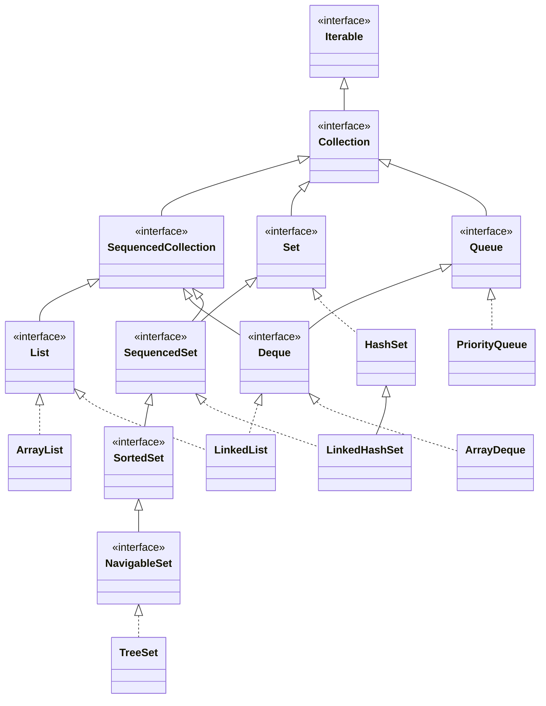
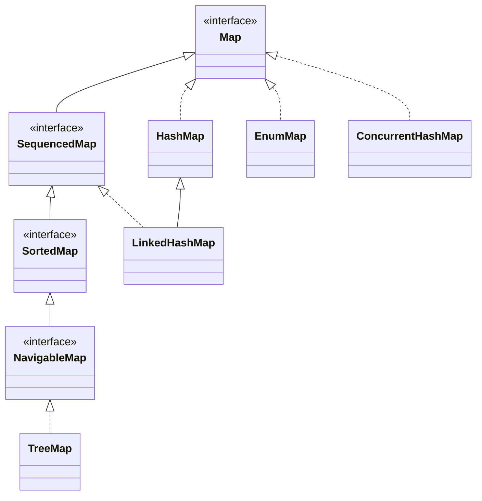
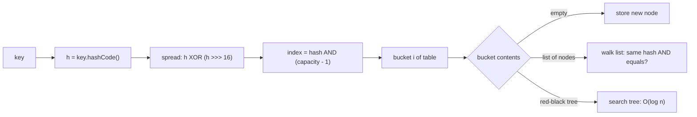
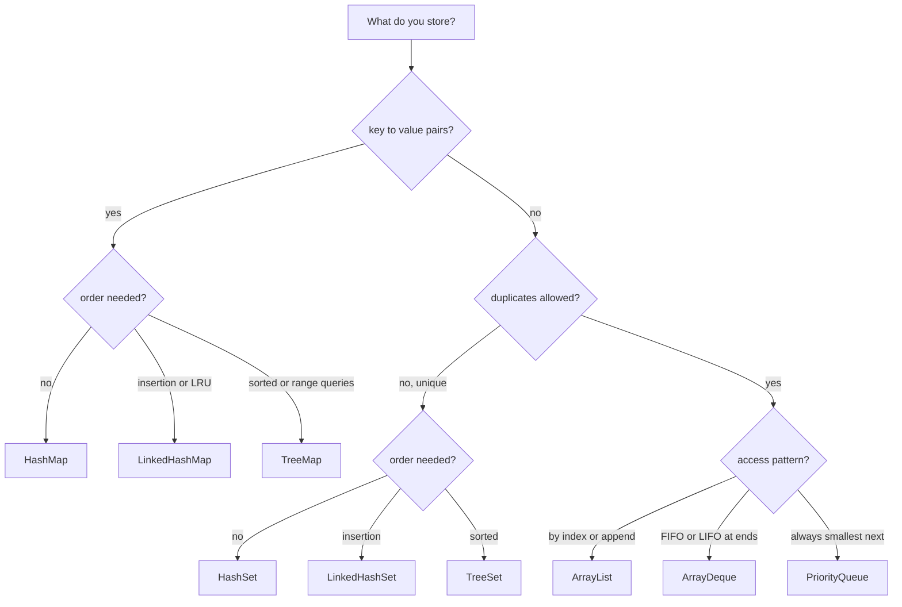

# Chapter 10 — Collections

Real programs hold *groups*: cart items, online users, word counts, pending jobs. Arrays ([§4.6](../04-methods-and-arrays/README.md#46-arrays)) are fixed-length with little behaviour. The **Java Collections Framework** (`java.util`) provides resizable lists, duplicate-free sets, key→value maps, queues (FIFO waiting lines), stacks (LIFO piles) and priority queues behind a small set of interfaces, so implementations can be swapped without rewriting code.

For each collection: what it is, **how it works inside** (so the big-O costs — how running time grows with size, §10.12 — make sense), which to pick, and the traps. Builds on generics ([Chapter 9](../09-generics/README.md)) and `equals`/`hashCode` ([§6.13](../06-oop-inheritance-interfaces-and-more/README.md#613-object-methods-equals-hashcode-and-tostring)); lambdas like `n -> n % 2 == 0` are "a small function" until [Chapter 11](../11-lambdas-and-functional-programming/README.md).

Code: [`code/`](code/) (package `ch10.*`), `javac --release 25`, run on JDK 26. Exam traps (`List.of` vs `Arrays.asList`, `remove(int)` vs `remove(Object)`, `TreeSet`/`TreeMap` ordering, `Comparator` chaining, wildcards): [OCP Chapter 9](../../../../ocp-java21-study/chapters/09-collections-generics/README.md).

---

## 10.1 The Collections Framework and its hierarchy

### What it is
A **collection** groups other objects (its **elements**). The framework is **interfaces** (contracts such as `List` — ordered, indexable, duplicates allowed — and `Set` — no duplicates), **implementations** (`ArrayList`, `HashSet`… each a particular data structure) and **algorithms** (static sorting/searching/shuffling in `Collections` and `Arrays`).

### How it is organised





| Interface | Promise | Main implementations |
|---|---|---|
| `Iterable<T>` | Usable in for-each | every collection |
| `Collection<E>` | `add`, `remove`, `contains`, `size`, `iterator`, `stream` | root of element-based types |
| `List<E>` | Ordered by index, duplicates allowed | `ArrayList`, `LinkedList` |
| `Set<E>` | No duplicates (by `equals`) | `HashSet`, `LinkedHashSet`, `TreeSet`, `EnumSet` |
| `Queue<E>` | Elements wait for processing, usually FIFO | `ArrayDeque`, `LinkedList`, `PriorityQueue` |
| `Deque<E>` | Double-ended queue; also a stack | `ArrayDeque`, `LinkedList` |
| `Map<K,V>` | Unique keys, one value each | `HashMap`, `LinkedHashMap`, `TreeMap`, `EnumMap` |
| `SequencedCollection` / `SequencedMap` (21) | Defined first and last element | `List`, `Deque`, `LinkedHashSet`, `TreeSet`, `LinkedHashMap`, `TreeMap` (§10.11) |

Terms:
- **Encounter order** — iteration follows a defined sequence (index, insertion or sorted order).
- **Sorted** — ordered by comparison (natural order or a `Comparator`, §10.8).
- **Structural modification** — a size change (add/remove), unlike replacing via `set`.
- **Optional operation** — a method an implementation may reject with `UnsupportedOperationException` (`add` on an unmodifiable list).

**`Map` is not a `Collection`** (`add(E)` makes no sense for pairs). It offers three live **views** that are collections: `keySet()`, `values()`, `entrySet()`.

### Program to the interface

```java
// code/ch10/hierarchy/HierarchyDemo.java (key parts)
Collection<String> langs = new ArrayList<>();          // declared type = interface
langs.add("Java"); langs.add("Go"); langs.add("Java"); // lists allow duplicates
langs.addAll(List.of("Rust", "Kotlin"));
langs.remove("Java");                                  // removes the FIRST match only
langs.removeIf(s -> s.length() <= 2);                  // bulk remove by condition (Java 8)

Collection<String> unique = new HashSet<>(List.of("Java", "Go", "Rust"));
System.out.println("add duplicate to set -> " + unique.add("Java"));   // add returns false

String[] arr = langs.toArray(String[]::new);           // typed array (Java 11 form)
Map<String, Integer> ages = new TreeMap<>(Map.of("ana", 31, "bo", 25));
System.out.println("keys=" + ages.keySet() + " values=" + ages.values() + " entries=" + ages.entrySet());
```

Output:
```
list-backed: [Java, Go, Java, Rust, Kotlin] size=5
contains Go? true
after removes: [Java, Rust, Kotlin]
add duplicate to set -> false
array: [Java, Rust, Kotlin] isEmpty=false
keys=[ana, bo] values=[31, 25] entries=[ana=31, bo=25]
Map is a Collection? false
```

Declaring `List`, `Set`, `Map` (not `ArrayList`…) lets code work with any implementation and change it in one place. Use the concrete type only for its extra methods (`TreeMap.floorKey`, `LinkedList.addFirst` before Java 21).

### Legacy classes
`Vector` (synchronized `ArrayList`), `Stack` (extends `Vector`), `Hashtable` (synchronized map, no nulls), `Enumeration` — Java 1.0. Every method takes a lock, and `Stack` inherits index methods a stack shouldn't have. Use `ArrayList`, `ArrayDeque`, `HashMap`, and `java.util.concurrent` classes when threads share data ([Chapter 14](../14-concurrency-1/README.md)).

### TL;DR
Interfaces (`List`, `Set`, `Queue`, `Deque`, `Map`) describe behaviour; classes pick the data structure. Program to the interface. Avoid `Vector`, `Stack`, `Hashtable`.

---

## 10.2 Lists: `ArrayList` and `LinkedList`

### What it is
A **`List`** is an ordered, indexable sequence (`get(i)`), allowing duplicates and (mostly) `null`.
- **`ArrayList`** — a resizable array: instant jump to index 500, but inserting at 0 shifts everything.
- **`LinkedList`** — a **doubly linked list**: each element in a *node* pointing to previous and next; reaching index 500 means following 500 links.

### How `ArrayList` works
1. Internal `Object[] elementData` plus `int size`.
2. `new ArrayList<>()` starts with a shared empty array; the first `add` allocates capacity **10**.
3. `add(e)` stores at `elementData[size++]`; when full it allocates ~**1.5×** (`old + old >> 1`) and copies. Geometric growth keeps total copying proportional to n, so append is **amortised O(1)**.
4. `get(i)`/`set(i, e)`: **O(1)**.
5. `add(i, e)`/`remove(i)` shift the tail with `System.arraycopy`: **O(n − i)** (so `add(0, x)` is O(n)).
6. `contains`/`indexOf` scan with `equals`: **O(n)**.
7. Never shrinks itself; `trimToSize()` releases spare capacity; `new ArrayList<>(expectedSize)`/`ensureCapacity(n)` avoid repeated growth.

### How `LinkedList` works
1. Each element is a `Node { item, prev, next }`; the list tracks `first`, `last`, `size`.
2. Add/remove at either end rewires two pointers: **O(1)**.
3. `get(i)` walks from the nearer end: **O(n)**.
4. Mid-list insert is O(1) *only once you're there* (via a `ListIterator`, §10.7); getting there is O(n).
5. Each node is a separate object (~24 bytes overhead on a typical 64-bit JVM with compressed pointers), scattered in memory, defeating the CPU cache (fast memory that favours data stored side by side).

`LinkedList` also implements `Deque`, but `ArrayDeque` does that faster (§10.6). **`ArrayList` is the right default** (measured in §10.12).

### Code

```java
// code/ch10/lists/ListDemo.java (key parts)
List<String> todo = new ArrayList<>(List.of("write", "test", "ship"));
todo.add(1, "review");                 // insert at index 1, shifts the rest right
todo.set(0, "design");                 // replace; returns the old value

List<Integer> nums = new ArrayList<>(List.of(10, 20, 30, 1));
nums.remove(1);                        // int argument -> remove(int index): removes 20
nums.remove(Integer.valueOf(1));       // object argument -> remove(Object): removes the value 1

List<String> firstTwo = todo.subList(0, 2);
firstTwo.clear();                      // subList is a VIEW: clears those elements from todo

String[] arr = {"a", "b", "c"};
List<String> view = Arrays.asList(arr); // fixed-size view backed by the array
view.set(0, "z");                       // writes through to arr
view.add("d");                          // UnsupportedOperationException

LinkedList<String> ll = new LinkedList<>(List.of("b", "c"));
ll.addFirst("a"); ll.addLast("d");

List<String> names = new ArrayList<>(List.of("mia", "Al", "zoe", "Bob", "ann"));
names.sort(null);                       // null comparator = natural order
names.sort(String.CASE_INSENSITIVE_ORDER);
```

Output:
```
[design, review, test, ship] get(2)=test indexOf(ship)=3
nums=[10, 30]
after subList.clear(): [test, ship]
array now [z, b, c]
asList.add -> UnsupportedOperationException
linked=[a, b, c, d] removeFirst=a peekLast=d
natural (uppercase first): [Al, Bob, ann, mia, zoe]
case-insensitive: [Al, ann, Bob, mia, zoe]
ArrayList equals LinkedList? true
```

- `remove(1)` on a `List<Integer>` picks **`remove(int index)`** — `1` is an `int`, no boxing needed ([§4.3](../04-methods-and-arrays/README.md#43-overloading)). Box explicitly to remove by value.
- Natural `String` order compares UTF-16 code units: all uppercase before lowercase.
- `List.equals`: same elements, same order, regardless of implementation.

### Trade-offs

| Operation | `ArrayList` | `LinkedList` |
|---|---|---|
| `get(i)` / `set(i, e)` | **O(1)** | O(n) |
| `add(e)` at end | amortised **O(1)** | O(1) |
| `add(0, e)` / `remove(0)` | O(n) (shift) | **O(1)** |
| insert/remove in middle | O(n) shift | O(n) to find + O(1) to link |
| `contains` / `indexOf` | O(n) | O(n) |
| Memory per element | one reference (+ spare capacity) | node object ≈ 24 B + reference |
| Cache friendliness | high (contiguous) | low (pointer chasing) |

Frequent membership checks → a `Set`; queue/stack work → `ArrayDeque`, not `ArrayList.remove(0)`; fixed-size numeric data in hot loops → `int[]` (no boxing).

### Common mistakes
- `remove(int)` vs `remove(Object)` on `List<Integer>`.
- Structurally modifying the parent while holding a `subList` → the sublist throws `ConcurrentModificationException` on next use.
- Expecting `Arrays.asList(...)` to grow — wrap: `new ArrayList<>(Arrays.asList(...))`. `Arrays.asList(intArray)` gives a one-element `List<int[]>`.
- `list.get(i)` in a loop over a `LinkedList` — O(n²); use for-each.

### In the interview
**30-second answer:** "ArrayList is a growable array: O(1) random access, amortised O(1) append, O(n) middle inserts/removes because it shifts. LinkedList is doubly linked: O(1) at the ends, O(n) to reach an index, more memory and poor cache locality. I default to ArrayList, and use ArrayDeque for queues and stacks."
- *How does ArrayList grow?* 10 on first add, then ~1.5× with an array copy; geometric growth makes append amortised O(1).
- *When does LinkedList win?* Many inserts/removes at positions you're already at via a `ListIterator` in a very long list — rare; measure.
- *`List.of` vs `Arrays.asList`?* `List.of` is fully unmodifiable and rejects nulls; `Arrays.asList` is a fixed-size writable view allowing nulls (§10.10).

### TL;DR
`ArrayList` = array + 1.5× growth: fast index and append, slow front/middle edits. `LinkedList` = linked nodes: fast ends, slow indexing, heavy. Default to `ArrayList`.

---

## 10.3 Sets: `HashSet`, `LinkedHashSet`, `TreeSet`

### What it is
A **`Set`** holds each element at most once — no two elements `equals`.

| Class | Built on | Order | `add`/`contains`/`remove` | Nulls |
|---|---|---|---|---|
| `HashSet` | a `HashMap` (elements = keys) | none guaranteed | **O(1)** average | one `null` |
| `LinkedHashSet` | a `LinkedHashMap` | insertion order | O(1) average | one `null` |
| `TreeSet` | a `TreeMap` (red-black tree) | sorted | **O(log n)** | no `null` with natural order |
| `EnumSet` | bit vector (one bit per constant) | declaration order | O(1), very fast | no `null` ([§6.9](../06-oop-inheritance-interfaces-and-more/README.md#69-enums)) |

### How it works
- **`HashSet`** stores each element as a key of an internal `HashMap` with a shared dummy value, so §10.5 applies: `hashCode()` picks a bucket, `equals()` confirms.
- **`LinkedHashSet`** threads a doubly linked list through entries to remember insertion order (re-adding doesn't move an element).
- **`TreeSet`** uses a **red-black tree** — a self-balancing binary search tree (left subtree smaller, right larger) of height O(log n). It never calls `equals`/`hashCode`: elements are "the same" when `compareTo`/`compare` returns 0.

### Code

```java
// code/ch10/sets/SetDemo.java (key parts)
List<String> visits = List.of("home", "cart", "home", "search", "cart", "about");
new HashSet<>(visits);  new LinkedHashSet<>(visits);  new TreeSet<>(visits);

Set<String> union = new TreeSet<>(a); union.addAll(b);      // A ∪ B
Set<String> inter = new TreeSet<>(a); inter.retainAll(b);   // A ∩ B
Set<String> diff  = new TreeSet<>(a); diff.removeAll(b);    // A − B

TreeSet<Integer> prices = new TreeSet<>(List.of(5, 12, 20, 35, 50));
prices.floor(19); prices.ceiling(19); prices.lower(20); prices.higher(20);
prices.headSet(20); prices.tailSet(20); prices.subSet(10, 40);

List<String> key = new ArrayList<>(List.of("x"));
Set<List<String>> set = new HashSet<>(); set.add(key);
key.add("y");                                               // mutates a key already in the set
```

Output:
```
HashSet       [search, about, cart, home]  (order not guaranteed)
LinkedHashSet [home, cart, search, about]  (insertion order)
TreeSet       [about, cart, home, search]  (sorted)
union=[docker, git, java, sql] intersection=[git] difference=[java, sql]
floor(19)=12 ceiling(19)=20 lower(20)=12 higher(20)=35
headSet(20)=[5, 12] tailSet(20)=[20, 35, 50] subSet(10,40)=[12, 20, 35]
first=5 pollLast=50 descending=[35, 20, 12, 5]
contains mutated key? false, size=1
HashSet null ok=true, TreeSet.add(null) -> NPE
```

**Navigation** (`NavigableSet`): `floor(x)` = greatest ≤ x, `ceiling(x)` = least ≥ x, `lower`/`higher` = strictly < / >. `headSet(x)` excludes x, `tailSet(x)` includes it, `subSet(from, to)` = `[from, to)`; these range views are live.

The mutated-key line is the key bug: after `key.add("y")` its `hashCode` changed, so `contains` searches another bucket and says `false` though the object is inside. **Never mutate an object while it is a set element or map key** — use immutable keys.

### Common mistakes
- `equals` without `hashCode` in a `HashSet` → duplicates ([§6.13](../06-oop-inheritance-interfaces-and-more/README.md#613-object-methods-equals-hashcode-and-tostring)).
- A `TreeSet` comparator returning 0 for different elements silently drops them (§10.8).
- Relying on `HashSet` print order — it can change between JDKs or after a resize.

Uses: unique visitors (`HashSet<UserId>`), de-dup keeping first-seen order (`LinkedHashSet`), "next event after t" (`TreeSet.ceiling`), feature flags (`EnumSet`).

### TL;DR
`HashSet` for fast membership, `LinkedHashSet` to keep insertion order, `TreeSet` for sorted order and nearest/range queries (O(log n)). Elements must not change while inside.

---

## 10.4 Maps: `HashMap`, `LinkedHashMap`, `TreeMap`

### What it is
A **`Map<K,V>`** associates each unique **key** with one **value**; putting under an existing key *replaces* the value.

### The everyday API

| Method | Does | Returns |
|---|---|---|
| `put(k, v)` | insert or replace | previous value or `null` |
| `get(k)` / `getOrDefault(k, d)` | look up | value, or `null` / `d` |
| `containsKey(k)` / `containsValue(v)` | test | `boolean` (`containsValue` is O(n)) |
| `remove(k)` | delete | removed value or `null` |
| `putIfAbsent(k, v)` | insert only if missing (or mapped to `null`) | existing value or `null` |
| `merge(k, v, fn)` | absent → put `v`, else put `fn(old, v)`; `null` result removes | new value |
| `compute(k, fn)` | `fn(k, oldOrNull)`; `null` result removes | new value |
| `computeIfAbsent(k, fn)` | if missing, compute and store `fn(k)` | current value |
| `computeIfPresent(k, fn)` | if present, recompute; `null` removes | new value |
| `forEach`, `replaceAll` | iterate / transform all values | — |
| `keySet()`, `values()`, `entrySet()` | live views | collections |

The Java 8 `merge`/`compute*` methods replace most "get, null-check, put" boilerplate.

### Code

```java
// code/ch10/maps/MapDemo.java (key parts)
Map<String, Integer> stock = new HashMap<>();
stock.put("apple", 5);
Integer old = stock.put("apple", 7);                    // replaces, returns 5
stock.putIfAbsent("pear", 3);
stock.merge("apple", 10, Integer::sum);                 // 7 + 10
stock.merge("plum", 1, Integer::sum);                   // absent -> puts 1
stock.compute("pear", (k, v) -> v == null ? 1 : v * 2);
stock.computeIfPresent("plum", (k, v) -> null);         // null result REMOVES plum

Map<String, Integer> counts = new TreeMap<>();          // word count idiom
for (String w : "to be or not to be".split(" ")) counts.merge(w, 1, Integer::sum);

Map<Character, List<String>> byInitial = new TreeMap<>(); // multimap idiom
for (String n : List.of("ana", "bo", "al", "cy", "ben"))
    byInitial.computeIfAbsent(n.charAt(0), c -> new ArrayList<>()).add(n);

for (Map.Entry<String, Integer> e : counts.entrySet())  // iterate entries, not keys + get
    if (e.getValue() > 1) System.out.print(e.getKey() + "x" + e.getValue() + " ");

TreeMap<Integer, String> bracket = new TreeMap<>(Map.of(0, "10%", 11_000, "12%", 44_725, "22%", 95_375, "24%"));
bracket.floorEntry(50_000).getValue();                  // bracket whose start <= 50,000

Map<String, String> lru = new LinkedHashMap<>(16, 0.75f, true) {   // true = access order
    @Override protected boolean removeEldestEntry(Map.Entry<String, String> eldest) { return size() > 3; }
};
lru.put("a", "A"); lru.put("b", "B"); lru.put("c", "C");
lru.get("a");       // a becomes most recently used
lru.put("d", "D");  // evicts b
```

Output:
```
old=5 get=7 missing=null default=0
stock={apple=17, pear=6}
counts={be=2, not=1, or=1, to=2}
byInitial={a=[ana, al], b=[bo, ben], c=[cy]}
bex2 tox2 
income 50000 -> 22%, first bracket above 50000 starts at 95375, headMap(44725)={0=10%, 11000=12%}
LRU keys=[c, a, d]
HashMap null key -> 0
```

(Brackets are illustrative progressive-tax numbers, not current law.) The `LinkedHashMap` with access order + `removeEldestEntry` is an **LRU cache** (evicts the Least Recently Used entry when full; [System Design Fundamentals](../../../system-design-patterns/modules/00-system-design-fundamentals/README.md)).

### The three main implementations

| | `HashMap` | `LinkedHashMap` | `TreeMap` |
|---|---|---|---|
| Structure | array of buckets (§10.5) | `HashMap` + doubly linked entry list | red-black tree |
| Iteration order | unspecified | insertion (or access) order | sorted by key |
| `get`/`put`/`remove` | **O(1)** average | O(1) average | **O(log n)** |
| `null` key | one | one | not with natural ordering |
| Extras | — | `removeEldestEntry` → LRU | `floorKey`, `ceilingEntry`, `headMap`, `tailMap`, `subMap`, `firstKey`, `descendingMap` |

Also: **`EnumMap`** (enum keys, array indexed by `ordinal()` — very fast), **`IdentityHashMap`** (keys compared with `==`, for object-graph algorithms like serialization), **`WeakHashMap`** (weakly held keys — an entry vanishes once nothing else references its key; metadata caches), **`ConcurrentHashMap`** (thread-safe, no null keys/values — [Chapter 14](../14-concurrency-1/README.md); simplified build in [LLD §13.7](../../../lld/chapters/13-concurrency-problems/README.md#137-design-a-simplified-concurrent-hashmap--lock-striping)).

### Common mistakes
- `if (map.get(k) != null)` to test presence — wrong with `null` values; use `containsKey`.
- `for (K k : map.keySet()) use(map.get(k))` — two lookups per entry; iterate `entrySet()` or `forEach`.
- `map.get(k) + 1` for an absent key → NPE from unboxing; use `merge`/`getOrDefault`.
- A `computeIfAbsent` function that modifies the same map (for `HashMap` throws `ConcurrentModificationException` since Java 9) — bites recursive memoisation ([§11.8](../11-lambdas-and-functional-programming/README.md#118-functional-style-in-everyday-java)).

Uses: HTTP headers and configuration (`Map<String,String>`), ID-keyed caches, counts (`merge`), grouping (`computeIfAbsent`), LRU thumbnail cache (`LinkedHashMap`), time-series and rate tables (`TreeMap.floorEntry`).

### TL;DR
Unique keys → values. `HashMap` default, `LinkedHashMap` for predictable order or LRU, `TreeMap` for sorted keys and ranges. `merge`, `computeIfAbsent`, `getOrDefault` instead of null-check boilerplate.

---

## 10.5 `HashMap` internals

### What it is
`HashMap` is a **hash table**: an array of **buckets** (*bins*); a key's **hash code** (`int` from `hashCode()`) decides its bucket, so lookups go straight there instead of searching. Keys landing in the same bucket are kept together and distinguished by `equals`.

Average **O(1)** `get`/`put` makes `HashMap`/`HashSet` the most-used collections and an interview favourite; the internals explain real bugs (slow maps from bad `hashCode`, lost keys from mutation, odd iteration order, wasted resizes).

### How it works (JDK 8 and later)



1. **Hash.** `put(key, value)` calls `key.hashCode()`; a `null` key gets hash 0 (bucket 0).
2. **Spread.** `HashMap.hash()` XORs the high 16 bits into the low 16: `h ^ (h >>> 16)`. Only low bits pick the bucket, so without this, hashes differing only in high bits would all collide.
3. **Index.** Table length `n` is always a **power of two** (default **16**), so `hash & (n − 1)` equals `hash mod n` in one cheap AND.
4. **Store.** A bucket holds a chain of `Node{hash, key, value, next}`. Empty → the node goes in. Otherwise walk the chain: a node matches when **hashes are equal and** (`==` or `equals`) — its value is replaced and `put` returns the old one; no match → append at the tail.
5. **Load factor and resize.** The **load factor** (default **0.75**) is the fullness that triggers growth; **threshold** = capacity × load factor (16 × 0.75 = **12**). When `size` exceeds it, the table **doubles** and nodes are redistributed. Because capacity is a power of two, each node stays at `i` or moves to `i + oldCapacity` (bucket 5 of 16 → 5 or 21), decided by one hash bit (`hash & oldCapacity`) — a cheap, order-preserving split.
6. **Treeification (Java 8).** If adding to a bucket that already holds **8** nodes (`TREEIFY_THRESHOLD`), the chain becomes a **red-black tree** of `TreeNode`s — worst case O(n) → **O(log n)**. But if the table has fewer than **64** buckets (`MIN_TREEIFY_CAPACITY`) it **resizes instead**. A tree bucket split down to **≤ 6** nodes (`UNTREEIFY_THRESHOLD`) reverts to a list. With a decent hash and 0.75 load, a bucket of 8 is astronomically unlikely (the JDK source estimates about 6 in 100 million) — trees defend against bad or malicious hash codes.
7. **Inside a tree bucket**, nodes order by hash, then by `compareTo` **if keys are `Comparable` and of the same class**; otherwise lookups may search both subtrees (the slow case below).
8. **Get** repeats steps 1–3 and searches one bucket.

Constants from `java/util/HashMap.java` (JDK 26):

| Constant | Value | Meaning |
|---|---|---|
| `DEFAULT_INITIAL_CAPACITY` | 16 | buckets allocated on first `put` (table created lazily) |
| `DEFAULT_LOAD_FACTOR` | 0.75 | resize when size > capacity × 0.75 |
| `TREEIFY_THRESHOLD` | 8 | chain length that triggers list → tree |
| `UNTREEIFY_THRESHOLD` | 6 | tree → list when a resize split leaves this few |
| `MIN_TREEIFY_CAPACITY` | 64 | below this table size, resize instead of treeifying |
| `MAXIMUM_CAPACITY` | 2^30 | table never grows beyond this |

**Why 0.75?** Time/space trade-off: lower = fewer collisions but more empty buckets; higher = tighter packing but longer chains. 0.75 keeps chains very short while wasting at most about a quarter of the table.

### Watching it happen: a teaching-size hash map
`TinyHashMap` implements steps 1–5 in ~60 lines (no trees, no null keys), starting with 4 buckets to show two resizes.

```java
// code/ch10/maps/TinyHashMap.java (key parts)
static int spread(Object key) { int h = key.hashCode(); return h ^ (h >>> 16); }

void put(K key, V value) {
    int h = spread(key), i = h & (table.length - 1);          // bucket index
    for (Node<K, V> n = table[i]; n != null; n = n.next())
        if (n.hash() == h && n.key().equals(key)) { table[i] = replace(table[i], key, value); return; }
    table[i] = new Node<>(h, key, value, table[i]);           // new node in bucket i
    if (++size > table.length * loadFactor) resize();         // threshold = capacity * 0.75
}

private void resize() {                                       // double and re-bucket every node
    Node<K, V>[] old = table;
    table = (Node<K, V>[]) new Node[old.length * 2];
    for (Node<K, V> head : old)
        for (Node<K, V> n = head; n != null; n = n.next()) {
            int i = n.hash() & (table.length - 1);            // stays at i or moves to i + oldCapacity
            table[i] = new Node<>(n.hash(), n.key(), n.value(), table[i]);
        }
}
```

Output:
```
put apple   hashCode=   93029210 spread=   93030097 index(n=4)=1
put banana  hashCode=-1396355227 spread=-1396317280 index(n=4)=0
put cherry  hashCode=-1361513063 spread=-1361552575 index(n=4)=1
put date    hashCode=    3076014 spread=    3075968 index(n=4)=0
  resize: size=4 exceeded threshold 3 -> capacity 4 -> 8
put elder   hashCode=   96592394 spread=   96593867 index(n=8)=3
put fig     hashCode=     101380 spread=     101381 index(n=8)=5
put grape   hashCode=   98615627 spread=   98616491 index(n=8)=3
  resize: size=7 exceeded threshold 6 -> capacity 8 -> 16
final table (capacity 16):
  bucket  0: date -> banana -> null
  bucket  1: cherry -> apple -> null
  bucket  5: fig -> null
  bucket 11: elder -> grape -> null
get(fig)=99 get(kiwi)=null size=7
```

With 4 buckets `apple` and `cherry` collide in bucket 1; after the 4th key, 4 > 4 × 0.75 = 3, so the table doubles. At 16 buckets, `elder` and `grape` still share bucket 11 (spread hashes agree in the low 4 bits). `put("fig", 99)` replaced a value, so size stays 7. (`String.hashCode` is the documented formula `s[0]·31^(n−1) + … + s[n−1]`, identical on every JVM.)

### What bad hash codes cost (measured)
`HashCollisionDemo` puts 20,000 keys whose `hashCode()` is the constant 42 (one bucket) and times 60,000 lookups. **Timings are machine-dependent** (Apple M4 Pro, JDK 26); compare ratios.

```java
// code/ch10/maps/HashCollisionDemo.java (key parts)
record CmpKey(int id) implements Comparable<CmpKey> {           // constant hash, but Comparable
    @Override public int hashCode() { return 42; }
    @Override public int compareTo(CmpKey o) { return Integer.compare(id, o.id); }
}
record PlainKey(int id) { @Override public int hashCode() { return 42; } }  // constant hash, not Comparable
record GoodKey(int id) {}                                        // record's generated hashCode
```

Output:
```
good hashCode (GoodKey)            n=20,000  3n lookups:      0.7 ms
constant hash, Comparable (tree)   n=20,000  3n lookups:      6.5 ms
constant hash, not Comparable      n=20,000  3n lookups:   1648.2 ms
```

- **Good hash:** spread across buckets → O(1).
- **Constant hash + `Comparable`:** one treeified bucket ordered by `compareTo` → O(log n); ~10× slower, still fast.
- **Constant hash, not `Comparable`:** the tree can't order equal-hash keys → lookups near O(n), **thousands of times slower**. Hash-flooding denial-of-service attacks (many colliding keys sent to grind a server down) exploit this; it's why Java 8 added treeification, and why `String` keys (`Comparable`) are well protected.

### Sizing a map correctly
`new HashMap<>(100)` is an initial *capacity*, rounded to 128; threshold 96, so the 97th `put` still resizes. To size for an expected number of **entries**, use the Java 19 factories:

```java
Map<String, User> users = HashMap.newHashMap(100);       // Java 19: capacity for 100 mappings without resizing
Set<String> seen        = HashSet.newHashSet(100);        // also LinkedHashMap.newLinkedHashMap, LinkedHashSet.newLinkedHashSet
```

### Thread safety
`HashMap` is **not** thread-safe: concurrent `put`s can lose entries or corrupt a bucket (in Java 7 and earlier a concurrent resize could even create a chain cycle so `get` spun forever). Use `ConcurrentHashMap` ([Chapter 14](../14-concurrency-1/README.md)); `Collections.synchronizedMap` works but locks the whole map per call.

### Trade-offs

| | `HashMap` | `TreeMap` |
|---|---|---|
| Needs | good `hashCode` + consistent `equals` | `Comparable` keys or a `Comparator` |
| Average `get`/`put` | O(1) | O(log n) |
| Worst case | O(log n) per bucket if keys `Comparable`, else O(n) | O(log n) guaranteed |
| Order | none | sorted |
| Memory | table + a node per entry | a tree node per entry (more pointers) |

### Common mistakes
- `equals` without `hashCode` (or different fields) → equal keys in different buckets.
- Constant or low-variety `hashCode` (e.g. a boolean field) → every lookup scans.
- Relying on iteration order — it follows buckets and can change after resizes or across JDKs; use `LinkedHashMap`/`TreeMap`.

### In the interview
**30-second answer:** "HashMap is an array of buckets. It takes the key's hashCode, spreads high bits into low bits, and ANDs with capacity minus one to pick a bucket. Collisions chain in a list; since Java 8 a bucket past 8 entries becomes a red-black tree if the table has at least 64 buckets, so the worst case is O(log n), not O(n). When size passes capacity × 0.75 the table doubles and each entry moves to index i or i + oldCapacity. Lookups compare hash, then equals — so equals and hashCode must agree and keys shouldn't be mutable."
- *Why a power-of-two capacity?* `hash & (n−1)` replaces modulo, and resizing splits each bucket into two predictable positions.
- *Null key?* Yes, one, hash 0; `Hashtable` and `ConcurrentHashMap` reject nulls.
- *Same hashCode, not equal?* Same bucket; `equals` tells them apart. Correct, slower.

### TL;DR
hashCode → spread → `& (n−1)` → bucket; match by hash then `equals`. Load 0.75 → double; buckets over 8 become trees (table ≥ 64). Good, stable hash codes = O(1). Pre-size with `HashMap.newHashMap(n)`. Not thread-safe.

---

## 10.6 Queues, deques and priority queues

### What it is
- A **queue** holds elements awaiting processing, normally **FIFO**.
- A **deque** ("deck", double-ended queue) adds/removes at both ends — a FIFO queue *or* a **LIFO stack**.
- A **priority queue** always hands out the *smallest* element next (natural order or comparator).

### Two method families
| Operation | Throws exception | Returns special value |
|---|---|---|
| Insert at tail | `add(e)` | `offer(e)` → `false` if full (bounded queues) |
| Remove head | `remove()` | `poll()` → `null` if empty |
| Examine head | `element()` | `peek()` → `null` if empty |

Prefer the special-value versions for ordinary flow. `Deque` adds `First`/`Last` variants (`offerFirst`, `pollLast`, `peekFirst`…) and stack methods `push` (= `addFirst`), `pop` (= `removeFirst`), `peek`.

### How the implementations work
- **`ArrayDeque`** — a resizable **circular array** with wrapping `head`/`tail` indexes: amortised **O(1)** at both ends, no node allocations. Rejects `null` (it's how `poll` signals "empty"). Per its Javadoc, likely faster than `Stack` as a stack and `LinkedList` as a queue — **use it for both**.
- **`PriorityQueue`** — a **binary min-heap** in an array: a complete binary tree (levels full except the last, filled left to right) where each parent ≤ its children; element *i*'s children are at *2i+1* and *2i+2*. `offer` appends and sifts up; `poll` moves the last element to the root and sifts down — both **O(log n)**; `peek` O(1); `contains`/`remove(Object)` O(n); building from a collection (heapify) O(n). Only the root is guaranteed smallest, so `toString()` and iteration show heap order, not sorted order. ("Heap" here is unrelated to the JVM memory heap.)

### Code

```java
// code/ch10/queues/QueueDemo.java (key parts)
Queue<String> printer = new ArrayDeque<>();
printer.offer("doc1"); printer.offer("doc2"); printer.offer("doc3");

Deque<Character> stack = new ArrayDeque<>();                 // balanced-brackets check
for (char c : "{[()]}(".toCharArray()) {
    if ("([{".indexOf(c) >= 0) stack.push(c);
    else if (!stack.isEmpty() && "([{".indexOf(stack.peek()) == ")]}".indexOf(c)) stack.pop();
    else { stack.push('!'); break; }
}

PriorityQueue<Integer> heap = new PriorityQueue<>(List.of(7, 3, 9, 1, 5));
while (!heap.isEmpty()) out.append(heap.poll()).append(' ');

PriorityQueue<Task> jobs = new PriorityQueue<>(
        Comparator.comparingInt(Task::priority).reversed().thenComparing(Task::name));

int k = 3; PriorityQueue<Integer> topK = new PriorityQueue<>();  // top-k largest with a min-heap
for (int x : new int[]{15, 2, 99, 42, 8, 77, 23}) { topK.offer(x); if (topK.size() > k) topK.poll(); }
```

Output:
```
peek=doc1 poll=doc1 left=[doc2, doc3]
empty.poll()=null empty.peek()=null
empty.remove() -> NoSuchElementException
{[()]}( balanced? false (left on stack: [(])
ArrayDeque.push(null) -> NPE
heap toString (NOT sorted): [1, 3, 9, 7, 5]
poll order: 1 3 5 7 9 
backup deploy lint email 
top-3 = [99, 77, 42]
```

The top-k trick keeps only *k* elements in a min-heap: O(log k) per element, evicting the smallest of the current top k — O(n log k) overall vs O(n log n) sorting; an interview staple ([Chapter 19](../19-java-for-coding-interviews/README.md)).

### When not to use them
- Producer–consumer threads (some add work, others take it) → a `BlockingQueue` (`ArrayBlockingQueue`, `LinkedBlockingQueue`) that waits instead of returning `null` ([Chapter 14](../14-concurrency-1/README.md)).
- Sorted output once → just sort a list; heaps shine when elements keep arriving.
- Changing a queued element's priority isn't supported — remove and re-add (O(n)), or insert anew and skip stale entries when polled.

### Common mistakes
- `Stack`/`LinkedList` where `ArrayDeque` fits.
- Printing a `PriorityQueue` expecting sorted output — drain with `poll()`.
- Mixing `add`/`remove` (throwing) with `offer`/`poll` expectations.
- `push` then `pollLast` — `push` adds at the **front**.

### TL;DR
`ArrayDeque` for FIFO queues and LIFO stacks; `PriorityQueue` (binary heap) when the next item is "the smallest": O(log n) add/poll, O(1) peek, unsorted iteration.

---

## 10.7 Iterators and fail-fast behaviour

### What it is
An **`Iterator<E>`** is a cursor with `hasNext()`, `next()` and optional `remove()`; for-each is shorthand for one. **`ListIterator`** adds `hasPrevious`/`previous`, index queries, `set` and `add`.

### How fail-fast works
Most `java.util` collections keep a **modification counter** (`modCount`) bumped on every structural change. An iterator records it at creation and re-checks on each `next()`; if anything *other than the iterator itself* changed the collection, `next()` throws **`ConcurrentModificationException`** (CME) — in single-threaded code too. It's best-effort bug detection, not a thread-safety guarantee.

**Fail-safe** iterators (`java.util.concurrent`) walk a snapshot or a weakly consistent view (may or may not show concurrent changes, never fails) and never throw CME. `CopyOnWriteArrayList` copies its array on every write — suited to read-mostly lists like event listeners.

### Code

```java
// code/ch10/iteration/IteratorDemo.java (key parts)
for (Integer n : nums) if (n % 2 == 0) nums.remove(n);          // WRONG: CME

for (Iterator<Integer> it = nums.iterator(); it.hasNext(); )    // RIGHT: iterator's own remove
    if (it.next() % 2 == 0) it.remove();

nums.removeIf(n -> n % 2 == 0);                                 // SIMPLEST (Java 8)

for (ListIterator<String> li = words.listIterator(); li.hasNext(); ) {
    String w = li.next();
    li.set(w.toUpperCase());
    if (w.equals("b")) li.add("b2");                            // inserted after the cursor
}
scores.entrySet().removeIf(e -> e.getValue() < 50);             // remove map entries by condition

List<String> listeners = new CopyOnWriteArrayList<>(List.of("L1", "L2"));
for (String l : listeners) listeners.add(l + "'");              // iterates the old snapshot
```

Output:
```
for-each + list.remove -> ConcurrentModificationException, list now [1, 3, 4, 5, 6]
iterator.remove -> [1, 3, 5]
removeIf        -> [1, 3, 5]
listIterator set/add -> [A, B, b2, C]
backwards -> Cb2BA
passed -> {bo=90, cy=55}
CopyOnWriteArrayList -> [L1, L2, L1', L2']
```

The first line shows `2` was already removed before the exception — fail-fast stops you *after* the first bad change, so never rely on catching CME.

### Common mistakes
- Removing inside for-each; calling `it.remove()` twice per `next()` or before the first `next()` → `IllegalStateException`.
- Thinking CME means a threading problem — usually a loop modifying its own collection.
- Removing by index in a forward `for (int i…)` loop skips the element that shifted into `i`; loop backwards or `removeIf`.

### TL;DR
Don't structurally modify a collection during for-each. Use `removeIf`, `Iterator.remove`, or apply changes afterwards. Fail-fast = bug detector, not a lock.

---

## 10.8 Ordering: `Comparable` and `Comparator`

### What it is
- **`Comparable<T>`** — the class defines its **natural order** via `int compareTo(T other)` (`String`, `Integer`, `LocalDate`, enums in declaration order).
- **`Comparator<T>`** — a separate object, `int compare(T a, T b)`, defining *any* order without changing the class (an external strategy).

Both return **negative** if the first comes first, **zero** for a tie, **positive** otherwise; only the sign matters.

### The contract
Must be **antisymmetric** (`a.compareTo(b)` and `b.compareTo(a)` have opposite signs), **transitive**, and ideally **consistent with equals** (`compareTo == 0` exactly when `equals`). `TreeSet`/`TreeMap` use comparison *instead of* `equals`, so inconsistency drops or merges elements. (`BigDecimal` is the famous JDK exception: `2.0` and `2.00` compare equal but aren't `equals`.)

### Building comparators (Java 8+)

| Factory / method | Meaning |
|---|---|
| `Comparator.comparing(Employee::name)` | by a `Comparable` key |
| `comparingInt/Long/Double(keyFn)` | by a primitive key (no boxing) |
| `comparing(keyFn, keyComparator)` | by a key using a given comparator |
| `.thenComparing(...)` | tie-breaker |
| `.reversed()` | flip the whole comparator so far |
| `Comparator.naturalOrder()` / `reverseOrder()` | natural / reverse natural |
| `nullsFirst(c)` / `nullsLast(c)` | tolerate nulls |
| `String.CASE_INSENSITIVE_ORDER` | ready-made |

### Code

```java
// code/ch10/sorting/SortingDemo.java (key parts)
record Employee(int id, String name, String dept, double salary) implements Comparable<Employee> {
    @Override public int compareTo(Employee o) { return Integer.compare(id, o.id); }   // natural order: id
}
Collections.sort(staff);                                              // uses compareTo
staff.sort(Comparator.comparing(Employee::name).reversed());
staff.sort(Comparator.comparing(Employee::dept)
        .thenComparing(Employee::salary, Comparator.reverseOrder())   // reverse just this key
        .thenComparing(Employee::name));
staff.sort(Comparator.comparingDouble(Employee::salary));
cities.sort(Comparator.nullsLast(String.CASE_INSENSITIVE_ORDER));

Comparator<Integer> bad = (a, b) -> a - b;                            // overflow bug
Set<String> byLength = new TreeSet<>(Comparator.comparingInt(String::length));
byLength.addAll(List.of("kiwi", "pear", "fig", "plum", "banana"));
```

Output:
```
by id:      [Ana, Bo, Cy, Dee]
name desc:  [Dee, Cy, Bo, Ana]
dept,salary desc,name: [Bo, Cy, Dee, Ana]
salary asc: [Ana, Cy, Dee, Bo]
nullsLast, case-insensitive: [Accra, lima, Oslo, null]
bad.compare(MIN_VALUE, 1) = 2147483647 (positive, so MIN_VALUE looks BIGGER), Integer.compare = -1
TreeSet by length keeps only [fig, kiwi, banana]  (pear and plum were dropped!)
stable (dept, then previous name order): [Bo, Cy, Dee, Ana]
```

- `reversed()` flips **everything chained before it**; to reverse one key, pass `Comparator.reverseOrder()` as that key's comparator (as for salary).
- `a - b` overflows (`MIN_VALUE − 1` wraps to `MAX_VALUE`); use `Integer.compare`, `Long.compare`, `Double.compare` (also handles `NaN`) or `comparingInt`.
- The length-ordered `TreeSet` treats `"kiwi"`, `"pear"`, `"plum"` (all length 4) as duplicates. Add a tie-breaker: `comparingInt(String::length).thenComparing(Comparator.naturalOrder())`.
- **Stability**: `List.sort`/`Collections.sort` (TimSort, merge-sort-based, O(n log n)) keep equal elements' relative order — so sorting by name, then dept, leaves each dept sorted by name.

### Common mistakes
- Subtraction comparators; `<`/`>` on doubles ignoring `NaN`.
- `Comparable` inconsistent with `equals` used as `TreeMap` keys.
- Non-`Comparable` objects in a `TreeSet` without a comparator → `ClassCastException` on the first add.

### In the interview
**30-second answer:** "Comparable is the class's single natural order via compareTo; Comparator is an external strategy for any number of orders. I build comparators with comparing, thenComparing and reversed, use primitive variants to avoid boxing, and never subtract. Sorted collections treat compare == 0 as equality, so the order should be consistent with equals."
- *Is `Collections.sort` stable?* Yes (TimSort for objects).
- *Descending by one key, ascending by another?* `comparing(a).thenComparing(b, reverseOrder())`.

### TL;DR
`Comparable` = one built-in order; `Comparator` = any order, composed with `comparing`/`thenComparing`/`reversed`/`nullsLast`. Consistent with `equals` for sorted collections. Object sorts are stable.

---

## 10.9 The `Collections` utility class

`java.util.Collections` (plural) holds static algorithms and wrappers — the collection counterpart of `Arrays` ([§4.8](../04-methods-and-arrays/README.md#48-the-javautilarrays-toolbox)).

```java
// code/ch10/utilities/CollectionsUtilDemo.java (key parts)
Collections.max(xs); Collections.min(xs); Collections.frequency(xs, 3);
Collections.sort(xs); Collections.binarySearch(xs, 8);    // binarySearch needs a sorted list
Collections.reverse(xs); Collections.swap(xs, 0, xs.size() - 1);
Collections.rotate(xs, 2); Collections.shuffle(xs, new Random(42));   // seeded -> repeatable
Collections.nCopies(3, "ab"); Collections.disjoint(List.of(1, 2), List.of(3));
Collections.addAll(letters, "d", "b");

List<String> view = Collections.unmodifiableList(source);  // read-only VIEW
List<String> copy = List.copyOf(source);                   // immutable COPY
source.add("y");

List<Integer> sync = Collections.synchronizedList(new ArrayList<>(List.of(1, 2)));
synchronized (sync) { for (int v : sync) System.out.print("sync " + v + " "); }   // lock while iterating
```

Output:
```
max=9 min=1 frequency(3)=2
sorted=[1, 3, 3, 5, 8, 9] binarySearch(8)=4 binarySearch(4)=-4 (negative: -(insertionPoint)-1)
reverse=[9, 8, 5, 3, 3, 1]
swap ends=[1, 8, 5, 3, 3, 9]
rotate 2=[3, 9, 1, 8, 5, 3]
shuffle(seed 42)=[9, 3, 5, 3, 8, 1]
nCopies=[ab, ab, ab] disjoint=true
addAll varargs=[c, a, d, b]
view sees change: [x, y]  copy does not: [x]
view.add -> UnsupportedOperationException
emptyList=[] singleton=[only]
sync 1 sync 2 
```

| Group | Methods |
|---|---|
| Algorithms | `sort`, `binarySearch`, `reverse`, `shuffle`, `swap`, `rotate`, `fill`, `copy`, `min`, `max`, `frequency`, `disjoint`, `addAll`, `nCopies` |
| Read-only wrappers (views) | `unmodifiableList/Set/Map/Collection`, `unmodifiableSequencedCollection/Set/Map` (21), sorted/navigable variants |
| Synchronized wrappers | `synchronizedList/Set/Map/...` — each call locks; lock manually around iteration |
| Constants and singletons | `emptyList/Set/Map`, `singletonList/singleton/singletonMap` (immutable) |
| Type-checked wrappers | `checkedList(list, String.class)` — catches heap pollution from raw types at insertion ([Chapter 9](../09-generics/README.md)) |
| Other | `reverseOrder()`, `newSetFromMap(map)`, `list(enumeration)`, `enumeration(coll)` |

`binarySearch` (sorted lists only — unsorted gives undefined results) returns the index, or `-(insertionPoint) - 1` — always negative, so "not found" can't be index 0. Here 4 would go at index 3 → −4. `unmodifiableList(l)` is a view reflecting later changes; `List.copyOf(l)` an independent snapshot.

---

## 10.10 Unmodifiable and immutable collections

### What it is
- **Unmodifiable** — the object rejects changes (`add`, `set`, `remove` throw `UnsupportedOperationException`).
- **Immutable** — unmodifiable *and* nothing else can change it (no backing collection).
- A **view** wraps another collection; it can be unmodifiable yet still change when the underlying one does.

Returning immutable collections (or storing them in records) stops callers corrupting your state, makes sharing across threads safe, and states intent — *Effective Java* Item 17 ("minimise mutability") and Item 50 ("make defensive copies when needed").

### The factory methods

| Factory | Since | Nulls | Duplicates | Order |
|---|---|---|---|---|
| `List.of(...)` | 9 | NPE | allowed | as given |
| `Set.of(...)` | 9 | NPE | **IllegalArgumentException** | unspecified (randomised per JVM run) |
| `Map.of(k1, v1, … up to 10 pairs)` / `Map.ofEntries(Map.entry(k, v), …)` | 9 | NPE | duplicate key → IAE | unspecified |
| `List.copyOf` / `Set.copyOf` / `Map.copyOf` | 10 | NPE | `Set.copyOf` drops duplicates | — |
| `Stream.toList()` | 16 | allowed | allowed | encounter order |
| `Collectors.toUnmodifiableList/Set/Map` | 10 | NPE | — | — |
| `Arrays.asList(...)` | 1.2 | allowed | allowed | fixed-size, **`set` works**, write-through to the array |
| `Collections.unmodifiableX(c)` | 1.2 | as `c` | as `c` | read-only **view** of `c` |

### Code

```java
// code/ch10/immutable/ImmutableDemo.java (key parts)
List<String> days = List.of("Mon", "Tue", "Wed");
attempt("List.of(...).add", () -> days.add("Thu"));
attempt("List.of with null", () -> List.of("a", null));
attempt("List.of(...).contains(null)", () -> days.contains(null));
attempt("Set.of duplicate", () -> Set.of("a", "a"));
attempt("Map.of duplicate key", () -> Map.of("k", 1, "k", 2));
List<String> snap = List.copyOf(src); src.add("b");
List<Integer> t = Stream.of(3, 1, 2).toList();
List<StringBuilder> sbs = List.of(new StringBuilder("hi")); sbs.get(0).append("!");
```

Output:
```
List.of(...).add -> UnsupportedOperationException
List.of(...).set -> UnsupportedOperationException
List.of with null -> NullPointerException
List.of(...).contains(null) -> NullPointerException
Set.of duplicate -> IllegalArgumentException
Map.of duplicate key -> IllegalArgumentException
Map.ofEntries get = 404
Arrays.asList set -> ok
Arrays.asList add -> UnsupportedOperationException
copyOf snapshot=[a] src=[a, b] copyOf(List.of) same object? true
Stream.toList().add -> UnsupportedOperationException
element mutated inside an 'immutable' list: [hi!]
Set.of size=3 (print order may differ between runs)
```

- **Shallowly** immutable: the list can't change, but mutable elements (a `StringBuilder`) can. Store immutable elements for true immutability.
- `List.of(...).contains(null)` throws NPE — surprising with nullable arguments.
- `copyOf` returns the same object when given an unmodifiable `List.of`-style list.
- `Collectors.toList()` promises nothing about mutability (currently an `ArrayList`); ask for unmodifiable with `Stream.toList()` ([Chapter 12](../12-streams/README.md)).
- `List.of` is safe to read from many threads (immutable), though its elements may not be.

**Defensive copy in a record** (records are shallowly immutable, [§6.8](../06-oop-inheritance-interfaces-and-more/README.md#68-records)):

```java
record Team(String name, List<String> members) {
    Team { members = List.copyOf(members); }   // callers can't change our list later, and we reject nulls
}
```

### TL;DR
`List.of`/`Set.of`/`Map.of` for constants, `List.copyOf` for defensive copies — null-rejecting and shallowly immutable. `unmodifiableList` is only a view. `Arrays.asList` is fixed-size but writable.

---

## 10.11 Sequenced collections (Java 21)

### The problem it solves
Before Java 21 "first/last element" and "reverse iteration" were spelled differently per type — `list.get(0)`/`list.get(list.size() - 1)`, `deque.getFirst()`, `sortedSet.first()`/`last()`, and no direct way to get a `LinkedHashSet`'s last element — and no common type meant "ordered collection".

### What it is
**JEP 431** (final in Java 21) added three interfaces for "well-defined encounter order":

| Interface | New methods | Retrofitted onto |
|---|---|---|
| `SequencedCollection<E>` | `addFirst`, `addLast`, `getFirst`, `getLast`, `removeFirst`, `removeLast`, `reversed()` | `List`, `Deque` |
| `SequencedSet<E>` | `reversed()` returns a `SequencedSet` | `LinkedHashSet`, `SortedSet` (so `TreeSet`) |
| `SequencedMap<K,V>` | `firstEntry`, `lastEntry`, `pollFirstEntry`, `pollLastEntry`, `putFirst`, `putLast`, `reversed()`, `sequencedKeySet()`, `sequencedValues()`, `sequencedEntrySet()` | `LinkedHashMap`, `SortedMap` (so `TreeMap`) |

Plus `Collections.unmodifiableSequencedCollection/Set/Map`. `HashSet`/`HashMap` are **not** sequenced.

### How it behaves
1. `reversed()` is a **live reverse view**, O(1) to create — later changes show through.
2. `getFirst`/`removeFirst` etc. on an empty collection throw `NoSuchElementException`; the `SequencedMap` entry methods (`firstEntry`…) return `null` on an empty map.
3. Sorted collections (`TreeSet`, `TreeMap`) throw `UnsupportedOperationException` from `addFirst`/`addLast`/`putFirst`/`putLast` — the comparator decides position.
4. In `LinkedHashSet`/`LinkedHashMap`, `addFirst`/`putFirst` on an existing element **moves** it to the front.
5. Unmodifiable collections reject the mutators as usual.

### Code

```java
// code/ch10/sequenced/SequencedDemo.java (key parts)
List<String> list = new ArrayList<>(List.of("b", "c"));
list.addFirst("a"); list.addLast("d");
list.getFirst(); list.getLast(); list.reversed();

LinkedHashSet<String> tags = new LinkedHashSet<>(List.of("java", "sql", "git"));
tags.addFirst("git");                  // already present -> moved to the front

TreeSet<Integer> sorted = new TreeSet<>(List.of(30, 10, 20));
sorted.addFirst(5);                    // UnsupportedOperationException

List<String> rev = list.reversed(); list.add("e");   // the view sees the change

LinkedHashMap<String, Integer> steps = new LinkedHashMap<>();
steps.put("build", 1); steps.put("test", 2); steps.put("deploy", 3);
steps.putFirst("checkout", 0);
steps.firstEntry(); steps.lastEntry(); steps.reversed().keySet(); steps.pollFirstEntry();

static <E> E lastOf(SequencedCollection<E> c) { return c.getLast(); }   // one method for any ordered collection
```

Output:
```
List        first=a last=d reversed=[d, c, b, a]
LinkedHashSet [git, java, sql] removeLast=sql -> [git, java]
Deque       reversed=[3, 2, 1] getLast=3
TreeSet     first=10 last=30 reversed=[30, 20, 10]
TreeSet.addFirst -> UnsupportedOperationException (order comes from the comparator)
view after list.add(e): [e, d, c, b, a]
SequencedMap first=checkout=0 last=deploy=3 reversed keys=[deploy, test, build, checkout]
pollFirstEntry=checkout=0 -> [build, test, deploy]
lastOf(list)=e lastOf(dq)=3 lastOf(tags)=java
empty getFirst -> NoSuchElementException
HashSet is sequenced? false
```

### Common mistakes
- Assuming `reversed()` copies.
- `addFirst` on a `TreeSet` or `List.of(...)`.
- Source compatibility: a custom `List`/`Deque` implementation already declaring `reversed()` or `getFirst()` with a different return type stops compiling on Java 21 (a known JEP 431 risk).

### TL;DR
Java 21 gives ordered collections one API — `getFirst/getLast/addFirst/addLast/removeFirst/removeLast/reversed` (maps: `firstEntry/lastEntry/pollFirstEntry/putFirst/...`). `reversed()` is a view; sorted collections refuse positional adds.

---

## 10.12 Big-O cheat sheet and a measured demo

**Big-O** describes how cost grows with *n*: O(1) constant, O(log n) very slow growth (tree height), O(n) proportional (scan). "Amortised" = averaged over many calls; "average" for hash structures assumes a reasonable `hashCode`.

| Collection | add (end) | add/remove front | get(i) | contains / get(key) | remove(element/key) | Iteration order | Nulls |
|---|---|---|---|---|---|---|---|
| `ArrayList` | O(1)* | O(n) | O(1) | O(n) | O(n) | index | yes |
| `LinkedList` | O(1) | O(1) | O(n) | O(n) | O(n) | index | yes |
| `ArrayDeque` | O(1)* | O(1)* | — | O(n) | O(n) | head→tail | **no** |
| `PriorityQueue` | O(log n) | poll O(log n) | — | O(n) | O(n) | heap (unsorted) | no |
| `HashSet` / `HashMap` | O(1)† | — | — | O(1)† | O(1)† | none | one null key |
| `LinkedHashSet` / `LinkedHashMap` | O(1)† | — | — | O(1)† | O(1)† | insertion/access | one null key |
| `TreeSet` / `TreeMap` | O(log n) | — | — | O(log n) | O(log n) | sorted | no (natural order) |
| `EnumSet` / `EnumMap` | O(1) | — | — | O(1) | O(1) | enum order | no |
| `CopyOnWriteArrayList` | O(n) | O(n) | O(1) | O(n) | O(n) | index | yes |

\* amortised. † average; worst case O(log n) for a treeified bucket (O(n) for non-`Comparable` colliding keys).

### Measured demo
`CollectionBenchmark` times operations once after a warm-up run (so the JIT has optimised). A *demonstration*, not a rigorous benchmark — use JMH for real measurements ([Chapter 16](../16-jvm-internals-and-performance/README.md)). **Timings are machine-dependent** (Apple M4 Pro, JDK 26); compare ratios within a row.

```java
// code/ch10/perf/CollectionBenchmark.java (key parts)
Runnable getA = () -> { for (int i = 0; i < 20_000; i++) sink += array.get((i * 7919) % n); };
Runnable getL = () -> { for (int i = 0; i < 20_000; i++) sink += linked.get((i * 7919) % n); };
Runnable frontA = () -> { List<Integer> l = new ArrayList<>(); for (int i = 0; i < 50_000; i++) l.add(0, i); };
Runnable frontD = () -> { Deque<Integer> d = new ArrayDeque<>(); for (int i = 0; i < 50_000; i++) d.addFirst(i); };
Runnable cL = () -> { for (int i = 0; i < 2_000; i++) sink += array.contains(n - 1 - i) ? 1 : 0; };
Runnable cH = () -> { for (int i = 0; i < 2_000; i++) sink += hash.contains(n - 1 - i) ? 1 : 0; };
// ... TreeSet contains, full iteration, presized vs default ArrayList
```

Output:
```
20k get(i) n=100k        ArrayList     0.6 ms | LinkedList   870.1 ms
50k add-at-front          ArrayList    83.6 ms | ArrayDeque     1.0 ms
2k contains n=100k         ArrayList    65.7 ms | HashSet 0.1 ms | TreeSet 0.3 ms
20 full iterations        ArrayList     4.2 ms | LinkedList     4.1 ms
2M adds                    default    42.7 ms | presized     7.7 ms
```

1. **Indexing** — `LinkedList.get(i)` walks up to 50,000 nodes per call: >1000× slower.
2. **Front inserts** — `ArrayList.add(0, x)` shifts everything (O(n²) total); `ArrayDeque.addFirst` is O(1).
3. **Membership** — list scan vs hashing vs a ~17-level tree walk.
4. **Iteration** — both O(n); freshly allocated nodes sit close together here, so the gap is small. In long-running apps with fragmented heaps, linked structures usually iterate noticeably slower.
5. **Pre-sizing** — skipping ~30 grow-and-copy steps (and their garbage) is several times faster.

---

## 10.13 Choosing a collection



- Enum keys/elements → `EnumMap` / `EnumSet`.
- Fixed compile-time data → `List.of` / `Set.of` / `Map.of`.
- Shared between threads → `ConcurrentHashMap`, `CopyOnWriteArrayList` (read-mostly), `BlockingQueue` ([Chapter 14](../14-concurrency-1/README.md)).
- Millions of primitives in a hot path → primitive arrays or a primitive-collections library (Eclipse Collections, fastutil).
- In doubt: `ArrayList` and `HashMap`, then measure.

Python readers: same ideas as `list`, `set`, `dict`, `deque`, `heapq` in [Python Chapter 6](../../../python/chapters/06-dicts-sets-collections/README.md).

### In the interview — collections quick round
- *HashSet vs TreeSet?* O(1) unordered vs O(log n) sorted with range queries; `TreeSet` needs `Comparable`/`Comparator` and uses compare-to-zero for equality.
- *Why `ArrayDeque` over `Stack`?* `Stack` extends synchronized `Vector` (locking, exposed index methods); `ArrayDeque` is a lean circular array.
- *LRU cache?* `LinkedHashMap` with `accessOrder = true` and `removeEldestEntry` (or `HashMap` + hand-written doubly linked list — [LLD case studies](../../../lld/chapters/14-case-everyday-objects/README.md)).
- *Is `List.of` thread-safe?* For reading, yes — it's immutable; its elements may not be.

---

## Chapter TL;DR

| Topic | Remember |
|---|---|
| Hierarchy | `Iterable` → `Collection` → `List`/`Set`/`Queue`/`Deque`; `Map` separate with `keySet`/`values`/`entrySet` views; program to interfaces |
| `ArrayList` | growable array (10, then ×1.5): O(1) get/append, O(n) middle edits; the default list |
| `LinkedList` | doubly linked nodes: O(1) ends, O(n) get; rarely the best choice |
| Sets | `HashSet` O(1), `LinkedHashSet` insertion order, `TreeSet` sorted O(log n) + `floor`/`ceiling`; never mutate elements |
| Map API | `getOrDefault`, `putIfAbsent`, `merge`, `compute*`; iterate `entrySet`; `TreeMap` for ranges; `LinkedHashMap` for LRU |
| `HashMap` internals | hash spread → `& (n−1)`; chain then tree (>8 in bucket, table ≥ 64); load factor 0.75 → double; equal hash then `equals`; `newHashMap(n)` (19); not thread-safe |
| Queues | `ArrayDeque` for queue and stack; `PriorityQueue` = binary heap (O(log n), unsorted iteration); `offer/poll/peek` return special values |
| Iteration | fail-fast CME; remove with `removeIf` or `Iterator.remove` |
| Ordering | `Comparable` natural vs `Comparator` composed; never subtract; consistent with equals for `TreeSet`/`TreeMap`; sorts are stable |
| Immutability | `List/Set/Map.of` (9), `copyOf` (10): no nulls, shallow; `Stream.toList` (16) unmodifiable but allows nulls; `unmodifiableX` = view; `Arrays.asList` fixed-size |
| Sequenced (21) | `getFirst/getLast/addFirst/addLast/removeFirst/removeLast/reversed` on lists, deques, `LinkedHashSet`, sorted sets; maps get `firstEntry/pollFirstEntry/putFirst/...` |

**Next:** lambdas and method references in [Chapter 11](../11-lambdas-and-functional-programming/README.md), then [Chapter 12 — Streams](../12-streams/README.md). Exam traps: [OCP Chapter 9](../../../../ocp-java21-study/chapters/09-collections-generics/README.md). Thread-safe collections: [Chapter 14](../14-concurrency-1/README.md).
