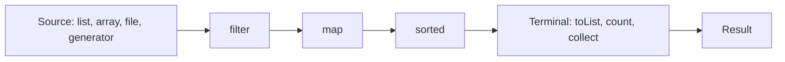
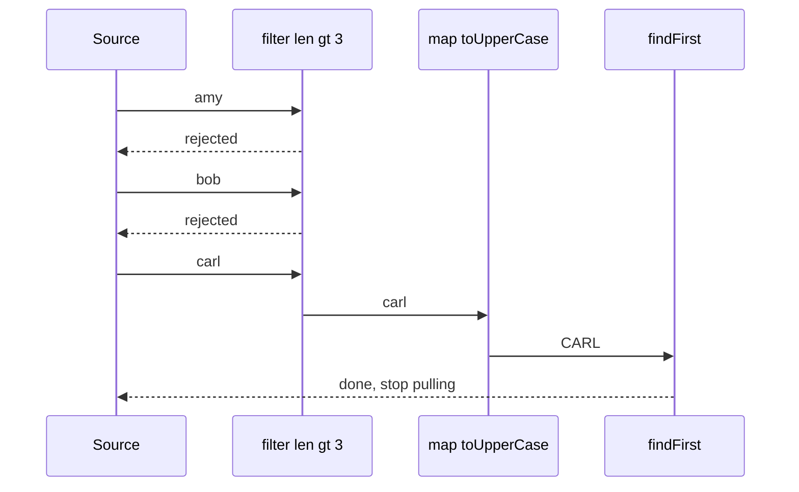

# Chapter 12 — Streams

The **Streams API** (`java.util.stream`, Java 8) lets you describe *what* you want to compute from a sequence of values — "the names of customers who spent over 450, upper-cased and sorted" — as a pipeline of small operations, instead of writing *how* to loop, test, accumulate and sort by hand. It is built on the lambdas, method references and functional interfaces from [Chapter 11](../11-lambdas-and-functional-programming/README.md) and usually starts from a collection ([Chapter 10](../10-collections/README.md)).

This chapter explains how a stream pipeline actually executes (lazily, one element at a time), every everyday operation, the collectors that turn streams into maps and reports, primitive streams, parallel streams and when *not* to use them, the new **stream gatherers** (final in Java 24), and the mistakes that make stream code wrong or slow.

**What you'll learn**

1. What a stream is and isn't; building a pipeline; ways to create streams.
2. Lazy evaluation, vertical processing, short-circuiting, stateless vs stateful operations.
3. Intermediate operations: `filter`, `map`, `flatMap`, `mapMulti`, `distinct`, `sorted`, `limit`, `skip`, `takeWhile`, `dropWhile`, `peek`.
4. Terminal operations and the three forms of `reduce`.
5. Collectors: `toList`, `toMap`, `joining`, `groupingBy`, `partitioningBy`, downstream collectors, `teeing`, custom collectors.
6. Primitive streams: `IntStream`, `LongStream`, `DoubleStream`.
7. Parallel streams — how they work, measured wins and losses, and correctness rules.
8. Gatherers (Java 24): built-in windows, `scan`, `fold`, `mapConcurrent`, and writing your own.
9. Common mistakes, streams vs loops, and a realistic reporting pipeline.

All runnable code is in [`code/`](code/) (package `ch12.*`), compiled with `javac --release 25` and run on JDK 26.

> **Exam depth.** Output-prediction puzzles (laziness, `peek`, infinite streams that hang), the exact return types of every terminal operation, `Optional` vs primitive optionals, `Spliterator`, and collector signatures are drilled in [OCP Chapter 10 — Streams](../../../../ocp-java21-study/chapters/10-streams/README.md) (see *Gotchas & exam traps*).

---

## 12.1 What a stream is

### What it is
A **stream** is a sequence of elements that supports a chain of operations computed on demand. Think of a factory conveyor belt: items come off a **source** (a collection, an array, a file, a generator), pass through stations that inspect, reshape or discard them (**intermediate operations**), and end at a station that produces a final product (**terminal operation**). Nothing moves until that final station is switched on.



A stream is **not** a collection:

| | Collection | Stream |
|---|---|---|
| Purpose | stores elements | computes over elements |
| Elements | all exist in memory | produced on demand; may be infinite |
| Traversal | as often as you like | **once** (then it's consumed) |
| Iteration | external (you write the loop) | internal (the library runs the loop) |
| Changes source? | `add`/`remove` modify it | never modifies its source |

### Why it matters
- **Readability**: each step names its intent (`filter`, `map`, `groupingBy`), and multi-step data processing reads top to bottom.
- **Fewer bugs**: no index variables, no forgetting to reset an accumulator.
- **Optimisation room**: because the library runs the loop, it can fuse steps, stop early, and (optionally) split work across cores.

### Code: loop vs pipeline

```java
// code/ch12/basics/PipelineDemo.java (key parts)
record Order(String customer, String product, int qty, double price) { double total() { return qty * price; } }

List<String> loop = new ArrayList<>();                            // imperative: HOW
for (Order o : ORDERS) if (o.total() >= 450) loop.add(o.customer().toUpperCase());
Collections.sort(loop);

List<String> stream = ORDERS.stream()                             // declarative: WHAT
        .filter(o -> o.total() >= 450)
        .map(o -> o.customer().toUpperCase())
        .sorted()
        .toList();                                                // Java 16
```

Output (first two lines):
```
loop:   [ANA, ANA, BO, CY]
stream: [ANA, ANA, BO, CY]
```

### Creating streams

| Source | Code | Notes |
|---|---|---|
| Any collection | `list.stream()`, `set.parallelStream()` | the usual start |
| Values | `Stream.of("a", "b")` | varargs |
| Array | `Arrays.stream(arr)`, `Arrays.stream(arr, from, to)` | `int[]` → `IntStream` |
| Number ranges | `IntStream.range(0, n)` (exclusive), `rangeClosed(1, n)` | |
| Infinite, by rule | `Stream.iterate(seed, f)`; `Stream.iterate(seed, hasNext, next)` (9) | use `limit` or the 3-arg form |
| Infinite, by supplier | `Stream.generate(supplier)` | unordered, needs `limit` |
| Maybe one value | `Stream.ofNullable(x)` (9), `optional.stream()` (9) | 0 or 1 elements |
| Joining two | `Stream.concat(a, b)` | |
| Characters / lines | `str.chars()`, `str.lines()` (11) | |
| Files | `Files.lines(path)`, `bufferedReader.lines()` | lazy; close it — [Chapter 13](../13-io-and-nio/README.md) |
| Map | `map.entrySet().stream()` | maps aren't streams themselves |
| Random numbers | `new Random(seed).ints(n, lo, hi)` | |
| Builder | `Stream.<T>builder().add(x).build()` | |

```java
Stream.iterate(1, x -> x * 2).limit(8).toList();
Stream.iterate(1, x -> x < 100, x -> x * 3).toList();          // like a for loop
Stream.generate(() -> "ab").limit(3).collect(Collectors.joining("-"));
Stream<String> s = Stream.of("once"); s.forEach(x -> {}); s.count();   // IllegalStateException
```

Output (remaining lines):
```
Stream.of        [a, b, c]
Arrays.stream    [3, 1, 2]
IntStream.range  [0, 1, 2, 3, 4] rangeClosed [1, 2, 3]
iterate(seed,f)  [1, 2, 4, 8, 16, 32, 64, 128]
iterate(s,has,f) [1, 3, 9, 27, 81]
generate         ab-ab-ab
String.chars     [h, e, y]
Map.entrySet     [x1, y2]
ofNullable(null) 0
concat           [1, 2, 3]
lines()          3 lines
builder          [built, stream]
reuse -> stream has already been operated upon or closed
source [3, 1, 2] unchanged, result [1, 2, 3]
```

### Self-check
1. What are the three parts of a pipeline? → Source, zero or more intermediate operations, one terminal operation.
2. Can you run two terminal operations on the same stream? → No — `IllegalStateException`; create a new stream from the source.
3. Does `list.stream().sorted()` sort `list`? → No; streams never modify their source.

### TL;DR
Stream = a one-shot, lazy pipeline over a source: source → intermediate ops → terminal op → result. It describes a computation; it doesn't store data.

---

## 12.2 Laziness: how a pipeline really executes

### What it is
**Intermediate operations are lazy**: calling `filter` or `map` only *records* a step and returns a new stream. The work happens when a **terminal operation** pulls elements through. And it happens **element by element through all stages** ("vertical" processing), not stage by stage over the whole list ("horizontal").

### How it works
1. Each intermediate call adds a *stage* to a linked pipeline description.
2. The terminal operation asks the source for elements — via a **`Spliterator`** (a "splittable iterator" that can also split its range in two for parallel work).
3. Each element travels through every stage in order; stages are fused into one pass, so there are no intermediate lists.
4. **Short-circuiting** operations (`findFirst`, `findAny`, `anyMatch`, `allMatch`, `noneMatch`, `limit`, `takeWhile`) stop pulling as soon as the answer is known — which is what makes infinite streams usable.
5. **Stateless** operations (`filter`, `map`, `flatMap`, `peek`) handle each element independently. **Stateful** ones need to remember other elements: `distinct` (a set of seen items), `sorted` (**buffers everything** before emitting anything — a *barrier*), `limit`/`skip` (counters).



### Code

```java
// code/ch12/laziness/LazinessDemo.java (key parts)
Stream<String> pipeline = names.stream().filter(n -> { System.out.println("filter " + n); return true; });
System.out.println("pipeline built, nothing printed yet");   // no terminal op -> nothing ran

Optional<String> first = names.stream()
        .filter(n -> { System.out.println("filter " + n); return n.length() > 3; })
        .map(n -> { System.out.println("map    " + n); return n.toUpperCase(); })
        .findFirst();

List<Integer> squares = Stream.iterate(1, i -> i + 1)           // infinite
        .peek(i -> System.out.print("gen " + i + " | "))
        .map(i -> i * i).filter(sq -> sq % 2 == 1).limit(3).toList();

Stream.of("c", "a", "b").peek(x -> System.out.println("before sort " + x))
      .sorted().forEach(x -> System.out.println("after sort  " + x));
```

Output:
```
pipeline built, nothing printed yet
--- vertical processing + short-circuit (findFirst)
filter amy
filter bob
filter carl
map    carl
result CARL  (dave and eve were never touched)
--- limit on an infinite stream
gen 1 | gen 2 | gen 3 | gen 4 | gen 5 | 
odd squares [1, 9, 25]
--- sorted() is a barrier
before sort c
before sort a
before sort b
after sort  a
after sort  b
after sort  c
map-then-filter: 1000 map calls; filter-then-map: 5 map calls (same count 5=5)
```

What to notice:
- The first pipeline never printed anything — it was never run.
- `map` ran **once**, not five times: `findFirst` stopped the pipeline at `carl`.
- The infinite `iterate` generated exactly 5 numbers, because `limit(3)` stopped pulling after the third odd square.
- `sorted()` consumed all three elements before passing any on.
- **Order of operations affects cost**: filtering first meant 5 `map` calls instead of 1,000. Put cheap, selective `filter`s early and expensive or stateful steps (`sorted`, `distinct`) late.

### Common mistakes
- Expecting a side effect in `map`/`peek` to happen without a terminal operation.
- Putting `sorted()` or `distinct()` *before* `limit` on an infinite stream → it never finishes (the barrier waits forever).
- Relying on `peek` for real work — the library may skip it entirely (§12.10).

### Self-check
1. `Stream.of(1, 2, 3).map(x -> { System.out.println(x); return x; });` prints what? → Nothing — no terminal operation.
2. Which operations short-circuit? → `findFirst`, `findAny`, `anyMatch`, `allMatch`, `noneMatch`, `limit`, `takeWhile`.
3. Why is `sorted` called a barrier? → It must receive every element before it can emit the first one.

### TL;DR
Nothing runs until a terminal operation. Elements flow one at a time through all fused stages; short-circuiting ops stop early; stateful ops (`sorted`, `distinct`) buffer. Filter early, sort late.

---

## 12.3 Intermediate operations

| Operation | Does | Stateful? | Notes |
|---|---|---|---|
| `filter(Predicate)` | keep matching elements | no | |
| `map(Function)` | transform each element (1 → 1) | no | may change type |
| `mapToInt/Long/Double`, `mapToObj`, `boxed` | switch between object and primitive streams | no | §12.6 |
| `flatMap(Function<T, Stream<R>>)` | each element → 0..n elements, flattened | no | |
| `mapMulti(BiConsumer<T, Consumer<R>>)` (16) | push 0..n results imperatively | no | avoids creating tiny streams |
| `distinct()` | drop duplicates (`equals`/`hashCode`) | **yes** | keeps first occurrence |
| `sorted()` / `sorted(Comparator)` | sort | **yes (barrier)** | stable for ordered streams |
| `limit(n)` / `skip(n)` | first n / all but first n | yes (counter) | `limit` short-circuits |
| `takeWhile(p)` / `dropWhile(p)` (9) | take / drop the **prefix** while `p` holds | yes | stop at the first failure |
| `peek(Consumer)` | look at elements passing by | no | debugging only |
| `parallel()`, `sequential()`, `unordered()`, `onClose(Runnable)` | change execution mode / characteristics | — | §12.8 |

### Code

```java
// code/ch12/ops/IntermediateOps.java (key parts)
List<Integer> nums = List.of(5, 3, 8, 3, 1, 9, 8, 2);
nums.stream().distinct().toList();
nums.stream().sorted(Comparator.reverseOrder()).toList();
nums.stream().skip(2).limit(3).toList();
nums.stream().takeWhile(n -> n < 8).toList();
nums.stream().dropWhile(n -> n < 8).toList();

books.stream().map(Book::tags).toList();                                    // List<List<String>>
books.stream().flatMap(b -> b.tags().stream()).distinct().sorted().toList(); // List<String>
Stream.of("to be", "or not").flatMap(line -> Arrays.stream(line.split(" "))).toList();

books.stream().<String>mapMulti((b, sink) -> {
    for (String t : b.tags()) if (t.startsWith("d")) sink.accept(b.title() + ":" + t);
}).toList();
```

Output:
```
filter even      [8, 8, 2]
map x10          [50, 30, 80, 30, 10, 90, 80, 20]
distinct         [5, 3, 8, 1, 9, 2]
sorted           [1, 2, 3, 3, 5, 8, 8, 9]
sorted desc      [9, 8, 8, 5, 3, 3, 2, 1]
skip 2 limit 3   [8, 3, 1]
takeWhile <8     [5, 3]   (Java 9: stops at first failure)
dropWhile <8     [8, 3, 1, 9, 8, 2]
filter <8        [5, 3, 3, 1, 2]   (compare: looks at every element)
map (nested)     [[java, best-practices], [java, streams, fp], [databases, distributed]]
flatMap          [best-practices, databases, distributed, fp, java, streams]
flatMap words    [to, be, or, not]
mapMulti         [DDIA:databases, DDIA:distributed]
mapToInt sum     6053
peek saw 3 titles, kept [Effective Java, DDIA]
sorted by length [a, bb, ccc]
boxed / asLong   [1, 2]
unordered/parallel/sequential/onClose also exist (see 12.8)
```

### `map` vs `flatMap` — the one to really understand
- `map` is **one in, one out**. If your function returns a list (or stream, or `Optional`), you get a stream *of lists*: `Stream<List<String>>`.
- `flatMap` is **one in, many out**: the function returns a *stream* for each element, and `flatMap` splices all of those streams into one: `Stream<String>`. Analogy: `map` puts each book's tag list into a box; `flatMap` empties all the boxes onto one belt.
- Uses: all words from all lines, all order lines from all orders, all present values from `Optional`s (`flatMap(Optional::stream)`).
- **`mapMulti`** (Java 16) does the same job imperatively — you call `sink.accept(x)` for each output. It's handy when each element yields very few results (avoids allocating a stream per element) or when the logic is easier as a loop. Note the explicit type witness `<String>mapMulti(...)`; inference often needs it.

### `takeWhile`/`dropWhile` vs `filter`
`takeWhile(n -> n < 8)` stopped at the first 8 and returned `[5, 3]`, even though `3, 1, 2` later are also < 8. It is meant for **sorted or naturally ordered** data ("log lines until the first error", "prices while under budget"). `filter` examines every element.

### Self-check
1. What type does `Stream.of("a b", "c").map(s -> s.split(" "))` produce? → `Stream<String[]>`; use `flatMap(s -> Arrays.stream(s.split(" ")))` for `Stream<String>`.
2. `Stream.of(1, 5, 2, 7).dropWhile(x -> x < 3).toList()`? → `[5, 2, 7]`.
3. Which intermediate ops are stateful? → `distinct`, `sorted`, `limit`, `skip`, `takeWhile`, `dropWhile`.

### TL;DR
`filter` keeps, `map` transforms 1→1, `flatMap`/`mapMulti` 1→many, `distinct`/`sorted` need state, `limit`/`skip`/`takeWhile`/`dropWhile` cut the sequence, `peek` is for debugging.

---

## 12.4 Terminal operations and `reduce`

| Operation | Returns | Short-circuits? | Notes |
|---|---|---|---|
| `forEach(c)` / `forEachOrdered(c)` | `void` | no | `forEachOrdered` keeps encounter order in parallel |
| `toList()` (16) | unmodifiable `List<T>` | no | allows `null` elements |
| `collect(collector)` | anything | no | §12.5 |
| `toArray()` / `toArray(String[]::new)` | `Object[]` / `T[]` | no | |
| `count()` | `long` | no | may skip the pipeline if size is known |
| `min(c)` / `max(c)` | `Optional<T>` | no | |
| `findFirst()` / `findAny()` | `Optional<T>` | **yes** | `findAny` is cheaper in parallel |
| `anyMatch` / `allMatch` / `noneMatch` | `boolean` | **yes** | on an empty stream: `false` / `true` / `true` |
| `reduce(...)` | `T` or `Optional<T>` or `U` | no | three forms below |
| `iterator()` / `spliterator()` | pull elements manually | — | escape hatch |

### `reduce` — folding a stream into one value
**Reduction** repeatedly combines elements until one value remains — summing, multiplying, finding the longest.

| Form | Signature | Use |
|---|---|---|
| Identity + accumulator | `T reduce(T identity, BinaryOperator<T> acc)` | `reduce(0, Integer::sum)` |
| Accumulator only | `Optional<T> reduce(BinaryOperator<T> acc)` | empty stream → `Optional.empty()` |
| Identity + accumulator + combiner | `U reduce(U identity, BiFunction<U,T,U> acc, BinaryOperator<U> combiner)` | result type differs from element type, e.g. total length of strings; the combiner merges partial results in parallel |

Rules that keep `reduce` correct (they matter the moment you go parallel):
1. The **identity** must be neutral: `combine(identity, x) == x` (0 for +, 1 for ×, `""` for concatenation).
2. The function must be **associative**: `(a ⊕ b) ⊕ c == a ⊕ (b ⊕ c)`. Subtraction and averaging are not.
3. It must be **stateless** and side-effect free.

For summing numbers, prefer `mapToInt(...).sum()`; for building collections use `collect`, not `reduce` (reducing into a new list at every step is O(n²)).

### Code

```java
// code/ch12/ops/TerminalOps.java (key parts)
words.stream().max(Comparator.comparingInt(String::length)).orElseThrow();
words.stream().filter(w -> w.startsWith("z")).findAny();              // Optional.empty
Stream.<String>empty().allMatch(w -> false);                           // true (vacuous truth)
Stream.of(1, 2, 3, 4).reduce(0, Integer::sum);
Stream.of(1, 2, 3, 4).reduce((a, b) -> a * b);                         // Optional
words.stream().reduce(0, (acc, w) -> acc + w.length(), Integer::sum);  // String -> int
words.stream().collect(Collectors.toCollection(ArrayList::new));       // when you need a mutable list
words.parallelStream().forEachOrdered(w -> System.out.print(w + " "));
```

Output:
```
count            3
min / max        java / stream
findFirst        Optional[record]
findAny          Optional.empty
anyMatch         true
allMatch         true
noneMatch        true
allMatch on EMPTY true (vacuous truth)
reduce           sum=10 product=24 totalLength=25 emptyReduce=Optional.empty
reduce longest   stream
toList [STREAM, LAMBDA, JAVA, RECORD, VAR] | toCollection+add 6 | toArray 5
forEachOrdered (parallel): stream lambda java record var 
iterator first two: java, lambda
```

`max` by length returned `stream`, the first of three 6-letter words. The Javadoc doesn't promise which of several tied elements you get, so add a tie-breaker (`thenComparing`) when it matters.

### `toList()` vs `collect(Collectors.toList())`

| | `stream.toList()` (16) | `collect(Collectors.toList())` | `collect(Collectors.toUnmodifiableList())` (10) |
|---|---|---|---|
| Mutability | unmodifiable | unspecified (currently `ArrayList`) | unmodifiable |
| Nulls | allowed | allowed | **NPE** |

Use `toList()` by default; `toCollection(ArrayList::new)` when you genuinely need to modify the result.

### Self-check
1. What does `reduce` without an identity return? → `Optional<T>`.
2. `IntStream.empty().anyMatch(x -> true)`? → `false`.
3. Why is `reduce(5, Integer::sum)` wrong for a sum? → 5 isn't an identity for addition; in parallel it's added once per chunk (§12.8).

### TL;DR
Terminal ops run the pipeline: `toList`, `collect`, `count`, `min`/`max`, `find*`, `*Match`, `reduce`, `forEach`. `reduce` needs a true identity and an associative, stateless function. `toList()` is unmodifiable.

---

## 12.5 Collectors

### What it is
A **`Collector`** is a recipe for **mutable reduction**: accumulate stream elements into a container (list, map, string builder, statistics) and optionally finish it. `Collectors` (with an *s*) provides ready-made ones; you pass them to `collect`. Add `import static java.util.stream.Collectors.*;` to keep pipelines readable.

### The toolbox

| Collector | Result | Notes |
|---|---|---|
| `toList()`, `toSet()`, `toUnmodifiableList/Set()` (10) | `List`, `Set` | |
| `toCollection(TreeSet::new)` | any collection | choose the implementation |
| `toMap(keyFn, valueFn)` | `Map` | **duplicate key → `IllegalStateException`**; `null` value → NPE |
| `toMap(keyFn, valueFn, mergeFn)` | `Map` | merge function resolves duplicates |
| `toMap(keyFn, valueFn, mergeFn, TreeMap::new)` | chosen map type | |
| `joining()`, `joining(", ")`, `joining(", ", "[", "]")` | `String` | elements must be `CharSequence` |
| `groupingBy(classifier)` | `Map<K, List<T>>` | the SQL `GROUP BY` of streams |
| `groupingBy(classifier, downstream)` / `(classifier, mapFactory, downstream)` | `Map<K, D>` | downstream collector per group |
| `partitioningBy(predicate[, downstream])` | `Map<Boolean, …>` | always both keys `false` and `true` |
| `counting()`, `summingInt/Long/Double`, `averagingX`, `minBy`, `maxBy` | numbers / `Optional` | usually as downstream |
| `summarizingInt/Long/Double` | `IntSummaryStatistics` etc. | count, sum, min, max, average in one pass |
| `mapping(fn, downstream)`, `filtering(p, downstream)` (9), `flatMapping(fn, downstream)` (9) | adapt elements inside a group | |
| `collectingAndThen(downstream, finisher)` | transformed result | e.g. unwrap an `Optional`, freeze a list |
| `teeing(c1, c2, merger)` (12) | anything | two collectors in one pass, then combine |
| `reducing(identity, op)` | `T` | reduction as a downstream collector |
| `groupingByConcurrent`, `toConcurrentMap` | `ConcurrentMap` | for parallel streams, unordered |

### Code

```java
// code/ch12/collectors/CollectorsDemo.java (key parts)
record Employee(String name, String dept, String city, double salary, List<String> skills) {}

STAFF.stream().map(Employee::name).collect(joining(", ", "[", "]"));
STAFF.stream().collect(toMap(Employee::dept, Employee::name));                   // throws: duplicate ENG
STAFF.stream().collect(toMap(Employee::dept, Employee::name, (a, b) -> a + "+" + b, TreeMap::new));

STAFF.stream().collect(groupingBy(Employee::dept, TreeMap::new, mapping(Employee::name, toList())));
STAFF.stream().collect(groupingBy(Employee::dept, TreeMap::new, counting()));
STAFF.stream().collect(groupingBy(Employee::dept, TreeMap::new,
        collectingAndThen(maxBy(Comparator.comparingDouble(Employee::salary)), o -> o.orElseThrow().name())));
STAFF.stream().collect(groupingBy(Employee::city, TreeMap::new, groupingBy(Employee::dept, TreeMap::new, counting())));
STAFF.stream().collect(groupingBy(Employee::dept, TreeMap::new,
        filtering(e -> e.salary() > 100_000, mapping(Employee::name, toList()))));
STAFF.stream().collect(groupingBy(Employee::dept, TreeMap::new,
        flatMapping(e -> e.skills().stream(), toCollection(TreeSet::new))));

STAFF.stream().collect(partitioningBy(e -> e.salary() >= 110_000, mapping(Employee::name, toList())));
STAFF.stream().collect(summarizingDouble(Employee::salary));
STAFF.stream().collect(teeing(minBy(bySalary), maxBy(bySalary),
        (min, max) -> min.orElseThrow().name() + ".." + max.orElseThrow().name()));

Collector<String, StringJoiner, String> pipes = Collector.of(
        () -> new StringJoiner("|"),   // supplier: new container
        StringJoiner::add,             // accumulator: add one element
        StringJoiner::merge,           // combiner: merge two containers (parallel)
        StringJoiner::toString);       // finisher: container -> result
```

Output:
```
joining          [Ana, Bo, Cy, Dee, Eli]
toSet(TreeSet)   [Berlin, Lisbon]
toMap            {Ana=120000.0, Bo=150000.0, Cy=90000.0, Dee=80000.0, Eli=110000.0}
toMap dup key -> IllegalStateException: Duplicate key ENG (attempted merging values Ana and Bo)
toMap merge      {ENG=Ana+Bo+Eli, OPS=Cy, SALES=Dee}
toMap identity   Bo -> ENG
groupingBy       {ENG=[Ana, Bo, Eli], OPS=[Cy], SALES=[Dee]}
  counting       {ENG=3, OPS=1, SALES=1}
  averaging      {ENG=126666.66666666667, OPS=90000.0, SALES=80000.0}
  summing        {Berlin=230000.0, Lisbon=320000.0}
  maxBy          {ENG=Bo, OPS=Cy, SALES=Dee}
  multi-level    {Berlin={ENG=1, SALES=1}, Lisbon={ENG=2, OPS=1}}
  filtering(9)   {ENG=[Ana, Bo, Eli], OPS=[], SALES=[]}
  flatMapping(9) {ENG=[go, java, k8s, sql], OPS=[bash, k8s], SALES=[excel]}
partitioningBy   {false=[Cy, Dee], true=[Ana, Bo, Eli]}
partition empty  {false=[], true=[]}
summarizing      count=5 min=80000 max=150000 avg=110000 sum=550000
teeing           lowest..highest paid = Dee..Bo
collectingAndThen UnmodifiableRandomAccessList
reducing         550000.0
Collector.of     Ana|Bo|Cy|Dee|Eli
```

How to read the grouping results:
- `groupingBy` = SQL `GROUP BY dept`; the **downstream** collector is the aggregate (`COUNT(*)`, `AVG(salary)`, `MAX(...)`). Compare with the SQL book's grouping chapter if you know SQL.
- `groupingBy` with no map factory returns a `HashMap` (no order); pass `TreeMap::new` for sorted keys — used here so the output is predictable.
- `filtering` inside the group kept the `OPS` and `SALES` keys with empty lists. A `filter` *before* `groupingBy` would have removed those groups entirely — choose based on whether you want empty groups reported.
- `partitioningBy` always contains both `false` and `true` keys, even for an empty stream; `groupingBy` only creates keys that occur.
- The `maxBy` downstream yields `Optional<Employee>` per group; `collectingAndThen` unwraps it.

### How a collector works (for writing your own)
A `Collector<T, A, R>` bundles four functions — the same shape as the `Collector.of` call above: a **supplier** creates an empty container `A`, an **accumulator** adds one `T`, a **combiner** merges two containers (used by parallel streams), and a **finisher** turns `A` into the result `R`. Optional **characteristics** (`IDENTITY_FINISH`, `UNORDERED`, `CONCURRENT`) let the library optimise. Write one when the same aggregation appears in many places.

### Common mistakes
- `toMap` without a merge function on keys that can repeat → `IllegalStateException` in production data.
- `toMap` when a value can be `null` → NPE (use `groupingBy`/`collect(HashMap::new, (m, e) -> m.put(...), Map::putAll)` if nulls are legitimate).
- Expecting `groupingBy` to preserve insertion or sorted order without a map factory.
- Nesting four collectors deep — at that point, a named helper method or a small loop is clearer.

### In the interview
**30-second answer:** "collect performs a mutable reduction via a Collector: supplier, accumulator, combiner, finisher. The workhorses are toList, toMap with a merge function, joining, and groupingBy with a downstream collector — counting, summing, mapping, maxBy — which is basically SQL GROUP BY. partitioningBy is a boolean groupingBy that always has both keys, and teeing runs two collectors in one pass."

- *Follow-up: How do you count word frequencies with streams?* → `words.stream().collect(groupingBy(Function.identity(), counting()))`.
- *Follow-up: What happens on duplicate keys in `toMap`?* → `IllegalStateException` unless you pass a merge function.

### Self-check
1. Collector for "names per department, sorted by department"? → `groupingBy(Employee::dept, TreeMap::new, mapping(Employee::name, toList()))`.
2. `partitioningBy` on an empty stream returns? → `{false=[], true=[]}`.
3. What's `teeing` for? → Computing two aggregates in one pass and merging them (e.g. min and max, or count and sum).

### TL;DR
`collect` + `Collectors`: `toList`/`toSet`/`toCollection`, `toMap` (+ merge fn!), `joining`, `groupingBy` + downstream (`counting`, `summingX`, `averagingX`, `mapping`, `filtering`, `flatMapping`, `maxBy`), `partitioningBy`, `summarizingX`, `teeing`, `collectingAndThen`. Custom: `Collector.of(supplier, accumulator, combiner, finisher)`.

---

## 12.6 Primitive streams

### What it is
`IntStream`, `LongStream` and `DoubleStream` hold primitive values directly, avoiding the boxing a `Stream<Integer>` performs on every element. They add numeric operations: `sum()`, `average()`, `summaryStatistics()`, `range`/`rangeClosed` (int and long only), and they return **`OptionalInt`/`OptionalLong`/`OptionalDouble`** for possibly-empty results.

| From → To | Method |
|---|---|
| `Stream<T>` → `IntStream` | `mapToInt(ToIntFunction)` (also `mapToLong`, `mapToDouble`) |
| `IntStream` → `Stream<Integer>` | `boxed()` |
| `IntStream` → `Stream<R>` | `mapToObj(IntFunction)` |
| `IntStream` → `LongStream`/`DoubleStream` | `asLongStream()`, `asDoubleStream()`, `mapToLong`, `mapToDouble` |

| Operation on empty stream | Result |
|---|---|
| `sum()` | `0` |
| `average()` | `OptionalDouble.empty` (average is always `OptionalDouble`, even for `IntStream`) |
| `min()` / `max()` | `OptionalInt.empty` etc. |
| `count()` | `0` |

### Code

```java
// code/ch12/primitive/PrimitiveStreams.java (key parts)
int[] scores = {72, 95, 88, 61, 79};
IntStream.of(scores).sum(); IntStream.of(scores).max().getAsInt(); Arrays.stream(scores).average();
IntStream.of(scores).summaryStatistics();
words.stream().mapToInt(String::length).sum();
IntStream.rangeClosed(1, 5).boxed().toList();
IntStream.range(0, names.size()).mapToObj(i -> i + ":" + names.get(i));      // index-based loop
text.toLowerCase().chars().filter(c -> "aeiou".indexOf(c) >= 0).count();
LongStream.rangeClosed(1, 20).reduce(1, (a, b) -> a * b);                   // 20!
new Random(7).ints(5, 1, 7).boxed().toList();                               // 5 dice rolls, seeded

long a = IntStream.range(0, n).asLongStream().sum();                        // primitive
long b = Stream.iterate(0L, i -> i + 1).limit(n).reduce(0L, Long::sum);     // boxed
```

Output:
```
sum=395 max=95 average=79.0
empty average -> OptionalDouble.empty, empty sum -> 0
stats IntSummaryStatistics{count=5, sum=395, min=61, average=79.000000, max=95}
totalChars=12 boxed=[1, 2, 3, 4, 5] labels=[row0, row1, row2] halves=[0.5, 1.0, 1.5]
indexed: 0:x 1:y 2:z
vowels in 'Hello World' = 3
20! = 2432902008176640000 (21! overflows long)
dice: [5, 3, 4, 5, 5]
sum 0..10M: LongStream 6 ms vs Stream<Long> 76 ms (same result: true)
```

The last line is a single rough timing (Apple M4 Pro, JDK 26 — **machine-dependent**): the boxed version allocates up to ten million `Long` objects and is roughly an order of magnitude slower here. For numeric work, stay primitive until you need objects.

`sum()` wraps silently on overflow like `+` does ([§2 integer overflow](../02-basics-types-and-operators/README.md)); use `LongStream` or `mapToObj(BigInteger::valueOf)` for large totals.

### Self-check
1. Return type of `IntStream.average()`? → `OptionalDouble`.
2. How do you turn `IntStream` into `List<Integer>`? → `.boxed().toList()`.
3. Why prefer `mapToInt(...).sum()` over `map(...).reduce(0, Integer::sum)`? → No boxing, and it reads better.

### TL;DR
Use `IntStream`/`LongStream`/`DoubleStream` for numbers: `sum`, `average` (→ `OptionalDouble`), `summaryStatistics`, `range`. Convert with `mapToInt`/`boxed`/`mapToObj`. Avoid boxing in hot paths.

---

## 12.7 Streams, `Optional` and nulls

Streams and `Optional` ([§11.7](../11-lambdas-and-functional-programming/README.md#117-optional)) are designed to work together:
- `findFirst`, `findAny`, `min`, `max` and single-argument `reduce` return `Optional` because the stream might be empty.
- `optional.stream()` (Java 9) turns an `Optional` into a 0- or 1-element stream, so `flatMap(Optional::stream)` drops the empties from a `Stream<Optional<T>>` — used in the sales report below to skip unparseable lines.
- `Stream.ofNullable(x)` (Java 9) turns a possibly-`null` value into a 0- or 1-element stream.
- Streams tolerate `null` elements, but many operations don't (`toMap` values, `Collectors.toUnmodifiableList`, `max` on a `null`, method references like `String::length`). Filter them out early: `.filter(Objects::nonNull)`.

---

## 12.8 Parallel streams

### What it is
Calling `.parallel()` on a stream (or `collection.parallelStream()`) lets the library split the source into chunks, process chunks on several threads, and merge the partial results. You change one word; correctness and performance are your responsibility.

### How it works
1. The source's **`Spliterator`** splits its range recursively (like halving an array) into chunks.
2. Chunks run as tasks on the **common `ForkJoinPool`** (shared by the whole JVM; by default its parallelism is the number of cores minus one, and the calling thread also helps).
3. Partial results are merged with the reduction's **combiner** (or the collector's combiner).
4. For ordered streams, operations like `findFirst`, `limit`, `forEachOrdered` and `sorted` must respect **encounter order**, which costs coordination; `unordered()`, `findAny` and `forEach` relax it.

### When it helps — measured
`ParallelDemo` runs each case twice and times the second run. **Timings are machine-dependent** (this run: 14-core Apple M4 Pro, JDK 26); some lines, such as the `forEach` order and the wrong `reduce` result, vary between runs by design.

```java
// code/ch12/parallel/ParallelDemo.java (key parts)
LongStream.rangeClosed(1, 3_000_000).filter(ParallelDemo::isPrime).count();              // heavy per element
LongStream.rangeClosed(1, 3_000_000).parallel().filter(ParallelDemo::isPrime).count();
IntStream.range(0, 1_000).parallel().map(i -> i * 2).sum();                              // tiny work
Stream.iterate(1L, i -> i + 1).limit(2_000_000).parallel().reduce(0L, Long::sum);       // unsplittable source

IntStream.range(0, 10_000).parallel().boxed().toList();                                  // safe: collector merges
IntStream.range(0, 10_000).parallel().boxed()
        .collect(Collectors.groupingByConcurrent(i -> i % 3, ConcurrentHashMap::new, Collectors.counting()));
IntStream.rangeClosed(1, 100).parallel().reduce(5, Integer::sum);                        // WRONG identity
```

Output (one run):
```
cores available: 14 (common pool parallelism 13)
count primes <= 3M      sequential  227.2 ms | parallel   33.5 ms
sum 1k doubled          sequential   0.07 ms | parallel   0.29 ms
iterate+limit 2M sum    sequential   13.7 ms | parallel   29.2 ms
safe toList size=10000, in encounter order? true, groupingByConcurrent={0=3334, 1=3333, 2=3333}
reduce identity 0 -> 5050, identity 5 -> 5550 (5 added once per chunk; the exact value depends on how the work was split)
forEach (parallel, order not guaranteed):   4 3 5 7 2 1 6 0 
forEachOrdered (parallel, encounter order): 0 1 2 3 4 5 6 7 
```

- **Prime counting** (CPU-heavy, independent elements, perfectly splittable range): ~7× faster on 14 cores.
- **1,000 tiny operations**: splitting and thread hand-offs cost more than the work — parallel is slower. A common rule of thumb (Brian Goetz's "NQ model"): parallelism pays when *N* (elements) × *Q* (work per element) is large; for trivial per-element work you need well over ten thousand elements.
- **`Stream.iterate` + `limit`**: the source can only produce elements one after another and `limit` must respect order, so parallel is *slower*. Sources split well when they know their size and can be cut anywhere: arrays, `ArrayList`, `IntStream.range`. They split badly: `LinkedList`, `Stream.iterate`, `BufferedReader.lines()`, most `Iterator`-based sources.
- **Wrong identity**: `reduce(5, Integer::sum)` added 5 once per chunk (in this run the extra 500 means the 100 numbers were split into 100 chunks). Sequentially it would be 5055. Both are wrong — 5 was never an identity.

### Correctness rules
1. **No shared mutable state** in lambdas. Adding to an `ArrayList` from `forEach` in parallel loses elements or throws `ArrayIndexOutOfBoundsException`; let `toList()`/`collect` do the merging.
2. **Reduction functions must be associative, stateless, with a true identity** (§12.4).
3. **Don't block** (I/O, locks, `Thread.sleep`) inside parallel streams — you tie up the JVM-wide common pool, starving every other parallel stream and `CompletableFuture` using it. For concurrent I/O use virtual threads ([Chapter 15](../15-concurrency-2-modern/README.md)) or the `mapConcurrent` gatherer (§12.9).
4. **Order costs**: if you don't need order, `unordered()`, `findAny()` and `forEach` are cheaper; if you do, `forEachOrdered`.

### When not to use it
Most of the time. *Effective Java* Item 48: "use caution when making streams parallel" — measure first with a proper benchmark (JMH, [Chapter 16](../16-jvm-internals-and-performance/README.md)). Avoid it in web servers (requests already run in parallel), for small inputs, poorly splittable sources, I/O-bound work, or pipelines with `limit`/`sorted`/`findFirst` on ordered data.

### In the interview
**30-second answer:** "Parallel streams split the source with a Spliterator and run chunks on the common ForkJoinPool, combining partial results. They help only for large, CPU-bound, independent work on splittable sources like arrays or ranges. They hurt for small inputs, LinkedList or iterate sources, ordered operations like limit, and anything blocking — which also starves the shared pool. Lambdas must be stateless and reductions associative with a real identity. I measure before switching."

- *Follow-up: Which thread pool do parallel streams use?* → The common `ForkJoinPool` (plus the caller thread).
- *Follow-up: Why might `parallel().forEach(list::add)` fail?* → `ArrayList` isn't thread-safe; concurrent adds lose data or throw. Use `collect`/`toList`.

### Self-check
1. Name two sources that split well and two that don't. → Well: arrays, `ArrayList`, `IntStream.range`. Badly: `LinkedList`, `Stream.iterate`, `Files.lines`.
2. Why is `findAny` preferred over `findFirst` in parallel? → It doesn't have to respect encounter order.
3. Is `reduce(0, (a, b) -> a - b)` safe in parallel? → No — subtraction isn't associative.

### TL;DR
Parallel = split + common ForkJoinPool + combine. Worth it only for big, CPU-heavy, splittable, stateless work — measure. Never share mutable state, never block, and respect reduction rules.

---

## 12.9 Stream gatherers (Java 24)

### The problem it solves
The built-in intermediate operations are a fixed set. Operations that need **state across elements** — "sliding windows of 3", "running totals", "distinct by a key", "emit groups of consecutive equal items" — were awkward: you either broke out of the stream into a loop or wrote a custom `Spliterator`. Collectors could keep state but only at the *end* of a pipeline.

### What it is
**JEP 485** (previewed in Java 22 and 23, **final in Java 24**, so available in Java 25 LTS) adds `Stream.gather(Gatherer)`: a way to plug **custom intermediate operations** into a pipeline. A **`Gatherer<T, A, R>`** consumes elements of type `T`, keeps private state `A`, and pushes zero or more `R` elements downstream. It can be one-to-one, one-to-many, many-to-one or many-to-many, and it can stop the stream early. Think of it as "a collector, but in the middle of the pipeline".

A gatherer has up to four functions (the same idea as a collector's):

| Part | Role |
|---|---|
| **initializer** | creates the private state (e.g. a `HashSet` of seen keys) |
| **integrator** | called per element with (state, element, downstream); may `push` results; returns `false` to **short-circuit** the stream |
| **combiner** | merges states when running in parallel (optional) |
| **finisher** | called after the last element; may push final results (e.g. a last partial window) |

Factory methods: `Gatherer.ofSequential(...)` (no combiner, sequential only) and `Gatherer.of(...)` (parallel-capable). `Gatherer.Integrator.ofGreedy(...)` marks an integrator that never short-circuits, allowing optimisations. Gatherers compose with `a.andThen(b)`.

### Built-in gatherers (`java.util.stream.Gatherers`)

| Gatherer | Does | Example result |
|---|---|---|
| `windowFixed(n)` | non-overlapping lists of n (last may be shorter) | batches of 3 |
| `windowSliding(n)` | overlapping windows, each shifted by one | moving averages |
| `scan(initial, f)` | running accumulation, emits every intermediate value | running totals |
| `fold(initial, f)` | like reduce, but as an intermediate op emitting one final value | single aggregate |
| `mapConcurrent(maxConcurrency, f)` | applies `f` using **virtual threads**, at most n at once, preserving encounter order | parallel I/O calls |

### Code

```java
// code/ch12/gatherers/GatherersDemo.java (key parts)
temps.stream().gather(Gatherers.windowFixed(3)).toList();
temps.stream().gather(Gatherers.windowSliding(3))
     .map(w -> w.stream().mapToInt(Integer::intValue).average().orElseThrow()).toList();   // moving average
Stream.of(5, 10, 20).gather(Gatherers.scan(() -> 0, Integer::sum)).toList();
Stream.of("a", "b", "c").gather(Gatherers.fold(() -> "", (acc, s) -> acc + s)).toList();
Stream.of("u1", "u2", "u3", "u4")
      .gather(Gatherers.mapConcurrent(2, url -> { sleep(20); return url.toUpperCase(); })).toList();

static <T, K> Gatherer<T, ?, T> distinctBy(Function<? super T, ? extends K> key) {
    return Gatherer.ofSequential(
            HashSet<K>::new,                                              // initializer
            Gatherer.Integrator.ofGreedy((seen, element, downstream) -> {  // integrator
                if (seen.add(key.apply(element))) return downstream.push(element);
                return true;
            }));
}

static Gatherer<Integer, ?, Integer> takeWithinBudget(int budget) {
    return Gatherer.ofSequential(() -> new int[1], (spent, cost, downstream) -> {
        if (spent[0] + cost > budget) return false;                       // stop the whole stream
        spent[0] += cost;
        return downstream.push(cost);
    });
}

static <T> Gatherer<T, ?, List<T>> runs() {                               // with a finisher
    class State { List<T> current = new ArrayList<>(); }
    return Gatherer.ofSequential(State::new,
            Gatherer.Integrator.ofGreedy((st, e, down) -> {
                if (!st.current.isEmpty() && !st.current.getLast().equals(e)) { down.push(st.current); st.current = new ArrayList<>(); }
                st.current.add(e);
                return true;
            }),
            (st, down) -> { if (!st.current.isEmpty()) down.push(st.current); });   // flush the last run
}
```

Output:
```
windowFixed(3)    [[21, 23, 22], [25, 27, 26], [24]]
windowSliding(3)  [[21, 23, 22], [23, 22, 25], [22, 25, 27], [25, 27, 26], [27, 26, 24]]
3-day moving avg  [22.0, 23.3, 24.7, 26.0, 25.7]
scan (running sum)[5, 15, 35]
fold (one result) [abc]
mapConcurrent(2)  [U1, U2, U3, U4]
distinctBy user   [/home, /cart, /home]
within budget 50  [10, 15, 20, 5]
runs              [[a, a], [b], [c, c, c], [a]]
andThen           [[1, 2], [3, 4], [5]]
```

Notes:
- `downstream.push(x)` returns `false` when downstream no longer wants elements (e.g. a later `limit` is satisfied); returning that value propagates the short-circuit.
- `takeWithinBudget` stopped at 30 even though a later small element might fit — that's the difference from `filter`, the same as `takeWhile`.
- `runs()` needs the finisher: without it the final `[a]` group would be lost.
- `mapConcurrent` is the idiomatic way to call a slow service for each element with bounded concurrency — a job parallel streams do badly (§12.8).

### When not to use it
If a built-in operation or a collector already does the job (`distinct`, `groupingBy`), use that. Gatherers are for stateful *mid-pipeline* logic. Keep state private to the gatherer — the initializer creates a fresh state object for each evaluation of the stream.

### Self-check
1. Which gatherer computes a running total? → `Gatherers.scan`.
2. How does an integrator stop the stream? → It returns `false`.
3. What's the finisher for? → Emitting results that depend on having seen all elements, like the final partial window or run.

### TL;DR
`stream.gather(g)` (Java 24) = custom intermediate operations with private state. Built-ins: `windowFixed`, `windowSliding`, `scan`, `fold`, `mapConcurrent`. Write your own with `Gatherer.ofSequential(initializer, integrator[, finisher])`; return `false` to short-circuit.

---

## 12.10 Common mistakes

```java
// code/ch12/mistakes/StreamMistakes.java (key parts)
Stream.of(arr).count();                                   // int[] -> Stream<int[]> with ONE element
Stream.of("a", "b").map(String::toUpperCase).forEach(out::add);   // side effect: use toList()
src.stream().forEach(x -> { if (x == 2) src.add(99); });  // modifying the source
Stream.of("apple", "avocado").collect(Collectors.toMap(s -> s.charAt(0), s -> s));   // duplicate key
Stream.of("x").collect(Collectors.toMap(s -> s, s -> (String) null));                // null value
Stream.of(1).toList().add(2);                             // unmodifiable
List.of("a", "b", "c").stream().peek(log::add).count();   // peek skipped!
```

Output:
```
1. Stream.of(int[]).count() = 1  vs Arrays.stream(arr).count() = 3
2. forEach(out::add) [A, B] -> prefer toList() [A, B]
3. modifying source -> ConcurrentModificationException
4. toMap duplicate -> IllegalStateException
5. toMap null value -> NullPointerException
6. Stream.toList().add -> UnsupportedOperationException
7. min() = 2 (same answer as sorted().findFirst(), less work)
8. [3, 2, 1] (limit first)
10. count()=3 but peek ran 0 times -- never put logic in peek
12. loop=2 stream=2 (both fine -- choose the clearer one)
```

| # | Mistake | Fix |
|---|---|---|
| 1 | `Stream.of(intArray)` | `Arrays.stream(intArray)` or `IntStream.of(...)` |
| 2 | Side effects in `forEach`/`map` to build results (*Effective Java* Item 46: use side-effect-free functions) | `toList()`, `collect(...)` |
| 3 | Modifying the source during the pipeline | Collect first, then modify; or `removeIf` |
| 4 | `toMap` on non-unique keys | pass a merge function or use `groupingBy` |
| 5 | `toMap` with `null` values | filter nulls or collect manually |
| 6 | Mutating `toList()` results | `toCollection(ArrayList::new)` |
| 7 | `sorted().findFirst()` for a minimum | `min(comparator)` — O(n), no buffering |
| 8 | Stateful op (`sorted`, `distinct`) before `limit` on an infinite stream | `limit` first, or a bounded source |
| 9 | `Stream.generate(() -> 1).distinct().limit(2)` | hangs: only one distinct value exists |
| 10 | Logic in `peek` | Since Java 9, `count()` may compute the size without running the pipeline — `peek` never ran. Use `peek` only for debugging |
| 11 | Checked exceptions in lambdas | wrap ([§11.8](../11-lambdas-and-functional-programming/README.md#118-functional-style-in-everyday-java)) or use a loop |
| 12 | Streams everywhere | a loop with `break`, several accumulators or complex control flow is often clearer (*Effective Java* Item 45: use streams judiciously) |
| 13 | Returning `Stream` from APIs that callers will iterate twice | return a `Collection` (EJ Item 47) — a stream can be traversed only once |
| 14 | Not closing I/O-backed streams | `try (Stream<String> lines = Files.lines(p)) { … }` — `BaseStream` is `AutoCloseable` |
| 15 | Reusing a stream variable | create a new stream each time, or keep a `Supplier<Stream<T>>` |

---

## 12.11 Streams vs loops, and a real-world pipeline

### Choosing

| Prefer a stream when… | Prefer a loop when… |
|---|---|
| The work is a clear sequence of transform / filter / aggregate steps | You need `break`/`continue`/`return` from the middle in complex ways |
| You'd otherwise write grouping or counting boilerplate | You update several variables per iteration |
| Readers benefit from named steps (`groupingBy`, `partitioningBy`) | You need checked exceptions to propagate naturally |
| You may later want `parallel()` for heavy CPU work | You're in a very hot loop over primitives and need every nanosecond (measure) |
| Data is already in a collection | You need the index and neighbours constantly (or use a gatherer) |

Performance: for typical business code, a sequential stream costs about the same as a loop — the JIT optimises both. Overhead shows up with tiny collections in hot paths or boxing; readability usually matters more.

### A realistic pipeline: a sales report

```java
// code/ch12/realworld/SalesReport.java (key parts)
record Sale(LocalDate date, String region, String product, int units, double unitPrice) {
    double revenue() { return units * unitPrice; }
    static Optional<Sale> parse(String line) { ... }        // Optional.empty() for malformed lines
}
List<Sale> sales = csv.lines().map(Sale::parse).flatMap(Optional::stream).toList();

sales.stream().collect(groupingBy(Sale::region, TreeMap::new, summingDouble(Sale::revenue)));
sales.stream().collect(groupingBy(s -> s.date().getMonthValue(), TreeMap::new, summingLong(Sale::units)));
sales.stream().collect(groupingBy(Sale::product, summingDouble(Sale::revenue)))
     .entrySet().stream()
     .sorted(Map.Entry.<String, Double>comparingByValue().reversed())
     .limit(2)
     .map(e -> e.getKey() + "=" + String.format("%.2f", e.getValue()))
     .toList();
sales.stream().collect(partitioningBy(s -> s.revenue() >= 500, counting()));
```

Output:
```
parsed 6 of 8 lines
  APAC    1050.00
  EU      1445.40
  US       925.00
units by month {1=19, 2=30}
top-2 products by revenue [monitor=2225.00, keyboard=707.90]
orders >= 500: 2, smaller: 4
```

The pipeline reads like the requirements: parse, drop bad lines, total by region, total by month, top-2 products, count big orders. Two malformed lines (`bad line` and a non-numeric unit count) were skipped by `parse` returning `Optional.empty()` and `flatMap(Optional::stream)`. In production you'd also log or count rejects.

Real-world uses: report generation and ETL-style transforms in back-end services, request validation (`allMatch`), building lookup maps from query results (`toMap`), batch processing of log lines (`Files.lines` + `filter` + `groupingBy`), and — with Spring Data or JPA — processing result streams inside a transaction.

### In the interview
**30-second answer:** "A stream is a lazy, single-use pipeline: source, intermediate operations, terminal operation. Nothing runs until the terminal op, elements flow one at a time, and short-circuiting ops can stop early, so infinite streams work with limit. I use filter/map/flatMap, then collect with toList, toMap with a merge function, or groupingBy with a downstream collector. I keep lambdas side-effect free, use primitive streams for numbers, and only go parallel for large CPU-bound work after measuring. Since Java 24, gatherers let me write custom stateful intermediate ops like sliding windows."

- *Follow-up: Difference between `map` and `flatMap`?* → 1→1 vs 1→many (flattening nested streams).
- *Follow-up: Intermediate vs terminal?* → Intermediate returns a new lazy `Stream`; terminal produces a result or side effect and consumes the stream.
- *Follow-up: Are streams faster than loops?* → Not inherently; similar for typical code, sometimes slower for tiny inputs. Choose for clarity; parallel can win on big CPU-bound work.
- *Follow-up: What's a stateful intermediate operation?* → One that needs to see other elements — `sorted`, `distinct`, `limit`, `skip` — and may buffer.

---

## Chapter TL;DR

| Topic | Remember |
|---|---|
| Pipeline | source → lazy intermediate ops → one terminal op; single use; never modifies the source |
| Laziness | nothing runs without a terminal op; vertical, fused processing; short-circuit ops stop early; `sorted`/`distinct` buffer |
| Intermediate | `filter`, `map`, `flatMap` (1→many), `mapMulti` (16), `distinct`, `sorted`, `limit`, `skip`, `takeWhile`/`dropWhile` (9), `peek` (debug only) |
| Terminal | `toList` (16, unmodifiable), `collect`, `count`, `min`/`max`, `findFirst`/`findAny`, `any/all/noneMatch` (empty → false/true/true), `reduce` |
| `reduce` | real identity + associative + stateless; 3-arg form with combiner for type change |
| Collectors | `toMap` (merge fn!), `joining`, `groupingBy` + downstream, `partitioningBy` (both keys), `teeing` (12), `filtering`/`flatMapping` (9), `Collector.of` |
| Primitive | `IntStream`/`LongStream`/`DoubleStream`; `sum`, `average` → `OptionalDouble`, `summaryStatistics`, `boxed`, `mapToObj` |
| Parallel | common ForkJoinPool; big CPU-bound splittable work only; no shared state, no blocking; measure |
| Gatherers (24) | `gather(...)`: `windowFixed`, `windowSliding`, `scan`, `fold`, `mapConcurrent`; custom via `Gatherer.ofSequential` |
| Style | side-effect-free lambdas; filter early; loops when clearer; return collections, not streams |

**Where next:** stream file contents with `Files.lines` and `Files.walk` in [Chapter 13 — I/O and NIO](../13-io-and-nio/README.md); `CompletableFuture` and virtual threads for concurrent work in [Chapter 15](../15-concurrency-2-modern/README.md); gatherers and other recent features in context in [Chapter 17 — Modern Java](../17-modern-java-17-to-25/README.md). Exam traps: [OCP Chapter 10](../../../../ocp-java21-study/chapters/10-streams/README.md). Python comparison (generators, comprehensions, `itertools`): [Python Chapter 11](../../../python/chapters/11-iterators-generators-functional/README.md).
