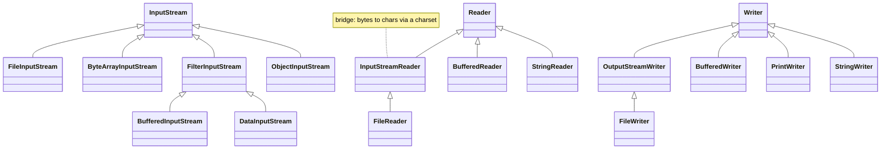
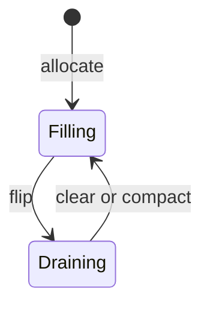

# Chapter 13 — I/O and NIO

Almost every program reads or writes something outside itself: config files, CSV exports, logs, uploads, the keyboard, the terminal. **I/O** (input/output) moves data across that boundary. Java has two generations of file APIs, met side by side in real code: the original **`java.io`** package (Java 1.0, *streams* of bytes and characters) and **NIO.2** (`java.nio.file`, Java 7, `Path` + the `Files` utility class). This chapter covers both, which to reach for, and the production trip-ups: buffering, character encodings, serialization and configuration files. It leans on try-with-resources and `IOException` ([Chapter 8](../08-exceptions/README.md)) and lazy streams ([Chapter 12](../12-streams/README.md) — `Files.lines` and `Files.walk` return `Stream`s).

All runnable code is in [`code/`](code/) (package `ch13.*`), compiled with `javac --release 25` and run on JDK 26. Every program works inside a `Files.createTempDirectory` directory and deletes it at the end. Outputs are pasted from real runs.

> **Exam depth.** `File` vs `Path` method-name differences, `resolve`/`relativize` puzzles, `Files` exception rules, stream class tables and `Console` details: [OCP Chapter 14 — I/O](../../../../ocp-java21-study/chapters/14-io/README.md). This chapter stays at "use it correctly at work" depth and links there for traps.

---

## 13.1 The big picture: `java.io` vs NIO.2

### What it is
- **`java.io`** (Java 1.0) models I/O as **streams**: a one-way flow of data you read from (*input stream*) or write to (*output stream*), piece after piece. Files are the old `java.io.File` class. (Unrelated to Chapter 12's `java.util.stream.Stream` — same word, different idea.)
- **NIO** ("New I/O", Java 1.4, `java.nio`) added **buffers** (`ByteBuffer`) and **channels** (`FileChannel`, `SocketChannel`) — lower-level, block-oriented (data in chunks), and capable of **non-blocking** network I/O (a read/write returns immediately even if no data is ready, instead of making the thread wait).
- **NIO.2** (Java 7, `java.nio.file`) replaced `File` with the **`Path`** interface and the **`Files`** class of static helpers, plus file attributes, **symbolic links** (symlinks: small files pointing to another file or directory), directory walking and change watching.

### Why it matters
Both APIs are current and interoperate. Modern code uses `Path` + `Files` for everything about *files*, and `java.io` streams whenever data flows from something that isn't a file (network **sockets**, HTTP bodies, zip entries, in-memory arrays) — `Files.newInputStream(path)` even *returns* a `java.io.InputStream`.

| Need | Use | Since |
|---|---|---|
| Represent a file/directory location | `Path` (`Path.of(...)`) | 7 (`Path.of` 11) |
| Create, copy, move, delete, check, list | `Files.*` static methods | 7 |
| Read/write a small text file in one call | `Files.readString` / `Files.writeString` | 11 |
| Read a huge text file line by line | `Files.lines` (lazy `Stream`) or `Files.newBufferedReader` | 8 / 7 |
| Process bytes from any source (socket, zip, HTTP) | `InputStream` / `OutputStream` | 1.0 |
| Process text from any source | `Reader` / `Writer` (+ a charset) | 1.1 |
| Random access (jump to any position), big files, memory mapping | `FileChannel` + `ByteBuffer` | 1.4 |
| Legacy APIs that want a `File` | `path.toFile()` / `file.toPath()` | 7 |

### Why `File` was replaced
The old `File` class has real flaws that NIO.2 fixes:
1. **Silent failures.** `file.delete()`, `mkdir()` and `renameTo()` return `false` without saying *why* (missing? permission? not empty?). `Files.delete` throws a specific exception (`NoSuchFileException`, `DirectoryNotEmptyException`, `AccessDeniedException`).
2. **No symbolic-link support, poor metadata** (size, dates, owner). NIO.2 reads attributes (size, times, POSIX permissions — Unix read/write/execute flags for owner, group and others — owner) in one call.
3. **No efficient directory walking.** `File.listFiles()` loads everything into an array; `Files.walk`/`Files.list` stream lazily.

### TL;DR
Use `Path` + `Files` for files and directories; use `InputStream`/`Reader` families for data flowing from anywhere; convert with `toFile()`/`toPath()` only at legacy boundaries.

---

## 13.2 `Path`: naming files and directories

### What it is
A **`Path`** is an **immutable** object representing a file-system location as a sequence of **name elements** (`reports`, `2025`, `q3`, `sales.csv`) plus an optional **root** (`/` on Unix/macOS, `C:\` on Windows). A `Path` is *just a name*: creating one never checks that the file exists or touches the disk — `Path.of("missing.txt")` doesn't throw.

Key terms:
- **Absolute path** — starts at a root (`/srv/app/logs`). **Relative path** — interpreted from the JVM process's **current working directory** (the folder the program was started from) (`reports/q3.csv`).
- **Separator** — `/` on Unix/macOS, `\` on Windows. `Path.of("a", "b")` inserts the right one; don't concatenate with `"/"` yourself.
- `.` means "this directory", `..` means "the parent directory".

### How it works
1. Create a path: `Path.of("reports", "2025", "sales.csv")` (Java 11) or the older, identical `Paths.get(...)` (Java 7).
2. Take it apart: `getFileName()`, `getParent()`, `getRoot()`, `getNameCount()`, `getName(i)`, `subpath(from, to)`.
3. Combine paths: `resolve` (append), `resolveSibling` (replace the last element), `relativize` (the route from one path to another).
4. Clean it: `normalize()` removes `.` and resolves `name/..` pairs *textually*; `toAbsolutePath()` prefixes the working directory; `toRealPath()` asks the file system (resolves symlinks and **requires the file to exist**).

[`code/ch13/paths/PathBasics.java`](code/ch13/paths/PathBasics.java) (key parts):
```java
Path p = Path.of("reports", "2025", "q3", "sales.csv");
p.getFileName(); p.getParent(); p.getRoot(); p.getNameCount(); p.getName(1); p.subpath(1, 3);

Path base = Path.of("/srv/app");
base.resolve("logs/app.log");                 // append a relative path
base.resolve("/etc/hosts");                   // an absolute argument simply wins
base.resolve("config.yml").resolveSibling("secrets.yml");

Path.of("/srv/app/./logs/../data/./users.db").normalize();
Path from = Path.of("/srv/app/logs"), to = Path.of("/srv/app/data/users.db");
from.relativize(to);                          // how do I get from 'from' to 'to'?
to.startsWith("/srv/ap");                     // compares whole NAME elements, not characters
```
Output:
```text
path          = reports/2025/q3/sales.csv
fileName      = sales.csv
parent        = reports/2025/q3
root          = null
nameCount     = 4
name(1)       = 2025
subpath(1,3)  = 2025/q3
isAbsolute    = false
resolve       = /srv/app/logs/app.log
resolve abs   = /etc/hosts
resolveSibling= /srv/app/secrets.yml
normalize     = /srv/app/data/users.db
relativize    = ../data/users.db
round trip    = /srv/app/data/users.db
startsWith    = true / string-wise 'app' = false
endsWith      = true
File <-> Path = reports/2025/q3/sales.csv -> true
Paths.get     = true
```
What to notice:
- `getRoot()` is `null` for a relative path, and `getName(0)` is the first element *after* the root.
- `subpath(1, 3)` is **half-open** (includes the start index, excludes the end) like `String.substring`: elements 1 and 2.
- `resolve` with an absolute argument returns the argument (`Path.of("/a/b").resolve("/c")` → `/c`) — a classic bug when a user-supplied "file name" starts with `/`.
- `relativize` requires both paths to be the same kind (both absolute or both relative), otherwise `IllegalArgumentException`; `Path.of("/a/b").relativize(Path.of("/a/c/d"))` → `../c/d`.
- `startsWith("/srv/ap")` is `false`: comparison is by name elements, not characters.

### Common mistakes
- Building paths by string concatenation (`dir + "/" + name`) — breaks on Windows and doubles separators. Use `resolve`.
- Assuming `normalize()` checks the disk. It is purely textual; `a/link/..` normalises to `a` even if `link` is a symlink pointing elsewhere. Use `toRealPath()` when it matters.
- **Path traversal** (an attack where `..` segments in input escape the allowed folder): `uploads.resolve(userInput)` with `userInput = ../../etc/passwd`. Guard with `Path target = uploads.resolve(name).normalize(); if (!target.startsWith(uploads)) throw ...` — exactly the check web servers do.
---

## 13.3 `Files`: managing files and directories

### What it is
**`java.nio.file.Files`** is a class of static methods that *do* touch the disk: test, create, copy, move, delete, read attributes, list and walk. Every method that can fail throws a specific subclass of the checked `IOException` ([§8.3](../08-exceptions/README.md#83-handle-or-declare-checked-exceptions-and-throws)).

### How it works — the core operations

| Task | Method | Fails with (if…) |
|---|---|---|
| Does it exist? | `exists`, `notExists`, `isRegularFile`, `isDirectory`, `isReadable`, `isSymbolicLink` | never throws; returns `false` if unsure |
| Make a directory | `createDirectory(p)` / `createDirectories(p)` | `FileAlreadyExistsException` / parents made too, no error if present |
| Make an empty file | `createFile(p)` | `FileAlreadyExistsException` |
| Temporary file/dir | `createTempFile(prefix, suffix)`, `createTempDirectory(prefix)` | in `java.io.tmpdir` |
| Copy | `copy(src, dst, options...)` | `FileAlreadyExistsException` unless `REPLACE_EXISTING` |
| Move / rename | `move(src, dst, options...)` | same; add `ATOMIC_MOVE` for all-or-nothing (**atomic**: others see the old state or the new one, never half-done) within one file system |
| Delete | `delete(p)` / `deleteIfExists(p)` | `NoSuchFileException`, `DirectoryNotEmptyException` / returns `boolean` |
| Size, times, type | `size`, `getLastModifiedTime`, `readAttributes(p, BasicFileAttributes.class)` | `NoSuchFileException` |
| Same content? | `mismatch(a, b)` (Java 12) → `-1` if identical, else first differing byte index | |
| Same file? | `isSameFile(a, b)` — follows links | |
| One level listing | `list(dir)` → `Stream<Path>` (lazy, **close it**) | `NotDirectoryException` |
| Recursive walk | `walk(dir[, maxDepth])`, `find(dir, maxDepth, (path, attrs) -> …)` → `Stream<Path>` | |
| Fine-grained walk with callbacks | `walkFileTree(dir, FileVisitor)` | |

Details worth knowing:
- `copy` of a directory copies only the directory itself (empty), not its contents. Recursive copy = `walk` + `copy` each entry.
- `walk` visits **depth-first** (down one branch fully before the next), starts with the directory itself, and by default does **not** follow symbolic links (pass `FileVisitOption.FOLLOW_LINKS`).
- `readAttributes(..., BasicFileAttributes.class)` fetches size, times and type in **one** file-system call — much cheaper than calling `size`, `isDirectory` and `getLastModifiedTime` separately in a loop over thousands of files.

[`code/ch13/files/FileOps.java`](code/ch13/files/FileOps.java) (key parts):
```java
Path root = Files.createTempDirectory("java1315_fileops");
try {
    Path docs = Files.createDirectories(root.resolve("docs/2025"));   // makes parents too
    Path a = Files.writeString(docs.resolve("a.txt"), "alpha\n");
    Files.createDirectory(docs);                                       // -> FileAlreadyExistsException
    Path b = Files.copy(a, docs.resolve("b.txt"));
    Files.copy(a, b);                                                  // -> FileAlreadyExistsException
    Files.copy(a, b, StandardCopyOption.REPLACE_EXISTING);            // allowed
    Path moved = Files.move(b, archive.resolve("b-old.txt"));         // move = rename
    Files.mismatch(a, moved) == -1;                                    // identical content
    BasicFileAttributes attrs = Files.readAttributes(a, BasicFileAttributes.class);

    try (Stream<Path> s = Files.walk(root)) {                          // lazy + holds OS handles
        s.map(p -> root.relativize(p).toString()).sorted().forEach(...);
    }
    try (Stream<Path> s = Files.find(root, 10,
            (p, at) -> at.isRegularFile() && p.toString().endsWith(".md"))) { ... }
    Files.delete(docs);                                                // -> DirectoryNotEmptyException
} finally {
    deleteRecursively(root);
}

static void deleteRecursively(Path root) throws IOException {
    try (Stream<Path> s = Files.walk(root)) {
        List<Path> all = s.sorted(Comparator.reverseOrder()).toList();  // children before parents
        for (Path p : all) Files.delete(p);
    }
}
```
Output:
```text
exists a.txt?        true
isDirectory docs?    true
size a.txt           6 bytes
createDirectory again -> FileAlreadyExistsException
copy onto existing   -> FileAlreadyExistsException
after move b exists? false, moved exists? true
same content a/moved true
attrs: regular=true dir=false size=6 created<=modified true
-- Files.list(root) (one level, sorted):
   archive
   docs
   readme.md
-- Files.walk(root) (recursive, sorted):
   ''
   'archive'
   'archive/b-old.txt'
   'docs'
   'docs/2025'
   'docs/2025/a.txt'
   'docs/2025/notes.md'
   'readme.md'
-- Files.find *.md:
   docs/2025/notes.md
   readme.md
delete non-empty dir -> DirectoryNotEmptyException
deleteIfExists(missing) = false
read missing file    -> NoSuchFileException
temp dir removed?    true
```
- The empty string `''` in the walk output is the root itself (`root.relativize(root)`), proving that `walk` includes its starting point.
- We **sort** listing output because the OS order is unspecified; never rely on it (in tests either).
- `deleteRecursively` sorts paths in reverse so `docs/2025/a.txt` comes before `docs/2025`, which comes before `docs` — a directory can only be deleted once it's empty. (`walkFileTree` with a `postVisitDirectory` callback is the other standard way.)

### Watching a directory for changes
`WatchService` (Java 7) notifies a program when files in a directory are created, modified or deleted — how IDEs and dev servers notice edits:
```java
// (not run: event delivery timing is OS-dependent; macOS uses polling with a delay of seconds)
try (WatchService ws = FileSystems.getDefault().newWatchService()) {
    dir.register(ws, StandardWatchEventKinds.ENTRY_CREATE, StandardWatchEventKinds.ENTRY_MODIFY);
    WatchKey key = ws.take();                         // blocks until something happens
    for (WatchEvent<?> e : key.pollEvents()) System.out.println(e.kind() + " " + e.context());
    key.reset();                                      // re-arm, or no more events arrive
}
```
It watches a single directory (not subdirectories), and events can be coalesced (merged) or overflow (`OVERFLOW` kind), so treat events as hints and re-scan when in doubt.

### Common mistakes
- **Not closing** `Files.list`/`walk`/`find`/`lines`. They hold an open directory or **file handle** (an OS token for an open file; each process gets a limited number); a long-running server leaking them eventually hits "Too many open files". Always use try-with-resources.
- **Check-then-act**: `if (!Files.exists(p)) Files.createFile(p);` — another process can create it in between (a **race condition**). Call `createFile` and catch `FileAlreadyExistsException` instead (or use `CREATE_NEW`, §13.4).
- Using `Files.exists` as proof: it returns `false` both for "doesn't exist" and "can't tell" (no permission). `Files.notExists` is not simply its negation — both can be `false`.
- Hard-coding `/tmp` — use `Files.createTempDirectory` (portable, unique name).

### Real-world examples
Log rotation (rename the current log and start a fresh one; `move` with `ATOMIC_MOVE` so readers never see half-written files), build tools walking source trees (`walk` + `find`), and "write to a temp file, then atomically move over the real file" — the standard trick for crash-safe config and cache updates.

### In the interview
**30-second answer:** "I use `Path.of` and the `Files` class: `createDirectories`, `copy`/`move` with explicit `StandardCopyOption`s, `delete` which throws a descriptive exception, and `walk`/`list`/`find` inside try-with-resources because they hold OS handles. For crash-safe updates I write to a temp file in the same directory and `move` it with `ATOMIC_MOVE`."
- *Why prefer `Files.delete` over `File.delete`?* → It throws a specific exception explaining the failure; `File.delete` just returns `false`.
- *How do you delete a directory tree?* → `walk`, sort in reverse order, delete each; or `walkFileTree` deleting in `postVisitDirectory`.
- *Is `walk` depth-first or breadth-first?* → Depth-first; it includes the start directory.

---

## 13.4 Reading and writing whole files

### What it is
For everyday text files, `Files` has one-line methods. They default to **UTF-8** (§13.7; true for `Files` methods even before Java 18) and open/close the file for you.

| Method | Reads/writes | Memory | Since |
|---|---|---|---|
| `readString(p[, cs])` / `writeString(p, text[, cs], opts...)` | whole file as one `String` | whole file | 11 |
| `readAllLines(p)` / `write(p, lines, opts...)` | `List<String>` of lines | whole file | 7 |
| `readAllBytes(p)` / `write(p, bytes, opts...)` | `byte[]` | whole file | 7 |
| `lines(p)` | lazy `Stream<String>` — **must be closed** | one line at a time | 8 |
| `newBufferedReader(p)` / `newBufferedWriter(p, opts...)` | `BufferedReader`/`BufferedWriter` | small buffer | 7 |
| `newInputStream(p)` / `newOutputStream(p, opts...)` | raw bytes | small buffer | 7 |

**Open options** (`StandardOpenOption`) control what "write" means. The default for the write methods is `CREATE`, `TRUNCATE_EXISTING`, `WRITE` — create if missing, **otherwise wipe it first** (*truncate* to zero length). Others: `APPEND`, `CREATE_NEW` (fail if it exists — an atomic "create only if absent"), `READ`, `SYNC`/`DSYNC` (force every write to the storage device — `DSYNC` syncs only the contents, `SYNC` also the metadata), `DELETE_ON_CLOSE`.

[`code/ch13/files/ReadWrite.java`](code/ch13/files/ReadWrite.java) (key parts):
```java
Files.writeString(f, "buy milk\n");                               // create or truncate
Files.writeString(f, "call bob\n", StandardOpenOption.APPEND);
Files.write(f, List.of("fix bug #42", "ship v2"), StandardOpenOption.APPEND);
Files.readString(f);
List<String> lines = Files.readAllLines(f);
try (Stream<String> s = Files.lines(f)) {                           // lazy; MUST be closed
    long withB = s.filter(l -> l.contains("b")).count();
}
Files.writeString(f, "x", StandardOpenOption.CREATE_NEW);          // FileAlreadyExistsException

try (BufferedWriter w = Files.newBufferedWriter(csv, StandardCharsets.UTF_8)) {
    w.write("name,score"); w.newLine();
    w.write("ana,91");     w.newLine();
    w.write("raj,78");     w.newLine();
}                                                                  // close() flushes the buffer
try (BufferedReader r = Files.newBufferedReader(csv)) {
    r.readLine();                                                  // skip header
    String line;
    while ((line = r.readLine()) != null) total += Integer.parseInt(line.split(",")[1]);
}
```
Output:
```text
readString:
buy milk
call bob
fix bug #42
ship v2
readAllLines size = 4 -> [buy milk, call bob, fix bug #42, ship v2]
lines containing 'b' = 3
bytes = 38
CREATE_NEW on existing -> FileAlreadyExistsException
total score = 169
```
- `Files.write(path, lines)` writes each line followed by the platform line separator (`\n` here). `readAllLines` strips line terminators.
- `readLine()` returns `null` at end of file — the classic `while ((line = r.readLine()) != null)` idiom.

### Trade-offs

| Style | Pros | Cons |
|---|---|---|
| `readString`/`readAllLines` | shortest code | loads the whole file; a 4 GB log → `OutOfMemoryError` |
| `lines()` | constant memory, stream operations | must remember try-with-resources; `UncheckedIOException` if a read fails mid-stream |
| `BufferedReader` loop | constant memory, full control, easy early exit | more code |

Rule of thumb: whole-file methods for files known to be small (configs, test fixtures, < a few MB); streaming for anything user-supplied or unbounded.

### Common mistakes
- Forgetting that the default write **truncates** — appending needs `APPEND`.
- Writing a CSV "by hand" with `split(",")` for real data: quoted fields containing commas break it. Use a CSV library (Apache Commons CSV, OpenCSV) for anything external.
- Writing important files in place. If the program crashes mid-write the file is corrupt. Write a temp file in the same directory, then `Files.move(tmp, target, ATOMIC_MOVE, REPLACE_EXISTING)`.

### TL;DR
`readString`/`writeString` for small text, `lines`/`newBufferedReader` for big text, and remember: writes truncate unless you say `APPEND`.

---

## 13.5 Byte streams and character streams

### What it is
In `java.io` all I/O is built from four abstract classes:

| | Input (read) | Output (write) | Unit |
|---|---|---|---|
| **Byte streams** | `InputStream` | `OutputStream` | `byte` (8-bit raw data: images, zip, protobuf, anything) |
| **Character streams** | `Reader` | `Writer` | `char` (16-bit UTF-16 text unit; see §13.7) |

Byte streams move raw bytes. Character streams move text, and at the point where text meets bytes (a file, a socket) something must **encode** chars to bytes or **decode** bytes to chars using a **charset** (§13.7). The **bridge** classes are `InputStreamReader` (bytes → chars) and `OutputStreamWriter` (chars → bytes).

### How it works: the decorator pattern
Concrete classes come in two kinds:
1. **Source/sink streams** that actually connect to something: `FileInputStream`, `ByteArrayInputStream`, a socket's stream, `FileReader`, `StringReader`, `StringWriter`.
2. **Filter (wrapper) streams** that take another stream in their constructor and add a feature: buffering (`BufferedInputStream`, `BufferedReader`), primitives (`DataInputStream`), objects (`ObjectInputStream`), compression (`GZIPInputStream`), formatting (`PrintStream`, `PrintWriter`).

You stack wrappers like nested boxes. Each `read`/`write` passes through the layers, and **closing the outermost wrapper closes the whole chain** (e.g. a `BufferedReader` over an `InputStreamReader`). This is the **Decorator** pattern (wrap an object in another of the same type that adds behaviour, [LLD Chapter 9](../../../lld/chapters/09-patterns-structural/README.md)).


(The output side mirrors this: `OutputStream` → `FileOutputStream`, `ByteArrayOutputStream`, `BufferedOutputStream`, `DataOutputStream`, `ObjectOutputStream`, `PrintStream`.)

The read contracts, which every subclass follows:
- `int read()` returns the next byte (0–255) or char (0–65535) **as an `int`**, or **`-1` at end of stream**. It returns `int` rather than `byte` precisely so `-1` can't be confused with a real value.
- `int read(byte[] buf)` fills *up to* `buf.length` bytes and returns **how many it actually read** (possibly fewer!) or `-1`. Always write `buf, 0, n`, never the whole array.
- Reads **block**: the thread waits until data arrives, the stream ends, or an error occurs.

[`code/ch13/streams/ByteAndCharStreams.java`](code/ch13/streams/ByteAndCharStreams.java) (key parts):
```java
// 1) the classic copy loop
try (InputStream in = new FileInputStream(src.toFile());
     OutputStream out = new FileOutputStream(dst.toFile())) {
    byte[] buf = new byte[4];                   // tiny, to make the loop visible
    int n;
    while ((n = in.read(buf)) != -1) out.write(buf, 0, n);
}
// 2) Java 9: let the library do the loop
in.transferTo(out);
// 3) characters: specify the charset at the byte boundary
try (Writer w = new OutputStreamWriter(new FileOutputStream(text.toFile()), StandardCharsets.UTF_8)) {
    w.write("naïve café ☕");
}
// 4) decorators: text -> buffered -> encoded -> gzipped -> file
try (PrintWriter pw = new PrintWriter(new BufferedWriter(new OutputStreamWriter(
        new GZIPOutputStream(new FileOutputStream(gz.toFile())), StandardCharsets.UTF_8)))) {
    for (int i = 1; i <= 1000; i++) pw.printf("line %d: all work and no play%n", i);
}
// 5) in memory
ByteArrayOutputStream bos = new ByteArrayOutputStream();
new StringReader("abc").transferTo(sw);         // Reader.transferTo: Java 10
```
Output:
```text
copied with 4 read() calls -> Hello, bytes!
transferTo copied 13 bytes
chars written = 12, bytes on disk = 16
chars read back = 12
gzip file 2453 bytes holds 1000 lines
ByteArrayOutputStream -> captured
StringReader -> StringWriter: abc
```
- 13 bytes through a 4-byte buffer = 4 reads (4+4+4+1); the last `write(buf, 0, 1)` writes only one byte.
- 12 characters became 16 bytes: `ï` and `é` take 2 bytes in UTF-8, `☕` takes 3.
- ~30 KB of repetitive text compressed to about 2.4 KB — and the code reading it back just adds `GZIPInputStream` to the chain.

### Useful extras (Java 9–25)

| Method | What it does | Since |
|---|---|---|
| `InputStream.readAllBytes()`, `readNBytes(n)` | read everything / exactly up to n bytes | 9 / 11 |
| `InputStream.transferTo(out)`, `Reader.transferTo(w)` | copy to the end | 9 / 10 |
| `InputStream.nullInputStream()`, `OutputStream.nullOutputStream()` | empty source / discard sink (tests) | 11 |
| `Reader.of(CharSequence)` | a `Reader` over a string | 24 |
| `Reader.readAllAsString()`, `readAllLines()` | read the rest of a reader | 25 |

`mark`/`reset` (remember a position and go back) and `skip` also exist; only some streams support `mark` (check `markSupported()`) — details in [OCP Chapter 14 §8a](../../../../ocp-java21-study/chapters/14-io/README.md).

### Common mistakes
- `FileReader`/`FileWriter` **without a charset** on Java 17 and earlier used the platform default (often Windows-1252 on Windows) — files written on one machine read wrongly on another. On Java 11+ pass the charset: `new FileReader(file, StandardCharsets.UTF_8)`.
- Ignoring the return value of `read(buf)` and writing the whole buffer → garbage at the end of the copy.
- Closing only the inner stream, or not closing at all — buffered data is lost and the file handle leaks. Declare the outermost wrapper in try-with-resources.
- Using `PrintWriter`/`PrintStream` for important output: they **swallow `IOException`s** (check `checkError()`), which is fine for the console but not for writing a file you need.

### In the interview
**30-second answer:** "`java.io` has byte streams, `InputStream`/`OutputStream`, and character streams, `Reader`/`Writer`, bridged by `InputStreamReader`/`OutputStreamWriter` with an explicit charset. Features are added by wrapping — buffering, data types, compression — which is the Decorator pattern. `read` returns -1 at end of stream, and I always close the outermost wrapper with try-with-resources."
- *Why does `read()` return `int`?* → To fit all 256 byte values plus `-1` as the end marker.
- *Byte or character stream for a PNG?* → Byte stream; it isn't text.

---

## 13.6 Buffering

### What it is
A **buffer** is a block of memory (8 KiB by default for the `Buffered*` classes) that collects many small reads or writes into one large operation. Without it, each `write('x')` on a `FileOutputStream` becomes a **system call** — a request to the OS **kernel**, which costs far more than copying a byte in memory.

### How it works
1. `BufferedOutputStream.write(b)` puts the byte in its internal array.
2. When the array is full, it writes the whole block to the wrapped stream in one call.
3. `flush()` forces out whatever is buffered now; `close()` flushes then closes.
4. On input, `BufferedInputStream`/`BufferedReader` read a large block at once and hand out pieces from memory; `BufferedReader` also adds `readLine()` and `lines()`.

[`code/ch13/streams/BufferingDemo.java`](code/ch13/streams/BufferingDemo.java) (key parts):
```java
try (OutputStream out = new FileOutputStream(f1.toFile())) {
    for (int i = 0; i < 200_000; i++) out.write('x');          // one system call per byte
}
try (OutputStream out = new BufferedOutputStream(new FileOutputStream(f2.toFile()))) {
    for (int i = 0; i < 200_000; i++) out.write('x');          // one system call per 8 KiB
}
BufferedWriter w = new BufferedWriter(new FileWriter(lost.toFile()));
w.write("this sits in the buffer");
Files.size(lost);   // 0 !
w.flush();
Files.size(lost);   // 23
```
Output (timings are machine-dependent; the ratio is the lesson):
```text
same size: true (200000 bytes)
unbuffered: 205 ms   [machine-dependent]
buffered:   2 ms   [machine-dependent]
buffered faster? true
before flush: 0 bytes on disk
after flush:  23 bytes on disk
```
Same 200,000 bytes, roughly 100× faster with a buffer on this machine. And until `flush()`/`close()`, written data lives only in the buffer: if the JVM crashes or you forget to close, it never reaches the file.

### When not to use it
- When you already read/write big arrays (`read(byte[8192])`, `Files.readAllBytes`, `transferTo`) — a buffer adds only a copy.
- The `Files` convenience methods and `Files.newBufferedReader/Writer` already buffer.
- Interactive **protocols** where each message must go out immediately — you can still buffer, but call `flush()` after each message.

### Common mistakes
- Forgetting `flush()` on a socket writer → the other side waits forever for a message sitting in your buffer.
- Wrapping twice (`new BufferedReader(Files.newBufferedReader(p))`) — harmless but pointless.
- `flush()` hands data to the OS, not necessarily to the physical disk. For **durability** (surviving a crash or power cut) use `FileChannel.force(true)` or the `SYNC`/`DSYNC` open options (databases do this).

### TL;DR
Always buffer small reads/writes; `close()` flushes; `flush()` ≠ on disk.

---

## 13.7 Charsets and encodings

### What it is
Files and networks carry **bytes**; Java `String`s hold **characters** (as UTF-16 `char` units). A **charset** (character encoding) is the rulebook that maps between them.
- **UTF-8** — variable length: 1 byte for ASCII (the basic 128 English letters, digits and symbols), 2 for most European accents, 3 for most other symbols (`€`, CJK), 4 for emoji. The web's and Java's default.
- **UTF-16** — 2 or 4 bytes per character; what `String` uses internally (conceptually).
- **ISO-8859-1** (Latin-1) — exactly 1 byte per character, only 256 characters.
- **US-ASCII** — 7-bit, 128 characters.

**Mojibake** is the garbled text you get when bytes are decoded with a different charset from the one used to encode them (`café`).

### Why it matters: JEP 400 (Java 18)
Before Java 18, APIs without an explicit charset (`FileReader`, `new String(bytes)`, `String.getBytes()`, `Scanner(File)`) used the **platform default**, which depended on the OS and **locale** (language/region settings): UTF-8 on most Linux/macOS, Windows-1252 on many Windows machines. The same program could read a file correctly on a Mac and wrongly on a Windows server. Since **Java 18 (JEP 400; JEPs: [§1.12](../01-java-and-the-jvm/README.md#112-java-releases-lts-and-jeps)) the default charset is UTF-8 everywhere**. (The console's own encoding still follows the terminal: see `System.getProperty("stdout.encoding")`.) Being explicit — `StandardCharsets.UTF_8` — is still best practice: it documents intent and stays correct if someone runs with `-Dfile.encoding=COMPAT` (a *system property*, §13.11).

[`code/ch13/charsets/CharsetDemo.java`](code/ch13/charsets/CharsetDemo.java) (key parts):
```java
String s = "café €";
for (Charset cs : new Charset[]{UTF_8, UTF_16BE, ISO_8859_1, US_ASCII}) {
    byte[] b = s.getBytes(cs);                                    // encode
    System.out.printf("%-10s %2d bytes  %s%n", cs, b.length, hex.formatHex(b));
}
byte[] utf8 = "café".getBytes(UTF_8);
new String(utf8, ISO_8859_1);                                     // decode with the wrong charset
Files.writeString(latin, "café", ISO_8859_1);
Files.readString(latin);                                          // assumes UTF-8 -> throws
String e = "hi👋";  e.length(); e.codePoints().count();
```
Output:
```text
default charset = UTF-8 (UTF-8 by default since Java 18, JEP 400)
UTF-8       9 bytes  63 61 66 c3 a9 20 e2 82 ac
UTF-16BE   12 bytes  00 63 00 61 00 66 00 e9 00 20 20 ac
ISO-8859-1  6 bytes  63 61 66 e9 20 3f
US-ASCII    6 bytes  63 61 66 3f 20 3f
decoded wrong  -> café
decoded right  -> café
readString(latin1 file) -> MalformedInputException
with right charset -> café
length()=4 codePoints=3 utf8 bytes=6
```
What to notice:
- The same 6-character string is 9, 12 or 6 bytes depending on the charset.
- `3f` is `?`: `String.getBytes` **silently replaces** characters the charset can't represent (`€` in ISO-8859-1; `é` and `€` in ASCII). Data is lost without an error. (To get an error, use a `CharsetEncoder` with `CodingErrorAction.REPORT`.)
- `Files.readString`/`readAllLines` are **strict**: invalid UTF-8 throws `MalformedInputException` rather than guessing — better than silent corruption. `BufferedReader` built with `InputStreamReader` is lenient and substitutes `�` (U+FFFD).
- `"hi👋".length()` is 4: the emoji is one **code point** outside the Basic Multilingual Plane, stored as two `char`s (a *surrogate pair*). Use `codePoints()` to count what humans see as characters ([Chapter 7](../07-core-apis/README.md)).

### Common mistakes
- Decoding a byte array that was cut in the middle of a multi-byte character (e.g. splitting network data at a fixed size) — decode after reassembling, or use a `Reader` which handles the boundary.
- A **BOM** (byte-order mark, `EF BB BF`) at the start of files from some Windows tools: Java's UTF-8 decoder keeps it as the character `\uFEFF`, so the first header of a CSV might not equal `"name"`. Strip it explicitly.
- Using `Properties.load(InputStream)`, which assumes ISO-8859-1 (§13.11).

### In the interview
**30-second answer:** "Strings are characters; files are bytes; a charset converts. Since Java 18 the default is UTF-8 on every platform, but I still pass `StandardCharsets.UTF_8` explicitly. Wrong charset gives mojibake; `getBytes` silently substitutes `?` for unmappable characters while `Files.readString` throws on malformed input."
- *How many bytes is `é` in UTF-8?* → 2.
- *Why can `String.length()` differ from the number of visible characters?* → It counts UTF-16 `char`s; characters outside the Basic Multilingual Plane (emoji) take two.

---

## 13.8 Console and standard streams

### What it is
Every process starts with three **standard streams** connected by the OS: **standard input** (`System.in`, an `InputStream` — usually the keyboard), **standard output** (`System.out`, a `PrintStream`) and **standard error** (`System.err`, a `PrintStream` for diagnostics and error messages). Shells can **redirect** each independently to files: `java App < input.txt > out.txt 2> errors.txt`.

Ways to read input:

| Tool | Best for | Notes |
|---|---|---|
| `Scanner(System.in)` | small interactive programs, exercises | parses tokens (`nextInt`, `nextDouble`, `nextLine`); regex-based, slow for big input |
| `BufferedReader(new InputStreamReader(System.in))` | large inputs (competitive programming, piped data; e.g. 10⁶ numbers) | line-based; parse with `split`/`Integer.parseInt` |
| `System.console()` | real terminals; passwords | `readPassword()` doesn't echo and returns `char[]` (can be wiped) |
| `IO.readln(prompt)` / `IO.println(x)` | beginner programs | `java.lang.IO`, **Java 25** (JEP 512), auto-imported — no `import` needed |

[`code/ch13/console/ConsoleInput.java`](code/ch13/console/ConsoleInput.java) simulates typed input with an in-memory stream so the output is repeatable:
```java
String typed = "Ada\n36\n3 4 5\n";
Scanner sc = new Scanner(new ByteArrayInputStream(typed.getBytes(UTF_8)));  // real code: new Scanner(System.in)
String name = sc.nextLine();
int age = sc.nextInt();
while (sc.hasNextInt()) sum += sc.nextInt();

BufferedReader br = new BufferedReader(new StringReader(typed));  // real code: new InputStreamReader(System.in)
String first = br.readLine();
int parsedAge = Integer.parseInt(br.readLine().trim());
for (String tok : br.readLine().split("\\s+")) total += Integer.parseInt(tok);

Scanner trap = new Scanner("42\nhello\n");
int n = trap.nextInt();
String rest = trap.nextLine();            // "" - the rest of the line after 42!

Console c = System.console();
c != null && c.isTerminal();              // isTerminal(): Java 22
IO.println("IO.println works without System.out");              // Java 25
```
Output (the stderr line may appear in a different position when both streams go to one terminal — they are separate streams):
```text
Scanner: name=Ada age=36 sum=12
BufferedReader: name=Ada age=36 sum=12
trap: n=42 nextLine=[] then [hello]
stdout and stderr are separate streams (redirect with > and 2>)
this line went to stderr
System.console() available? false
IO.println works without System.out
```
- **The `nextInt`/`nextLine` trap**: `nextInt()` consumes `42` but leaves the newline; the following `nextLine()` returns the empty remainder of that line. Fix: call an extra `nextLine()` after `nextInt()`, or read whole lines and parse them.
- `System.console()` returns `null` when input or output is redirected (IDEs, pipes, CI servers) — always null-check it. Java 22–24 used a JLine-based console by default that could return a `Console` even then; Java 25 reverted to the old behaviour. `isTerminal()` (22) tells you whether a returned console is really interactive.

### Common mistakes
- Closing a `Scanner` wrapping `System.in` in a helper method — that closes `System.in` for the rest of the program.
- Using `System.out.println` for logging in applications — use a logging framework ([Chapter 18](../18-testing-build-and-tooling/README.md)).
- Reading passwords with `Scanner` into a `String` — use `Console.readPassword()`.

---

## 13.9 Binary data, channels and buffers

### Primitive values: `DataOutputStream` / `DataInputStream`
To store numbers compactly (not as text), `DataOutputStream` writes Java primitives (`int`, `double`, `boolean` …) in a fixed **big-endian** (most significant byte first) binary format; `DataInputStream` reads them back. **You must read in exactly the same order and types you wrote** — the file has no labels, so the reader can't ask what type comes next.

[`code/ch13/binary/DataAndChannels.java`](code/ch13/binary/DataAndChannels.java) (key parts):
```java
try (DataOutputStream out = new DataOutputStream(new BufferedOutputStream(Files.newOutputStream(f)))) {
    out.writeInt(2025);  out.writeDouble(3.5);  out.writeBoolean(true);  out.writeUTF("ok");
}
try (DataInputStream in = new DataInputStream(new BufferedInputStream(Files.newInputStream(f)))) {
    in.readInt(); in.readDouble(); in.readBoolean(); in.readUTF();
}
```

### Channels and `ByteBuffer`
NIO models I/O differently from streams:
- A **channel** (`FileChannel`, `SocketChannel`) is a connection that can read *into* and write *from* a buffer, often in both directions, and supports **positioned** (random-access) reads.
- A **`ByteBuffer`** is a fixed-capacity block of bytes with three cursors: **position** (next index to use), **limit** (end of valid data), **capacity**. You *fill* it (channel read), call **`flip()`** to switch to *draining* (limit = position, position = 0), consume it, then **`clear()`** to fill again (position = 0, limit = capacity) — or **`compact()`**, which keeps any unread bytes at the front.



```java
try (FileChannel ch = FileChannel.open(g, READ)) {
    ByteBuffer buf = ByteBuffer.allocate(8);
    while (ch.read(buf) != -1) {         // fill
        buf.flip();                      // switch to draining
        sb.append(UTF_8.decode(buf));
        buf.clear();                     // ready to fill again
    }
}
ch.read(word, 13);                       // positioned read at byte offset 13
```
Output:
```text
file size = 17 bytes (4 + 8 + 1 + 2 + 2)
read back: 2025, 3.5, true, ok
channel wrote 20 bytes, position now 20
channel read: channels and buffers
bytes 13..15 = buf
```
(`writeUTF("ok")` = a 2-byte length prefix + 2 bytes. Decoding an 8-byte UTF-8 chunk independently is only safe here because the text is ASCII — with multi-byte characters use a `CharsetDecoder` or a `Reader`.)

### What else NIO offers (overview)

| Feature | What it's for |
|---|---|
| `FileChannel.map(...)` → `MappedByteBuffer` | **memory-mapped files**: the OS maps the file into memory; fast random access to huge files (databases, search indexes) |
| `FileChannel.transferTo/transferFrom` | **zero-copy** (the OS moves the data without copying it through your program's memory) file-to-socket transfer (web servers sending static files) |
| `FileChannel.lock()` | OS-level file locks between processes |
| `Selector` + non-blocking `SocketChannel` | one thread watching thousands of connections — the basis of Netty; far less needed now that virtual threads make blocking I/O cheap ([Chapter 15](../15-concurrency-2-modern/README.md)) |
| `AsynchronousFileChannel` | callback / `Future`-based file I/O |
| `ByteBuffer.allocateDirect` | memory outside the heap for native (OS/C-level) I/O (the Foreign Function & Memory API, final in Java 22, is the modern route to off-heap memory) |
| `RandomAccessFile` (java.io) | the older way to seek and read/write at positions |

---

## 13.10 Serialization (and why to avoid it)

### What it is
**Java serialization** converts an **object graph** (an object and everything it references) into a byte stream with `ObjectOutputStream.writeObject`, and rebuilds it (*deserialization*) with `ObjectInputStream.readObject`. A class opts in by implementing the **marker interface** `java.io.Serializable` (no methods; it only tags the class).

Rules:
1. Every non-`transient`, non-`static` field is written; referenced objects must also be `Serializable`, or `NotSerializableException` is thrown.
2. **`transient`** fields are skipped and come back as default values (`null`, `0`, `false`).
3. On deserialization of a normal class, **its constructor does not run**. Java allocates the object and fills fields directly; only the no-arg constructor of the first *non-serializable* superclass runs. Validation in constructors is therefore bypassed.
4. **Records** are the exception: they are rebuilt **through the canonical constructor** (the record's main constructor taking every component in order), so validation runs (Java 16).
5. **`serialVersionUID`** is a version stamp. If you don't declare one, the JVM computes it from the class structure; almost any change (adding a method) changes it, and old data then fails with `InvalidClassException`. Declare it explicitly (`@Serial private static final long serialVersionUID = 1L;` — `@Serial` is Java 14) if you serialize at all.

[`code/ch13/serial/SerializationDemo.java`](code/ch13/serial/SerializationDemo.java) (key parts):
```java
static class Account implements Serializable {
    @Serial private static final long serialVersionUID = 1L;
    private final String owner;
    private final long balanceCents;
    private transient String sessionToken;                      // skipped
    Account(...) { ...; System.out.println("  constructor ran for " + owner); }
}
record Point(int x, int y) implements Serializable {
    Point { if (x < 0 || y < 0) throw new IllegalArgumentException("negative"); ... }
}

ObjectInputFilter allow = ObjectInputFilter.Config.createFilter(
        "ch13.serial.SerializationDemo$Account;ch13.serial.SerializationDemo$Point;!*");
in.setObjectInputFilter(allow);                                 // before readObject()
```
Output:
```text
create:
  constructor ran for ana
serialized to 116 bytes
deserialize (note: NO constructor call for a normal class):
  Account[ana, 1250, token=null]  same object? false
record - create:
  canonical constructor ran for (1,2)
record - deserialize (the canonical constructor runs again):
  canonical constructor ran for (1,2)
  Point[x=1, y=2]
  canonical constructor ran for (1,2)
filtered, allowed class: Point[x=1, y=2]
filtered, ArrayList -> InvalidClassException: filter status: REJECTED
```
- The transient token came back `null`; the account is a new object with equal state.
- The record's canonical constructor ran on every deserialization (including the filtered one) — so an invalid byte stream can't create an invalid `Point`.
- The allow-list filter (`!*` = reject everything else) blocked an `ArrayList` before any of its code ran.

### Why to avoid it
*Effective Java* (Item 85) is blunt: there is no reason to use Java serialization in new systems.
1. **Security.** `readObject` can instantiate any serializable class on the **classpath** and run its deserialization methods. Attackers chain such "gadget" classes (harmless-looking classes whose side effects combine into an attack) to execute code — many real **remote-code-execution** (RCE) vulnerabilities in application servers and libraries came from deserializing untrusted bytes. Filters (`ObjectInputFilter`, Java 9, JEP 290; JVM-wide filter factories, Java 17, JEP 415; or the `jdk.serialFilter` system property) reduce the risk but must be configured correctly.
2. **Hidden constructor.** Deserialization bypasses constructors and invariants (except for records).
3. **Fragile versioning** and a format only Java can read.
4. **Freezes your implementation**: private fields become part of the public **wire format** (the byte layout sent or stored).

**Use instead:** JSON (§13.12) for human-readable data and APIs, Protocol Buffers/Avro (compact schema-based binary formats readable from many languages) for cross-language data, a database for persistence. If stuck with serialization (legacy RMI — Remote Method Invocation — some caches), serialize records, set an allow-list filter, and never deserialize untrusted data.

### In the interview
**30-second answer:** "Serialization turns an object graph into bytes via `Serializable`; `transient` fields are skipped, `serialVersionUID` guards compatibility, and normal classes are rebuilt without calling their constructor. I avoid it for new code because deserializing untrusted data can lead to remote code execution and it's brittle; I use JSON or protobuf. If I must, I use records and an `ObjectInputFilter` allow-list."
- *What happens to a `static` field?* → Not serialized; it belongs to the class.
- *Superclass not `Serializable`?* → Its no-arg constructor runs on deserialization and its fields are not restored (and it must have an accessible no-arg constructor).
---

## 13.11 Properties files

### What it is
A **properties file** is plain text of `key=value` lines — the traditional Java configuration format (Spring Boot's `application.properties`, `log4j2.properties`, `gradle.properties`). `java.util.Properties` loads and stores them.

Format rules: `#` or `!` start a comment; the separator can be `=`, `:` or whitespace, with spaces around it ignored; a trailing `\` continues the value on the next line (leading whitespace of the next line is dropped); values are **always strings**.

[`code/ch13/props/PropertiesDemo.java`](code/ch13/props/PropertiesDemo.java) (key parts):
```java
Files.writeString(file, """
        # database settings
        db.url = jdbc:postgresql://localhost:5432/shop
        db.pool.size=10
        ! bang also starts a comment
        greeting=Hello, \\
                 world
        city=Zürich
        """);
Properties p = new Properties();
try (Reader r = Files.newBufferedReader(file, StandardCharsets.UTF_8)) { p.load(r); }
p.getProperty("db.url");
Integer.parseInt(p.getProperty("db.pool.size"));
p.getProperty("timeout", "30");                  // default when absent
p.setProperty("timeout", "45");
try (Writer w = Files.newBufferedWriter(out, UTF_8)) { p.store(w, "saved by demo"); }
```
Output:
```text
keys        = [city, db.pool.size, db.url, greeting]
db.url      = jdbc:postgresql://localhost:5432/shop
pool+1      = 11   (values are always Strings)
greeting    = Hello, world
city        = Zürich
timeout     = 30   (default used)
saved 5 key lines
system property java.version starts with 2? true
```
(`\\` in the Java text block produces a single `\` in the file.)

### Common mistakes
- `load(InputStream)` decodes as **ISO-8859-1**, so `Zürich` saved as UTF-8 becomes `Zürich`. Use `load(Reader)` with UTF-8. (Resource bundles, `PropertyResourceBundle`, read UTF-8 since Java 9.)
- `Properties` extends `Hashtable<Object,Object>` (an old synchronised map; a historical design mistake); use only `getProperty`/`setProperty`/`stringPropertyNames`, never `put`/`get` with non-strings.
- Committing secrets (passwords, API keys) to version control in properties files — use **environment variables** or a **secret manager** (a service that stores and hands out credentials).
- **System properties** (`System.getProperty("user.home")`, set with `-Dkey=value`) are a separate, JVM-wide `Properties` object; **environment variables** come from `System.getenv("HOME")`.

For locale-specific messages with `ResourceBundle`, see [OCP Chapter 11](../../../../ocp-java21-study/chapters/11-exceptions-localization/README.md).

---

## 13.12 Working with JSON

### What it is
**JSON** (JavaScript Object Notation: nested `{"key": value}` objects and `[ … ]` lists in plain text) is the format of web APIs and most modern config/data files. As of Java 25/26 the JDK has **no public JSON API** — you use a library: **Jackson** (Spring Boot's default) or **Gson**; JSON-B/Yasson is the Jakarta EE standard. Jackson 3 (October 2025, default in Spring Boot 4) moved to `tools.jackson.*` packages and prefers building an immutable `JsonMapper` via `JsonMapper.builder()`; the calls below are otherwise the same.

### How it works (Jackson 2.x — not run: needs the `jackson-databind` dependency)
```java
// (Jackson - not run)
record Order(String id, List<String> items, double total) {}

ObjectMapper mapper = new ObjectMapper();                   // thread-safe once configured; reuse one
String json = mapper.writeValueAsString(new Order("A1", List.of("pen", "ink"), 9.5));
// {"id":"A1","items":["pen","ink"],"total":9.5}
Order back = mapper.readValue(json, Order.class);           // records supported since Jackson 2.12
JsonNode tree = mapper.readTree(json);                      // untyped tree when there's no class
tree.get("items").get(0).asText();                          // "pen"
List<Order> orders = mapper.readValue(arrayJson, new TypeReference<List<Order>>() {});  // generics survive erasure
```
- **Data binding** (JSON ↔ your classes; records fit perfectly) for known shapes; the **tree model** (`JsonNode`) for dynamic or partial data; **streaming** (`JsonParser`) for gigantic files.
- `TypeReference` works around **type erasure** (generic type arguments are unknown at run time; [Chapter 9](../09-generics/README.md)).
- Money: use `BigDecimal`, not `double` ([Chapter 7](../07-core-apis/README.md)).
- Adding the dependency with Maven/Gradle: [Chapter 18](../18-testing-build-and-tooling/README.md).

### Common mistakes
Hand-building JSON with string concatenation (quotes and escapes break it; an **injection** risk — attacker text changing the structure), creating a new `ObjectMapper` per request (expensive — share one), and not deciding whether unknown fields should be ignored or fail (`FAIL_ON_UNKNOWN_PROPERTIES`).

---

## 13.13 Best practices and common mistakes (checklist)

1. **`Path` + `Files`** for files; `java.io.File` only for legacy APIs.
2. **try-with-resources** for every stream, reader, writer, channel, and for `Files.lines/list/walk/find`.
3. **Always name the charset** (`StandardCharsets.UTF_8`), even though it's the default since Java 18.
4. **Buffer** small reads/writes; remember `close()` flushes and `flush()` isn't a disk sync.
5. **Stream large inputs**; load whole files only when they're known to be small.
6. **Don't check-then-act** (`exists` then `create`); do the operation and handle `FileAlreadyExistsException`/`NoSuchFileException`.
7. **Write atomically**: temp file in the same directory + `move(..., ATOMIC_MOVE)`.
8. **Validate user-supplied paths**: `normalize()` then `startsWith(baseDir)`.
9. **Don't swallow `IOException`**: it carries the reason (disk full, permission denied). Wrap in `UncheckedIOException` inside lambdas ([Chapter 8 §8.8](../08-exceptions/README.md)).
10. **No Java serialization of untrusted data**; prefer JSON/protobuf; if unavoidable, records + filters.
11. **Tests**: use JUnit's `@TempDir` or `Files.createTempDirectory`, and in-memory streams (`ByteArrayInputStream`, `StringReader`) to test parsing without files.
12. **Blocking I/O is fine on virtual threads** — thousands of concurrent file/socket operations no longer need async APIs ([Chapter 15 §15.4](../15-concurrency-2-modern/README.md#154-virtual-threads)).

### In the interview (chapter-level)
- *How would you count lines in a 50 GB log file?* → `Files.lines(p)` in try-with-resources (or a `BufferedReader` loop) — constant memory; never `readAllLines`.
- *How do you make a config update crash-safe?* → Write to a temp file, `force` if durability matters, then `ATOMIC_MOVE` over the old file.
- *NIO vs IO?* → `java.io` = blocking streams; NIO = channels/buffers/selectors (non-blocking sockets, memory mapping); NIO.2 = `Path`/`Files` file-system API. Most file code today is NIO.2 + `java.io` readers.

---

## Chapter TL;DR

| Topic | Remember |
|---|---|
| APIs | `java.io` streams (1.0), NIO channels/buffers (1.4), NIO.2 `Path`/`Files` (7) — use NIO.2 for files |
| `Path` | Just a name; `resolve` appends (absolute arg wins), `relativize` gives the route, `normalize` is textual |
| `Files` ops | Specific exceptions; `copy`/`move` need `REPLACE_EXISTING`; delete trees children-first; close `list`/`walk`/`find`/`lines` |
| Whole files | `readString`/`writeString` (11) for small files; writes truncate unless `APPEND`; `CREATE_NEW` = atomic create |
| Streams | Byte (`InputStream`/`OutputStream`) vs char (`Reader`/`Writer`); bridge with a charset; decorators stack; `read` → `-1` at end |
| Buffering | ~100× fewer system calls; `close()` flushes; unflushed data is lost |
| Charsets | UTF-8 default since Java 18 (JEP 400); still pass it explicitly; wrong charset = mojibake; `getBytes` substitutes `?` |
| Console | `Scanner` (easy), `BufferedReader` (fast), `Console` (passwords, `isTerminal` 22), `IO` (25); beware `nextInt`+`nextLine` |
| Binary/NIO | `Data*Stream` for primitives in a fixed order; `ByteBuffer` fill → `flip` → drain → `clear`; memory mapping for huge files |
| Serialization | `Serializable`, `transient`, `serialVersionUID`; constructors skipped (records excepted); security risk — avoid, or filter |
| Properties | `load(Reader)` with UTF-8; values are strings; `getProperty(key, default)` |
| JSON | Needs a library (Jackson/Gson); bind to records |

**Where next:** doing many I/O operations at once — threads and thread pools in [Chapter 14 — Concurrency I](../14-concurrency-1/README.md), then virtual threads, which make blocking I/O scale, in [Chapter 15](../15-concurrency-2-modern/README.md). Exam traps: [OCP Chapter 14 — I/O](../../../../ocp-java21-study/chapters/14-io/README.md). Python comparison (`open`, `pathlib`): [Python Chapter 9](../../../python/chapters/09-errors-exceptions-files/README.md).
