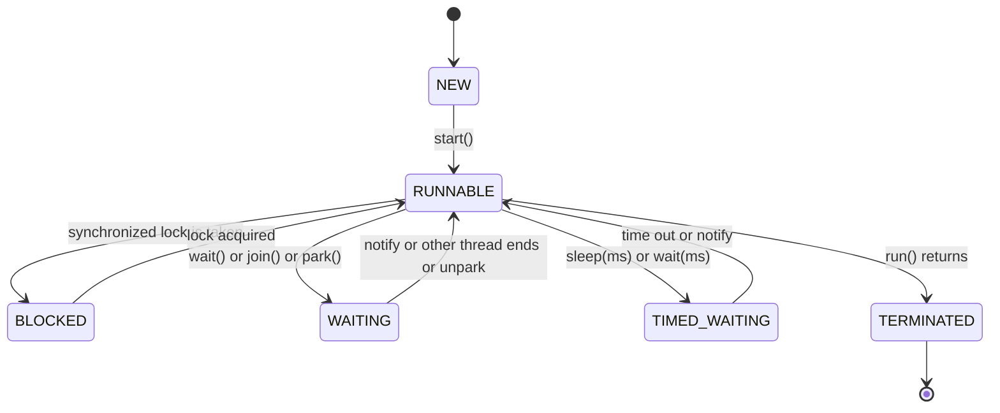
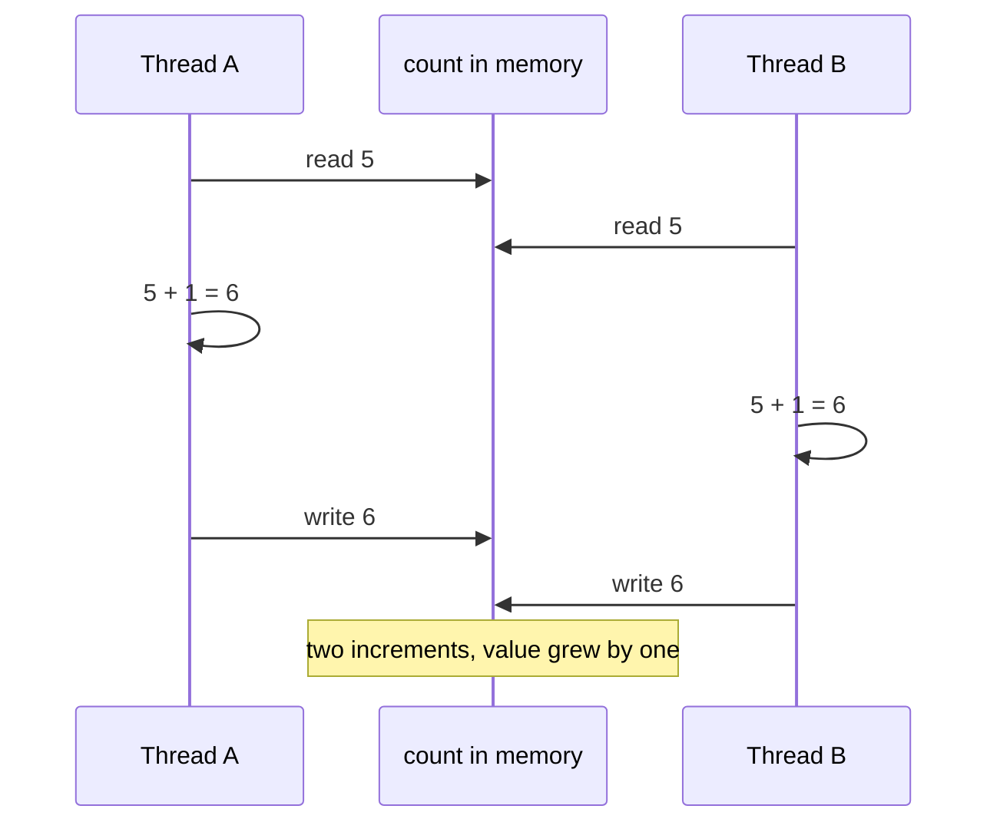

# Chapter 14 — Concurrency I: Threads, Locks and the `java.util.concurrent` Toolkit

A web server handling thousands of requests, an app downloading images while the user scrolls, a **batch job** (processing a large pile of data in one go, no user waiting) using all 16 **cores**: all do several things **at the same time**. Java has supported this since 1.0 through **threads** (§14.1), and since Java 5 through the high-level **`java.util.concurrent`** package (designed by Doug Lea and the authors of *Java Concurrency in Practice*, "JCIP"). Concurrency is also where Java programs get their nastiest bugs — results that are wrong only sometimes, on some machines, under load.

This chapter builds the foundation: creating and controlling threads, *why* shared data goes wrong (race conditions and visibility), the tools that make it right (`synchronized`, `volatile`, locks, atomics), and the everyday toolkit (thread pools, concurrent collections, synchronizers). [Chapter 15](../15-concurrency-2-modern/README.md) continues with `CompletableFuture`, Fork/Join, **virtual threads**, structured concurrency, scoped values, the Java Memory Model (the rules for when one thread's writes become visible to another) and **liveness** problems — threads that stop making progress: **deadlock** (each waiting forever for a lock another holds), **livelock** (busily reacting to each other without progress) and **starvation** (a thread never getting its turn).

All runnable code is in [`code/`](code/) (package `ch14.*`), compiled with `javac --release 25` and run on JDK 26 on a 14-core laptop. **Concurrency output is not always repeatable.** Lines marked `[nondeterministic]` change from run to run (that is the point being demonstrated); lines marked `[machine-dependent]` depend on your hardware. Everything else is forced into a fixed order with `join`, latches or barriers (§14.2, §14.13). The programs added in the numbered subsections (§14.1.1 and later, and the extensions of §14.7, §14.13 and §14.14) were compiled with `javac --release 21` and run on JDK 21 on a 4-core Linux machine, so their `[machine-dependent]` numbers come from that machine.

> **Related material — linked, not repeated.**
> - Exam-level API tables and trick questions (`Future` methods, `Executors` factories, `TimeUnit`, lock methods, parallel streams): [OCP Chapter 13 — Concurrency](../../../../ocp-java21-study/chapters/13-concurrency/README.md).
> - Design-level concepts with diagrams and interview framing (mutex — a lock that lets one thread in at a time — semaphores, producer-consumer, reader-writer, thread-pool patterns): [LLD Chapter 12 — Concurrency concepts](../../../lld/chapters/12-concurrency-concepts/README.md).
> - Classic problems solved step by step (FooBar alternation, H2O, dining philosophers, blocking queue, TTL cache — entries expire after a *time to live* — rate limiter, which caps how many requests are allowed per second): [LLD Chapter 13 — Concurrency problems](../../../lld/chapters/13-concurrency-problems/README.md).

---

## 14.1 Concurrency basics

### What it is
- A **program** is passive: instructions stored in files (`App.class`, a JAR, the `java` launcher binary). Nothing runs until the operating system loads it.
- A **process** is a running instance of a program, with its own **address space** (the private range of memory addresses it can use), its own open files and sockets, and an OS-assigned **process id** (PID); the OS isolates processes from each other. Starting `java App` twice from the same program gives two processes that share nothing: a `static` field changed in one is unchanged in the other. Each is a JVM (Java Virtual Machine, the program that runs your compiled Java code). Processes communicate only through the OS (pipes, sockets, files).
- A **thread** is an independent path of execution *inside* a process and the unit the OS **schedules** onto a core. Each thread has its own **call stack** (local variables, method frames) and **program counter** (the marker of which instruction runs next), but **all threads in a process share the same heap** (the memory area where all objects live) — the same objects and fields. A JVM is never single-threaded: even "hello world" runs alongside garbage-collector, JIT-compiler and reference-handler threads. Creating and switching threads is far cheaper than doing the same for processes, because no address space has to be set up or swapped.
- **Concurrency** means several tasks are *in progress* during the same period (possibly taking turns on one CPU core). **Parallelism** means tasks literally run *at the same instant* on different cores. Concurrency is about structure; parallelism is about hardware. (Detailed comparison with diagrams: [LLD §12.1–12.2](../../../lld/chapters/12-concurrency-concepts/README.md#121-concurrency-vs-parallelism).)

### Why it matters
1. **Responsiveness** — a UI (user interface) or server keeps answering while slow work (disk, network) happens elsewhere.
2. **Throughput** (work completed per second, §14.1.2) — while one request waits for a database, another can use the CPU.
3. **Using all cores** — CPU-heavy work (image processing, sorting big data) can be split across cores.

### The core problem
Because threads share the heap, two threads touching the same object can interfere. Three things can go wrong:
1. **Atomicity** — an operation that looks like one step (`count++`) is really several, and threads interleave in the middle (§14.5).
2. **Visibility** — a value written by one thread may not be seen by another, because of **CPU caches** (small, fast per-core copies of memory) and **compiler reordering** (the compiler or CPU shuffling independent instructions to run faster) (§14.7, and the Java Memory Model in [Chapter 15](../15-concurrency-2-modern/README.md)).
3. **Ordering** — operations may appear to happen in a different order to another thread.

Everything in this chapter is a tool against one or more of these.

### Key terms
| Term | Meaning |
|---|---|
| **Thread-safe** | behaves correctly when used by several threads at once, with no extra coordination by callers |
| **Shared mutable state** | data that more than one thread can access *and* that can change — the source of all concurrency bugs |
| **Critical section** | code that touches shared mutable state and must not be executed by two threads at once |
| **Lock / monitor** | a mechanism that lets only one thread (or a controlled number) into a critical section |
| **Blocking** | a thread waiting (for a lock, I/O, a sleep) without doing work |
| **Context switch** | the OS pausing one thread and running another on the same core |

### 14.1.1 Preemptive vs cooperative multitasking
A core runs one thread at a time; **multitasking** shares it by saving one thread's registers and program counter and switching to another (a *context switch*). The two designs differ in **who decides when to switch**:

| | Preemptive | Cooperative |
|---|---|---|
| Who switches | the **scheduler** (the OS component that picks the next thread), using a hardware timer interrupt | the running task, voluntarily |
| When | at the end of a **time slice** (a few milliseconds) or when a higher-priority thread becomes ready — at *any* instruction | only at **yield points**: a blocking call, an `await`, an explicit `yield` |
| A task stuck in a loop | slows everyone a little; others still run | **freezes** every other task sharing that thread/core |
| Shared-data consequence | a thread can be interrupted between any two instructions → races (§14.5) | no switch between yield points, so code between them runs without interference (on one thread) |
| Examples | OS threads on Linux, Windows, macOS; Java **platform threads** | Windows 3.x, classic Mac OS; JavaScript's event loop; Python `asyncio`; Kotlin coroutines; Java **virtual threads** with respect to their carrier |

Platform threads are OS threads, so they are preemptively scheduled. **Virtual threads** ([§15.4](../15-concurrency-2-modern/README.md#154-virtual-threads)) leave their **carrier** (the platform thread running them) only when they block in a JDK operation or call `Thread.yield()`: JEP 444 says the scheduler "does not currently implement time sharing for virtual threads". The OS can still preempt the carrier, but that only pauses the virtual thread; no other virtual thread gets the carrier.

[`code/ch14/threads/Multitasking.java`](code/ch14/threads/Multitasking.java) starts threads that spin until a shared deadline 300 ms away and count iterations; a count of 0 means the thread never got a CPU in time. Virtual threads share one carrier (`jdk.virtualThreadScheduler.parallelism=1`, set by the program at startup):
```java
Runnable spin = () -> {
    long count = 0;
    while (System.nanoTime() < deadline) {                 // pure CPU work, never blocks
        count++;
        if (yield && count % 1_000 == 0) Thread.yield();   // a voluntary yield point
    }
    loops.set(id, count);
};
```
Output:
```text
platform threads that ran before the deadline: 12 of 12
virtual threads, 1 carrier, no yield:          1 of 3
virtual threads, 1 carrier, Thread.yield():    3 of 3
```
- 12 platform threads on 4 cores all progressed: the OS time-sliced them.
- The first virtual thread kept the only carrier past the deadline, so the other two never ran: cooperative scheduling.
- With a `yield()` every 1,000 iterations all three ran. Real virtual threads yield whenever they block on I/O, locks or queues — why they suit I/O-bound work, not long CPU loops.

**In the interview:** "Preemptive means the scheduler can switch threads at any instruction; cooperative means a task runs until it yields. Platform threads are preemptive. Virtual threads switch only when they block or yield, so a CPU-bound virtual thread can hog its carrier."

Sources: JEP 444 (Virtual Threads), `Thread.yield` Javadoc.

### 14.1.2 Sync vs async, I/O-bound vs CPU-bound, throughput vs latency
Four pairs of words that describe *how a task uses its thread*:

| Pair | Definition | Java example |
|---|---|---|
| **Synchronous** | the caller waits for the result before continuing; the result is the return value | `String s = client.send(req, ofString()).body();` |
| **Asynchronous** | the call returns at once and the result arrives later, through a `Future`, a callback, or a `CompletableFuture` stage | `client.sendAsync(req, ofString()).thenAccept(...)` ([§15.2](../15-concurrency-2-modern/README.md#152-completablefuture)) |
| **Blocking** | the *thread* is parked until the operation can finish | `queue.take()`, `lock.lock()`, `InputStream.read()` |
| **Non-blocking** | returns immediately, even if it has to report "not ready" | `queue.poll()` → `null`, `lock.tryLock()` → `false`, NIO channels in non-blocking mode |
| **I/O-bound** | most of the time is spent waiting for disk, network or a database; the CPU sits idle | a REST call, a JDBC query |
| **CPU-bound** | the time is spent computing; adding waiting threads doesn't help, adding cores does | hashing, image resizing, sorting a large array |
| **Latency** | time for **one** operation, start to finish (report percentiles such as p50/p99 — the value 50%/99% of requests stay under) | "p99 checkout latency is 180 ms" |
| **Throughput** | operations **completed per unit of time** | "the service handles 4,000 requests/s" |

The pairs are independent: a synchronous call can be non-blocking (`poll()` in a loop), and an asynchronous API can block a thread elsewhere (`supplyAsync` runs a blocking call on a pool thread). Virtual threads give synchronous, blocking code the scalability of asynchronous code, because a blocked virtual thread holds no OS thread.

**Little's law** ties the last pair together for any stable system: **in-flight requests = throughput × latency** (L = λ × W). Two worked uses:
- *Sizing*: 2,000 requests/s at 50 ms each → 2,000 × 0.05 = **100 requests in flight**. If each holds a thread, you need ≥ 100 threads.
- *Ceiling*: a pool of 20 threads with 200 ms requests can complete at most 20 / 0.2 = **100 requests/s**, however fast the CPU is.

Throughput and latency trade against each other: batching and deep queues raise throughput but lengthen each wait, and near full utilisation waiting explodes. In the simplest queueing model (M/M/1: one server, random arrivals, 10 ms average service, so at most 100 requests/s) the average time in the system is 1 / (100 − arrival rate) s: 20 ms at 50 requests/s, 100 ms at 90/s, 1 s at 99/s. Hence servers run well below 100% busy and bounded queues reject work early (§14.11).

[`code/ch14/threads/IoVsCpu.java`](code/ch14/threads/IoVsCpu.java) compares a task's CPU time (`ThreadMXBean.getCurrentThreadCpuTime()`) with its wall-clock time, then runs 16 copies on 1 thread and on 16 threads:
```java
long wall0 = System.nanoTime(), cpu0 = MX.getCurrentThreadCpuTime();
task.run();                                   // ioTask = sleep(100); cpuTask = 100M arithmetic steps
// ... CPU busy % = cpu / wall
long speedup = timeOn(1, tasks, task) / timeOn(tasks, tasks, task);
```
Output:
```text
I/O-bound task: wall 100 ms, CPU 0 ms -> CPU busy 0%   [machine-dependent]
CPU-bound task: wall 80 ms, CPU 79 ms -> CPU busy 99%   [machine-dependent]
cores = 4, tasks = 16, pool = 16 threads   [machine-dependent]
I/O tasks: speed-up vs one thread = 15x   [machine-dependent]
CPU tasks: speed-up vs one thread = 4x   [machine-dependent]
```
Sixteen threads gave the waiting tasks a 15–16× speed-up (waits overlap for free; thread start-up costs the rest), while the CPU tasks stopped at 4×, the core count — the measured basis of the pool-sizing rule in §14.11.

Sources: `java.net.http.HttpClient`, `BlockingQueue`, `ThreadMXBean` Javadoc; JEP 444.

### 14.1.3 Limits of speed-up: Amdahl's law, Gustafson's law, Moore's law
**Amdahl's law** (Gene Amdahl, 1967): if a fraction **p** of a program's running time can be parallelised and the rest (1 − p) is serial, the best speed-up on **N** cores is

**S(N) = 1 / ((1 − p) + p / N)**, which can never exceed **1 / (1 − p)** however many cores you add.

| Parallel fraction p | 2 cores | 4 | 8 | 16 | 64 | 1,024 | limit |
|---|---|---|---|---|---|---|---|
| 50% | 1.33× | 1.60× | 1.78× | 1.88× | 1.97× | 2.00× | 2× |
| 90% | 1.82× | 3.08× | 4.71× | 6.40× | 8.77× | 9.91× | 10× |
| 95% | 1.90× | 3.48× | 5.93× | 9.14× | 15.42× | 19.64× | 20× |
| 99% | 1.98× | 3.88× | 7.48× | 13.91× | 39.26× | 91.18× | 100× |

Worked example: a 100 s job, 95 s parallelisable, takes 5 + 95/16 ≈ 10.9 s on 16 cores — 9.1×, not 16× — and never under 5 s on any number of cores. In Java the serial parts are code under a contended lock, single-threaded set-up and merge steps, and a counter every thread updates; shrinking them (lock striping, `LongAdder`, per-thread partial results) pays more than adding threads.

**Gustafson's law** (1988) is the optimistic counterpart: more cores usually solve *bigger* problems in the same time, the serial part staying roughly fixed. With s the serial fraction *measured on the N-core run*, the **scaled speed-up** is **S = s + (1 − s) × N** (s = 5%, 16 cores → 15.25×). Amdahl asks "how much faster is this fixed job?", Gustafson "how much more work fits in the same time?".

**Moore's law** (Gordon Moore, 1965, revised 1975) is an *observation*: transistor counts double roughly every two years. For decades **Dennard scaling** (smaller transistors need proportionally less power) also raised clock speeds, so single-threaded code got faster for free. Around 2005 power and heat stopped that; clock rates levelled off at a few GHz and the growing transistor budget became **more cores** (Herb Sutter, "The Free Lunch Is Over", 2005). Programs now get faster on new hardware only by using several cores — within Amdahl's limit.

**In the interview:** "Amdahl: speed-up ≤ 1/(serial fraction), so 5% serial work caps you at 20× on any number of cores; shrink contention and serial steps before adding threads. Gustafson: if the problem grows with the machine, speed-up grows almost linearly. Moore's law still adds transistors, but since Dennard scaling ended they arrive as more cores, which is why concurrency matters."

Sources: G. Amdahl, AFIPS 1967; J. Gustafson, "Reevaluating Amdahl's Law", CACM 1988; G. Moore, *Electronics* 1965; H. Sutter, "The Free Lunch Is Over", 2005.

### Self-check
1. Two `java App` processes and two threads in one process both change a `static int`. Who sees whose change? → Threads share it (same heap); processes don't (separate address spaces).
2. Why can one CPU-bound virtual thread starve others on the same carrier? → Virtual threads are scheduled cooperatively: they give up the carrier only when they block or yield.
3. A service gets 500 requests/s and each takes 80 ms. How many are in flight on average? → Little's law: 500 × 0.08 = 40.
4. 10% of a job is serial. Best possible speed-up on 1,000 cores? → Below 1/0.1 = 10× (9.91×).

---

## 14.2 Creating and starting threads

### What it is
A `java.lang.Thread` object represents one thread. The *work* it does is a `Runnable` — an interface with one method, `void run()`. Since Java 21 there are two kinds of threads: **platform threads** (a thin wrapper over an **OS thread**, i.e. a thread created and scheduled by the operating system — this chapter) and **virtual threads** (lightweight threads managed by the JVM — [Chapter 15 §15.4](../15-concurrency-2-modern/README.md#154-virtual-threads)).

### How it works
1. Describe the work: subclass `Thread` and override `run()`, or (better) write a `Runnable` — often a lambda.
2. Create the thread: `new Thread(runnable, "name")`, or the **builder** (an object you configure step by step and then ask to create the thing) `Thread.ofPlatform().name("x").unstarted(runnable)` (Java 21).
3. Call **`start()`**: the JVM creates a new OS thread, which calls `run()`. `start()` returns immediately; the new thread runs concurrently.
4. Optionally **`join()`**: the calling thread waits until the other thread has finished.
5. The thread ends when `run()` returns (or throws). A thread can be started **only once**.

[`code/ch14/threads/CreatingThreads.java`](code/ch14/threads/CreatingThreads.java) (key parts):
```java
static class Greeter extends Thread {                        // 1) subclass Thread
    Greeter() { super("greeter"); }
    @Override public void run() { System.out.println("1 subclass  running in " + Thread.currentThread().getName()); }
}
static class Task implements Runnable { ... }                // 2) implement Runnable

Thread t1 = new Greeter();
Thread t2 = new Thread(new Task(), "worker-2");
Thread t3 = new Thread(() -> System.out.println(...), "worker-3");           // 3) lambda
Thread t4 = Thread.ofPlatform().name("worker-4").unstarted(() -> ...);       // 4) builder (Java 21)
for (Thread t : new Thread[]{t1, t2, t3, t4}) { t.start(); t.join(); }

Thread notStarted = new Thread(() -> ...);
notStarted.run();                                            // just a method call - runs in main!
t1.start();                                                  // second start -> IllegalThreadStateException

Thread a = new Thread(() -> System.out.println("   [order varies] A says hi"));
Thread b = new Thread(() -> System.out.println("   [order varies] B says hi"));
a.start(); b.start(); a.join(); b.join();

Thread daemon = new Thread(() -> { while (true) Thread.onSpinWait(); }, "background-spinner");
daemon.setDaemon(true);                                      // before start()
daemon.start();
```
Output:
```text
main thread is called 'main'
1 subclass  running in greeter
2 Runnable  running in worker-2
3 lambda    running in worker-3
4 builder   running in worker-4
run() called directly executes in main
state after run(): NEW
start() twice -> IllegalThreadStateException
   [order varies] A says hi
   [order varies] B says hi
both finished (join guarantees this line comes last)
daemon? true, alive? true, id>0? true
main ends; the JVM exits even though the daemon still spins
```
What to notice:
- Calling **`run()` directly** does *not* create a thread: the code runs in `main`, and the `Thread` object stays `NEW`.
- A and B were started together, so either may print first — that's what `[order varies]` means. `join()` guarantees the line after it runs only when both are done.
- **Daemon threads** are background helpers (e.g. the **garbage collector**'s threads — the GC is the JVM component that automatically frees memory of objects no longer in use). The JVM exits when only daemon threads remain — so the infinite spinner didn't keep the program alive. Normal (non-daemon) threads *do* keep the JVM running.

### Useful `Thread` methods

| Method | Purpose |
|---|---|
| `Thread.currentThread()` | the thread running this code |
| `getName()` / `setName()` | names appear in logs and **thread dumps** (a snapshot listing every thread and what it is doing) — always name your threads |
| `threadId()` (19) | unique id (`getId()` is deprecated — still works but officially discouraged and may be removed) |
| `Thread.sleep(ms)` / `sleep(Duration)` (19) | pause the current thread; throws `InterruptedException` |
| `join()` / `join(ms)` / `join(Duration)` (19) | wait for another thread to finish |
| `isAlive()`, `getState()` | inspect |
| `setDaemon(true)` | background thread (set before `start`) |
| `setPriority(n)` | a *hint* (1–10) the OS may ignore — never rely on it for correctness |
| `setUncaughtExceptionHandler(h)` | what to do if `run()` throws (default: print **stack trace** — the chain of method calls that led to the error; the thread dies, others continue) |
| `Thread.onSpinWait()` (9) | hint inside **busy-wait** loops (loops that keep checking a condition instead of sleeping) |
| `Thread.yield()` | hint to let others run; rarely useful |

### Trade-offs: `extends Thread` vs `Runnable`

| `extends Thread` | `implements Runnable` / lambda |
|---|---|
| Uses up your single **superclass** (Java classes can extend only one parent class) | Class can extend something else |
| Couples *what* to do with *how* it runs | The same task can run in a `Thread`, a pool, a virtual thread |
| Rarely the right choice | Preferred |

### When not to use raw threads
In application code you should almost never call `new Thread(...)` directly: creating a platform thread is expensive (an OS thread with a 1–2 MB stack reservation by default, depending on the platform), and unmanaged threads are hard to shut down and monitor. Use an **`ExecutorService`** (§14.11) or, for I/O-heavy tasks on Java 21+, virtual threads ([Chapter 15](../15-concurrency-2-modern/README.md)).

### Self-check
1. What's the difference between `t.start()` and `t.run()`? → `start` creates a new thread that calls `run`; calling `run` directly executes on the current thread.
2. Can you restart a finished thread? → No: `IllegalThreadStateException`. Create a new `Thread` (or reuse the `Runnable`).
3. Why doesn't a running daemon thread stop the JVM from exiting? → The JVM exits when all non-daemon threads have finished.

---

## 14.3 Thread lifecycle

### What it is
`Thread.getState()` returns one of six `Thread.State` values:

| State | Meaning | Typical cause |
|---|---|---|
| `NEW` | created, not yet started | `new Thread(...)` |
| `RUNNABLE` | running **or ready to run** (waiting for a CPU, or even blocked in OS-level I/O) | after `start()` |
| `BLOCKED` | waiting to **acquire a monitor lock** (`synchronized`) held by another thread | entering a `synchronized` block that's taken |
| `WAITING` | waiting indefinitely for another thread's action | `Object.wait()`, `join()`, `LockSupport.park()` (low-level "pause this thread until woken", §14.9.1) |
| `TIMED_WAITING` | waiting with a timeout | `sleep(ms)`, `wait(ms)`, `join(ms)`, `tryLock(timeout)` |
| `TERMINATED` | `run()` has finished (normally or by exception) | end of `run()` |



[`code/ch14/threads/Lifecycle.java`](code/ch14/threads/Lifecycle.java) drives one thread through every state, polling `getState()` until each is reached (so the output is deterministic):
```java
Thread t = new Thread(() -> {
    while (keepSpinning) Thread.onSpinWait();   // RUNNABLE
    Thread.sleep(300);                          // TIMED_WAITING
    go.await();                                 // WAITING (a CountDownLatch parks the thread)
    synchronized (LOCK) { }                     // BLOCKED while main holds LOCK
});
```
Output:
```text
after new:              NEW
while spinning:         RUNNABLE
during sleep(300):      TIMED_WAITING
during latch.await():   WAITING
waiting for a monitor:  BLOCKED
after run() returns:    TERMINATED
```
Note the subtle split: waiting for a **`synchronized`** monitor is `BLOCKED`, but waiting for a **`ReentrantLock`** is `WAITING` (locks park the thread). A thread blocked reading a socket shows as `RUNNABLE` — the JVM doesn't distinguish OS-level I/O waits. Thread dumps (`jstack <pid>`, `jcmd <pid> Thread.print` — `pid` is the OS *process id*) show these states and are the first tool for diagnosing a hung program. More: [LLD §12.3](../../../lld/chapters/12-concurrency-concepts/README.md#123-thread-lifecycle--states).

---

## 14.4 Interruption: cooperative cancellation

### What it is
Java has no safe way to forcibly kill a thread (`Thread.stop()` was deprecated because it could leave objects half-updated; since Java 20 it throws `UnsupportedOperationException`, and JDK 26 removed it entirely). Instead, one thread **requests** another to stop by calling `t.interrupt()`, which sets the target's **interrupt flag** (a per-thread true/false marker meaning "someone asked you to stop"). The target decides how and when to stop. Analogy: tapping a colleague on the shoulder, not pulling their chair away.

### How it works
1. `t.interrupt()` sets `t`'s interrupt flag.
2. If `t` is blocked in an **interruptible** method (`sleep`, `wait`, `join`, `BlockingQueue.take`, `Lock.lockInterruptibly`, `Future.get`…), that method wakes up and throws **`InterruptedException`** — and **clears the flag**.
3. If `t` is busy computing, nothing happens automatically; the code must check `Thread.currentThread().isInterrupted()` periodically.
4. `Thread.interrupted()` (static) returns the current thread's flag **and clears it**; `isInterrupted()` only reads it.

[`code/ch14/threads/Interruption.java`](code/ch14/threads/Interruption.java) (key parts):
```java
try {
    Thread.sleep(60_000);
} catch (InterruptedException e) {
    // flag was cleared when the exception was thrown
    Thread.currentThread().interrupt();          // restore it so callers can see the request
}

while (!Thread.currentThread().isInterrupted()) loops++;     // busy code polls the flag

Thread.currentThread().interrupt();
Thread.interrupted();   // true  (and clears)
Thread.interrupted();   // false
```
Output:
```text
sleeper: woke up early, flag now = false
sleeper: flag restored = true
worker: saw the interrupt and stopped cleanly (loops > 0: true)
interrupted() first call  = true
interrupted() second call = false
```

### Common mistakes
- **Swallowing** `InterruptedException`: `catch (InterruptedException e) {}`. The cancellation request is lost; `shutdownNow()` on a pool then can't stop the task. Either **rethrow** it (declare `throws InterruptedException`) or **restore the flag** with `Thread.currentThread().interrupt()` — JCIP's rule, and why every `catch` in this chapter's code does so.
- Using a plain `boolean` field as a stop flag without `volatile` (§14.7). Interruption is preferable because it also wakes blocked threads.
- Assuming interruption stops *non-interruptible* blocking such as classic `java.io` socket reads — closing the socket is the way to unblock those.

### In the interview
**30-second answer:** "Interruption is cooperative cancellation: `interrupt()` sets a flag; blocking methods respond by throwing `InterruptedException` and clearing the flag; long computations should poll `isInterrupted()`. When I catch `InterruptedException` and can't rethrow it, I restore the flag with `Thread.currentThread().interrupt()`."
- *Why was `Thread.stop` removed?* → It released all locks mid-operation, exposing corrupted state.

---

## 14.5 Race conditions

### What it is
A **race condition** is a bug where the result depends on the unlucky timing (**interleaving** — how the steps of different threads happen to get mixed together) of threads. The two classic shapes:
1. **Read-modify-write**: `count++` is really *read* `count` → *add* 1 → *write* back. If two threads both read 5, both write 6: one increment is **lost**.
2. **Check-then-act**: `if (seat.isFree()) seat.book(me);` — between the check and the act another thread can book the same seat. **Lazy initialisation** (creating an object only the first time it's needed: `if (instance == null) instance = new X();`) has the same shape.

A **data race**, more narrowly, is when two threads access the same variable without synchronisation and at least one writes. Data races also cause *visibility* problems (§14.7).



[`code/ch14/race/RaceCondition.java`](code/ch14/race/RaceCondition.java) (key parts) — 4 threads each add 1,000,000:
```java
run(() -> { for (int i = 0; i < PER_THREAD; i++) unsafeCount++; });
run(() -> { for (int i = 0; i < PER_THREAD; i++) synchronized (LOCK) { syncCount++; } });
run(() -> { for (int i = 0; i < PER_THREAD; i++) atomicCount.incrementAndGet(); });
run(() -> { for (int i = 0; i < PER_THREAD; i++) adder.increment(); });

void bookUnsafe(String who) {
    if (owner == null) {           // check ...
        sleepQuietly();            // (real work would widen the window like this)
        owner = who;               // ... then act
        successes++;
    }
}
synchronized void bookSafe(String who) { ...same body... }
```
Output (two runs; the first line differs every time):
```text
unsynchronized count++ : 1,127,175   [nondeterministic - lost updates, changes every run]
synchronized           : 4,000,000
AtomicInteger          : 4,000,000
LongAdder              : 4,000,000
unsafe booking attempt 1: successful bookings = 2   [nondeterministic - 2 means double-booked]
unsafe booking attempt 2: successful bookings = 2   [nondeterministic - 2 means double-booked]
unsafe booking attempt 3: successful bookings = 2   [nondeterministic - 2 means double-booked]
synchronized booking: successful bookings = 1
```
```text
unsynchronized count++ : 1,927,211   [nondeterministic - lost updates, changes every run]
...
```
Almost **three quarters of the increments vanished** in the first run, and a different number in the second. The seat was double-booked every time. Both fixed versions are exact.

### Why these bugs are nasty
- They may **never appear** in tests on a laptop and then appear under **production** load (production = the real system that real users rely on).
- Adding a `println` to debug them changes the timing and often hides them ("Heisenbugs").
- The JIT compiler (the JVM's *just-in-time* compiler, which turns hot code into machine code while the program runs) may keep a non-volatile field in a **register** (a tiny storage slot inside the CPU core) for a whole loop, making results even stranger than simple interleaving suggests.

### How to fix (preview of the rest of the chapter)
1. **Don't share** — confine data to one thread (local variables, `ThreadLocal` — a variable that holds a separate value per thread) — §14.14.
2. **Don't mutate** — share only immutable objects (records with immutable fields) — §14.14.
3. **Synchronise** every access to shared mutable state — `synchronized` (§14.6), locks (§14.9).
4. **Use atomic or concurrent building blocks** — `AtomicInteger`, `ConcurrentHashMap.merge` (§14.10, §14.12).

More examples and the "critical section" framing: [LLD §12.5](../../../lld/chapters/12-concurrency-concepts/README.md#125-race-conditions--critical-sections).

### Self-check
1. Why is `count++` not atomic? → It's three steps: read, add, write.
2. Name the other classic race shape. → Check-then-act (e.g. lazy initialisation, "if free then book").
3. Does making a field `volatile` fix `count++`? → No (§14.7).

---

## 14.6 `synchronized` and intrinsic locks

### What it is
Every Java object has a built-in lock called its **intrinsic lock** or **monitor**. A `synchronized` block or method acquires it on entry and releases it on exit — even if an exception is thrown. While one thread holds a monitor, other threads trying to enter a block synchronised on the *same object* wait (state `BLOCKED`).

`synchronized` gives two guarantees:
1. **Mutual exclusion (atomicity)**: only one thread at a time runs code guarded by that lock. (*Atomic* = happens as one indivisible step that other threads can't see half-done.)
2. **Visibility**: everything a thread wrote before releasing a lock is visible to the next thread that acquires the *same* lock (a *happens-before* edge — a guaranteed "this write is visible to that read" ordering — [Chapter 15 §15.8](../15-concurrency-2-modern/README.md#158-the-java-memory-model-and-happens-before)).

### How it works

| Form | Lock used |
|---|---|
| `synchronized void m()` (instance method) | `this` |
| `static synchronized void m()` | the `Class` object (`Counter.class`) |
| `synchronized (obj) { ... }` | `obj` — any object you choose |

Intrinsic locks are **reentrant** (re-enterable by the thread that already holds them): a thread that holds a lock can enter another block guarded by the same lock (e.g. a synchronized method calling another synchronized method on `this`) without deadlocking itself. The JVM counts the entries.

[`code/ch14/sync/SynchronizedBasics.java`](code/ch14/sync/SynchronizedBasics.java) (key parts):
```java
static class Counter {
    private int value;
    public synchronized void increment() { value++; }                  // locks this
    public void incrementBlock() { synchronized (this) { value++; } }  // same lock
    public synchronized int get() { return value; }                    // reads need it too
    public synchronized void addTwice() { increment(); increment(); }  // reentrant
    public static synchronized String describe() { ... }               // locks Counter.class
}
synchronized (c) { Thread.holdsLock(c); Thread.holdsLock(Counter.class); }

Object lockA = new Object(), lockB = new Object();       // different locks don't exclude each other
```
Output:
```text
4 threads x 500,000 synchronized increments = 2000000
reentrant call worked, value = 2000002
static synchronized locks Counter.class
inside synchronized(c): holdsLock(c)=true holdsLock(Counter.class)=false
different locks -> both threads were inside at once (latch reached 0: true)
```
The last line proves the most common mistake: protection only works if **all** code touching the data uses **the same lock**. Here the two threads each held a different lock, so both were "inside" at once (the latch could only reach 0 because both got in).

### Guidelines
- **Guard every access** — reads too. An unsynchronised `get()` might return a **stale** (out-of-date) value (visibility).
- **Keep critical sections short**; never do slow I/O (input/output: disk, network) or call unknown code (**callbacks** and **listeners** — functions other code registered to be called when something happens) while holding a lock — that's how deadlocks and stalls happen.
- **Prefer a private final lock object** (`private final Object lock = new Object();`) over `synchronized(this)` in library code, so outside code can't grab your lock and interfere.
- **Never lock on** `String` literals, boxed integers (`Integer` cache!) or other shared/**interned** objects (objects the JVM reuses so one copy is shared program-wide), and not on a field that can be reassigned.
- Document which lock guards which fields with JCIP's `@GuardedBy("lock")` **annotation** (a `@` label on code for tools and readers; §14.14).
- Since Java 24 (JEP 491 — a JEP, *JDK Enhancement Proposal*, is the numbered design document for a Java feature), `synchronized` no longer "pins" (glues to one OS thread) virtual threads — details in [Chapter 15 §15.5](../15-concurrency-2-modern/README.md#155-pinning-and-jep-491).

### Common mistakes
- Synchronising the writer but not the reader.
- Synchronising two methods on *different* objects and assuming they're mutually exclusive (static vs instance synchronized methods use different locks!).
- Thinking `Collections.synchronizedList(list)` makes *iteration* safe — you must still `synchronized (list) { for (...) }` (§14.12).

### In the interview
**30-second answer:** "`synchronized` acquires the monitor of an object — `this` for instance methods, the `Class` for static ones, or any object for a block. It gives mutual exclusion and visibility, it's reentrant, and the lock is released automatically, even on exceptions. All accesses to a piece of shared state must use the same lock."
- *Is `synchronized` reentrant?* → Yes; the same thread can re-acquire a lock it holds.
- *Static and instance synchronized methods — do they block each other?* → No; different locks (`Class` object vs instance).

Deeper treatment with diagrams: [LLD §12.7](../../../lld/chapters/12-concurrency-concepts/README.md#127-mutex-mutual-exclusion-and-synchronized).

---

## 14.7 `volatile` and visibility

### What it is
Modern CPUs keep copies of memory in per-core caches, and both the compiler and the CPU reorder instructions for speed. So without synchronisation, a value written by one thread **may never become visible** to another thread, or become visible out of order. A field declared **`volatile`** fixes visibility:
- Every read of a volatile field sees the **most recent write** by any thread.
- Writes made *before* a volatile write become visible to a thread that later *reads* that volatile field (it creates a happens-before edge — [Chapter 15 §15.8](../15-concurrency-2-modern/README.md#158-the-java-memory-model-and-happens-before)).
- `volatile long`/`double` reads and writes are atomic; plain ones are not guaranteed to be (see the table below).

`volatile` does **not** provide mutual exclusion: `volatileCounter++` is still read-modify-write.

**Atomic assignments (JLS 17.7).** A single read or write is *atomic* when another thread can never observe half of it. The JLS (the *Java Language Specification*, the official rulebook of the language) guarantees:

| Access | Atomic? |
|---|---|
| read or write of `boolean`, `byte`, `char`, `short`, `int`, `float` | yes |
| read or write of any **reference** (even on 64-bit JVMs) | yes |
| plain `long` / `double` | **not guaranteed**: the JVM may perform it as two 32-bit writes, so a reader can see 32 bits of an old value and 32 bits of a new one (**word tearing**) |
| `volatile long` / `volatile double`, or access under a lock, `AtomicLong`, a `VarHandle` | yes |
| `x++`, `x += 2`, `if (x == 0) x = 1` | **no**: these are compound operations (§14.5), whatever the type |

Two interview points. **Atomic is not visible**: without a happens-before edge an atomic `int` write can go unseen indefinitely; atomicity only rules out torn values. And the JLS *encourages* JVMs not to split 64-bit values (64-bit HotSpot writes a `long` in one instruction), so tearing is legal but rarely observable — you can't test your way to safety. [`code/ch14/sync/Tearing.java`](code/ch14/sync/Tearing.java) flips a field between `0L` and `-1L` 20 million times while another thread looks for any other value:
```java
long v = (i & 1) == 0 ? A : B;  plain = v;               // writer
long v = plain;  if (v != A && v != B) torn[0]++;          // reader: a mix of the two halves
```
```text
plain long   torn reads: 0   [machine-dependent: 64-bit JVMs write a long in one instruction; a 32-bit JVM may tear]
volatile long torn reads: 0   (guaranteed 0 by JLS 17.7)
```
Rule: share a `long`/`double` across threads only as `volatile`, under a lock, or in an `AtomicLong`. Sources: JLS §17.7 "Non-Atomic Treatment of double and long", JLS §17.4.

[`code/ch14/sync/VolatileFlag.java`](code/ch14/sync/VolatileFlag.java) (key parts):
```java
private static volatile boolean running = true;          // without volatile the worker MAY spin forever

Thread worker = new Thread(() -> { long spins = 0; while (running) spins++; ... });
worker.start();
Thread.sleep(200);
running = false;                                         // guaranteed to be seen

// 4 threads x 1,000,000 of volatileCounter++
```
Output:
```text
worker saw running=false and stopped (spins > 0: true)
volatile count++ from 4 threads: 1,113,395 of 4,000,000   [nondeterministic - still loses updates]
```
(Why "may spin forever" without `volatile`: the JIT is allowed to read `running` once and turn the loop into `while (true)`. Whether it does depends on the JVM and timing, which is exactly why you can't test your way to safety — follow the rules instead.)

### When to use `volatile`
- A **status flag** written by one thread and read by others (`shutdownRequested`).
- **Publishing** an immutable object reference (`volatile Config current;` replaced wholesale).
- The double-checked-locking **idiom** (a standard code pattern; here, lazy initialisation that only locks the first time) ([Chapter 15 §15.8](../15-concurrency-2-modern/README.md#158-the-java-memory-model-and-happens-before)).

### When not to use it
When the new value depends on the old (`count++`, `balance -= x`), or several fields must change together — use locks or atomics.

| | `volatile` | `synchronized` | `AtomicInteger` |
|---|---|---|---|
| Visibility | ✓ | ✓ | ✓ |
| Atomic compound update (`++`) | ✗ | ✓ | ✓ (single variable) |
| Multi-variable invariants | ✗ | ✓ | ✗ |
| Blocking | never | may block | never (retries) |

More: [LLD §12.6](../../../lld/chapters/12-concurrency-concepts/README.md#126-java-memory-model-basics-visibility-happens-before-volatile).

---

## 14.8 `wait` / `notify`: guarded blocks

### What it is
Sometimes a thread must wait until a *condition* becomes true ("the queue is not empty"). Every object's monitor has a **wait set**:
- `obj.wait()` — releases `obj`'s lock and sleeps until notified (or interrupted, or a *spurious wakeup* — waking up for no reason, which the JVM is allowed to do); then re-acquires the lock before returning.
- `obj.notify()` — wakes **one** waiting thread (which one is unspecified). `obj.notifyAll()` wakes **all** of them.
- All three must be called **while holding `obj`'s lock**, or you get `IllegalMonitorStateException`.

### How it works — the guarded-block idiom
1. Acquire the lock (`synchronized`).
2. **`while`** the condition is false, `wait()`. (A `while`, not `if`: after waking, the condition may already be false again, or the wakeup may be spurious — §14.8.2.)
3. Do the action.
4. After changing state that others wait on, `notifyAll()`.

[`code/ch14/sync/WaitNotify.java`](code/ch14/sync/WaitNotify.java) — a two-slot buffer between a **producer** (a thread that creates work items) and a **consumer** (a thread that processes them):
```java
public synchronized void put(T item) throws InterruptedException {
    while (items.size() == capacity) wait();     // wait for "not full"
    items.add(item);
    notifyAll();                                 // wake consumers
}
public synchronized T take() throws InterruptedException {
    while (items.isEmpty()) wait();              // wait for "not empty"
    T item = items.remove();
    notifyAll();                                 // wake producers
    return item;
}
```
Output:
```text
consumer received in order: 1 2 3 4 5 6 7 8 9 10
sum = 55 (1..10 = 55)
wait() without the lock -> IllegalMonitorStateException
```
The producer ends with a **poison pill** (`-1`), a special value meaning "no more items" — a common way to stop consumers.

### When not to use it
In real code, use `BlockingQueue` (§14.12), `CountDownLatch`/`Semaphore` (§14.13) or `Condition` (§14.9), which are easier to get right. Know `wait`/`notify` for interviews and legacy code. `notify()` (single) is only safe when all waiters wait for the same condition and any one can proceed; otherwise it can wake the wrong thread (§14.8.3) — `notifyAll()` is the safe default. Step-by-step coverage: [LLD §12.13](../../../lld/chapters/12-concurrency-concepts/README.md#1213-condition-variables-waitnotify-and-condition) and the blocking queue built two ways in [LLD §13.8](../../../lld/chapters/13-concurrency-problems/README.md#138-thread-safe-bounded-blocking-queue-two-ways).

### Self-check
1. Why `while` and not `if` around `wait()`? → Spurious wakeups, and the condition may have changed before the thread re-acquired the lock.
2. Does `wait()` release the lock? → Yes (only that object's lock); `sleep()` does not release any lock.
3. Why can a `release()` before `acquire()` work, but a `notify()` before `wait()` not? → A semaphore stores permits; a condition variable has no memory.

### 14.8.1 Mutex vs semaphore vs monitor
Three classic primitives that are often confused:

| | **Mutex** (mutual-exclusion lock) | **Semaphore** (Dijkstra, 1965) | **Monitor** (Brinch Hansen 1973, Hoare 1974) |
|---|---|---|---|
| What it is | a lock: one thread inside at a time | a counter of **permits**: `acquire` takes one (waits at 0), `release` adds one | a mutex **plus** one or more **condition variables** (queues where threads wait for a condition), bundled with the data they protect |
| Owner | yes: only the holder may unlock | **none**: any thread may `release` | the mutex part has an owner |
| Memory of signals | — | **yes**: a `release` with no waiter is kept as a permit | **no**: a `notify`/`signal` with no waiter is lost (§14.8.3) |
| Re-entrant | Java's are (`synchronized`, `ReentrantLock`) | no: a thread asking for a second permit can block itself | yes in Java |
| Can admit N threads | no (exactly 1) | yes (N permits) | no (1 inside, others wait) |
| Java | `synchronized` lock, `ReentrantLock` | `java.util.concurrent.Semaphore` | every object (`synchronized` + `wait`/`notify`, one condition); `Lock` + `Condition` (many conditions) |
| Use for | protecting a critical section | limiting concurrency (10 DB connections), signalling between threads | "wait until a state is true" (buffer not empty / not full) |

A **binary semaphore** looks like a mutex but has no owner: another thread may release it, and an extra `release()` raises it to 2 permits. Each primitive can build the others — a monitor implements a semaphore with a counter and `while (count == 0) wait()` ([§22.2](../22-multithreading-interview-problems/README.md#222-implement-a-counting-semaphore)), semaphores implement mutexes and condition waits — but monitors make the common case, waiting for a state change under a lock, hard to get wrong. [`code/ch14/sync/MonitorPitfalls.java`](code/ch14/sync/MonitorPitfalls.java) part 1:
```text
1 mutex locked twice by its owner, holdCount = 2
1 semaphore: same thread tries a 2nd permit -> false (acquire() here would block forever)
1 other thread unlock(): IllegalMonitorStateException (not the owner)
1 other thread release(): ok, permits = 1
1 extra release() -> permits = 2 (a 'binary' semaphore now admits 2)
```
Deeper design discussion: [LLD §12.12](../../../lld/chapters/12-concurrency-concepts/README.md#1212-semaphores). Sources: `Semaphore`, `ReentrantLock`, `Object` Javadoc.

### 14.8.2 Hoare vs Mesa monitors: why Java needs `while`
When a thread signals a condition, *who runs next*? The two classic answers:

| | **Hoare** semantics (signal-and-wait) | **Mesa** semantics (signal-and-continue) |
|---|---|---|
| On `signal` | the lock passes **directly** to one waiter, which runs at once; the signaller is suspended | the signaller **keeps** the lock and carries on; the waiter is only moved to the queue for the lock |
| When the waiter resumes | immediately, with the condition **guaranteed** true | later, after competing for the lock, so another thread may have made the condition false again |
| Correct waiting idiom | `if (!condition) wait();` | **`while (!condition) wait();`** |
| Cost | two extra context switches per signal | cheap; the signal is just a hint |
| Where | Hoare's 1974 paper, teaching languages | Xerox's Mesa language (Lampson & Redell, 1980), **Java**, POSIX threads (`pthread_cond_wait`), C#, Python |

Java monitors are Mesa-style: `notify`/`notifyAll` and `Condition.signal` only make waiters *eligible* to re-acquire the lock, and `Object.wait`/`Condition.await` may also return with no signal at all (a **spurious wakeup**, allowed by their Javadoc). In exchange, broadcast and timed waits are easy, since a woken thread always re-checks. Part 2: two consumers wait on an empty box, one item arrives, `notifyAll` wakes both:
```java
synchronized int takeWithIf() throws InterruptedException {
    if (items.isEmpty()) wait();          // checked once only
    return items.removeFirst();           // the other consumer may have emptied it
}
synchronized int takeWithWhile() throws InterruptedException {
    while (items.isEmpty()) wait();       // re-check after every wakeup
    return items.removeFirst();
}
```
```text
2 if   : consumers that got an item = 1, crashed with NoSuchElementException = 1
2 while: after 1 item, one consumer is back in wait() instead of failing
2 while: consumers that got an item = 2, crashed with NoSuchElementException = 0
```
Under Hoare semantics the `if` version would be correct. Under Java's Mesa semantics the second consumer wakes to an empty box. Sources: `Object.wait`, `Condition` Javadoc (spurious wakeups); JLS §17.2.

### 14.8.3 Missed signals
A **missed signal** (or *lost wakeup*) happens when a notification is sent while nobody is waiting yet: condition variables have **no memory**, so the later waiter sleeps forever. Three common ways it happens:
1. **Signal before wait**: the worker finishes and calls `notify()` before the main thread reaches `wait()`.
2. **Check outside the lock**: `if (!done) { /* signal lands here */ synchronized (lock) { lock.wait(); } }`. Java blocks the worst form by requiring the lock for `wait` (otherwise `IllegalMonitorStateException`), but checking the condition *before* taking the lock still opens the gap.
3. **`notify()` wakes the wrong thread**: producers and consumers share one wait set, and the single wakeup goes to a thread that can't proceed. That thread waits again, and the thread that could proceed is never woken. `notifyAll()` or separate `Condition`s avoid it.

The fix is always the same: **record the event in state guarded by the lock, and wait in a `while` loop on that state.** Alternatively, use a primitive that remembers: `Semaphore` permits, `CountDownLatch`, the `LockSupport` permit (§14.9.1) or a `BlockingQueue`. Demo part 3, where the signal is sent first every time:
```java
synchronized (LOCK) { LOCK.wait(500); }                      // naive: nothing remembers the notify()
synchronized (LOCK) { while (!ready) LOCK.wait(500); }       // signaller did: ready = true; notifyAll()
sem.release(); ... sem.tryAcquire(500, MILLISECONDS);        // permit stored before anyone waits
```
```text
3 naive wait: still waiting until the 500 ms timeout: true -> the notify() was lost
3 flag + while: returned at once: true
3 semaphore: permit was remembered: true
```
**In the interview:** "Java monitors are Mesa-style and allow spurious wakeups, so always wait in a `while`. Condition variables don't remember signals, so keep the condition in a guarded field; a semaphore or latch remembers releases."

---

## 14.9 Explicit locks: `ReentrantLock`, `Condition`, `ReadWriteLock`, `StampedLock`

### What it is
`java.util.concurrent.locks` (Java 5) provides lock *objects* with the same mutual-exclusion and visibility guarantees as `synchronized`, plus features `synchronized` lacks:

| Feature | `synchronized` | `ReentrantLock` |
|---|---|---|
| Released automatically | ✓ (end of block) | ✗ — **must `unlock()` in `finally`** |
| Try without waiting / with timeout | ✗ | `tryLock()`, `tryLock(time, unit)` |
| Interruptible wait for the lock | ✗ | `lockInterruptibly()` |
| Fairness (FIFO-ish order — first in, first out: longest waiter goes next) | ✗ | `new ReentrantLock(true)` |
| Multiple wait conditions | one wait set per object | many `Condition`s per lock |
| Lock/unlock in different methods | ✗ | ✓ (use with care) |
| Inspect (`isLocked`, `getHoldCount`, queued threads) | ✗ | ✓ |
| Syntax | concise, can't forget to unlock | verbose |

### How it works
```java
lock.lock();
try {
    // critical section
} finally {
    lock.unlock();          // ALWAYS in finally, or an exception leaves it locked forever
}
```
[`code/ch14/locks/LocksDemo.java`](code/ch14/locks/LocksDemo.java) (key parts):
```java
lock.lock(); try { lock.lock(); try { ... } finally { lock.unlock(); } } finally { lock.unlock(); }  // reentrant
boolean got = lock.tryLock(150, TimeUnit.MILLISECONDS);      // another thread holds it
lock.lockInterruptibly();                                     // in a waiter thread, then waiter.interrupt()

Condition ready = l.newCondition();
while (!flag[0]) ready.await();                               // like wait(); signalAll() like notifyAll()

ReadWriteLock rw = new ReentrantReadWriteLock();
rw.readLock().lock();   // 3 readers wait at a CyclicBarrier(3) while holding the read lock
rw.writeLock().lock();  // exclusive: a reader's tryLock fails
```
Output:
```text
holding lock: isHeldByCurrentThread=true holdCount=1
re-entered: holdCount=2
tryLock(150ms) while another thread holds it -> false after >=150ms: true
waiter: interrupted while waiting for the lock
Condition: woke up, flag = true
ReadWriteLock: readers holding the read lock simultaneously = 3
writer holds write lock; can a reader get in now? false
```
The barrier trick proves read-sharing: a `CyclicBarrier(3)` only opens when three threads are waiting at it, and they were all holding the read lock at the time.

### `ReadWriteLock` and `StampedLock`
- **`ReentrantReadWriteLock`**: many readers **or** one writer. Worth it when reads vastly outnumber writes and critical sections are not tiny (e.g. an in-memory catalogue refreshed hourly). For small, fast sections a plain lock or `ConcurrentHashMap` is usually faster.
- **`StampedLock`** (Java 8): adds **optimistic reads** — read without locking, then `validate(stamp)` to check that no write happened; fall back to a real read lock if one did. Very fast for read-mostly data, but **not reentrant** and doesn't support `Condition`s — for experts. Examples: [LLD §12.10](../../../lld/chapters/12-concurrency-concepts/README.md#1210-read-write-locks-readwritelock-and-stampedlock).

### When not to use explicit locks
If you don't need `tryLock`, timeouts, interruptibility, fairness or several conditions, **prefer `synchronized`**: shorter, impossible to forget to unlock, and (since Java 24) equally friendly to virtual threads. Fair locks have much lower throughput; use them only when starvation is a real problem.

### In the interview
**30-second answer:** "`ReentrantLock` offers what `synchronized` doesn't: `tryLock` with timeouts to avoid deadlock, interruptible acquisition, optional fairness and multiple `Condition`s. The price is that I must unlock in `finally`. I default to `synchronized` and switch to `ReentrantLock` when I need those features; `ReadWriteLock` for read-heavy data, `StampedLock` for optimistic reads."
- *How does `tryLock` help against deadlock?* → A thread that can't get the second lock backs off, releases the first and retries, breaking the circular wait ([Chapter 15 §15.9](../15-concurrency-2-modern/README.md#159-liveness-deadlock-livelock-starvation)).

### 14.9.1 `LockSupport`: the park/unpark primitive
Every blocking class in `java.util.concurrent` (locks, `Condition`, latches, semaphores, `FutureTask`, blocking queues) finally suspends threads with **`LockSupport`**, most via `AbstractQueuedSynchronizer` (AQS), which keeps the queue of waiters. Each thread has one **permit**, available or not:

| Method | Effect |
|---|---|
| `park()` / `park(blocker)` | if the permit is available, consume it and return at once; otherwise block (state `WAITING`) |
| `parkNanos(ns)` / `parkUntil(deadlineMs)` | the same with a timeout (`TIMED_WAITING`) |
| `unpark(thread)` | make that thread's permit available; if it is parked, it wakes up |
| `getBlocker(thread)` | the object passed to `park(blocker)`; thread dumps print it ("parking to wait for …") |

Rules that follow from "one permit, not a counter":
- **`unpark` before `park` is remembered**, so park/unpark has no missed-signal problem (unlike `notify`, §14.8.3).
- **Permits don't accumulate**: two `unpark`s followed by two `park`s block on the second `park`.
- `park` also returns **when the thread is interrupted** (no exception; the flag stays set) and may return **for no reason** (spuriously). So callers always re-check their condition in a loop, and many first check `Thread.interrupted()`.
- Unlike `wait`, `park` needs no lock. When a virtual thread parks, it unmounts from its carrier, which is how JDK locks and queues free carriers.

[`code/ch14/locks/ParkDemo.java`](code/ch14/locks/ParkDemo.java) (key parts):
```java
LockSupport.unpark(Thread.currentThread()); LockSupport.park();            // 1 returns at once
LockSupport.unpark(t); LockSupport.unpark(t); LockSupport.parkNanos(1);   // 2 one permit only...
LockSupport.parkNanos(300_000_000L);                                      //   ...this one waits
Thread sleeper = new Thread(() -> LockSupport.park(blocker));             // 3 unpark from main
Thread victim  = new Thread(() -> { LockSupport.park(); flag[0] = Thread.currentThread().isInterrupted(); });
```
Output:
```text
1 unpark then park: returned immediately: true
2 second park after two unparks waited for the timeout: true
3 sleeper state = WAITING, blocker recorded: true
3 after unpark: woke = true
4 park returned on interrupt, no exception, interrupt flag still set: true
```
Use `LockSupport` directly only when building your own synchronizer (or extend AQS); application code should use the higher-level classes. Source: `LockSupport` and `AbstractQueuedSynchronizer` Javadoc.

---

## 14.10 Atomic variables

### What it is
`java.util.concurrent.atomic` classes (`AtomicInteger`, `AtomicLong`, `AtomicBoolean`, `AtomicReference<V>`, `AtomicIntegerArray`, …) offer single-variable operations that are **atomic without locks**. They're built on the CPU's **compare-and-set (CAS)** instruction (a single hardware step that checks and updates a memory location together): "if the value is still `expected`, set it to `new` and return true; otherwise change nothing and return false". A thread that loses the race simply **retries**; no thread ever blocks.

Analogy: editing a shared document with version numbers — "save my change only if the document is still version 17; otherwise reload and try again."

[`code/ch14/atomic/AtomicDemo.java`](code/ch14/atomic/AtomicDemo.java) (key parts):
```java
AtomicInteger n = new AtomicInteger(10);
n.incrementAndGet();  n.getAndIncrement();  n.addAndGet(5);
n.compareAndSet(17, 100);                  // true: value was 17
n.compareAndSet(17, 200);                  // false: value is 100 now
n.updateAndGet(x -> x * 2);
n.accumulateAndGet(50, Math::max);

do { prev = hits.get(); next = prev + 1; } while (!hits.compareAndSet(prev, next));   // what updateAndGet does

AtomicReference<Range> range = new AtomicReference<>(new Range(0, 10));
range.updateAndGet(r -> new Range(r.low() + 1, r.high() + 1));     // 4 threads x 10,000

LongAdder requests = new LongAdder();       // 8 threads x 100,000 increments
```
Output:
```text
incrementAndGet -> 11
getAndIncrement -> 11 (now 12)
addAndGet(5)    -> 17
CAS 17->100     -> true, value 100
CAS 17->200     -> false, value 100 (expected value was stale)
updateAndGet x2 -> 200
accumulateAndGet(max with 50) -> 200
hand-written CAS loop -> 1
AtomicReference after 40,000 shifts -> Range[low=40000, high=40010]
LongAdder sum -> 800000
```
- `AtomicReference` + an **immutable** (unchangeable once built) record lets you update several related values (low and high) atomically: build a new object, CAS it in. The **invariant** (a rule about the data that must always be true) `high - low == 10` always holds.
- The function passed to `updateAndGet` may run **more than once** (on retries), so it must have no side effects.
- **`LongAdder`** (Java 8) spreads increments over several internal cells to avoid CAS **contention** (many threads fighting over the same variable or lock); `sum()` adds them up. Much faster than `AtomicLong` for hot counters (**metrics** — numbers a service records about itself, like request counts), but `sum()` is not an atomic snapshot and there is no `compareAndSet`.

### Trade-offs
| | Locks | Atomics |
|---|---|---|
| Scope | any number of variables | one variable (or one reference to an immutable object) |
| Under low contention | slower | very fast |
| Under very high contention | threads sleep | many CAS retries burn CPU (`LongAdder` helps) |
| Deadlock possible? | yes | no |

CAS internals, the ABA problem (a value changes A→B→A, so CAS wrongly thinks nothing happened) and `AtomicStampedReference`: [LLD §12.15](../../../lld/chapters/12-concurrency-concepts/README.md#1215-compare-and-swap-cas--atomics).

### Self-check
1. What does `compareAndSet` return if the current value isn't the expected one? → `false`, and the value is unchanged.
2. When is `LongAdder` better than `AtomicLong`? → Many threads updating, rare reads.
3. Why must the `updateAndGet` lambda be side-effect free? → It may be retried.
4. How do you get a concurrent maximum without a lock? → `LongAccumulator(Long::max, Long.MIN_VALUE)` (or `accumulateAndGet(x, Math::max)` on an `AtomicLong`).

### 14.10.1 The rest of the atomics family
| Class | Adds | Typical use |
|---|---|---|
| `AtomicBoolean` | CAS on a flag | **run once**: `if (started.compareAndSet(false, true)) init();`; start/stop state |
| `AtomicIntegerArray`, `AtomicLongArray`, `AtomicReferenceArray<E>` | every **element** is atomic and volatile (a `volatile int[]` makes only the *array reference* volatile, not its elements) | histograms, per-slot counters, claiming slots with `compareAndSet(i, null, me)`, Bloom-filter bits |
| `AtomicStampedReference<V>` | a reference and an `int` **stamp** (version) compared and set together | fixing **ABA**: A→B→A changes the stamp, so a stale CAS fails |
| `AtomicMarkableReference<V>` | a reference and a `boolean` **mark** set together | **logical deletion** in lock-free linked lists: mark a node's `next` as "deleted" so a concurrent insert after it fails its CAS |
| `AtomicIntegerFieldUpdater`, `AtomicLongFieldUpdater`, `AtomicReferenceFieldUpdater` | atomic operations on a plain **`volatile` field** of existing objects, set up once (reflectively) in a `static final` | millions of small objects (nodes, connections) where an `AtomicInteger` each would waste memory. The field must be `volatile`, non-`static`, exactly `int`/`long` and accessible; atomicity holds only among updater operations |
| `VarHandle` (Java 9, `java.lang.invoke`) | the modern low-level equivalent of the updaters, for fields **and** array elements, plus weaker memory-order modes (`getAcquire`/`setRelease`/`getOpaque`) | library and JDK internals; prefer it to updaters in new low-level code |
| `LongAdder`, `DoubleAdder` | sum spread over per-thread cells (§14.10 above) | hot counters, totals. A `DoubleAdder` sum can differ in the last bits between runs because floating-point addition depends on order |
| `LongAccumulator(op, identity)`, `DoubleAccumulator` | generalise the adders to any **associative, commutative** operation; `accumulate(x)`, `get()`, `reset()` | concurrent **max/min**: `new LongAccumulator(Long::max, Long.MIN_VALUE)` |

Every reference CAS compares with `==` (identity), not `equals`. With boxed values such as `AtomicStampedReference<Integer>`, two equal `Integer`s outside the small-value cache are different objects, and the CAS fails. [`code/ch14/atomic/AtomicFamily.java`](code/ch14/atomic/AtomicFamily.java) (key parts):
```java
if (started.compareAndSet(false, true)) initRuns.incrementAndGet();            // 8 racing threads
histogram.incrementAndGet(i % 4);                                               // AtomicIntegerArray(4)
stamped.compareAndSet("A", "C", seenStamp, seenStamp + 1);                      // after A->B->A
link.attemptMark(next, true); link.compareAndSet(next, "node-new", false, false);
static final AtomicIntegerFieldUpdater<Connection> REFS =
        AtomicIntegerFieldUpdater.newUpdater(Connection.class, "refCount");     // volatile int refCount
REFS_VH = MethodHandles.lookup().findVarHandle(Connection.class, "refCount", int.class);
LongAccumulator maxLatency = new LongAccumulator(Long::max, Long.MIN_VALUE);
```
Output:
```text
AtomicBoolean       : 8 racing threads, init ran 1 time(s)
AtomicIntegerArray  : [10000, 10000, 10000, 10000]
AtomicReferenceArray: 5 threads tried to claim seat 0, winners = 1
ABA                 : plain CAS A->C true, stamped CAS A->C false (stamp is now 2)
AtomicMarkableRef   : marked deleted true, later insert after it succeeds? false
IntegerFieldUpdater : refCount = 40000
RefFieldUpdater     : NEW->OPEN true, NEW->OPEN again false
VarHandle CAS       : 40000->0 true, refCount = 0
updater on non-volatile field -> IllegalArgumentException: Must be volatile type
LongAccumulator(max): 99999
DoubleAdder sum     : 1000.0, DoubleAccumulator(min): 0.5
```
Sources: `java.util.concurrent.atomic` package summary and class Javadoc; `VarHandle` Javadoc (JEP 193).

### 14.10.2 Progress guarantees: blocking, obstruction-free, lock-free, wait-free
"Lock-free" is a precise term about **progress**, not about whether a `Lock` object appears in the code:

| Guarantee | Definition | If one thread is paused mid-operation (preempted, page fault, GC) | Java examples |
|---|---|---|---|
| **Blocking** | one thread can stop others from progressing indefinitely | every thread needing its lock stops too | `synchronized`, `ReentrantLock`, `BlockingQueue.put`, and also a **spin lock** made from an `AtomicBoolean` (no `Lock` object, still blocking) |
| **Obstruction-free** | a thread finishes in a finite number of its own steps **if it runs alone** | others still progress, but contending threads can keep undoing each other (livelock) | rare in practice (some transactional-memory designs) |
| **Lock-free** | at any moment, **some** thread finishes in a finite number of steps (the system as a whole progresses); an individual thread may retry forever | others unaffected | CAS-retry loops: `AtomicInteger.updateAndGet`, `ConcurrentLinkedQueue` (Michael-Scott queue), the Treiber stack in [LLD §12.15](../../../lld/chapters/12-concurrency-concepts/README.md#1215-compare-and-swap-cas--atomics) |
| **Wait-free** | **every** thread finishes in a bounded number of its own steps, so no thread can starve | others unaffected | `volatile` reads/writes; `AtomicInteger.getAndAdd` where the CPU has an atomic add (on x86-64 the JIT emits a single `LOCK XADD`, JDK-7023898); wait-free queues exist but are complex |

Each row implies the ones above it (wait-free ⇒ lock-free ⇒ obstruction-free); the JDK's **non-blocking** (e.g. `ConcurrentLinkedQueue` Javadoc) means lock-free or better. Lock-free code can't deadlock or stall behind a descheduled lock holder, but it is **not automatically faster** — contended CAS retries burn CPU (hence `LongAdder`) — and multi-variable invariants still need locks.

**In the interview:** "Lock-free means *some* thread always makes progress even if others are paused; wait-free means *every* thread finishes in bounded steps. A CAS retry loop is lock-free but not wait-free, because one unlucky thread can keep losing. A spin lock uses no `Lock` class but is still blocking."

---

## 14.11 Executors and thread pools

### What it is
An **`ExecutorService`** separates **submitting tasks** from **running them**. You hand it `Runnable`s or `Callable`s; it runs them on a **thread pool** — a set of reusable worker threads fed from a **work queue**. Analogy: a taxi rank. Passengers (tasks) queue; a fixed number of taxis (threads) take the next passenger when free, instead of buying a new car for every trip.

- **`Runnable`** — `void run()`, can't return a value or throw checked exceptions.
- **`Callable<V>`** — `V call() throws Exception`, returns a result. (**Checked exceptions** are the ones the compiler forces you to catch or declare.)
- **`Future<V>`** — a handle to a pending result: `get()` (blocks), `get(timeout, unit)`, `isDone()`, `cancel(mayInterrupt)`, `isCancelled()`, and since Java 19 `state()`, `resultNow()`, `exceptionNow()`.

### Why it matters
1. **Reuse**: creating an OS thread per task costs time and memory; pools **amortise** it (spread the one-off cost over many tasks).
2. **Bounded resources** (with a fixed upper limit): a pool of 20 threads can't create 10,000 threads during a traffic spike.
3. **Lifecycle management**: one place to shut everything down, wait for completion, collect results and exceptions.

### How it works
1. Create a pool (factory methods below, or a `ThreadPoolExecutor` directly).
2. `execute(runnable)` (fire and forget) or `submit(callable)` → `Future`.
3. `invokeAll(tasks)` → all `Future`s when every task is done; `invokeAny(tasks)` → the first successful result, cancelling the rest.
4. Shut down: `shutdown()` (stop accepting, finish queued), `awaitTermination(timeout)` (wait), `shutdownNow()` (interrupt running tasks, return queued ones). Since **Java 19** `ExecutorService` is `AutoCloseable`: **`close()`** = shutdown + wait, so try-with-resources (the `try (X x = …) { }` form that closes `x` automatically) works.

[`code/ch14/executors/ExecutorBasics.java`](code/ch14/executors/ExecutorBasics.java) (key parts):
```java
try (ExecutorService pool = Executors.newFixedThreadPool(3)) {
    pool.execute(() -> ...);                                         // 6 tasks
    Future<Integer> f = pool.submit(() -> { Thread.sleep(100); return 6 * 7; });
    f.isDone(); f.get(); f.state(); f.resultNow();

    Future<Integer> bad = pool.submit(() -> Integer.parseInt("forty-two"));
    bad.get();                                                       // ExecutionException wrapping the cause

    Future<String> slow = pool.submit(() -> { Thread.sleep(10_000); return "late"; });
    slow.get(100, TimeUnit.MILLISECONDS);                            // TimeoutException
    slow.cancel(true);                                               // interrupts the sleeping task

    pool.invokeAll(List.of(() -> "a", () -> { Thread.sleep(50); return "b"; }, () -> "c"));
    pool.invokeAny(List.of(() -> { Thread.sleep(300); return "slow mirror"; },
                           () -> { Thread.sleep(10);  return "fast mirror"; }));
}                                                                    // close(): waits for all tasks

ex.shutdown(); ex.awaitTermination(5, TimeUnit.SECONDS); ex.submit(...);   // rejected

try (ScheduledExecutorService sched = Executors.newScheduledThreadPool(1)) {
    sched.scheduleAtFixedRate(() -> ..., 50, 100, TimeUnit.MILLISECONDS);
    sched.schedule(() -> "delayed hello", 50, TimeUnit.MILLISECONDS).get();
}
```
Output:
```text
6 tasks ran on at most 3 threads: true
isDone right after submit? false
get() blocks, then returns 42
state = SUCCESS, resultNow = 42
get() -> ExecutionException caused by NumberFormatException
get(100ms) -> TimeoutException; cancel(true) = true, isCancelled = true
invokeAll results in order: abc
invokeAny -> fast mirror
pool closed (all tasks finished)
single-thread executor task
awaitTermination -> true, isTerminated = true
submit after shutdown -> RejectedExecutionException
tick 1 at ~50 ms   [timing approximate]
tick 2 at ~150 ms   [timing approximate]
tick 3 at ~250 ms   [timing approximate]
delayed hello
```
- An exception inside a task **doesn't crash anything**: it's stored in the `Future` and rethrown by `get()` as `ExecutionException` with the original as its *cause*. If you never call `get()`, a `submit`ted task's exception is silently lost — a frequent source of "the job just stopped working" mysteries. (`execute()`d tasks, by contrast, let the exception reach the thread's uncaught-exception handler, which prints it.)
- `invokeAll` returns results in **submission order**, not completion order.
- `scheduleAtFixedRate` runs at a fixed *rate* (start times 100 ms apart); `scheduleWithFixedDelay` waits a fixed *delay* after each run ends. If a periodic task throws, its future runs are silently cancelled (compared with `Timer` in §14.11.2).

### The `Executors` factory methods

| Factory | Pool | Queue | Watch out |
|---|---|---|---|
| `newFixedThreadPool(n)` | exactly n threads | **unbounded** `LinkedBlockingQueue` | a flood of tasks piles up in memory |
| `newCachedThreadPool()` | 0…∞ threads, idle ones die after 60 s | hand-off (`SynchronousQueue`) | a flood creates unbounded threads |
| `newSingleThreadExecutor()` | 1 thread | unbounded | tasks run sequentially in order |
| `newScheduledThreadPool(n)` | n threads | delay queue | periodic tasks die silently on exception |
| `newWorkStealingPool()` (8) | a `ForkJoinPool` | per-thread deques | for many small CPU tasks |
| `newVirtualThreadPerTaskExecutor()` (21) | a new virtual thread per task | none | not a pool at all — [Chapter 15](../15-concurrency-2-modern/README.md#154-virtual-threads) |

### Configuring `ThreadPoolExecutor`
For production services, build the pool explicitly so every limit is a decision. The rules for a new task are:
1. Fewer than **core** threads running → start a new thread.
2. Otherwise → put it in the **queue**.
3. Queue full and fewer than **max** threads → start an extra thread.
4. Otherwise → call the **rejection policy**.

[`code/ch14/executors/PoolConfig.java`](code/ch14/executors/PoolConfig.java) (key parts) — core 2, max 3, queue capacity 2, 7 tasks that all block:
```java
ThreadPoolExecutor pool = new ThreadPoolExecutor(
        2, 3, 30, TimeUnit.SECONDS,
        new ArrayBlockingQueue<>(2),
        new ThreadPoolExecutor.AbortPolicy());
```
Output:
```text
available processors: 14   [machine-dependent]
task 1 accepted  (threads=1, queued=0)
task 2 accepted  (threads=2, queued=0)
task 3 accepted  (threads=2, queued=1)
task 4 accepted  (threads=2, queued=2)
task 5 accepted  (threads=3, queued=2)
task 6 REJECTED  (threads=3, queued=2)
task 7 REJECTED  (threads=3, queued=2)
completed tasks = 5
third task ran in: main (the caller)
```
Note the surprise in step 3: the pool grows beyond the core size only when the queue is **full** — so with an unbounded queue, `max` is never used.

**Rejection policies**: `AbortPolicy` (default, throws `RejectedExecutionException`), **`CallerRunsPolicy`** (the submitting thread runs the task itself — natural **back-pressure** (a signal that pushes back on whoever sends work too fast, slowing them down) that slows the producer; shown in the last line), `DiscardPolicy` (silently drop), `DiscardOldestPolicy` (drop the oldest queued task).

**Sizing** (JCIP): for **CPU-bound** work (§14.1.2), about **N<sub>cpu</sub> (+1)** threads — more just adds context switches. For tasks that wait, **N<sub>threads</sub> ≈ N<sub>cpu</sub> × (1 + wait time / compute time)**; e.g. 8 cores, tasks that wait 90 ms per 10 ms of CPU → ~80 threads. Then measure. For **I/O-bound** tasks on Java 21+, virtual threads usually remove the need for this calculation.

### Common mistakes
- Forgetting to shut down a pool → non-daemon worker threads keep the JVM alive forever.
- Unbounded queues/pools in servers → `OutOfMemoryError` (the JVM ran out of heap memory) under load instead of a clean rejection.
- Tasks that wait on other tasks **in the same bounded pool** → **thread-starvation deadlock** when all threads wait for queued tasks that can't run.
- Ignoring `Future`s from `submit` → exceptions disappear.
- Sharing one pool for fast and slow work → slow tasks hog all threads (use separate pools, the *bulkhead* pattern — named after a ship's watertight walls: a failure in one compartment can't sink the rest).

### In the interview
**30-second answer:** "I use an `ExecutorService` rather than raw threads: tasks go in as `Runnable`/`Callable`, results and exceptions come back through `Future`, and I shut it down with `shutdown`/`awaitTermination` or try-with-resources on Java 19+. In production I configure `ThreadPoolExecutor` explicitly — bounded queue, a sized max, a rejection policy like `CallerRunsPolicy` for back-pressure, and named threads."
- *`shutdown` vs `shutdownNow`?* → Graceful (queued tasks still run) vs interrupt running tasks and return the queued ones.
- *Why is `newFixedThreadPool` risky?* → Its queue is unbounded.
- *`submit` vs `execute`?* → `submit` returns a `Future` and captures exceptions; `execute` returns nothing and exceptions go to the uncaught handler.

Design discussion: [LLD §12.21 Thread pool pattern](../../../lld/chapters/12-concurrency-concepts/README.md#1221-thread-pool-pattern). Exam tables (`TimeUnit`, `ScheduledExecutorService` methods): [OCP Chapter 13](../../../../ocp-java21-study/chapters/13-concurrency/README.md).

### 14.11.1 `CompletionService`: results in completion order
`invokeAll` and a loop of `future.get()` return results in **submission** order, so a slow first task holds up all the fast ones. **`ExecutorCompletionService`** wraps an executor and queues each `Future` **when it completes**:

| Method | Does |
|---|---|
| `submit(callable)` / `submit(runnable, result)` | run on the wrapped executor; returns the `Future` |
| `take()` | block until the next task completes and return its (done) `Future` |
| `poll()` / `poll(timeout, unit)` | the same without blocking / with a timeout (`null` if none) |

Call `take()` once per submission; a failed task arrives like any other and its `get()` throws `ExecutionException`. Uses: handling results as they arrive, and "first success wins" — take until one succeeds, then `cancel(true)` the rest (`invokeAny` does this when you don't need the others). [`code/ch14/executors/CompletionAndTimers.java`](code/ch14/executors/CompletionAndTimers.java), tasks that sleep 300, 100 and 200 ms:
```java
CompletionService<String> cs = new ExecutorCompletionService<>(pool);
for (Callable<String> j : jobs) cs.submit(j);
for (int i = 0; i < jobs.size(); i++) asReady.add(cs.take().get());
```
```text
invokeAll         : [A(300ms), B(100ms), C(200ms)]
CompletionService : [B(100ms), C(200ms), A(300ms)]
```
On Java 8+, `CompletableFuture`s with `thenAccept` give the same "handle each as it finishes" behaviour without a queue ([§15.2](../15-concurrency-2-modern/README.md#152-completablefuture)).

### 14.11.2 `java.util.Timer` vs `ScheduledThreadPoolExecutor`
`java.util.Timer` + `TimerTask` (Java 1.3) is the legacy scheduler. `ScheduledThreadPoolExecutor` (Java 5, what `Executors.newScheduledThreadPool` returns) replaces it; the `Timer` Javadoc itself calls it "effectively a more versatile replacement":

| | `Timer` | `ScheduledThreadPoolExecutor` |
|---|---|---|
| Threads | **one** background thread for all tasks; a slow task delays every other task | a configurable pool of core threads |
| A task throws | the Timer thread **dies**: all tasks are cancelled and every later `schedule` throws `IllegalStateException` | only that task stops; a periodic task's later runs are suppressed and its `ScheduledFuture.get()` throws `ExecutionException`; other tasks keep running |
| Clock | OpenJDK's implementation uses `System.currentTimeMillis()` (wall clock), so a clock change can shift schedules | `System.nanoTime()` (a monotonic clock that never jumps) |
| Task type | must subclass `TimerTask` | any `Runnable` or `Callable`, with a result through `ScheduledFuture` |
| Shutdown | `cancel()`; non-daemon by default (`new Timer(true)` for daemon) | `shutdown()`/`close()` like any executor |

Output of the second half of the same program (the Timer thread's stack trace also goes to stderr, as an uncaught exception):
```text
Timer after a task threw -> IllegalStateException: Timer already cancelled.
STPE failing periodic task -> ExecutionException caused by IllegalStateException; isDone = true
STPE other periodic task kept running: true
STPE terminated after shutdown: true
```
Use a scheduled executor, and wrap periodic task bodies in a logging `try/catch`: even there, an exception silently ends that task's schedule. Sources: `ExecutorCompletionService`, `Timer`, `ScheduledThreadPoolExecutor` Javadoc.

---

## 14.12 Concurrent collections

### What it is
The ordinary collections of [Chapter 10](../10-collections/README.md) (`ArrayList`, `HashMap`) are not thread-safe. There are two ways to share collections:
1. **Synchronised wrappers** — `Collections.synchronizedList/Map/Set(...)`, and the legacy `Vector`/`Hashtable`: every method takes one lock. Simple, but only one thread at a time, and **compound actions and iteration still need external locking**.
2. **Concurrent collections** (`java.util.concurrent`) — designed for concurrent access with **fine-grained locking** (many small locks, each guarding a small part) or **lock-free** algorithms (built on CAS, so no thread ever waits for a lock), plus **atomic compound operations** built in.

| Class | Use for | Notes |
|---|---|---|
| **`ConcurrentHashMap`** | shared maps, caches, counters | atomic `putIfAbsent`, `computeIfAbsent`, `compute`, `merge`; reads don't block; **no null keys/values**; weakly consistent iterators (they never throw but may or may not see changes made during iteration) |
| `ConcurrentSkipListMap` / `Set` | sorted concurrent map/set | concurrent `TreeMap`; O(log n) (time grows with the logarithm of size — very slowly) |
| **`CopyOnWriteArrayList`** / `Set` | read-mostly lists (listeners, config) | every write copies the array; iterators see a snapshot, never throw CME (`ConcurrentModificationException`) |
| **`ArrayBlockingQueue`** | bounded producer-consumer | `put` waits when full, `take` waits when empty |
| `LinkedBlockingQueue` | producer-consumer (optionally bounded) | unbounded by default |
| `PriorityBlockingQueue`, `DelayQueue` | priority / delayed tasks | unbounded |
| `SynchronousQueue` | direct hand-off (capacity 0) | used by cached thread pools |
| `LinkedTransferQueue` | producer can wait until consumed | |
| `ConcurrentLinkedQueue` / `Deque` (double-ended queue) | non-blocking queue | lock-free; `poll` returns `null` when empty |

`BlockingQueue` methods come in four flavours: throw (`add`/`remove`), special value (`offer`/`poll` → `false`/`null`), **block** (`put`/`take`), and **time out** (`offer(e, t, unit)`/`poll(t, unit)`).

[`code/ch14/collections/ConcurrentCollections.java`](code/ch14/collections/ConcurrentCollections.java) (key parts):
```java
counts.merge(w, 1, Integer::sum);                                   // atomic per key

Integer old = syncMap.get(w);                                       // each call is thread-safe,
syncMap.put(w, old == null ? 1 : old + 1);                          // the combination is NOT

groups.computeIfAbsent(w.substring(0, 1), k -> new CopyOnWriteArrayList<>()).add(w);
counts.put("x", null);                                              // NullPointerException

for (String s : plain) if (s.equals("a")) plain.add("d");           // ArrayList: CME
for (String s : cow)   { seen++; if (s.equals("a")) cow.add("d"); } // snapshot iteration

BlockingQueue<String> queue = new ArrayBlockingQueue<>(3);          // producer put()s, consumer take()s
```
Output:
```text
ConcurrentHashMap merge : {and=80000, bat=40000, cat=40000, hat=40000, the=120000}
synchronizedMap get+put : {and=55878, bat=32934, cat=33358, hat=33388, the=76273}   [nondeterministic - lost updates; expected the=120000]
computeIfAbsent sizes   : {a=8, b=4, c=4, h=4, t=12}
ConcurrentHashMap rejects null values -> NullPointerException
ArrayList modify during for-each -> ConcurrentModificationException
CopyOnWriteArrayList: iterator saw 3 elements, list now [a, b, c, d]
BlockingQueue consumed  : [job-1, job-2, job-3, job-4, job-5]
offer on full queue     : offer(2) = false (returns false instead of blocking)
poll with timeout, empty: null
ConcurrentSkipListMap sorted descending? true
ConcurrentLinkedQueue size after 4 x 1000 offers = 4000
```
The second line is the key lesson: a thread-safe collection does **not** make *your sequence of calls* atomic. `get` then `put` is check-then-act; a third of the counts were lost. Use the atomic methods (`merge`, `compute`, `computeIfAbsent`, `putIfAbsent`) — or hold one lock around the whole sequence.

### Common mistakes
- Using `containsKey` + `put` (or `get` + `put`) on a `ConcurrentHashMap` — use `putIfAbsent`/`computeIfAbsent`/`merge`.
- Long or blocking work inside `computeIfAbsent`'s function — it runs while that key's **hash bin** (the internal slot that keys with the same hash land in) is locked, so other updates to keys in the same bin wait. Never modify the same map from inside the function.
- `size()` on a busy `ConcurrentHashMap` is an estimate at that moment; don't use it for logic.
- `CopyOnWriteArrayList` for write-heavy lists — each add copies the whole array: O(n).
- Iterating a `synchronizedList` without `synchronized (list) { ... }` → `ConcurrentModificationException` or worse.

### In the interview
**30-second answer:** "For shared maps I use `ConcurrentHashMap` and its atomic methods — `merge`, `computeIfAbsent` — because separate `get` and `put` calls are a check-then-act race even on a thread-safe map. `CopyOnWriteArrayList` for read-mostly lists like listeners, `BlockingQueue` for producer-consumer, and the skip-list classes (a **skip list** is a sorted linked list with extra "express lane" links for fast search) when I need ordering."
- *How does `ConcurrentHashMap` scale?* → Since Java 8: CAS for inserting into empty bins and a lock on only the first node of a bin for updates; reads are lock-free. (Java 7 used segments.) A simplified build: [LLD §13.7](../../../lld/chapters/13-concurrency-problems/README.md#137-design-a-simplified-concurrent-hashmap--lock-striping).
- *Why no nulls?* → `get` returning `null` must unambiguously mean "absent"; with concurrent updates you can't follow up with `containsKey` safely.

More in [LLD §12.16](../../../lld/chapters/12-concurrency-concepts/README.md#1216-concurrent-collections) and [§12.22 Producer-consumer](../../../lld/chapters/12-concurrency-concepts/README.md#1222-producer-consumer-pattern).

---

## 14.13 Synchronizers: `CountDownLatch`, `CyclicBarrier`, `Semaphore`, `Phaser`

### What it is
**Synchronizers** are objects whose job is to coordinate the *flow* of threads based on their own state.

| Synchronizer | Idea | Reusable? | Typical use |
|---|---|---|---|
| **`CountDownLatch(n)`** | threads `await()` until `countDown()` has been called n times | no (one-shot) | "start all workers together"; "wait until N services are initialised" |
| **`CyclicBarrier(n, action)`** | n threads `await()` each other; when the last arrives, the optional action runs and all proceed | yes | iterative algorithms in phases (simulations) |
| **`Semaphore(permits)`** | `acquire()` takes a permit (waits if none), `release()` returns one | yes | limit concurrency: at most 10 DB (database) connections / API calls |
| **`Phaser`** (7) | like a barrier, but parties can register/deregister dynamically; numbered phases | yes | variable number of participants |
| `Exchanger<V>` | two threads swap objects at a meeting point | yes | double-buffering (one buffer is filled while the other is used, then they swap; rare) |

[`code/ch14/synchronizers/Synchronizers.java`](code/ch14/synchronizers/Synchronizers.java) (key parts):
```java
CountDownLatch startGate = new CountDownLatch(1), finished = new CountDownLatch(n);
// workers: startGate.await(); work...; finished.countDown();
startGate.countDown();  finished.await();

CyclicBarrier barrier = new CyclicBarrier(3, () -> System.out.println("barrier: all 3 arrived, ..."));
// 3 threads: for (round 0..1) barrier.await();

Semaphore permits = new Semaphore(3);
permits.acquire();
try { /* at most 3 threads here */ } finally { permits.release(); }

Phaser phaser = new Phaser(1);  phaser.register();  phaser.arriveAndAwaitAdvance();
```
Output:
```text
latch: work before opening the gate = 0
latch: work after all finished = 40, count = 0
barrier: all 3 arrived, phase 1 complete
barrier: all 3 arrived, phase 2 complete
semaphore: 20 tasks on 10 threads, max ever inside = 3 (limit 3)
phaser: main + 2 workers passed phase 0, current phase = 1
```
- `countDown()` goes in `finally` so a failing worker can't leave the waiter stuck forever. Prefer `await(timeout, unit)` in production.
- A `Semaphore` has no owner: any thread can `release()`, and releasing without acquiring *increases* the permits — always pair `acquire` with `release` in `finally`.
- If one thread waiting at a `CyclicBarrier` is interrupted or times out, the barrier becomes **broken** and all others get `BrokenBarrierException`.

**`Exchanger<V>` in depth.** `exchange(x)` blocks until a partner also calls it; each returns the other's object (the timed form throws `TimeoutException`), and everything done before the hand-over is visible to the partner. With more than two threads the pairing is arbitrary, so it fits two roles — classically **double buffering**: a filler and a drainer swap buffers when the filler's is full, so no buffer is ever shared and nothing is copied or locked.

**`Phaser` in depth.** A `Phaser` is a reusable barrier whose number of **parties** (registered participants) can change between phases:

| Method | Meaning |
|---|---|
| `new Phaser(n)`, `register()`, `bulkRegister(k)` | add parties (at any time) |
| `arriveAndAwaitAdvance()` | arrive and wait for the others (like `CyclicBarrier.await`) |
| `arrive()` | arrive **without** waiting (signal "my part of this phase is done") |
| `arriveAndDeregister()` | arrive and leave for good; later phases need one party fewer |
| `awaitAdvance(phase)` | wait for a phase to finish without being a party |
| `onAdvance(phase, registeredParties)` | override: runs once when a phase completes (like a barrier action); **return `true` to terminate** the phaser. The default terminates when no parties remain |
| `getPhase()`, `isTerminated()` | the phase number (wraps to 0 after `Integer.MAX_VALUE`; **negative** once terminated) |

A phaser holds at most 65,535 parties (**tiered** phasers — children registered with a parent — go beyond and cut contention). Unlike `CyclicBarrier` it has no "broken" state, and `arriveAndAwaitAdvance` ignores interrupts (`awaitAdvanceInterruptibly` doesn't). In the demo, three workers need 1, 2 and 4 phases and `onAdvance` stops after phase 3. [`code/ch14/synchronizers/ExchangerPhaser.java`](code/ch14/synchronizers/ExchangerPhaser.java) (key parts):
```java
if (buf.size() == 3) buf = exchanger.exchange(buf);         // filler: full buffer out, empty one back
buf = exchanger.exchange(buf); log.add("drained " + buf);   // drainer

Phaser phaser = new Phaser(1) {                             // main is a party
    @Override protected boolean onAdvance(int phase, int registeredParties) {
        return phase >= 3 || registeredParties == 0;        // true = terminate
    }
};
phaser.register();                                          // per worker; the worker loops:
if (r == rounds - 1) phaser.arriveAndDeregister(); else phaser.arriveAndAwaitAdvance();
while (!phaser.isTerminated()) phaser.arriveAndAwaitAdvance();   // main drives the phases
```
Output:
```text
Exchanger: [drained [1, 2, 3], drained [4, 5, 6]]
Exchanger: no partner within 100 ms -> TimeoutException
  phase 0 done, parties still registered = 3
  phase 1 done, parties still registered = 2
  phase 2 done, parties still registered = 2
  phase 3 done, parties still registered = 1
Phaser: terminated = true, getPhase() = -2147483644 (negative once terminated)
Phaser: awaitAdvance on a terminated phaser returns at once: -2147483644
```
The registered count fell from 4 (main + 3 workers) as workers deregistered. Sources: `Exchanger`, `Phaser` Javadoc.

Worked examples: [LLD §12.12 Semaphores](../../../lld/chapters/12-concurrency-concepts/README.md#1212-semaphores), [§12.14 Latch and barrier](../../../lld/chapters/12-concurrency-concepts/README.md#1214-countdownlatch-and-cyclicbarrier), and the rate limiter in [LLD §13.11](../../../lld/chapters/13-concurrency-problems/README.md#1311-rate-limiter--token-bucket-thread-safe).

### Self-check
1. Latch or barrier for "main waits until 5 workers finish"? → `CountDownLatch(5)`.
2. How do you cap concurrent calls to an API at 10? → `Semaphore(10)`, acquire/release around each call.
3. Can a `CountDownLatch` be reset? → No; use `CyclicBarrier` or `Phaser` for reuse.

---

## 14.14 Designing thread-safe classes

*Java Concurrency in Practice* boils thread safety down to one sentence: **manage access to shared, mutable state.** You can remove "shared", remove "mutable", or manage the access:

| Strategy | How | Example |
|---|---|---|
| **Thread confinement** | only one thread ever touches the data | local variables; objects created and used inside one task; one thread owning a UI; `ThreadLocal` ([Chapter 15](../15-concurrency-2-modern/README.md#156-threadlocal-and-scoped-values)) |
| **Immutability** | no state changes after construction; `final` fields; defensive copies (copying incoming/outgoing mutable data so outsiders can't change yours) | records with immutable components, `String`, `List.of(...)`, `java.time` — always thread-safe |
| **Encapsulated synchronisation** | private state, every access under the same private lock | the `Counter` in §14.6 |
| **Delegation** | keep state in thread-safe components | a `ConcurrentHashMap` field, an `AtomicLong` counter |

Guidelines:
1. **Prefer immutable objects**; make fields `final` unless they must change ([Chapter 5](../05-oop-classes-and-objects/README.md)).
2. **Don't let `this` escape** from a constructor (starting a thread or registering a listener in the constructor) — other threads could see a half-built object.
3. **Invariants involving several variables** need one lock around all of them (atomics per field aren't enough).
4. **Document** thread-safety guarantees in Javadoc (the `/** … */` API documentation comments) ("This class is thread-safe" / "not thread-safe").
5. **Prefer high-level utilities** (executors, concurrent collections, synchronizers) over `wait`/`notify` and raw threads — *Effective Java* Items 80–81.
6. **Test under load** and use tools: thread dumps, JFR (Java Flight Recorder, the JVM's built-in low-overhead profiler/recorder), and stress-testing harnesses such as OpenJDK's jcstress for low-level code — but remember tests can't prove absence of races; reasoning about happens-before can ([Chapter 15](../15-concurrency-2-modern/README.md#158-the-java-memory-model-and-happens-before)).

**Concurrency annotations (guideline 4 in code).** *Java Concurrency in Practice* introduced four annotations that record thread-safety decisions where readers and tools can see them:

| Annotation | On | Promise |
|---|---|---|
| `@ThreadSafe` | class | correct under any concurrent use without extra synchronisation by callers |
| `@NotThreadSafe` | class | callers must confine it to one thread or lock around it |
| `@Immutable` | class | state never changes after construction (so it is also thread-safe) |
| `@GuardedBy("lock")` | field, method | access only while holding the named lock: `"this"`, a field name (`"lock"`), `"Foo.class"`, `"Outer.this"`, `"itself"` (the field's own object) or `"method()"` (the lock returned by a method) |

```java
@ThreadSafe
public class Inventory {
    private final Object lock = new Object();
    @GuardedBy("lock") private final Map<String, Integer> stock = new HashMap<>();
    public int available(String sku) { synchronized (lock) { return stock.getOrDefault(sku, 0); } }
}
```
They are **not in the JDK**, and `javac` checks nothing. They come from a library — `net.jcip:jcip-annotations`, the dormant JSR 305 jar (`javax.annotation.concurrent`, never part of the JDK despite the name), or a checker's own versions — and static analysis enforces them: Error Prone (its `@GuardedBy`, `@ThreadSafe`, `@Immutable`, at compile time), the Checker Framework's Lock Checker, SpotBugs. Even unchecked, `@GuardedBy` tells the next maintainer which lock protects which field. Sources: JCIP Appendix A; Error Prone and Checker Framework documentation.

### Choosing the tool

| Need | Reach for |
|---|---|
| Run tasks in the background | `ExecutorService` (virtual threads for I/O-bound — Chapter 15) |
| Counter / accumulator | `AtomicInteger`/`AtomicLong`; `LongAdder` if very hot |
| Stop flag, publish an immutable snapshot | `volatile` |
| Multi-field invariant | `synchronized` (or `ReentrantLock` if you need `tryLock`/timeouts) |
| Shared map / cache | `ConcurrentHashMap` + atomic methods |
| Producer-consumer | `BlockingQueue` |
| Wait for N things to finish | `CountDownLatch` (or `invokeAll`, or `CompletableFuture.allOf`) |
| Limit concurrent access | `Semaphore` |
| Read-mostly data with rare writes | `CopyOnWriteArrayList`, `ReadWriteLock`, or an immutable snapshot in a `volatile`/`AtomicReference` |

The LLD book's version of this table with interview framing: [LLD §12.26](../../../lld/chapters/12-concurrency-concepts/README.md#1226-choosing-the-right-tool-cheat-sheet); how concurrency appears in design interviews (seat booking, parking lots, inventory): [LLD §12.25](../../../lld/chapters/12-concurrency-concepts/README.md#1225-how-concurrency-shows-up-in-lld-interviews-parking-seat-booking-inventory).

### In the interview (chapter-level)
- *How would you make a seat-booking method safe?* → Make check-and-book atomic: `synchronized` on the show (or a per-seat lock), or `ConcurrentHashMap.putIfAbsent(seatId, userId)` — and in a real system a database **constraint** (a rule like "seat id must be unique" that the database enforces) or `SELECT … FOR UPDATE` (an SQL query that locks the rows it reads until the transaction ends), because several servers run the code.
- *`synchronized` vs `volatile` vs `AtomicInteger`?* → Mutual exclusion + visibility / visibility only / lock-free atomic single-variable updates.
- *What is a thread-safe class?* → One that stays correct under any interleaving of calls from multiple threads without callers adding synchronisation.

---

## Chapter TL;DR

| Topic | Remember |
|---|---|
| Basics | Program (file) → process (own memory, PID) → thread (shared heap); platform threads preemptive, virtual threads cooperative; Little's law: in-flight = throughput × latency; Amdahl: speed-up ≤ 1/(serial fraction) |
| Threads | Share the heap, own their stack; `start()` (not `run()`) creates a thread; `join()` waits; daemon threads don't keep the JVM alive; `Thread.Builder` (21) |
| States | NEW, RUNNABLE, BLOCKED (monitor), WAITING, TIMED_WAITING, TERMINATED |
| Interruption | Cooperative; blocking calls throw `InterruptedException` and clear the flag; restore it or rethrow |
| Races | Read-modify-write and check-then-act; results vary run to run; tests can't prove absence |
| `synchronized` | Mutual exclusion + visibility; `this` / `Class` / chosen object; reentrant; same lock for every access |
| `volatile` | Visibility (and ordering) only; perfect for flags; `++` still races; plain `long`/`double` may tear (JLS 17.7) |
| `wait`/`notify` | Hold the lock, `while` loop (Mesa semantics + spurious wakeups), prefer `notifyAll`; signals aren't remembered — keep state in a field; mutex = owner, semaphore = counter, monitor = mutex + conditions |
| Locks | `ReentrantLock`: `tryLock`, timeouts, interruptible, fair, `Condition`s — unlock in `finally`; `ReadWriteLock`; `StampedLock`; all built on `LockSupport` park/unpark (one permit) |
| Atomics | CAS-based, lock-free, single variable; `AtomicReference` + immutable object; `LongAdder` for hot counters; arrays, stamped/markable refs, field updaters/`VarHandle`, accumulators; lock-free = someone progresses, wait-free = everyone does |
| Executors | Prefer to raw threads; `Future` + `ExecutionException`; shut down (or `close()`, 19); bounded queues + rejection policy in servers; size by CPU vs wait; `CompletionService` for completion order; scheduled pool, not `Timer` |
| Collections | `ConcurrentHashMap` atomic methods (`merge`, `computeIfAbsent`); COW lists for read-mostly; `BlockingQueue` for producer-consumer |
| Synchronizers | Latch (one-shot), barrier (cyclic), semaphore (permits), phaser (dynamic; `arriveAndDeregister`, `onAdvance` to terminate), exchanger (two-thread swap) |
| Design | Confinement, immutability, encapsulated locking, delegation; document with `@ThreadSafe`/`@GuardedBy` (library annotations, not JDK) |

**Where next:** composing asynchronous work with `CompletableFuture`, Fork/Join, **virtual threads**, structured concurrency, scoped values, the **Java Memory Model** and deadlock/livelock/starvation in [Chapter 15 — Concurrency II](../15-concurrency-2-modern/README.md). Practise with classic problems in [LLD Chapter 13](../../../lld/chapters/13-concurrency-problems/README.md); exam traps in [OCP Chapter 13](../../../../ocp-java21-study/chapters/13-concurrency/README.md). Python comparison (GIL, `threading`, `asyncio`): [Python Chapter 16](../../../python/chapters/16-concurrency-and-async/README.md).
