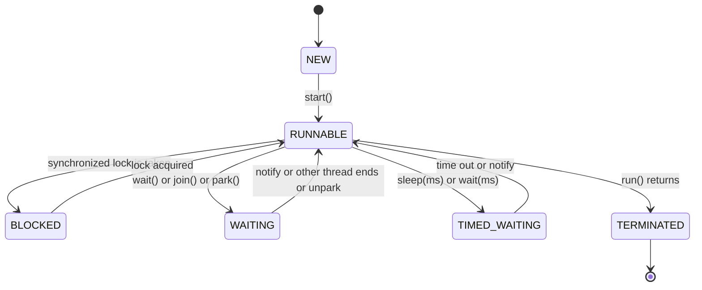
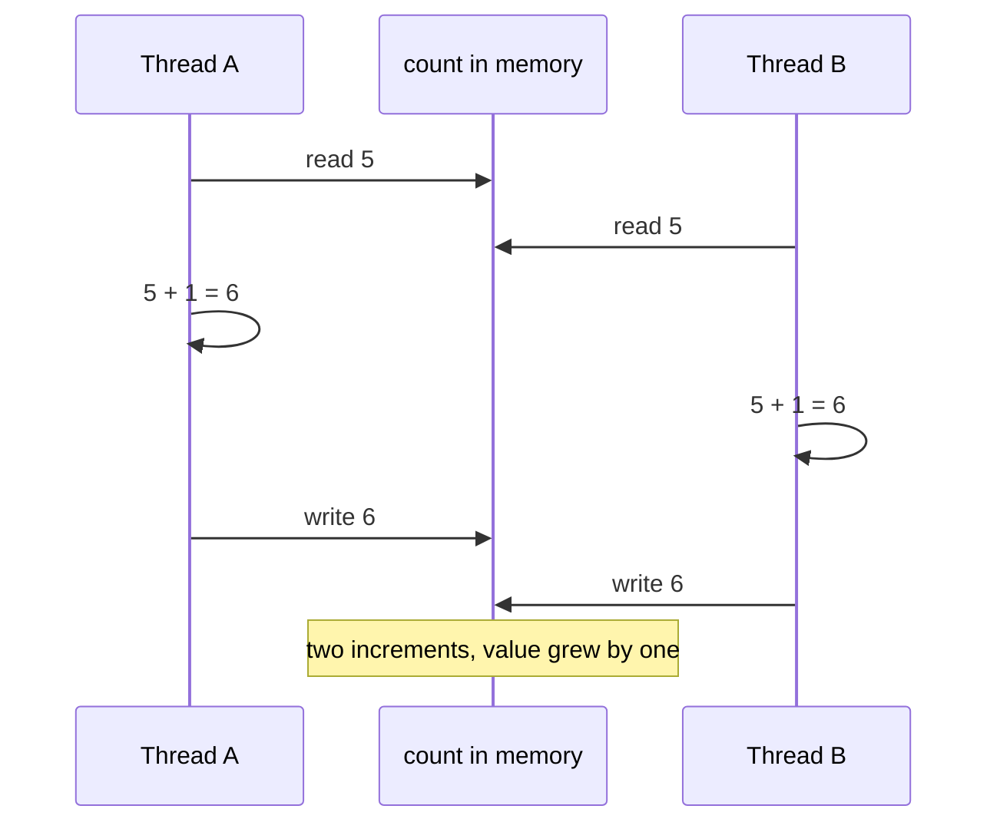

# Chapter 14 — Concurrency I: Threads, Locks and the `java.util.concurrent` Toolkit

A web server handling thousands of requests, an app downloading images while the user scrolls, a batch job using all 16 cores: all of these do several things **at the same time**. Java has supported this since version 1.0 through **threads**, and since Java 5 through the high-level **`java.util.concurrent`** package (designed by Doug Lea and the authors of *Java Concurrency in Practice*, "JCIP"). Concurrency is also where Java programs get their nastiest bugs — results that are wrong only sometimes, on some machines, under load.

This chapter builds the foundation: creating and controlling threads, *why* shared data goes wrong (race conditions and visibility), the tools that make it right (`synchronized`, `volatile`, locks, atomics), and the everyday toolkit you should actually use at work (thread pools, concurrent collections, synchronizers). [Chapter 15](../15-concurrency-2-modern/README.md) continues with `CompletableFuture`, Fork/Join, **virtual threads**, structured concurrency, scoped values, the Java Memory Model and liveness problems (deadlock, livelock, starvation).

**What you'll learn**

| § | Topic | You'll be able to… |
|---|---|---|
| 14.1 | Concurrency basics | explain processes, threads, concurrency vs parallelism, and why threads share memory |
| 14.2 | Creating and starting threads | use `Thread`, `Runnable`, lambdas and `Thread.Builder`; `start` vs `run`; `join`; daemon threads |
| 14.3 | Thread lifecycle | name every `Thread.State` and what causes each |
| 14.4 | Interruption | cancel threads cooperatively and handle `InterruptedException` correctly |
| 14.5 | Race conditions | recognise read-modify-write and check-then-act bugs |
| 14.6 | `synchronized` and intrinsic locks | protect shared state; know what object is locked |
| 14.7 | `volatile` and visibility | stop a thread with a flag; know what `volatile` does *not* do |
| 14.8 | `wait` / `notify` | write a guarded block correctly (and know why you rarely should) |
| 14.9 | Explicit locks | use `ReentrantLock`, `tryLock`, `Condition`, `ReadWriteLock`, `StampedLock` |
| 14.10 | Atomic variables | use `AtomicInteger`, CAS, `AtomicReference`, `LongAdder` |
| 14.11 | Executors and thread pools | submit tasks, use `Future`, size and configure pools, shut them down |
| 14.12 | Concurrent collections | pick `ConcurrentHashMap`, `CopyOnWriteArrayList`, `BlockingQueue`… and avoid compound-action bugs |
| 14.13 | Synchronizers | coordinate threads with `CountDownLatch`, `CyclicBarrier`, `Semaphore`, `Phaser` |
| 14.14 | Designing thread-safe classes | apply JCIP's strategies: immutability, confinement, encapsulated locking |

All runnable code is in [`code/`](code/) (package `ch14.*`), compiled with `javac --release 25` and run on JDK 26 on a 14-core laptop. **Concurrency output is not always repeatable.** Lines marked `[nondeterministic]` change from run to run (that is the point being demonstrated); lines marked `[machine-dependent]` depend on your hardware. Everything else is forced into a fixed order with `join`, latches or barriers.

> **Related material — linked, not repeated.**
> - Exam-level API tables and trick questions (`Future` methods, `Executors` factories, `TimeUnit`, lock methods, parallel streams): [OCP Chapter 13 — Concurrency](../../../../ocp-java21-study/chapters/13-concurrency/README.md).
> - Design-level concepts with diagrams and interview framing (mutex, semaphores, producer-consumer, reader-writer, thread-pool patterns): [LLD Chapter 12 — Concurrency concepts](../../../lld/chapters/12-concurrency-concepts/README.md).
> - Classic problems solved step by step (FooBar alternation, H2O, dining philosophers, blocking queue, TTL cache, rate limiter): [LLD Chapter 13 — Concurrency problems](../../../lld/chapters/13-concurrency-problems/README.md).

---

## 14.1 Concurrency basics

### What it is
- A **process** is a running program with its own memory, isolated from other processes by the operating system. Starting `java App` creates one process: the JVM.
- A **thread** is an independent path of execution *inside* a process. Each thread has its own **call stack** (local variables, method frames) and program counter, but **all threads in a process share the same heap** — the same objects and fields.
- **Concurrency** means several tasks are *in progress* during the same period (possibly taking turns on one CPU core). **Parallelism** means tasks literally run *at the same instant* on different cores. Concurrency is about structure; parallelism is about hardware. (Detailed comparison with diagrams: [LLD §12.1–12.2](../../../lld/chapters/12-concurrency-concepts/README.md#121-concurrency-vs-parallelism).)

Analogy: a restaurant kitchen. The kitchen (process) has shared fridges and counters (heap). Each cook (thread) has their own recipe card and hands (stack). Cooks working at the same time get a lot done — until two of them grab the last egg at once.

### Why it matters
1. **Responsiveness** — a UI or server keeps answering while slow work (disk, network) happens elsewhere.
2. **Throughput** — while one request waits for a database, another can use the CPU.
3. **Using all cores** — CPU-heavy work (image processing, sorting big data) can be split across cores.

### The core problem
Because threads share the heap, two threads touching the same object can interfere. Three things can go wrong:
1. **Atomicity** — an operation that looks like one step (`count++`) is really several, and threads interleave in the middle (§14.5).
2. **Visibility** — a value written by one thread may not be seen by another, because of CPU caches and compiler reordering (§14.7, and the Java Memory Model in [Chapter 15](../15-concurrency-2-modern/README.md)).
3. **Ordering** — operations may appear to happen in a different order to another thread.

Everything in this chapter is a tool against one or more of these.

### Key terms
| Term | Meaning |
|---|---|
| **Thread-safe** | behaves correctly when used by several threads at once, with no extra coordination by callers |
| **Shared mutable state** | data that more than one thread can access *and* that can change — the source of all concurrency bugs |
| **Critical section** | code that touches shared mutable state and must not be executed by two threads at once |
| **Lock / monitor** | a mechanism that lets only one thread (or a controlled number) into a critical section |
| **Blocking** | a thread waiting (for a lock, I/O, a sleep) without doing work |
| **Context switch** | the OS pausing one thread and running another on the same core |

---

## 14.2 Creating and starting threads

### What it is
A `java.lang.Thread` object represents one thread. The *work* it does is a `Runnable` — an interface with one method, `void run()`. Since Java 21 there are two kinds of threads: **platform threads** (a thin wrapper over an OS thread — this chapter) and **virtual threads** (lightweight threads managed by the JVM — [Chapter 15 §15.4](../15-concurrency-2-modern/README.md#154-virtual-threads)).

### How it works
1. Describe the work: subclass `Thread` and override `run()`, or (better) write a `Runnable` — often a lambda.
2. Create the thread: `new Thread(runnable, "name")`, or the builder `Thread.ofPlatform().name("x").unstarted(runnable)` (Java 21).
3. Call **`start()`**: the JVM creates a new OS thread, which calls `run()`. `start()` returns immediately; the new thread runs concurrently.
4. Optionally **`join()`**: the calling thread waits until the other thread has finished.
5. The thread ends when `run()` returns (or throws). A thread can be started **only once**.

[`code/ch14/threads/CreatingThreads.java`](code/ch14/threads/CreatingThreads.java) (key parts):
```java
static class Greeter extends Thread {                        // 1) subclass Thread
    Greeter() { super("greeter"); }
    @Override public void run() { System.out.println("1 subclass  running in " + Thread.currentThread().getName()); }
}
static class Task implements Runnable { ... }                // 2) implement Runnable

Thread t1 = new Greeter();
Thread t2 = new Thread(new Task(), "worker-2");
Thread t3 = new Thread(() -> System.out.println(...), "worker-3");           // 3) lambda
Thread t4 = Thread.ofPlatform().name("worker-4").unstarted(() -> ...);       // 4) builder (Java 21)
for (Thread t : new Thread[]{t1, t2, t3, t4}) { t.start(); t.join(); }

Thread notStarted = new Thread(() -> ...);
notStarted.run();                                            // just a method call - runs in main!
t1.start();                                                  // second start -> IllegalThreadStateException

Thread a = new Thread(() -> System.out.println("   [order varies] A says hi"));
Thread b = new Thread(() -> System.out.println("   [order varies] B says hi"));
a.start(); b.start(); a.join(); b.join();

Thread daemon = new Thread(() -> { while (true) Thread.onSpinWait(); }, "background-spinner");
daemon.setDaemon(true);                                      // before start()
daemon.start();
```
Output:
```text
main thread is called 'main'
1 subclass  running in greeter
2 Runnable  running in worker-2
3 lambda    running in worker-3
4 builder   running in worker-4
run() called directly executes in main
state after run(): NEW
start() twice -> IllegalThreadStateException
   [order varies] A says hi
   [order varies] B says hi
both finished (join guarantees this line comes last)
daemon? true, alive? true, id>0? true
main ends; the JVM exits even though the daemon still spins
```
What to notice:
- Calling **`run()` directly** does *not* create a thread: the code runs in `main`, and the `Thread` object stays `NEW`.
- A and B were started together, so either may print first — that's what `[order varies]` means. `join()` guarantees the line after it runs only when both are done.
- **Daemon threads** are background helpers (e.g. the garbage collector's threads). The JVM exits when only daemon threads remain — so the infinite spinner didn't keep the program alive. Normal (non-daemon) threads *do* keep the JVM running.

### Useful `Thread` methods

| Method | Purpose |
|---|---|
| `Thread.currentThread()` | the thread running this code |
| `getName()` / `setName()` | names appear in logs and thread dumps — always name your threads |
| `threadId()` (19) | unique id (`getId()` is deprecated) |
| `Thread.sleep(ms)` / `sleep(Duration)` (19) | pause the current thread; throws `InterruptedException` |
| `join()` / `join(ms)` / `join(Duration)` (19) | wait for another thread to finish |
| `isAlive()`, `getState()` | inspect |
| `setDaemon(true)` | background thread (set before `start`) |
| `setPriority(n)` | a *hint* (1–10) the OS may ignore — never rely on it for correctness |
| `setUncaughtExceptionHandler(h)` | what to do if `run()` throws (default: print stack trace; the thread dies, others continue) |
| `Thread.onSpinWait()` (9) | hint inside busy-wait loops |
| `Thread.yield()` | hint to let others run; rarely useful |

### Trade-offs: `extends Thread` vs `Runnable`

| `extends Thread` | `implements Runnable` / lambda |
|---|---|
| Uses up your single superclass | Class can extend something else |
| Couples *what* to do with *how* it runs | The same task can run in a `Thread`, a pool, a virtual thread |
| Rarely the right choice | Preferred |

### When not to use raw threads
In application code you should almost never call `new Thread(...)` directly: creating a platform thread is expensive (an OS thread with a 1–2 MB stack reservation by default, depending on the platform), and unmanaged threads are hard to shut down and monitor. Use an **`ExecutorService`** (§14.11) or, for I/O-heavy tasks on Java 21+, virtual threads ([Chapter 15](../15-concurrency-2-modern/README.md)).

### Self-check
1. What's the difference between `t.start()` and `t.run()`? → `start` creates a new thread that calls `run`; calling `run` directly executes on the current thread.
2. Can you restart a finished thread? → No: `IllegalThreadStateException`. Create a new `Thread` (or reuse the `Runnable`).
3. Why doesn't a running daemon thread stop the JVM from exiting? → The JVM exits when all non-daemon threads have finished.

---

## 14.3 Thread lifecycle

### What it is
`Thread.getState()` returns one of six `Thread.State` values:

| State | Meaning | Typical cause |
|---|---|---|
| `NEW` | created, not yet started | `new Thread(...)` |
| `RUNNABLE` | running **or ready to run** (waiting for a CPU, or even blocked in OS-level I/O) | after `start()` |
| `BLOCKED` | waiting to **acquire a monitor lock** (`synchronized`) held by another thread | entering a `synchronized` block that's taken |
| `WAITING` | waiting indefinitely for another thread's action | `Object.wait()`, `join()`, `LockSupport.park()` (used by `Lock`, latches, queues) |
| `TIMED_WAITING` | waiting with a timeout | `sleep(ms)`, `wait(ms)`, `join(ms)`, `tryLock(timeout)` |
| `TERMINATED` | `run()` has finished (normally or by exception) | end of `run()` |



[`code/ch14/threads/Lifecycle.java`](code/ch14/threads/Lifecycle.java) drives one thread through every state, polling `getState()` until each is reached (so the output is deterministic):
```java
Thread t = new Thread(() -> {
    while (keepSpinning) Thread.onSpinWait();   // RUNNABLE
    Thread.sleep(300);                          // TIMED_WAITING
    go.await();                                 // WAITING (a CountDownLatch parks the thread)
    synchronized (LOCK) { }                     // BLOCKED while main holds LOCK
});
```
Output:
```text
after new:              NEW
while spinning:         RUNNABLE
during sleep(300):      TIMED_WAITING
during latch.await():   WAITING
waiting for a monitor:  BLOCKED
after run() returns:    TERMINATED
```
Note the subtle split: waiting for a **`synchronized`** monitor is `BLOCKED`, but waiting for a **`ReentrantLock`** is `WAITING` (locks park the thread). A thread blocked reading a socket shows as `RUNNABLE` — the JVM doesn't distinguish OS-level I/O waits. Thread dumps (`jstack <pid>`, `jcmd <pid> Thread.print`) show these states and are the first tool for diagnosing a hung program. More: [LLD §12.3](../../../lld/chapters/12-concurrency-concepts/README.md#123-thread-lifecycle--states).

---

## 14.4 Interruption: cooperative cancellation

### What it is
Java has no safe way to forcibly kill a thread (`Thread.stop()` was deprecated because it could leave objects half-updated; since Java 20 it throws `UnsupportedOperationException`, and JDK 26 removed it entirely). Instead, one thread **requests** another to stop by calling `t.interrupt()`, which sets the target's **interrupt flag**. The target decides how and when to stop. Analogy: tapping a colleague on the shoulder, not pulling their chair away.

### How it works
1. `t.interrupt()` sets `t`'s interrupt flag.
2. If `t` is blocked in an **interruptible** method (`sleep`, `wait`, `join`, `BlockingQueue.take`, `Lock.lockInterruptibly`, `Future.get`…), that method wakes up and throws **`InterruptedException`** — and **clears the flag**.
3. If `t` is busy computing, nothing happens automatically; the code must check `Thread.currentThread().isInterrupted()` periodically.
4. `Thread.interrupted()` (static) returns the current thread's flag **and clears it**; `isInterrupted()` only reads it.

[`code/ch14/threads/Interruption.java`](code/ch14/threads/Interruption.java) (key parts):
```java
try {
    Thread.sleep(60_000);
} catch (InterruptedException e) {
    // flag was cleared when the exception was thrown
    Thread.currentThread().interrupt();          // restore it so callers can see the request
}

while (!Thread.currentThread().isInterrupted()) loops++;     // busy code polls the flag

Thread.currentThread().interrupt();
Thread.interrupted();   // true  (and clears)
Thread.interrupted();   // false
```
Output:
```text
sleeper: woke up early, flag now = false
sleeper: flag restored = true
worker: saw the interrupt and stopped cleanly (loops > 0: true)
interrupted() first call  = true
interrupted() second call = false
```

### Common mistakes
- **Swallowing** `InterruptedException`: `catch (InterruptedException e) {}`. The cancellation request is lost; `shutdownNow()` on a pool then can't stop the task. Either **rethrow** it (declare `throws InterruptedException`) or **restore the flag** with `Thread.currentThread().interrupt()` — JCIP's rule, and why every `catch` in this chapter's code does so.
- Using a plain `boolean` field as a stop flag without `volatile` (§14.7). Interruption is preferable because it also wakes blocked threads.
- Assuming interruption stops *non-interruptible* blocking such as classic `java.io` socket reads — closing the socket is the way to unblock those.

### In the interview
**30-second answer:** "Interruption is cooperative cancellation: `interrupt()` sets a flag; blocking methods respond by throwing `InterruptedException` and clearing the flag; long computations should poll `isInterrupted()`. When I catch `InterruptedException` and can't rethrow it, I restore the flag with `Thread.currentThread().interrupt()`."
- *Why was `Thread.stop` removed?* → It released all locks mid-operation, exposing corrupted state.

---

## 14.5 Race conditions

### What it is
A **race condition** is a bug where the result depends on the unlucky timing (interleaving) of threads. The two classic shapes:
1. **Read-modify-write**: `count++` is really *read* `count` → *add* 1 → *write* back. If two threads both read 5, both write 6: one increment is **lost**.
2. **Check-then-act**: `if (seat.isFree()) seat.book(me);` — between the check and the act another thread can book the same seat. Lazy initialisation (`if (instance == null) instance = new X();`) has the same shape.

A **data race**, more narrowly, is when two threads access the same variable without synchronisation and at least one writes. Data races also cause *visibility* problems (§14.7).



[`code/ch14/race/RaceCondition.java`](code/ch14/race/RaceCondition.java) (key parts) — 4 threads each add 1,000,000:
```java
run(() -> { for (int i = 0; i < PER_THREAD; i++) unsafeCount++; });
run(() -> { for (int i = 0; i < PER_THREAD; i++) synchronized (LOCK) { syncCount++; } });
run(() -> { for (int i = 0; i < PER_THREAD; i++) atomicCount.incrementAndGet(); });
run(() -> { for (int i = 0; i < PER_THREAD; i++) adder.increment(); });

void bookUnsafe(String who) {
    if (owner == null) {           // check ...
        sleepQuietly();            // (real work would widen the window like this)
        owner = who;               // ... then act
        successes++;
    }
}
synchronized void bookSafe(String who) { ...same body... }
```
Output (two runs; the first line differs every time):
```text
unsynchronized count++ : 1,127,175   [nondeterministic - lost updates, changes every run]
synchronized           : 4,000,000
AtomicInteger          : 4,000,000
LongAdder              : 4,000,000
unsafe booking attempt 1: successful bookings = 2   [nondeterministic - 2 means double-booked]
unsafe booking attempt 2: successful bookings = 2   [nondeterministic - 2 means double-booked]
unsafe booking attempt 3: successful bookings = 2   [nondeterministic - 2 means double-booked]
synchronized booking: successful bookings = 1
```
```text
unsynchronized count++ : 1,927,211   [nondeterministic - lost updates, changes every run]
...
```
Almost **three quarters of the increments vanished** in the first run, and a different number in the second. The seat was double-booked every time. Both fixed versions are exact.

### Why these bugs are nasty
- They may **never appear** in tests on a laptop and then appear under production load.
- Adding a `println` to debug them changes the timing and often hides them ("Heisenbugs").
- The JIT compiler may keep a non-volatile field in a register for a whole loop, making results even stranger than simple interleaving suggests.

### How to fix (preview of the rest of the chapter)
1. **Don't share** — confine data to one thread (local variables, `ThreadLocal`) — §14.14.
2. **Don't mutate** — share only immutable objects (records with immutable fields) — §14.14.
3. **Synchronise** every access to shared mutable state — `synchronized` (§14.6), locks (§14.9).
4. **Use atomic or concurrent building blocks** — `AtomicInteger`, `ConcurrentHashMap.merge` (§14.10, §14.12).

More examples and the "critical section" framing: [LLD §12.5](../../../lld/chapters/12-concurrency-concepts/README.md#125-race-conditions--critical-sections).

### Self-check
1. Why is `count++` not atomic? → It's three steps: read, add, write.
2. Name the other classic race shape. → Check-then-act (e.g. lazy initialisation, "if free then book").
3. Does making a field `volatile` fix `count++`? → No (§14.7).

---

## 14.6 `synchronized` and intrinsic locks

### What it is
Every Java object has a built-in lock called its **intrinsic lock** or **monitor**. A `synchronized` block or method acquires it on entry and releases it on exit — even if an exception is thrown. While one thread holds a monitor, other threads trying to enter a block synchronised on the *same object* wait (state `BLOCKED`).

`synchronized` gives two guarantees:
1. **Mutual exclusion (atomicity)**: only one thread at a time runs code guarded by that lock.
2. **Visibility**: everything a thread wrote before releasing a lock is visible to the next thread that acquires the *same* lock (a *happens-before* edge — [Chapter 15 §15.8](../15-concurrency-2-modern/README.md#158-the-java-memory-model-and-happens-before)).

### How it works

| Form | Lock used |
|---|---|
| `synchronized void m()` (instance method) | `this` |
| `static synchronized void m()` | the `Class` object (`Counter.class`) |
| `synchronized (obj) { ... }` | `obj` — any object you choose |

Intrinsic locks are **reentrant**: a thread that holds a lock can enter another block guarded by the same lock (e.g. a synchronized method calling another synchronized method on `this`) without deadlocking itself. The JVM counts the entries.

[`code/ch14/sync/SynchronizedBasics.java`](code/ch14/sync/SynchronizedBasics.java) (key parts):
```java
static class Counter {
    private int value;
    public synchronized void increment() { value++; }                  // locks this
    public void incrementBlock() { synchronized (this) { value++; } }  // same lock
    public synchronized int get() { return value; }                    // reads need it too
    public synchronized void addTwice() { increment(); increment(); }  // reentrant
    public static synchronized String describe() { ... }               // locks Counter.class
}
synchronized (c) { Thread.holdsLock(c); Thread.holdsLock(Counter.class); }

Object lockA = new Object(), lockB = new Object();       // different locks don't exclude each other
```
Output:
```text
4 threads x 500,000 synchronized increments = 2000000
reentrant call worked, value = 2000002
static synchronized locks Counter.class
inside synchronized(c): holdsLock(c)=true holdsLock(Counter.class)=false
different locks -> both threads were inside at once (latch reached 0: true)
```
The last line proves the most common mistake: protection only works if **all** code touching the data uses **the same lock**. Here the two threads each held a different lock, so both were "inside" at once (the latch could only reach 0 because both got in).

### Guidelines
- **Guard every access** — reads too. An unsynchronised `get()` might return a stale value (visibility).
- **Keep critical sections short**; never do slow I/O or call unknown code (callbacks, listeners) while holding a lock — that's how deadlocks and stalls happen.
- **Prefer a private final lock object** (`private final Object lock = new Object();`) over `synchronized(this)` in library code, so outside code can't grab your lock and interfere.
- **Never lock on** `String` literals, boxed integers (`Integer` cache!) or other shared/interned objects, and not on a field that can be reassigned.
- Document which lock guards which fields (JCIP's `@GuardedBy("lock")` convention).
- Since Java 24 (JEP 491), `synchronized` no longer "pins" virtual threads — details in [Chapter 15 §15.5](../15-concurrency-2-modern/README.md#155-pinning-and-jep-491).

### Common mistakes
- Synchronising the writer but not the reader.
- Synchronising two methods on *different* objects and assuming they're mutually exclusive (static vs instance synchronized methods use different locks!).
- Thinking `Collections.synchronizedList(list)` makes *iteration* safe — you must still `synchronized (list) { for (...) }` (§14.12).

### In the interview
**30-second answer:** "`synchronized` acquires the monitor of an object — `this` for instance methods, the `Class` for static ones, or any object for a block. It gives mutual exclusion and visibility, it's reentrant, and the lock is released automatically, even on exceptions. All accesses to a piece of shared state must use the same lock."
- *Is `synchronized` reentrant?* → Yes; the same thread can re-acquire a lock it holds.
- *Static and instance synchronized methods — do they block each other?* → No; different locks (`Class` object vs instance).

Deeper treatment with diagrams: [LLD §12.7](../../../lld/chapters/12-concurrency-concepts/README.md#127-mutex-mutual-exclusion-and-synchronized).

---

## 14.7 `volatile` and visibility

### What it is
Modern CPUs keep copies of memory in per-core caches, and both the compiler and the CPU reorder instructions for speed. So without synchronisation, a value written by one thread **may never become visible** to another thread, or become visible out of order. A field declared **`volatile`** fixes visibility:
- Every read of a volatile field sees the **most recent write** by any thread.
- Writes made *before* a volatile write become visible to a thread that later *reads* that volatile field (it creates a happens-before edge — [Chapter 15 §15.8](../15-concurrency-2-modern/README.md#158-the-java-memory-model-and-happens-before)).
- `volatile long`/`double` reads and writes are atomic (plain 64-bit writes are allowed to be split in two by the JLS).

`volatile` does **not** provide mutual exclusion: `volatileCounter++` is still read-modify-write.

[`code/ch14/sync/VolatileFlag.java`](code/ch14/sync/VolatileFlag.java) (key parts):
```java
private static volatile boolean running = true;          // without volatile the worker MAY spin forever

Thread worker = new Thread(() -> { long spins = 0; while (running) spins++; ... });
worker.start();
Thread.sleep(200);
running = false;                                         // guaranteed to be seen

// 4 threads x 1,000,000 of volatileCounter++
```
Output:
```text
worker saw running=false and stopped (spins > 0: true)
volatile count++ from 4 threads: 1,113,395 of 4,000,000   [nondeterministic - still loses updates]
```
(Why "may spin forever" without `volatile`: the JIT is allowed to read `running` once and turn the loop into `while (true)`. Whether it does depends on the JVM and timing, which is exactly why you can't test your way to safety — follow the rules instead.)

### When to use `volatile`
- A **status flag** written by one thread and read by others (`shutdownRequested`).
- **Publishing** an immutable object reference (`volatile Config current;` replaced wholesale).
- The double-checked-locking idiom ([Chapter 15 §15.8](../15-concurrency-2-modern/README.md#158-the-java-memory-model-and-happens-before)).

### When not to use it
When the new value depends on the old (`count++`, `balance -= x`), or several fields must change together — use locks or atomics.

| | `volatile` | `synchronized` | `AtomicInteger` |
|---|---|---|---|
| Visibility | ✓ | ✓ | ✓ |
| Atomic compound update (`++`) | ✗ | ✓ | ✓ (single variable) |
| Multi-variable invariants | ✗ | ✓ | ✗ |
| Blocking | never | may block | never (retries) |

More: [LLD §12.6](../../../lld/chapters/12-concurrency-concepts/README.md#126-java-memory-model-basics-visibility-happens-before-volatile).

---

## 14.8 `wait` / `notify`: guarded blocks

### What it is
Sometimes a thread must wait until a *condition* becomes true ("the queue is not empty"). Every object's monitor has a **wait set**:
- `obj.wait()` — releases `obj`'s lock and sleeps until notified (or interrupted, or a *spurious wakeup*); then re-acquires the lock before returning.
- `obj.notify()` — wakes **one** waiting thread (which one is unspecified). `obj.notifyAll()` wakes **all** of them.
- All three must be called **while holding `obj`'s lock**, or you get `IllegalMonitorStateException`.

### How it works — the guarded-block idiom
1. Acquire the lock (`synchronized`).
2. **`while`** the condition is false, `wait()`. (A `while`, not `if`: after waking, the condition may already be false again — another thread got there first — or the wakeup may be spurious.)
3. Do the action.
4. After changing state that others wait on, `notifyAll()`.

[`code/ch14/sync/WaitNotify.java`](code/ch14/sync/WaitNotify.java) — a two-slot buffer between a producer and a consumer:
```java
public synchronized void put(T item) throws InterruptedException {
    while (items.size() == capacity) wait();     // wait for "not full"
    items.add(item);
    notifyAll();                                 // wake consumers
}
public synchronized T take() throws InterruptedException {
    while (items.isEmpty()) wait();              // wait for "not empty"
    T item = items.remove();
    notifyAll();                                 // wake producers
    return item;
}
```
Output:
```text
consumer received in order: 1 2 3 4 5 6 7 8 9 10
sum = 55 (1..10 = 55)
wait() without the lock -> IllegalMonitorStateException
```
The producer ends with a **poison pill** (`-1`), a special value meaning "no more items" — a common way to stop consumers.

### When not to use it
In real code, use `BlockingQueue` (§14.12), `CountDownLatch`/`Semaphore` (§14.13) or `Condition` (§14.9), which are easier to get right. Know `wait`/`notify` for interviews and legacy code. `notify()` (single) is only safe when all waiters wait for the same condition and any one can proceed; otherwise a "lost wakeup" can leave threads stuck — `notifyAll()` is the safe default. Step-by-step coverage: [LLD §12.13](../../../lld/chapters/12-concurrency-concepts/README.md#1213-condition-variables-waitnotify-and-condition) and the blocking queue built two ways in [LLD §13.8](../../../lld/chapters/13-concurrency-problems/README.md#138-thread-safe-bounded-blocking-queue-two-ways).

### Self-check
1. Why `while` and not `if` around `wait()`? → Spurious wakeups, and the condition may have changed before the thread re-acquired the lock.
2. Does `wait()` release the lock? → Yes (only that object's lock); `sleep()` does not release any lock.

---

## 14.9 Explicit locks: `ReentrantLock`, `Condition`, `ReadWriteLock`, `StampedLock`

### What it is
`java.util.concurrent.locks` (Java 5) provides lock *objects* with the same mutual-exclusion and visibility guarantees as `synchronized`, plus features `synchronized` lacks:

| Feature | `synchronized` | `ReentrantLock` |
|---|---|---|
| Released automatically | ✓ (end of block) | ✗ — **must `unlock()` in `finally`** |
| Try without waiting / with timeout | ✗ | `tryLock()`, `tryLock(time, unit)` |
| Interruptible wait for the lock | ✗ | `lockInterruptibly()` |
| Fairness (FIFO-ish order) | ✗ | `new ReentrantLock(true)` |
| Multiple wait conditions | one wait set per object | many `Condition`s per lock |
| Lock/unlock in different methods | ✗ | ✓ (use with care) |
| Inspect (`isLocked`, `getHoldCount`, queued threads) | ✗ | ✓ |
| Syntax | concise, can't forget to unlock | verbose |

### How it works
```java
lock.lock();
try {
    // critical section
} finally {
    lock.unlock();          // ALWAYS in finally, or an exception leaves it locked forever
}
```
[`code/ch14/locks/LocksDemo.java`](code/ch14/locks/LocksDemo.java) (key parts):
```java
lock.lock(); try { lock.lock(); try { ... } finally { lock.unlock(); } } finally { lock.unlock(); }  // reentrant
boolean got = lock.tryLock(150, TimeUnit.MILLISECONDS);      // another thread holds it
lock.lockInterruptibly();                                     // in a waiter thread, then waiter.interrupt()

Condition ready = l.newCondition();
while (!flag[0]) ready.await();                               // like wait(); signalAll() like notifyAll()

ReadWriteLock rw = new ReentrantReadWriteLock();
rw.readLock().lock();   // 3 readers wait at a CyclicBarrier(3) while holding the read lock
rw.writeLock().lock();  // exclusive: a reader's tryLock fails
```
Output:
```text
holding lock: isHeldByCurrentThread=true holdCount=1
re-entered: holdCount=2
tryLock(150ms) while another thread holds it -> false after >=150ms: true
waiter: interrupted while waiting for the lock
Condition: woke up, flag = true
ReadWriteLock: readers holding the read lock simultaneously = 3
writer holds write lock; can a reader get in now? false
```
The barrier trick proves read-sharing: a `CyclicBarrier(3)` only opens when three threads are waiting at it, and they were all holding the read lock at the time.

### `ReadWriteLock` and `StampedLock`
- **`ReentrantReadWriteLock`**: many readers **or** one writer. Worth it when reads vastly outnumber writes and critical sections are not tiny (e.g. an in-memory catalogue refreshed hourly). For small, fast sections a plain lock or `ConcurrentHashMap` is usually faster.
- **`StampedLock`** (Java 8): adds **optimistic reads** — read without locking, then `validate(stamp)` to check that no write happened; fall back to a real read lock if one did. Very fast for read-mostly data, but **not reentrant** and doesn't support `Condition`s — for experts. Examples: [LLD §12.10](../../../lld/chapters/12-concurrency-concepts/README.md#1210-read-write-locks-readwritelock-and-stampedlock).

### When not to use explicit locks
If you don't need `tryLock`, timeouts, interruptibility, fairness or several conditions, **prefer `synchronized`**: shorter, impossible to forget to unlock, and (since Java 24) equally friendly to virtual threads. Fair locks have much lower throughput; use them only when starvation is a real problem.

### In the interview
**30-second answer:** "`ReentrantLock` offers what `synchronized` doesn't: `tryLock` with timeouts to avoid deadlock, interruptible acquisition, optional fairness and multiple `Condition`s. The price is that I must unlock in `finally`. I default to `synchronized` and switch to `ReentrantLock` when I need those features; `ReadWriteLock` for read-heavy data, `StampedLock` for optimistic reads."
- *How does `tryLock` help against deadlock?* → A thread that can't get the second lock backs off, releases the first and retries, breaking the circular wait ([Chapter 15 §15.9](../15-concurrency-2-modern/README.md#159-liveness-deadlock-livelock-starvation)).

---

## 14.10 Atomic variables

### What it is
`java.util.concurrent.atomic` classes (`AtomicInteger`, `AtomicLong`, `AtomicBoolean`, `AtomicReference<V>`, `AtomicIntegerArray`, …) offer single-variable operations that are **atomic without locks**. They're built on the CPU's **compare-and-set (CAS)** instruction: "if the value is still `expected`, set it to `new` and return true; otherwise change nothing and return false". A thread that loses the race simply **retries**; no thread ever blocks.

Analogy: editing a shared document with version numbers — "save my change only if the document is still version 17; otherwise reload and try again."

[`code/ch14/atomic/AtomicDemo.java`](code/ch14/atomic/AtomicDemo.java) (key parts):
```java
AtomicInteger n = new AtomicInteger(10);
n.incrementAndGet();  n.getAndIncrement();  n.addAndGet(5);
n.compareAndSet(17, 100);                  // true: value was 17
n.compareAndSet(17, 200);                  // false: value is 100 now
n.updateAndGet(x -> x * 2);
n.accumulateAndGet(50, Math::max);

do { prev = hits.get(); next = prev + 1; } while (!hits.compareAndSet(prev, next));   // what updateAndGet does

AtomicReference<Range> range = new AtomicReference<>(new Range(0, 10));
range.updateAndGet(r -> new Range(r.low() + 1, r.high() + 1));     // 4 threads x 10,000

LongAdder requests = new LongAdder();       // 8 threads x 100,000 increments
```
Output:
```text
incrementAndGet -> 11
getAndIncrement -> 11 (now 12)
addAndGet(5)    -> 17
CAS 17->100     -> true, value 100
CAS 17->200     -> false, value 100 (expected value was stale)
updateAndGet x2 -> 200
accumulateAndGet(max with 50) -> 200
hand-written CAS loop -> 1
AtomicReference after 40,000 shifts -> Range[low=40000, high=40010]
LongAdder sum -> 800000
```
- `AtomicReference` + an **immutable** record lets you update several related values (low and high) atomically: build a new object, CAS it in. The invariant `high - low == 10` always holds.
- The function passed to `updateAndGet` may run **more than once** (on retries), so it must have no side effects.
- **`LongAdder`** (Java 8) spreads increments over several internal cells to avoid CAS contention; `sum()` adds them up. Much faster than `AtomicLong` for hot counters (metrics, request counts), but `sum()` is not an atomic snapshot and there is no `compareAndSet`.

### Trade-offs
| | Locks | Atomics |
|---|---|---|
| Scope | any number of variables | one variable (or one reference to an immutable object) |
| Under low contention | slower | very fast |
| Under very high contention | threads sleep | many CAS retries burn CPU (`LongAdder` helps) |
| Deadlock possible? | yes | no |

CAS internals, the ABA problem and `AtomicStampedReference`: [LLD §12.15](../../../lld/chapters/12-concurrency-concepts/README.md#1215-compare-and-swap-cas--atomics).

### Self-check
1. What does `compareAndSet` return if the current value isn't the expected one? → `false`, and the value is unchanged.
2. When is `LongAdder` better than `AtomicLong`? → Many threads updating, rare reads.
3. Why must the `updateAndGet` lambda be side-effect free? → It may be retried.

---

## 14.11 Executors and thread pools

### What it is
An **`ExecutorService`** separates **submitting tasks** from **running them**. You hand it `Runnable`s or `Callable`s; it runs them on a **thread pool** — a set of reusable worker threads fed from a **work queue**. Analogy: a taxi rank. Passengers (tasks) queue; a fixed number of taxis (threads) take the next passenger when free, instead of buying a new car for every trip.

- **`Runnable`** — `void run()`, can't return a value or throw checked exceptions.
- **`Callable<V>`** — `V call() throws Exception`, returns a result.
- **`Future<V>`** — a handle to a pending result: `get()` (blocks), `get(timeout, unit)`, `isDone()`, `cancel(mayInterrupt)`, `isCancelled()`, and since Java 19 `state()`, `resultNow()`, `exceptionNow()`.

### Why it matters
1. **Reuse**: creating an OS thread per task costs time and memory; pools amortise it.
2. **Bounded resources**: a pool of 20 threads can't create 10,000 threads during a traffic spike.
3. **Lifecycle management**: one place to shut everything down, wait for completion, collect results and exceptions.

### How it works
1. Create a pool (factory methods below, or a `ThreadPoolExecutor` directly).
2. `execute(runnable)` (fire and forget) or `submit(callable)` → `Future`.
3. `invokeAll(tasks)` → all `Future`s when every task is done; `invokeAny(tasks)` → the first successful result, cancelling the rest.
4. Shut down: `shutdown()` (stop accepting, finish queued), `awaitTermination(timeout)` (wait), `shutdownNow()` (interrupt running tasks, return queued ones). Since **Java 19** `ExecutorService` is `AutoCloseable`: **`close()`** = shutdown + wait, so try-with-resources works.

[`code/ch14/executors/ExecutorBasics.java`](code/ch14/executors/ExecutorBasics.java) (key parts):
```java
try (ExecutorService pool = Executors.newFixedThreadPool(3)) {
    pool.execute(() -> ...);                                         // 6 tasks
    Future<Integer> f = pool.submit(() -> { Thread.sleep(100); return 6 * 7; });
    f.isDone(); f.get(); f.state(); f.resultNow();

    Future<Integer> bad = pool.submit(() -> Integer.parseInt("forty-two"));
    bad.get();                                                       // ExecutionException wrapping the cause

    Future<String> slow = pool.submit(() -> { Thread.sleep(10_000); return "late"; });
    slow.get(100, TimeUnit.MILLISECONDS);                            // TimeoutException
    slow.cancel(true);                                               // interrupts the sleeping task

    pool.invokeAll(List.of(() -> "a", () -> { Thread.sleep(50); return "b"; }, () -> "c"));
    pool.invokeAny(List.of(() -> { Thread.sleep(300); return "slow mirror"; },
                           () -> { Thread.sleep(10);  return "fast mirror"; }));
}                                                                    // close(): waits for all tasks

ex.shutdown(); ex.awaitTermination(5, TimeUnit.SECONDS); ex.submit(...);   // rejected

try (ScheduledExecutorService sched = Executors.newScheduledThreadPool(1)) {
    sched.scheduleAtFixedRate(() -> ..., 50, 100, TimeUnit.MILLISECONDS);
    sched.schedule(() -> "delayed hello", 50, TimeUnit.MILLISECONDS).get();
}
```
Output:
```text
6 tasks ran on at most 3 threads: true
isDone right after submit? false
get() blocks, then returns 42
state = SUCCESS, resultNow = 42
get() -> ExecutionException caused by NumberFormatException
get(100ms) -> TimeoutException; cancel(true) = true, isCancelled = true
invokeAll results in order: abc
invokeAny -> fast mirror
pool closed (all tasks finished)
single-thread executor task
awaitTermination -> true, isTerminated = true
submit after shutdown -> RejectedExecutionException
tick 1 at ~50 ms   [timing approximate]
tick 2 at ~150 ms   [timing approximate]
tick 3 at ~250 ms   [timing approximate]
delayed hello
```
- An exception inside a task **doesn't crash anything**: it's stored in the `Future` and rethrown by `get()` as `ExecutionException` with the original as its *cause*. If you never call `get()`, a `submit`ted task's exception is silently lost — a frequent source of "the job just stopped working" mysteries. (`execute()`d tasks, by contrast, let the exception reach the thread's uncaught-exception handler, which prints it.)
- `invokeAll` returns results in **submission order**, not completion order.
- `scheduleAtFixedRate` runs at a fixed *rate* (start times 100 ms apart); `scheduleWithFixedDelay` waits a fixed *delay* after each run ends. If a periodic task throws, its future runs are silently cancelled.

### The `Executors` factory methods

| Factory | Pool | Queue | Watch out |
|---|---|---|---|
| `newFixedThreadPool(n)` | exactly n threads | **unbounded** `LinkedBlockingQueue` | a flood of tasks piles up in memory |
| `newCachedThreadPool()` | 0…∞ threads, idle ones die after 60 s | hand-off (`SynchronousQueue`) | a flood creates unbounded threads |
| `newSingleThreadExecutor()` | 1 thread | unbounded | tasks run sequentially in order |
| `newScheduledThreadPool(n)` | n threads | delay queue | periodic tasks die silently on exception |
| `newWorkStealingPool()` (8) | a `ForkJoinPool` | per-thread deques | for many small CPU tasks |
| `newVirtualThreadPerTaskExecutor()` (21) | a new virtual thread per task | none | not a pool at all — [Chapter 15](../15-concurrency-2-modern/README.md#154-virtual-threads) |

### Configuring `ThreadPoolExecutor`
For production services, build the pool explicitly so every limit is a decision. The rules for a new task are:
1. Fewer than **core** threads running → start a new thread.
2. Otherwise → put it in the **queue**.
3. Queue full and fewer than **max** threads → start an extra thread.
4. Otherwise → call the **rejection policy**.

[`code/ch14/executors/PoolConfig.java`](code/ch14/executors/PoolConfig.java) (key parts) — core 2, max 3, queue capacity 2, 7 tasks that all block:
```java
ThreadPoolExecutor pool = new ThreadPoolExecutor(
        2, 3, 30, TimeUnit.SECONDS,
        new ArrayBlockingQueue<>(2),
        new ThreadPoolExecutor.AbortPolicy());
```
Output:
```text
available processors: 14   [machine-dependent]
task 1 accepted  (threads=1, queued=0)
task 2 accepted  (threads=2, queued=0)
task 3 accepted  (threads=2, queued=1)
task 4 accepted  (threads=2, queued=2)
task 5 accepted  (threads=3, queued=2)
task 6 REJECTED  (threads=3, queued=2)
task 7 REJECTED  (threads=3, queued=2)
completed tasks = 5
third task ran in: main (the caller)
```
Note the surprise in step 3: the pool grows beyond the core size only when the queue is **full** — so with an unbounded queue, `max` is never used.

**Rejection policies**: `AbortPolicy` (default, throws `RejectedExecutionException`), **`CallerRunsPolicy`** (the submitting thread runs the task itself — natural back-pressure that slows the producer; shown in the last line), `DiscardPolicy` (silently drop), `DiscardOldestPolicy` (drop the oldest queued task).

**Sizing** (JCIP): for CPU-bound work, about **N<sub>cpu</sub> (+1)** threads — more just adds context switches. For tasks that wait, **N<sub>threads</sub> ≈ N<sub>cpu</sub> × (1 + wait time / compute time)**; e.g. 8 cores, tasks that wait 90 ms per 10 ms of CPU → ~80 threads. Then measure. For I/O-bound tasks on Java 21+, virtual threads usually remove the need for this calculation.

### Common mistakes
- Forgetting to shut down a pool → non-daemon worker threads keep the JVM alive forever.
- Unbounded queues/pools in servers → `OutOfMemoryError` under load instead of a clean rejection.
- Tasks that wait on other tasks **in the same bounded pool** → **thread-starvation deadlock** when all threads wait for queued tasks that can't run.
- Ignoring `Future`s from `submit` → exceptions disappear.
- Sharing one pool for fast and slow work → slow tasks hog all threads (use separate pools, the *bulkhead* pattern).

### In the interview
**30-second answer:** "I use an `ExecutorService` rather than raw threads: tasks go in as `Runnable`/`Callable`, results and exceptions come back through `Future`, and I shut it down with `shutdown`/`awaitTermination` or try-with-resources on Java 19+. In production I configure `ThreadPoolExecutor` explicitly — bounded queue, a sized max, a rejection policy like `CallerRunsPolicy` for back-pressure, and named threads."
- *`shutdown` vs `shutdownNow`?* → Graceful (queued tasks still run) vs interrupt running tasks and return the queued ones.
- *Why is `newFixedThreadPool` risky?* → Its queue is unbounded.
- *`submit` vs `execute`?* → `submit` returns a `Future` and captures exceptions; `execute` returns nothing and exceptions go to the uncaught handler.

Design discussion: [LLD §12.21 Thread pool pattern](../../../lld/chapters/12-concurrency-concepts/README.md#1221-thread-pool-pattern). Exam tables (`TimeUnit`, `ScheduledExecutorService` methods): [OCP Chapter 13](../../../../ocp-java21-study/chapters/13-concurrency/README.md).

---

## 14.12 Concurrent collections

### What it is
The ordinary collections of [Chapter 10](../10-collections/README.md) (`ArrayList`, `HashMap`) are not thread-safe. There are two ways to share collections:
1. **Synchronised wrappers** — `Collections.synchronizedList/Map/Set(...)`, and the legacy `Vector`/`Hashtable`: every method takes one lock. Simple, but only one thread at a time, and **compound actions and iteration still need external locking**.
2. **Concurrent collections** (`java.util.concurrent`) — designed for concurrent access with fine-grained locking or lock-free algorithms, plus **atomic compound operations** built in.

| Class | Use for | Notes |
|---|---|---|
| **`ConcurrentHashMap`** | shared maps, caches, counters | atomic `putIfAbsent`, `computeIfAbsent`, `compute`, `merge`; reads don't block; **no null keys/values**; weakly consistent iterators |
| `ConcurrentSkipListMap` / `Set` | sorted concurrent map/set | concurrent `TreeMap`; O(log n) |
| **`CopyOnWriteArrayList`** / `Set` | read-mostly lists (listeners, config) | every write copies the array; iterators see a snapshot, never throw CME |
| **`ArrayBlockingQueue`** | bounded producer-consumer | `put` waits when full, `take` waits when empty |
| `LinkedBlockingQueue` | producer-consumer (optionally bounded) | unbounded by default |
| `PriorityBlockingQueue`, `DelayQueue` | priority / delayed tasks | unbounded |
| `SynchronousQueue` | direct hand-off (capacity 0) | used by cached thread pools |
| `LinkedTransferQueue` | producer can wait until consumed | |
| `ConcurrentLinkedQueue` / `Deque` | non-blocking queue | lock-free; `poll` returns `null` when empty |

`BlockingQueue` methods come in four flavours: throw (`add`/`remove`), special value (`offer`/`poll` → `false`/`null`), **block** (`put`/`take`), and **time out** (`offer(e, t, unit)`/`poll(t, unit)`).

[`code/ch14/collections/ConcurrentCollections.java`](code/ch14/collections/ConcurrentCollections.java) (key parts):
```java
counts.merge(w, 1, Integer::sum);                                   // atomic per key

Integer old = syncMap.get(w);                                       // each call is thread-safe,
syncMap.put(w, old == null ? 1 : old + 1);                          // the combination is NOT

groups.computeIfAbsent(w.substring(0, 1), k -> new CopyOnWriteArrayList<>()).add(w);
counts.put("x", null);                                              // NullPointerException

for (String s : plain) if (s.equals("a")) plain.add("d");           // ArrayList: CME
for (String s : cow)   { seen++; if (s.equals("a")) cow.add("d"); } // snapshot iteration

BlockingQueue<String> queue = new ArrayBlockingQueue<>(3);          // producer put()s, consumer take()s
```
Output:
```text
ConcurrentHashMap merge : {and=80000, bat=40000, cat=40000, hat=40000, the=120000}
synchronizedMap get+put : {and=55878, bat=32934, cat=33358, hat=33388, the=76273}   [nondeterministic - lost updates; expected the=120000]
computeIfAbsent sizes   : {a=8, b=4, c=4, h=4, t=12}
ConcurrentHashMap rejects null values -> NullPointerException
ArrayList modify during for-each -> ConcurrentModificationException
CopyOnWriteArrayList: iterator saw 3 elements, list now [a, b, c, d]
BlockingQueue consumed  : [job-1, job-2, job-3, job-4, job-5]
offer on full queue     : offer(2) = false (returns false instead of blocking)
poll with timeout, empty: null
ConcurrentSkipListMap sorted descending? true
ConcurrentLinkedQueue size after 4 x 1000 offers = 4000
```
The second line is the key lesson: a thread-safe collection does **not** make *your sequence of calls* atomic. `get` then `put` is check-then-act; a third of the counts were lost. Use the atomic methods (`merge`, `compute`, `computeIfAbsent`, `putIfAbsent`) — or hold one lock around the whole sequence.

### Common mistakes
- Using `containsKey` + `put` (or `get` + `put`) on a `ConcurrentHashMap` — use `putIfAbsent`/`computeIfAbsent`/`merge`.
- Long or blocking work inside `computeIfAbsent`'s function — it runs while that key's hash bin is locked, so other updates to keys in the same bin wait. Never modify the same map from inside the function.
- `size()` on a busy `ConcurrentHashMap` is an estimate at that moment; don't use it for logic.
- `CopyOnWriteArrayList` for write-heavy lists — each add copies the whole array: O(n).
- Iterating a `synchronizedList` without `synchronized (list) { ... }` → `ConcurrentModificationException` or worse.

### In the interview
**30-second answer:** "For shared maps I use `ConcurrentHashMap` and its atomic methods — `merge`, `computeIfAbsent` — because separate `get` and `put` calls are a check-then-act race even on a thread-safe map. `CopyOnWriteArrayList` for read-mostly lists like listeners, `BlockingQueue` for producer-consumer, and the skip-list classes when I need ordering."
- *How does `ConcurrentHashMap` scale?* → Since Java 8: CAS for inserting into empty bins and a lock on only the first node of a bin for updates; reads are lock-free. (Java 7 used segments.) A simplified build: [LLD §13.7](../../../lld/chapters/13-concurrency-problems/README.md#137-design-a-simplified-concurrent-hashmap--lock-striping).
- *Why no nulls?* → `get` returning `null` must unambiguously mean "absent"; with concurrent updates you can't follow up with `containsKey` safely.

More in [LLD §12.16](../../../lld/chapters/12-concurrency-concepts/README.md#1216-concurrent-collections) and [§12.22 Producer-consumer](../../../lld/chapters/12-concurrency-concepts/README.md#1222-producer-consumer-pattern).

---

## 14.13 Synchronizers: `CountDownLatch`, `CyclicBarrier`, `Semaphore`, `Phaser`

### What it is
**Synchronizers** are objects whose job is to coordinate the *flow* of threads based on their own state.

| Synchronizer | Idea | Reusable? | Typical use |
|---|---|---|---|
| **`CountDownLatch(n)`** | threads `await()` until `countDown()` has been called n times | no (one-shot) | "start all workers together"; "wait until N services are initialised" |
| **`CyclicBarrier(n, action)`** | n threads `await()` each other; when the last arrives, the optional action runs and all proceed | yes | iterative algorithms in phases (simulations) |
| **`Semaphore(permits)`** | `acquire()` takes a permit (waits if none), `release()` returns one | yes | limit concurrency: at most 10 DB connections / API calls |
| **`Phaser`** (7) | like a barrier, but parties can register/deregister dynamically; numbered phases | yes | variable number of participants |
| `Exchanger<V>` | two threads swap objects at a meeting point | yes | double-buffering (rare) |

[`code/ch14/synchronizers/Synchronizers.java`](code/ch14/synchronizers/Synchronizers.java) (key parts):
```java
CountDownLatch startGate = new CountDownLatch(1), finished = new CountDownLatch(n);
// workers: startGate.await(); work...; finished.countDown();
startGate.countDown();  finished.await();

CyclicBarrier barrier = new CyclicBarrier(3, () -> System.out.println("barrier: all 3 arrived, ..."));
// 3 threads: for (round 0..1) barrier.await();

Semaphore permits = new Semaphore(3);
permits.acquire();
try { /* at most 3 threads here */ } finally { permits.release(); }

Phaser phaser = new Phaser(1);  phaser.register();  phaser.arriveAndAwaitAdvance();
```
Output:
```text
latch: work before opening the gate = 0
latch: work after all finished = 40, count = 0
barrier: all 3 arrived, phase 1 complete
barrier: all 3 arrived, phase 2 complete
semaphore: 20 tasks on 10 threads, max ever inside = 3 (limit 3)
phaser: main + 2 workers passed phase 0, current phase = 1
```
- `countDown()` goes in `finally` so a failing worker can't leave the waiter stuck forever. Prefer `await(timeout, unit)` in production.
- A `Semaphore` has no owner: any thread can `release()`, and releasing without acquiring *increases* the permits — always pair `acquire` with `release` in `finally`.
- If one thread waiting at a `CyclicBarrier` is interrupted or times out, the barrier becomes **broken** and all others get `BrokenBarrierException`.

Worked examples: [LLD §12.12 Semaphores](../../../lld/chapters/12-concurrency-concepts/README.md#1212-semaphores), [§12.14 Latch and barrier](../../../lld/chapters/12-concurrency-concepts/README.md#1214-countdownlatch-and-cyclicbarrier), and the rate limiter in [LLD §13.11](../../../lld/chapters/13-concurrency-problems/README.md#1311-rate-limiter--token-bucket-thread-safe).

### Self-check
1. Latch or barrier for "main waits until 5 workers finish"? → `CountDownLatch(5)`.
2. How do you cap concurrent calls to an API at 10? → `Semaphore(10)`, acquire/release around each call.
3. Can a `CountDownLatch` be reset? → No; use `CyclicBarrier` or `Phaser` for reuse.

---

## 14.14 Designing thread-safe classes

*Java Concurrency in Practice* boils thread safety down to one sentence: **manage access to shared, mutable state.** You can remove "shared", remove "mutable", or manage the access:

| Strategy | How | Example |
|---|---|---|
| **Thread confinement** | only one thread ever touches the data | local variables; objects created and used inside one task; one thread owning a UI; `ThreadLocal` ([Chapter 15](../15-concurrency-2-modern/README.md#156-threadlocal-and-scoped-values)) |
| **Immutability** | no state changes after construction; `final` fields; defensive copies | records with immutable components, `String`, `List.of(...)`, `java.time` — always thread-safe |
| **Encapsulated synchronisation** | private state, every access under the same private lock | the `Counter` in §14.6 |
| **Delegation** | keep state in thread-safe components | a `ConcurrentHashMap` field, an `AtomicLong` counter |

Guidelines:
1. **Prefer immutable objects**; make fields `final` unless they must change ([Chapter 5](../05-oop-classes-and-objects/README.md)).
2. **Don't let `this` escape** from a constructor (starting a thread or registering a listener in the constructor) — other threads could see a half-built object.
3. **Invariants involving several variables** need one lock around all of them (atomics per field aren't enough).
4. **Document** thread-safety guarantees in Javadoc ("This class is thread-safe" / "not thread-safe").
5. **Prefer high-level utilities** (executors, concurrent collections, synchronizers) over `wait`/`notify` and raw threads — *Effective Java* Items 80–81.
6. **Test under load** and use tools: thread dumps, JFR, and stress-testing harnesses such as OpenJDK's jcstress for low-level code — but remember tests can't prove absence of races; reasoning about happens-before can ([Chapter 15](../15-concurrency-2-modern/README.md#158-the-java-memory-model-and-happens-before)).

### Choosing the tool

| Need | Reach for |
|---|---|
| Run tasks in the background | `ExecutorService` (virtual threads for I/O-bound — Chapter 15) |
| Counter / accumulator | `AtomicInteger`/`AtomicLong`; `LongAdder` if very hot |
| Stop flag, publish an immutable snapshot | `volatile` |
| Multi-field invariant | `synchronized` (or `ReentrantLock` if you need `tryLock`/timeouts) |
| Shared map / cache | `ConcurrentHashMap` + atomic methods |
| Producer-consumer | `BlockingQueue` |
| Wait for N things to finish | `CountDownLatch` (or `invokeAll`, or `CompletableFuture.allOf`) |
| Limit concurrent access | `Semaphore` |
| Read-mostly data with rare writes | `CopyOnWriteArrayList`, `ReadWriteLock`, or an immutable snapshot in a `volatile`/`AtomicReference` |

The LLD book's version of this table with interview framing: [LLD §12.26](../../../lld/chapters/12-concurrency-concepts/README.md#1226-choosing-the-right-tool-cheat-sheet); how concurrency appears in design interviews (seat booking, parking lots, inventory): [LLD §12.25](../../../lld/chapters/12-concurrency-concepts/README.md#1225-how-concurrency-shows-up-in-lld-interviews-parking-seat-booking-inventory).

### In the interview (chapter-level)
- *How would you make a seat-booking method safe?* → Make check-and-book atomic: `synchronized` on the show (or a per-seat lock), or `ConcurrentHashMap.putIfAbsent(seatId, userId)` — and in a real system a database constraint or `SELECT … FOR UPDATE`, because several servers run the code.
- *`synchronized` vs `volatile` vs `AtomicInteger`?* → Mutual exclusion + visibility / visibility only / lock-free atomic single-variable updates.
- *What is a thread-safe class?* → One that stays correct under any interleaving of calls from multiple threads without callers adding synchronisation.

---

## Chapter TL;DR

| Topic | Remember |
|---|---|
| Threads | Share the heap, own their stack; `start()` (not `run()`) creates a thread; `join()` waits; daemon threads don't keep the JVM alive; `Thread.Builder` (21) |
| States | NEW, RUNNABLE, BLOCKED (monitor), WAITING, TIMED_WAITING, TERMINATED |
| Interruption | Cooperative; blocking calls throw `InterruptedException` and clear the flag; restore it or rethrow |
| Races | Read-modify-write and check-then-act; results vary run to run; tests can't prove absence |
| `synchronized` | Mutual exclusion + visibility; `this` / `Class` / chosen object; reentrant; same lock for every access |
| `volatile` | Visibility (and ordering) only; perfect for flags; `++` still races |
| `wait`/`notify` | Hold the lock, `while` loop, prefer `notifyAll`; prefer higher-level tools |
| Locks | `ReentrantLock`: `tryLock`, timeouts, interruptible, fair, `Condition`s — unlock in `finally`; `ReadWriteLock`; `StampedLock` |
| Atomics | CAS-based, lock-free, single variable; `AtomicReference` + immutable object; `LongAdder` for hot counters |
| Executors | Prefer to raw threads; `Future` + `ExecutionException`; shut down (or `close()`, 19); bounded queues + rejection policy in servers; size by CPU vs wait |
| Collections | `ConcurrentHashMap` atomic methods (`merge`, `computeIfAbsent`); COW lists for read-mostly; `BlockingQueue` for producer-consumer |
| Synchronizers | Latch (one-shot), barrier (cyclic), semaphore (permits), phaser (dynamic) |
| Design | Confinement, immutability, encapsulated locking, delegation |

**Where next:** composing asynchronous work with `CompletableFuture`, Fork/Join, **virtual threads**, structured concurrency, scoped values, the **Java Memory Model** and deadlock/livelock/starvation in [Chapter 15 — Concurrency II](../15-concurrency-2-modern/README.md). Practise with classic problems in [LLD Chapter 13](../../../lld/chapters/13-concurrency-problems/README.md); exam traps in [OCP Chapter 13](../../../../ocp-java21-study/chapters/13-concurrency/README.md). Python comparison (GIL, `threading`, `asyncio`): [Python Chapter 16](../../../python/chapters/16-concurrency-and-async/README.md).
