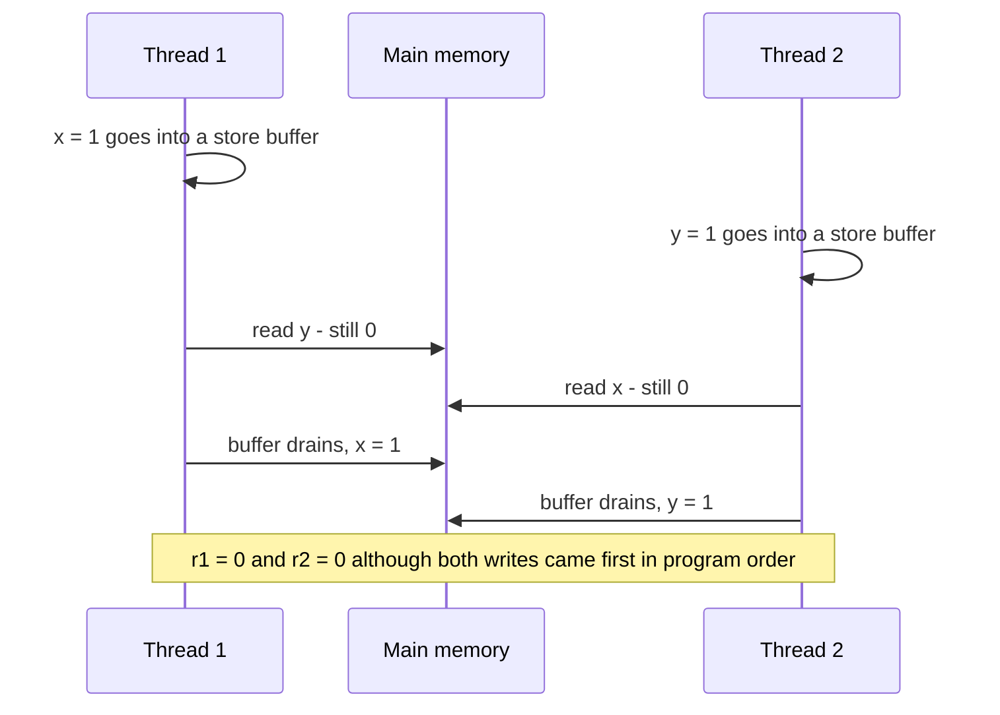

# Chapter 15 — Concurrency II: Modern Concurrency

[Chapter 14](../14-concurrency-1/README.md) gave you threads, locks, atomics, thread pools and concurrent collections. This chapter covers how concurrent Java is written **today**: composing **asynchronous** results (results of work that finishes later, while the caller carries on) with `CompletableFuture`, splitting CPU work with Fork/Join, handling huge numbers of **blocking** tasks (tasks that spend time waiting, e.g. for a network reply) with **virtual threads** (Java 21), passing context safely with **scoped values** (final in Java 25), and grouping related tasks with **structured concurrency** (still a **preview** feature — shipped in the JDK for feedback but switched off unless you pass `--enable-preview`, and still allowed to change). It then goes underneath all of them — the **Java Memory Model** (the rules for when one thread's writes become visible to another) and *happens-before* (the ordering guarantee those rules are built on), which explain *why* the Chapter 14 tools work — and ends with the ways concurrent programs stop making progress: deadlock, livelock and starvation.

**What you'll learn**

| § | Topic | You'll be able to… |
|---|---|---|
| 15.1 | `Future` and its limits | say why `Future.get()` isn't enough for real pipelines |
| 15.2 | `CompletableFuture` | create, transform, compose, combine and time out async results; handle errors properly |
| 15.3 | Fork/Join | split CPU-bound work recursively and understand work stealing (and parallel streams) |
| 15.4 | Virtual threads | explain how they work, measure the win, and know when they help and when they don't |
| 15.5 | Pinning and JEP 491 | know what pinning was, what Java 24 fixed, and what still pins |
| 15.6 | `ThreadLocal` and scoped values | pass request context implicitly, and choose between the two |
| 15.7 | Structured concurrency (preview) | read and write `StructuredTaskScope` code and know its status |
| 15.8 | The Java Memory Model and happens-before | reason about visibility; publish objects safely; write correct lazy initialisation |
| 15.9 | Liveness: deadlock, livelock, starvation | produce, detect and prevent each one |
| 15.10 | Best practices and choosing a model | pick the right concurrency tool for a job |

All runnable code is in [`code/`](code/) (package `ch15.*`), compiled with `javac --release 25` (the Java compiler, targeting Java 25) and run on JDK 26 (the Java Development Kit) on a 14-core Apple-silicon (Apple's own ARM-based processors) laptop. As in Chapter 14, lines tagged `[nondeterministic]` vary between runs and `[machine-dependent]` lines depend on your hardware; timing numbers are rounded. The structured-concurrency example (§15.7) uses a **preview** API, so it lives only in this README and was run separately with `--enable-preview` on JDK 25 and JDK 26.

> **Related material — linked, not repeated.** Virtual threads, `Future`, parallel-stream and thread-problem exam traps: [OCP Chapter 13 — Concurrency](../../../../ocp-java21-study/chapters/13-concurrency/README.md). Deadlock, livelock and starvation with more diagrams and the dining philosophers: [LLD §12.17–12.19](../../../lld/chapters/12-concurrency-concepts/README.md#1217-deadlock) and [LLD §13.5](../../../lld/chapters/13-concurrency-problems/README.md#135-dining-philosophers-leetcode-1226). Fork/Join merge sort: [LLD §13.10](../../../lld/chapters/13-concurrency-problems/README.md#1310-multi-threaded-merge-sort-forkjoin). Parallel streams: [Chapter 12](../12-streams/README.md).

---

## 15.1 `Future` and its limits

### What it is
A **`Future<V>`** (Java 5, [Chapter 14 §14.11](../14-concurrency-1/README.md#1411-executors-and-thread-pools)) is a handle to a result that will exist later. You can `get()` it (blocking), poll `isDone()`, `cancel()` it, and since Java 19 read `state()` / `resultNow()` / `exceptionNow()` without blocking.

### The problem it doesn't solve
Real work is a *pipeline* (a chain of steps, each feeding the next): "fetch the user, **then** fetch their orders, **combined with** today's exchange rate, **falling back** to a **cached** value (a saved copy from earlier) on error, **giving up** after 2 seconds". With a plain `Future`:
1. The only way to use the result is **`get()`, which blocks** the calling thread — so "then do X" means parking a thread just to wait.
2. There's **no way to chain** a next step, combine two futures, or react to "whichever finishes first".
3. **Error handling** is a `try/catch (ExecutionException)` around each `get()`.
4. You can't **complete it yourself** (e.g. from a callback-based library — one that reports results by calling a function you gave it).

`CompletableFuture` (Java 8) fixes all four.

---

## 15.2 `CompletableFuture`

### What it is
**`CompletableFuture<T>`** implements both `Future<T>` and **`CompletionStage<T>`**, an interface of ~40 methods for saying *what should happen when this completes* — without blocking. Analogy: instead of standing at the counter waiting for your coffee (`get()`), you leave your phone number and a list of instructions: "when it's ready, add milk, then bring it to table 5; if they're out of beans, bring tea".

### How it works
1. **Start** async work: `supplyAsync(supplier[, executor])` (returns a value) or `runAsync(runnable[, executor])`. Or create an already-finished one with `completedFuture(v)` / `failedFuture(ex)` (9), or an empty one with `new CompletableFuture<>()` that you later `complete(v)` / `completeExceptionally(ex)` — a **promise** (a placeholder for a result that some code promises to fill in later).
2. **Attach stages**; each returns a *new* `CompletableFuture`, so calls chain:

| Method | Input → output | Stream analogy |
|---|---|---|
| `thenApply(fn)` | `T` → `U` | `map` |
| `thenAccept(consumer)` | `T` → nothing | `forEach` |
| `thenRun(runnable)` | nothing → nothing | |
| `thenCompose(fn)` | `T` → `CompletableFuture<U>`, flattened | `flatMap` |
| `thenCombine(other, bifn)` | `T` and `U` → `V` (both needed) | `zip` |
| `applyToEither(other, fn)` / `acceptEither` | whichever of two finishes first | |
| `allOf(cfs...)` | wait for all → `CompletableFuture<Void>` | |
| `anyOf(cfs...)` | first to finish → `CompletableFuture<Object>` | |

3. **Handle errors**: `exceptionally`, `handle`, `whenComplete`, `exceptionallyCompose` (12).
4. **Time out** (Java 9): `orTimeout(t, unit)` fails with `TimeoutException`; `completeOnTimeout(value, t, unit)` substitutes a default.
5. **Get the result at the edge** of your program: `join()` (unchecked `CompletionException` — *unchecked* means the compiler doesn't force you to catch it) or `get()` (checked `ExecutionException` — one you must catch or declare), or hand the `CompletableFuture` to a framework that accepts it (Spring MVC **controllers** — the classes in the Spring web framework that handle incoming HTTP requests — can return one).

**Which thread runs a stage?** A non-async stage (`thenApply`) runs on whichever thread completes the previous stage — or immediately on the *calling* thread if it's already complete. Every method has an **`…Async`** twin (`thenApplyAsync(fn[, executor])`) that submits the stage to an **executor** (an object that runs tasks on its threads, usually a thread pool — [Chapter 14 §14.11](../14-concurrency-1/README.md#1411-executors-and-thread-pools)). **Without an executor argument, async methods use `ForkJoinPool.commonPool()`** — shared by the whole JVM and sized for CPU work, so **always pass your own executor for blocking I/O** (or a virtual-thread executor, §15.4).

[`code/ch15/cf/CompletableFutureBasics.java`](code/ch15/cf/CompletableFutureBasics.java) (key parts; each `fetch…` sleeps to simulate a remote call):
```java
try (ExecutorService io = Executors.newFixedThreadPool(8)) {
    CompletableFuture<Integer> idF = CompletableFuture.supplyAsync(() -> fetchUserId("grace"), io);
    idF.thenApply(id -> "user-" + id).thenApply(String::toUpperCase).join();

    // thenApply with an async function nests; thenCompose flattens
    CompletableFuture<CompletableFuture<String>> nested = idF.thenApply(id -> supplyAsync(() -> fetchProfile(id), io));
    CompletableFuture<String> flat = idF.thenCompose(id -> supplyAsync(() -> fetchProfile(id), io));

    price.thenCombine(taxRate, (p, t) -> p * (1 + t));

    List<CompletableFuture<Double>> quotes = List.of(
            supplyAsync(() -> fetchPrice("A", 300, 19.99), io),
            supplyAsync(() -> fetchPrice("B", 200, 17.49), io),
            supplyAsync(() -> fetchPrice("C", 250, 18.25), io));
    CompletableFuture<Void> all = CompletableFuture.allOf(quotes.toArray(CompletableFuture[]::new));
    double best = all.thenApply(v -> quotes.stream().mapToDouble(CompletableFuture::join).min().orElseThrow()).join();

    CompletableFuture.anyOf(supplyAsync(() -> fetchPrice("slow", 300, 1.0), io),
                            supplyAsync(() -> fetchPrice("fast", 50, 2.0), io)).join();

    CompletableFuture<String> promise = new CompletableFuture<>();
    io.submit(() -> { sleep(50); promise.complete("completed by another thread"); });
}
```
Output:
```text
1 submitted, done yet? false
2 thenApply chain -> USER-35
3 thenApply gives a nested future: CompletableFuture; thenCompose gives the value: profile#35
4 thenCombine -> total = 25.0
5 allOf best price = 17.49, took ~300 ms (sequential would be ~750)   [timing machine-dependent]
6 anyOf -> 2.0
7 thenAccept got cached
7 thenRun: nothing to receive, just runs after
8 manual complete -> completed by another thread
9 thenApplyAsync(fn, io) ran on our pool
```
- `allOf` returns `CompletableFuture<Void>` — it only signals "all done". Collect the values by calling `join()` on each original future inside the next stage; by then they're complete, so `join()` doesn't block.
- The three price lookups ran **in parallel**: total time ≈ the slowest (300 ms), not the sum (750 ms). This **fan-out/fan-in** (send several requests at once, then gather all the answers) is the most common real use (price comparison, aggregating **microservice** calls — a microservice being a small, separately deployed service that owns one business area).

### Error handling
When a stage throws, all later *transforming* stages are skipped and the exception travels down the chain until a handler deals with it — like an exception unwinding a **call stack** (the chain of method calls currently in progress).

| Method | Runs when | Can change the result? | Use for |
|---|---|---|---|
| `exceptionally(ex -> fallback)` | only on failure | yes — recovers | default value |
| `handle((val, ex) -> …)` | always | yes | map success and failure into one result |
| `whenComplete((val, ex) -> …)` | always | no — passes the original through | logging, metrics (counters and timings a service records about itself), cleanup |
| `exceptionallyCompose(ex -> otherCf)` (12) | only on failure | yes, asynchronously | retry / call a backup service |

[`code/ch15/cf/CompletableFutureErrors.java`](code/ch15/cf/CompletableFutureErrors.java) (key parts):
```java
CompletableFuture<Integer> failed = supplyAsync(() -> parse("x")).thenApply(n -> n * 2);  // thenApply skipped
failed.join();   // CompletionException(cause NumberFormatException)
failed.get();    // ExecutionException(cause NumberFormatException)

supplyAsync(() -> parse("x")).exceptionally(ex -> -1);
supplyAsync(() -> parse(in)).handle((val, ex) -> ex == null ? "ok " + val * 2 : "failed: " + ex.getCause().getMessage());
supplyAsync(() -> parse("oops")).whenComplete((val, ex) -> log(...));

slow.orTimeout(100, MILLISECONDS).join();                         // TimeoutException
slow.completeOnTimeout("default", 100, MILLISECONDS).join();       // "default"
CompletableFuture.<String>failedFuture(new IllegalStateException("primary down"))
        .exceptionallyCompose(ex -> supplyAsync(() -> "from backup"));

CompletableFuture.runAsync(() -> { throw new IllegalStateException("nobody will ever see this"); });
```
Output:
```text
1 join -> CompletionException, cause NumberFormatException
1 get  -> ExecutionException,  cause NumberFormatException
1 isCompletedExceptionally = true, state = FAILED
2 exceptionally sees CompletionException wrapping NumberFormatException
2 recovered value = -1
3 handle(21) -> ok 42
3 handle(oops) -> failed: For input string: "oops"
4 whenComplete logs: error
4 still failed afterwards? true
5 orTimeout -> TimeoutException
5 completeOnTimeout -> default
6 exceptionallyCompose -> from backup
7 fire-and-forget failure printed nothing (that's the danger)
```
- The exception a handler receives is often **wrapped in `CompletionException`** (line 2). Unwrap before checking its type: `Throwable cause = ex instanceof CompletionException ce ? ce.getCause() : ex;`.
- Line 7 is the biggest practical danger: a failed `CompletableFuture` that nobody joins or handles **fails silently**. Every chain should end in a `join`, a handler, or at least a `whenComplete` that logs.

### Trade-offs

| | `Future` + pool | `CompletableFuture` | Virtual threads + plain blocking code |
|---|---|---|---|
| Composition | none | rich | ordinary sequential code |
| Readability | simple | chains can get long; **stack traces** (the printed list of calls at an error) are fragmented | simplest |
| Threads blocked while waiting | yes | no (callbacks) | yes, but they're cheap |
| Best for | simple fire-and-get | fan-out/fan-in, async APIs, callbacks | most request/response I/O (Java 21+) |

### Common mistakes
- Blocking I/O in `supplyAsync` **without an executor** → the common pool (≈ one thread per core) is exhausted and every parallel stream in the JVM stalls.
- Calling `join()` right after `supplyAsync` everywhere → you've written slow synchronous code with extra steps.
- Using `thenApply` with a function returning a `CompletableFuture` → `CompletableFuture<CompletableFuture<T>>`; use `thenCompose`.
- Expecting `cancel(true)` to interrupt the running task: for `CompletableFuture` it just completes the future with `CancellationException`; the computation keeps running.
- Swallowing errors with `exceptionally(ex -> null)`.

### In the interview
**30-second answer:** "`CompletableFuture` is a composable, completable `Future`. I start work with `supplyAsync` on a dedicated executor, chain with `thenApply`/`thenCompose`, combine with `thenCombine`/`allOf`, recover with `exceptionally`/`handle`, and bound **latency** (how long a call takes, start to finish) with `orTimeout`. Non-async stages run on the completing thread; async variants default to the common pool, so for I/O I always pass an executor."
- *`thenApply` vs `thenCompose`?* → `map` vs `flatMap`: use `thenCompose` when the function itself returns a `CompletableFuture`.
- *`join` vs `get`?* → Same result; `join` throws unchecked `CompletionException`, `get` throws checked `ExecutionException`/`InterruptedException` and has a timeout overload.
- *How do you wait for a list of futures?* → `allOf(...).thenApply(v -> list.stream().map(CompletableFuture::join).toList())`.

### Self-check
1. What does `allOf` return? → `CompletableFuture<Void>`; read the individual futures for values.
2. Which handler cannot change the result? → `whenComplete`.
3. Which pool do `…Async` methods use without an executor? → `ForkJoinPool.commonPool()`.

---

## 15.3 Fork/Join

### What it is
The **Fork/Join framework** (Java 7) runs **divide-and-conquer** algorithms (split a problem into smaller copies of itself, solve those, combine the answers) in parallel: split a big problem into halves recursively until pieces are small, solve the pieces, and combine the answers. Its **`ForkJoinPool`** uses **work stealing**: each worker thread has its own double-ended queue (deque) of tasks; when a worker runs out, it **steals** tasks from the other end of a busy worker's deque, keeping all cores busy with little **contention** (threads competing for the same lock or data). Analogy: a team splitting a stack of exam papers — whoever finishes their pile grabs half of a colleague's remaining pile.

### How it works
1. Extend **`RecursiveTask<V>`** (returns a value) or **`RecursiveAction`** (no value) and implement `compute()`.
2. In `compute()`: if the problem is below a **threshold**, solve it directly (plain loop).
3. Otherwise split: `left.fork()` (push onto this worker's deque), compute the other half directly (`right.compute()`), then `left.join()` (wait for — or run — the forked half), and combine.
4. Start with `pool.invoke(task)`; `ForkJoinPool.commonPool()` has parallelism = cores − 1 by default.

[`code/ch15/forkjoin/ForkJoinSum.java`](code/ch15/forkjoin/ForkJoinSum.java) (key parts):
```java
static class SumTask extends RecursiveTask<Long> {
    static final int THRESHOLD = 10_000;
    @Override protected Long compute() {
        if (to - from <= THRESHOLD) { long s = 0; for (int i = from; i < to; i++) s += data[i]; return s; }
        int mid = (from + to) >>> 1;
        SumTask left = new SumTask(data, from, mid), right = new SumTask(data, mid, to);
        left.fork();                   // others may steal it
        long r = right.compute();      // keep this thread busy
        long l = left.join();
        return l + r;
    }
}
long fj = ForkJoinPool.commonPool().invoke(new SumTask(data, 0, data.length));
long ps = Arrays.stream(data).parallel().sum();        // same framework underneath
```
Output (20 million longs):
```text
common pool parallelism = 13   [machine-dependent: cores - 1]
round 1: correct=true  sequential 7 ms, fork/join 15 ms, parallel stream 28 ms   [timings machine-dependent]
round 2: correct=true  sequential 11 ms, fork/join 1 ms, parallel stream 0 ms   [timings machine-dependent]
round 3: correct=true  sequential 5 ms, fork/join 1 ms, parallel stream 0 ms   [timings machine-dependent]
tasks stolen between workers so far > 0: true
```
- Round 1 is *slower* in parallel: thread start-up and JIT compilation (the JVM's *just-in-time* compiler turning frequently used bytecode into machine code at run time) dominate. Parallelism pays off only once **warmed up** (after the JIT has optimised the hot code) and for enough data — measure with a proper **benchmark harness** (a tool that runs timing experiments correctly — warm-up, repetition, statistics; JMH, the Java Microbenchmark Harness, [Chapter 16](../16-jvm-internals-and-performance/README.md)) before concluding anything.
- The order `fork` one half → `compute` the other → `join` matters: calling `left.fork(); right.fork(); left.join(); right.join();` wastes the current thread.

### When to use it / when not
- **Use** for **CPU-bound** (limited by processing, not by waiting), recursively splittable work on large in-memory data: sorting, searching, image processing, tree traversal. Most of the time, a **parallel stream** ([Chapter 12 §12.8](../12-streams/README.md)) gives you the same engine with one method call.
- **Don't** do blocking I/O in Fork/Join tasks (or parallel streams): the common pool is shared by the whole JVM and has few threads. (`ForkJoinPool.ManagedBlocker` exists for special cases.) For I/O (input/output — disk, network) concurrency use virtual threads.
- **Don't** make the threshold too small (task overhead dominates) or too large (not enough tasks to balance). Thousands of elements per leaf is a typical starting point.

### Self-check
1. What is work stealing? → Idle workers take queued tasks from busy workers' deques.
2. `RecursiveTask` vs `RecursiveAction`? → Returns a value vs doesn't.
3. What else uses the common pool? → Parallel streams and `CompletableFuture` async methods without an executor.

---

## 15.4 Virtual threads

### What it is
A **virtual thread** (final in **Java 21, JEP 444** — a JEP, *JDK Enhancement Proposal*, is the numbered design document for a Java feature; previews in 19 and 20) is a `java.lang.Thread` that is **not tied to an operating-system thread**. The JVM schedules many virtual threads onto a small pool of OS threads called **carrier threads**. When a virtual thread performs a blocking operation (sleep, socket read, `BlockingQueue.take`, lock wait…), the JVM **unmounts** it — saves its stack to the **heap** (the JVM's memory area for objects) — and the carrier is free to run another virtual thread. When the operation completes, the virtual thread is **mounted** again on some carrier and continues.

Analogy: platform threads are like giving every restaurant customer a dedicated waiter who stands by the table even while the customer reads the menu. Virtual threads are like a few waiters serving hundreds of tables, going to whichever table actually needs something.

| | Platform thread | Virtual thread |
|---|---|---|
| Backed by | one OS thread, 1:1 | carrier threads, M:N (many virtual threads share a few OS threads) |
| Creation cost | expensive (OS call, 1–2 MB stack reserved) | cheap (a small heap object; stack grows/shrinks on the heap) |
| How many | thousands | millions |
| Blocking | holds the OS thread | unmounts; carrier is released |
| Pool them? | yes | **no** — create one per task |
| Daemon / priority | configurable | always daemon (doesn't keep the JVM alive), normal priority |
| API | same `Thread` API | same `Thread` API (`isVirtual()`) |

### Why it matters
A server that handles each request on its own thread ("**thread-per-request**") is the easiest style to write and debug: plain sequential code, readable stack traces, `try/catch` works. But with platform threads, if each request spends 100 ms waiting on a database, a server with 200 threads can handle only ~2,000 requests per second, no matter how idle the CPU is. **Little's law** says concurrency = **throughput** (requests completed per second) × latency (both explained in [System Design Fundamentals](../../../system-design-patterns/modules/00-system-design-fundamentals/README.md)): 10,000 requests/s × 0.1 s = 1,000 requests in flight — more than a platform-thread pool comfortably holds. The previous fix was asynchronous/**reactive** code (a style where code is written as reactions to streams of events, never blocking — `CompletableFuture` chains, reactive libraries), which scales but is harder to write, read and debug. Virtual threads let simple blocking code scale like async code.

### How it works
1. Create one: `Thread.ofVirtual().name("vt-1").start(runnable)`, `Thread.startVirtualThread(runnable)`, or — most commonly — **`Executors.newVirtualThreadPerTaskExecutor()`**, which starts a new virtual thread for every submitted task.
2. The default **scheduler** (the component that decides which virtual thread runs on which carrier next) is a `ForkJoinPool` (FIFO — first in, first out — mode) whose parallelism equals the number of cores.
3. When the virtual thread blocks in a JDK operation that supports it (almost all of `java.io`, `java.net`, `java.util.concurrent`, `Thread.sleep`), its stack frames are copied to the heap and the carrier moves on.
4. When unblocked, it's rescheduled on any free carrier.

[`code/ch15/virtual/VirtualThreadsDemo.java`](code/ch15/virtual/VirtualThreadsDemo.java) (key parts):
```java
Thread v1 = Thread.ofVirtual().name("vt-1").start(() -> ...);
Thread v2 = Thread.startVirtualThread(() -> {});
Thread.currentThread().toString();       // inside a virtual thread: shows its carrier

static long time(ExecutorService executor) {
    try (executor) {                                   // close() waits for all tasks
        for (int i = 0; i < 10_000; i++) executor.submit(() -> { Thread.sleep(Duration.ofMillis(100)); return null; });
    }
}
time(Executors.newFixedThreadPool(200));
time(Executors.newVirtualThreadPerTaskExecutor());

Semaphore dbPermits = new Semaphore(10);            // limit a resource, not the number of threads
```
Output:
```text
1 hello from vt-1
1 isVirtual=true, daemon=true, main isVirtual=false
2 VirtualThread[#N]/runnable@ForkJoinPool-1-worker-K   [ids vary]
3 fixed pool of 200 platform threads: 5,202 ms  (theory: 10,000 / 200 x 100 ms = 5,000)   [machine-dependent]
3 one virtual thread per task:        126 ms  (theory: ~100 ms + overhead)             [machine-dependent]
4 carrier threads used: 14 <= cores (14)? true   [machine-dependent]
5 200 virtual threads, Semaphore(10): max concurrent 'DB calls' = 10
```
- **10,000 blocking tasks: ~5.2 s on a 200-thread pool vs ~0.13 s on virtual threads** — 40× faster here, because all 10,000 could wait at the same time. With a 10,000-thread platform pool you'd get similar speed at a much higher memory cost, and at 100,000 or 1,000,000 tasks platform threads run out while virtual threads keep going.
- Only **14 carrier threads** (the number of cores) ran all 10,000 virtual threads.
- Note that virtual threads don't make anything *faster* per task: each still took 100 ms. They raise **throughput** for tasks that **wait**.

### When they help
- Servers and clients with **many concurrent, mostly-waiting tasks**: HTTP handlers (code that answers web requests), calls to databases and other services, message consumers (code that processes items from a message queue). Spring Boot (3.2+; the most popular Java framework for building services) enables them for request handling with `spring.threads.virtual.enabled=true`; Tomcat, Jetty and Helidon (Java web servers / frameworks) support them.
- Replacing complex async code with straightforward blocking code.
- Concurrent mapping inside a stream: the `Gatherers.mapConcurrent(n, fn)` gatherer (Java 24) runs `fn` on virtual threads with at most `n` in flight ([Chapter 12 §12.9](../12-streams/README.md#129-stream-gatherers-java-24)).

### When they don't help (and pitfalls)
1. **CPU-bound work** — there are still only as many cores as there are. Use a platform pool sized to the cores, Fork/Join or parallel streams.
2. **Don't pool virtual threads.** A pool exists to limit an expensive resource; virtual threads aren't expensive. To limit access to a scarce resource (a database allowing 10 connections, a **rate-limited** API that accepts only so many calls per second), use a **`Semaphore`** (a counter of permits; [Chapter 14 §14.13](../14-concurrency-1/README.md#1413-synchronizers-countdownlatch-cyclicbarrier-semaphore-phaser)) or a bounded **connection pool** (a fixed set of reusable, already-open database connections), as in line 5.
3. **Heavy `ThreadLocal` caching**: code that caches expensive objects per thread (one parser per thread) was fine with 200 pooled threads, but with a million short-lived virtual threads you get a million copies, each used once (§15.6).
4. **Pinning** on Java 21–23 when blocking inside `synchronized` (§15.5).
5. Your **downstream** systems (the services and databases your code calls) still have limits: 10,000 concurrent requests may overwhelm a database that could handle 200 at a time.

### Observing virtual threads
`jcmd <pid> Thread.dump_to_file -format=json dump.json` (`pid` = the OS process id of the JVM) writes a **thread dump** (a snapshot of every thread and what it's doing) that includes virtual threads (the older `jstack` output shows only platform threads). JDK Flight Recorder (JFR, the JVM's built-in low-overhead event recorder) has `jdk.VirtualThreadStart`/`End` (off by default), `jdk.VirtualThreadPinned` and `jdk.VirtualThreadSubmitFailed` events.

### In the interview
**30-second answer:** "Virtual threads, final in Java 21, are JVM-managed threads **multiplexed** (many sharing a few) onto a few carrier threads. When one blocks on I/O it unmounts and frees the carrier, so millions of blocking tasks can be in flight and simple thread-per-request code scales like async code. They help I/O-bound, high-concurrency workloads, not CPU-bound ones; you don't pool them — you create one per task and limit scarce resources with semaphores."
- *Are virtual threads faster?* → Not per task; they give higher throughput for waiting tasks.
- *How many carrier threads?* → By default one per core.
- *What replaces a pool size limit?* → A `Semaphore` or a bounded resource pool (e.g. HikariCP, the most common Java database connection pool).
- *Does existing code need to change?* → Usually not: same `Thread` API; switch the executor.

### Self-check
1. What happens to a virtual thread's stack when it blocks? → It's copied to the heap; the carrier is released.
2. Why is `newFixedThreadPool(100)` of virtual threads a bad idea? → It defeats their purpose and still limits concurrency the wrong way; use one per task plus a semaphore.
3. Will a CPU-heavy image resize run faster on virtual threads? → No.

---

## 15.5 Pinning and JEP 491

### What it is
A virtual thread is **pinned** when it blocks but *cannot* unmount, so it holds its carrier thread hostage for the whole wait. If all carriers are pinned, no other virtual thread can run — throughput collapses back to "one task per carrier", and in the worst case the application deadlocks.

### What changed in Java 24
In Java 21–23, a virtual thread was pinned when it blocked **inside a `synchronized` block or method** (including `Object.wait()`), because the JVM's **monitor** (the built-in lock behind `synchronized`) implementation tracked lock ownership by carrier thread. The advice at the time was "replace `synchronized` with `ReentrantLock` around blocking operations". **JEP 491 (Java 24) re-implemented monitors so virtual threads can acquire, hold and release them independently of their carrier.** Blocking inside `synchronized` — and `Object.wait()` — now unmounts normally, so that advice no longer applies on Java 24+ (including Java 25 LTS — a *long-term support* release that receives updates for years).

[`code/ch15/virtual/PinningDemo.java`](code/ch15/virtual/PinningDemo.java) uses only Java 21 APIs, so it was also compiled and run on JDK 21 for comparison:
```java
try (ExecutorService ex = Executors.newVirtualThreadPerTaskExecutor()) {
    for (int i = 0; i < 1_000; i++) {
        Object lock = new Object();                 // one lock per task: no contention
        ex.submit(() -> { synchronized (lock) { Thread.sleep(50); } return null; });
    }
}
```
Output on JDK 26 (the runner):
```text
Java 26: 1000 virtual threads sleeping 50 ms inside synchronized took 63 ms   [machine-dependent]
if every carrier were pinned: ~3600 ms with 14 carriers
```
Output of the same program on JDK 21 (Amazon Corretto 21.0.10 — Amazon's free build of the JDK — run by hand):
```text
Java 21: 1000 virtual threads sleeping 50 ms inside synchronized took 3869 ms   [machine-dependent]
if every carrier were pinned: ~3600 ms with 14 carriers
```
On Java 21 every sleeping virtual thread pinned its carrier, so only 14 could sleep at a time: 1,000 / 14 × 50 ms ≈ 3.6 s. On Java 24+ all 1,000 slept at once.

### What still pins (Java 24+)
According to JEP 491, a virtual thread still pins its carrier when:
1. It calls **native code** (code compiled for the machine, typically C, reached via JNI — the Java Native Interface — or the Foreign Function & Memory API) and that native code calls back into Java code that blocks.
2. It blocks while **loading a class** (resolving a symbolic reference — turning a class/method *name* in bytecode into the real thing in memory) or **inside a class initializer** (`static { … }`, code that runs once when a class is first used), or waits for another thread to finish initialising a class.

These are rare in application code. The JFR event **`jdk.VirtualThreadPinned`** (on by default, reported when the pin lasts over 20 ms) now also records the *reason* and the carrier thread. The old diagnostic **system property** (a `-Dname=value` setting passed to the JVM) `jdk.tracePinnedThreads` was removed by JEP 491 and has no effect.

### Takeaway
On Java 21–23: avoid long blocking operations inside `synchronized` in virtual-thread code (use `ReentrantLock` there). On Java 24+: choose `synchronized` or `ReentrantLock` on their merits ([Chapter 14 §14.9](../14-concurrency-1/README.md#149-explicit-locks-reentrantlock-condition-readwritelock-stampedlock)); watch JFR for the remaining native/class-initialisation cases.

---

## 15.6 `ThreadLocal` and scoped values

### The problem
Code deep in a call stack often needs *context* that was established near the top: the current user, a request id for logging, a **transaction** (a group of database operations that succeed or fail together). Passing it as a parameter through every method is noisy, especially through framework code you don't own. Java has two ways to pass it **implicitly**.

### `ThreadLocal` (Java 1.2)
A **`ThreadLocal<T>`** is a variable with a separate value **per thread**: `set(v)`, `get()`, `remove()`, `ThreadLocal.withInitial(supplier)`. Uses: per-request context in older frameworks (Spring Security's `SecurityContextHolder`, logging MDC — *Mapped Diagnostic Context*, key/value pairs automatically added to every log line), and per-thread caches of non-thread-safe objects (the classic being `SimpleDateFormat` — which `java.time.DateTimeFormatter`, being immutable, made unnecessary).

Problems:
1. **Unconstrained mutability** — any code can `set` it at any time; data flow is hard to follow.
2. **Unbounded lifetime** — the value lives until `remove()` or the thread dies. With **thread pools, a forgotten `remove()` leaks** the value into the next, unrelated task (a security bug if it's a user identity) and can **leak memory** (keep objects alive that nothing needs any more, so the garbage collector can't free them).
3. **Expensive inheritance** — `InheritableThreadLocal` copies values into every child thread; with millions of virtual threads that's costly.

### Scoped values (final in Java 25, JEP 506)
A **`ScopedValue<T>`** is an **immutable** value **bound for the duration of a method call**. You bind it with `ScopedValue.where(KEY, value).run(runnable)` (or `.call(callable)` for a result); any code called — directly or indirectly — from inside that call can `KEY.get()` it; when the call returns, the binding is gone automatically. There is no `set`. Code can **rebind** it for a nested call, which shadows the outer value only inside that call. History: **incubator** in Java 20 (JEP 429; an incubator module is an even earlier experimental stage than preview), previews in 21–24 (JEPs 446, 464, 481, 487), **final in Java 25 (JEP 506)** — so it's usable without flags in Java 25 LTS.

Analogy: a `ThreadLocal` is a whiteboard in each worker's office — anyone can scribble on it and it stays until someone wipes it. A scoped value is a visitor badge handed out at the door for one meeting: everyone in the meeting can read it, nobody can change it, and it's collected when the meeting ends.

[`code/ch15/scoped/ScopedValuesDemo.java`](code/ch15/scoped/ScopedValuesDemo.java) (key parts):
```java
static final ThreadLocal<String> REQUEST_ID_TL = new ThreadLocal<>();
static final ScopedValue<String> USER = ScopedValue.newInstance();

// ThreadLocal leak on a pooled thread
single.submit(() -> REQUEST_ID_TL.set("req-OLD")).get();                 // forgot remove()
single.submit(() -> System.out.println(... REQUEST_ID_TL.get())).get();  // sees req-OLD!

ScopedValue.where(USER, "alice").run(() -> handleRequest());            // handler -> service -> repository
static void repository() { System.out.println("3 repository sees USER = " + USER.get()); }

String result = ScopedValue.where(USER, "bob").call(() -> {
    String outer = USER.get();
    String inner = ScopedValue.where(USER, "admin").call(USER::get);    // nested rebinding
    return outer + " -> " + inner + " -> " + USER.get();
});
USER.get();                 // unbound -> NoSuchElementException
USER.orElse("anonymous");
```
Output:
```text
1 ThreadLocal in A: requestId = req-A
1 ThreadLocal in B: requestId = req-B
1 main thread sees null (never set here)
2 next task on the same pooled thread sees: req-OLD
2 withInitial -> per-thread scratch buffer
3 bound before? false
3 repository sees USER = alice
3 bound after?  false
4 nested rebinding: bob -> admin -> bob
5 get() when unbound -> NoSuchElementException; orElse -> anonymous
6 plain new thread sees bound? false
```
- Line 2 is the pooled-thread leak in action: the second task inherited the first task's request id.
- Line 3: `repository()` read `alice` three calls deep without any parameter; outside the `run`, nothing is bound.
- Line 6: bindings are **not** inherited by threads you start yourself. They *are* inherited by subtasks forked in a `StructuredTaskScope` (§15.7), which is how context flows into concurrent subtasks safely.

### Trade-offs

| | `ThreadLocal` | `ScopedValue` (25) |
|---|---|---|
| Mutability | `set` anywhere | immutable; rebind only for a nested call |
| Lifetime | until `remove()` / thread death | exactly the `run`/`call` |
| Leak risk with pools | yes | none |
| Inheritance | `InheritableThreadLocal` copies | shared (no copy) with structured-concurrency subtasks |
| Good for | per-thread caches of mutable objects; legacy frameworks | request context: user, tenant (the customer account in a multi-customer system), trace id (an id following one request across services), transaction |

### Common mistakes
- Not calling `remove()` in a `finally` when using `ThreadLocal` with pools.
- Treating a scoped value like a mutable holder — to "change" it, rebind for a nested call.
- Declaring `ScopedValue` keys as instance fields; they're meant to be `static final` constants (often private, exposed through accessors to control who can read or bind them).

### In the interview
**30-second answer:** "`ThreadLocal` gives each thread its own mutable copy; it's easy to leak across pooled tasks and costly with millions of virtual threads. Scoped values, final in Java 25, bind an immutable value for the duration of a call; callees read it, it disappears when the call returns, and structured-concurrency subtasks share it. I use scoped values for request context and keep `ThreadLocal` for legacy integration and per-thread caches."

---

## 15.7 Structured concurrency (preview)

### Status (verified against the JEPs)
Structured concurrency is **still a preview API** — not final — in Java 25 and 26:

| Release | JEP | Status |
|---|---|---|
| 19, 20 | 428, 437 | incubator |
| 21, 22, 23, 24 | 453, 462, 480, 499 | preview 1–4 |
| **25 (LTS)** | **505** | fifth preview — API redesigned around `StructuredTaskScope.open()` and `Joiner` |
| **26** | **525** | sixth preview — small changes (e.g. `Joiner.anySuccessfulResultOrThrow()` renamed `anySuccessfulOrThrow()`, `allSuccessfulOrThrow()` now returns a list of results, new `Joiner.onTimeout()`) |
| 27 (GA — general availability, the official release — 15 Sept 2026) | 533 | seventh preview — built-in joiners make `join()` throw `ExecutionException`, a third type parameter for the exception type, `awaitAll()` removed, timeouts reworked |

Because it's a preview, you must compile and run with `--enable-preview` (and the exact API can still change between releases), so the runnable code in this book doesn't depend on it. Details below use the part of the API that is the same in Java 25 and 26.

### What it is
**Structured concurrency** treats a group of related concurrent tasks as **one unit of work** with a clear lifetime, the way a code block structures sequential code: subtasks are started inside a scope, and the scope **cannot be exited until they've all finished**. Consequences:
1. **No leaked threads** — when the method returns, no subtask is still running in the background.
2. **Error propagation and cancellation** — if one subtask fails, the others are **cancelled** (interrupted) automatically and the failure surfaces from `join()`.
3. **Observability** — thread dumps show subtasks as children of the task that forked them.
4. **Scoped values** bound in the parent are visible in the forked subtasks.

Compare with `ExecutorService` + `Future`s: if you submit two lookups and the first fails, nothing stops the second; if the caller is interrupted, the subtasks keep running; the relationship between them exists only in your head.

### How it works (Java 25/26 preview API)
1. Open a scope in try-with-resources: `StructuredTaskScope.open()` (default policy: all subtasks must succeed) or `open(Joiner)` for another policy.
2. `fork(callable)` each subtask → a `Subtask<T>`; each runs in its own **virtual thread**.
3. `join()` waits for all subtasks (or until the policy decides — e.g. first failure).
4. Read results with `subtask.get()`; `subtask.state()` is `SUCCESS`, `FAILED` or `UNAVAILABLE`.
5. Closing the scope guarantees every subtask has finished.

```java
// (preview API - run with: java --enable-preview --source 26 StructuredDemo.java ; same output on JDK 25 with --source 25)
static final ScopedValue<String> USER = ScopedValue.newInstance();
record Page(String profile, int orders) {}

static String fetchProfile() throws InterruptedException { Thread.sleep(100); return "profile of " + USER.get(); }
static int fetchOrders() throws InterruptedException { Thread.sleep(150); return 3; }
static int fetchOrdersBroken() throws InterruptedException { Thread.sleep(50); throw new IllegalStateException("orders service down"); }
static String slowProfile() throws InterruptedException {
    try { Thread.sleep(5_000); return "too late"; }
    catch (InterruptedException e) { System.out.println("  slowProfile: cancelled (interrupted)"); throw e; }
}

static Page load() throws InterruptedException {
    try (var scope = StructuredTaskScope.open()) {                  // all must succeed
        Subtask<String> profile = scope.fork(StructuredDemo::fetchProfile);
        Subtask<Integer> orders = scope.fork(StructuredDemo::fetchOrders);
        scope.join();                                               // wait for both, or the first failure
        return new Page(profile.get(), orders.get());
    }
}
static Page loadWithFailure() throws InterruptedException {
    try (var scope = StructuredTaskScope.open()) {
        Subtask<String> profile = scope.fork(StructuredDemo::slowProfile);
        Subtask<Integer> orders = scope.fork(StructuredDemo::fetchOrdersBroken);
        scope.join();                                               // throws FailedException
        return new Page(profile.get(), orders.get());
    }
}
// main:
Page p = ScopedValue.where(USER, "alice").call(StructuredDemo::load);
try { loadWithFailure(); }
catch (StructuredTaskScope.FailedException e) { ... e.getCause().getMessage() ... }
```
Output (JDK 26 and JDK 25, both with `--enable-preview`):
```text
page = Page[profile=profile of alice, orders=3] in ~150 ms (max of 100 and 150, not the sum)
  slowProfile: cancelled (interrupted)
join -> FailedException, cause: orders service down; returned after ~50 ms, not 5000
```
- The forked `fetchProfile` read `USER` — scoped values flow into subtasks.
- When `fetchOrdersBroken` failed after 50 ms, the scope **interrupted** `slowProfile` immediately instead of letting it run for 5 s, and `join()` threw `FailedException` carrying the original cause.

Other built-in policies (`Joiner` factory methods): all must succeed (the default policy of `open()`; `allSuccessfulOrThrow` also collects the results), first success wins and cancels the rest (`anySuccessfulOrThrow` in 26 — "hedged" requests: sending the same request to several **replicas**, i.e. identical copies of a service, and taking the fastest answer), wait for all regardless of outcome (`awaitAll`), and a predicate-based `allUntil`. Timeouts are set through the configuration function passed to `open`. Check the Javadoc of the JDK you run, since names changed between previews (Java 27's seventh preview removes `awaitAll` and has the built-in joiners make `join()` throw `ExecutionException`).

### When to use it
Once final, for any "call several things concurrently, then combine" code in a request handler — the fan-out that §15.2 did with `CompletableFuture.allOf`, but with automatic cancellation and ordinary blocking code. Until then: use it for experiments, or use `CompletableFuture`/executors in production and cancel manually.

### In the interview
**30-second answer:** "Structured concurrency groups subtasks into a scope whose lifetime is a code block: fork subtasks in virtual threads, `join`, and on failure the siblings are cancelled and the error propagates; no thread outlives the scope and scoped values flow into subtasks. It's still a preview API — fifth preview in Java 25, sixth in 26, seventh in 27 — while scoped values became final in 25."

---

## 15.8 The Java Memory Model and happens-before

### What it is
The **Java Memory Model (JMM)** — JLS chapter 17 (the JLS is the *Java Language Specification*, the official rulebook), redesigned in Java 5 (JSR-133, a *Java Specification Request*, the older name for a formal spec change) — is the contract that says **which values a read of a shared variable is allowed to return** when several threads run. It exists because compilers, JIT and CPUs all **reorder** (run independent instructions in a different order) and **cache** (keep private, faster copies of) memory operations to go faster. Within a single thread these optimisations are invisible (the thread always sees its own actions in program order), but *another* thread can observe writes late or in a surprising order.

The JMM's central idea is the **happens-before** relation. If action A *happens-before* action B, then A's effects (and everything before A in its thread) are **guaranteed visible** to B. If two conflicting accesses (same variable, at least one write, different threads) are **not** ordered by happens-before, the program has a **data race**, and the read can see **stale** (out-of-date) or reordered values.

### The happens-before rules

| Rule | A happens-before B when… |
|---|---|
| Program order | A comes before B in the same thread |
| Monitor lock | A is an unlock of a monitor and B is a *later* lock of the **same** monitor (`synchronized`) |
| Volatile | A is a write to a volatile field and B a *later* read of **that** field |
| Thread start | A is `t.start()` and B is any action in `t` |
| Thread termination | A is any action in `t` and B is another thread returning from `t.join()` (or seeing `isAlive()` false) |
| Interruption | A is `t.interrupt()` and B is `t` detecting the interrupt |
| Transitivity | A hb B and B hb C ⇒ A hb C |
| `java.util.concurrent` | e.g. putting an object into a concurrent collection hb its retrieval; submitting a task hb its execution; task actions hb `Future.get()` returning; `release`/`countDown`/`unlock` hb a successful `acquire`/`await`/`lock` |

Plus **final-field semantics** (JLS 17.5): if a constructor doesn't leak `this`, every thread that obtains a reference to the object sees its `final` fields correctly initialised, even without synchronisation.

### Seeing reordering for real
[`code/ch15/jmm/ReorderingDemo.java`](code/ch15/jmm/ReorderingDemo.java) runs the classic "store buffering" test millions of times. For each slot `i`, two threads run concurrently:
```java
// thread 1                        // thread 2
x[i] = 1;   r1[i] = y[i];          y[i] = 1;   r2[i] = x[i];
```
In **any** interleaving of these four statements in program order, at least one thread reads a 1 — so `(r1, r2) = (0, 0)` is impossible without reordering. Then the same with `AtomicIntegerArray` `set`/`get` (volatile semantics):

Output:
```text
plain arrays:          (0,0) seen 1,041 times in 50,000,000 trials   [nondeterministic - varies run to run; any value > 0 proves reordering]
AtomicIntegerArray:    (0,0) seen 0 times in 50,000,000 trials   [always 0 - forbidden by the JMM]
```
Each CPU core put its write into a *store buffer* (a small per-core queue of pending writes) and read the other variable before its own write became visible to the other core — both reads saw 0. With volatile semantics the JMM forbids that outcome, and it never occurred.



### Safe publication
**Publishing** an object means making it reachable by other threads. Publishing *unsafely* (assigning to a plain shared field with no happens-before) can let another thread see the reference **before** the object's fields are initialised. Safe ways (JCIP):
1. Initialise it in a **static initializer** (class initialisation is thread-safe).
2. Store the reference in a **`volatile`** field or an `AtomicReference`.
3. Store it in a **`final`** field of a properly constructed object.
4. Store it in a field **guarded by a lock**, or put it in a **concurrent collection**.
5. Make the object **immutable** (all fields `final`, no `this` escape) — then even racy publication shows it correctly.

[`code/ch15/jmm/SafePublication.java`](code/ch15/jmm/SafePublication.java) (key parts):
```java
// Double-checked locking: correct ONLY because 'instance' is volatile (Java 5+)
private static volatile Registry instance;
static Registry get() {
    Registry r = instance;
    if (r == null) {
        synchronized (Registry.class) {
            r = instance;
            if (r == null) instance = r = new Registry();
        }
    }
    return r;
}
// Initialization-on-demand holder: lazy and thread-safe with no locking code
private static class Holder { static final Heavy INSTANCE = new Heavy(); }
static Heavy get() { return Holder.INSTANCE; }

static volatile Config current;                               // publish through a volatile write
```
Output:
```text
64 threads raced: Registry constructed 1 time(s), Heavy constructed 1 time(s)
reader sees fully built config: Config[url=jdbc:postgresql://db/shop, poolSize=10]
```
Without `volatile`, double-checked locking is **broken**: the write of the reference can become visible before the writes inside the constructor, so a second thread skips the lock and uses a half-built object. The holder idiom is usually simpler — the JVM initialises `Holder` exactly once, on first use, under its internal class-initialisation lock. For **singletons** (classes meant to have exactly one instance), an `enum` with one constant is simplest of all (*Effective Java* Item 3; see [LLD Chapter 8](../../../lld/chapters/08-patterns-creational/README.md)).

### Common mistakes
- Believing "it worked in testing" proves correctness — reorderings depend on CPU architecture (ARM, as on this laptop, reorders more than x86 — the Intel/AMD chip family), JIT decisions and load.
- Synchronising writes but reading without the lock (no happens-before for the reader).
- Using `volatile` for a reference to a *mutable* object and assuming later changes to its fields are visible — only the reference write is covered.

### In the interview
**30-second answer:** "The JMM defines when a write by one thread is guaranteed visible to another, through happens-before: program order, unlock→lock on the same monitor, volatile write→read, `start`, `join`, and the `java.util.concurrent` hand-offs, all transitive. Without a happens-before edge you have a data race and can see stale or reordered values. That's why double-checked locking needs `volatile`, and why immutable objects with final fields are always safe to share."
- *Does `volatile` make `i++` atomic?* → No; it gives visibility and ordering only.
- *What does `final` guarantee?* → Correct visibility of final fields after construction, if `this` doesn't escape.

More: [LLD §12.6](../../../lld/chapters/12-concurrency-concepts/README.md#126-java-memory-model-basics-visibility-happens-before-volatile); JCIP chapter 16; JLS §17.4.

---

## 15.9 Liveness: deadlock, livelock, starvation

**Safety** means "nothing bad happens" (no races). **Liveness** means "something good eventually happens" — the program makes progress. Liveness failures:

| Failure | What happens | Threads are… | Analogy |
|---|---|---|---|
| **Deadlock** | two or more threads each wait for a lock another holds, forever | `BLOCKED`/`WAITING`, 0% CPU | two cars at a one-lane bridge, each waiting for the other to reverse |
| **Livelock** | threads keep reacting to each other and retrying, but none progresses | running, busy CPU | two people in a corridor stepping aside in the same direction again and again |
| **Starvation** | one thread never gets the resource because others keep taking it | runnable but never lucky | the polite customer never served at a crowded bar |

### Deadlock
Four conditions (the **Coffman conditions**) must all hold: **mutual exclusion**, **hold and wait** (holding one lock while waiting for another), **no preemption** (locks can't be taken away), and **circular wait** (A waits for B, B waits for A, or a longer loop). Break any one and deadlock is impossible — in practice, you break *circular wait* or *hold-and-wait*.

[`code/ch15/liveness/DeadlockDemo.java`](code/ch15/liveness/DeadlockDemo.java) (key parts):
```java
static void transferBad(Account from, Account to, int amt, CountDownLatch bothHoldFirstLock) {
    synchronized (from) {
        bothHoldFirstLock.countDown(); bothHoldFirstLock.await();   // make the deadlock certain
        synchronized (to) { ... }
    }
}
// thread 1: transferBad(a, b, ...)     thread 2: transferBad(b, a, ...)
long[] ids = ManagementFactory.getThreadMXBean().findDeadlockedThreads();

// Fix 1 - global lock order: always lock the account with the lower id first
Account first = from.id < to.id ? from : to, second = first == from ? to : from;
synchronized (first) { synchronized (second) { ... } }

// Fix 2 - tryLock with timeout, release everything, random back-off, retry
if (from.lock.tryLock(10, MILLISECONDS)) { try { if (to.lock.tryLock(10, MILLISECONDS)) { ... } } finally { from.lock.unlock(); } }
Thread.sleep(ThreadLocalRandom.current().nextInt(1, 5));
```
Output:
```text
deadlock detected between 2 threads:
  transfer-a-to-b is BLOCKED, waiting for a lock held by transfer-b-to-a
  transfer-b-to-a is BLOCKED, waiting for a lock held by transfer-a-to-b
t1 alive=true, t2 alive=true (stuck forever; only a restart helps)
lock ordering: finished, total money = 2000
tryLock + back-off: finished, total money = 2000
```
- `ThreadMXBean.findDeadlockedThreads()` (`ThreadMXBean` is the JVM's built-in monitoring interface for threads; this is also what `jstack` and `jcmd Thread.print` report as "Found one Java-level deadlock") detects cycles among `synchronized` monitors and `java.util.concurrent` locks. Java can't *recover* from a deadlock — the threads can't be forced to release their locks — so prevention is the only real strategy. (The demo marks the stuck threads as daemons so the program can still exit.)
- Both fixes completed 2,000 opposite-direction transfers with money conserved.

**Prevention checklist:**
1. **Lock ordering** — acquire multiple locks in one global order (by id, by `System.identityHashCode` with a tie-breaker lock).
2. **Timeouts** — `tryLock(timeout)`, then release and retry with random back-off.
3. **Fewer locks, shorter holds** — don't call unknown code (callbacks, listeners, overridable methods) while holding a lock ("open calls" — JCIP 10.1.4).
4. **Higher-level tools** — a single-writer design, `ConcurrentHashMap` atomic methods, message passing via queues.
5. **Thread-starvation deadlock** in pools: tasks waiting for other tasks in the same bounded pool ([Chapter 14 §14.11](../14-concurrency-1/README.md#1411-executors-and-thread-pools)) — use separate pools, `CompletableFuture` composition, or virtual threads.

### Livelock
Threads aren't blocked; they're busy responding to each other. Typical cause: every thread detects a conflict and backs off **in exactly the same way at the same time** — e.g. the `tryLock` version above *without* the random sleep can end up with both threads repeatedly grabbing their first lock, failing on the second, releasing, and trying again in lock-step. The fix is **randomised back-off** (wait a random, growing delay before retrying — as in Ethernet collision handling, where network cards that collide each wait a random time) or an ordering rule that decides who goes first. Also found in message processing: a message that always fails is put back at the head of the queue and retried forever (use a **dead-letter queue** — a side queue where messages that keep failing are parked for a human to inspect).

### Starvation
A thread is ready to run but never gets the lock or CPU time:
- **Unfair locks**: `synchronized` and default `ReentrantLock` allow **barging** — a newly arriving thread can grab a just-released lock ahead of long waiters. That improves throughput but can starve a thread under heavy contention. `new ReentrantLock(true)` / `new Semaphore(n, true)` grant in (roughly) arrival order, at a throughput cost.
- **Readers starving a writer** with read-write locks under constant read traffic (the fair mode of `ReentrantReadWriteLock` helps).
- **Thread priorities** — don't use them to fix starvation; they're only hints ([Chapter 14 §14.2](../14-concurrency-1/README.md#142-creating-and-starting-threads)).
- **Long-running tasks** hogging a small pool while short tasks queue behind them — separate pools (bulkheads).

Detailed walk-throughs and the dining philosophers: [LLD §12.17 Deadlock](../../../lld/chapters/12-concurrency-concepts/README.md#1217-deadlock), [§12.18 Livelock](../../../lld/chapters/12-concurrency-concepts/README.md#1218-livelock), [§12.19 Starvation](../../../lld/chapters/12-concurrency-concepts/README.md#1219-starvation-and-fairness), [LLD §13.5](../../../lld/chapters/13-concurrency-problems/README.md#135-dining-philosophers-leetcode-1226).

### In the interview
**30-second answer:** "Deadlock needs mutual exclusion, hold-and-wait, no preemption and a circular wait; I prevent it with a global lock order or `tryLock` with timeouts and back-off, and by not calling foreign code while holding locks. I diagnose it with a thread dump, which reports Java-level deadlocks. Livelock is threads busily retrying in lock-step — fixed with randomised back-off. Starvation is a thread never getting a resource — fairness settings, separate pools, or less contention fix it."
- *How do you find a deadlock in production?* → `jstack <pid>` / `jcmd <pid> Thread.print` (or `ThreadMXBean` in a **health check** — an endpoint or job that regularly reports whether the service is working).
- *Deadlock vs livelock CPU usage?* → ~0% vs high.

### Self-check
1. Which Coffman condition does lock ordering break? → Circular wait.
2. Why random back-off rather than fixed? → Fixed delays keep contenders in lock-step → livelock.
3. What does a fair lock trade away? → Throughput.

---

## 15.10 Best practices and choosing a concurrency model

### Best practices (JCIP, *Effective Java* Items 78–84, JDK guidance)
1. **Minimise shared mutable state.** Prefer immutable objects (records), confinement and message passing.
2. **Synchronise all access to shared mutable data** — reads and writes — with the same lock (Item 78).
3. **Keep synchronised regions small; never call alien code** (code you don't control, e.g. callbacks or overridable methods) **inside them** (Item 79).
4. **Prefer executors, tasks and streams to raw threads** (Item 80); prefer **concurrency utilities to `wait`/`notify`** (Item 81).
5. **Document thread safety** of every class you publish (Item 82).
6. **Lazy initialisation**: only when needed; use the holder idiom or volatile double-checked locking (Item 83).
7. **Don't depend on the thread scheduler** — no `Thread.yield`, priorities or busy-waits for correctness (Item 84).
8. **Handle interruption** properly — rethrow or restore the flag.
9. **Always bound things**: queue sizes, pool sizes, timeouts on `get`/`join`/`tryLock`/remote calls.
10. **Never lose exceptions** in async code: join, handle or log every `Future`/`CompletableFuture`.
11. **Use virtual threads for I/O-bound concurrency on Java 21+**; don't pool them; limit scarce resources with semaphores; avoid `ThreadLocal` caches.
12. **Prefer scoped values over `ThreadLocal`** for request context on Java 25+.
13. **Test and observe**: stress tests, thread dumps, JFR; but rely on happens-before reasoning, not on tests passing.

### Choosing a model

| Workload | Recommended tool (Java 25) |
|---|---|
| Many concurrent blocking calls (HTTP, DB, files) | virtual threads — `newVirtualThreadPerTaskExecutor()`, thread-per-request |
| Fan out to N services, combine, with cancellation | `CompletableFuture.allOf` today; `StructuredTaskScope` once final |
| CPU-heavy work on large in-memory data | parallel streams / Fork/Join / fixed pool of ≈ #cores platform threads |
| Periodic or delayed jobs | `ScheduledExecutorService` |
| Producer-consumer pipeline | `BlockingQueue` + executor (virtual threads are fine as consumers) |
| Shared counters, caches, registries | atomics, `LongAdder`, `ConcurrentHashMap` |
| Callback-based library integration | `CompletableFuture` as a promise (`complete`) |
| Very high-throughput event streaming with back-pressure (consumers signalling producers to slow down) | reactive libraries (Project Reactor, RxJava) or messaging systems — beyond this book |

### Real-world examples
- **Web servers**: Tomcat/Jetty with virtual threads let each request run plain blocking JDBC (Java Database Connectivity, the standard low-level database API) code at high concurrency.
- **API gateways / BFFs** (a gateway is the single entry point in front of many services; a BFF, *Backend For Frontend*, is a gateway tailored to one app — see [System Design Fundamentals](../../../system-design-patterns/modules/00-system-design-fundamentals/README.md)): fan out to several microservices per request (`CompletableFuture.allOf` with per-call `orTimeout` and fallbacks).
- **Batch analytics**: parallel streams over large in-memory collections; Fork/Join merge sorts.
- **Caches**: Caffeine (a popular in-memory caching library) builds on `ConcurrentHashMap` and `CompletableFuture` (async loading).
- **Observability** (being able to see what a running system is doing through logs, metrics and traces): request ids carried in logging context (MDC, `ThreadLocal`-based today, scoped values in newer designs).

---

## Chapter TL;DR

| Topic | Remember |
|---|---|
| `Future` | Blocking `get()`, no composition; `state()`/`resultNow()` since 19 |
| `CompletableFuture` | `supplyAsync(…, executor)` → `thenApply`/`thenCompose`/`thenCombine`/`allOf`/`anyOf`; `exceptionally`/`handle`/`whenComplete`; `orTimeout`/`completeOnTimeout` (9); pass your own executor for I/O; never leave failures unobserved |
| Fork/Join | Recursive split + work stealing; `RecursiveTask`; fork one half, compute the other, join; powers parallel streams; CPU-bound only |
| Virtual threads (21) | Cheap JVM-managed threads on ~#cores carriers; unmount on blocking; huge throughput for waiting tasks; don't pool; limit with `Semaphore`; no help for CPU work |
| Pinning | Java 21–23: blocking in `synchronized` pinned carriers; Java 24 (JEP 491) fixed it; native callbacks and class initialisation still pin; `jdk.VirtualThreadPinned` JFR event |
| Context | `ThreadLocal`: per-thread, mutable, leaks with pools; `ScopedValue` (final 25): immutable, bounded to a call, inherited by structured subtasks |
| Structured concurrency | Preview in 25 (JEP 505), 26 (JEP 525), 27 (JEP 533): scope = unit of work, auto-cancel on failure, no leaked threads |
| JMM | Happens-before via program order, monitor unlock→lock, volatile write→read, start/join, j.u.c hand-offs; data race = stale/reordered reads; safe publication; DCL needs `volatile`; holder idiom |
| Liveness | Deadlock (Coffman; lock ordering, `tryLock`+timeouts; detect with thread dumps), livelock (random back-off), starvation (fairness, bulkheads) |
| Choosing | I/O-bound → virtual threads; CPU-bound → parallel streams/Fork/Join; fan-out → `CompletableFuture` (structured concurrency later) |

**Where next:** what the JVM does underneath — memory areas, garbage collectors, JIT, profiling with JFR and benchmarking with JMH — in [Chapter 16 — JVM internals and performance](../16-jvm-internals-and-performance/README.md); the version-by-version feature tour in [Chapter 17 — Modern Java 17 to 25](../17-modern-java-17-to-25/README.md). Practise with [LLD Chapter 13 — Concurrency problems](../../../lld/chapters/13-concurrency-problems/README.md); exam traps in [OCP Chapter 13](../../../../ocp-java21-study/chapters/13-concurrency/README.md); compare with Python's `asyncio` and GIL in [Python Chapter 16](../../../python/chapters/16-concurrency-and-async/README.md).
