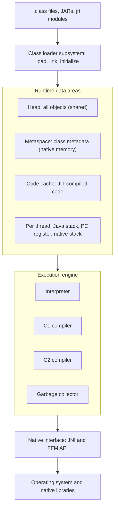
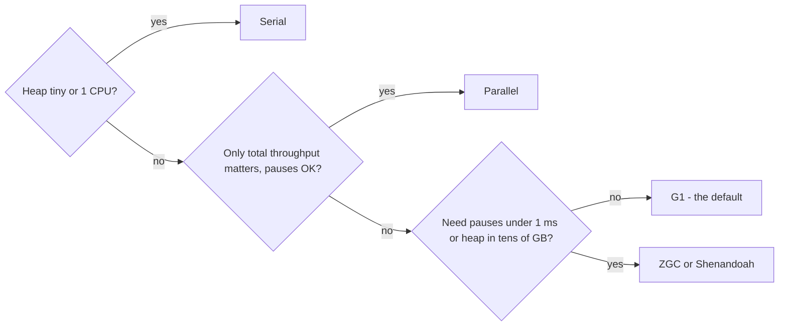
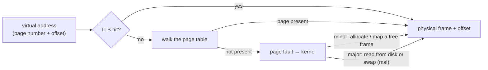

# Chapter 16 — JVM Internals and Performance

[Chapter 1](../01-java-and-the-jvm/README.md) gave the one-page picture: `javac` makes bytecode; the JVM loads it lazily, interprets it, JIT-compiles hot code and collects garbage. This chapter opens the hood — with measurements: class loading, object sizes, five garbage collectors on one workload, the JIT deleting allocations, lying benchmarks, the JDK's diagnostic tools, a leak hunt (a **memory leak** is memory never released though no longer needed), a two-module JPMS application (§16.12), and the operating-system mechanics underneath every process (§16.13).

Everything here is about **HotSpot**, the JVM inside OpenJDK and almost every vendor build (Oracle, Temurin, Corretto, Zulu, Microsoft). Other JVMs (OpenJ9, GraalVM native images — programs compiled ahead of time into a standalone executable) differ in details.

**How the code was run.** Programs are in [`code/`](code/) (package `ch16.*`), compiled with `javac --release 25`, run on **OpenJDK 26** (`26+35`), Apple M4 Pro (14 cores, 48 GiB — **GiB/MiB/KiB** are binary units: 1 GiB = 1024 MiB = 1024 × 1024 KiB — macOS). The JPMS example has its own [`jpms/run.sh`](jpms/run.sh). **All timings, byte counts, heap sizes and pauses are machine-dependent** — compare the *shape* of the results. Shenandoah isn't in the Oracle-built OpenJDK 26, so its numbers come from **Amazon Corretto 21.0.10**.

> **Exam depth.** Module directives, command-line options and service-loader traps are drilled in [OCP Chapter 12 — Modules](../../../../ocp-java21-study/chapters/12-modules/README.md). Concurrency-related JVM behaviour (memory model, thread states) is in [Chapter 15](../15-concurrency-2-modern/README.md) and the LLD handbook's [concurrency chapters](../../../lld/chapters/12-concurrency-concepts/README.md).

---

## 16.1 The JVM's architecture

### What it is
A **Java Virtual Machine** is a small operating system for Java programs: it loads code, gives each thread a **stack** (per-call scratch memory for locals), owns and cleans the shared **heap** of objects, and compiles bytecode to machine code on the fly. The *JVM Specification* says **what** a JVM must do; HotSpot decides **how** (which collectors, which compilers).



| Subsystem | Job | Covered in |
|---|---|---|
| Class loader subsystem | Find class bytes, verify them, prepare statics, run static initialisers | 16.2 |
| Runtime data areas | Memory the JVM manages for you | 16.3, 16.4 |
| Interpreter + JIT compilers | Execute bytecode; compile hot code to machine code | 16.8, [Chapter 1 §1.7](../01-java-and-the-jvm/README.md#17-how-the-jvm-runs-your-code-class-loading-interpreter-jit) |
| Garbage collector | Reclaim unreachable objects, compact memory | 16.5–16.7 |
| Native interface | Call C code: JNI (Java Native Interface, old) or the Foreign Function & Memory API (Java 22, [Chapter 17](../17-modern-java-17-to-25/README.md)) | — |
| Serviceability | Tools and events that observe a live JVM: JFR, `jcmd`, JMX (Java Management Extensions, the standard monitoring API) | 16.10 |

---

## 16.2 Class loading in depth

### What it is
**Class loading** is how a class goes from bytes on disk to something the JVM can execute. It happens **lazily**: a class is loaded the first time the program needs it, not at start-up.

### How it works
1. **Loading** — a *class loader* finds the bytes (`.class` file, JAR entry, or the JDK's `jrt:` image) and creates a `Class` object plus **metadata** (the JVM's internal description: methods, fields, bytecode) in **metaspace** (§16.3).
2. **Linking** — **verification** (the bytecode is **type-safe**, so hostile class files can't crash the JVM); **preparation** (static fields get default values); **resolution** (symbolic references like "`println` in `java/io/PrintStream`" become direct pointers, lazily on first use).
3. **Initialization** — static initialisers and `static { }` blocks run top to bottom, exactly once, under a lock.

**What triggers initialization?** Creating an instance (`new`), calling a static method, reading or writing a static field that is **not** a compile-time constant (so reading `static final int MAX = 10` doesn't), initialising a subclass (the superclass goes first), **reflection** like `Class.forName("X")`, or being the main class. Merely *loading* a class (e.g. because it is named in a signature) does not initialise it.

### The loader hierarchy and parent delegation

| Loader | Loads | `getClassLoader()` returns |
|---|---|---|
| **Bootstrap** (inside the JVM, written in C++) | `java.base` and other core modules | `null` (e.g. `String.class.getClassLoader()`) |
| **Platform** | Other Java SE / JDK modules such as `java.sql` | the platform loader |
| **Application** (also called *system*) | Your class path (folders/JARs searched for classes) and module path (§16.12) | the app loader |
| Custom (`new URLClassLoader(…)`, frameworks) | Plugins, web apps in **app servers** (Tomcat-style servers hosting several deployed apps), hot-reload tools | your loader |

A loader first **delegates to its parent**; only if the parent can't find the class does it look itself. So nobody can sneak in a fake `java.lang.String`: the bootstrap loader always wins. A class's identity is **its name plus its defining loader** — the same `.class` file loaded by two loaders gives two different, incompatible classes (the source of the infamous "`ClassCastException`: `Foo` cannot be cast to `Foo`" in app servers).

### Seeing it: [`code/ch16/classload/LoadingDemo.java`](code/ch16/classload/LoadingDemo.java)

```java
static class Config {
    static final String NAME = "compile-time constant"; // inlined by javac: does NOT trigger init
    static final long STARTED = System.nanoTime();       // not a constant: reading it DOES trigger init
    static { System.out.println("  [Config static initializer runs]"); }
}
static class Parent { static { System.out.println("  [Parent initialized]"); } static int shared = 1; }
static class Child extends Parent { static { System.out.println("  [Child initialized]"); } }

// in main:
System.out.println("2. reading Config.NAME   -> " + Config.NAME);
long t = Config.STARTED;          // 3.
int s = Child.shared;             // 4. field declared in Parent
new Child();                      // 5.
show("java.lang.String", String.class);
show("java.sql.Date", Class.forName("java.sql.Date"));
```

Output:
```text
1. main started
2. reading Config.NAME   -> compile-time constant
3. reading Config.STARTED (triggers init):
  [Config static initializer runs]
4. Child.shared via subclass name (only Parent initializes):
  [Parent initialized]
5. new Child():
  [Child initialized]
6. Who loaded what?
   java.lang.String  loaded by bootstrap (null)
   java.sql.Date     loaded by platform
   LoadingDemo       loaded by app
   app loader's parent  : platform
   platform's parent    : null (bootstrap is native)
   module of String     : java.base
   module of LoadingDemo: unnamed module (class path)
```

What to notice:
- Step 2 printed nothing from `Config`: `NAME` is a `static final` String initialised with a literal — a **constant variable** — so `javac` copied its value into `main`'s bytecode (**inlined** it).
- Step 4 initialised only `Parent`: a static field is "owned" by the class that declares it.

### The class-loading log
`java -Xlog:class+load=info -cp out ch16.classload.LoadingDemo` prints one line per loaded class (real output; paths shortened, timestamps machine-dependent):

```text
[0.006s][info][class,load] java.lang.Object source: shared objects file
...
[0.016s][info][class,load] ch16.classload.LoadingDemo source: file:.../out/
[0.017s][info][class,load] ch16.classload.LoadingDemo$Config source: file:.../out/
...
[0.017s][info][class,load] ch16.classload.LoadingDemo$Child source: file:.../out/
...
[0.023s][info][class,load] java.sql.Date source: jrt:/java.sql
```

The run loaded **786 classes**: 770 from the *shared objects file*, 9 from `jrt:/` (the JDK's module image), the rest from `out/`. `Child` is **loaded** at step 4 but **not initialised** until step 5 — separate steps. The **shared objects file** is **Class Data Sharing (CDS)**: a pre-parsed, pre-verified archive of core classes mapped straight into memory, which is why Hello World starts in tens of milliseconds. The JDK ships a default archive (JEP 341, Java 12); you can archive your own classes (AppCDS, JEP 310, Java 10) and, since Java 24–25, a full **AOT cache** (*ahead-of-time*: work done before the program runs and saved) that also records linked classes and method profiles (JEPs 483, 514, 515 — see [Chapter 1 §1.7](../01-java-and-the-jvm/README.md#17-how-the-jvm-runs-your-code-class-loading-interpreter-jit)).

### Common mistakes
- Expecting a `static {}` block to run at program start. It runs at first *active use*.
- Heavy work in static initialisers. An exception there becomes `ExceptionInInitializerError`, and every later use of the class throws `NoClassDefFoundError` — the class is permanently broken for that loader.
- Confusing `ClassNotFoundException` (checked; thrown by `Class.forName`/`loadClass` when a name can't be found) with `NoClassDefFoundError` (an error; the class was present at compile time but is missing or failed to initialise at run time).
- Holding references to a custom loader's classes from shared code: that loader and all its classes can never be unloaded — the *classloader leak* (16.11) behind `OutOfMemoryError: Metaspace` after **redeploys** (replacing a running app without restarting the server).

### In the interview
**Q: Walk me through what happens when the JVM first uses a class.** It is loaded by a class loader using parent delegation (bootstrap → platform → application), linked (verified, statics prepared with defaults, references resolved lazily), then initialised: static initialisers run once, in textual order, under a lock.
- *Why parent delegation?* Core classes can't be spoofed, and each class is loaded once per hierarchy.
- *What is CDS?* A memory-mapped archive of pre-processed classes: faster start-up, metadata shared between JVMs.

### TL;DR
Load (find bytes) → link (verify, prepare, resolve) → initialise (static code, once). Lazy. Loaders delegate to parents first. CDS/AOT caches pre-do this work for faster start-up.

---

## 16.3 Runtime memory areas

### What it is
The JVM splits its memory into areas with different owners and lifetimes. Knowing them tells you *which* `OutOfMemoryError` you are looking at and which flag controls it.

| Area | Per thread or shared | Holds | Size flag | When it runs out |
|---|---|---|---|---|
| **Heap** | Shared | All objects and arrays | `-Xms` (initial), `-Xmx` (max), `-XX:MaxRAMPercentage` | `OutOfMemoryError: Java heap space` (also `GC overhead limit exceeded` when GC time dominates) |
| **Java stack** | Per thread | One **frame** per active method call: local variables (e.g. a method's local `int`s), operand stack (the scratch stack bytecode pushes and pops values on), return address | `-Xss` / `Thread` constructor `stackSize` | `StackOverflowError` |
| **PC register** (program counter) | Per thread | Address of the current bytecode instruction | — | — |
| **Native method stack** | Per thread | Frames of native (C) code | OS | crash or `StackOverflowError` |
| **Metaspace** | Shared, native memory (straight from the OS, outside the Java heap) | Class metadata: methods, bytecode, constant pools (each class's table of literals and symbolic references), field layouts | `-XX:MaxMetaspaceSize` (unlimited by default) | `OutOfMemoryError: Metaspace` |
| **Compressed class space** | Part of metaspace | Class structures addressed by compressed class pointers | `-XX:CompressedClassSpaceSize` (1 GiB default) | `OutOfMemoryError: Compressed class space` |
| **Code cache** | Shared | JIT-compiled machine code | `-XX:ReservedCodeCacheSize` | Warning "CodeCache is full. Compiler has been disabled" — the app keeps running, slowly |
| **Direct / native memory** | Shared | `ByteBuffer.allocateDirect`, FFM `Arena` memory, thread stacks, GC data structures | `-XX:MaxDirectMemorySize` | `OutOfMemoryError: Direct buffer memory` / `unable to create native thread` |

Since **Java 8** (JEP 122) class metadata lives in **metaspace** (native memory) instead of the old fixed-size *PermGen*, so the classic `PermGen space` error is gone — but an unbounded metaspace can still grow with a classloader leak.

### Seeing it: [`code/ch16/memory/MemoryAreas.java`](code/ch16/memory/MemoryAreas.java)
The `java.lang.management` API reports the pools the running JVM actually has; recursion in threads of different stack sizes measures stack depth.

```java
for (MemoryPoolMXBean p : ManagementFactory.getMemoryPoolMXBeans()) {
    MemoryUsage u = p.getUsage();
    ... p.getType(), p.getName(), u.getUsed() / 1024, u.getMax() / MiB ...
}
for (long stackSize : new long[] {256 * 1024, 1024 * 1024, 8 * 1024 * 1024}) {
    depth = 0;
    Thread t = new Thread(null, () -> {
        try { recurse(); } catch (StackOverflowError e) { /* expected */ }
    }, "deep", stackSize);
    t.start(); t.join();
}
```

Output (machine-dependent: default G1, 48 GiB machine so max heap = 12 288 MiB):
```text
Garbage collector(s): 
  G1 Young Generation
  G1 Concurrent GC
  G1 Old Generation
Memory pools (type, used KiB / max MiB):
  NON-HEAP CodeHeap 'non-nmethods'               1174 / 5
  NON-HEAP Metaspace                              738 / no limit
  NON-HEAP CodeHeap 'profiled nmethods'           138 / 117
  NON-HEAP Compressed Class Space                  62 / 1024
  HEAP     G1 Eden Space                            0 / no limit
  HEAP     G1 Old Gen                               0 / 12288
  HEAP     G1 Survivor Space                        0 / no limit
  NON-HEAP CodeHeap 'non-profiled nmethods'        38 / 117
Stack   256 KiB -> StackOverflowError after ~1,473 frames
Stack  1024 KiB -> StackOverflowError after ~23,200 frames
Stack  8192 KiB -> StackOverflowError after ~206,700 frames
```
- The **code cache** has three segments: JVM stubs (small helper routines), C1 code still **profiling** usage ("profiled nmethods" — *nmethod* is HotSpot's name for a compiled method), and final C2 code ("non-profiled").
- Depth isn't proportional to stack size: at 256 KiB the method overflowed while still **interpreted** (big frames); with bigger stacks it got **JIT-compiled** (small frames). Never rely on an exact depth.
- Under `-XX:+UseZGC` the pools become `ZGC Young/Old Generation`.

### Native memory tracking
The heap is only part of a Java process's memory. **Native Memory Tracking (NMT)** accounts for the rest. Start the JVM with `-XX:NativeMemoryTracking=summary`, then ask it: `jcmd <pid> VM.native_memory summary scale=MB` (real output for the leak demo of 16.11 with `-Xmx256m`, trimmed):

```text
Total: reserved=1722MB, committed=278MB
-                 Java Heap (reserved=256MB, committed=186MB)
-                     Class (reserved=1024MB, committed=0MB)
-                      Code (reserved=244MB, committed=8MB)
-                        GC (reserved=60MB, committed=59MB)
...
```
*Reserved* = address space set aside; *committed* = backed by RAM. The **GC's own bookkeeping** (59 MB: remembered sets and mark bitmaps, §16.5) and other areas push committed memory (278 MB) past the heap — why a 512 MB **container** (an isolated, resource-limited process environment, e.g. Docker) must not get `-Xmx512m`.

### Common mistakes
- Sizing a container by `-Xmx` alone. Budget heap + metaspace + code cache + thread stacks (roughly 1 MB each by default, 2 MB on macOS/AArch64 — 64-bit ARM) + direct buffers + GC overhead. A common start is `-XX:MaxRAMPercentage=75` and measure. If the heap is at 40% but the container OOM-killed the process (§16.13), look at native memory: NMT summary, thread count, direct buffers, metaspace.
- "Fixing" `StackOverflowError` with a giant `-Xss`. Usually the recursion has no base case, or should be a loop ([Chapter 4 §4.5](../04-methods-and-arrays/README.md#45-recursion)).

### TL;DR
Heap = objects (`-Xmx`); stack = frames per thread (`-Xss`); metaspace = class metadata; code cache = JIT output; plus native memory. Each has its own error message — read it.

---

## 16.4 Object layout basics

### What it is
Every heap object carries a hidden **header** before its fields, and sizes are rounded up to a multiple of 8 bytes (**alignment**). Knowing this explains why a million tiny objects cost more than you'd guess, and why `int[]` beats `List<Integer>` for big numeric data.

On 64-bit HotSpot with default settings:

| Part | Size | Contains |
|---|---|---|
| **Mark word** | 8 bytes | Identity hash code (default `hashCode()`), lock state, GC age bits (collections survived) |
| **Class pointer** | 4 bytes (*compressed class pointers*) | Which class this object is |
| Array length (arrays only) | 4 bytes | `length` |
| Fields | `long`/`double` 8, `int`/`float` 4, `short`/`char` 2, `byte`/`boolean` 1, **reference 4** (*compressed oops*) | Your data, reordered by the JVM to reduce gaps |
| Padding | 0–7 bytes | Round total up to a multiple of 8 |

**Compressed oops** ("ordinary object pointers"): with heaps below about 32 GB the JVM stores references as 32-bit offsets and shifts them by 3 (because objects are 8-byte aligned), so each reference costs 4 bytes instead of 8. That is why going from `-Xmx31g` to `-Xmx33g` can *reduce* usable capacity.

**Compact object headers** (JEP 519, a product feature in **Java 25**, opt-in with `-XX:+UseCompactObjectHeaders`; made the default in JDK 27 by JEP 534) squeeze mark word and class pointer into a single **8-byte** header.

### Seeing it: [`code/ch16/layout/ObjectSizes.java`](code/ch16/layout/ObjectSizes.java)
No library needed: HotSpot counts the bytes each thread allocates. Allocate a million objects into an array (so the JIT can't remove them) and divide.

```java
static double bytesPerObject(Maker m) {
    for (int i = 0; i < N; i++) sink[i] = m.make(i);          // warm-up round
    long before = THREADS.getCurrentThreadAllocatedBytes();
    for (int i = 0; i < N; i++) sink[i] = m.make(i);
    long after = THREADS.getCurrentThreadAllocatedBytes();
    return (after - before) / (double) N;
}
... bytesPerObject(i -> new Point(i, i)) ...    // record Point(int x, int y)
```

Output of `java -cp out ch16.layout.ObjectSizes`, then with `-XX:+UseCompactObjectHeaders` (JDK 26):

| Object | Default | Compact headers | Why (default) |
|---|---:|---:|---|
| `new Object()` | 16.0 | 8.0 | 12-byte header → padded to 16 |
| `record Point(int x, int y)` | 24.0 | 16.0 | 12 + 4 + 4 = 20 → 24 |
| `Node { Object value; Node next; }` | 24.0 | 16.0 | 12 + 4 + 4 (compressed refs) = 20 → 24 |
| `Long` (not cached) | 24.0 | 16.0 | 12 + 8 = 20 → 24 |
| `new int[0]` | 16.0 | 16.0 | 12 + 4 length = 16 |
| `new int[10]` | 56.0 | 56.0 | 16 + 40 = 56 |
| `new byte[10]` | 32.0 | 24.0 | 16 + 10 = 26 → 32 |
| a 6-character `String` | 48.0 | 48.0 | `String` object 24 + its `byte[6]` 24 |

What this means in practice:
- A `List<Integer>` of a million values costs ~4 MB of references **plus** ~16 MB of `Integer`s (outside the -128..127 cache — [§7.6](../07-core-apis/README.md#76-wrapper-classes-and-autoboxing)); an `int[]` costs 4 MB — 5× less.
- A two-`int` record is 24 bytes for 8 bytes of data: headers dominate small objects. Compact headers cut them by a third (JEP 519 reports 22% less heap and 8% less CPU on SPECjbb2015, an industry-standard Java server benchmark).
- 6 ASCII characters cost 48 bytes as a `String` (Latin-1 strings use 1 byte per char — Java 9 *compact strings*).

### When not to care
Most business code allocates moderately and the GC handles it. Worry about layout when profiling (16.10) shows a type with millions of instances dominating the heap — then consider primitive arrays, fewer wrapper objects, or compact headers.

### TL;DR
Header 12 bytes (8 with compact headers), references 4 bytes (compressed oops, heap < ~32 GB), everything padded to 8. Small objects are mostly header; primitive arrays are dense.

---

## 16.5 Garbage-collection algorithms

[Chapter 1 §1.8](../01-java-and-the-jvm/README.md#18-memory-and-garbage-collection--an-overview) explained **reachability** (alive = reachable by a chain of references), **GC roots** (where chains start: local variables, static fields, active threads) and the **generational** idea (young and old objects kept apart and collected differently). Here are the mechanics behind each HotSpot collector.

### The building blocks

| Technique | How it works | Cost | Used by |
|---|---|---|---|
| **Mark** | Trace from GC roots, marking every reachable object | Proportional to **live** objects | All |
| **Sweep** | Walk memory, add unmarked space to free lists | Proportional to heap size; leaves **fragmentation** (free memory split into many small gaps) | Old gen of Serial (with compaction) |
| **Compact** | Slide live objects together, fix up references | Proportional to live data; no fragmentation | Serial/Parallel old gen, G1 full GC |
| **Copy (evacuate)** | Copy live objects into an empty area; the old area is freed wholesale | Proportional to live data; needs spare space | Young generations everywhere; G1, ZGC, Shenandoah for all regions |
| **Generations** | Collect the young area often (most objects are already dead), the old area rarely | Needs to track old→young references (**card table / remembered sets** — side tables noting which old areas point into young ones) | Serial, Parallel, G1, generational ZGC and Shenandoah |
| **Concurrent phases** | GC threads work *while* application threads run | Needs **barriers** — small code the JIT inserts around reference reads/writes — and extra CPU | G1 marking, ZGC, Shenandoah |

Terms: a **stop-the-world (STW) pause** halts all application threads at a **safepoint** (where every thread's state is known). **Throughput** = share of time running your code, **latency** = pause lengths, **footprint** = memory needed; a collector optimises two, rarely all three.

### The collectors



| Collector | Since | How it works | Pauses | Choose it for |
|---|---|---|---|---|
| **Serial** `-XX:+UseSerialGC` | The original | One GC thread; copying young gen, mark-sweep-compact old gen; all STW | Grow with heap size | Small heaps, 1 CPU, CLI tools, small containers |
| **Parallel** `-XX:+UseParallelGC` | Default before Java 9 | Serial's design with many GC threads | Shorter, still grow with live data | Batch jobs: max throughput, pauses irrelevant |
| **G1** (Garbage-First) `-XX:+UseG1GC` | Default since Java 9 (JEP 248) | Equal **regions** (1–32 MB, sized from the heap). Young regions evacuated in parallel STW pauses; old regions **marked concurrently**, then **mixed** collections evacuate the old regions with the most garbage first (hence the name). Objects ≥ half a region are **humongous** (own regions). *Evacuate* = copy live objects out so the region can be freed. Full GC only as a fallback | Aims at `-XX:MaxGCPauseMillis` (default 200 ms); typically a few to tens of ms | General purpose — the default for most services |
| **ZGC** `-XX:+UseZGC` | Experimental 11, production 15, generational 21 (JEP 439), generational-only since 24 (JEP 490) | Nearly everything concurrent, including **relocation** (moving objects). **Coloured pointers** keep GC state in spare bits of each reference; **load barriers** fix references as the app reads them | Well under 1 ms, independent of heap size (up to 16 TB) | Latency-sensitive services, large heaps |
| **Shenandoah** `-XX:+UseShenandoahGC` | Experimental 12, production 15 (JEP 379); generational mode product in 25 (JEP 521) | Concurrent marking **and** concurrent compaction using load-reference barriers | Sub-millisecond to a few ms | Low latency; shipped in most OpenJDK builds (Temurin, Corretto, Red Hat) but not in Oracle's builds |
| **Epsilon** `-XX:+UnlockExperimentalVMOptions -XX:+UseEpsilonGC` | Java 11 (JEP 318) | Allocates, never frees | None — until the heap is full and the JVM exits | Performance testing, ultra-short jobs |

The removed **CMS** collector (removed in Java 14, JEP 363) is still mentioned in old articles and flags; it no longer exists.

**Default choice**: G1, unless the JVM sees fewer than 2 CPUs or less than 1792 MB of memory, where it picks Serial. JDK 27 (JEP 523) makes G1 the default in all environments.

### How G1 collects, step by step
1. New objects go into **eden** regions (fast: each thread **bump-allocates** — just moves a pointer forward — in its own *TLAB*, thread-local allocation buffer).
2. When eden fills, a **young pause** copies live objects to **survivor** regions; objects that survived enough collections (up to `MaxTenuringThreshold` = 15) are **promoted** (moved) to old regions.
3. When the old generation passes a threshold (*IHOP*, Initiating Heap Occupancy Percent, adaptive), a **concurrent mark cycle** starts: short STW pauses begin and end it (*Concurrent Start*, *Remark*, *Cleanup*); the tracing runs alongside the app.
4. Then several **mixed** pauses evacuate young regions plus a slice of old regions ordered by garbage.
5. If old regions can't be reclaimed fast enough — allocation outruns marking — an **evacuation failure** and eventually a **Full GC** (STW, multi-threaded compaction) occur. Seeing `Pause Full` in a G1 log is a tuning signal (16.6).

### In the interview
**Q: Compare G1 and ZGC.** Both are region-based and generational. G1 copies live objects in stop-the-world pauses aimed at a goal (200 ms default, usually far less) with lower CPU and memory overhead. ZGC also moves objects concurrently (coloured pointers, load barriers), so pauses stay under a millisecond whatever the heap size, at some cost in throughput and **headroom** (spare free memory).
- *Why generational?* Most objects die young, so collecting only the young area is cheap and productive.
- *Why do concurrent collectors need barriers?* The app changes references while the GC traces or moves objects; barriers record or repair those changes.
- *Which collector for a nightly batch job on 32 cores?* Parallel (throughput). ZGC's generational mode arrived in 21, became its default in 23, and is the only mode since 24.

### TL;DR
Serial (tiny), Parallel (throughput), **G1 (default, balanced)**, ZGC and Shenandoah (concurrent compaction, sub-ms pauses), Epsilon (no GC). All modern ones are generational and region-based.

---

## 16.6 Collectors compared on a real workload

### The workload: [`code/ch16/gc/AllocWorkload.java`](code/ch16/gc/AllocWorkload.java)
A server-like pattern: a cache of 100 000 byte arrays (~100 MB) with random replacement, so objects live a while, get promoted, then die in the old generation — the hard case for generational GC. A **heartbeat** thread sleeps 1 ms in a loop and records its worst extra delay: the latency users would feel.

```java
Thread heartbeat = Thread.ofPlatform().daemon().start(() -> {
    long last = System.nanoTime();
    while (running) {
        try { Thread.sleep(1); } catch (InterruptedException e) { return; }
        long now = System.nanoTime();
        long stall = (now - last) / 1_000 - 1_000;           // time beyond the 1 ms we asked for
        if (stall > worstStallMicros) worstStallMicros = stall;
        last = now;
    }
});
byte[][] cache = new byte[100_000][];                         // the live set
SplittableRandom rnd = new SplittableRandom(42);              // fixed seed: same work every run
for (long i = 0; i < allocations; i++) {
    byte[] b = new byte[64 + rnd.nextInt(1_984)];            // 64..2047 bytes, avg ~1 KiB
    b[0] = (byte) i;
    bytes += b.length;
    int slot = rnd.nextInt(cache.length);
    if (cache[slot] != null) checksum += cache[slot][0];     // read the entry we evict
    cache[slot] = b;                                          // old entry becomes garbage
}
```

### G1 vs ZGC with `-Xlog:gc`
`java -Xmx1g -XX:+UseG1GC -Xlog:gc -cp out ch16.gc.AllocWorkload` (real output, start and end):

```text
[0.004s][info][gc] Using G1
[0.019s][info][gc] GC(1) Pause Young (Concurrent Start) (G1 Evacuation Pause) 6M->6M(10M) 0.322ms
[0.019s][info][gc] GC(2) Concurrent Mark Cycle
[0.021s][info][gc] GC(2) Pause Remark 12M->12M(33M) 0.112ms
[0.021s][info][gc] GC(2) Pause Cleanup 14M->14M(33M) 0.012ms
[0.021s][info][gc] GC(2) Concurrent Mark Cycle 1.846ms
...
[0.601s][info][gc] GC(49) Pause Young (Mixed) (G1 Evacuation Pause) 746M->282M(1013M) 4.061ms
allocated      : 6,331 MB of payload in 6,000,000 arrays (checksum -2929001)
elapsed        : 641 ms wall, 1,673 ms CPU (whole process)
  G1 Young Generation    count   44, time   132 ms
  G1 Concurrent GC       count   14, time     2 ms
  G1 Old Generation      count    0, time     0 ms
worst stall    : 9.1 ms (seen by the heartbeat thread)
```
Read a G1 line as: GC number, pause kind (Young Normal / Concurrent Start / Prepare Mixed / Mixed / Remark / Cleanup / Full), cause, `before->after(heap size)`, pause length. The concurrent mark cycle itself is not a pause — only Remark and Cleanup are.

`java -Xmx1g -XX:+UseZGC -Xlog:gc -cp out ch16.gc.AllocWorkload`:
```text
[0.004s][info][gc] Using The Z Garbage Collector
[0.053s][info][gc] GC(1) Major Collection (Warmup)
[0.059s][info][gc] GC(1) Major Collection (Warmup) 206M(20%)->148M(14%) 0.006s
...
[0.581s][info][gc] GC(13) Minor Collection (Allocation Rate) 640M(62%)->228M(22%) 0.011s
allocated      : 6,331 MB of payload in 6,000,000 arrays (checksum -2929001)
elapsed        : 580 ms wall, 947 ms CPU (whole process)
  ZGC Minor Cycles       count   10, time   110 ms
  ZGC Minor Pauses       count   30, time     0 ms
  ZGC Major Cycles       count    4, time    31 ms
  ZGC Major Pauses       count   20, time     0 ms
worst stall    : 0.8 ms (seen by the heartbeat thread)
```
The time at the end of a ZGC line (`0.011s`) is the **whole concurrent cycle**, not a pause. The actual pauses are logged under `gc+phases` (`-Xlog:gc+phases`):
```text
[0.034s][info][gc,phases] GC(0) Y: Pause Mark Start (Major) 0.005ms
[0.039s][info][gc,phases] GC(0) Y: Pause Mark End 0.007ms
[0.039s][info][gc,phases] GC(0) Y: Pause Relocate Start 0.002ms
```
Five **micro**seconds. `Minor` = young-only collection, `Major` = young + old; `Y:`/`O:` = young/old generation.

### Five collectors, same program
Three runs each with `-Xmx1g`, pauses parsed from `-Xlog:gc*` (Shenandoah on Corretto 21.0.10; the rest on OpenJDK 26). **Machine-dependent numbers** — M4 Pro, 14 cores:

| Collector | Wall time | Process CPU | Pauses | Longest pause | Worst stall seen by app |
|---|---:|---:|---:|---:|---:|
| Serial | 1 570–1 590 ms | ~1 670 ms | 42 | **128–133 ms** | 128–133 ms |
| Parallel | 690–700 ms | ~1 940 ms | 62 | 5–10 ms | 5–10 ms |
| G1 (default) | 630–660 ms | ~1 670 ms | 58 | 9–17 ms | 8–17 ms |
| ZGC | 585–605 ms | ~950–1 010 ms | ~50 | **0.010–0.015 ms** | 0.3–1.8 ms |
| Shenandoah (JDK 21) | 560–570 ms | ~870 ms | 48 | 0.18–0.25 ms | 0.4–0.8 ms |

How to read it:
- **Serial** works on one thread while the app waits: slowest, with 130 ms freezes. **Parallel** spreads the pauses over 11 GC threads: short pauses, most CPU. **G1** matches Parallel here, with tunable pause goals.
- **ZGC/Shenandoah** pauses are tiny; the heartbeat's leftover sub-millisecond "stall" is OS scheduling noise. On this many-core machine they also finished fastest; in a CPU-starved container their concurrent GC threads compete with yours and the picture can flip — measure on production-like hardware.
- JFR agrees (16.10): `jfr view gc-pauses` reported **P99 8.40 ms** (the 99th **percentile**: 99% of pauses were this short or shorter) for G1 and **P99 0.012 ms** for ZGC on a 20-million-allocation run.

### When the heap is too small
The same G1 run with `-Xmx512m` (real log excerpt):
```text
[0.207s][info][gc] GC(42) Pause Young (Normal) (G1 Evacuation Pause) (Evacuation Failure: Allocation) 500M->511M(512M) 1.864ms
[0.208s][info][gc] GC(43) Pause Young (Normal) (G1 Evacuation Pause) (Evacuation Failure: Allocation) 512M->512M(512M) 1.192ms
[0.215s][info][gc] GC(44) Pause Full (G1 Compaction Pause) 512M->104M(367M) 6.408ms
```
At ~6.5 GB/s of allocation and ~400 MB of headroom, G1's marking couldn't keep up, evacuation failed (no free region for survivors) and G1 fell back to **six Full GCs** in under a second. The heap after the full GC (104M) is the real **live set** (memory taken by still-reachable objects). The fix is headroom, not a magic flag: at `-Xmx1g` there were no full GCs. ZGC at 512 MB still had no allocation stalls (longest pause 0.019 ms).

### TL;DR
Read `before->after(size) pause` in G1 logs; for ZGC, pauses are in `gc+phases`. Serial pauses scale with the heap; G1 gives single-digit milliseconds here; ZGC/Shenandoah give microseconds. `Pause Full` or `Evacuation Failure` in G1 = not enough headroom.

---

## 16.7 GC tuning basics

### The problem it solves
Default settings are good for most programs. Tuning is for a **measured** problem: pauses over an SLA (service-level agreement), throughput too low, or memory too high.

### How to tune (in this order)
1. **Define the goal** — "p99 latency < 50 ms", "batch done in 20 min", "fits a 2 GB container".
2. **Log GC permanently** (cheap): `-Xlog:gc*:file=gc.log:time,uptime,level,tags:filecount=5,filesize=20m`.
3. **Size the heap**: `-Xmx`, or `-XX:MaxRAMPercentage` in containers (**cgroup** limits — the Linux kernel feature containers use to cap CPU and memory — are detected). Rule of thumb: 3–4× the **live set** (heap after a full or mixed GC). `-Xms` = `-Xmx` avoids resizing in long-running services.
4. **Pick the collector** (16.5), then **set a goal, not mechanisms**: G1 `-XX:MaxGCPauseMillis=100`; ZGC mostly needs only `-Xmx`.
5. **Change one thing at a time** and re-measure under realistic load.
6. **Reduce allocation** in code — often the biggest win (JFR allocation views, 16.10, show where).

### The flags you'll actually use

| Flag | Meaning |
|---|---|
| `-Xms<size>` / `-Xmx<size>` | Initial / maximum heap |
| `-XX:MaxRAMPercentage=75` | Max heap as % of machine or container memory (default 25) |
| `-XX:+UseG1GC`, `+UseZGC`, `+UseParallelGC`, `+UseSerialGC`, `+UseShenandoahGC` | Select a collector |
| `-XX:MaxGCPauseMillis=<ms>` | G1/Parallel pause goal (a hint, not a guarantee) |
| `-Xss<size>` | Thread stack size |
| `-XX:MaxMetaspaceSize=<size>` | Cap metaspace (turns a classloader leak into a clear error) |
| `-Xlog:gc*` | Unified GC logging (Java 9+; replaces `-XX:+PrintGCDetails`) |
| `-XX:+HeapDumpOnOutOfMemoryError -XX:HeapDumpPath=<dir>` | Write a **heap dump** (a file of every object in the heap, for offline analysis) when the heap is exhausted |
| `-XX:+AlwaysPreTouch` | Touch all heap pages at start-up (slower start, no page-fault hiccups later, §16.13) |
| `-XX:+UseCompactObjectHeaders` | Java 25+: 8-byte headers (16.4) |

### What the JVM chose for you: `-XX:+PrintFlagsFinal`
`java -XX:+PrintFlagsFinal -version` prints all ~800 flags with their final values. Excerpt (real, this machine):

```text
   size_t G1HeapRegionSize                         = 8388608                                   {product} {ergonomic}
    uintx MaxGCPauseMillis                         = 200                                       {product} {default}
   size_t MaxHeapSize                              = 12884901888                               {product} {ergonomic}
     uint ParallelGCThreads                        = 11                                        {product} {default}
     intx ThreadStackSize                          = 2048                                   {pd product} {default}
     bool UseCompactObjectHeaders                  = false                          {product lp64_product} {default}
     bool UseG1GC                                  = true                                      {product} {ergonomic}
...
```
`{ergonomic}` means the JVM computed the value from the machine (**ergonomics**): 12 GiB max heap = 25% of 48 GiB, 8 MiB G1 regions for that heap size, G1 selected because the machine is "server class" (at least 2 CPUs and ~2 GB of memory). `{default}` is the built-in default; `{command line}` would mark your own settings. `pd` = platform-dependent (e.g. 2 MiB stacks on macOS/AArch64). `jcmd <pid> VM.flags` shows the same for a running JVM.

### When not to tune
- Without logs or metrics showing a problem.
- By copying flag lists from old blog posts (many flags are obsolete — CMS, PermGen — or harmful, like tiny young generations).
- To hide a leak: a bigger heap only delays the `OutOfMemoryError` (16.11).

### Common mistakes
- Setting `-Xmn`/`NewRatio` with G1: fixing the young size disables G1's pause-time adaptation.
- Calling `System.gc()` in application code (it triggers a full collection; disable with `-XX:+DisableExplicitGC` if a library does it).
- Measuring GC on a laptop and deploying to a 2-CPU container.

### TL;DR
Measure → size heap from the live set → pick collector → set a goal → one change at a time.

---

## 16.8 JIT compilation, inlining and escape analysis

[Chapter 1 §1.7](../01-java-and-the-jvm/README.md#17-how-the-jvm-runs-your-code-class-loading-interpreter-jit) showed **tiered compilation** (interpreter → C1, a fast simple compiler → C2, a slower optimising one) with `-XX:+PrintCompilation`. This section covers the optimisations that make C2 fast.

### Key optimisations

| Optimisation | What it does | Why it matters |
|---|---|---|
| **Inlining** | Copies a **callee**'s body into the caller (hot methods up to `FreqInlineSize` = 325 bytecode bytes, others up to `MaxInlineSize` = 35) | Removes call overhead and lets other optimisations see across methods; small methods and getters are free |
| **Devirtualisation** | If profiling shows a **virtual call** (target depends on the runtime class) only ever sees one or two **receiver** classes, call them directly (behind a cheap guard checking the assumption) | Interfaces and polymorphism cost almost nothing in hot code |
| **Escape analysis** | Proves an object never leaves the method/thread | **Scalar replacement** (fields become locals — no allocation) and **lock elision** |
| **Loop optimisations** | Unrolling (repeating the body to do fewer jumps), range-check elimination, vectorisation (SIMD — *single instruction, multiple data*) | Array loops approach C speed |
| **Dead-code elimination** | Removes computations whose results are unused | Great for apps, a trap for benchmarks (16.9) |
| **Speculation + deoptimisation** | Optimise for what was observed; fall back to the interpreter if it changes (*deoptimise*) | Aggressive yet correct |

### Seeing escape analysis: [`code/ch16/jit/EscapeAnalysis.java`](code/ch16/jit/EscapeAnalysis.java)

```java
record Point(int x, int y) {
    Point plus(Point o) { return new Point(x + o.x, y + o.y); }
}
static Point escaped;

static long sumLocal(int n) {                        // Points never leave the method
    long total = 0;
    for (int i = 0; i < n; i++) {
        Point p = new Point(i, i).plus(new Point(1, 2)); // 3 Point allocations per iteration... on paper
        total += p.x() + p.y();
    }
    return total;
}
static long sumEscaping(int n) {                     // one Point per iteration is published
    ... escaped = p; ...
}
```
After warming both methods up, it counts the heap bytes allocated during 10 million iterations.

`java -cp out ch16.jit.EscapeAnalysis`, then `java -XX:-DoEscapeAnalysis -cp out ch16.jit.EscapeAnalysis`:
```text
DoEscapeAnalysis = true
local      result=100000020000000  heap allocated for 10M iterations: 0 bytes
escaping   result=100000020000000  heap allocated for 10M iterations: 240,000,000 bytes
DoEscapeAnalysis = false
local      result=100000020000000  heap allocated for 10M iterations: 720,000,000 bytes
escaping   result=100000020000000  heap allocated for 10M iterations: 720,000,000 bytes
```
- With escape analysis, 30 million `Point`s in `sumLocal` cost **zero** bytes: after inlining, C2 kept `x` and `y` in CPU **registers**. In `sumEscaping` only the published `Point` escaped (10M × 24 B = 240 MB); the two temporaries were scalar-replaced.
- Switched off, all 3 × 10M × 24 B = 720 MB are allocated.

Lesson: short-lived small objects in hot code (records, iterators, `Optional`, lambdas) are often free — write clear code first, profile before "optimising" allocations away by hand.

### Interpreter vs C1 vs C2 on real work
The first part of [`code/ch16/bench/NaiveBenchmark.java`](code/ch16/bench/NaiveBenchmark.java) computes Collatz sequence lengths (halve even numbers, map odd *n* to 3*n*+1, until 1 — a cheap CPU workout) for 20 000 numbers per round. Round times (ms; machine-dependent):

| Mode | Round 1 | Rounds 6–8 |
|---|---:|---:|
| Default (tiered, C2) | 3.37 | 2.0–2.2 |
| `-XX:TieredStopAtLevel=1` (C1 only) | 4.54 | 4.3–4.6 |
| `-Xint` (interpreter only) | 23.21 | 23.1–23.6 |

The interpreter is ~10× slower than C2 here; C1 alone is about 2× slower. `TieredStopAtLevel=1` is sometimes used for short-lived tools where start-up matters more than peak speed.

### Code cache
Compiled code lives in the code cache (16.3). If it fills, the JIT stops compiling and new hot code stays interpreted — the app runs on, slower. `jcmd <pid> Compiler.codecache` shows its use; increase `-XX:ReservedCodeCacheSize` if logs say *CodeCache is full*.

### In the interview
**Q: What is escape analysis?** C2 proves an object is never seen outside the method or thread that made it, then replaces it with its fields in registers (no allocation, no GC) and drops locks on it. It depends on inlining, so it works best on small, hot code.
- *Does Java allocate on the stack?* Not literally; scalar replacement has the same effect for non-escaping objects.
- *What is deoptimisation?* Discarding compiled code whose speculation failed (e.g. a new subclass appeared) and continuing in the interpreter.

### TL;DR
C2 inlines, devirtualises, removes non-escaping allocations and dead code, and speculates with a safety net. Prove optimisations with measurement (allocated bytes, JFR), not guesses.

---

## 16.9 Benchmarking: why naive timing lies, and JMH

### The problem it solves
"Is `A` faster than `B`?" sounds simple, but on the JVM the same code runs at three different speeds (interpreter, C1, C2), the JIT may delete work whose result you never use, and GC pauses can land in any measurement.

### Two traps, measured
[`code/ch16/bench/NaiveBenchmark.java`](code/ch16/bench/NaiveBenchmark.java):
```java
for (int i = 0; i < 50_000_000; i++) Math.sqrt(i);          // result discarded
...
double acc = 0;
for (int i = 0; i < 50_000_000; i++) acc += Math.sqrt(i);   // result used
sink = acc;
```
Output (machine-dependent):
```text
1) Warm-up: identical rounds of 20,000 Collatz sequences
   round 1:   3.37 ms (result 1834634)
   round 2:   2.42 ms (result 1834634)
   ...
   round 8:   1.99 ms (result 1834634)
2) Dead code: 50M square roots, result ignored vs used
   round 1: ignored    1.55 ms   used   27.41 ms
   round 2: ignored    3.48 ms   used   26.12 ms
   round 3: ignored    0.00 ms   used   26.35 ms
```
1. **Warm-up**: round 1 is ~70% slower than round 8 — measure the first run and you compare the interpreter, not your algorithm.
2. **Dead-code elimination**: 50 million square roots "in 0.00 ms" is impossible — the JIT removed the loop because nobody used `Math.sqrt`'s result.

Other traps: **constant folding** (inputs known at compile time get precomputed), **loop hoisting** (moving invariant work out of the loop), **GC noise** (allocation from an earlier test collected during a later one), **profile pollution** (benchmarking two implementations in one JVM makes a call site polymorphic), **CPU frequency scaling**, and **`System.currentTimeMillis()`** (low resolution — use `System.nanoTime()` for intervals).

### What JMH is
**JMH** (Java Microbenchmark Harness, an OpenJDK project) handles these traps: separate warm-up and measurement iterations, fresh **forked** JVMs per benchmark (isolating profiles and JIT decisions), a `Blackhole` that "consumes" results so the JIT can't eliminate them, state fields that prevent constant folding, and error bars.

```java
// (JMH — not run in this book: needs the jmh-core library and its annotation processor)
@State(Scope.Thread)
@BenchmarkMode(Mode.AverageTime) @OutputTimeUnit(TimeUnit.NANOSECONDS)
@Warmup(iterations = 5, time = 1) @Measurement(iterations = 5, time = 1) @Fork(2)
public class SqrtBench {
    double x = 12345.678;                          // field, not a constant: no constant folding

    @Benchmark public double sqrt() { return Math.sqrt(x); }          // returned value is consumed
    @Benchmark public void sqrtBlackhole(Blackhole bh) { bh.consume(Math.sqrt(x)); }
}
```
To run: generate a project from the Maven archetype ([Chapter 18](../18-testing-build-and-tooling/README.md)) `org.openjdk.jmh:jmh-java-benchmark-archetype`, `mvn package`, `java -jar target/benchmarks.jar`. Results read `Score ± Error`; overlapping error ranges mean no demonstrated difference.

### When not to use microbenchmarks
Microbenchmarks answer tiny questions. For "why is my service slow?", **profile the real application** under load (16.10) — the **bottleneck** is usually I/O, locks or an algorithm.

### TL;DR
Never trust a single `nanoTime` loop. Use JMH for micro questions and a profiler for real ones.

---

## 16.10 Profiling and diagnostic tools

### The JDK's own toolbox (all in `$JAVA_HOME/bin`)

| Tool | What it does | Typical use |
|---|---|---|
| `jps -l` | Lists running JVMs with PIDs and main classes | Find the process |
| **`jcmd <pid> <command>`** | Swiss-army knife: sends diagnostic commands to a live JVM | Flags, heap info, class histogram, thread dump, JFR start/stop, heap dump, NMT |
| `jstat -gcutil <pid> <ms>` | Samples GC statistics periodically | Watch heap occupancy and GC counts live |
| `jstack <pid>` | Thread dump (same as `jcmd <pid> Thread.print`) | Deadlocks, stuck threads |
| `jmap`, `jinfo` | Older heap/flag tools, mostly superseded by `jcmd` | Legacy scripts |
| `jfr` | Reads Flight Recorder files | Offline analysis |
| `jconsole` / `jhsdb` | Basic JMX GUI / inspect a hung process or **core dump** (snapshot of a crashed process's memory) | Quick look / last resort |

Free external tools: **JDK Mission Control (JMC)**, the JFR GUI (separate download); **VisualVM** (visualvm.github.io) — live monitoring, sampling profiler, heap-dump browser; **async-profiler** — low-overhead CPU/allocation **flame graphs** (each bar is a method; its width shows its share of time or memory) (Linux/macOS).

### `jcmd` on a live process
The leak demo of 16.11 can be kept alive with `java -Xmx256m -cp out ch16.leak.ListenerLeak leak 12`. Real session (PID machine-specific):

```text
$ jps -l | grep ListenerLeak
1796 ch16.leak.ListenerLeak
$ jcmd 1796 VM.version
1796:
OpenJDK 64-Bit Server VM version 26+35-2893
JDK 26.0.0
$ jcmd 1796 GC.heap_info
1796:
garbage-first heap   total reserved 262144K, committed 191488K, used 105337K [0x00000007f0000000, 0x0000000800000000)
 region size 1M, 2 eden (2M), 0 survivor (0M), 104 old (104M), 0 humongous (0M), 81 free (81M)
$ jcmd 1796 Thread.print | head
Full thread dump OpenJDK 64-Bit Server VM (26+35-2893 mixed mode, sharing)
...
"main" #3 [6403] prio=5 os_prio=31 cpu=57.63ms elapsed=5.99s tid=0x0000000148019400 nid=6403 waiting on condition  [0x000000016d7b6000]
   java.lang.Thread.State: TIMED_WAITING (sleeping)
	...
	at ch16.leak.ListenerLeak.main(ListenerLeak.java:68)
```
`jcmd <pid> help` lists every command (on JDK 26: `GC.class_histogram`, `GC.heap_dump`, `JFR.start`, `JFR.dump`, `JFR.view`, `Thread.dump_to_file` — which also lists virtual threads —, `VM.flags`, `VM.native_memory`, `VM.metaspace`, `Compiler.codecache` and more).

### `jstat` — GC counters every 500 ms
While `AllocWorkload` ran with 60 million allocations: `jstat -gcutil <pid> 500 6`
```text
  S0     S1     E      O      M     CCS    YGC     YGCT     FGC    FGCT     CGC    CGCT       GCT   
     - 100.00  68.66  30.61  52.38  13.36     56     0.171     0     0.000    20     0.004     0.174
     - 100.00   7.26  36.10  52.38  13.36     69     0.220     0     0.000    26     0.005     0.225
     ...
     - 100.00  47.49  30.37  52.38  13.36    119     0.406     0     0.000    50     0.010     0.415
```
Columns are percentages of capacity for **S**urvivor 0/1, **E**den, **O**ld, **M**etaspace, **C**ompressed **C**lass **S**pace, then counts and total seconds for **Y**oung GC, **F**ull GC, **C**oncurrent GC. Here: ~25 young GCs per second, no full GCs, old gen oscillating 30–44% as mixed collections clean it — healthy. A steadily rising `O` that never drops after GCs is the signature of a leak.

### Java Flight Recorder (JFR)
**What it is**: an event recorder built into the JVM (open-sourced in JDK 11, JEP 328) — the aircraft "black box". It records GC, JIT, locks, I/O, allocation samples and CPU samples with typically ~1% overhead (default settings), so it is safe to leave on in production.

**How to use it**
1. Start at launch: `java -XX:StartFlightRecording=filename=rec.jfr,settings=profile …` (or attach later: `jcmd <pid> JFR.start duration=60s filename=rec.jfr`).
2. Dump or stop: the recording is written when the program exits or with `jcmd <pid> JFR.dump name=1 filename=rec.jfr`.
3. Analyse: `jfr summary`, `jfr print --events <type>`, `jfr view <view>` (JDK 21+), or open in JMC.

Real session on `AllocWorkload 20000000` (G1, `-Xmx1g`):
```text
$ jfr summary rec.jfr
 ...
 Event Type                              Count  Size (bytes) 
=============================================================
 jdk.GCPhaseParallel                     37056        978649
 ...
 jdk.ObjectAllocationSample                570          8201
 jdk.ExecutionSample                       117          1166
 jdk.GarbageCollection                      80          1778
 ...
$ jfr print --events jdk.GarbageCollection rec.jfr | head -11
jdk.GarbageCollection {
  ...
  name = "G1New"
  cause = "G1 Evacuation Pause"
  sumOfPauses = 1.72 ms
  ...
}
```
```text
$ jfr view gc-pauses rec.jfr          (G1)          $ jfr view gc-pauses recz.jfr    (same run, ZGC)
Total Pause Time: 270 ms                           Total Pause Time: 0.955 ms
Number of Pauses: 94                               Number of Pauses: 173
Median Pause Time: 3.68 ms                         Median Pause Time: 0.00521 ms
P99 Pause Time: 8.40 ms                            P99 Pause Time: 0.0120 ms
Maximum Pause Time: 8.40 ms                        Maximum Pause Time: 0.0121 ms
```
(The two outputs are shown side by side and trimmed to the key lines.)

```text
$ jfr view hot-methods rec.jfr
Method                                                          Samples Percent
ch16.gc.AllocWorkload.main(String[])                                116  99.15%
...
$ jfr view allocation-by-class rec.jfr
Object Type                                                 Allocation Pressure
byte[]                                                                  100.00%
...
```
`jfr view` with no name lists all views (`allocation-by-site`, `contention-by-site`, `gc`, `pinned-threads`, …). Recordings can contain environment variables and system properties — review before sharing (`jfr scrub` removes events).

### Which tool for which symptom?

| Symptom | First tool | Then |
|---|---|---|
| High CPU | JFR `hot-methods` / async-profiler flame graph | Check GC CPU in JFR `gc` view |
| Latency spikes | GC log pauses; JFR `gc-pauses`, `safepoints` | Lock contention views, thread dumps |
| App hangs | `jcmd <pid> Thread.print` two or three times | Look for `BLOCKED` threads and "Found one Java-level deadlock" |
| Memory keeps growing | `jstat -gcutil` (old gen after GC); `GC.class_histogram` twice | JFR `OldObjectSample` with `path-to-gc-roots=true`; heap dump in VisualVM/Eclipse MAT (Memory Analyzer Tool) |
| Process RSS (RAM really used, §16.13) > heap | NMT `VM.native_memory` | Thread count, direct buffers, metaspace |
| Slow start-up | `-Xlog:class+load`, `-Xlog:startuptime` | CDS / AOT cache |

### In the interview
**Q: Latency spikes every few minutes. How do you investigate?** Correlate spikes with the GC log (long pauses, full GCs, evacuation failures), then record JFR across a spike and check GC pauses, safepoints, lock **contention** (threads queuing for one lock) and allocation hot spots. If GC is the cause, fix allocation rate or headroom before touching flags.
- *Thread dump vs heap dump?* Thread dump: every thread's stack and locks — small and fast. Heap dump: every object — large, pauses the JVM, may contain secrets.

### TL;DR
`jps` → `jcmd` (everything) → `jstat` (live GC counters) → JFR for low-overhead recordings (`jfr summary/print/view`, JMC). Heap dumps are the heavy tool of last resort.

---

## 16.11 Memory leaks

### What it is
A **memory leak** in Java is memory that stays **reachable** although the program will never use it again. The GC can't free it — something still points to it.

### Why it matters
Leaks grow slowly: fine for days, then ever more frequent GCs, rising latency, and finally `OutOfMemoryError: Java heap space` — often at peak traffic.

### Common leak shapes

| Shape | Example | Fix |
|---|---|---|
| Unbounded static collection | `static Map<String, Result> cache` that only grows | Bounded cache with **eviction** (removing old or least-used entries: Caffeine, or `LinkedHashMap.removeEldestEntry` — [Chapter 10](../10-collections/README.md)) |
| Listeners never removed | Per-request subscription to an app-wide **event bus** (forwards published events to every subscriber) | Unsubscribe (try-with-resources handle) |
| `ThreadLocal` on pooled threads | Setting per-request data on a thread pool thread and never calling `remove()` | `try { … } finally { tl.remove(); }`; scoped values (Java 25) |
| Wrong `equals`/`hashCode` for map keys | Mutable key changed after insertion; entry can never be found or removed | Immutable keys, e.g. records ([Chapter 6 §6.13](../06-oop-inheritance-interfaces-and-more/README.md#613-object-methods-equals-hashcode-and-tostring)) |
| Classloader leaks | A shared class keeps a reference into a redeployed web app | Clean up drivers, threads, thread-locals on undeploy |
| Unclosed resources | Streams, connections holding native buffers | try-with-resources ([Chapter 8](../08-exceptions/README.md)) |
| Inner-class capture | A stored inner-class instance or lambda keeps its outer object alive | Static nested classes; capture less |

### A measured leak: [`code/ch16/leak/ListenerLeak.java`](code/ch16/leak/ListenerLeak.java)

```java
static final class EventBus {
    static final List<Consumer<String>> LISTENERS = new CopyOnWriteArrayList<>();
    static AutoCloseable subscribe(Consumer<String> l) {
        LISTENERS.add(l);
        return () -> LISTENERS.remove(l);                 // the handle that lets callers clean up
    }
}
static final class RequestSession {
    final byte[] buffer = new byte[10 * 1024];            // per-request working memory
    void onEvent(String e) { buffer[0]++; }
}
static void handleRequestLeaky() {
    RequestSession s = new RequestSession();
    EventBus.subscribe(s::onEvent);                       // BUG: never unsubscribed
}
static void handleRequestFixed() throws Exception {
    RequestSession s = new RequestSession();
    try (AutoCloseable sub = EventBus.subscribe(s::onEvent)) {   // unsubscribed when the request ends
        // ... handle the request ...
    }
}
static long usedAfterGcKiB() {
    System.gc();                                          // only for measuring in a demo
    return ManagementFactory.getMemoryMXBean().getHeapMemoryUsage().getUsed() / 1024;
}
```
The bound method reference `s::onEvent` captures its receiver `s`, so the static list → lambda → session → 10 KiB buffer chain keeps every request's memory alive.

Output (KiB figures vary slightly between runs — machine-dependent):
```text
mode = leak
  after  2,000 requests: listeners= 2,000  heap growth since start= 20,211 KiB
  after  4,000 requests: listeners= 4,000  heap growth since start= 40,537 KiB
  ...
  after 10,000 requests: listeners=10,000  heap growth since start=101,210 KiB
mode = fixed
  after  2,000 requests: listeners=     0  heap growth since start=      0 KiB
  ...
  after 10,000 requests: listeners=     0  heap growth since start=      0 KiB
```
The key measurement is **heap used *after* a full GC**: linear growth (~10 KiB per request) is a leak; flat is healthy. In production, read the same signal from the GC log's "after" numbers or `jstat`'s `O` column — no `System.gc()` needed.

### Finding the culprit without a heap dump
**Step 1 — class histogram** (`jcmd <pid> GC.class_histogram`, real output, trimmed):
```text
 num     #instances         #bytes  class name (module)
-------------------------------------------------------
   1:         20232      103004240  [B (java.base@26)
   ...
   6:         10000         160000  ch16.leak.ListenerLeak$$Lambda/0x000001fc01041800
   7:         10000         160000  ch16.leak.ListenerLeak$RequestSession
```
`[B` is `byte[]`. Exactly 10 000 sessions and 10 000 lambdas after 10 000 requests: suspicious. Take two histograms minutes apart; classes whose counts only rise are the suspects. (By default the histogram runs a full GC first, so it counts only live objects.)

**Step 2 — JFR old-object sampling with paths to GC roots**:
`java -XX:StartFlightRecording=filename=leak.jfr,settings=profile,path-to-gc-roots=true … leak`, then `jfr print --events jdk.OldObjectSample --stack-depth 3 leak.jfr` (one of 178 samples):
```text
jdk.OldObjectSample {
  ...
  objectSize = 10.0 kB
  object =  [
    byte[10240]
    buffer : ch16.leak.ListenerLeak$RequestSession
    arg$1 : ch16.leak.ListenerLeak$$Lambda.0x0000180001045400
    [9822] : java.lang.Object[10000]
    array : java.util.concurrent.CopyOnWriteArrayList
    LISTENERS : java.lang.Class Class Name: ch16.leak.ListenerLeak$EventBus
    ...
  ]
  ...
  stackTrace = [
    ch16.leak.ListenerLeak$RequestSession.<init>() line: 27
    ch16.leak.ListenerLeak.handleRequestLeaky() line: 32
    ...
  ]
}
```
Read the `object` chain bottom-up and you have the whole story: the `LISTENERS` static field of `EventBus` → its `CopyOnWriteArrayList` → element 9822 → the lambda (its captured `arg$1`) → the session's `buffer`. The stack trace shows **where** the leaked object was allocated. All of this without stopping the JVM to write a multi-gigabyte heap dump.

**Step 3 (if needed) — heap dump**: `jcmd <pid> GC.heap_dump /tmp/app.hprof` or `-XX:+HeapDumpOnOutOfMemoryError`, analysed in Eclipse MAT or VisualVM ("dominator tree", "path to GC roots"). Heap dumps pause the app and contain all data in memory (passwords, personal data) — handle them as secrets.

### Common mistakes
- Treating a large heap as a leak. A cache that is big but bounded is fine; a leak is **growth without bound** in heap-after-GC.
- "Fixing" with `WeakReference` everywhere (a weak reference doesn't keep its object alive; the GC may clear it). Weak references suit canonicalising maps (one shared instance per value) and listener registries you don't own; caches usually want size- or time-based eviction.

### In the interview
**Q: Can Java leak memory if it has a GC?** Yes: the GC frees only *unreachable* objects, so anything still referenced but no longer needed — static maps, listeners never removed, thread-locals on pooled threads — leaks. Confirm with heap-after-GC growth, find the type with class histograms or JFR old-object samples, and follow the path to the GC root.
- *Leak vs high usage?* A leak keeps growing in heap-after-GC; high usage plateaus.

### TL;DR
Leak = still reachable, never used. Measure heap after GC → class histogram → JFR `OldObjectSample` path to root → fix the reference (unsubscribe, bound the cache, `remove()` the thread-local).

---

## 16.12 Modules (JPMS) basics

### What it is
The **Java Platform Module System** (JPMS, Java 9, JEP 261) adds a level above packages: a **module** is a named group of packages whose `module-info.java` declares **what it needs** (`requires`) and **what it offers** (`exports`). The JDK itself is about 70 modules (`java.base`, `java.sql`, …).

### The problem it solves
The flat **class path** made every `public` class usable by everyone (hence widespread use of internals like `sun.misc.Unsafe`), found missing or duplicate JARs only at run time ("JAR hell"), and couldn't produce a smaller JDK. Modules give **reliable configuration**, **strong encapsulation** (non-exported packages are inaccessible, even to reflection) and a **modular JDK** that `jlink` can trim.

### The directives

| Directive | Meaning |
|---|---|
| `requires M;` | This module reads module `M` (needs it at compile and run time) |
| `requires transitive M;` | …and anyone who requires me also reads `M` (for types that appear in my API) |
| `requires static M;` | Needed at compile time only; optional at run time |
| `exports p;` | Public types in package `p` are accessible to other modules |
| `exports p to M1, M2;` | Qualified export — only to the named modules |
| `opens p;` / `opens p to M;` | Allow deep reflection (private members) on `p` at run time — what Jackson or Hibernate need |
| `open module m { … }` | Opens every package of the module for reflection |
| `uses S;` / `provides S with Impl;` | Service consumer / provider for `ServiceLoader` (the JDK's plug-in lookup) |

`java.base` is required implicitly by every module.

### The example: [`jpms/`](jpms/)
```text
jpms/src/
├── com.example.greet/                 (library module)
│   ├── module-info.java
│   └── com/example/greet/Greeter.java, internal/Formatter.java
└── com.example.app/                   (application module)
    ├── module-info.java
    └── com/example/app/Main.java
```
```java
// src/com.example.greet/module-info.java
module com.example.greet {
    exports com.example.greet;              // public types here are usable by other modules
    // com.example.greet.internal is NOT exported: public classes there are still inaccessible outside
}

// src/com.example.app/module-info.java
module com.example.app {
    requires com.example.greet;             // checked at compile AND launch time
    requires java.logging;                  // a JDK module; java.base is always required implicitly
}
```
```java
// src/com.example.app/com/example/app/Main.java
public class Main {
    public static void main(String[] args) throws Exception {
        System.out.println(Greeter.greet("modules"));
        System.out.println("my module      : " + Main.class.getModule().getName());
        System.out.println("Greeter module : " + Greeter.class.getModule().getName());
        System.out.println("Logger module  : " + Logger.class.getModule().getName());
        System.out.println("app reads greet: " + Main.class.getModule().canRead(Greeter.class.getModule()));
        Class<?> hidden = Class.forName("com.example.greet.internal.Formatter");
        try {
            hidden.getConstructor().newInstance();
        } catch (IllegalAccessException e) {
            System.out.println("reflection     : " + e.getMessage());
        }
    }
}
```
`Formatter` is a `public` class with a `public` constructor — yet outside its module it is off-limits.

Run with `bash jpms/run.sh` (the book's generic runner skips this folder: it compiles `code/` as one class-path unit). Real output:
```text
$ javac -d mods --module-source-path src $(find src -name "*.java")
$ java --module-path mods -m com.example.app/com.example.app.Main
*** Hello, modules ***
my module      : com.example.app
Greeter module : com.example.greet
Logger module  : java.logging
app reads greet: true
reflection     : class com.example.app.Main (in module com.example.app) cannot access class com.example.greet.internal.Formatter (in module com.example.greet) because module com.example.greet does not export com.example.greet.internal to module com.example.app
$ jdeps --module-path mods -s mods/com.example.app
com.example.app -> com.example.greet
com.example.app -> java.base
com.example.app -> java.logging
$ jlink --module-path mods --add-modules com.example.app --output runtime --strip-debug --no-header-files --no-man-pages
$ runtime/bin/java --list-modules
com.example.app
com.example.greet
java.base@26
java.logging@26
$ du -sh runtime
44M  runtime/
```
And if `Main` imports the internal package, compilation fails (real `javac` output):
```text
Main.java:4: error: package com.example.greet.internal is not visible
import com.example.greet.internal.Formatter;
                        ^
  (package com.example.greet.internal is declared in module com.example.greet, which does not export it)
```
`--module-source-path` compiles several modules at once (one sub-folder per module); `-m module/mainclass` launches. `jdeps` shows dependencies (also useful on plain JARs to find use of JDK internals). `jlink` built a **44 MB** self-contained runtime with just four modules, compared with the full 377 MB JDK on this machine — ideal for container images.

### Class path vs module path

| Where the JAR is | It becomes | Can read | Exports |
|---|---|---|---|
| Class path | Part of the **unnamed module** | Every module | Everything (but named modules can't `require` it) |
| Module path, has `module-info.class` | **Named (explicit) module** | Only what it `requires` | Only what it `exports` |
| Module path, no `module-info` | **Automatic module** (name from `Automatic-Module-Name` in the JAR's `META-INF/MANIFEST.MF` **manifest**, else the file name) | Every module | Everything |

This is why modules were adoptable gradually: most applications still run on the class path, while the **JDK's** internals are strongly encapsulated for everyone since Java 16–17 (JEPs 396 and 403). Code that reflects into JDK internals needs `--add-opens java.base/java.lang=ALL-UNNAMED` (a temporary workaround, not a fix).

### When not to use it
Most applications stay on the class path — frameworks work fine there, and modularising adds `opens` friction with reflective libraries. Modules pay off for **libraries**, **large codebases** wanting enforced boundaries, and **`jlink` runtimes**.

### Common mistakes
- Module name ≠ package name confusion: `requires` takes a *module* name, `exports` a *package* name.
- Split packages: the same package in two modules is an error on the module path.
- Forgetting `opens` for packages that frameworks access reflectively → `InaccessibleObjectException` at run time.
- Cyclic `requires` between modules — not allowed.

### In the interview
**Q: What does JPMS give you over the class path?** Reliable configuration (dependencies checked at start-up), strong encapsulation (only exported packages are accessible; deep reflection needs `opens`), and a modular JDK that `jlink` can shrink.
- *`exports` vs `opens`?* Compile- and run-time access to public types vs run-time reflective access to all members, private included.

### TL;DR
`module-info.java`: `requires` what you need, `exports` your API, `opens` for reflection. Class path = unnamed module. `jdeps` to analyse, `jlink` to ship a small runtime. Exam-level detail: [OCP Chapter 12](../../../../ocp-java21-study/chapters/12-modules/README.md).

---

## 16.13 Operating-system fundamentals for engineers

### What it is
The JVM is a program like any other: the **operating system (OS)** **kernel** gives it CPU time, memory and access to files and the network. Many "JVM" problems — 100% CPU, `Too many open files`, a container killed with no Java stack trace, a slow first request on a cold disk — are really OS behaviour. This section covers the OS ideas every backend engineer is expected to know, each tied to what you see from Java (process vs thread basics are introduced in [§14.1](../14-concurrency-1/README.md#141-concurrency-basics)). The Python handbook points here too ([Python ch.17](../../../python/chapters/17-performance-memory-internals/README.md)); the ideas are language-neutral.

### Processes vs threads

| | **Process** | **Thread** |
|---|---|---|
| What | a running program with its **own virtual address space** (below), file-descriptor table and resources | a path of execution **inside** a process: its own stack, registers and program counter |
| Shares memory with | nobody (only through explicit IPC) | every other thread in the same process — hence data races ([14.5](../14-concurrency-1/README.md#145-race-conditions)) |
| Create / switch cost | higher: new address space; switching may flush address-translation caches | lower, but a platform thread still has a kernel structure and ~1 MiB of reserved stack by default |
| Crash isolation | one process crashing leaves others alive | one thread corrupting memory can take down the whole process |
| Java | `ProcessBuilder`, `ProcessHandle` (each JVM is one process) | each **platform thread** is one OS thread (1:1). **Virtual threads** ([15.4](../15-concurrency-2-modern/README.md#154-virtual-threads)) are scheduled by the JVM onto a few OS carrier threads (M:N) |

On Linux, `fork()` creates a child process as a copy of the parent (using **copy-on-write**: pages are shared until one side writes), and `exec()` replaces its program — that is what `ProcessBuilder.start()` does. Processes talk through **IPC** (inter-process communication): pipes (what `Process.getInputStream()` reads), sockets (including Unix domain sockets, supported by `SocketChannel` since Java 16), shared memory (a memory-mapped file), **signals** (small numbered OS notifications; `kill -TERM` triggers the JVM's **shutdown hooks**, code registered to run at exit) and message queues.

### CPU scheduling
A CPU core runs one thread at a time. The kernel's **scheduler** gives each runnable thread a short **time slice**, then **preempts** it (a timer **interrupt** forces the CPU into kernel code) and saves its registers — a **context switch**, costing a few microseconds plus cache warm-up. Linux's scheduler (CFS, the Completely Fair Scheduler, replaced by EEVDF in kernel 6.6) aims at fairness weighted by priority (`nice`). Threads waiting for I/O or a lock are **blocked** and use no CPU; **load average** counts threads running or waiting to run (on Linux also uninterruptible disk waits).

Consequences for Java: a pool of 500 CPU-bound platform threads on 8 cores gets no faster than ~8 threads, just more switching; blocked threads are cheap in CPU but not in memory; and container CPU **limits** (cgroup quotas) can pause (**throttle**) a whole JVM for the rest of a 100 ms period once its quota is spent — the JVM reads the limit to size GC and fork-join threads (`-XX:ActiveProcessorCount` overrides it).

**Diagnosing 100% CPU:** `top -H -p <pid>` (Linux) lists threads by CPU; convert the hot thread id to hex; `jcmd <pid> Thread.print` shows each Java thread with its OS id as `nid=0x…`; match them to find the stack burning CPU. Take three dumps a few seconds apart — a frame that stays on top is the culprit. JFR's `ExecutionSample` events ([16.10](#1610-profiling-and-diagnostic-tools)) do the same statistically.

### Virtual memory and paging
Every process sees its own **virtual address space**; it never uses physical addresses. Memory is managed in fixed-size **pages** (4 KiB on most x86-64 Linux, 16 KiB on Apple Silicon — the demo prints it). A per-process **page table** maps virtual pages to physical **frames** (page-sized slots of real RAM), and the CPU's **TLB** (*translation lookaside buffer*, a small hardware cache) caches recent translations.



- Memory is **allocated lazily**: reserving address space (`-Xmx`, `mmap`) costs nothing until a page is touched; the first touch triggers a **page fault** and the kernel supplies a frame. That is why a process's **virtual size (VSZ)** is far larger than its **resident set size (RSS)**, the RAM actually used. `-XX:+AlwaysPreTouch` touches the whole heap at start-up to avoid faults later.
- When RAM runs short the kernel drops clean file pages, writes **dirty** ones (modified since they were read) back, and **swaps** **anonymous pages** (memory not backed by any file, such as the heap) out to a disk area called *swap*; a **major fault** then costs milliseconds instead of nanoseconds. A swapping JVM has terrible GC pauses, so servers usually run with little or no swap.
- Out of memory entirely, Linux's **OOM killer** picks a victim and sends `SIGKILL` (uncatchable, immediate) — the JVM dies with no `OutOfMemoryError` and no stack trace. In containers the cgroup memory limit applies to the *whole* process (heap + metaspace + thread stacks + direct buffers, [16.3](#163-runtime-memory-areas)), so size `-Xmx` (or `-XX:MaxRAMPercentage`) well below it.
- **Segmentation** (variable-size segments) is the older scheme; modern x86-64 and ARM OSes use flat paging, and "segmentation fault" today just means touching an unmapped or protected page.

**Memory hierarchy — rough latencies** (orders of magnitude; vary by hardware):

| Level | Latency | Size |
|---|---|---|
| CPU register / L1 cache | ~1 ns | tens of KiB per core |
| L2 / L3 cache | ~4–40 ns | MiB |
| Main memory (DRAM) | ~100 ns | GiB |
| NVMe SSD read | ~20–100 µs | TiB |
| Spinning disk seek | ~5–10 ms | TiB |
| Network round trip, same data centre / across a continent | ~0.5 ms / ~50–150 ms | — |

### System calls
Your code runs in **user mode** and cannot touch hardware. To open a file, send bytes, create a thread or allocate pages it makes a **system call** (`open`, `read`, `write`, `mmap` — map a file or memory into the address space — `clone` — create a thread/process — `futex` — the kernel wait/wake primitive behind locks — `epoll_wait` …): the CPU traps into **kernel mode**, the kernel checks permissions and does the work, and control returns. A syscall costs roughly 100 ns to a few µs — cheap once, expensive per byte. That is why buffering matters ([13.6](../13-io-and-nio/README.md#136-buffering)): 1,000 one-byte `write` calls are 1,000 syscalls; one buffered 1,000-byte write is one. On Linux, `strace -f -c java …` counts a program's syscalls (not run here: macOS needs `dtruss` with System Integrity Protection relaxed).

### File descriptors
A **file descriptor (fd)** is a small integer index into a process's table of open kernel objects — files, pipes, sockets, the epoll instance itself ("everything is a file"). 0, 1 and 2 are stdin, stdout and stderr ([§13.8](../13-io-and-nio/README.md#138-console-and-standard-streams)). Every `FileInputStream`, `FileChannel`, socket and database connection holds one until closed. The table has a per-process limit (`ulimit -n`, often 1,024 by default for shells; servers raise it to tens of thousands); leaked streams or a connection storm end in `IOException: Too many open files` (`EMFILE`). Use try-with-resources ([Chapter 8](../08-exceptions/README.md)) and watch the count (`ls /proc/<pid>/fd | wc -l` on Linux, or the JMX `OpenFileDescriptorCount`). File **permissions** (`rwx` for owner, group, others) are checked when the fd is opened, not on each read.

### I/O models: blocking, non-blocking, multiplexing, async

| Model | How a thread waits | Java | Scales to |
|---|---|---|---|
| **Blocking** | `read()` sleeps in the kernel until data arrives | `java.io` streams, `Socket` | one thread per connection — fine for hundreds, costly for 100k **platform** threads |
| **Non-blocking** | `read()` returns 0 immediately if nothing is there; the app must retry | `configureBlocking(false)` | useless alone (busy-waiting) |
| **Multiplexing** | one call waits for **readiness** on many fds: `select`/`poll` (O(n) per call), **`epoll`** (Linux) / **`kqueue`** (BSD, macOS) (O(ready)) | NIO `Selector` — the basis of Netty, Tomcat's NIO connector, Redis's **event loop** (one thread looping over "what's ready next?", SQL book §16.11) | one thread, tens of thousands of connections |
| **Asynchronous (completion)** | submit the operation; the kernel tells you when it is *done* | `AsynchronousFileChannel`; Linux `io_uring` (batched async I/O) via libraries | high-throughput storage and networking |
| **Virtual threads** | write blocking code; the JVM parks the virtual thread and uses the OS readiness APIs underneath | `Thread.ofVirtual()`, `Executors.newVirtualThreadPerTaskExecutor()` | blocking style at event-loop scale |

### Page cache and zero-copy
The kernel keeps recently read and written file data in otherwise unused RAM, the **page cache**. A `read()` of cached data is a memory copy; a miss goes to disk. A `write()` normally only dirties cached pages and returns — the kernel flushes them later — so data survives a power cut only after **`fsync`** (`FileChannel.force(true)`), which databases do at commit (SQL book's write-ahead log). This is also why "free" memory on a busy Linux server looks near zero (it's cache, released on demand) and why the second run of a file-heavy job is much faster. **Zero-copy** (`sendfile`, used by `FileChannel.transferTo`) sends file pages from the page cache straight to a socket without copying through the JVM — one reason Kafka is fast.

### Seeing it: [`code/ch16/os/OsBasics.java`](code/ch16/os/OsBasics.java)

```text
process  pid=94997 parent=94956 cpus=14
thread   wrote sharedCounter -> main thread reads 42
child    says: child pid=95011 parent=94997 | exit code 3 | it could not see sharedCounter (separate address space)
fds      before=6  with 100 files open=108  after close=8
vm       page size=16384 B, mapped 1024 MiB, touched 1000 pages -> only those 15.6 MiB need physical RAM
nio      selector implementation: KQueueSelectorProvider
nio      one selector thread echoed to 200 of 200 clients
```

Reading it: a thread sees the variable another thread wrote; a child process (created by fork + exec) has its own pid, reports ours as its parent, and could not see our memory. Opening 100 channels added ~100 descriptors (the small leftovers are descriptors the JDK opened for its own use meanwhile, such as the pipes to the `getconf` child). Mapping 1 GiB was instant because pages are only backed when touched. On macOS the NIO selector is kqueue-based (it would print `EPollSelectorProvider` on Linux), and a single thread served 200 connections. Pids and counts change on every run.

**How the demo's program itself ran** — C and Go are compiled ahead of time to machine code; CPython interprets bytecode; the JVM interprets bytecode and **JIT-compiles** hot methods ([16.8](#168-jit-compilation-inlining-and-escape-analysis)). **Endianness** (byte order of multi-byte numbers) also comes from the CPU: x86 and ARM are little-endian, network protocols are big-endian, and Java's `ByteBuffer` defaults to big-endian (`ByteOrder.nativeOrder()` tells you the CPU's).

### Common mistakes
- **Thread-per-request with thousands of platform threads** → memory for stacks and scheduler overhead; use a bounded pool, virtual threads, or an event loop.
- **Setting `-Xmx` equal to the container memory limit** → the OOM killer ends the JVM because non-heap memory has nowhere to go; leave 25% or more headroom.
- **Unbuffered small writes** → one syscall each; wrap streams in buffers.
- **Not closing streams, sockets or connections** → fd exhaustion under load.
- **Assuming a successful `write()` is on disk** → call `force()`/`fsync` when durability matters.
- **Treating `top`'s low "free" memory as a leak** → most of it is page cache; look at RSS and "available".

### In the interview
**30-second answer — process vs thread:** "A process is a running program with its own virtual address space and file-descriptor table; a thread is an execution path inside a process that shares its memory. Processes are isolated and heavier to create and switch; threads are cheaper but need synchronisation. In Java each platform thread is an OS thread, while virtual threads are multiplexed by the JVM onto a few carrier threads."

- *What is a page fault?* → The CPU touched a virtual page with no valid mapping; the kernel maps a frame (minor) or loads it from disk (major), or kills the access (segfault).
- *epoll vs select?* → `select` re-scans every fd on each call (O(n), limited set size); `epoll` registers fds once and returns only the ready ones (O(ready)).
- *Why did my container JVM vanish without an `OutOfMemoryError`?* → The kernel's OOM killer sent `SIGKILL` because total process memory exceeded the cgroup limit.
- *What happens on a system call?* → Switch from user to kernel mode via a trap, the kernel validates and performs the operation, then returns — cheap but not free, so batch I/O.

### TL;DR
Processes own address spaces and fd tables; threads share them. The scheduler time-slices runnable threads (context switches aren't free; cgroup CPU limits throttle). Virtual memory = pages + page tables + TLB, allocated lazily on page faults; out of RAM → swap or OOM killer. Syscalls cross into the kernel (batch them); fds are per-process handles with a limit. I/O: blocking, non-blocking, multiplexed (epoll/kqueue — NIO, Netty, Redis), async (io_uring), or virtual threads. The page cache makes repeat reads fast, writes lazy (`fsync` for durability) and enables zero-copy.

Sources: Arpaci-Dusseau & Arpaci-Dusseau, *Operating Systems: Three Easy Pieces* (processes, scheduling, paging, TLBs, I/O); Linux man pages `fork(2)`, `mmap(2)`, `epoll(7)`, `select(2)`, `fsync(2)`, `proc(5)`, `getrlimit(2)`; Linux kernel docs (EEVDF scheduler, cgroup v2 memory/CPU); JDK 25 API docs (`ProcessHandle`, `Selector`, `FileChannel`, `ByteOrder`); JEP 444 (virtual threads).

---

## Chapter TL;DR
- **Class loading**: lazy load → link → initialise; parent-first delegation; CDS/AOT caches speed start-up.
- **Memory areas**: heap, stacks, metaspace, code cache, native memory — each with its own `OutOfMemoryError`.
- **Objects**: 12-byte header (8 with compact headers), 4-byte references, 8-byte alignment: `new Object()` = 16 B, `Point(int,int)` = 24 B.
- **Collectors**: Serial, Parallel, **G1 (default)**, ZGC/Shenandoah (sub-ms pauses). Here: Serial 130 ms, G1 ~9 ms, ZGC ~0.01 ms pauses.
- **Tuning**: measure, size from the live set, set a goal, one change at a time.
- **JIT**: inlining unlocks escape analysis (30 M `Point`s, 0 bytes). **Benchmarks**: use JMH.
- **Tools**: `jcmd`, `jstat`, **JFR**; heap dumps last. **Leaks**: heap-after-GC growth → histogram → `OldObjectSample` path.
- **JPMS**: `requires`/`exports`/`opens`; `jdeps`; `jlink` (44 MB runtime vs 377 MB JDK).
- **OS fundamentals**: processes own address spaces, threads share them; time-sliced scheduling; virtual memory is lazy (page faults, RSS ≪ VSZ, OOM killer); syscalls and fds are per-process; NIO `Selector` = epoll/kqueue; page cache + `fsync` + zero-copy.
- Next: [Chapter 17 — Modern Java 17 to 25](../17-modern-java-17-to-25/README.md).
