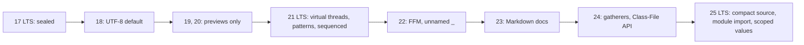

# Chapter 17 — Modern Java: 17 to 25

Java changes every six months, and a lot changed between the two long-term-support releases most teams run today: **Java 17** (September 2021) and **Java 25** (September 2025). This chapter is a **concise tour**: one table of everything that became final in each release, one tiny runnable example per final feature that the rest of the book doesn't already teach, and an exact list of what is still *preview* or *incubating* — so you know what you can use in production code today and what you can't.

Most of the big language features already have full sections elsewhere in the book; here they get a two-line reminder and a link. Read this chapter as the map, the linked sections as the territory.

**What you'll learn**

| # | Topic |
|---|---|
| 17.1 | How to read feature status (final, preview, incubator, experimental, withdrawn) |
| 17.2 | The version table: every release 17 → 25 at a glance |
| 17.3 | The Java 17 baseline (features finalised in 14–17) |
| 17.4 | Java 18: UTF-8 by default, the simple web server, code snippets in Javadoc |
| 17.5 | Java 19 and 20: the preview years |
| 17.6 | Java 21 LTS: virtual threads, pattern matching for `switch`, record patterns, sequenced collections |
| 17.7 | Java 22: unnamed variables, the Foreign Function & Memory API, multi-file launch |
| 17.8 | Java 23: Markdown documentation comments; string templates withdrawn |
| 17.9 | Java 24: stream gatherers, the Class-File API, virtual threads without pinning |
| 17.10 | Java 25 LTS: compact source files, module imports, flexible constructors, scoped values, KDF API |
| 17.11 | Still preview or incubating in Java 25 — exact list, and what JDK 26/27 did next |
| 17.12 | Removals and deprecations that matter when upgrading 17 → 21 → 25 |

**How the code was run.** Programs are in [`code/`](code/) (package `ch17.v17` … `ch17.v25`, one sub-package per release), compiled with `javac --release 25` **without** `--enable-preview`, and run on OpenJDK 26. Only **final** features appear in runnable code. Every JEP number and status in this chapter was checked against the release pages on openjdk.org (`openjdk.org/projects/jdk/<N>/`) and the individual JEP pages.

---

## 17.1 Reading a feature's status

Each change to the JDK is described in a **JEP** (JDK Enhancement Proposal) — see [Chapter 1 §1.12](../01-java-and-the-jvm/README.md#112-java-releases-lts-and-jeps) for the release model. A JEP title tells you the maturity:

| Title contains | Status | Can you use it in production? |
|---|---|---|
| nothing (e.g. *JEP 444: Virtual Threads*) | **Final / permanent** | Yes |
| *(Preview)*, *(Second Preview)* … | **Preview**: complete, but may still change | Only with `--enable-preview` on both `javac` and `java`, for experiments |
| *(Incubator)* | **Incubating API** in a `jdk.incubator.*` module | Only with `--add-modules jdk.incubator.…`; API will change |
| *(Experimental)* | **Experimental VM feature** | Needs `-XX:+UnlockExperimentalVMOptions`; not for production |
| status *Closed / Withdrawn* | **Withdrawn** | No — removed before finalisation |

A feature usually goes preview → preview → … → final, and sometimes gets renamed along the way (e.g. *Statements before super(...)* became *Flexible Constructor Bodies*). This book marks every feature with the release that **finalised** it.

---

## 17.2 The version table

GA = general availability date. "Final" rows list what you can rely on; previews are in 17.11.

| Release | GA | Language and library — final | JVM, GC and tools — final |
|---|---|---|---|
| **17 LTS** | 2021-09-14 | Sealed classes (409), enhanced pseudo-random generators (356), always-strict floating point (306), context-specific deserialization filters (415) | Strong encapsulation of JDK internals (403), macOS/AArch64 port (391), new macOS rendering pipeline (382); experimental AOT/Graal JIT removed (410); RMI activation removed (407) |
| **18** | 2022-03-22 | UTF-8 by default (400), code snippets in Javadoc `@snippet` (413), internet-address resolution SPI (418) | Simple web server `jwebserver` (408), core reflection reimplemented with method handles (416); finalization deprecated for removal (421) |
| **19** | 2022-09-20 | *(no final language/API features)* | Linux/RISC-V port (422) |
| **20** | 2023-03-21 | *(no final features — previews and incubators only)* | — |
| **21 LTS** | 2023-09-19 | Record patterns (440), pattern matching for `switch` (441), virtual threads (444), sequenced collections (431), key encapsulation mechanism API (452) | Generational ZGC (439); warnings for dynamically loaded agents (451); Windows 32-bit x86 port deprecated (449) |
| **22** | 2024-03-19 | Unnamed variables and patterns (456), Foreign Function & Memory API (454), launch multi-file source programs (458) | Region pinning for G1 (423) |
| **23** | 2024-09-17 | Markdown documentation comments (467) | ZGC generational mode by default (474); `sun.misc.Unsafe` memory-access methods deprecated for removal (471) |
| **24** | 2025-03-18 | Stream gatherers (485), Class-File API (484), quantum-resistant ML-KEM (496) and ML-DSA (497) | Virtual threads synchronize without pinning (491), ahead-of-time class loading and linking (483), ZGC non-generational mode removed (490), Security Manager permanently disabled (486), linking run-time images without JMODs (493), late barrier expansion for G1 (475), JNI restriction warnings (472), `Unsafe` memory-access warnings (498), Windows 32-bit port removed (479), 32-bit x86 port deprecated (501) |
| **25 LTS** | 2025-09-16 | Compact source files and instance `main` methods (512), module import declarations (511), flexible constructor bodies (513), scoped values (506), key derivation function API (510) | Compact object headers (519, opt-in), generational Shenandoah (521), AOT command-line ergonomics (514) and method profiling (515), JFR cooperative sampling (518) and method timing and tracing (520); 32-bit x86 port removed (503) |

Numbers in parentheses are JEP numbers. In three words each: **21** = virtual threads + patterns, **22** = FFM + `_`, **24** = gatherers, **25** = simpler Java (compact source files, module imports, flexible constructors) + scoped values.



---

## 17.3 The Java 17 baseline

Teams moving from Java 11 got a whole set of features finalised in 14–17. They are taught in depth elsewhere:

| Feature | Final in | JEP | Where in this book |
|---|---|---|---|
| Switch expressions (`->`, `yield`) | 14 | 361 | [Chapter 3 §3.3](../03-control-flow/README.md#33-arrow-labels-and-switch-expressions-java-14) |
| Helpful `NullPointerException` messages (on by default since 15) | 14 | 358 | below |
| Text blocks `"""` | 15 | 378 | [Chapter 2 §2.12](../02-basics-types-and-operators/README.md#212-strings-and-text-blocks) |
| Records | 16 | 395 | [Chapter 6 §6.8](../06-oop-inheritance-interfaces-and-more/README.md#68-records) |
| Pattern matching for `instanceof` | 16 | 394 | [Chapter 3 §3.5](../03-control-flow/README.md#35-pattern-matching-for-instanceof-java-16) |
| `Stream.toList()` | 16 | — | [Chapter 12](../12-streams/README.md) |
| `jpackage` (native installers) | 16 | 392 | — |
| Sealed classes and interfaces | 17 | 409 | [Chapter 6 §6.7](../06-oop-inheritance-interfaces-and-more/README.md#67-sealed-classes-and-interfaces-java-17) |

All of them in one small program: [`code/ch17/v17/Java17Baseline.java`](code/ch17/v17/Java17Baseline.java)
```java
sealed interface Shape permits Circle, Square {}                 // sealed classes: Java 17
record Circle(double r) implements Shape {}                      // records: Java 16
record Square(double side) implements Shape {}

static double area(Shape s) {
    if (s instanceof Circle c) return Math.PI * c.r() * c.r();   // pattern matching for instanceof: Java 16
    if (s instanceof Square q) return q.side() * q.side();
    throw new AssertionError();
}
static String kind(int day) {
    return switch (day) {                                         // switch expression: Java 14
        case 6, 7 -> "weekend";
        case 1, 2, 3, 4, 5 -> "weekday";
        default -> throw new IllegalArgumentException("day " + day);
    };
}
// main: a text block, then c.address().city().length() with a null address
```
Output:
```text
text block : {"shape": "circle", "r": 1.5}
areas      : 7.07 4.00
switch     : weekend, weekday
record     : Circle[r=1.5]
NPE says   : Cannot invoke "ch17.v17.Java17Baseline$Address.city()" because the return value of "ch17.v17.Java17Baseline$Customer.address()" is null
```
The **helpful NPE** message names exactly which part of a chain was `null` — no more guessing which of three calls on one line failed.

### Enhanced pseudo-random generators (JEP 356, Java 17)
**What it is:** a common interface `java.util.random.RandomGenerator` for every random source (old `Random`, `SplittableRandom`, `ThreadLocalRandom` and new *LXM* algorithms), selectable by name. **Why it matters:** code can accept "any generator", and you can pick algorithms with better statistical quality or splitting support for parallel work. [`code/ch17/v17/RandomGenerators.java`](code/ch17/v17/RandomGenerators.java):
```java
RandomGenerator g = RandomGeneratorFactory.of("L64X128MixRandom").create(42); // seeded: repeatable
System.out.println("L64X128MixRandom dice: " + g.ints(8, 1, 7).boxed().toList());
RandomGenerator legacy = new java.util.Random(42);           // old classes implement the interface too
```
Output:
```text
L64X128MixRandom dice: [1, 2, 1, 1, 4, 4, 6, 2]
java.util.Random dice: [3, 4, 1, 3, 1, 2, 6, 3]
default algorithm    : L32X64MixRandom
a few algorithms     : [L128X1024MixRandom, L128X128MixRandom, L128X256MixRandom, L32X64MixRandom, L64X1024MixRandom, L64X128MixRandom]
```
For everyday use `ThreadLocalRandom.current()` or `RandomGenerator.getDefault()` is fine; for security use `SecureRandom` ([Chapter 7 §7.12](../07-core-apis/README.md#712-random-numbers)).

### Strong encapsulation (JEP 403, Java 17)
The JDK's internal packages (`sun.*`, `jdk.internal.*`) are closed to reflection by default — the `--illegal-access` escape hatch was removed. Old libraries that poked at internals fail with `InaccessibleObjectException` unless you add `--add-opens`. This is the #1 upgrade issue from Java 8/11; see [Chapter 16 §16.12](../16-jvm-internals-and-performance/README.md#1612-modules-jpms-basics).

---

## 17.4 Java 18

### UTF-8 by default (JEP 400)
**The problem it solved:** before 18, APIs such as `FileReader`, `FileWriter`, `InputStreamReader`, `PrintStream` and `String.getBytes()` used the **platform** charset — UTF-8 on Linux/macOS but often Windows-1252 on Windows — so a file written on one machine could be garbled on another. Since 18 the default is **UTF-8 everywhere**; the OS encoding is still available as the `native.encoding` property. (Console output uses `stdout.encoding`, which still follows the terminal.)

[`code/ch17/v18/Utf8Default.java`](code/ch17/v18/Utf8Default.java):
```java
System.out.println("Charset.defaultCharset(): " + Charset.defaultCharset());
System.out.println("native.encoding (OS)    : " + System.getProperty("native.encoding"));
Files.writeString(tmp, "café ☕");                           // no charset argument needed
try (var reader = new java.io.FileReader(tmp.toFile())) { ... }   // FileReader also uses UTF-8 now
```
Output (macOS — on Windows `native.encoding` would typically be `Cp1252`, but the first two lines would still say UTF-8):
```text
Charset.defaultCharset(): UTF-8
file.encoding           : UTF-8
native.encoding (OS)    : UTF-8
read back               : café ☕ (9 bytes)
```
9 bytes for 6 characters: `é` takes 2 bytes and `☕` 3 in UTF-8. Still best practice: pass a charset explicitly when reading data you did not write ([Chapter 13](../13-io-and-nio/README.md)).

### Simple web server (JEP 408)
`jwebserver` serves the current directory as static files over HTTP — handy for testing HTML or sharing files on a LAN, **not** for production (HTTP/1.1 only, no HTTPS). `jwebserver -p 8000` then open `http://localhost:8000/` (not run here — the book's programs don't use the network). The same server is available as an API: `com.sun.net.httpserver.SimpleFileServer`.

### Code snippets in Javadoc (JEP 413)
`{@snippet : …}` replaces `<pre>{@code …}</pre>` for examples in documentation; it supports highlighting, regions and snippets pulled from real, compiled source files — so documentation examples can be tested.

### Finalization deprecated for removal (JEP 421)
`Object.finalize()` still works but is on its way out; use try-with-resources and `java.lang.ref.Cleaner` instead ([Chapter 8](../08-exceptions/README.md)).

---

## 17.5 Java 19 and 20: the preview years

Neither release finalised a language or library feature. They matter because the big Java 21 features were previewed here:

| JEP | Feature in 19 | JEP | Feature in 20 |
|---|---|---|---|
| 425 | Virtual Threads (Preview) | 436 | Virtual Threads (Second Preview) |
| 405 | Record Patterns (Preview) | 432 | Record Patterns (Second Preview) |
| 427 | Pattern Matching for switch (Third Preview) | 433 | Pattern Matching for switch (Fourth Preview) |
| 424 | Foreign Function & Memory API (Preview) | 434 | Foreign Function & Memory API (Second Preview) |
| 428 | Structured Concurrency (Incubator) | 437 | Structured Concurrency (Second Incubator) |
| 426 | Vector API (Fourth Incubator) | 438 | Vector API (Fifth Incubator) |
| — | — | 429 | Scoped Values (Incubator) |

Java 19 also added the Linux/RISC-V port (JEP 422). If you are on 17 and skipping to 21 or 25, you can ignore 19 and 20 entirely.

---

## 17.6 Java 21 LTS

### Pattern matching for `switch` and record patterns (JEPs 441, 440)
`switch` can match on **types** and **deconstruct records**, with `when` guards, explicit `case null`, and exhaustiveness checking over sealed hierarchies — no `default` needed. Full treatment: [Chapter 3 §3.6](../03-control-flow/README.md#36-pattern-matching-for-switch-java-21) and [§3.7](../03-control-flow/README.md#37-record-patterns-java-21-and-unnamed-patterns-java-22). [`code/ch17/v21/PatternsDemo.java`](code/ch17/v21/PatternsDemo.java) evaluates a small expression tree:
```java
sealed interface Expr permits Num, Add, Mul, Neg {}
record Num(int value) implements Expr {}
record Add(Expr left, Expr right) implements Expr {}
record Mul(Expr left, Expr right) implements Expr {}
record Neg(Expr e) implements Expr {}

static int eval(Expr e) {
    return switch (e) {                                          // exhaustive: no default needed (sealed)
        case Num(int v) -> v;
        case Add(Expr l, Expr r) -> eval(l) + eval(r);
        case Mul(Num(int a), Num(int b)) when a == 0 || b == 0 -> 0;   // nested pattern + guard
        case Mul(Expr l, Expr r) -> eval(l) * eval(r);
        case Neg(Neg(Expr inner)) -> eval(inner);                // double negation
        case Neg(Expr inner) -> -eval(inner);
    };
}
static String describe(Object o) {
    return switch (o) {
        case null -> "null!";
        case Integer i when i > 100 -> "big int " + i;
        case Integer i -> "int " + i;
        case String s -> "string of length " + s.length();
        default -> "something else: " + o.getClass().getSimpleName();
    };
}
```
Output:
```text
Add[left=Num[value=2], right=Mul[left=Num[value=3], right=Neg[e=Neg[e=Num[value=4]]]]] = 14
int 7
big int 700
string of length 3
something else: Double
null!
```
If you add a new `Expr` subtype, every `switch` like `eval` stops compiling until you handle it — the compiler finds the places to update. This "data-oriented" style (sealed types + records + pattern switch) is the modern alternative to the Visitor pattern ([LLD handbook, behavioural patterns](../../../lld/chapters/11-patterns-behavioral-2/README.md)).

### Virtual threads (JEP 444)
**Virtual threads** are lightweight threads managed by the JVM rather than the OS: you can have millions, and a blocking call (sleep, socket read, JDBC) unmounts the virtual thread from its carrier OS thread instead of blocking it. They make the simple thread-per-request style scale for I/O-bound servers. Full coverage, including pinning and when they *don't* help: [Chapter 15](../15-concurrency-2-modern/README.md). [`code/ch17/v21/VirtualThreadsDemo.java`](code/ch17/v21/VirtualThreadsDemo.java):
```java
try (var executor = Executors.newVirtualThreadPerTaskExecutor()) {   // close() waits for all tasks
    for (int i = 0; i < 10_000; i++) {
        executor.submit(() -> {
            Thread.sleep(Duration.ofMillis(200));            // simulated blocking I/O
            done.incrementAndGet();
            return null;
        });
    }
}
```
Output:
```text
tasks finished: 10000
took < 2 s    : true   (10,000 x 200 ms sequentially would be 2,000 s)
is virtual    : true
```
(The program prints a yes/no instead of the elapsed time, which varies by machine; on the author's machine it was a few hundred milliseconds.)

### Sequenced collections (JEP 431)
New interfaces `SequencedCollection`, `SequencedSet` and `SequencedMap` give every ordered collection `getFirst`, `getLast`, `addFirst`, `addLast`, `removeFirst/Last` and `reversed()` (maps: `firstEntry`, `lastEntry`, `pollFirstEntry`, `putFirst`, …). Full coverage: [Chapter 10 §10.11](../10-collections/README.md#1011-sequenced-collections-java-21). [`code/ch17/v21/SequencedDemo.java`](code/ch17/v21/SequencedDemo.java):
```java
List<String> list = new ArrayList<>(List.of("b", "c"));
list.addFirst("a"); list.addLast("d");
LinkedHashSet<Integer> set = new LinkedHashSet<>(List.of(3, 1, 2));
set.addFirst(2);                                             // moves an existing element to the front
SequencedMap<String, Integer> map = new LinkedHashMap<>();
map.put("x", 1); map.put("y", 2); map.putFirst("w", 0);
```
Output:
```text
[a, b, c, d] first=a last=d reversed=[d, c, b, a]
[2, 3, 1] reversed=[1, 3, 2]
{w=0, x=1, y=2} firstEntry=w=0 pollLast=y=2 -> {w=0, x=1}
```

### Also final in 21
- **Generational ZGC** (JEP 439) — opt-in with `-XX:+UseZGC -XX:+ZGenerational` in 21; default mode from 23, the only mode from 24 ([Chapter 16 §16.5](../16-jvm-internals-and-performance/README.md#165-garbage-collection-algorithms)).
- **Key Encapsulation Mechanism API** (JEP 452) — `javax.crypto.KEM`, the building block for hybrid and post-quantum key exchange.
- **Warnings for dynamically loaded agents** (JEP 451) — attaching a Java agent to a running JVM now prints a warning; tools like Mockito's inline mock maker should be loaded with `-javaagent` at start-up.

---

## 17.7 Java 22

### Unnamed variables and patterns (JEP 456)
Use `_` for anything you must declare but never read: loop variables, `catch` parameters, lambda parameters, try-with-resources variables, and parts of record patterns. It documents intent and silences "unused" warnings. [`code/ch17/v22/UnnamedDemo.java`](code/ch17/v22/UnnamedDemo.java):
```java
for (var _ : List.of("a", "b", "c")) count++;                 // loop variable not needed
catch (NumberFormatException _) { ... }                       // exception object not needed
m.forEach((k, _) -> System.out.print(k + " "));               // lambda parameter not needed
if (o instanceof Line(Point(var x1, _), Point(var x2, _)))    // ignore the y components
    System.out.println("horizontal distance = " + Math.abs(x2 - x1));
String kind = switch (o) {
    case Line(Point _, Point(int x, int y)) when x == y -> "ends on the diagonal";
    case Line _ -> "a line";                                  // unnamed pattern variable
    default -> "other";
};
```
Output:
```text
count = 3
not a number
x y 
horizontal distance = 3
a line
```
`_` has been a reserved keyword since Java 9, so no valid old code breaks. You can use several `_` in the same scope.

### Foreign Function & Memory API (JEP 454)
**What it is:** a pure-Java way to call native (C) libraries and to work with memory outside the heap — the safe, fast replacement for JNI (which needed hand-written C glue code) and for `sun.misc.Unsafe` memory access. **Key types:** `Linker` (makes a Java `MethodHandle` for a C function), `FunctionDescriptor` (the C signature), `Arena` (owns off-heap memory and frees it when closed), `MemorySegment` (a bounded, checked region of memory), `ValueLayout` (C types like `int`, `long`, pointer).

[`code/ch17/v22/ForeignStrlen.java`](code/ch17/v22/ForeignStrlen.java) calls the C library's `strlen`:
```java
Linker linker = Linker.nativeLinker();
MethodHandle strlen = linker.downcallHandle(
        linker.defaultLookup().find("strlen").orElseThrow(),
        FunctionDescriptor.of(ValueLayout.JAVA_LONG, ValueLayout.ADDRESS));   // size_t strlen(const char*)

try (Arena arena = Arena.ofConfined()) {                     // off-heap memory freed at the end of the block
    MemorySegment cString = arena.allocateFrom("Hello, native world!");     // UTF-8, NUL-terminated
    long len = (long) strlen.invokeExact(cString);
    MemorySegment ints = arena.allocate(ValueLayout.JAVA_INT, 5);            // like int[5] in C
    for (int i = 0; i < 5; i++) ints.setAtIndex(ValueLayout.JAVA_INT, i, i * i);
}
```
Output of `java -cp out ch17.v22.ForeignStrlen` (warnings go to standard error; path shortened):
```text
WARNING: A restricted method in java.lang.foreign.Linker has been called
WARNING: java.lang.foreign.Linker::downcallHandle has been called by ch17.v22.ForeignStrlen in an unnamed module (file:.../out17/)
WARNING: Use --enable-native-access=ALL-UNNAMED to avoid a warning for callers in this module
WARNING: Restricted methods will be blocked in a future release unless native access is enabled

strlen = 20
off-heap ints: [0, 1, 4, 9, 16], 20 bytes
```
Calling native code can crash the JVM, so such methods are **restricted**: grant access explicitly with `--enable-native-access=ALL-UNNAMED` (or a module name). Real-world users: Apache Lucene (memory-mapped index files), database drivers, and bindings generated by the **jextract** tool from C header files.

### Launch multi-file source-code programs (JEP 458)
`java Main.java` now compiles and runs a program spread over several source files in a directory tree — no build step for small tools and learning. See [Chapter 1 §1.10](../01-java-and-the-jvm/README.md#110-launching-source-files-directly).

### Region pinning for G1 (JEP 423)
Native code holding a pointer into a Java array (a JNI "critical region") no longer blocks G1 garbage collection; G1 just avoids moving that one region.

---

## 17.8 Java 23

### Markdown documentation comments (JEP 467)
Javadoc comments can be written in **Markdown** using `///` lines instead of HTML inside `/** … */`. [`code/ch17/v23/MarkdownDoc.java`](code/ch17/v23/MarkdownDoc.java):
```java
/// JEP 467 (Java 23): documentation comments written in **Markdown**.
///
/// Lines start with `///` instead of the `/** ... */` block, and use Markdown instead of HTML:
///
/// - lists like this one
/// - `inline code` and **bold**
/// - links to program elements: [String#strip()]
///
/// @param <T> the element type (block tags such as `@param` still work)
public class MarkdownDoc<T> {
```
`javadoc -d docs MarkdownDoc.java` turns it into this HTML (real output, the class description block):
```html
<p>JEP 467 (Java 23): documentation comments written in <strong>Markdown</strong>.</p>
<p>Lines start with <code>///</code> instead of the <code>/** ... */</code> block, and use Markdown instead of HTML:</p>
<ul>
<li>lists like this one</li>
<li><code>inline code</code> and <strong>bold</strong></li>
<li>links to program elements: <a href="https://docs.oracle.com/en/java/javase/26/docs/api/java.base/java/lang/String.html#strip()" class="external-link"><code>String.strip()</code></a></li>
</ul>
```
`[String#strip()]` became a link to the JDK's API page — reference links to program elements are the Markdown replacement for `{@link …}`.

### Also in 23
- **ZGC generational mode by default** (JEP 474).
- **`sun.misc.Unsafe` memory-access methods deprecated for removal** (JEP 471) — the FFM API and `VarHandle` are the replacements.
- **String templates withdrawn.** They were previewed in 21 (JEP 430) and 22 (JEP 459); a third preview (JEP 465) was proposed for 23 but **withdrawn**, and the feature was removed from JDK 23. The designers decided the syntax (`STR."Hello \{name}"`) and processor model needed rethinking. There is no replacement yet — use `String.formatted`, `+`, `StringBuilder` or `MessageFormat` ([Chapter 7 §7.4](../07-core-apis/README.md#74-formatting-text-and-numbers)). Don't trust tutorials from 2023–24 that show `STR.` templates: that code doesn't compile on any current JDK.

---

## 17.9 Java 24

### Stream gatherers (JEP 485)
`Stream.gather(Gatherer)` adds **custom intermediate operations** — the missing counterpart to custom collectors. Built-ins in `java.util.stream.Gatherers`: `windowFixed`, `windowSliding`, `fold`, `scan`, `mapConcurrent`. Full coverage, including writing your own: [Chapter 12 §12.9](../12-streams/README.md#129-stream-gatherers-java-24). [`code/ch17/v24/GatherersDemo.java`](code/ch17/v24/GatherersDemo.java):
```java
Stream.of(1, 2, 3, 4, 5, 6, 7).gather(Gatherers.windowFixed(3)).toList()
Stream.of(1, 2, 3, 4, 5).gather(Gatherers.windowSliding(2)).toList()
Stream.of(1, 2, 3, 4, 5).gather(Gatherers.scan(() -> 0, Integer::sum)).toList()
Stream.of("a", "b", "c").gather(Gatherers.fold(() -> "", String::concat)).toList()
```
Output:
```text
[[1, 2, 3], [4, 5, 6], [7]]
[[1, 2], [2, 3], [3, 4], [4, 5]]
[1, 3, 6, 10, 15]
[abc]
```

### Class-File API (JEP 484)
**What it is:** a standard API (`java.lang.classfile`) for reading, writing and transforming `.class` files. **Why:** frameworks and tools (Spring, Hibernate, Mockito, the JDK itself) generate or rewrite bytecode, traditionally with the third-party ASM library, which always lags behind new class-file versions. The JDK's own API is updated in lock-step with each release. [`code/ch17/v24/ClassFileDemo.java`](code/ch17/v24/ClassFileDemo.java) parses its own class file:
```java
ClassModel cm = ClassFile.of().parse(bytes);
for (MethodModel m : cm.methods()) {
    for (CodeElement e : m.code().get()) {                // walk the bytecode as typed objects
        if (e instanceof Instruction) instructions++;
        if (e instanceof InvokeInstruction inv) calls.add(inv.name().stringValue());
    }
}
```
Output:
```text
class   : ch17/v24/ClassFileDemo  (class-file major version 69)
method  : <init>   ()V                        3 instructions, 1 calls [<init>]
method  : square   (I)I                       4 instructions, 0 calls []
method  : main     ([Ljava/lang/String;)V   133 instructions, 36 calls
square(7) = 49
```
Major version 69 = Java 25 ([Chapter 1 §1.6](../01-java-and-the-jvm/README.md#16-bytecode-and-class-files)). Note how pattern matching (`instanceof InvokeInstruction inv`) makes walking a model natural. Application developers rarely need this API directly.

### Virtual threads without pinning (JEP 491)
Before 24, a virtual thread that blocked **inside a `synchronized` block** stayed *pinned* to its carrier OS thread, which could starve the scheduler — the standard advice was "replace `synchronized` with `ReentrantLock`". Since 24, virtual threads can release their carrier while holding or waiting for a monitor, so that advice is largely obsolete. (Pinning still happens in native frames.) Details: [Chapter 15](../15-concurrency-2-modern/README.md).

### Also final in 24
- **Ahead-of-time class loading and linking** (JEP 483): record a training run into an AOT cache, start faster in production ([Chapter 1 §1.7](../01-java-and-the-jvm/README.md#17-how-the-jvm-runs-your-code-class-loading-interpreter-jit)).
- **Security Manager permanently disabled** (JEP 486): `System.setSecurityManager` throws; `-Djava.security.manager` is an error.
- **Post-quantum cryptography**: ML-KEM key encapsulation (JEP 496) and ML-DSA signatures (JEP 497), standardised by NIST in FIPS 203/204.
- **ZGC non-generational mode removed** (JEP 490), **late barrier expansion for G1** (JEP 475, a JIT-internal simplification), **linking run-time images without JMODs** (JEP 493, lets `jlink` work on JDKs shipped without the `jmods` folder).
- Integrity warnings: **JNI** use prints a warning unless enabled (JEP 472); **`Unsafe` memory access** prints a warning on first use (JEP 498).

---

## 17.10 Java 25 LTS

### Compact source files and instance `main` methods (JEP 512)
A source file can now contain just methods and fields — the class around them is implicit — and `main` can be an instance method without `String[] args`. A new class `java.lang.IO` offers `IO.println` and `IO.readln`, and compact source files automatically import all of `java.base`. This is covered with runnable examples in [Chapter 1 §1.10](../01-java-and-the-jvm/README.md#110-launching-source-files-directly) and [Chapter 4 §4.9](../04-methods-and-arrays/README.md#49-main-command-line-arguments-and-simpler-main-java-25):
```java
void main() {
    IO.println("Hello, Java 25");
}
```
It was previewed four times under different names: *Unnamed Classes and Instance Main Methods* (21, JEP 445), *Implicitly Declared Classes…* (22 JEP 463, 23 JEP 477), *Simple Source Files…* (24, JEP 495).

### Module import declarations (JEP 511)
`import module M;` imports every public top-level type in every package that module `M` exports (and that it transitively reads through `requires transitive`). It saves long import lists in scripts, prototypes and teaching code; ordinary code can use it too. [`code/ch17/v25/ModuleImportDemo.java`](code/ch17/v25/ModuleImportDemo.java):
```java
package ch17.v25;

import module java.base;           // JEP 511 (Java 25): imports every package exported by java.base

public class ModuleImportDemo {
    public static void main(String[] args) {
        List<String> words = List.of("modules", "import", "java", "base");
        Map<Integer, List<String>> byLength = words.stream().collect(Collectors.groupingBy(String::length));
        IO.println("by length : " + new TreeMap<>(byLength));                 // java.lang.IO: Java 25 (JEP 512)
        IO.println("a path    : " + Path.of("docs", "ch17.md"));
        IO.println("a date    : " + LocalDate.of(2025, 9, 16).getDayOfWeek()); // Java 25 GA day
    }
}
```
Output:
```text
by length : {4=[java, base], 6=[import], 7=[modules]}
a path    : docs/ch17.md
a date    : TUESDAY
```
**Trade-off:** ambiguity. Add `import module java.desktop;` next to `java.base` and a plain `List` becomes ambiguous (`java.util.List` or `java.awt.List`?) — fix it with a normal single-type import (`import java.util.List;`), which always wins over module imports. The importing class does not have to be in a named module: this demo lives on the class path.

### Flexible constructor bodies (JEP 513)
Statements may now appear **before** `super(…)` or `this(…)`, as long as they don't use the object being constructed (except to assign its own fields). **The problem it solves:** validating or computing arguments used to need a static helper method or wasted superclass work; and a superclass constructor calling an overridden method saw the subclass's fields still at default values. [`code/ch17/v25/FlexibleConstructors.java`](code/ch17/v25/FlexibleConstructors.java):
```java
static class Account {
    final String id;
    Account(String id) { this.id = id; describe(); }
    void describe() { System.out.println("  Account(" + id + ")"); }
}
static class SavingsAccount extends Account {
    final double rate;
    SavingsAccount(String id, double rate) {
        if (rate < 0 || rate > 0.2)                                // validate BEFORE the superclass runs
            throw new IllegalArgumentException("bad rate " + rate);
        this.rate = rate;                                          // allowed: initialise own field early
        super(id.strip().toUpperCase());                           // prepare the argument, then call super
    }
    @Override void describe() {                                   // called from Account's constructor:
        System.out.println("  SavingsAccount(" + id + ", rate=" + rate + ")");   // rate is already set
    }
}
```
Output:
```text
  SavingsAccount(SA-1, rate=0.03)
  rejected before any superclass work: bad rate 5.0
```
Before Java 25 the overridden `describe()` would have printed `rate=0.0` (the field wasn't assigned yet). Still, calling overridable methods from constructors is a design smell ([Chapter 6](../06-oop-inheritance-interfaces-and-more/README.md)); this feature makes it safe where it can't be avoided. Not allowed in the prologue: reading fields, calling instance methods, using `this` as a value.

### Scoped values (JEP 506)
A `ScopedValue` passes read-only context (the current user, a request ID, a transaction) to code deep in a call chain **without** method parameters — like a `ThreadLocal`, but immutable, automatically unbound when the scope ends (no leaks on thread pools), and cheap to inherit into child threads in structured concurrency. Details and comparison with `ThreadLocal`: [Chapter 15](../15-concurrency-2-modern/README.md). [`code/ch17/v25/ScopedValueDemo.java`](code/ch17/v25/ScopedValueDemo.java):
```java
static final ScopedValue<String> USER = ScopedValue.newInstance();

static void handle() { audit("read order 17"); }                  // no user parameter threaded through
static void audit(String action) {
    System.out.println("  audit: " + (USER.isBound() ? USER.get() : "<anonymous>") + " -> " + action);
}
// main:
ScopedValue.where(USER, "ana").run(ScopedValueDemo::handle); // bound only while run() executes
ScopedValue.where(USER, "bo").run(() -> {
    handle();
    ScopedValue.where(USER, "admin").run(ScopedValueDemo::handle);   // rebinding for a nested scope
    handle();                                                       // back to "bo"
});
handle();                                                            // unbound again
```
Output:
```text
  audit: ana -> read order 17
  audit: bo -> read order 17
  audit: admin -> read order 17
  audit: bo -> read order 17
  audit: <anonymous> -> read order 17
bound outside? false
```

### Key derivation function API (JEP 510)
`javax.crypto.KDF` derives keys from a secret, e.g. with **HKDF** (used by TLS 1.3 and many protocols). [`code/ch17/v25/HkdfDemo.java`](code/ch17/v25/HkdfDemo.java) checks the JDK against test case 1 of RFC 5869, the HKDF standard:
```java
KDF hkdf = KDF.getInstance("HKDF-SHA256");
byte[] okm = hkdf.deriveData(HKDFParameterSpec.ofExtract()
        .addIKM(ikm).addSalt(salt).thenExpand(info, 42));    // extract-then-expand, 42 bytes out
```
Output:
```text
OKM      = 3cb25f25faacd57a90434f64d0362f2a2d2d0a90cf1a5a4c5db02d56ecc4c5bf34007208d5b887185865
RFC 5869 = 3cb25f25faacd57a90434f64d0362f2a2d2d0a90cf1a5a4c5db02d56ecc4c5bf34007208d5b887185865
match    : true
```
Use `deriveKey("AES", spec)` to get a `SecretKey` instead of raw bytes.

### JVM and tooling in 25
| JEP | Feature | One line |
|---|---|---|
| 519 | Compact object headers | 8-byte object headers with `-XX:+UseCompactObjectHeaders`: smaller heaps ([Chapter 16 §16.4](../16-jvm-internals-and-performance/README.md#164-object-layout-basics)) |
| 521 | Generational Shenandoah | `-XX:+UseShenandoahGC -XX:ShenandoahGCMode=generational`, now a product feature |
| 514 | AOT command-line ergonomics | One-step AOT cache creation: `-XX:AOTCacheOutput=app.aot` |
| 515 | AOT method profiling | The AOT cache also stores method profiles, so the JIT warms up faster |
| 518 | JFR cooperative sampling | Safer, more robust stack sampling in Flight Recorder |
| 520 | JFR method timing and tracing | Time or trace chosen methods via JFR without changing code |
| 503 | Remove the 32-bit x86 port | Only 64-bit x86 remains |

---

## 17.11 Still preview or incubating in Java 25 — and what came next

These are **not** final in Java 25. Don't use them in production code; the book has no runnable examples of them. Each row shows every round up to JDK 27 (GA 15 September 2026).

| Feature | History (JEP numbers) | Status in 25 | After 25 |
|---|---|---|---|
| **Structured concurrency** — treat a group of subtasks as one unit (fail together, cancel together) | Incubator 19 (428), 20 (437); preview 21 (453), 22 (462), 23 (480), 24 (499) | **Fifth preview** (505) | Sixth preview in 26 (525), seventh in 27 (533) |
| **Primitive types in patterns, `instanceof` and `switch`** — e.g. `case int i when i > 0`, `x instanceof byte b` | Preview 23 (455), 24 (488) | **Third preview** (507) | Fourth preview in 26 (530), fifth in 27 (532) |
| **Stable values** — lazily initialised constants the JIT can treat as `final` | — | **Preview** (502) | Renamed **Lazy Constants**: second preview in 26 (526), third in 27 (531) |
| **PEM encodings of cryptographic objects** — read/write keys and certificates as PEM text | — | **Preview** (470) | Second preview in 26 (524), third in 27 (538) |
| **Vector API** — portable SIMD computations (`jdk.incubator.vector`) | Incubating since 16; 17 (414) … 24 (489) | **Tenth incubator** (508) | 11th incubator in 26 (529), 12th in 27 (537) — waiting for Project Valhalla's value classes |
| **JFR CPU-time profiling** (Linux only) | — | **Experimental** (509) | — |

To try a preview on JDK 25: `javac --release 25 --enable-preview Foo.java` and `java --enable-preview Foo`; single-file launch: `java --enable-preview --source 25 Foo.java`.

**What JDK 26 (GA 17 March 2026) and JDK 27 (GA 15 September 2026) finalised** — both non-LTS, noted briefly:
- **26**: HTTP/3 for the HTTP Client API (517), AOT object caching with any GC (516), G1 throughput improvement by reducing synchronization (522), *Prepare to Make Final Mean Final* (500 — warnings when deep reflection mutates `final` fields), Applet API removed (504).
- **27**: G1 the default collector in all environments (523), compact object headers on by default (534), post-quantum hybrid key exchange for TLS 1.3 (527), JFR in-process data redaction (536).

The next LTS is expected to be **Java 29** (September 2027).

---

## 17.12 Upgrading 17 → 21 → 25: removals and deprecations

| Change | JEP, release | What breaks / what to do |
|---|---|---|
| JDK internals strongly encapsulated | 403, 17 | Reflection into `sun.*`/`java.*` private members fails → upgrade the library, or `--add-opens` temporarily |
| Security Manager deprecated → permanently disabled | 411 (17) → 486 (24) | Code calling `System.setSecurityManager` fails; remove it |
| Finalization deprecated for removal | 421, 18 | Replace `finalize()` with try-with-resources / `Cleaner` |
| Applet API deprecated → removed | 398 (17) → 504 (26) | Nothing for server code |
| Dynamic agent loading warns | 451, 21 | Load agents with `-javaagent` at start-up (e.g. Mockito in tests: add the agent to the test JVM) |
| `sun.misc.Unsafe` memory access deprecated → warns | 471 (23) → 498 (24) | Upgrade libraries (Netty, older serializers) to versions using FFM/`VarHandle` |
| JNI use warns | 472, 24 | Add `--enable-native-access=…` for libraries that use native code |
| ZGC non-generational mode removed | 490, 24 | Drop `-XX:-ZGenerational` |
| 32-bit ports removed | 479 (24, Windows x86), 503 (25, x86) | Use 64-bit JDKs |
| String templates withdrawn | 465, 23 | Code written against the 21/22 preview must be rewritten |

**A practical upgrade checklist**
1. Build and run the test suite on the new JDK with `--release` still at the old version, then raise `--release`.
2. Upgrade build plugins and bytecode-heavy libraries first (Maven/Gradle plugins, Lombok, Mockito, Byte Buddy, Spring, Hibernate): they must understand the new class-file version.
3. Run `jdeps --jdk-internals your.jar` to find uses of JDK internals and `jdeprscan your.jar` to find deprecated APIs.
4. Watch the startup warnings (agents, JNI, `Unsafe`) — they become errors in future releases.
5. Re-check GC and memory settings; defaults changed (generational ZGC, compact headers in 27).

---

## 17.13 In the interview

**Q: What changed in Java between 17 and 21, and between 21 and 25?** 17 → 21: pattern matching for `switch` and record patterns (with sealed types, a new data-oriented style), **virtual threads**, sequenced collections, generational ZGC. 21 → 25: unnamed `_` variables, the Foreign Function & Memory API, stream gatherers, the Class-File API, virtual threads no longer pinned by `synchronized`, and in 25 itself compact source files with instance `main`, module import declarations, flexible constructor bodies, scoped values and AOT start-up improvements.
- *Is structured concurrency final?* No — it is still in preview (fifth preview in 25, seventh in 27).
- *What happened to string templates?* Previewed in 21 and 22, withdrawn in 23; no replacement yet.
- *Why upgrade from 21 to 25?* LTS support horizon, no `synchronized` pinning with virtual threads, faster start-up with AOT caches, smaller heaps with compact object headers, and the new language conveniences.
- *Can you use a preview feature in production?* Technically with `--enable-preview`, but it may change or disappear in the next release and class files compiled with previews only run on that exact release — so no.

### Self-check
1. In which release did virtual threads become final, and which JEP? → Java 21, JEP 444.
2. Name two features finalised in Java 25. → Any of: compact source files and instance main (512), module import declarations (511), flexible constructor bodies (513), scoped values (506), KDF API (510), compact object headers (519), generational Shenandoah (521).
3. Did Java 19 or 20 finalise any language features? → No — only previews/incubators (and the RISC-V port in 19).
4. What does `import module java.base;` import? → All public top-level types of every package exported by `java.base`.
5. Which statements are allowed before `super(...)` since Java 25? → Ones that don't use `this` — validation, computing arguments, and assigning the class's own fields.

---

## Chapter TL;DR
- Status words matter: **final** = use it; **preview/incubator/experimental** = experiments only; **withdrawn** = gone. Check the JEP title on openjdk.org.
- **17**: sealed classes, new random generators, strong encapsulation (plus records, text blocks, `switch` expressions, `instanceof` patterns from 14–16).
- **18**: UTF-8 by default, `jwebserver`, `@snippet`. **19–20**: previews only.
- **21 LTS**: pattern matching for `switch`, record patterns, **virtual threads**, sequenced collections, generational ZGC.
- **22**: `_` unnamed variables and patterns, **FFM API**, multi-file source launch. **23**: Markdown doc comments; string templates withdrawn.
- **24**: **stream gatherers**, Class-File API, virtual threads without `synchronized` pinning, AOT class loading, Security Manager disabled, ML-KEM/ML-DSA.
- **25 LTS**: compact source files + instance `main` + `IO`, `import module`, flexible constructor bodies, **scoped values**, KDF API, compact object headers (opt-in), generational Shenandoah.
- Still preview in 25: structured concurrency, primitive patterns, stable values (→ lazy constants), PEM; Vector API incubating. JDK 26/27 finalised HTTP/3, G1-everywhere and compact headers by default.
- Next: [Chapter 18 — Testing, build and tooling](../18-testing-build-and-tooling/README.md).
