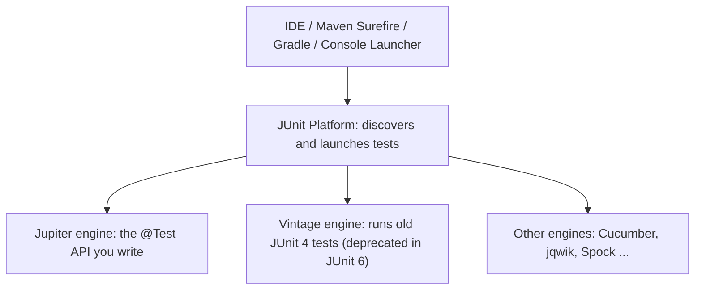
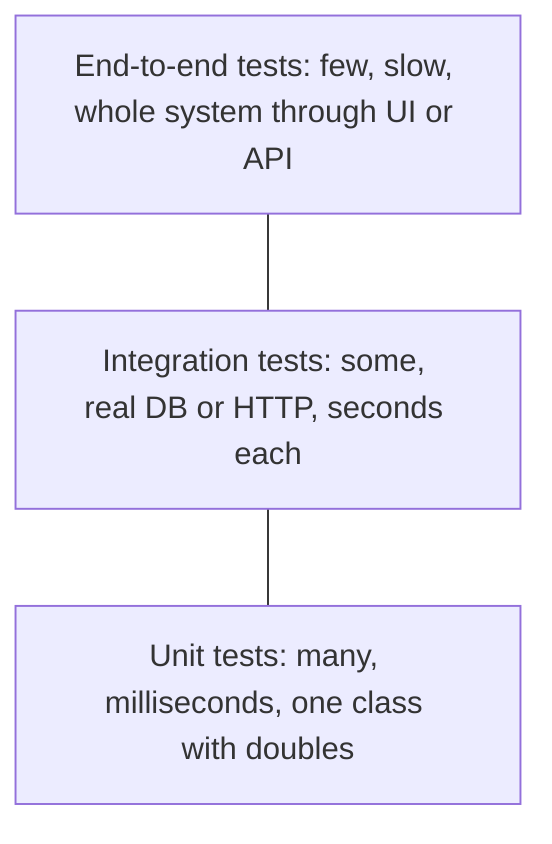
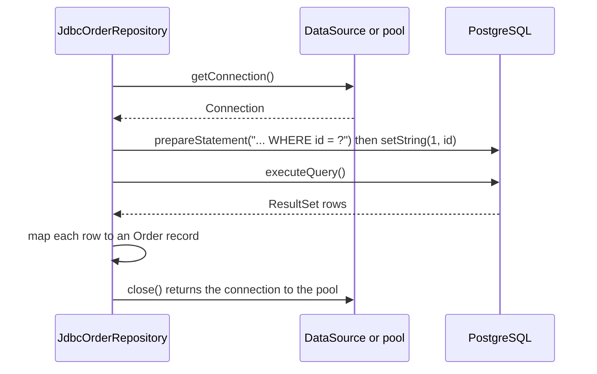

# Chapter 18 — Testing, Build and Tooling

Everything so far was compiled with a bare `javac` and run with `java`. Real projects add four things around the language: a **build tool** that downloads libraries and runs every step in the right order, **automated tests** that prove the code still works after each change, **logging** that tells you what a running program did, and a **package** (a JAR) you can ship. This chapter teaches all four on one small shop application, plus the JDBC basics you need to talk to a database, and ends with a map of where to go next (Spring Boot).

**What you'll learn**

| # | Topic |
|---|---|
| 18.1 | The shape of a real Java project: layout, coordinates, repositories |
| 18.2 | Maven: `pom.xml`, dependencies and scopes, the lifecycle, a real offline build |
| 18.3 | Gradle: `build.gradle.kts`, configurations, tasks, Maven vs Gradle |
| 18.4 | JUnit (Jupiter): first tests, assertions, lifecycle, nested tests, tags, running from the command line |
| 18.5 | Parameterized, repeated and dynamic tests |
| 18.6 | Test doubles and Mockito |
| 18.7 | AssertJ fluent assertions |
| 18.8 | Reading a failing test report |
| 18.9 | Test design: what makes a good test, coverage, flaky tests, integration tests |
| 18.10 | Logging: `java.util.logging` (run) and SLF4J (snippet) |
| 18.11 | JDBC basics: connections, prepared statements, transactions, a repository |
| 18.12 | Packaging: JAR files, executable JARs, fat JARs, jlink/jpackage |
| 18.13 | Other everyday tools |
| 18.14 | Where next: Spring Boot and friends |

**How the code was run.** All sources are in [`code/`](code/):

| Folder | What | How it runs |
|---|---|---|
| [`code/ch18/shop/`](code/ch18/shop/) | the application: `Cart`, `Discounts`, `OrderService`, … and `ShopDemo` (has `main`) | the book's runner (`javac --release 25`, JDK 26) |
| [`code/test/ch18/shop/`](code/test/ch18/shop/) | JUnit tests (marked `// tools_run: skip` — they have no `main`) | [`code/run_tests.sh`](code/run_tests.sh) |
| [`code/ch18/logging/`](code/ch18/logging/) | `JulDemo` | the book's runner |
| [`code/ch18/jdbc/`](code/ch18/jdbc/) | `JdbcOrderRepository`, `JdbcDemo` (skip-marked: needs a database) | by hand against the SQL Handbook's private PostgreSQL (18.11) |
| [`code/build-files/`](code/build-files/) | `pom.xml`, `build.gradle.kts`, `settings.gradle.kts` | Maven 3.9.14 and Gradle 9.4.1 **offline**, from the local artifact cache (18.2, 18.3) |
| [`code/package_jar.sh`](code/package_jar.sh) | builds and runs a JAR with the `jar` tool | by hand (18.12) |

Test libraries were downloaded from Maven Central (`repo1.maven.org`, SHA-1 checked) into `ROOT/.java-books/lib/`: **JUnit 6.1.3** (`junit-platform-console-standalone`, the latest release at the time of writing), **Mockito 5.24.0** (`mockito-core`, `mockito-junit-jupiter`) with **Byte Buddy 1.18.14** (`byte-buddy`, `byte-buddy-agent`) and **Objenesis 3.3**, and **AssertJ 3.27.7**. The Maven and Gradle builds used the versions already in the local cache (JUnit 6.0.3, Mockito 5.23.0) because they ran without network. Every output below is real.

---

## 18.1 The shape of a real Java project

### What it is
A Java project is more than `.java` files. It has **dependencies** (other people's JARs), **tests**, **resources** (config files, templates), and **build outputs** (compiled classes, the final JAR). Both mainstream build tools agree on one **standard directory layout**, so any Java developer can open any project:

```text
shop/
├── pom.xml                  (Maven)  or  build.gradle.kts + settings.gradle.kts (Gradle)
├── mvnw / gradlew           the build-tool "wrapper" script (commit it)
└── src/
    ├── main/
    │   ├── java/ch18/shop/Cart.java        production code (package = folder path)
    │   └── resources/                       copied as-is onto the class path (e.g. logback.xml)
    └── test/
        ├── java/ch18/shop/CartTest.java     tests: same package, separate folder
        └── resources/                       test-only resources
target/  (Maven)  or  build/  (Gradle)        generated — never commit
```

Tests live in the **same package** as the code they test but in a **separate source folder**. That gives them access to package-private members, while the build keeps test classes out of the final JAR. This chapter's `code/` folder mirrors it: `code/ch18/shop` is "main", `code/test/ch18/shop` is "test".

### Coordinates and repositories
Every library is identified by three **coordinates**, written `groupId:artifactId:version` — for example `org.assertj:assertj-core:3.27.7`.

| Term | Meaning |
|---|---|
| **groupId** | the organisation, reversed domain style (`org.junit.jupiter`) |
| **artifactId** | the library's name (`junit-jupiter-api`) |
| **version** | a release (`6.1.3`) or a **SNAPSHOT** (`1.0.0-SNAPSHOT`: work in progress, may change) |
| **artifact** | a file published under those coordinates — usually a JAR plus a `.pom` describing its own dependencies |
| **repository** | a server storing artifacts; the public one is **Maven Central** (`repo1.maven.org/maven2`, searchable at central.sonatype.com) |
| **local repository** | the cache on your disk (`~/.m2/repository` for Maven, `~/.gradle/caches` for Gradle) — downloaded once, reused by every project |
| **transitive dependency** | a dependency of a dependency, pulled in automatically (Mockito brings Byte Buddy and Objenesis) |

A repository is laid out by coordinates: `org.assertj:assertj-core:3.27.7` lives at `repo1.maven.org/maven2/org/assertj/assertj-core/3.27.7/assertj-core-3.27.7.jar` — how this chapter fetched its jars by hand, and what a build tool does for every (transitive) dependency.

### Why a build tool
Without one you'd download jars by hand, keep versions consistent, type long `-cp` lines and remember to test before packaging. A build tool turns that into one file and one command (`mvn verify`, `./gradlew build`) that behaves the same on every machine and on CI.

### TL;DR
Standard layout (`src/main/java`, `src/test/java`), libraries identified by `group:artifact:version`, downloaded from Maven Central into a local cache. The build tool does the rest.

---

## 18.2 Maven

### What it is
**Apache Maven** (2004) is a build tool driven by a declarative XML file, `pom.xml` (**P**roject **O**bject **M**odel). You describe *what* the project is — coordinates, dependencies, plugin settings — and Maven's fixed **lifecycle** decides *how* and *in which order* things happen. Analogy: a set menu — the courses always come in the same order; you only choose the dishes. The current stable line is Maven 3.9 (3.9.16 at the time of writing); Maven 4.0 was still at release-candidate stage.

### The `pom.xml` — [`code/build-files/maven/pom.xml`](code/build-files/maven/pom.xml)
Key parts (the full file adds pinned plugin versions):

```xml
<project ...>
  <modelVersion>4.0.0</modelVersion>
  <groupId>com.example</groupId>
  <artifactId>shop</artifactId>
  <version>1.0.0-SNAPSHOT</version>
  <packaging>jar</packaging>

  <properties>
    <maven.compiler.release>25</maven.compiler.release>   <!-- same as javac option: release 25 -->
    <project.build.sourceEncoding>UTF-8</project.build.sourceEncoding>
  </properties>

  <dependencyManagement>                        <!-- versions only; adds nothing by itself -->
    <dependencies>
      <dependency>                              <!-- a BOM pins every JUnit module's version -->
        <groupId>org.junit</groupId> <artifactId>junit-bom</artifactId> <version>6.0.3</version>
        <type>pom</type> <scope>import</scope>
      </dependency>
      <dependency>                              <!-- one Byte Buddy for Mockito AND AssertJ -->
        <groupId>net.bytebuddy</groupId> <artifactId>byte-buddy</artifactId> <version>1.18.11</version>
      </dependency>
      <!-- ... byte-buddy-agent 1.18.11 ... -->
    </dependencies>
  </dependencyManagement>

  <dependencies>
    <dependency>
      <groupId>org.junit.jupiter</groupId> <artifactId>junit-jupiter</artifactId>
      <scope>test</scope>                       <!-- no version: taken from the BOM -->
    </dependency>
    <dependency>
      <groupId>org.mockito</groupId> <artifactId>mockito-junit-jupiter</artifactId>
      <version>5.23.0</version> <scope>test</scope>
    </dependency>
    <dependency>
      <groupId>org.assertj</groupId> <artifactId>assertj-core</artifactId>
      <version>3.27.7</version> <scope>test</scope>
    </dependency>
  </dependencies>

  <build>
    <plugins>
      <!-- maven-dependency-plugin 'properties' goal: exposes the mockito-core jar path as a property -->
      <plugin>
        <artifactId>maven-surefire-plugin</artifactId> <version>3.5.4</version>
        <configuration>
          <argLine>-javaagent:${org.mockito:mockito-core:jar} -Xshare:off</argLine>
          <excludedGroups>demo-failure</excludedGroups>        <!-- JUnit tags to skip -->
        </configuration>
      </plugin>
      <plugin>
        <artifactId>maven-jar-plugin</artifactId> <version>3.5.1</version>
        <configuration>
          <archive><manifest><mainClass>ch18.shop.ShopDemo</mainClass></manifest></archive>
        </configuration>
      </plugin>
    </plugins>
  </build>
</project>
```

What each part does:
- **Coordinates** of *this* project — what other projects would write to depend on it.
- **`maven.compiler.release`** — passes `--release 25` to `javac` ([Chapter 1 §1.5](../01-java-and-the-jvm/README.md#15-write--compile--run)).
- **`dependencyManagement`** — a table of versions; it *declares* nothing. A **BOM** (bill of materials) is a pom that is only such a table, imported with `<scope>import</scope>`, so all JUnit modules share one version.
- **`dependencies`** — what the project actually uses, each with a **scope**.
- **`build/plugins`** — configure the plugins that do the work (compile, test, jar).

### Dependency scopes

| Scope | On compile class path | On test class path | Packaged / at run time | Typical example |
|---|---|---|---|---|
| `compile` (default) | yes | yes | yes | Jackson, Guava |
| `provided` | yes | yes | no — the runtime supplies it | Servlet API inside an app server |
| `runtime` | no | yes | yes | JDBC driver (code uses only `java.sql`) |
| `test` | no (main code) | yes | no | JUnit, Mockito, AssertJ |
| `import` | — | — | — | only for a BOM inside `dependencyManagement` |

`system` also exists but is deprecated — don't use it.

### Transitive dependencies and version conflicts
Maven builds a dependency **tree**. When two paths bring *different versions* of one library, Maven picks the **nearest** one in the tree; on a tie, the one declared **first**. This build hit a real conflict: `mockito-core` wants Byte Buddy 1.17.7 at depth 3, `assertj-core` wants 1.18.3 at depth 2 — so "nearest wins" picked AssertJ's version, and Mockito's `byte-buddy-agent` would have stayed at a different version. The fix is to **pin** the version in `dependencyManagement`. The real tree after pinning (`mvn -o dependency:tree`):

```text
[INFO] com.example:shop:jar:1.0.0-SNAPSHOT
[INFO] +- org.junit.jupiter:junit-jupiter:jar:6.0.3:test
[INFO] |  +- org.junit.jupiter:junit-jupiter-api:jar:6.0.3:test
[INFO] |  |  +- org.opentest4j:opentest4j:jar:1.3.0:test
[INFO] |  |  +- org.junit.platform:junit-platform-commons:jar:6.0.3:test
[INFO] |  |  +- org.apiguardian:apiguardian-api:jar:1.1.2:test
[INFO] |  |  \- org.jspecify:jspecify:jar:1.0.0:test
[INFO] |  +- org.junit.jupiter:junit-jupiter-params:jar:6.0.3:test
[INFO] |  \- org.junit.jupiter:junit-jupiter-engine:jar:6.0.3:test
[INFO] |     \- org.junit.platform:junit-platform-engine:jar:6.0.3:test
[INFO] +- org.mockito:mockito-junit-jupiter:jar:5.23.0:test
[INFO] |  \- org.mockito:mockito-core:jar:5.23.0:test
[INFO] |     +- net.bytebuddy:byte-buddy-agent:jar:1.18.11:test
[INFO] |     \- org.objenesis:objenesis:jar:3.3:test
[INFO] \- org.assertj:assertj-core:jar:3.27.7:test
[INFO]    \- net.bytebuddy:byte-buddy:jar:1.18.11:test
```

Other conflict tools: `<exclusions>` on a dependency removes one transitive artifact; the **Maven Enforcer** plugin can fail the build on version convergence problems.

### The lifecycle: phases, plugins and goals


- A **phase** is a step in the lifecycle. Running a phase runs **every phase before it**: `mvn package` = validate, compile, test-compile, test, then package.
- A **plugin** is a JAR that does work; each unit of work is a **goal**, written `plugin:goal` (`compiler:compile`, `surefire:test`). The `jar` packaging binds default goals to phases:

| Phase | Default goal bound (packaging `jar`) | Result |
|---|---|---|
| process-resources | `resources:resources` | copy `src/main/resources` into `target/classes` |
| compile | `compiler:compile` | `target/classes` |
| test-compile | `compiler:testCompile` | `target/test-classes` |
| test | `surefire:test` | runs unit tests; fails the build on a failure |
| package | `jar:jar` | `target/shop-1.0.0-SNAPSHOT.jar` |
| integration-test / verify | `failsafe:*` if configured | integration tests (`*IT.java`) and checks |
| install | `install:install` | copy the JAR into `~/.m2/repository` for other local projects |
| deploy | `deploy:deploy` | upload to a remote repository (company Nexus/Artifactory, Maven Central) |

Two other lifecycles exist: **clean** (`mvn clean` deletes `target/`) and **site** (project reports). Surefire runs test classes whose names match `Test*`, `*Test`, `*Tests` or `*TestCase` by default.

### Everyday commands

| Command | Does |
|---|---|
| `mvn clean verify` | full build from scratch with all checks — what CI usually runs |
| `mvn test` | compile and run unit tests |
| `mvn -Dtest=CartTest test` | run one test class (`CartTest#newCartIsEmpty` for one method) |
| `mvn package -DskipTests` | build the JAR without running tests (compiles them) |
| `mvn dependency:tree` | print the resolved tree |
| `mvn -o …` | offline: use only the local repository |
| `./mvnw …` | the **Maven Wrapper**: downloads the exact Maven version the project pins (`mvn wrapper:wrapper` creates it) |

### A real build
The sources were copied into the standard layout in a scratch folder next to this `pom.xml` and built **offline** (`mvn -o -B package`) from the local cache. Trimmed real output:

```text
[INFO] --- dependency:3.10.0:properties (default) @ shop ---
[INFO] --- resources:3.3.1:resources (default-resources) @ shop ---
[INFO] --- compiler:3.15.0:compile (default-compile) @ shop ---
[INFO] Compiling 11 source files with javac [debug release 25] to target/classes
[INFO] --- resources:3.3.1:testResources (default-testResources) @ shop ---
[INFO] --- compiler:3.15.0:testCompile (default-testCompile) @ shop ---
[INFO] Compiling 6 source files with javac [debug release 25] to target/test-classes
[INFO] --- surefire:3.5.4:test (default-test) @ shop ---
[INFO] Using auto detected provider org.apache.maven.surefire.junitplatform.JUnitPlatformProvider
[INFO] Running ch18.shop.DiscountsTest
[INFO] Tests run: 27, Failures: 0, Errors: 0, Skipped: 0, Time elapsed: 0.105 s -- in ch18.shop.DiscountsTest
[INFO] Running ch18.shop.AssertjStyleTest
[INFO] Tests run: 6, Failures: 0, Errors: 0, Skipped: 0, Time elapsed: 0.395 s -- in ch18.shop.AssertjStyleTest
[INFO] Running ch18.shop.OrderServiceTest
[INFO] Tests run: 6, Failures: 0, Errors: 0, Skipped: 0, Time elapsed: 0.166 s -- in ch18.shop.OrderServiceTest
...
[INFO] Results:
[WARNING] Tests run: 48, Failures: 0, Errors: 0, Skipped: 1
[INFO] --- jar:3.5.1:jar (default-jar) @ shop ---
[INFO] Building jar: .../java18_mvn/target/shop-1.0.0-SNAPSHOT.jar
[INFO] BUILD SUCCESS
[INFO] Total time:  2.645 s
```

That is the lifecycle table in action. The real run taught two lessons: the first attempt failed because Maven 3.9.14's *default* resources plugin (3.4.0) wasn't cached — **pin every plugin version** so a Maven upgrade can't silently change your build — and the Byte Buddy conflict above. `java -jar target/shop-1.0.0-SNAPSHOT.jar` runs `ShopDemo` (output in 18.12).

### Multi-module builds (in brief)
Big projects split into **modules** (`shop-domain`, `shop-web`, …) under a parent pom with `<packaging>pom</packaging>` and a `<modules>` list. The parent holds shared `dependencyManagement` and plugin settings; `mvn verify` at the root builds modules in dependency order.

### Common mistakes
- Omitting plugin versions (build changes when Maven is upgraded) or using version ranges.
- Test libraries without `<scope>test</scope>` — they end up in the product.
- Fighting a conflict with random exclusions instead of reading `dependency:tree` and pinning in `dependencyManagement`.
- Running `mvn install` just to build — `verify` is enough unless another local project needs the JAR.

### In the interview
**30-second answer:** "Maven is a declarative build tool. The `pom.xml` gives coordinates, dependencies with scopes, and plugin configuration. It resolves transitive dependencies from Maven Central into `~/.m2`, choosing the nearest version on conflicts, and runs a fixed lifecycle — compile, test, package, verify, install, deploy — where running a phase runs all earlier ones. Plugins' goals are bound to phases."
- *`dependencies` vs `dependencyManagement`?* → The first adds dependencies; the second only fixes versions (and scopes) for when they are used, including transitive ones.
- *What is a BOM?* → A pom that only contains `dependencyManagement`; importing it aligns versions of a family of libraries (JUnit, Spring, Jackson).
- *`install` vs `deploy`?* → Local repository vs remote repository.

### Self-check
1. What does `mvn package` run? → validate, compile, test-compile, test (and the resource phases) then package.
2. Which scope for a JDBC driver? → `runtime`: code compiles against `java.sql` only.
3. How does Maven choose between two versions of the same transitive dependency? → Nearest in the tree; first declared on a tie; `dependencyManagement` overrides both.
4. Why commit `mvnw`? → Everyone (and CI) uses the same Maven version without installing it.

### TL;DR
`pom.xml` = coordinates + dependencies (with scopes) + plugins. Fixed lifecycle; a phase runs all earlier phases. Pin plugin and conflicting library versions; read `dependency:tree`.

---

## 18.3 Gradle

### What it is
**Gradle** (2008) is a build tool whose build file is **code** — a Kotlin (`build.gradle.kts`, the default for new builds) or Groovy (`build.gradle`) script. Instead of a fixed lifecycle it builds a **graph of tasks** and runs only what's needed, skipping **up-to-date** tasks (incremental builds) and reusing outputs from a **build cache**. It uses the same Maven repositories and coordinates. Gradle 9 (the version used here is 9.4.1) needs Java 17+ to run the build itself.

### The build file — [`code/build-files/gradle/build.gradle.kts`](code/build-files/gradle/build.gradle.kts)

```kotlin
plugins {
    application                                   // adds 'java' + the run task
}

group = "com.example"
version = "1.0.0-SNAPSHOT"

java {
    toolchain { languageVersion = JavaLanguageVersion.of(25) }   // build with a JDK 25
}

repositories {
    mavenCentral()
}

val mockitoAgent = configurations.create("mockitoAgent")   // a separate list holding just the agent jar

dependencies {
    testImplementation(platform("org.junit:junit-bom:6.0.3"))
    testImplementation("org.junit.jupiter:junit-jupiter")
    testRuntimeOnly("org.junit.platform:junit-platform-launcher")
    testImplementation("org.mockito:mockito-junit-jupiter:5.23.0")
    testImplementation("org.assertj:assertj-core:3.27.7")
    testImplementation("net.bytebuddy:byte-buddy:1.18.11")        // one Byte Buddy version for everybody
    testImplementation("net.bytebuddy:byte-buddy-agent:1.18.11")
    mockitoAgent("org.mockito:mockito-core:5.23.0") { isTransitive = false }
}

application { mainClass = "ch18.shop.ShopDemo" }

tasks.test {
    useJUnitPlatform { excludeTags("demo-failure") }
    jvmArgs("-javaagent:${mockitoAgent.asPath}", "-Xshare:off")
    testLogging { events("passed", "skipped", "failed") }
}

tasks.jar { manifest { attributes["Main-Class"] = "ch18.shop.ShopDemo" } }
```

`settings.gradle.kts` holds one line, `rootProject.name = "shop"` (multi-project builds list their subprojects there with `include(...)`).

- **Toolchain** — Gradle finds (or provisions) a JDK 25 to compile and test with, independent of the JDK running Gradle.
- **`platform(...)`** — imports a BOM, like Maven's `import` scope.
- **`testRuntimeOnly("org.junit.platform:junit-platform-launcher")`** — required since Gradle 9 when running on the JUnit Platform.
- **`useJUnitPlatform()`** — without it Gradle looks for JUnit 4 tests and finds none.

### Configurations (Gradle's scopes)

| Gradle configuration | Closest Maven scope | Meaning |
|---|---|---|
| `implementation` | compile | needed to compile and run, **not** exposed to consumers' compile class path |
| `api` (plugin `java-library`) | compile | part of your public API: consumers compile against it too |
| `compileOnly` | provided | compile time only (annotations, provided APIs) |
| `runtimeOnly` | runtime | run time only (JDBC driver, logging backend) |
| `testImplementation` / `testRuntimeOnly` | test | the same, for tests |

`implementation` vs `api` is a real improvement over Maven: hiding implementation dependencies means fewer recompilations and less accidental coupling.

### A real build
The same sources, built offline with Gradle 9.4.1 (`gradle --offline clean build --console=plain`; for the offline run `mavenCentral()` was replaced by `mavenLocal()` so Gradle could read the `~/.m2` cache):

```text
> Task :clean
> Task :compileJava
> Task :processResources NO-SOURCE
> Task :classes
> Task :jar
> Task :startScripts
> Task :distTar
> Task :distZip
> Task :assemble
> Task :compileTestJava
> Task :processTestResources NO-SOURCE
> Task :testClasses
> Task :test
Cart > itemsViewIsReadOnly() PASSED
Cart > shippingIsFreeAbove50() SKIPPED
Cart > adding the same SKU twice merges the quantities PASSED
...
> Task :check
> Task :build
BUILD SUCCESSFUL in 5s
8 actionable tasks: 8 executed
```

`build` depends on `assemble` (jar + distributions from the `application` plugin) and `check` (tests). `gradle run` then ran `ShopDemo`. Useful commands: `./gradlew test --tests 'ch18.shop.CartTest'`, `./gradlew dependencies --configuration testRuntimeClasspath`, `./gradlew tasks`, `./gradlew build --scan` (online build report).

**The Gradle Wrapper.** `gradle wrapper` generates `gradlew`, `gradlew.bat` and `gradle/wrapper/gradle-wrapper.properties` (holding `distributionUrl`). Commit them and always run `./gradlew`. The user's OCP study repo is a real example: its [`build.gradle`](../../../../ocp-java21-study/build.gradle) (Groovy DSL) pins a **Java 21 toolchain**, gives every chapter its own *source set* with its own compile task, and its wrapper pins Gradle 9.4.1.

### Maven vs Gradle

| | Maven | Gradle |
|---|---|---|
| Build file | XML, declarative | Kotlin/Groovy script |
| Model | fixed lifecycle of phases | task graph, incremental, build cache, daemon |
| Speed on big builds | fine | usually faster (up-to-date checks, caching) |
| Flexibility | limited — write a plugin for custom logic | very high (and easy to over-engineer) |
| Learning curve | gentle, very uniform across projects | steeper; builds differ more |
| Where you'll meet it | most enterprise/back-end Java, Spring examples | Android (mandatory), many newer projects, Kotlin |

Both are good choices; follow the team. Spring Initializr (start.spring.io) generates either.

### Common mistakes
- Using `gradle` from your PATH instead of `./gradlew`.
- Forgetting `useJUnitPlatform()` — "0 tests" and a green build.
- Putting everything in `api` "to be safe".
- Custom logic scattered in the build script; move it to a plugin in `buildSrc` or a convention plugin.

### Self-check
1. `implementation` vs `api`? → `api` leaks to consumers' compile class path; `implementation` doesn't.
2. Why is a second `./gradlew build` with no changes fast? → Tasks are up-to-date; Gradle compares inputs/outputs and skips them.
3. What does a toolchain do? → Chooses the JDK for compiling/testing independently of the JDK running Gradle.

### TL;DR
Gradle = scripted task graph with incremental builds; same repositories and coordinates as Maven. Use the wrapper, `implementation` by default, and remember `useJUnitPlatform()`.

---

## 18.4 JUnit: your first automated tests

### What it is
An **automated test** is code that runs other code with known inputs and checks the result, reporting pass or fail without a human looking at output. A **unit test** checks one small piece (a class or method) in isolation, in milliseconds. **JUnit** is Java's standard test framework. Its modern generation (JUnit 5, 2017; **JUnit 6**, released 30 September 2025) has three parts:



- **JUnit Platform** — the launcher that tools talk to.
- **JUnit Jupiter** — the programming model (`org.junit.jupiter.api.*`) and its engine.
- **JUnit Vintage** — an engine for legacy JUnit 4 tests.

JUnit 6 kept the same Jupiter API (annotations and assertions in these examples are identical in JUnit 5), moved the minimum to **Java 17**, gave Platform, Jupiter and Vintage **one shared version number** (6.x instead of 1.x/5.x), added JSpecify nullness annotations, a `--fail-fast` launcher option and test cancellation, and deprecated Vintage. Most JUnit 5 test code runs unchanged.

### Why it matters
Tests let you refactor, upgrade or fix without fear — hundreds of checks in a second. They document behaviour precisely ("SAVE25 needs a subtotal of at least 100"), catch regressions before users do, and push toward better design (hard-to-test code is usually too coupled).

### The code under test
[`Cart`](code/ch18/shop/Cart.java) holds `Item` records ([Chapter 6 §6.8](../06-oop-inheritance-interfaces-and-more/README.md#68-records)); adding the same SKU twice merges quantities; money is `BigDecimal` ([Chapter 7 §7.7](../07-core-apis/README.md#77-biginteger-and-bigdecimal)).

```java
public final class Cart {
    private final Map<String, Item> items = new LinkedHashMap<>();
    public void add(Item item) {
        items.merge(item.sku(), item,
                (old, extra) -> new Item(old.sku(), old.name(), old.unitPrice(), old.quantity() + extra.quantity()));
    }
    public void remove(String sku) {
        if (items.remove(sku) == null) throw new NoSuchElementException("not in cart: " + sku);
    }
    public List<Item> items()   { return List.copyOf(items.values()); }
    public boolean isEmpty()    { return items.isEmpty(); }
    public int count()          { return items.values().stream().mapToInt(Item::quantity).sum(); }
    public BigDecimal subtotal() { /* sum of line totals, setScale(2, HALF_UP) */ }
}
```

### The tests — [`code/test/ch18/shop/CartTest.java`](code/test/ch18/shop/CartTest.java)

```java
@Tag("fast")
@DisplayName("Cart")
class CartTest {

    private Cart cart;                                   // a NEW CartTest instance is created for every test

    @BeforeEach
    void setUp() { cart = new Cart(); }

    @Test
    void newCartIsEmpty() {
        assertTrue(cart.isEmpty());
        assertEquals(0, cart.count());
        assertEquals(new BigDecimal("0.00"), cart.subtotal());
    }

    @Test
    @DisplayName("adding the same SKU twice merges the quantities")
    void addSameSkuMerges() {
        cart.add(new Item("MUG", "Mug", new BigDecimal("12.50"), 1));
        cart.add(new Item("MUG", "Mug", new BigDecimal("12.50"), 2));

        assertAll("merged line",                         // reports EVERY failing check, not just the first
                () -> assertEquals(1, cart.items().size()),
                () -> assertEquals(3, cart.count()),
                () -> assertEquals(new BigDecimal("37.50"), cart.subtotal()));
    }

    @Test
    void removingUnknownSkuThrows() {
        NoSuchElementException e = assertThrows(NoSuchElementException.class, () -> cart.remove("NOPE"));
        assertEquals("not in cart: NOPE", e.getMessage());
    }

    @Test
    @Disabled("shipping costs not implemented yet")
    void shippingIsFreeAbove50() { fail("not written yet"); }

    @Nested
    @DisplayName("with a book and a mug")
    class WithTwoItems {
        @BeforeEach
        void fill() {                                    // runs AFTER the outer setUp()
            cart.add(new Item("BK-1", "Java book", new BigDecimal("45.00"), 2));
            cart.add(new Item("MUG", "Mug", new BigDecimal("12.50"), 1));
        }
        @Test void subtotalAddsLineTotals() { assertEquals(new BigDecimal("102.50"), cart.subtotal()); }
        @Test void removeDropsTheWholeLine() { cart.remove("BK-1"); assertEquals(1, cart.count()); }
    }
    // ... itemsViewIsReadOnly()
}
```

How it works:
1. `@Test` marks a test method. Test classes and methods don't need to be `public` (package-private is the convention); they must not be `private`.
2. The static import `org.junit.jupiter.api.Assertions.*` gives the `assertXxx` methods. Argument order is **(expected, actual)**, with an optional message **last**.
3. A failed assertion throws `AssertionFailedError`; any other uncaught exception also fails the test. A test that finishes normally passes.
4. `assertThrows` runs the lambda, checks the exception type and **returns** the exception so you can inspect it.
5. `@Nested` inner classes group tests sharing a situation; the outer `@BeforeEach` runs first.

### The assertions you'll use

| Assertion | Checks |
|---|---|
| `assertEquals(exp, act)` / `assertNotEquals` | `equals` (with a `delta` overload for doubles) |
| `assertTrue` / `assertFalse` | a condition |
| `assertNull` / `assertNotNull` | null-ness |
| `assertSame` / `assertNotSame` | same reference (`==`) |
| `assertArrayEquals`, `assertIterableEquals` | element by element |
| `assertLinesMatch` | lists of strings, with regex lines allowed |
| `assertInstanceOf(Type.class, obj)` | type, returns the cast value |
| `assertThrows` / `assertThrowsExactly` | an exception of that type (or subtype / exactly that type) |
| `assertDoesNotThrow` | no exception; returns the result |
| `assertAll(...)` | runs every check, reports all failures together |
| `assertTimeout(Duration, ...)` | finishes in time (`assertTimeoutPreemptively` aborts it) |
| `fail("msg")` | fails immediately |

Messages can be a `Supplier<String>` (`() -> "got " + r`), built only on failure.

### Lifecycle — [`LifecycleTest.java`](code/test/ch18/shop/LifecycleTest.java)

```java
class LifecycleTest {
    static int instances;
    LifecycleTest()            { System.out.println("  constructor  (instance #" + ++instances + ")"); }

    @BeforeAll static void beforeAll() { System.out.println("@BeforeAll   (static, once)"); }
    @BeforeEach void beforeEach()      { System.out.println("  @BeforeEach"); }
    @Test void first()                 { System.out.println("    test: first"); }
    @Test void second()                { System.out.println("    test: second"); }
    @AfterEach void afterEach()        { System.out.println("  @AfterEach"); }
    @AfterAll static void afterAll()   { System.out.println("@AfterAll    (static, once)"); }
}
```

Output (from the run below):

```text
@BeforeAll   (static, once)
  constructor  (instance #1)
  @BeforeEach
    test: second
  @AfterEach
  constructor  (instance #2)
  @BeforeEach
    test: first
  @AfterEach
@AfterAll    (static, once)
```

Three facts to remember:
- **A fresh instance per test method** (default `@TestInstance(Lifecycle.PER_METHOD)`), so fields can't leak state between tests. That is also why `@BeforeAll`/`@AfterAll` must be `static` — unless you annotate the class `@TestInstance(Lifecycle.PER_CLASS)`.
- **Method order is deterministic but deliberately not obvious** — here `second` ran before `first`. Tests must not depend on each other. If you truly need an order: `@TestMethodOrder(MethodOrderer.OrderAnnotation.class)` + `@Order(n)`.
- `@AfterEach` runs even when the test fails — use it for cleanup.

### More annotations

| Annotation | Purpose |
|---|---|
| `@DisplayName("…")` | readable name in reports |
| `@Disabled("reason")` | skip, with a reason shown in the report (`↷` below) |
| `@Tag("fast")` | label for filtering (`--include-tag`, Maven `<groups>`, Gradle `includeTags`) |
| `@Timeout(2)` | fail if slower than 2 s |
| `@TempDir Path dir` | a fresh temporary directory, deleted afterwards (18.7) |
| `@ExtendWith(X.class)` | plug in an **extension** (Mockito, Spring) — replaces JUnit 4 runners and rules |
| `@EnabledOnOs`, `@EnabledIfEnvironmentVariable`, `@EnabledForJreRange` … | conditional execution |

**Assumptions** (`assumeTrue(cond)`, `assumingThat`) stop a test as *aborted* rather than failed when a precondition doesn't hold (e.g. "only on CI").

### Running the tests from the command line
IDEs and build tools run JUnit for you. Without them, the **Console Launcher** (`junit-platform-console-standalone`, one JAR containing the Platform, Jupiter, Vintage and Suite engines) does it. The plain form — compile, then point the launcher at the classes:

```text
$ javac --release 25 -cp '.java-books/lib/*' -d /tmp/java18t $(find ch18/shop test -name '*.java')
$ java -jar junit-platform-console-standalone-6.1.3.jar execute \
      --class-path /tmp/java18t:assertj-core-3.27.7.jar --scan-class-path \
      --include-classname '.*(Cart|Discounts)Test' --details=summary --disable-banner

Test run finished after 101 ms
[        13 containers found      ]
[         0 containers skipped    ]
[        13 containers started    ]
[         0 containers aborted    ]
[        13 containers successful ]
[         0 containers failed     ]
[        34 tests found           ]
[         1 tests skipped         ]
[        33 tests started         ]
[         0 tests aborted         ]
[        33 tests successful      ]
[         0 tests failed          ]
```

`--scan-class-path` discovers every class whose name matches the default pattern (`Test*`, `*Test`, `*Tests`). The exit code is 0 only if nothing failed — that's what CI checks.

For the Mockito tests the launcher must be started differently, because Mockito wants to be attached as a **Java agent** (18.6) and the agent must be the *same* JAR the tests load. So [`code/run_tests.sh`](code/run_tests.sh) puts everything on one class path and starts the launcher by its main class:

```bash
LIB="../../../../.java-books/lib"; CP="$LIB/*"; OUT=$(mktemp -d)
javac --release 25 -cp "$CP" -d "$OUT" $(find ch18/shop test -name '*.java') || exit 1
if [ "${1:-}" = fail ]; then TAGS=(--include-tag demo-failure); else TAGS=(--exclude-tag demo-failure); fi
java -Xshare:off -javaagent:"$(ls "$LIB"/mockito-core-*.jar)" \
     -Djava.util.logging.SimpleFormatter.format='%4$s: %5$s%n' \
     -cp "$OUT:$CP" org.junit.platform.console.ConsoleLauncher execute \
     --scan-class-path "$OUT" "${TAGS[@]}" \
     --disable-banner --disable-ansi-colors --details=tree
```

`bash code/run_tests.sh` output (tree trimmed; notes in parentheses added):

```text
WARNING: declined: customer=bob total=102.50
INFO: order placed: id=ORD-1 total=102.50 ref=PAY-9
INFO: order placed: id=ORD-1 total=76.88 ref=PAY-9
INFO: order placed: id=ORD-7 total=92.25 ref=ok
@BeforeAll   (static, once)
  ... (lifecycle lines shown above)
╷
├─ JUnit Platform Suite ✔
├─ JUnit Jupiter ✔
│  ├─ AssertjStyleTest ✔          (6 tests, 18.7)
│  ├─ DiscountsTest ✔             (27 tests, 18.5)
│  ├─ Cart ✔
│  │  ├─ itemsViewIsReadOnly() ✔
│  │  ├─ shippingIsFreeAbove50() ↷ shipping costs not implemented yet
│  │  ├─ adding the same SKU twice merges the quantities ✔
│  │  ├─ newCartIsEmpty() ✔
│  │  ├─ removingUnknownSkuThrows() ✔
│  │  └─ with a book and a mug ✔
│  │     ├─ removeDropsTheWholeLine() ✔
│  │     └─ subtotalAddsLineTotals() ✔
│  ├─ OrderServiceTest ✔          (6 tests, 18.6)
│  └─ LifecycleTest ✔
│     ├─ second() ✔
│     └─ first() ✔
└─ JUnit Vintage ✔

Test run finished after 566 ms
...
[        48 tests found           ]
[         1 tests skipped         ]
[        47 tests started         ]
[        47 tests successful      ]
[         0 tests failed          ]
```

The `INFO:`/`WARNING:` lines at the top are the application's own logging (18.10) printed while `OrderServiceTest` ran.

### Coming from JUnit 4

| JUnit 4 | Jupiter (JUnit 5/6) |
|---|---|
| `org.junit.Test`, public classes/methods | `org.junit.jupiter.api.Test`, package-private OK |
| `@Before` / `@After` | `@BeforeEach` / `@AfterEach` |
| `@BeforeClass` / `@AfterClass` | `@BeforeAll` / `@AfterAll` |
| `@Ignore` | `@Disabled` |
| `@Test(expected = X.class)` | `assertThrows(X.class, ...)` |
| `@RunWith`, `@Rule` | `@ExtendWith` extensions |
| `@Category` | `@Tag` |
| `assertEquals("msg", exp, act)` — message first | `assertEquals(exp, act, "msg")` — message last |

### Common mistakes
- Swapping expected and actual — failure messages then read backwards.
- Forgetting `@Test` (the method never runs, silently).
- Mixing JUnit 4's `org.junit.Test` with Jupiter assertions — the Jupiter engine ignores JUnit 4 tests.
- Tests that depend on each other's order or on shared static state.
- Printing results instead of asserting them — a test that can't fail is not a test.

### In the interview
**30-second answer:** "JUnit 5 and 6 split into the Platform, which launches tests for IDEs and build tools, and Jupiter, the API: `@Test`, `@BeforeEach`/`@AfterEach`, static `@BeforeAll`/`@AfterAll`, assertions like `assertEquals`, `assertThrows` and `assertAll`, plus `@Nested`, `@Tag`, `@DisplayName`, `@Disabled` and extensions via `@ExtendWith`. A new test instance is created per method so tests stay independent."
- *Why is `@BeforeAll` static?* → One instance per test method exists, so a once-per-class hook can't belong to an instance — unless `PER_CLASS` lifecycle is used.
- *`assertAll` vs several asserts?* → Several asserts stop at the first failure; `assertAll` reports all of them.
- *What changed in JUnit 6?* → Java 17 baseline, a single version for all modules, JSpecify annotations, Vintage deprecated; the Jupiter API is essentially the same.

### Self-check
1. What does `assertThrows` return? → The thrown exception, for further checks.
2. How many `LifecycleTest` instances were created for 2 tests? → Two.
3. How do you run only tests tagged `fast`? → `--include-tag fast` (console), `<groups>fast</groups>` (Surefire), `useJUnitPlatform { includeTags("fast") }` (Gradle).
4. Aborted vs failed? → Aborted = an assumption didn't hold; failed = an assertion or unexpected exception.

### TL;DR
`@Test` + `Assertions` + lifecycle hooks, one fresh instance per test, no reliance on order. Run from IDE, build tool, or the Console Launcher.

---

## 18.5 Parameterized, repeated and dynamic tests

### The problem it solves
Rules like "a code is 4+ capital letters followed by 2 digits" need many inputs. Copy-pasting a test per input is noisy; a loop inside one test stops at the first failure and reports one anonymous result. **Parameterized tests** run the same method once per input, each reported separately. (They live in `junit-jupiter-params`, included in the `junit-jupiter` aggregate artifact.)

### The rules under test — [`Discounts.java`](code/ch18/shop/Discounts.java)

```java
public static boolean isValidCode(String code) {
    return code != null && code.matches("[A-Z]{4,}\\d{2}");
}
public static int percentFor(String code, BigDecimal subtotal) {
    if (!isValidCode(code)) return 0;
    return switch (code) {
        case "SAVE10" -> 10;
        case "SAVE25" -> subtotal.compareTo(BIG_ORDER) >= 0 ? 25 : 0;   // BIG_ORDER = 100.00
        default -> 0;
    };
}
public static BigDecimal apply(BigDecimal amount, int percent) {
    if (percent < 0 || percent > 100) throw new IllegalArgumentException("percent out of range: " + percent);
    return amount.multiply(BigDecimal.valueOf(100 - percent)).divide(BigDecimal.valueOf(100), 2, RoundingMode.HALF_UP);
}
```

### The tests — [`DiscountsTest.java`](code/test/ch18/shop/DiscountsTest.java)

```java
@ParameterizedTest(name = "{0} is a valid code")
@ValueSource(strings = {"SAVE10", "SAVE25", "WELCOME99"})
void validCodes(String code) { assertTrue(Discounts.isValidCode(code)); }

@ParameterizedTest(name = "[{index}] {0} is rejected")
@NullAndEmptySource                                   // adds null and ""
@ValueSource(strings = {"save10", "SAV10", "SAVE1", "SAVE100"})
void invalidCodes(String code) { assertFalse(Discounts.isValidCode(code)); }

@ParameterizedTest(name = "{0} on {1} -> {2}%")
@CsvSource({
        "SAVE10,  20.00, 10",
        "SAVE25,  99.99,  0",     // boundary: just below 100
        "SAVE25, 100.00, 25",     // boundary: exactly 100
        "SAVE99, 500.00,  0",     // well-formed but unknown
})
void percentForCode(String code, BigDecimal subtotal, int expected) {   // strings converted to BigDecimal/int
    assertEquals(expected, Discounts.percentFor(code, subtotal));
}

static Stream<Arguments> roundingCases() {
    return Stream.of(
            Arguments.of("10.00", 10, "9.00"),
            Arguments.of("0.05", 50, "0.03"),              // 0.025 rounds half-up to 0.03
            Arguments.of("102.50", 25, "76.88"),           // 76.875 -> 76.88
            Arguments.of("19.99", 100, "0.00"));
}

@ParameterizedTest
@MethodSource("roundingCases")
void applyRoundsHalfUpToCents(String amount, int percent, String expected) {
    assertEquals(new BigDecimal(expected), Discounts.apply(new BigDecimal(amount), percent));
}

@RepeatedTest(3)
void applyIsDeterministic() { assertEquals(new BigDecimal("9.00"), Discounts.apply(BigDecimal.TEN, 10)); }

@TestFactory
Stream<DynamicTest> everyPercentKeepsTheResultWithinRange() {
    return Stream.of(0, 33, 50, 99, 100).map(p -> dynamicTest("percent " + p, () -> {
        BigDecimal r = Discounts.apply(new BigDecimal("80.00"), p);
        assertTrue(r.signum() >= 0 && r.compareTo(new BigDecimal("80.00")) <= 0, () -> "got " + r);
    }));
}
```

Output (part of the same run; some rows collapsed, notes in parentheses added):

```text
│  ├─ DiscountsTest ✔
│  │  ├─ validCodes(String) ✔
│  │  │  ├─ "SAVE10" is a valid code ✔
│  │  │  ├─ "SAVE25" is a valid code ✔
│  │  │  └─ "WELCOME99" is a valid code ✔
│  │  ├─ applyRoundsHalfUpToCents(String, int, String) ✔   (4 rows)
│  │  ├─ invalidCodes(String) ✔
│  │  │  ├─ [1] null is rejected ✔
│  │  │  ├─ [2] "" is rejected ✔
│  │  │  ├─ [3] "save10" is rejected ✔
│  │  │  ├─ [4] "SAV10" is rejected ✔
│  │  │  ├─ [5] "SAVE1" is rejected ✔
│  │  │  └─ [6] "SAVE100" is rejected ✔
│  │  ├─ applyRejectsBadPercent(int) ✔                     (2 rows)
│  │  ├─ percentForCode(String, BigDecimal, int) ✔
│  │  │  ├─ "SAVE10" on "20.00" -> "10"% ✔
│  │  │  ├─ "SAVE25" on "99.99" -> "0"% ✔
│  │  │  ├─ "SAVE25" on "100.00" -> "25"% ✔
│  │  │  └─ "SAVE99" on "500.00" -> "0"% ✔
│  │  ├─ everyPercentKeepsTheResultWithinRange() ✔
│  │  │  ├─ percent 0 ✔
│  │  │  ├─ ... percent 33, 50, 99 ✔
│  │  │  └─ percent 100 ✔
│  │  └─ applyIsDeterministic() ✔
│  │     ├─ repetition 1 of 3 ✔
│  │     ├─ repetition 2 of 3 ✔
│  │     └─ repetition 3 of 3 ✔
```

Notice: the name pattern placeholders are `{0}`, `{1}` … and `{index}`; this JUnit version shows text arguments **in quotes**, so `null` (no quotes) and `""` (the empty string) are easy to tell apart. `@CsvSource` values start as text and are **converted** to the parameter types (`BigDecimal`, `int`) automatically.

### Argument sources

| Source | Supplies | Example use |
|---|---|---|
| `@ValueSource(strings/ints/…)` | one literal argument per run | valid/invalid inputs |
| `@NullSource`, `@EmptySource`, `@NullAndEmptySource` | `null`, empty string/collection/array | edge cases |
| `@EnumSource(Level.class)` | each enum constant (filterable with `names`) | behaviour per enum value |
| `@CsvSource({...})` / `@CsvFileSource(resources = "/x.csv")` | rows of several arguments | input → expected tables |
| `@MethodSource("factory")` | a `static` method returning `Stream<Arguments>` (or a collection) | objects that can't be written as text |
| `@FieldSource` (5.11+) | a static field holding the arguments | shared fixed data |
| `@ArgumentsSource(MyProvider.class)` | your own provider | reusable generators |

Related features: `@RepeatedTest(n)` runs a test n times (useful for suspected flakiness); `@TestFactory` returns **dynamic tests** created at run time — the number of tests can depend on data. Since JUnit 5.13 a whole class can be parameterized with `@ParameterizedClass`.

### Common mistakes
- Many inputs in one `@Test` with a loop — the first failure hides the rest.
- Hiding the *expected* value computation inside the test (re-implementing the logic). Expected values should be literal, worked out by hand — like `76.88` above.
- Forgetting boundaries: the `99.99` / `100.00` rows are the most valuable ones in that table.

### Self-check
1. Where must a `@MethodSource` factory live? → A `static` method in the test class (or a fully qualified `Class#method` elsewhere), unless the class uses `PER_CLASS` lifecycle.
2. How do you include `null` as an input? → `@NullSource` or `@NullAndEmptySource`.
3. Parameterized vs dynamic tests? → Parameterized: fixed method, data from a source. Dynamic: the factory builds arbitrary tests at run time.

### TL;DR
One method, many inputs, each reported separately: `@ParameterizedTest` + a source. Put boundary values in the table.

---

## 18.6 Test doubles and Mockito

### The problem it solves
[`OrderService.checkout`](code/ch18/shop/OrderService.java) charges a card and saves an order. A unit test must not charge real cards or need a real database — it would be slow, flaky and expensive. So the service is written to **receive its collaborators** through the constructor (dependency injection; the *Dependency Inversion Principle*, see [LLD §4.10](../../../lld/chapters/04-solid-principles/README.md#410-dependency-inversion-principle-dip)), and tests pass in stand-ins called **test doubles**.

```java
public final class OrderService {
    private static final Logger LOG = Logger.getLogger(OrderService.class.getName());
    private final PaymentGateway gateway;          // interface: the card processor
    private final OrderRepository repository;      // interface: storage
    private final Clock clock;                     // time is a dependency too
    private final Supplier<String> ids;            // so is id generation

    public OrderService(PaymentGateway gateway, OrderRepository repository, Clock clock, Supplier<String> ids) { ... }

    public Order checkout(String customer, Cart cart, String discountCode) {
        if (cart.isEmpty()) throw new IllegalStateException("cart is empty");
        BigDecimal subtotal = cart.subtotal();
        int percent = Discounts.percentFor(discountCode, subtotal);
        BigDecimal total = Discounts.apply(subtotal, percent);

        PaymentGateway.PaymentResult result = gateway.charge(customer, total);
        if (!result.approved()) {
            LOG.warning(() -> "declined: customer=" + customer + " total=" + total);
            throw new PaymentDeclinedException(customer, total);
        }
        Order order = new Order(ids.get(), customer, total, clock.instant());
        repository.save(order);
        LOG.info(() -> "order placed: id=" + order.id() + " total=" + total + " ref=" + result.reference());
        return order;
    }
}
```

Injecting a `java.time.Clock` ([Chapter 7 §7.10](../07-core-apis/README.md#710-zones-instants-duration-and-daylight-saving)) and an id `Supplier` makes the result fully predictable: `Clock.fixed(...)` always returns the same instant.

### The five kinds of test double

| Double | What it is | In this chapter |
|---|---|---|
| **Dummy** | passed only to fill a parameter, never used | — |
| **Stub** | returns canned answers | the lambda `(c, amt) -> new PaymentResult(true, "ok")` |
| **Fake** | a real, working but simplified implementation | [`InMemoryOrderRepository`](code/ch18/shop/InMemoryOrderRepository.java) (a `LinkedHashMap`) |
| **Spy** | a real object that also records calls | `spy(new InMemoryOrderRepository())` |
| **Mock** | programmed with expectations; you **verify** how it was called | `@Mock PaymentGateway gateway` |

Rule of thumb: check **state** (the result, the fake's contents) when you can; **verify interactions** only when the interaction *is* the behaviour — "the card was charged the discounted amount", "nothing was saved after a decline". A longer discussion of doubles and test strategy is in [LLD — Testing strategies](../../../lld/chapters/06-clean-code/README.md#17-testing-strategies-unit-vs-integration-test-doubles-mocks).

### Mockito in practice — [`OrderServiceTest.java`](code/test/ch18/shop/OrderServiceTest.java)

```java
@ExtendWith(MockitoExtension.class)                      // creates @Mock fields, checks for unused stubs
class OrderServiceTest {
    static final Instant NOW = Instant.parse("2025-09-16T10:00:00Z");

    @Mock PaymentGateway gateway;
    @Mock OrderRepository repository;
    @Captor ArgumentCaptor<Order> saved;
    OrderService service;
    Cart cart;

    @BeforeEach
    void setUp() {
        service = new OrderService(gateway, repository, Clock.fixed(NOW, ZoneOffset.UTC), () -> "ORD-1");
        cart = new Cart();
        cart.add(new Item("BK-1", "Java book", new BigDecimal("45.00"), 2));
        cart.add(new Item("MUG", "Mug", new BigDecimal("12.50"), 1));    // subtotal 102.50
    }

    @Test
    void approvedPaymentSavesTheOrder() {
        when(gateway.charge("ann", new BigDecimal("76.88"))).thenReturn(new PaymentResult(true, "PAY-9"));  // arrange

        Order order = service.checkout("ann", cart, "SAVE25");                                              // act

        assertEquals(new Order("ORD-1", "ann", new BigDecimal("76.88"), NOW), order);                       // assert
        verify(repository).save(saved.capture());         // called exactly once, capture the argument
        assertEquals("ORD-1", saved.getValue().id());
    }

    @Test
    void chargesBeforeSaving() {
        when(gateway.charge(anyString(), any())).thenReturn(new PaymentResult(true, "PAY-9"));
        service.checkout("ann", cart, null);
        InOrder inOrder = inOrder(gateway, repository);
        inOrder.verify(gateway).charge(eq("ann"), eq(new BigDecimal("102.50")));  // mixing matchers: all must be matchers
        inOrder.verify(repository).save(any(Order.class));
    }

    @Test
    void declinedPaymentThrowsAndSavesNothing() {
        when(gateway.charge(anyString(), any())).thenReturn(new PaymentResult(false, null));
        var e = assertThrows(PaymentDeclinedException.class, () -> service.checkout("bob", cart, null));
        assertEquals("payment of 102.50 declined for bob", e.getMessage());
        verifyNoInteractions(repository);
    }

    @Test
    void gatewayOutagePropagates() {
        when(gateway.charge(anyString(), any())).thenThrow(new IllegalStateException("gateway timeout"));
        assertThrows(IllegalStateException.class, () -> service.checkout("ann", cart, null));
        verify(repository, never()).save(any());
    }

    @Test
    void fakeRepositoryPlusSpy() {
        InMemoryOrderRepository fake = spy(new InMemoryOrderRepository());
        var svc = new OrderService((c, amt) -> new PaymentResult(true, "ok"),   // a stub written as a lambda
                fake, Clock.fixed(NOW, ZoneOffset.UTC), () -> "ORD-7");
        svc.checkout("cy", cart, "SAVE10");
        assertEquals(new BigDecimal("92.25"), fake.findById("ORD-7").orElseThrow().total());
        verify(fake, times(1)).save(any());
    }
    // ... emptyCartNeverReachesTheGateway()
}
```

All six passed (tree in 18.4). How Mockito works, step by step:
1. `@Mock` (or `mock(PaymentGateway.class)`) creates a generated subclass/instrumented class whose methods record each call and return **defaults**: `null`, `0`, `false`, empty collections, `Optional.empty()`.
2. `when(mock.method(args)).thenReturn(x)` **stubs** a call: when those arguments arrive, return `x`. Also `thenThrow(...)`, `thenAnswer(inv -> ...)`, and several values in a row (`thenReturn(a, b)`).
3. The code under test runs.
4. `verify(mock).method(args)` checks a call happened (exactly once by default). Variants: `times(n)`, `never()`, `atLeastOnce()`, `atMost(n)`, `verifyNoInteractions(...)`, `verifyNoMoreInteractions(...)`; `inOrder(...)` checks ordering.
5. **Argument matchers** — `any()`, `anyString()`, `eq(x)`, `argThat(pred)` — loosen matching. Rule: if one argument uses a matcher, *all* must (hence `eq("ann")` above).
6. An **`ArgumentCaptor`** grabs what was passed so you can assert on it afterwards.

### More Mockito you'll meet

| Need | API |
|---|---|
| Stub a `void` method to throw | `doThrow(new X()).when(mock).voidMethod()` |
| Stub a spy without calling the real method | `doReturn(x).when(spy).method()` |
| Given/when/then wording | `BDDMockito.given(...).willReturn(...)`, `then(mock).should().method()` |
| Mock a `static` method | `try (MockedStatic<Util> m = mockStatic(Util.class)) { m.when(Util::now).thenReturn(...); }` |
| Allow an unused stub | `lenient().when(...)` or `@MockitoSettings(strictness = LENIENT)` |
| Mock without the extension | `mock(X.class)` or `MockitoAnnotations.openMocks(this)` |

**Mockito 5 notes.** Mockito 5 needs Java 11+, and its default *inline* mock maker instruments classes at run time, so it can mock `final` classes, records and static methods. It does that through a Java agent. On JDK 21+ loading an agent *dynamically* prints a warning (JEP 451), and a future JDK will block it by default — without `-javaagent` the first run of this chapter printed:

```text
Mockito is currently self-attaching to enable the inline-mock-maker. This will no longer work in future releases of the JDK. Please add Mockito as an agent to your build as described in Mockito's documentation: ...
WARNING: A Java agent has been loaded dynamically (.../byte-buddy-agent-1.18.14.jar)
```

Hence `-javaagent:mockito-core.jar` in `run_tests.sh`, Surefire's `argLine`, and Gradle's `jvmArgs`. (`-Xshare:off` only silences a harmless class-data-sharing notice caused by the agent.)

### When not to mock
- **Value objects and records** (`Item`, `Order`, `BigDecimal`) — just create real ones.
- **Types you don't own** (e.g. a JDBC `ResultSet`, an HTTP client): wrap them behind your own interface and mock that, or use an integration test.
- **Everything** — tests that mock every collaborator end up restating the implementation ("calls A then B then C") and break on every refactor while catching few bugs. Prefer fakes for storage-like collaborators.

### Common mistakes
- Stubbing with the wrong arguments — the stub never matches and the mock returns `null`. **Strict stubs** (the `MockitoExtension` default) turn that into an `UnnecessaryStubbingException`, as 18.8 shows.
- Verifying calls that aren't part of the behaviour (logging, getters).
- `when(spy.method())` on a spy calls the real method during stubbing — use `doReturn`.
- Mixing raw values and matchers in one call.

### In the interview
**30-second answer:** "A test double replaces a real collaborator: dummy, stub, fake, spy or mock. Mockito creates mocks, stubs them with `when(...).thenReturn(...)`, and verifies interactions with `verify`, argument matchers and captors. I inject collaborators through the constructor so tests can swap them, use fakes for things like repositories, and mock only true boundaries like payment gateways — checking state first and interactions only when they are the behaviour."
- *Mock vs stub?* → A stub provides answers; a mock is also verified for how it was called.
- *Mock vs spy?* → A mock is a hollow object with defaults; a spy wraps a real object and calls real methods unless stubbed.
- *How do you test code that uses `LocalDateTime.now()`?* → Inject a `Clock`, pass `Clock.fixed(...)` in tests.

### Self-check
1. What does an unstubbed `List<String> find()` on a mock return? → An empty list.
2. You write `verify(gateway).charge("ann", any())`. What happens? → Mockito throws `InvalidUseOfMatchersException`: once one argument is a matcher, all must be — write `eq("ann")`.
3. What does `verifyNoInteractions(repository)` prove in the decline test? → No order was saved (or even looked up) after a decline.
4. Which double is `InMemoryOrderRepository`? → A fake.

### TL;DR
Design for injection, then choose the lightest double: real object → fake → stub → mock. Mockito: `@Mock`, `when/thenReturn`, `verify`, matchers, captors; run it with `-javaagent`.

---

## 18.7 AssertJ fluent assertions

### What it is
**AssertJ** is an assertion library: one entry point, `assertThat(actual)`, returns a type-specific object whose methods you chain — your IDE's auto-complete shows only assertions that make sense for that type. Failure messages are detailed (you'll see one in 18.8). It works with any test framework; Spring Boot's test starter includes it. (Hamcrest — `assertThat(x, is(y))` — is the older matcher-style alternative.)

### Code — [`AssertjStyleTest.java`](code/test/ch18/shop/AssertjStyleTest.java)

```java
import static org.assertj.core.api.Assertions.*;

@Test
void collections() {
    assertThat(sampleCart().items())
            .hasSize(2)
            .extracting(Item::sku)
            .containsExactly("BK-1", "MUG");
}

@Test
void bigDecimalsCompareByValue() {
    assertThat(sampleCart().subtotal())
            .isEqualByComparingTo("102.5")               // ignores scale: 102.5 == 102.50
            .isGreaterThan(BigDecimal.ZERO);
}

@Test
void exceptions() {
    assertThatThrownBy(() -> new Item("X", "x", BigDecimal.ONE, 0))
            .isInstanceOf(IllegalArgumentException.class)
            .hasMessage("quantity must be positive: 0");
    assertThatIllegalArgumentException().isThrownBy(() -> Discounts.apply(BigDecimal.ONE, 200));
}

@Test
void recursiveComparisonIgnoringAField() {
    Order actual = new Order("ORD-42", "ann", new BigDecimal("9.99"), Instant.now());
    Order expected = new Order("ignored", "ann", new BigDecimal("9.99"), Instant.EPOCH);
    assertThat(actual).usingRecursiveComparison().ignoringFields("id", "placedAt").isEqualTo(expected);
}

@Test
void softAssertionsCollectAllFailures() {
    Cart cart = sampleCart();
    SoftAssertions.assertSoftly(soft -> {
        soft.assertThat(cart.count()).isEqualTo(3);
        soft.assertThat(cart.isEmpty()).isFalse();
        soft.assertThat(cart.items()).allSatisfy(i -> assertThat(i.quantity()).isPositive());
    });
}

@Test
void writesCsvIntoATemporaryDirectory(@TempDir Path dir) throws IOException {   // deleted after the test
    Order o = new Order("ORD-1", "ann", new BigDecimal("76.88"), Instant.parse("2025-09-16T10:00:00Z"));
    Path csv = OrderExporter.writeCsv(List.of(o), dir);
    assertThat(csv).exists().hasFileName("orders.csv");
    assertThat(Files.readAllLines(csv)).containsExactly(
            "id,customer,total,placed_at",
            "ORD-1,ann,76.88,2025-09-16T10:00:00Z");
}
```

All six passed (tree in 18.4). The last test uses JUnit's **`@TempDir`**: a real, empty directory per test, deleted afterwards — the right way to test file code ([Chapter 13](../13-io-and-nio/README.md)) without touching your disk.

### JUnit assertions vs AssertJ

| Check | JUnit `Assertions` | AssertJ |
|---|---|---|
| equality | `assertEquals(3, n)` | `assertThat(n).isEqualTo(3)` |
| list order and content | `assertEquals(List.of(...), list)` | `assertThat(list).containsExactly(...)` / `containsExactlyInAnyOrder` / `contains` |
| property of each element | loop | `extracting(Item::sku)`, `filteredOn(...)`, `allSatisfy(...)` |
| `BigDecimal` by value | `assertEquals(0, a.compareTo(b))` | `isEqualByComparingTo("102.5")` |
| exception and message | `assertThrows` then `assertEquals(msg, e.getMessage())` | `assertThatThrownBy(...).isInstanceOf(...).hasMessage(...)` |
| many checks, one report | `assertAll(...)` | `SoftAssertions.assertSoftly(...)` |
| object graph field by field | manual | `usingRecursiveComparison()` |
| strings | `assertTrue(s.startsWith("x"))` | `assertThat(s).startsWith("x").contains("y")` |
| files | manual | `assertThat(path).exists().hasContent(...)` |
| description | message argument | `.as("subtotal of %s", cart)` before the assertion |

### Common mistakes
- `assertThat(x);` with nothing chained — asserts nothing. (Static analysis tools and AssertJ's own `@CheckReturnValue` catch this.)
- Calling `.as("…")` **after** the assertion — too late; it must come first.
- `isEqualTo` on `BigDecimal` when scale doesn't matter — use `isEqualByComparingTo`.

### TL;DR
`assertThat(actual).<fluent checks>` — readable, type-aware, great messages. Especially strong for collections, exceptions, `BigDecimal`, and object graphs.

---

## 18.8 Reading a failing test report

A test suite is only useful if its failures are quick to understand. [`FailingDemoTest`](code/test/ch18/shop/FailingDemoTest.java) fails **on purpose** — it carries `@Tag("demo-failure")`, which every normal run excludes. `bash code/run_tests.sh fail` runs only it:

```java
@Tag("demo-failure")
@ExtendWith(MockitoExtension.class)
class FailingDemoTest {
    @Mock PaymentGateway gateway;

    @Test
    void bigDecimalEqualsChecksScale() {
        // BigDecimal.equals compares value AND scale: 102.5 is not equal to 102.50
        assertEquals(new BigDecimal("102.5"), AssertjStyleTest.sampleCart().subtotal());
    }

    @Test
    void assertjListDiff() {
        List<String> skus = AssertjStyleTest.sampleCart().items().stream().map(Item::sku).toList();
        Assertions.assertThat(skus).containsExactly("MUG", "BK-1", "PEN");
    }

    @Test
    void groupedAssertionsReportEveryFailure() {
        Cart cart = AssertjStyleTest.sampleCart();
        assertAll("cart",
                () -> assertEquals(2, cart.count(), "count"),
                () -> assertEquals(2, cart.items().size(), "lines"),
                () -> assertEquals("100.00", cart.subtotal().toPlainString(), "subtotal"));
    }

    @Test
    void unusedStubIsReported() {
        // Strict stubs: a stubbing the code under test never uses is a smell (wrong argument? dead setup?)
        Mockito.when(gateway.charge("ann", BigDecimal.TEN)).thenReturn(new PaymentGateway.PaymentResult(true, "x"));
        Assertions.assertThat(AssertjStyleTest.sampleCart().count()).isEqualTo(3);
    }
}
```

Real output (exit code 1; stack frames trimmed where marked):

```text
╷
├─ JUnit Platform Suite ✔
├─ JUnit Jupiter ✔
│  └─ FailingDemoTest ✔
│     ├─ bigDecimalEqualsChecksScale() ✘ expected: <102.5> but was: <102.50>
│     ├─ groupedAssertionsReportEveryFailure() ✘ cart (2 failures)
│     │        	org.opentest4j.AssertionFailedError: count ==> expected: <2> but was: <3>
│     │        	org.opentest4j.AssertionFailedError: subtotal ==> expected: <100.00> but was: <102.50>
│     ├─ unusedStubIsReported() ✘ 
│     │        Unnecessary stubbings detected.
│     │        Clean & maintainable test code requires zero unnecessary code.
│     │        Following stubbings are unnecessary (click to navigate to relevant line of code):
│     │          1. -> at ch18.shop.FailingDemoTest.unusedStubIsReported(FailingDemoTest.java:47)
│     │        Please remove unnecessary stubbings or use 'lenient' strictness. More info: javadoc for UnnecessaryStubbingException class.
│     └─ assertjListDiff() ✘ 
│              Expecting actual:
│                ["BK-1", "MUG"]
│              to contain exactly (and in same order):
│                ["MUG", "BK-1", "PEN"]
│              but could not find the following elements:
│                ["PEN"]
└─ JUnit Vintage ✔

Failures (4):
  JUnit Jupiter:FailingDemoTest:bigDecimalEqualsChecksScale()
    MethodSource [className = 'ch18.shop.FailingDemoTest', methodName = 'bigDecimalEqualsChecksScale', methodParameterTypes = '']
    => org.opentest4j.AssertionFailedError: expected: <102.5> but was: <102.50>
       org.junit.jupiter.api.Assertions.assertEquals(Assertions.java:1199)
       ch18.shop.FailingDemoTest.bigDecimalEqualsChecksScale(FailingDemoTest.java:26)
  ... (the other three repeat the messages above, each with its stack frames)

Test run finished after 67 ms
...
[         4 tests found           ]
[         0 tests skipped         ]
[         4 tests started         ]
[         0 tests aborted         ]
[         0 tests successful      ]
[         4 tests failed          ]
```

How to read each one:
1. **`expected: <102.5> but was: <102.50>`** — looks equal, isn't: `BigDecimal.equals` compares value *and scale* ([Chapter 7 §7.7](../07-core-apis/README.md#77-biginteger-and-bigdecimal)). The last frame from *your* code (`FailingDemoTest.java:26`) is the line to open.
2. **`cart (2 failures)`** — `assertAll` ran all three checks and reports the two that failed (`count`, `subtotal`), each with its message label; the `lines` check passed.
3. **Unnecessary stubbings** — the test stubbed `charge("ann", 10)` but never called it. In real tests this usually means the stub's arguments don't match what the code passes, so the code got `null` instead. Mockito tells you the exact line.
4. **AssertJ's diff** prints actual, expected and exactly what's missing (and, when relevant, what's unexpected or out of order).

Build tools report the same information: Surefire writes XML/text reports under `target/surefire-reports/`, Gradle an HTML report at `build/reports/tests/test/index.html`; CI servers read the XML.

### TL;DR
Read the first line (expected vs actual), then the first stack frame in your own code. Use `assertAll`/soft assertions and AssertJ to get complete, precise messages.

---

## 18.9 Test design

### What makes a good unit test — FIRST

| Letter | Property | How the tests here achieve it |
|---|---|---|
| **F**ast | milliseconds, so you run them constantly | no network, no DB, no sleeps: 47 tests in ~0.6 s |
| **I**ndependent | any order, any subset | fresh instance per test, `@BeforeEach` setup |
| **R**epeatable | same result everywhere, every time | fixed `Clock`, fixed ids, `@TempDir` |
| **S**elf-validating | pass/fail without reading output | assertions, not `println` |
| **T**imely | written with (or before) the code | — |

### Structure: Arrange–Act–Assert
Every test has three blocks — **arrange** (inputs, doubles), **act** (one call to the code under test), **assert** (check outcome) — the same idea as BDD's *given–when–then*. `approvedPaymentSavesTheOrder` above is commented that way. One *behaviour* per test; several assertions about that one behaviour are fine.

### Naming
Name tests after behaviour, not methods: `declinedPaymentThrowsAndSavesNothing` beats `testCheckout2`. A failing test's name should already tell you what broke. `@DisplayName` allows full sentences.

### Choosing inputs
- **Equivalence classes**: one representative per group that behaves the same (a valid code, a lowercase code, a too-short code).
- **Boundaries**: just below, at, just above each limit (`99.99`, `100.00` for SAVE25; `-1`, `0`, `100`, `101` for percentages).
- **Special values**: `null`, empty, zero, negative, very large, duplicates, Unicode.
- **Errors**: each exception path, including exceptions thrown by collaborators (`gatewayOutagePropagates`).

### The test pyramid



Most tests should be fast unit tests; fewer **integration tests** exercise real infrastructure (a real database, real HTTP); a handful of **end-to-end** tests cover whole user journeys. **Testcontainers** (a library, 2.x at the time of writing) starts real databases/brokers in Docker for integration tests — the modern replacement for in-memory lookalikes such as H2, whose SQL dialect differs from production. Maven runs integration tests with the **Failsafe** plugin (`*IT.java`, `verify` phase); Gradle typically uses a separate test source set or the JVM Test Suite plugin.

### Coverage — useful, but not a goal
**Code coverage** measures which lines/branches the tests executed; **JaCoCo** is the standard Java tool (Maven plugin `jacoco-maven-plugin`, Gradle plugin `jacoco`), producing an HTML report. Low coverage reliably shows *untested* code; high coverage does **not** prove the tests check anything (a test without assertions still "covers" lines). **Mutation testing** (PIT/pitest) is stronger: it makes small changes to your code (flip `>=` to `>`) and checks that some test fails — our `99.99`/`100.00` rows would kill that mutant.

### Flaky tests
A **flaky** test sometimes passes and sometimes fails without code changes. Common causes and cures:

| Cause | Cure |
|---|---|
| Current time, time zones | inject `Clock`; fixed zone |
| Randomness | inject `Random` with a seed, or a `Supplier` |
| Test order / shared static state | fresh state per test; no static mutables |
| `Thread.sleep` to "wait" for async work | wait for a condition (Awaitility library, latches — [Chapter 14](../14-concurrency-1/README.md)) |
| Real network or external services | doubles in unit tests; Testcontainers/WireMock in integration tests |
| Hash-order assumptions (`HashMap` iteration) | assert with `containsExactlyInAnyOrder` or sort first |

### TDD in one paragraph
**Test-driven development** repeats a short cycle: write a failing test (**red**), write the simplest code that passes (**green**), clean up (**refactor**) with the tests as a safety net. It keeps designs small and testable; many teams use it selectively (bug fixes: first write the test that reproduces the bug). See also [LLD — refactoring with tests as a safety net](../../../lld/chapters/07-refactoring/README.md).

### In the interview
**30-second answer:** "Good unit tests are fast, independent, repeatable and self-checking. I structure them arrange–act–assert, name them after behaviour, and pick inputs by equivalence classes and boundaries. I keep most tests at unit level with injected doubles, add integration tests against real infrastructure with Testcontainers, and treat coverage as a way to find untested code, not a target."
- *How do you test time-dependent code?* → Inject a `Clock`.
- *Is 100% coverage worth it?* → No; diminishing returns and it can't show assertion quality — mutation testing is a better signal.
- *What's a flaky test and how do you fix one?* → Nondeterministic outcome; remove the hidden input (time, randomness, order, network, sleeps).

### Self-check
1. Two boundary inputs for "SAVE25 needs at least 100"? → 99.99 and 100.00.
2. What does 90% line coverage guarantee? → Only that 90% of lines ran during tests.
3. Why prefer Testcontainers over H2 for repository tests? → Same database engine and SQL dialect as production.

### TL;DR
FIRST, AAA, behaviour names, boundary inputs, mostly unit tests, real infrastructure for integration tests, no hidden time/random/order dependencies.

---

## 18.10 Logging

### What it is
**Logging** records what a running program does, each record with a **level**, a **logger name** (usually the class) and a timestamp, sent to destinations (console, file, log collector) chosen by **configuration**, not code. `System.out.println` has no levels, no way to turn it down in production, no timestamps and no routing.

### How a logging system works
1. Code asks for a **logger** named after its class: `Logger.getLogger(OrderService.class.getName())`.
2. Loggers form a **hierarchy** by name: `ch18.shop.OrderService` → `ch18.shop` → `ch18` → root. A logger without its own level **inherits** the nearest ancestor's.
3. Each call has a **level**; if it is below the logger's effective level, the call is discarded cheaply.
4. Accepted records go to **handlers/appenders** (console, file…), which have their own level and a **formatter/layout**.

### Levels across the libraries

| `java.util.logging` | SLF4J / Logback / Log4j 2 | `System.Logger` | Use for |
|---|---|---|---|
| `SEVERE` | `ERROR` | `ERROR` | failures needing attention |
| `WARNING` | `WARN` | `WARNING` | unexpected but handled |
| `INFO` | `INFO` | `INFO` | important business/lifecycle events |
| `CONFIG` | — | — | configuration details (JUL only) |
| `FINE` | `DEBUG` | `DEBUG` | diagnostic detail |
| `FINER`, `FINEST` | `TRACE` | `TRACE` | very fine detail |

### `java.util.logging` (JUL), run — [`code/ch18/logging/JulDemo.java`](code/ch18/logging/JulDemo.java)
JUL is built into the JDK (module `java.logging`), so it needs no dependency. By default the root logger is at `INFO` and a `ConsoleHandler` writes to **System.err** (settings in `$JAVA_HOME/conf/logging.properties`).

```java
// What you would normally put in a logging.properties file (-Djava.util.logging.config.file=...)
static final String CONFIG = """
        handlers = java.util.logging.ConsoleHandler
        .level = INFO
        java.util.logging.ConsoleHandler.level = ALL
        java.util.logging.SimpleFormatter.format = %4$-7s [%3$s] %5$s%6$s%n
        ch18.logging.level = FINE
        """;

public static void main(String[] args) throws IOException {
    System.setErr(System.out);                        // ConsoleHandler writes to System.err; merge for the demo
    LogManager.getLogManager().readConfiguration(
            new ByteArrayInputStream(CONFIG.getBytes(StandardCharsets.UTF_8)));
    // Normally a static final field; created AFTER the configuration here because the demo configures in code.
    Logger log = Logger.getLogger(JulDemo.class.getName());                     // "ch18.logging.JulDemo"

    System.out.println("-- 1. levels (ch18.logging is set to FINE, the root to INFO)");
    log.severe("disk full");
    log.warning("slow response: 1200 ms");
    log.info("server started on port 8080");
    log.config("pool size = 10");
    log.fine("cache miss for key 42");
    log.finer("not shown: FINER is below FINE");

    System.out.println("-- 2. another package inherits the root level INFO");
    Logger other = Logger.getLogger("com.acme.billing");
    other.info("billing ready");
    other.fine("not shown: com.acme.billing is at INFO");

    System.out.println("-- 3. parameters and lazy messages");
    log.log(Level.INFO, "user {0} bought {1} items", new Object[]{"ann", 3});   // MessageFormat style
    int[] calls = {0};
    Logger quiet = Logger.getLogger("com.acme.quiet");
    quiet.fine(() -> "expensive " + (++calls[0]));   // Supplier: not evaluated, FINE is disabled here
    quiet.fine("eager " + (++calls[0]));               // string built anyway, then thrown away
    System.out.println("message expressions evaluated: " + calls[0]);
    System.out.println("isLoggable(FINE) = " + quiet.isLoggable(Level.FINE));

    System.out.println("-- 4. logging an exception (message + stack trace)");
    try { Integer.parseInt("12x"); }
    catch (NumberFormatException e) { log.log(Level.WARNING, "bad quantity in request", e); }

    System.out.println("-- 5. a custom handler with its own format");
    Logger audit = Logger.getLogger("ch18.audit");
    audit.setUseParentHandlers(false);                // don't ALSO send to the root's ConsoleHandler
    Handler h = new StreamHandler(System.out, new java.util.logging.Formatter() {
        @Override public String format(LogRecord r) {
            return "AUDIT|" + r.getLevel() + "|" + r.getLoggerName() + "|" + formatMessage(r) + "\n";
        }
    });
    audit.addHandler(h);
    audit.info("ann changed her e-mail");
    h.flush();

    System.out.println("-- 6. System.Logger (Java 9): a facade that routes to JUL by default");
    System.Logger sys = System.getLogger("ch18.logging.system");
    sys.log(System.Logger.Level.INFO, "hello from System.Logger, {0}", "ann");
    sys.log(System.Logger.Level.DEBUG, "DEBUG maps to FINE -> shown, ch18.logging is FINE");
}
```

Output:

```text
-- 1. levels (ch18.logging is set to FINE, the root to INFO)
SEVERE  [ch18.logging.JulDemo] disk full
WARNING [ch18.logging.JulDemo] slow response: 1200 ms
INFO    [ch18.logging.JulDemo] server started on port 8080
CONFIG  [ch18.logging.JulDemo] pool size = 10
FINE    [ch18.logging.JulDemo] cache miss for key 42
-- 2. another package inherits the root level INFO
INFO    [com.acme.billing] billing ready
-- 3. parameters and lazy messages
INFO    [ch18.logging.JulDemo] user ann bought 3 items
message expressions evaluated: 1
isLoggable(FINE) = false
-- 4. logging an exception (message + stack trace)
WARNING [ch18.logging.JulDemo] bad quantity in request
java.lang.NumberFormatException: For input string: "12x"
	at java.base/java.lang.NumberFormatException.forInputString(NumberFormatException.java:67)
	at java.base/java.lang.Integer.parseInt(Integer.java:527)
	at java.base/java.lang.Integer.parseInt(Integer.java:624)
	at ch18.logging.JulDemo.main(JulDemo.java:56)

-- 5. a custom handler with its own format
AUDIT|INFO|ch18.audit|ann changed her e-mail
-- 6. System.Logger (Java 9): a facade that routes to JUL by default
INFO    [ch18.logging.system] hello from System.Logger, ann
FINE    [ch18.logging.system] DEBUG maps to FINE -> shown, ch18.logging is FINE
```

What it shows:
- **Levels and inheritance**: `ch18.logging.level = FINE` applies to every logger below `ch18.logging`; `com.acme.billing` has no setting, so it inherits the root's `INFO`.
- **Two filters**: a record must pass the *logger's* level and then the *handler's* level (`ConsoleHandler.level = ALL` here; its default is `INFO`).
- **Formatter placeholders** in `SimpleFormatter.format` (a `String.format` pattern): `%1$` date/time, `%2$` source, `%3$` logger name, `%4$` level, `%5$` message, `%6$` exception with stack trace.
- **Lazy messages**: the `Supplier` overload skipped the string building; the plain overload built a string that was then discarded ("evaluated: 1"). Use suppliers (or `isLoggable` guards) for expensive messages.
- **Exceptions**: pass the exception as the last argument — you get the message *and* the stack trace ([Chapter 8 §8.9](../08-exceptions/README.md#89-reading-stack-traces)).
- **Configuration timing**: levels from a configuration file are applied to loggers as they are created; configure logging at start-up (`-Djava.util.logging.config.file=logging.properties`) before your classes create loggers — that's why this demo, which configures in code, creates its logger afterwards.
- **`System.Logger`** (Java 9) is a tiny facade in `java.base`; without other setup it forwards to JUL.

### SLF4J + Logback: what most applications use (not run)
Real applications usually code against **SLF4J** (Simple Logging Facade for Java, 2.0.x) — an API only — and pick a **backend** at deployment: **Logback** (Spring Boot's default) or **Log4j 2**. Libraries log through SLF4J so the *application* decides where output goes. Bridges route JUL, Log4j 1, and Commons Logging calls into SLF4J so one configuration controls everything.

```java
// (SLF4J — not run: needs slf4j-api plus a backend such as logback-classic on the class path)
import org.slf4j.Logger;
import org.slf4j.LoggerFactory;
import org.slf4j.MDC;

public final class OrderService {
    private static final Logger log = LoggerFactory.getLogger(OrderService.class);

    public Order checkout(String customer, Cart cart, String code) {
        MDC.put("customer", customer);                                   // added to every line on this thread
        try {
            log.debug("checkout started, {} items", cart.count());       // {} placeholders: no string built if DEBUG is off
            // ...
            log.info("order placed id={} total={}", order.id(), total);
            log.atInfo().addKeyValue("orderId", order.id()).log("order placed");  // SLF4J 2 fluent API: structured field
            return order;
        } catch (RuntimeException e) {
            log.error("checkout failed for {}", customer, e);            // exception LAST, no placeholder for it
            throw e;
        } finally {
            MDC.remove("customer");
        }
    }
}
```

```xml
<!-- src/main/resources/logback.xml (not run) -->
<configuration>
  <appender name="CONSOLE" class="ch.qos.logback.core.ConsoleAppender">
    <encoder><pattern>%d{HH:mm:ss.SSS} %-5level [%thread] %logger{36} %X{customer} - %msg%n</pattern></encoder>
  </appender>
  <logger name="com.example.shop" level="DEBUG"/>
  <root level="INFO"><appender-ref ref="CONSOLE"/></root>
</configuration>
```

- **`{}` placeholders** replace string concatenation and are cheap when the level is off.
- **MDC** (Mapped Diagnostic Context) attaches key/values (request id, user) to every log line of the current thread — `%X{customer}` prints it. (With virtual threads and thread pools, always clear it in `finally`.)
- **Structured logging** (JSON lines with fields) makes logs searchable in tools such as Elasticsearch/OpenSearch, Loki or Splunk.

### Common mistakes
- Logging and rethrowing the same exception at every layer — one failure, five stack traces. Log once, where it's handled.
- Logging secrets or personal data (passwords, tokens, card numbers).
- String concatenation in hot debug logs (`log.debug("x=" + expensive())`).
- Several backends on the class path — SLF4J warns and picks one; keep exactly one.
- Treating the logging library as harmless: **Log4Shell** (CVE-2021-44228, December 2021) let attackers run code through message lookups in Log4j 2 versions before 2.15.0 — keep logging libraries patched like any other dependency.

### In the interview
**30-second answer:** "I code against SLF4J with a backend like Logback, one logger per class, levels ERROR to TRACE, parameterized `{}` messages, exceptions passed as the last argument, MDC for request ids, configuration outside the code. The JDK has java.util.logging and the `System.Logger` facade, fine for small tools."
- *Why a facade?* → Libraries shouldn't force a backend; the application chooses one, and bridges unify everything.
- *Why `{}` instead of concatenation?* → No string is built when the level is disabled.

### Self-check
1. Which logger level applies to `com.acme.billing` in the demo? → Inherited root `INFO`.
2. What two levels must a JUL record pass? → The logger's and the handler's.
3. Where does JUL's default `ConsoleHandler` write? → `System.err`.

### TL;DR
Loggers per class, levels, hierarchy, handlers/appenders, config outside code. JUL is built in; SLF4J + Logback/Log4j 2 is the industry default.

---

## 18.11 JDBC basics

### What it is
**JDBC** (Java Database Connectivity, packages `java.sql` and `javax.sql`) is the standard API for talking to relational databases. Your code uses JDBC **interfaces**; a vendor's **driver** JAR (here PostgreSQL's `postgresql-42.7.13.jar`) implements them. Since JDBC 4.0 (Java 6) drivers register themselves through the service loader — the old `Class.forName("org.postgresql.Driver")` line is unnecessary. Every higher-level tool (Spring's `JdbcTemplate`, jOOQ, Hibernate/JPA) is built on JDBC.

The SQL Handbook's [Chapter 14](../../../sql/chapters/14-advanced-sql-and-using-sql-from-code/README.md) runs a longer JDBC program against the same private PostgreSQL (SQL injection demonstrated, batches, isolation levels); this section focuses on the Java side: resource handling, mapping rows to records, transactions, and hiding JDBC behind the `OrderRepository` interface so the rest of the app — and its tests — don't care.

### The pieces

| Type | Role |
|---|---|
| `DriverManager` | gets a `Connection` from a URL — simple, for scripts and tools |
| `DataSource` | a connection factory configured once — what applications inject; a **connection pool** (HikariCP, Spring Boot's default) implements it |
| `Connection` | one session with the database; owns transactions |
| `PreparedStatement` | SQL with `?` placeholders, values bound by index (from **1**) with typed setters |
| `ResultSet` | a cursor over result rows: `next()`, then `getString("col")`, `getBigDecimal`, `getObject(col, LocalDate.class)` |
| `SQLException` | checked exception; `getSQLState()` gives a standard 5-character code (`23505` = unique violation) |



### The repository — [`code/ch18/jdbc/JdbcOrderRepository.java`](code/ch18/jdbc/JdbcOrderRepository.java)

```java
public final class JdbcOrderRepository implements OrderRepository {
    private final DataSource dataSource;
    public JdbcOrderRepository(DataSource dataSource) { this.dataSource = dataSource; }

    @Override
    public void save(Order o) {
        String sql = "INSERT INTO orders (id, customer, total, placed_at) VALUES (?, ?, ?, ?)";
        try (Connection c = dataSource.getConnection();
             PreparedStatement ps = c.prepareStatement(sql)) {
            bind(ps, o);
            ps.executeUpdate();
        } catch (SQLException e) {
            throw new RepositoryException("save failed for " + o.id(), e);
        }
    }

    /** All or nothing: one transaction for the whole list. */
    public void saveAll(List<Order> orders) {
        String sql = "INSERT INTO orders (id, customer, total, placed_at) VALUES (?, ?, ?, ?)";
        try (Connection c = dataSource.getConnection()) {
            c.setAutoCommit(false);                       // start a transaction
            try (PreparedStatement ps = c.prepareStatement(sql)) {
                for (Order o : orders) { bind(ps, o); ps.addBatch(); }
                ps.executeBatch();
                c.commit();
            } catch (SQLException e) {
                c.rollback();                             // undo every insert of this call
                throw e;
            }
        } catch (SQLException e) {
            throw new RepositoryException("saveAll failed", e);
        }
    }

    private List<Order> query(String sql, String param) {
        try (Connection c = dataSource.getConnection();
             PreparedStatement ps = c.prepareStatement(sql)) {
            ps.setString(1, param);                       // bound parameter: never concatenate user input
            try (ResultSet rs = ps.executeQuery()) {
                List<Order> out = new ArrayList<>();
                while (rs.next()) out.add(map(rs));
                return out;
            }
        } catch (SQLException e) {
            throw new RepositoryException("query failed: " + sql, e);
        }
    }

    private static Order map(ResultSet rs) throws SQLException {       // row -> record
        return new Order(rs.getString("id"), rs.getString("customer"),
                rs.getBigDecimal("total"), rs.getTimestamp("placed_at").toInstant());
    }
    // ... findById / findByCustomer call query(...); bind(...) sets the four parameters;
    //     RepositoryException is an unchecked wrapper for SQLException
}
```

What to notice:
1. **try-with-resources** closes `ResultSet`, `PreparedStatement`, then `Connection`, even on exceptions ([Chapter 8 §8.6](../08-exceptions/README.md#86-try-with-resources)). With a pool, `close()` returns the connection instead of disconnecting.
2. **Always `PreparedStatement` with `?`** for values — the driver sends them separately from the SQL text, which prevents **SQL injection** (demonstrated in the SQL book) and lets the database reuse the plan.
3. **Transactions**: a connection starts in **auto-commit** mode (each statement commits alone). For several statements that must succeed together, `setAutoCommit(false)`, then `commit()` or `rollback()`.
4. **Exception translation** ([Chapter 8 §8.8](../08-exceptions/README.md#88-chaining-and-exception-translation)): the checked `SQLException` is wrapped, with the cause kept, so the `OrderRepository` interface stays storage-neutral.
5. The class names only `java.sql`/`javax.sql` types — the driver is a **runtime** dependency.

### Running it — [`code/ch18/jdbc/JdbcDemo.java`](code/ch18/jdbc/JdbcDemo.java)
The demo creates a database `ch_18_jdbc` on the SQL Handbook's private server (port 5544, reachable only through a Unix socket, hence the `junixsocket` socket-factory parameters in the URL; against a normal server the URL is just `jdbc:postgresql://localhost:5432/shop`), creates the table, and uses the repository through a `PGSimpleDataSource`:

```java
PGSimpleDataSource ds = new PGSimpleDataSource();          // the driver's simple, non-pooled DataSource
ds.setURL(BASE + "ch_18_jdbc" + SOCKET);
ds.setUser("postgres");
JdbcOrderRepository repo = new JdbcOrderRepository(ds);
repo.save(new Order("ORD-1", "ann", new BigDecimal("76.88"), t));
repo.saveAll(List.of(/* ORD-2 for bob, ORD-3 for ann */));
System.out.println("findById(ORD-1)   = " + repo.findById("ORD-1").orElseThrow());
// ... findById("ORD-404"), findByCustomer("ann"), then saveAll(ORD-4, duplicate ORD-1) inside try/catch,
//     printing the SQLState of the cause, and finally whether ORD-4 exists
```

Commands (from the repository root) and real output:

```text
$ bash tools_pg.sh start
postgres ready on port 5544 (socket /tmp)
$ javac --release 25 -cp '.java-books/lib/*' -d /tmp/java18o $(find java/chapters/18-testing-build-and-tooling/code/ch18 -name '*.java')
$ java --enable-native-access=ALL-UNNAMED -cp "/tmp/java18o:.java-books/lib/*" ch18.jdbc.JdbcDemo
driver: PostgreSQL JDBC Driver 42.7.13
findById(ORD-1)   = Order[id=ORD-1, customer=ann, total=76.88, placedAt=2025-09-16T10:00:00Z]
findById(ORD-404) = Optional.empty
ann's orders      = [ORD-1, ORD-3]
saveAll failed: SQLState 23505 (BatchUpdateException)
ORD-4 present after rollback? false
```

(`--enable-native-access=ALL-UNNAMED` only silences the JDK's warning about the socket library loading native code — without it the program prints four `WARNING: A restricted method…` lines first.) The rollback worked: the valid `ORD-4` was undone together with the failing duplicate. `BatchUpdateException` is the `SQLException` subclass thrown by `executeBatch`.

### Java ↔ SQL types

| SQL (PostgreSQL) | Java | Getter / setter |
|---|---|---|
| `text`, `varchar` | `String` | `getString` / `setString` |
| `integer`, `bigint` | `int`, `long` (use `wasNull()` for SQL NULL) or `Integer`/`Long` via `getObject(col, Integer.class)` | `getInt`, `getLong` |
| `numeric` | `BigDecimal` — never `double` for money | `getBigDecimal` / `setBigDecimal` |
| `boolean` | `boolean` | `getBoolean` |
| `date`, `time` | `LocalDate`, `LocalTime` (JDBC 4.2) | `getObject(col, LocalDate.class)` / `setObject` |
| `timestamp` | `LocalDateTime` | `getObject(col, LocalDateTime.class)` |
| `timestamptz` | `OffsetDateTime` (pgjdbc does not accept `Instant` in `setObject`); `Timestamp.from(instant)` also works, as above | `getObject(col, OffsetDateTime.class)` |

### Testing database code
- **Unit tests** of services use the fake `InMemoryOrderRepository` — the reason the interface exists.
- **Integration tests** of `JdbcOrderRepository` itself need a real database: Testcontainers starts PostgreSQL in Docker, the test creates the schema, runs the repository, and checks rows. Mocking `Connection`/`ResultSet` tests nothing useful.

### When not to write raw JDBC
For a handful of queries, raw JDBC is fine. For a real application, use a helper that removes the boilerplate: **Spring `JdbcClient`/`JdbcTemplate`** (SQL stays visible, mapping is a lambda), **jOOQ** (type-safe SQL builder), or **JPA/Hibernate** (maps objects to tables and generates SQL — powerful, but hides queries; watch for the N+1 problem). The SQL book compares ORMs vs SQL in its Chapter 14.

### Common mistakes
- Concatenating user input into SQL.
- Not closing connections — the pool runs dry and the app hangs.
- `getInt` on a NULL column returns `0`; check `wasNull()` or use `getObject(col, Integer.class)`.
- Using `double` for money columns.
- Forgetting `rollback()` (or `setAutoCommit(true)` before returning a connection to a pool that doesn't reset it).

### In the interview
**30-second answer:** "JDBC is the standard API; a driver implements it. Apps get connections from a pooled `DataSource`, use `PreparedStatement` with bound parameters to avoid SQL injection, map `ResultSet` rows to objects, close everything with try-with-resources, and control transactions with `setAutoCommit(false)`, `commit` and `rollback`. I hide it behind a repository interface and test it against a real database with Testcontainers."
- *`Statement` vs `PreparedStatement`?* → Prepared: parameters bound separately (safe, typed, plan reuse).
- *Why a connection pool?* → Opening a connection costs a network handshake, authentication and a server process; a pool reuses a bounded number of them.

### Self-check
1. First parameter index in JDBC? → 1.
2. What does auto-commit mean? → Each statement is its own committed transaction.
3. Which SQLState is a unique-key violation? → 23505.
4. Which scope/configuration for the driver? → `runtime` / `runtimeOnly`.

### TL;DR
`DataSource` → `Connection` → `PreparedStatement` → `ResultSet`, all in try-with-resources; bind parameters; explicit transactions for multi-statement work; hide JDBC behind an interface; test it against a real DB.

---

## 18.12 Packaging: JAR files

### What it is
A **JAR** (Java ARchive) is a ZIP file of `.class` files and resources plus a **manifest**, `META-INF/MANIFEST.MF`, holding metadata. A manifest with a `Main-Class` makes it an **executable JAR**, started with `java -jar`.

### Building one by hand — [`code/package_jar.sh`](code/package_jar.sh)
This is what `jar:jar` (Maven) and the `jar` task (Gradle) do for you. Real run:

```text
$ javac --release 25 -d classes $(find src -name '*.java')
$ jar --create --file shop.jar --main-class ch18.shop.ShopDemo -C classes .
$ jar --list --file shop.jar | head -5
META-INF/
META-INF/MANIFEST.MF
ch18/
ch18/shop/
ch18/shop/Cart.class
$ unzip -p shop.jar META-INF/MANIFEST.MF
Manifest-Version: 1.0
Created-By: 26 (Oracle Corporation)
Main-Class: ch18.shop.ShopDemo

$ java -jar shop.jar
items=3 subtotal=102.50
Order[id=ORD-1, customer=ann, total=76.88, placedAt=2025-09-16T10:00:00Z]
Sep 28, 2026 3:37:08 PM ch18.shop.OrderService checkout
WARNING: declined: customer=bob total=899.00
error: payment of 899.00 declined for bob
$ ls -l shop.jar
13629 bytes
```

- `-C classes .` means "change into `classes/` and add everything" — package folders become ZIP paths.
- `--main-class` (short form `-e`) writes the `Main-Class` manifest line; `Created-By` records the JDK that built it (26 here, compiled for 25).
- The `WARNING` lines come from JUL's *default* format (timestamp, source, level) because no custom configuration was loaded — compare 18.10.
- Short, older option spellings still work: `jar cfe shop.jar ch18.shop.ShopDemo -C classes .`, `jar tf shop.jar`.

### Dependencies at run time
`java -jar` **ignores** `-cp`; a JAR that needs libraries must say where they are, or contain them:

| Approach | How | Notes |
|---|---|---|
| Plain JAR + class path | `java -cp "shop.jar:lib/*" ch18.shop.ShopDemo` | simplest; ship a `lib/` folder (Gradle's `application` plugin builds exactly this into `distZip` with start scripts) |
| `Class-Path` manifest entry | `Class-Path: lib/postgresql-42.7.13.jar` | relative paths, space-separated |
| **Fat / uber JAR** | Maven Shade plugin, Gradle Shadow plugin | one file with all classes merged; watch for clashing `META-INF/services` files and signatures |
| **Spring Boot JAR** | `spring-boot-maven-plugin` / Gradle plugin | dependencies kept as nested JARs, loaded by Boot's own launcher |
| **Custom runtime** | `jlink` (Java 9) | a trimmed JDK containing only needed modules — see [Chapter 16 §16.12](../16-jvm-internals-and-performance/README.md#1612-modules-jpms-basics) |
| **Native installer** | `jpackage` (final in Java 16) | `.dmg`/`.pkg`, `.msi`/`.exe`, `.deb`/`.rpm` bundling a runtime |
| **Container image** | Dockerfile, Jib, Cloud Native Buildpacks | the common deployment unit for services |
| **Native executable** | GraalVM Native Image | ahead-of-time compiled, fast start-up; restrictions on reflection |

Other JAR facts: a **multi-release JAR** (Java 9) holds version-specific classes under `META-INF/versions/N/`; a **modular JAR** contains `module-info.class` ([Chapter 16](../16-jvm-internals-and-performance/README.md#1612-modules-jpms-basics), and the [OCP modules chapter](../../../../ocp-java21-study/chapters/12-modules/README.md) for exam depth); JARs can be **signed** with `jarsigner`. Libraries are published as a JAR + `.pom` (+ `-sources.jar` and `-javadoc.jar`) to a repository with `mvn deploy` or Gradle's `maven-publish` plugin.

### Self-check
1. What makes a JAR executable? → A `Main-Class` entry in its manifest.
2. Why does `java -cp lib/* -jar app.jar` not find the libraries? → With `-jar`, the class path comes only from the JAR and its manifest.
3. Fat JAR vs `jlink` image? → Fat JAR bundles libraries but still needs an installed JRE; `jlink` bundles a trimmed runtime.

### TL;DR
JAR = ZIP + manifest. `jar --create --main-class`, run with `java -jar`. For dependencies: class path folder, fat JAR, Boot JAR, or container; `jlink`/`jpackage` to ship a runtime.

---

## 18.13 Other everyday tools

| Need | Tool(s) | One-line note |
|---|---|---|
| IDE | IntelliJ IDEA, Eclipse, VS Code + Java extensions | import the Maven/Gradle build; don't hand-configure class paths ([Chapter 1 §1.11](../01-java-and-the-jvm/README.md#111-ides-editors-and-build-tools)) |
| Debugger | IDE debugger (breakpoints, conditional breakpoints, watches, step into/over, evaluate expression); `jdb` on the command line | start the JVM with `-agentlib:jdwp=transport=dt_socket,server=y,suspend=n,address=*:5005` to attach remotely |
| Quick experiments | `jshell`, single-file launch `java Foo.java` | [Chapter 1 §1.9–1.10](../01-java-and-the-jvm/README.md#19-jshell--the-java-repl) |
| Formatting | google-java-format, Palantir Java Format, Spotless (build plugin) | format automatically; stop debating style in reviews |
| Static analysis | compiler warnings (`-Xlint:all`), Error Prone, SpotBugs, PMD, Checkstyle, SonarQube | catch bugs and smells before tests run |
| Null-safety | JSpecify annotations + NullAway | JUnit 6 and Spring Boot 4 both adopted JSpecify |
| Coverage / mutation | JaCoCo / PIT | 18.9 |
| Dependency hygiene | `dependency:tree`, `gradle dependencies`, Dependabot/Renovate, OWASP Dependency-Check | keep libraries current and free of known vulnerabilities |
| Documentation | `javadoc` (Markdown doc comments since Java 23 — [Chapter 17](../17-modern-java-17-to-25/README.md)) | generated HTML API docs |
| Profiling / monitoring | JFR, JMC, VisualVM, async-profiler | [Chapter 16 §16.10](../16-jvm-internals-and-performance/README.md#1610-profiling-and-diagnostic-tools) |
| Benchmarks | JMH | [Chapter 16 §16.9](../16-jvm-internals-and-performance/README.md#169-benchmarking-why-naive-timing-lies-and-jmh) |
| Continuous integration | GitHub Actions, GitLab CI, Jenkins | run `./mvnw verify` / `./gradlew build` on every push |

A typical CI job is only a few lines — check out, set up a JDK, run the wrapper:

```yaml
# .github/workflows/build.yml (GitHub Actions — not run)
name: build
on: [push, pull_request]
jobs:
  build:
    runs-on: ubuntu-latest
    steps:
      - uses: actions/checkout@v5
      - uses: actions/setup-java@v5
        with: { distribution: temurin, java-version: '25', cache: maven }
      - run: ./mvnw -B verify
```

---

## 18.14 Where next: Spring Boot and friends

### What it is
Most server-side Java uses a **framework** for dependency injection, configuration, web endpoints, data access, security, observability and testing. The most widely used is **Spring Boot** (on the Spring Framework). **Spring Boot 4.0** was released on 20 November 2025 on Spring Framework 7 (4.1 followed in 2026); it runs on Java 17+ and supports Java 25.

### What Spring Boot gives you
- **Dependency injection container**: you write classes like our `OrderService` with constructor parameters; Spring creates them (*beans*) and passes the right collaborators — exactly the design that made 18.6 testable, without the hand wiring in `ShopDemo`.
- **Starters**: one dependency per capability (`spring-boot-starter-webmvc`, `-jdbc`, `-data-jpa`, `-security`, `-actuator`) with compatible versions managed by Boot's BOM.
- **Auto-configuration**: sees a JDBC driver and a URL in `application.properties` → creates a HikariCP `DataSource`; sees the web starter → starts an embedded Tomcat.
- **Executable JAR**: `./mvnw spring-boot:run` in development, `java -jar app.jar` in production.
- **Testing**: the test starter bundles JUnit Jupiter, Mockito and AssertJ (this chapter's tools); `@SpringBootTest` for full context tests, *slice* tests like `@WebMvcTest` and `@DataJdbcTest`, `@MockitoBean` to replace a bean with a mock, and Testcontainers integration.
- **Actuator**: health checks, metrics (Micrometer), info endpoints for operations.

```java
// (Spring Boot — not run: needs the Spring Boot starters; shows the shape of an app)
@SpringBootApplication                               // component scan + auto-configuration
public class ShopApplication {
    public static void main(String[] args) { SpringApplication.run(ShopApplication.class, args); }
}

@RestController
@RequestMapping("/orders")
class OrderController {
    private final OrderService service;              // injected by Spring through the constructor
    OrderController(OrderService service) { this.service = service; }

    @GetMapping("/{id}")
    Order byId(@PathVariable String id) { return service.find(id).orElseThrow(); }
}
```

```properties
# src/main/resources/application.properties (not run)
spring.datasource.url=jdbc:postgresql://localhost:5432/shop
spring.datasource.username=shop
logging.level.com.example.shop=DEBUG
```

Generate a project at **start.spring.io** (Spring Initializr): choose Maven or Gradle, Java 25, and the starters you need.

### Alternatives worth knowing

| Framework | In one line |
|---|---|
| **Quarkus** | Kubernetes-oriented, fast start-up, strong GraalVM native-image support; Jakarta EE / MicroProfile APIs |
| **Micronaut** | compile-time dependency injection (no run-time reflection), small footprint |
| **Jakarta EE** (formerly Java EE) | the standard specifications (Servlet, JPA, CDI, REST) implemented by application servers and runtimes such as WildFly, Open Liberty, Payara |
| **Helidon**, **Javalin**, **Vert.x** | lighter or reactive options for services |

### A learning path from here
1. Build a small REST API with Spring Boot (web + JDBC or JPA + validation), tested with this chapter's tools and Testcontainers.
2. Learn the design side: [LLD Handbook](../../../lld/) — SOLID, patterns, and the case studies (parking lot, booking systems) — all in Java.
3. Learn the data side: [SQL Handbook](../../../sql/) and *Designing Data-Intensive Applications* notes in [`ddia/`](../../../ddia/).
4. Prepare for interviews: [Chapter 19 — Java for coding interviews](../19-java-for-coding-interviews/README.md) and the [OCP Java 21 study repo](../../../../ocp-java21-study/README.md) for certification-level detail.

### TL;DR
Spring Boot = DI container + starters + auto-configuration + executable JAR + first-class testing. Everything in this chapter — constructor injection, JUnit/Mockito/AssertJ, SLF4J logging, JDBC/DataSource, Maven/Gradle, JARs — is what Boot builds on.

---

## Chapter TL;DR

- **Layout & coordinates**: `src/main/java`, `src/test/java`; libraries are `group:artifact:version` from Maven Central, cached locally.
- **Maven**: `pom.xml`; scopes; nearest-wins conflicts fixed by `dependencyManagement`/BOMs; lifecycle validate → … → deploy. Pin plugin versions; use `mvnw`.
- **Gradle**: scripted incremental task graph; `implementation`/`api`/`runtimeOnly`/`testImplementation`; `useJUnitPlatform()`; `gradlew`, toolchains.
- **JUnit (5/6 Jupiter)**: `@Test`, `assertEquals(expected, actual)`, `assertThrows`, `assertAll`; new instance per test; `@Nested`, `@Tag`, `@TempDir`; parameterized tests. JUnit 6 = Java 17 baseline, unified versions, same API.
- **Mockito**: inject collaborators, mock boundaries: `when/thenReturn`, `verify`, matchers (all or none), captors, strict stubs; prefer fakes; attach with `-javaagent`.
- **AssertJ**: `assertThat(x).…` fluent, type-aware, precise failure messages; soft assertions; recursive comparison.
- **Test design**: FIRST, arrange–act–assert, behaviour names, boundaries, pyramid, Testcontainers for integration, coverage ≠ quality, remove time/random/order/network nondeterminism.
- **Logging**: logger per class, levels, hierarchy, handlers; JUL built in; SLF4J + Logback/Log4j 2 in apps; `{}` placeholders, exception last, MDC, no secrets.
- **JDBC**: `DataSource` → `Connection` → `PreparedStatement` → `ResultSet` in try-with-resources; bind parameters; explicit transactions; wrap behind a repository.
- **Packaging**: JAR = ZIP + manifest; `jar --create --main-class`, `java -jar`; fat JARs, Boot JARs, `jlink`, `jpackage`, containers.
- **Next**: Spring Boot builds on all of the above.

Next: [Chapter 19 — Java for coding interviews](../19-java-for-coding-interviews/README.md).
