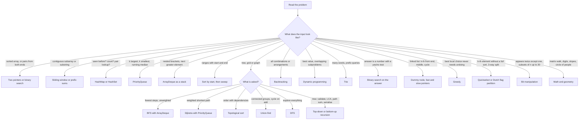

# Chapter 19 — Java for Coding Interviews

A coding interview (the "LeetCode-style" round, named after LeetCode, a popular website of practice problems) checks two things: do you recognise the classic **data-structure and algorithm (DSA) patterns** (a *data structure* is a way of organising data in memory, such as an array, a list or a tree; an *algorithm* is a step-by-step recipe that solves a problem), and can you write them correctly in your language under time pressure? Java is a strong interview language — fast, predictable collections and a compiler that catches type slips — but it is verbose, and a few Java-specific traps (integer overflow, `Integer` compared with `==`, `Stack` instead of `ArrayDeque`, an `a - b` comparator) quietly fail hidden test cases (extra inputs the judge runs but never shows you). *Integer overflow* is a result too big for its type silently wrapping round to a wrong value; a *comparator* is the function that decides which of two values sorts first.

This chapter has three parts:

1. **The Java DSA toolkit** (19.1–19.7): the exact classes and idioms you reach for, the pitfalls, and a complexity table.
2. **Twenty patterns** (19.8–19.27): each with how to recognise it, the steps, runnable Java with checks, complexity and the common mistakes — from two pointers to tries (19.8–19.21), then linked lists, tree recursion, greedy, sort and search, bit manipulation, and math and geometry (19.22–19.27) — and how to talk through a solution (19.28).
3. **Java interview Q&A** (19.29): 42 short, correct answers to the language questions interviewers ask, each linked to the section of this book that teaches it properly.

It assumes you know Java basics (Chapters 2–6), collections ([Chapter 10](../10-collections/README.md)) and lambdas ([Chapter 11](../11-lambdas-and-functional-programming/README.md)). The same patterns in Python are in [Python Handbook, Chapter 19](../../../python/chapters/19-python-for-coding-interviews/README.md) — reading both side by side is a good way to separate the *algorithm* from the *language*.

> **Key term — complexity (Big-O):** interviewers ask "what is the complexity?" meaning how the running time (and extra memory) grows as the input size *n* grows. O(1) means constant — the same cost for any n; O(log n) grows very slowly (halving each step); O(n) grows in step with n; O(n log n) is the cost of a good sort; O(n²) means a loop inside a loop. Constants are ignored, so O(2n) is just O(n). §19.7 collects the numbers for every Java collection.

**What you'll learn**

| # | Topic | Program in `code/ch19/` |
|---|---|---|
| 19.1 | Why `assert` is off by default, and the tiny `Check` helper | `Check.java`, `toolkit/AssertKeywordDemo.java` |
| 19.2 | Arrays, `Arrays`, `String`, `StringBuilder`, char arithmetic | `toolkit/ArraysAndStrings.java` |
| 19.3 | `HashMap` / `HashSet` idioms: `merge`, `getOrDefault`, `computeIfAbsent` | `toolkit/MapSetIdioms.java` |
| 19.4 | `ArrayDeque` (stack and queue), `PriorityQueue`, `TreeMap` / `TreeSet` | `toolkit/DequesHeapsTrees.java` |
| 19.5 | Sorting with comparators | `toolkit/SortingDemo.java` |
| 19.6 | Overflow, `Math.*Exact`, `Integer` caching and other traps | `toolkit/NumericPitfalls.java` |
| 19.7 | Complexity cheat table | — |
| 19.8–19.21 | Two pointers, sliding window, hashing, prefix sums, stacks, heaps (incl. two heaps), binary search, intervals, BFS/DFS, topological sort, union-find, DP, backtracking, tries | `patterns/*.java` |
| 19.22 | Linked lists and fast/slow pointers: k-th from end, intersection, palindrome, cycle start, happy number | `patterns/LinkedLists.java` |
| 19.23 | Tree recursion templates: validate a BST, lowest common ancestor, max path sum, serialise/deserialise | `patterns/Trees.java` |
| 19.24 | Greedy: jump game, gas station, candies | `patterns/Greedy.java` |
| 19.25 | Sort and search: quicksort, quickselect, Dutch national flag, merge sort on a list | `patterns/SortSearch.java` |
| 19.26 | Bit manipulation: single number, counting bits, swapping bits, subsets by mask | `patterns/BitManipulation.java` |
| 19.27 | Math and geometry: spiral matrix, reverse an int with overflow check, points on a line, Josephus | `patterns/MathGeometry.java` |
| 19.28 | Talking through a solution | — |
| 19.29 | 42 Java interview questions | `qa/InterviewFacts.java` |

> **Key terms — the pattern names in the table and diagram:** each is taught in its own section, but in one line: a **graph** is a set of *nodes* (points) joined by *edges* (links), and a **tree** is a graph with one *root* and no loops, where each node has children below it. **BFS** (breadth-first search) explores a graph ring by ring outward; **DFS** (depth-first search) follows one path as deep as possible before backing up. **Dijkstra** finds cheapest routes when edges have costs. **Topological sort** orders tasks so every prerequisite comes first. **Union-find** tracks which items are in the same group. **DP** (dynamic programming) reuses answers to smaller sub-problems; **backtracking** tries choices and undoes them; **greedy** always takes the best-looking step now. A **trie** is a tree of letters for prefix lookups; a **heap** keeps the smallest (or largest) item instantly available; a **BST** (binary search tree) keeps smaller keys to the left and larger to the right; the **LCA** (lowest common ancestor) is the deepest node above two given nodes. **Quickselect** finds the k-th smallest item without sorting everything.

**How the code was run.** Every program is in [`code/`](code/), compiled with `javac --release 25` (the Java compiler, told to produce code for Java 25) and run on OpenJDK 26, the free, open-source build of Java (`bash tools_run_java.sh java` from the repository root). Every pattern program ends with a line such as `10 checks passed`; the output shown is real.



---

# Part 1 — The Java DSA toolkit

## 19.1 Testing your solutions: `assert` is off, use a helper

### What it is
Interview practice means writing a function and checking it against a few inputs. Java has an `assert` statement, but the JVM (Java Virtual Machine — the program that runs compiled Java) **ignores it unless you start it with `-ea`** (enable assertions). Run a program normally and a failing `assert` does nothing at all, so a "passing" run proves nothing. This chapter therefore uses a ten-line helper, `ch19.Check`, whose `eq(actual, expected, label)` always runs, compares arrays by content, prints `ok …`, and throws `AssertionError` (an error object that stops the program and reports the message) on a mismatch.

```java
// code/ch19/toolkit/AssertKeywordDemo.java (key part)
boolean enabled = false;
assert enabled = true;                  // the side effect runs ONLY when assertions are on (java -ea)
System.out.println("assert keyword enabled? " + enabled);
assert 1 + 1 == 3 : "never reported without -ea";
System.out.println("assert 1 + 1 == 3 did not stop the program");
eq(1 + 1, 2, "Check.eq always runs");
try { eq(1 + 1, 3, "deliberately wrong"); }
catch (AssertionError e) { System.out.println("Check.eq failed loudly: " + e.getMessage()); }
```

Output (plain `java`, no `-ea`):

```
assert keyword enabled? false
assert 1 + 1 == 3 did not stop the program
ok  Check.eq always runs -> 2
Check.eq failed loudly: deliberately wrong: expected 3 but got 2
```

With `java -ea` the first line becomes `true` and the second `assert` throws `AssertionError: never reported without -ea`.

In a real project you'd write JUnit tests (JUnit is Java's standard library for automated tests) instead ([Chapter 18](../18-testing-build-and-tooling/README.md)); in an interview you'd just run `main` with a few calls. Use `assert` in production code (the code that ships to real users) only for internal invariants (conditions your own code guarantees are always true) you're happy to have switched off — never for argument validation.

---

## 19.2 Arrays, strings and char arithmetic

Arrays are fixed-size and zero-based (the first element is index 0); `java.util.Arrays` is the toolbox of static helpers (methods called on the class itself, like `Arrays.sort(a)`) ([§4.6](../04-methods-and-arrays/README.md#46-arrays), [§4.8](../04-methods-and-arrays/README.md#48-the-javautilarrays-toolbox)). `String` is immutable — it can never change after it is created ([§7.1](../07-core-apis/README.md#71-strings-immutability-the-pool-and-memory)); build strings with `StringBuilder` ([§7.3](../07-core-apis/README.md#73-stringbuilder-stringbuffer-and-stringjoiner)). A `char` is an unsigned 16-bit number (a whole number from 0 to 65,535 that stands for one character), so `c - 'a'` turns a lowercase letter into 0–25 — the basis of the `int[26]` frequency table used in dozens of string problems.

```java
// code/ch19/toolkit/ArraysAndStrings.java (key parts)
int[] a = {5, 2, 9, 1};
Arrays.sort(a);                                        // in place, ascending
int[] part = Arrays.copyOfRange(a, 1, 3);              // [from, to) -> indexes 1..2
int[] dist = new int[4];
Arrays.fill(dist, Integer.MAX_VALUE);                  // "infinity" for shortest paths
int[][] grid = new int[2][3];                          // 2 rows x 3 cols, all 0
System.out.println(Arrays.equals(new int[]{1, 2}, new int[]{1, 2}) + " " + (new int[]{1, 2} == new int[]{1, 2}));

int[] freq = new int[26];
for (char c : "banana".toCharArray()) freq[c - 'a']++;  // 'a'->0, 'b'->1, ...
char next = (char) ('a' + 2);                          // int arithmetic, cast back to char
int digit = '7' - '0';                                 // 7

char[] cs = "dcba".toCharArray();
Arrays.sort(cs);                                       // sort a string's letters
String sorted = new String(cs);

StringBuilder sb = new StringBuilder();
for (int i = 0; i < 5; i++) sb.append(i).append(',');
sb.setLength(sb.length() - 1);                         // drop the trailing comma
```

Output:

```
sorted      [1, 2, 5, 9]
copyOfRange [2, 5]
fill        [2147483647, 2147483647, 2147483647, 2147483647]
grid        [[0, 0, 0], [0, 0, 7]]
equals      true  ==  false
sum/max     17 9
freq a,b,n  3,1,2
'a'+2       99 as char c
digit value 7  Character.getNumericValue 7
helpers     false true q
trim/strip  [Hello, World] lower=hello, world
charAt/sub  e el 2
split       [a, b, , c]  words=[two, spaces]
sorted chars abcd  valueOf=abcd
builder     0,1,2,3,4  reversed=cba
edited      [X,1,2,3,4]  deleteCharAt(1)=ac
join/repeat a-b-c ababab
parse       -41 1010 10
```

| Need | Java | Note |
|---|---|---|
| Length | `arr.length`, `s.length()`, `list.size()` | Field, method, method — a classic compile error |
| Print an array | `Arrays.toString(a)`, `Arrays.deepToString(grid)` | `println(a)` prints `[I@1b6d3586` |
| Compare arrays | `Arrays.equals(a, b)` | `a == b` and `a.equals(b)` compare references (same object?), not contents |
| Character at i | `s.charAt(i)` | O(1); `s.toCharArray()` copies (O(n)) — fine once, not in a loop |
| Substring | `s.substring(from, to)` | End exclusive; copies, O(to − from) |
| Split on whitespace | `s.trim().split("\\s+")` | `split` takes a **regex** (a text-pattern language); trailing empty strings are dropped |
| Letter test | `Character.isLetterOrDigit`, `isDigit`, `isLetter`, `toLowerCase` | |
| Build a string | `StringBuilder.append`, `insert`, `reverse`, `setCharAt`, `deleteCharAt`, `setLength` | `s += x` in a loop is O(n²) |
| Number ↔ text | `Integer.parseInt(s)`, `Integer.parseInt(s, 2)`, `String.valueOf(n)`, `Integer.toBinaryString(n)` | |
| 2D grid | `new int[rows][cols]`, `grid[r][c]` | Rows first. `char[][] g` from `String[]` via `toCharArray()` |

**Common mistakes.** Comparing strings with `==` (§19.6); forgetting that `'a' + 1` is the `int` 98, not `"b"`; using `split(".")` (the dot is a regex meaning "any character" — use `split("\\.")`); mutating an array you were given when the caller still needs it (clone first).

---

## 19.3 `HashMap` and `HashSet` idioms

A `HashMap` gives O(1) average `get`/`put`/`containsKey`; a `HashSet` is a `HashMap` with only keys ([§10.4](../10-collections/README.md#104-maps-hashmap-linkedhashmap-treemap), internals in [§10.5](../10-collections/README.md#105-hashmap-internals)). Since Java 8 the `Map` interface (a contract listing the methods every map class provides) has default methods (methods that come with a ready-made body inside the interface) that turn the old "if key present … else …" into one line:

| Idiom | One-liner | Replaces |
|---|---|---|
| Count | `count.merge(key, 1, Integer::sum)` | `if (!m.containsKey(k)) m.put(k, 1); else m.put(k, m.get(k) + 1);` |
| Count (alternative) | `count.put(k, count.getOrDefault(k, 0) + 1)` | same |
| Group | `groups.computeIfAbsent(key, k -> new ArrayList<>()).add(v)` | get, null check, put, add |
| Put once | `m.putIfAbsent(k, v)` | `if (!m.containsKey(k)) m.put(k, v)` |
| Seen before? | `if (!seen.add(x)) …` | `if (seen.contains(x)) … else seen.add(x)` |
| Iterate | `for (var e : m.entrySet()) e.getKey() / e.getValue()` | `for (k : keySet()) m.get(k)` (a second lookup per key) |

```java
// code/ch19/toolkit/MapSetIdioms.java (key parts)
for (String w : words) count.merge(w, 1, Integer::sum);
for (String w : words) byLength.computeIfAbsent(w.length(), k -> new ArrayList<>()).add(w);
int n = count.get("missing");                  // null unboxed -> NullPointerException
if (!seen.add(x)) { firstDup = x; break; }     // add returns false for a duplicate
Set<int[]> arrays = ...;                       // arrays use identity equals/hashCode
record Cell(int r, int c) {}                   // records get value-based equals/hashCode
```

Output:

```
merge        {be=2, not=1, or=1, to=2}  same=true
group        {2=[to, be, or, to, be], 3=[not]}
be=2 to=2 
unboxing null -> NullPointerException
first dup    1
int[] key    contains? false
List key     contains? true
record key   contains? true
linked order [to, be, or, not]
```

**Keys.** A key must have `equals` and `hashCode` based on its *value* (`hashCode` turns an object into an `int` that picks its bucket; `equals` then decides whether two objects count as the same) ([§6.13](../06-oop-inheritance-interfaces-and-more/README.md#613-object-methods-equals-hashcode-and-tostring)). `int[]` doesn't, so `Set<int[]>` can't find an equal array. Use `List.of(r, c)`, a `record Cell(int r, int c)` (a *record* is a compact class for plain data whose `equals`/`hashCode` compare the field values), a `String` like `r + "," + c`, or encode a grid cell as the `int` `r * cols + c` (fastest). Never mutate an object while it is a key.

**Order.** `HashMap` iteration order is unspecified and can change between runs or JDK versions (the JDK, Java Development Kit, is the compiler, tools and standard library) — don't let an answer depend on it. Use `LinkedHashMap` (insertion order) or `TreeMap` (sorted) when order matters, as in `Hashing.firstUnique` (§19.10).

**Arrays beat maps for small dense keys.** When keys are lowercase letters or values 0–1000, an `int[26]` or `int[1001]` is faster than a `HashMap<Character, Integer>` (no boxing — wrapping each `int` in an `Integer` object — and no hashing, i.e. computing a hash code and finding its bucket).

---

## 19.4 `ArrayDeque`, `PriorityQueue` and `TreeMap`

### `ArrayDeque` for stacks and queues — and why not `Stack`
`ArrayDeque` is a resizable circular array (an array whose end wraps round to its start, so both ends can grow cheaply) with amortised O(1) operations (O(1) on average over many calls — see §19.7) at both ends ([§10.6](../10-collections/README.md#106-queues-deques-and-priority-queues)). Use it for **both** stacks and queues:

| Role | Add | Remove | Look | Empty remove |
|---|---|---|---|---|
| Stack (LIFO: last in, first out) | `push(x)` | `pop()` | `peek()` | `pop()` throws `NoSuchElementException` |
| Queue (FIFO: first in, first out) | `offer(x)` | `poll()` | `peek()` | `poll()` returns `null` |

Declare the variable as `Deque<Integer>` (a stack) or `Queue<Integer>`/`Deque<Integer>` (a queue). `ArrayDeque` rejects `null` elements.

Why not `java.util.Stack`? It dates from Java 1.0, extends `Vector` (every method is `synchronized` — locked so only one thread can run it at a time — which costs time for nothing in single-threaded code; a *thread* is one independent path of execution inside a program), exposes index methods like `get(0)` that break the stack abstraction, and iterates **bottom-to-top** — the opposite of `ArrayDeque`. Its own Javadoc (the official API documentation) recommends `Deque` instead. `LinkedList` also implements `Deque` but allocates a node (a small object holding one value plus links to its neighbours) per element; `ArrayDeque` is faster.

### `PriorityQueue` — a binary heap
`PriorityQueue` is a **min-heap** by default (a tree-shaped structure, stored in an array, that always keeps the smallest element at the top — the *root*): `peek()` is O(1), `offer`/`poll` are O(log n). For a max-heap pass `Comparator.reverseOrder()`. For arrays like `{distance, node}` use `Comparator.comparingInt(x -> x[0])`. Printing or iterating a `PriorityQueue` shows **heap order, not sorted order**; only repeated `poll()` gives sorted output. `contains` and `remove(Object)` are O(n).

### `TreeMap` / `TreeSet` — sorted with navigation
A red-black tree (a self-balancing binary search tree, so it never becomes lopsided): O(log n) `get`/`put`/`remove`, and navigation methods a hash map can't offer. Remember the four: **`floor`** (≤), **`ceiling`** (≥), **`lower`** (<), **`higher`** (>). On a `TreeMap` they are `floorKey`/`floorEntry` and so on; all return `null` when nothing qualifies. Typical uses: finding the nearest booking before a given time, detecting clashes in a calendar, ranking players on a leaderboard, and medians over a moving window.

```java
// code/ch19/toolkit/DequesHeapsTrees.java (key parts)
Deque<Integer> stack = new ArrayDeque<>();
stack.push(1); stack.push(2); stack.push(3);
Deque<String> queue = new ArrayDeque<>();
queue.offer("a"); queue.offer("b"); queue.offer("c");
PriorityQueue<Integer> max = new PriorityQueue<>(Comparator.reverseOrder());
PriorityQueue<int[]> pq = new PriorityQueue<>(Comparator.comparingInt(x -> x[0]));
TreeMap<Integer, String> prices = new TreeMap<>(Map.of(10, "ten", 20, "twenty", 30, "thirty"));
prices.floorKey(25); prices.ceilingKey(25); prices.lowerKey(20); prices.higherKey(30);
```

Output:

```
stack peek=3 pop=3 iterates [2, 1]
legacy Stack iterates [1, 2, 3] and allows get(0)=1
queue poll=a peek=b left [b, c]
empty poll -> null (pop() would throw)
min.peek=1 max.peek=8  toString is heap order, not sorted: [1, 3, 8, 5]
poll order 1 3 5 8
int[] heap first [2, 9]
floorKey(25)=20 ceilingKey(25)=30 lowerKey(20)=10 higherKey(30)=null
first=10 last=30=thirty headMap(20)={10=ten} tailMap(20)={20=twenty, 30=thirty}
TreeSet floor(10)=9 ceiling(10)=16 pollFirst=1 descending=[16, 9, 4]
```

---

## 19.5 Sorting with comparators

| What you sort | Call | Algorithm and guarantees |
|---|---|---|
| `int[]`, `long[]`, `char[]` … | `Arrays.sort(a)` | Dual-Pivot Quicksort (quicksort splitting around two pivot values, §19.25); the Javadoc promises O(n log n) on all inputs. Ascending only — there is no comparator overload for primitives |
| `Integer[]`, `String[]`, `int[][]`, objects | `Arrays.sort(a, comparator)` | Stable (equal elements keep their order), TimSort-based merge sort (a merge sort tuned for partly sorted data), O(n log n) |
| `List` | `list.sort(cmp)` or `Collections.sort(list, cmp)` | Same stable sort; `Collections.sort` just calls `List.sort` |

Build comparators from parts (`Person::age` is a *method reference*, shorthand for the lambda `p -> p.age()`) instead of writing `compare` by hand ([§10.8](../10-collections/README.md#108-ordering-comparable-and-comparator)): `Comparator.comparingInt(Person::age).reversed().thenComparing(Person::name)`. For `int[]` rows the lambda (a short anonymous function written `x -> …`) needs a type witness (the type argument written explicitly in angle brackets before the method name): `Comparator.<int[]>comparingInt(x -> x[0]).thenComparingInt(x -> x[1])` — otherwise the compiler infers `Object` once you chain.

```java
// code/ch19/toolkit/SortingDemo.java (key parts)
Integer[] boxed = {3, -1, 2};
Arrays.sort(boxed, Collections.reverseOrder());                      // descending needs boxes
int[][] intervals = {{5, 6}, {1, 9}, {1, 3}};
Arrays.sort(intervals, Comparator.<int[]>comparingInt(x -> x[0]).thenComparingInt(x -> x[1]));
people.sort(Comparator.comparingInt(Person::age).reversed().thenComparing(Person::name));
Integer[] big = {Integer.MIN_VALUE, 1, Integer.MAX_VALUE};
Arrays.sort(big, (x, y) -> x - y);                                   // WRONG: overflows
Arrays.sort(big, Integer::compare);                                  // right
```

Output:

```
int[] asc        [-1, 2, 3]
Integer[] desc   [3, 2, -1]
stream desc      [3, 2, -1]
intervals        [[1, 3], [1, 9], [5, 6]]
age desc, name   [Person[name=Bo, age=30], Person[name=Ravi, age=30], Person[name=Ana, age=25]]
by length        [fig, pear, kiwi, apple]
(a-b) comparator [1, 2147483647, -2147483648]
Integer::compare [-2147483648, 1, 2147483647]
```

The `(a, b) -> a - b` comparator is the most common silent bug: `1 - Integer.MIN_VALUE` overflows to a negative number, so the sort puts `MIN_VALUE` last. Always use `Integer.compare(a, b)` or `Comparator.comparingInt`. Note also "by length" — `pear` stays before `kiwi` because the sort is stable.

---

## 19.6 Numeric and equality pitfalls

These are the bugs that pass the sample tests and fail the hidden ones. Background: overflow in [§2.10](../02-basics-types-and-operators/README.md#210-integer-overflow), wrappers (object versions of primitives, such as `Integer` for `int`) and caching in [§7.6](../07-core-apis/README.md#76-wrapper-classes-and-autoboxing).

```java
// code/ch19/toolkit/NumericPitfalls.java (key parts)
int lo = 2_000_000_000, hi = 2_100_000_000;
int bad  = (lo + hi) / 2;  // overflows
int mid  = lo + (hi - lo) / 2;  // safe midpoint
int mid2 = (lo + hi) >>> 1;     // also safe for non-negative lo, hi (unsigned shift)
long wrong = n * n;        // int * int overflows BEFORE widening
long right = (long) n * n;
Math.multiplyExact(n, n);  // throws ArithmeticException instead of wrapping
Integer c = 128, d = 128;
boolean same = c == d;              // false: compares references
list.remove(1);                      // removes INDEX 1
list.remove(Integer.valueOf(10));    // removes VALUE 10
```

Output:

```
MAX + 1            -2147483648
(lo+hi)/2          -97483648  lo+(hi-lo)/2=2050000000  (lo+hi)>>>1=2050000000
n*n wrong/right    1410065408 / 10000000000
multiplyExact      ArithmeticException: integer overflow
toIntExact ok      42
abs(MIN_VALUE)     -2147483648
7/2, -7/2          3, -3   7/2.0=3.5
-7 % 3, floorMod   -1, 2
127 == 127         true
128 == 128         false   equals=true
map.get == get     false   intValue== true
remove idx/value   [30]
String ==, equals  false, true
'a' + 1, "" + 'a' + 1  98, a1
for-each remove    ConcurrentModificationException
removeIf           [1, 3]
```

| Trap | Why | Fix |
|---|---|---|
| `int` overflow | `int` wraps silently past ±2.1 billion | Use `long` for sums, products, and "infinity + edge"; `Math.addExact` / `multiplyExact` / `toIntExact` throw instead |
| Midpoint | `lo + hi` can overflow | `lo + (hi - lo) / 2` |
| `Math.abs(Integer.MIN_VALUE)` | +2³¹ doesn't fit in `int` | Work in `long`, or `Math.absExact` (Java 15) to get an exception |
| `Integer.MAX_VALUE` as "infinity" | `INF + 1` wraps to a negative number | Guard before adding (see coin change, §19.19) or use `Integer.MAX_VALUE / 2` |
| `-7 % 3 == -1` | `%` keeps the dividend's (the number being divided) sign | `Math.floorMod(x, m)` for a non-negative index (circular arrays, hashing) |
| `7 / 2 == 3` | Integer division truncates toward zero | Cast one side: `7 / 2.0`, or `(double) a / b` |
| `Integer == Integer` | Compares references; only −128…127 are guaranteed cached by `Integer.valueOf` | `.equals`, `Integer.compare`, or unbox to `int`. Especially `map.get(a) == map.get(b)` |
| Unboxing `null` | `int x = map.get(missing)` | `getOrDefault`, or keep it as `Integer` and check |
| `list.remove(int)` | `List<Integer>` has `remove(int index)` and `remove(Object)` | `remove(Integer.valueOf(v))` to remove a value |
| Removing in for-each | Fail-fast iterator (it checks for changes) throws `ConcurrentModificationException` | `removeIf`, an explicit `Iterator.remove()`, or build a new list |
| Deep recursion | Default thread stack overflows around 10⁴–10⁵ frames (one frame per active call; depends on frame size) | Iterate with an explicit `ArrayDeque` stack for big grids/lists (see islands, §19.16) |

---

## 19.7 Complexity cheat table

Big-O describes how cost grows with input size n; "amortised" means averaged over many calls (an occasional resize is paid for by many cheap operations). Details and a measured demo: [§10.12](../10-collections/README.md#1012-big-o-cheat-sheet-and-a-measured-demo).

| Structure | Access / search | Insert / add | Remove | Notes |
|---|---|---|---|---|
| array `int[]` | O(1) index, O(n) search | — (fixed size) | — | `Arrays.binarySearch` O(log n) if sorted |
| `ArrayList` | O(1) `get(i)`, O(n) `contains` | O(1) amortised at end, O(n) in middle | O(n) (shifts), O(1) at end | Default list |
| `LinkedList` | O(n) `get(i)` | O(1) at ends | O(1) at ends | Rarely the right choice |
| `ArrayDeque` | O(1) `peek` at ends | O(1) amortised `push`/`offer` | O(1) `pop`/`poll` | Stack and queue |
| `HashMap` / `HashSet` | O(1) average | O(1) average | O(1) average | Worst case O(log n) with treeified (crowded bucket turned into a tree) buckets of `Comparable` keys |
| `LinkedHashMap` | O(1) average | O(1) | O(1) | Keeps insertion (or access) order — LRU (least-recently-used) cache |
| `TreeMap` / `TreeSet` | O(log n) | O(log n) | O(log n) | `floor`/`ceiling`/`first`/`last` also O(log n) |
| `PriorityQueue` | O(1) `peek` | O(log n) `offer` | O(log n) `poll`, O(n) `remove(obj)` | Build from a collection in O(n) |
| `String` | O(1) `charAt` | `+` copies: O(n) | `substring` copies | `StringBuilder.append` amortised O(1) |

| Algorithm | Time | Extra space |
|---|---|---|
| `Arrays.sort` / `List.sort` | O(n log n) | Small for primitives; up to O(n) buffer for objects (merge sort) |
| Binary search | O(log n) | O(1) |
| BFS / DFS on V vertices, E edges | O(V + E) | O(V) |
| Dijkstra with a binary heap | O((V + E) log V) | O(V + E) |
| Topological sort (Kahn) | O(V + E) | O(V) |
| Union-find with path compression + union by size | ≈ O(1) per op (inverse Ackermann, §19.18) | O(n) |
| Subsets / permutations | O(2ⁿ · n) / O(n! · n) | O(n) recursion depth |

Rough budget: about 10⁸ simple operations per second in Java once the JIT (just-in-time compiler, which turns frequently run code into fast machine code while the program runs) has warmed up, so n = 10⁵ needs O(n log n) or better and n ≤ 20 allows O(2ⁿ).

---

# Part 2 — Twenty patterns

Each pattern follows the same shape: **what it is**, **recognise it when** (the wording in a problem that should trigger it), **how it works**, the code, its **complexity**, and **common mistakes**. Full programs are in `code/ch19/patterns/`; the README shows the key methods. Python versions of the same ideas: [Python §19.2–19.11](../../../python/chapters/19-python-for-coding-interviews/README.md#192-arrays-and-strings-two-pointers-sliding-window-prefix-sums).

## 19.8 Two pointers

### What it is
Two indexes move through the data in a coordinated way so that one pass replaces a nested loop. Three flavours: **opposite ends** moving inward (sorted arrays, palindromes — text that reads the same backwards), **read/write** pointers moving the same way (in-place filtering, i.e. changing the input array itself rather than building a new one), and **fast/slow** pointers moving at different speeds (linked lists — chains of nodes, each pointing to the next; §19.22). Analogy: two people searching a sorted bookshelf from both ends and meeting in the middle.

**Recognise it when**: the input is sorted; you need a pair/triple with a target sum; "in place, O(1) extra space"; palindrome; linked-list middle, cycle, or k-th from the end.

### How it works (pair sum in a sorted array)
1. Put `left` at index 0 and `right` at the last index.
2. If the sum is too small, only moving `left` right can increase it; if too big, move `right` left.
3. Stop when they meet — each step discards one element for good, so the loop runs at most n times.

```java
// code/ch19/patterns/TwoPointers.java (key parts)
static int[] pairWithSum(int[] sorted, int target) {
    int left = 0, right = sorted.length - 1;
    while (left < right) {
        int sum = sorted[left] + sorted[right];
        if (sum == target) return new int[]{left, right};
        if (sum < target) left++;          // need a bigger sum
        else right--;                      // need a smaller sum
    }
    return new int[]{-1, -1};
}

static int dedupe(int[] sorted) {          // read/write pointers
    if (sorted.length == 0) return 0;
    int write = 1;                         // sorted[0..write) holds the unique values
    for (int read = 1; read < sorted.length; read++)
        if (sorted[read] != sorted[write - 1]) sorted[write++] = sorted[read];
    return write;
}

static boolean hasCycle(ListNode head) {   // fast/slow (Floyd)
    ListNode slow = head, fast = head;
    while (fast != null && fast.next != null) {
        slow = slow.next; fast = fast.next.next;
        if (slow == fast) return true;     // reference comparison on purpose
    }
    return false;
}

static ListNode reverse(ListNode head) {   // prev / cur / next
    ListNode prev = null, cur = head;
    while (cur != null) { ListNode next = cur.next; cur.next = prev; prev = cur; cur = next; }
    return prev;
}
```

`ListNode` is a tiny class with `int val` and `ListNode next` — the shape interview platforms use. The file also has `isPalindrome` (skip non-alphanumerics, compare lower-cased) and `middle`.

Output:

```
ok  pairWithSum 15 -> [2, 4]
ok  pairWithSum none -> [-1, -1]
ok  dedupe -> [1, 2, 3, 4]
ok  palindrome yes -> true
ok  palindrome no -> true
ok  middle odd -> 3
ok  middle even -> 3
ok  cycle yes -> true
ok  cycle no -> true
ok  reverse -> 3->2->1
10 checks passed
```

**Complexity**: O(n) time, O(1) space (a sort first makes it O(n log n)).

### Common mistakes
- Using opposite-end pointers on **unsorted** input — use hashing (§19.10) instead.
- `while (left <= right)` for pairs — an element would pair with itself.
- In fast/slow, checking `fast.next.next` without first checking `fast != null && fast.next != null`.
- For 3Sum (find all triples that add up to zero), forgetting to skip duplicate values after sorting.

---

## 19.9 Sliding window

### What it is
A special two-pointer pattern for **contiguous** ranges (elements next to each other, with no gaps): keep a window `[left, right]` and a running summary of it (sum, counts, distinct characters). Moving `right` adds one element; moving `left` removes one — each element enters and leaves once, so the work is O(n) instead of O(n²) for re-examining every subarray (a contiguous slice of an array).

**Recognise it when**: "longest/shortest substring or subarray such that…", "at most k distinct", "window of size k", and the condition changes monotonically (only ever in one direction) as the window grows (for sums, this needs non-negative numbers — otherwise use prefix sums, §19.11).

### How it works (variable-size window)
1. For each `right`, add `a[right]` to the window state.
2. **While** the window is invalid (or, for "shortest", while it is valid), update the answer as appropriate and remove `a[left++]`.
3. Record the answer for the current window.

```java
// code/ch19/patterns/SlidingWindow.java (key parts)
static int shortestWithSumAtLeast(int[] a, int target) {
    int left = 0, sum = 0, best = Integer.MAX_VALUE;
    for (int right = 0; right < a.length; right++) {
        sum += a[right];                           // grow
        while (sum >= target) {                    // valid: record, then shrink
            best = Math.min(best, right - left + 1);
            sum -= a[left++];
        }
    }
    return best == Integer.MAX_VALUE ? 0 : best;
}

static int longestUniqueSubstring(String s) {
    Map<Character, Integer> lastSeen = new HashMap<>();
    int left = 0, best = 0;
    for (int right = 0; right < s.length(); right++) {
        Integer prev = lastSeen.put(s.charAt(right), right);    // put returns the old value
        if (prev != null && prev >= left) left = prev + 1;      // jump past the duplicate
        best = Math.max(best, right - left + 1);
    }
    return best;
}

static int longestWithKDistinct(String s, int k) {
    int[] count = new int[128];                    // ASCII counts: faster than a HashMap
    int distinct = 0, left = 0, best = 0;
    for (int right = 0; right < s.length(); right++) {
        if (count[s.charAt(right)]++ == 0) distinct++;
        while (distinct > k) if (--count[s.charAt(left++)] == 0) distinct--;
        best = Math.max(best, right - left + 1);
    }
    return best;
}
```

The file also has the fixed-size version, `maxSumOfK`: add `a[right]`, subtract `a[right - k]`.

Output:

```
ok  max sum of 3 -> 9
ok  shortest sum>=7 -> 2
ok  shortest none -> 0
ok  unique abcabcbb -> 3
ok  unique abba -> 2
ok  2 distinct eceba -> 3
6 checks passed
```

**Complexity**: O(n) time; O(1) or O(alphabet) space.

### Common mistakes
- The `prev >= left` check in `longestUniqueSubstring`: without it, `"abba"` jumps `left` **backwards** at the last `a` and returns 3 instead of 2.
- Using `if` instead of `while` to shrink.
- Applying "shrink while sum ≥ target" to arrays with **negative** numbers — shrinking no longer reliably lowers the sum.

---

## 19.10 Hashing

### What it is
Store what you've seen in a `HashMap`/`HashSet` so the question "have I seen X?" or "how many X so far?" costs O(1) instead of a scan. You trade O(n) memory for a factor of n in time.

**Recognise it when**: pairs with a target sum in **unsorted** data, duplicates, counting frequencies, grouping by a signature (anagrams — words with the same letters, like *tea* and *eat*), "first unique", "longest consecutive run".

### How it works (Two Sum)
1. Walk the array once.
2. For each value x, look up `target - x` among the values already seen.
3. If found, you have the pair; otherwise record x → its index and continue. Looking only backwards also stops an element pairing with itself.

```java
// code/ch19/patterns/Hashing.java (key parts)
static int[] twoSum(int[] a, int target) {
    Map<Integer, Integer> indexOf = new HashMap<>();
    for (int i = 0; i < a.length; i++) {
        Integer j = indexOf.get(target - a[i]);
        if (j != null) return new int[]{j, i};
        indexOf.put(a[i], i);
    }
    return new int[0];
}

static List<List<String>> groupAnagrams(String[] words) {
    Map<String, List<String>> groups = new LinkedHashMap<>();   // keeps first-seen order
    for (String w : words) {
        char[] cs = w.toCharArray();
        Arrays.sort(cs);                                        // "tea" -> "aet"
        groups.computeIfAbsent(new String(cs), k -> new ArrayList<>()).add(w);
    }
    return new ArrayList<>(groups.values());
}

static int longestConsecutive(int[] a) {
    Set<Integer> set = new HashSet<>();
    for (int x : a) set.add(x);
    int best = 0;
    for (int x : set) {
        if (set.contains(x - 1)) continue;        // only count from the START of a run
        int len = 1;
        while (set.contains(x + len)) len++;
        best = Math.max(best, len);
    }
    return best;
}
```

Output:

```
ok  twoSum -> [2, 3]
ok  groupAnagrams -> [[eat, tea, ate], [tan, nat], [bat]]
ok  longestConsecutive -> 4
ok  firstUnique -> w
4 checks passed
```

**Complexity**: O(n) average time (`groupAnagrams` is O(n · k log k) for words of length k), O(n) space. `longestConsecutive` is O(n) because each run is walked only from its first element.

### Common mistakes
- `Integer j = …; if (j != 0)` style checks on a missing key (it's `null`, not 0).
- Comparing two `Integer` values from a map with `==` (§19.6).
- Using `int[]` as a map key (identity `hashCode`) — use a `String`, `List`, or record.

---

## 19.11 Prefix sums

### What it is
Precompute `prefix[i]` = sum of the first i elements. Then the sum of any range `a[l..r]` is `prefix[r + 1] - prefix[l]` — one subtraction instead of a loop. Combined with a hash map, it counts subarrays with a given sum even when numbers are **negative** (where a sliding window fails).

**Recognise it when**: many range-sum queries; "number of subarrays whose sum equals k"; 2D sub-rectangle sums; many "add v to every element in [l, r]" updates (the inverse trick, a **difference array**).

### How it works (subarrays summing to k)
1. Keep a running sum and a map from "prefix sum value" → "how many times seen", starting with `{0: 1}` (the empty prefix).
2. A subarray ending here sums to k exactly when an earlier prefix equals `sum - k`. Add that count.
3. Record the current sum.

```java
// code/ch19/patterns/PrefixSums.java (key parts)
static long[] prefix(int[] a) {                 // length n+1, prefix[0] = 0; long avoids overflow
    long[] p = new long[a.length + 1];
    for (int i = 0; i < a.length; i++) p[i + 1] = p[i] + a[i];
    return p;
}
static long rangeSum(long[] p, int from, int to) { return p[to + 1] - p[from]; }

static int subarraysSumToK(int[] a, int k) {
    Map<Integer, Integer> seen = new HashMap<>();
    seen.put(0, 1);                              // empty prefix
    int sum = 0, count = 0;
    for (int x : a) {
        sum += x;
        count += seen.getOrDefault(sum - k, 0);
        seen.merge(sum, 1, Integer::sum);
    }
    return count;
}

// 2D: p[r+1][c+1] = g[r][c] + above + left - overlap (inclusion-exclusion)
static long rect(long[][] p, int r1, int c1, int r2, int c2) {
    return p[r2 + 1][c2 + 1] - p[r1][c2 + 1] - p[r2 + 1][c1] + p[r1][c1];
}
```

The difference array records `+v` at `l` and `-v` at `r + 1` for each update, then one running-sum pass produces the final array.

Output:

```
ok  rangeSum 1..3 -> 6
ok  rangeSum all -> 23
ok  subarrays sum 3 -> 4
ok  2D rect -> 28
ok  difference array -> [0, 2, 5, 5, 3]
5 checks passed
```

**Complexity**: O(n) to build, O(1) per query; 2D is O(rows · cols) to build.

### Common mistakes
- Off-by-one (an index one too high or too low): the `n + 1` length and the `prefix[0] = 0` sentinel (a dummy value placed to remove a special case) exist precisely so that `l = 0` needs no special case.
- Forgetting `seen.put(0, 1)` — misses subarrays that start at index 0.
- `int` prefix sums of large inputs overflowing — use `long`.

---

## 19.12 Stacks and monotonic stacks

### What it is
A **stack** (last in, first out) matches nested structure: brackets, expression evaluation, undo, DFS. A **monotonic stack** keeps its contents in increasing or decreasing order by popping everything that breaks the order before pushing; each popped element has just met its "next greater" (or smaller) element. A **monotonic deque** does the same at both ends to give the max of a sliding window in O(n).

**Recognise it when**: balanced brackets; "next greater/smaller element", "days until warmer", "stock span", "largest rectangle in histogram"; "maximum of every window of size k".

### How it works (next warmer day)
1. Keep a stack of **indexes** whose temperatures are decreasing from bottom to top.
2. For each new day i, pop every index j whose temperature is lower — day i is j's answer, `i - j`.
3. Push i. Indexes left at the end never found a warmer day (answer 0).

```java
// code/ch19/patterns/Stacks.java (key parts)
static boolean validBrackets(String s) {
    Deque<Character> stack = new ArrayDeque<>();
    for (char c : s.toCharArray()) {
        switch (c) {
            case '(' -> stack.push(')');           // push the EXPECTED closer
            case '[' -> stack.push(']');
            case '{' -> stack.push('}');
            default -> { if (stack.isEmpty() || stack.pop() != c) return false; }
        }
    }
    return stack.isEmpty();
}

static int[] daysUntilWarmer(int[] t) {
    int[] ans = new int[t.length];
    Deque<Integer> stack = new ArrayDeque<>();
    for (int i = 0; i < t.length; i++) {
        while (!stack.isEmpty() && t[stack.peek()] < t[i]) {
            int j = stack.pop();
            ans[j] = i - j;                        // i is j's "next greater"
        }
        stack.push(i);
    }
    return ans;
}

static int[] windowMax(int[] a, int k) {
    int[] out = new int[a.length - k + 1];
    Deque<Integer> dq = new ArrayDeque<>();        // indexes, values decreasing front to back
    for (int i = 0; i < a.length; i++) {
        if (!dq.isEmpty() && dq.peekFirst() <= i - k) dq.pollFirst();       // fell out of window
        while (!dq.isEmpty() && a[dq.peekLast()] <= a[i]) dq.pollLast();    // can never be max again
        dq.offerLast(i);
        if (i >= k - 1) out[i - k + 1] = a[dq.peekFirst()];
    }
    return out;
}
```

The file also evaluates Reverse Polish Notation (postfix notation, where each operator follows its operands: `"4 13 5 / +"` = 6) with an arrow-label `switch` ([§3.3](../03-control-flow/README.md#33-arrow-labels-and-switch-expressions-java-14)).

Output:

```
ok  brackets ok -> true
ok  brackets crossed -> true
ok  brackets unclosed -> true
ok  daysUntilWarmer -> [1, 1, 4, 2, 1, 1, 0, 0]
ok  windowMax -> [3, 3, 5, 5, 6, 7]
ok  RPN -> 6
6 checks passed
```

**Complexity**: O(n) — every index is pushed once and popped at most once, even though there's a loop inside a loop.

### Common mistakes
- Storing values instead of indexes when you need distances.
- Forgetting the final `stack.isEmpty()` check (`"(("` would pass).
- Popping in RPN in the wrong order: the **second** pop is the left operand (the value on the left of the operator).
- Using `java.util.Stack` (§19.4).

---

## 19.13 Heaps and top-k

### What it is
A heap (`PriorityQueue`) always hands you the smallest (or largest) element in O(log n) per change. The key trick for "top k" is counter-intuitive: to keep the k **largest**, use a **min**-heap of size k — its root is the weakest of the current top k, the one to evict when something bigger arrives.

**Recognise it when**: "k-th largest/smallest", "k most frequent", "k closest points", "merge k sorted lists", "running median" (the median of everything seen so far, updated as each value arrives) and "maximise capital" (two heaps, below), scheduling by earliest end time, Dijkstra.

### How it works (k-th largest)
1. Offer each element into a min-heap.
2. If the heap grows past k, poll (remove the smallest).
3. After all elements, the root is the k-th largest. Cost O(n log k) — better than sorting when k ≪ n.

```java
// code/ch19/patterns/HeapTopK.java (key parts)
static int kthLargest(int[] a, int k) {
    PriorityQueue<Integer> heap = new PriorityQueue<>();
    for (int x : a) {
        heap.offer(x);
        if (heap.size() > k) heap.poll();          // evict the smallest
    }
    return heap.peek();
}

static List<Integer> mergeSorted(int[][] arrays) {   // heap holds {value, arrayIndex, elementIndex}
    PriorityQueue<int[]> heap = new PriorityQueue<>(Comparator.comparingInt(x -> x[0]));
    for (int i = 0; i < arrays.length; i++) if (arrays[i].length > 0) heap.offer(new int[]{arrays[i][0], i, 0});
    List<Integer> out = new ArrayList<>();
    while (!heap.isEmpty()) {
        int[] top = heap.poll();
        out.add(top[0]);
        int arr = top[1], next = top[2] + 1;
        if (next < arrays[arr].length) heap.offer(new int[]{arrays[arr][next], arr, next});
    }
    return out;
}

static final class MedianFinder {                    // two heaps
    private final PriorityQueue<Integer> low = new PriorityQueue<>(Comparator.reverseOrder()); // max-heap
    private final PriorityQueue<Integer> high = new PriorityQueue<>();                         // min-heap
    void add(int x) {
        low.offer(x);
        high.offer(low.poll());                                    // largest of low moves up
        if (high.size() > low.size()) low.offer(high.poll());      // keep low >= high in size
    }
    double median() {
        return low.size() > high.size() ? low.peek() : (low.peek() + (long) high.peek()) / 2.0;
    }
}
```

`topKFrequent` counts with `merge`, then keeps a size-k min-heap of map entries ordered by `Map.Entry.comparingByValue()`, breaking ties by key.

Output:

```
ok  kthLargest -> 5
ok  topKFrequent -> [1, 2]
ok  mergeSorted -> [0, 1, 2, 4, 5, 7, 9]
ok  median of 5,15 -> 10.0
ok  median of 5,15,1 -> 5.0
ok  maximizeCapital k=2 -> 4
ok  maximizeCapital k=3 -> 6
ok  maximizeCapital nothing affordable -> 0
8 checks passed
```

**Complexity**: top-k O(n log k); merging k lists with N total elements O(N log k); median O(log n) per add, O(1) per query; maximise capital O(n log n) (each project enters and leaves each heap at most once).

### Two heaps
Some problems need the best element from **two different groups** at once. Keep one heap per group and move elements across the boundary as the situation changes. Two shapes come up:

- **Split one stream into halves** (running median). A max-heap `low` holds the smaller half, a min-heap `high` the larger half, and the invariant (the rule kept true after every step) is `low.size() == high.size()` or one more. The median is then `low.peek()` or the average of both roots — O(1) — and each `add` costs O(log n). Every new value passes through `low` into `high` and, if `high` got too big, one value comes back; that keeps every element of `low` ≤ every element of `high` without a special case (`MedianFinder` above).
- **Locked vs available** (maximise capital, scheduling). A min-heap orders items by the threshold that **unlocks** them; a max-heap holds the unlocked ones by **value**. Each round: move everything whose threshold is now met from the first heap to the second, then take the best from the second. Example: you may run at most k projects; project i needs `capital[i]` to start and pays `profit[i]`; start with `start` money.

```java
// code/ch19/patterns/HeapTopK.java (key part)
static long maximizeCapital(int k, long start, int[] profit, int[] capital) {
    PriorityQueue<Integer> locked = new PriorityQueue<>(Comparator.comparingInt(i -> capital[i]));
    PriorityQueue<Integer> affordable = new PriorityQueue<>(Comparator.comparingInt((Integer i) -> profit[i]).reversed());
    for (int i = 0; i < profit.length; i++) locked.offer(i);
    long money = start;
    for (int round = 0; round < k; round++) {
        while (!locked.isEmpty() && capital[locked.peek()] <= money) affordable.offer(locked.poll()); // unlock
        if (affordable.isEmpty()) break;                   // nothing we can start
        money += profit[affordable.poll()];                // greedy: the most profitable affordable project
    }
    return money;
}
```

Heaps store **indexes** here, and the comparators look the values up — cheaper than creating `int[]` pairs. The `(Integer i) ->` type on the lambda is needed because `.reversed()` stops Java inferring it. Taking the most profitable affordable project is a greedy choice (§19.24): money only grows, so nothing unlocked now can become locked later, and a bigger profit never unlocks fewer projects.

**Recognise it when**: "median of a stream / sliding window median", "maximise capital with at most k projects", "schedule tasks as they become available", anything that says "the best among those that currently qualify".

### Common mistakes
- A max-heap of everything for top-k: O(n log n), and uses O(n) memory.
- Writing the max-heap comparator as `(a, b) -> b - a` (overflow, §19.5) — use `Comparator.reverseOrder()`.
- Expecting `heap.toString()` or a for-each loop to be sorted.
- Changing an object's priority field while it sits in the heap — the heap won't re-order; remove and re-insert (or insert a new entry and skip stale ones, as Dijkstra does in §19.16).

---

## 19.14 Binary search (and binary search on the answer)

### What it is
Halve a sorted search space each step: O(log n). Beyond "find x in a sorted array", the powerful version is **binary search on the answer**: when the answer is a number and a yes/no test `feasible(x)` flips from false to true exactly once as x grows, binary-search x itself.

**Recognise it when**: sorted input; "first/last position of", "insert position"; rotated sorted array; "minimum capacity/speed/time such that…" or "maximise the minimum…" (search on the answer).

### How it works
1. Decide the range and write down the **invariant** (what's true about `lo` and `hi` at every step).
2. Compute `mid = lo + (hi - lo) / 2` (never `(lo + hi) / 2`, §19.6).
3. Discard the half that cannot contain the answer, keeping the invariant.
4. Two templates cover almost everything: **closed** `[lo, hi]` with `while (lo <= hi)` for "find exactly", and **half-open / first-true** (the range includes `lo` but not `hi`) with `while (lo < hi)`, `hi = mid` for "first index where the condition holds".

```java
// code/ch19/patterns/BinarySearch.java (key parts)
static int lowerBound(int[] a, int target) {       // first index with a[i] >= target
    int lo = 0, hi = a.length;                      // answer is in [lo, hi]
    while (lo < hi) {
        int mid = (lo + hi) >>> 1;
        if (a[mid] < target) lo = mid + 1; else hi = mid;
    }
    return lo;
}

static int searchRotated(int[] a, int target) {    // e.g. [4,5,6,7,0,1,2]
    int lo = 0, hi = a.length - 1;
    while (lo <= hi) {
        int mid = lo + (hi - lo) / 2;
        if (a[mid] == target) return mid;
        if (a[lo] <= a[mid]) {                     // left half is sorted
            if (a[lo] <= target && target < a[mid]) hi = mid - 1; else lo = mid + 1;
        } else {                                   // right half is sorted
            if (a[mid] < target && target <= a[hi]) lo = mid + 1; else hi = mid - 1;
        }
    }
    return -1;
}

// Binary search on the answer: smallest ship capacity that ships everything in `days` days.
static int minCapacity(int[] weights, int days) {
    int lo = Arrays.stream(weights).max().getAsInt();   // must fit the heaviest package
    int hi = Arrays.stream(weights).sum();              // everything in one day
    while (lo < hi) {
        int mid = lo + (hi - lo) / 2;
        if (daysNeeded(weights, mid) <= days) hi = mid; else lo = mid + 1;
    }
    return lo;
}
```

`daysNeeded` greedily fills each day up to the capacity. Library versions: `Arrays.binarySearch` and `Collections.binarySearch` return the index if found, otherwise **`-(insertionPoint) - 1`**; with duplicates, they don't promise *which* equal element they return — write `lowerBound` yourself when you need the first. `TreeSet.ceiling` is the other ready-made lower bound.

Output:

```
ok  search hit -> 3
ok  search miss -> -1
ok  lowerBound first 2 -> 1
ok  lowerBound past end -> 5
ok  rotated -> 4
ok  ship capacity -> 15
ok  Arrays.binarySearch miss -> -3
ok  insertion point -> 2
ok  Collections.binarySearch -> 2
9 checks passed
```

**Complexity**: O(log n); on the answer, O(n · log(range)).

### Common mistakes
- Mixing templates: `while (lo < hi)` with `hi = mid - 1`, or `while (lo <= hi)` with `hi = mid` (infinite loop).
- `lo = mid` with a downward-rounded mid: when `hi = lo + 1` the loop never moves.
- Search-on-answer with the wrong bounds (capacity below the heaviest item is never feasible) or a non-monotonic test.

---

## 19.15 Intervals

### What it is
Problems about ranges `[start, end]`: merge overlaps, insert a new range, count simultaneous meetings. Almost all start the same way: **sort by start**, then sweep left to right, comparing each interval with the last one you kept.

**Recognise it when**: meetings, bookings, time ranges, "overlapping", "minimum rooms/platforms", "free time".

### How it works (merge)
1. Sort by start.
2. For each interval: if it starts at or before the end of the last merged interval, they overlap — extend that end to the max of the two ends.
3. Otherwise start a new merged interval.

```java
// code/ch19/patterns/Intervals.java (key parts)
static int[][] merge(int[][] intervals) {
    int[][] sorted = intervals.clone();                         // don't reorder the caller's array
    Arrays.sort(sorted, Comparator.comparingInt(x -> x[0]));
    List<int[]> out = new ArrayList<>();
    for (int[] cur : sorted) {
        if (!out.isEmpty() && cur[0] <= out.getLast()[1]) {     // overlaps the last merged one
            out.getLast()[1] = Math.max(out.getLast()[1], cur[1]);
        } else {
            out.add(new int[]{cur[0], cur[1]});
        }
    }
    return out.toArray(new int[0][]);
}

static int minRooms(int[][] meetings) {                          // [start, end) semantics
    int[][] sorted = meetings.clone();
    Arrays.sort(sorted, Comparator.comparingInt(x -> x[0]));
    PriorityQueue<Integer> ends = new PriorityQueue<>();         // end times of rooms in use
    for (int[] m : sorted) {
        if (!ends.isEmpty() && ends.peek() <= m[0]) ends.poll(); // reuse the room that frees first
        ends.offer(m[1]);
    }
    return ends.size();
}
```

`List.getLast()` is from sequenced collections (Java 21, [§10.11](../10-collections/README.md#1011-sequenced-collections-java-21)); on older Java write `out.get(out.size() - 1)`. `insert` copies intervals that end before the new one, merges all that overlap it, then copies the rest — O(n) with no sort.

Output:

```
ok  merge -> [[1, 6], [8, 10], [15, 18]]
ok  merge touching -> [[1, 5]]
ok  insert -> [[1, 2], [3, 10]]
ok  minRooms -> 2
ok  minRooms back-to-back -> 1
5 checks passed
```

**Complexity**: O(n log n) for the sort; the sweep is O(n) (O(n log n) with the heap).

### Common mistakes
- Not agreeing whether `[1, 4]` and `[4, 5]` overlap: for merging closed ranges, `<=` says yes; for meetings `[start, end)`, back-to-back meetings share a room. Ask the interviewer.
- Keeping `max(end)` out: `[1, 10]` then `[2, 3]` must stay `[1, 10]`.
- `clone()` on `int[][]` is **shallow** — rows are shared, so writing into `out` rows copied by reference would modify the input. That's why `merge` adds `new int[]{…}`.

---

## 19.16 BFS and DFS: trees, grids and graphs

### What it is
Two ways to visit every node reachable from a start. **Breadth-first search (BFS)** uses a **queue** and visits nodes in rings of increasing distance — so in an unweighted graph (one whose edges all cost the same) the first time it reaches a node is via a shortest path. **Depth-first search (DFS)** uses a **stack** (or recursion, which uses the call stack) and goes as deep as possible before backing up — good for "explore everything", connected components (groups of nodes that can all reach each other), cycle detection and path enumeration. **Dijkstra's algorithm** is BFS generalised to non-negative edge weights (a cost on each edge, such as a distance), with a priority queue instead of a plain queue.

A graph is usually given as an edge list; build an **adjacency list** `List<List<Integer>>` (for each node, the list of nodes it links to). A grid is an implicit graph: each cell's neighbours are the four cells reached by the `DIRS` offsets.

**Recognise it when**: tree depth or level order; "number of islands/regions"; "fewest moves/steps" (BFS); "can you reach"; weighted "cheapest route" (Dijkstra).

### How it works (BFS)
1. Put the start in the queue and mark it seen.
2. Poll a node; for each unseen neighbour, mark it seen **when you enqueue it** and record its distance.
3. For level-by-level output, read `q.size()` at the start of each level and poll exactly that many.

```java
// code/ch19/patterns/Graphs.java (key parts)
record TreeNode(int val, TreeNode left, TreeNode right) {}

static int depth(TreeNode n) {                       // DFS, recursive
    return n == null ? 0 : 1 + Math.max(depth(n.left()), depth(n.right()));
}

static List<List<Integer>> levels(TreeNode root) {  // BFS, level by level
    List<List<Integer>> out = new ArrayList<>();
    Deque<TreeNode> q = new ArrayDeque<>();
    if (root != null) q.offer(root);
    while (!q.isEmpty()) {
        List<Integer> level = new ArrayList<>();
        for (int size = q.size(); size > 0; size--) {
            TreeNode n = q.poll();
            level.add(n.val());
            if (n.left() != null) q.offer(n.left());
            if (n.right() != null) q.offer(n.right());
        }
        out.add(level);
    }
    return out;
}

static final int[][] DIRS = {{1, 0}, {-1, 0}, {0, 1}, {0, -1}};

static int shortestPath(String[] maze) {            // BFS on a grid, '#' = wall
    int rows = maze.length, cols = maze[0].length();
    int[][] dist = new int[rows][cols];
    for (int[] row : dist) Arrays.fill(row, -1);    // -1 = not seen
    Deque<int[]> q = new ArrayDeque<>();
    q.offer(new int[]{0, 0});
    dist[0][0] = 0;
    while (!q.isEmpty()) {
        int[] cur = q.poll();
        if (cur[0] == rows - 1 && cur[1] == cols - 1) return dist[cur[0]][cur[1]];
        for (int[] d : DIRS) {
            int nr = cur[0] + d[0], nc = cur[1] + d[1];
            if (nr < 0 || nc < 0 || nr >= rows || nc >= cols) continue;
            if (maze[nr].charAt(nc) == '#' || dist[nr][nc] != -1) continue;
            dist[nr][nc] = dist[cur[0]][cur[1]] + 1;
            q.offer(new int[]{nr, nc});
        }
    }
    return -1;
}

static long[] dijkstra(int n, int[][] edges, int src) {   // edges = {from, to, weight}
    // ... build List<List<int[]>> g
    long[] dist = new long[n];
    Arrays.fill(dist, Long.MAX_VALUE);
    dist[src] = 0;
    PriorityQueue<long[]> pq = new PriorityQueue<>(Comparator.comparingLong(x -> x[0]));
    pq.offer(new long[]{0, src});
    while (!pq.isEmpty()) {
        long[] top = pq.poll();
        int u = (int) top[1];
        if (top[0] > dist[u]) continue;             // stale entry: a shorter path was found already
        for (int[] e : g.get(u)) {
            long nd = dist[u] + e[1];
            if (nd < dist[e[0]]) { dist[e[0]] = nd; pq.offer(new long[]{nd, e[0]}); }
        }
    }
    return dist;
}
```

`islands` in the same file counts connected groups of `'1'` cells with an **explicit `ArrayDeque` stack** instead of recursion, so a 1000 × 1000 grid can't cause `StackOverflowError` (thrown when the call stack, the JVM's record of active method calls, runs out of space); `dfs` shows the recursive adjacency-list version. Java's `PriorityQueue` has no "decrease key", so Dijkstra re-inserts a node with its new distance and skips stale entries on the way out ("lazy deletion").

Output:

```
ok  tree depth -> 3
ok  level order -> [[3], [9, 20], [15, 7]]
ok  islands -> 3
ok  maze BFS -> 4
ok  maze blocked -> -1
ok  graph DFS component -> [0, 1, 2, 3]
ok  dijkstra -> [0, 3, 1, 4]
7 checks passed
```

**Complexity**: BFS/DFS O(V + E) (a grid: O(rows · cols)); Dijkstra O((V + E) log V).

### Common mistakes
- Marking a cell seen when it's **polled** rather than when it's **offered** — the same cell gets queued many times.
- `new boolean[rows][cols]` vs `[cols][rows]` swapped; `r < rows` vs `c < cols` bound mix-ups.
- Recursive DFS on huge inputs → `StackOverflowError`.
- Dijkstra with negative edge weights (wrong answers — use Bellman-Ford, a slower shortest-path algorithm that allows them); forgetting the stale-entry check (still correct, but slower).
- Building an undirected graph (edges work in both directions) with only one direction of each edge.

---

## 19.17 Topological sort

### What it is
An ordering of a **directed acyclic graph** (DAG) in which every edge `u → v` puts u before v — a valid order to take courses, run build steps or apply database migrations (ordered, scripted changes to a database's structure). It exists only if there's no cycle, so the same algorithm doubles as cycle detection.

**Recognise it when**: prerequisites, dependencies, "order of tasks", "can all courses be finished", build systems, alien-dictionary letter order.

### How it works (Kahn's algorithm)
1. Count each node's **in-degree** (number of incoming edges).
2. Queue every node with in-degree 0 — nothing has to come before them.
3. Poll a node, append it to the order, and decrement its neighbours' in-degrees; enqueue any that reach 0.
4. If the order has fewer than n nodes, the rest are stuck in a cycle.

```java
// code/ch19/patterns/TopoSort.java (key parts)
static List<Integer> kahn(int n, int[][] prereqs) {        // {a, b}: b before a
    List<List<Integer>> g = new ArrayList<>();
    for (int i = 0; i < n; i++) g.add(new ArrayList<>());
    int[] indegree = new int[n];
    for (int[] p : prereqs) { g.get(p[1]).add(p[0]); indegree[p[0]]++; }

    Deque<Integer> ready = new ArrayDeque<>();
    for (int i = 0; i < n; i++) if (indegree[i] == 0) ready.offer(i);
    List<Integer> order = new ArrayList<>();
    while (!ready.isEmpty()) {
        int u = ready.poll();
        order.add(u);
        for (int v : g.get(u)) if (--indegree[v] == 0) ready.offer(v);
    }
    return order.size() == n ? order : List.of();           // leftovers are in a cycle
}

// DFS version: colour 0 = unvisited, 1 = on the current path, 2 = finished.
private static boolean visit(List<List<Integer>> g, int u, int[] colour, Deque<Integer> finished) {
    colour[u] = 1;
    for (int v : g.get(u)) {
        if (colour[v] == 1) return false;                  // back edge -> cycle
        if (colour[v] == 0 && !visit(g, v, colour, finished)) return false;
    }
    colour[u] = 2;
    finished.push(u);                                      // reverse post-order
    return true;
}
```

Output:

```
ok  kahn order -> [0, 1, 2, 3]
ok  kahn cycle -> []
ok  dfs order -> [0, 2, 1, 3]
ok  dfs cycle -> []
4 checks passed
```

Both `[0, 1, 2, 3]` and `[0, 2, 1, 3]` are valid — a DAG usually has many topological orders. If the problem wants the *smallest* order lexicographically (in dictionary order), swap the queue for a `PriorityQueue`.

**Complexity**: O(V + E) time and space.

### Common mistakes
- Reversing the edge direction (read `{a, b}` carefully).
- In DFS, using a single `visited` flag: it can't tell "on the current path" (a cycle) from "finished earlier" (fine) — that's why there are three colours.

---

## 19.18 Union-find (disjoint set union)

### What it is
A structure that tracks which elements belong to the same group and merges groups quickly. Each group is a tree; its root is the group's representative. `find(x)` walks to the root; `union(a, b)` links one root under the other. With **path compression** (make nodes point closer to the root while finding) and **union by size** (hang the smaller tree under the larger), each operation costs effectively O(1) — formally O(α(n)), the inverse Ackermann function, which is below 5 for any realistic n.

**Recognise it when**: "number of connected components" with edges arriving over time; "does adding this edge create a cycle?"; grouping accounts/emails that share an attribute; Kruskal's minimum spanning tree (the cheapest set of edges that connects every node without forming a cycle).

### How it works
1. Start with every element as its own root (`parent[i] = i`).
2. `find`: follow `parent` pointers to the root, halving the path as you go.
3. `union`: find both roots; if equal they were already connected (return false); otherwise attach the smaller tree to the larger and decrement the component count.

```java
// code/ch19/patterns/UnionFind.java (key parts)
int find(int x) {
    while (parent[x] != x) {
        parent[x] = parent[parent[x]];         // path halving: point to grandparent
        x = parent[x];
    }
    return x;
}

boolean union(int a, int b) {
    int ra = find(a), rb = find(b);
    if (ra == rb) return false;                // already connected: this edge closes a cycle
    if (size[ra] < size[rb]) { int t = ra; ra = rb; rb = t; }
    parent[rb] = ra;                           // smaller tree under the larger
    size[ra] += size[rb];
    components--;
    return true;
}

static int kruskal(int n, int[][] edges) {     // minimum spanning tree weight
    int[][] sorted = edges.clone();
    Arrays.sort(sorted, Comparator.comparingInt(e -> e[2]));
    UnionFind uf = new UnionFind(n);
    int total = 0;
    for (int[] e : sorted) if (uf.union(e[0], e[1])) total += e[2];
    return total;
}
```

Output:

```
ok  components -> 3
ok  0 and 1 connected -> true
ok  1 and 3 separate -> true
ok  redundant edge -> [2, 3]
ok  kruskal MST -> 19
5 checks passed
```

**Complexity**: O(α(n)) amortised per operation; O(n) space. Kruskal is O(E log E) for the sort.

### Common mistakes
- Comparing `parent[a] == parent[b]` instead of `find(a) == find(b)`.
- Linking `a` to `b` instead of **root** to root.
- Using union-find for **directed** reachability — it only models undirected connectivity.

---

## 19.19 Dynamic programming

### What it is
**Dynamic programming (DP)** solves a problem by combining answers to smaller versions of the same problem, computing each smaller answer **once**. It applies when a problem has **optimal substructure** (the best answer is built from best answers to subproblems) and **overlapping subproblems** (plain recursion would recompute the same subproblem many times — e.g. naive Fibonacci — the sequence 1, 1, 2, 3, 5, … where each number is the sum of the two before — is exponential, roughly doubling in cost with each step of n).

Two ways to write it:

| | Memoisation (top-down) | Tabulation (bottom-up) |
|---|---|---|
| Shape | Recursive function + cache | Loops filling an array |
| Computes | Only the states actually reached | Every state in the table |
| Order | Natural — recursion finds it | You must choose a loop order where dependencies come first |
| Risk in Java | `StackOverflowError` on deep recursion; `HashMap` memo boxes keys | Off-by-one indexes |
| Space optimisation | Hard | Easy — keep only the rows you need |

Java has no `@cache` decorator (unlike Python's `functools.cache`, a one-line wrapper that remembers a function's results); use an array (fast; pick a sentinel such as 0 or -1 that can't be a real answer) or a `HashMap` keyed by a record for multi-part states. Don't use `computeIfAbsent` with a recursive mapping function on a `HashMap` — modifying the map inside its own mapping function throws `ConcurrentModificationException` since Java 9 (memoisation note in [§11.8](../11-lambdas-and-functional-programming/README.md#118-functional-style-in-everyday-java)); use get-then-put as in `editDistance`.

**Recognise it when**: "number of ways", "minimum/maximum cost", "longest/shortest … subsequence" (elements kept in their original order but not necessarily adjacent), "can you reach/make", choices at each step whose effects add up, and a brute force (try-every-possibility solution) that branches.

### How to design a DP (the five questions)
1. **State**: what does `dp[i]` (or `dp[i][j]`) mean, in words?
2. **Transition**: how is a state computed from smaller ones?
3. **Base cases**.
4. **Order**: which loop direction guarantees dependencies are ready?
5. **Answer**: which state holds it? Then shrink space if only the last row/two values are used.

```java
// code/ch19/patterns/DynamicProgramming.java (key parts)
// 1D, top-down: ways to climb n stairs taking 1 or 2 steps
static long climbMemo(int n, long[] memo) {
    if (n <= 1) return 1;
    if (memo[n] != 0) return memo[n];
    return memo[n] = climbMemo(n - 1, memo) + climbMemo(n - 2, memo);
}
// 1D, bottom-up in O(1) space
static long climbTab(int n) {
    long prev2 = 1, prev1 = 1;
    for (int i = 2; i <= n; i++) { long cur = prev1 + prev2; prev2 = prev1; prev1 = cur; }
    return prev1;
}

// Coin change: dp[x] = fewest coins that make x
static int coinChange(int[] coins, int amount) {
    int[] dp = new int[amount + 1];
    Arrays.fill(dp, Integer.MAX_VALUE);
    dp[0] = 0;
    for (int x = 1; x <= amount; x++)
        for (int c : coins)
            if (c <= x && dp[x - c] != Integer.MAX_VALUE)   // guard: MAX_VALUE + 1 would overflow
                dp[x] = Math.min(dp[x], dp[x - c] + 1);
    return dp[amount] == Integer.MAX_VALUE ? -1 : dp[amount];
}

// 2D: longest common subsequence, dp[i][j] = LCS of a[0..i) and b[0..j)
static int lcs(String a, String b) {
    int[][] dp = new int[a.length() + 1][b.length() + 1];
    for (int i = 1; i <= a.length(); i++)
        for (int j = 1; j <= b.length(); j++)
            dp[i][j] = a.charAt(i - 1) == b.charAt(j - 1)
                    ? dp[i - 1][j - 1] + 1
                    : Math.max(dp[i - 1][j], dp[i][j - 1]);
    return dp[a.length()][b.length()];
}

// 0/1 knapsack in one row: iterate capacity DOWNWARDS so each item is used at most once
static int knapsack(int[] weight, int[] value, int capacity) {
    int[] dp = new int[capacity + 1];
    for (int item = 0; item < weight.length; item++)
        for (int c = capacity; c >= weight[item]; c--)
            dp[c] = Math.max(dp[c], dp[c - weight[item]] + value[item]);
    return dp[capacity];
}
```

The file also has house robber (`dp[i] = max(dp[i-1], dp[i-2] + a[i])` in two variables), longest increasing subsequence in O(n log n) with `Arrays.binarySearch` on a `tails` array, edit distance top-down with a `HashMap<Key, Integer>` memo (`record Key(int i, int j)`), and grid paths with a single rolling row.

Output:

```
ok  climb memo n=50 -> 20365011074
ok  climb tab n=50 -> 20365011074
ok  house robber -> 12
ok  coin change 15 -> 3
ok  coin change impossible -> -1
ok  LIS -> 4
ok  LCS -> 3
ok  edit distance -> 3
ok  0/1 knapsack -> 9
ok  grid paths -> 28
10 checks passed
```

Note `coinChange({1, 5, 11}, 15) = 3` (5 + 5 + 5): a greedy "largest coin first" would take 11 + 1 + 1 + 1 + 1 = 5 coins — the classic reason this problem needs DP. And `climb(50)` is 20,365,011,074, beyond `int` range — hence `long`.

**Complexity**: states × work per state. Climbing O(n); coin change O(amount · coins); LCS and edit distance O(m · n); knapsack O(items · capacity).

### Common mistakes
- Undefined state ("dp[i] is… something about i") — write the sentence first.
- 0/1 knapsack with the capacity loop going **up** (items get reused — that's the unbounded version).
- `Integer.MAX_VALUE + 1` as "impossible + one coin" wrapping to negative.
- `int` answers for counting problems that exceed 2³¹ — use `long` or the requested modulus (report the remainder after dividing by a big prime, `% 1_000_000_007`).

---

## 19.20 Backtracking

### What it is
A systematic search that builds a candidate one choice at a time, recurses, then **undoes** the choice to try the next one. Think of walking a maze with chalk: mark a turn, explore, and rub the mark out when you come back. Pruning (abandoning a branch as soon as it can't succeed) is what makes it fast enough.

**Recognise it when**: "all subsets / permutations / combinations", "all valid arrangements", N-Queens (place N chess queens so that none attacks another), Sudoku, word search in a grid, partitioning a string; small n (≤ ~20).

### How it works (template)
1. If the current path is a complete answer, record a **copy** of it.
2. For each available choice: **choose** (add to path, mark used) → **explore** (recurse) → **un-choose** (remove, unmark).
3. Skip choices that already violate a constraint (prune).

```java
// code/ch19/patterns/Backtracking.java (key parts)
private static void subsets(int[] nums, int start, List<Integer> path, List<List<Integer>> out) {
    out.add(new ArrayList<>(path));                   // COPY: path keeps changing
    for (int i = start; i < nums.length; i++) {
        path.add(nums[i]);                            // choose
        subsets(nums, i + 1, path, out);              // explore
        path.removeLast();                            // un-choose (Java 21; or remove(size()-1))
    }
}

private static void combo(int[] c, int remaining, int start, List<Integer> path, List<List<Integer>> out) {
    if (remaining == 0) { out.add(List.copyOf(path)); return; }
    for (int i = start; i < c.length && c[i] <= remaining; i++) {   // sorted input: prune
        path.add(c[i]);
        combo(c, remaining - c[i], i, path, out);                    // i, not i+1: reuse allowed
        path.removeLast();
    }
}

private static int place(int n, int row, boolean[] cols, boolean[] diag, boolean[] anti) {  // N-Queens
    if (row == n) return 1;
    int count = 0;
    for (int c = 0; c < n; c++) {
        int d = row - c + n, a = row + c;             // each diagonal has a unique index
        if (cols[c] || diag[d] || anti[a]) continue;
        cols[c] = diag[d] = anti[a] = true;
        count += place(n, row + 1, cols, diag, anti);
        cols[c] = diag[d] = anti[a] = false;
    }
    return count;
}
```

`permutations` uses a `boolean[] used` instead of a start index, since every element can appear at any position.

Output:

```
ok  subsets -> [[], [1], [1, 2], [1, 2, 3], [1, 3], [2], [2, 3], [3]]
ok  permutations count -> 6
ok  permutations of 2 -> [[1, 2], [2, 1]]
ok  combination sum -> [[2, 2, 3], [7]]
ok  8 queens -> 92
5 checks passed
```

**Complexity**: subsets O(2ⁿ · n), permutations O(n! · n); pruning improves the practical cost, not the worst case.

### Common mistakes
- `out.add(path)` without copying: every stored answer is the same list object, empty at the end.
- `path.remove(x)` on a `List<Integer>` with an `int` x removes by **index** (§19.6). `removeLast()` (Java 21) or `remove(path.size() - 1)` is unambiguous.
- Forgetting to un-mark `used[i]` or the diagonal flags.
- Duplicates in the input: sort, then skip `nums[i] == nums[i - 1]` at the same depth.

---

## 19.21 Tries

### What it is
A **trie** (prefix tree, pronounced "try") stores strings character by character: each node has one child per possible next character and a flag saying "a word ends here". Words sharing a prefix share the path, so "does any word start with `car`?" costs O(length of `car`) no matter how many words are stored. Real uses: autocomplete, spell-check, IP routing tables (longest-prefix match: a router picks the most specific matching network address), word games.

**Recognise it when**: many prefix queries; autocomplete; "word search II" (many words in one grid); replacing words by their shortest root.

### How it works
1. Start at the root. For each character, follow (or create, when inserting) the child for that character.
2. At the end of an insert, set `isWord = true`.
3. `contains` needs the path **and** `isWord`; `startsWith` only needs the path.

```java
// code/ch19/patterns/Trie.java (key parts)
private static final class Node {
    final Node[] next = new Node[26];     // lowercase a-z; HashMap<Character, Node> for big alphabets
    boolean isWord;
    int prefixCount;                      // how many inserted words pass through this node
}
private final Node root = new Node();

void insert(String word) {
    Node n = root;
    for (char ch : word.toCharArray()) {
        int i = ch - 'a';
        if (n.next[i] == null) n.next[i] = new Node();
        n = n.next[i];
        n.prefixCount++;
    }
    n.isWord = true;
}

private Node walk(String s) {
    Node n = root;
    for (char ch : s.toCharArray()) {
        n = n.next[ch - 'a'];
        if (n == null) return null;
    }
    return n;
}

boolean contains(String word)     { Node n = walk(word); return n != null && n.isWord; }
boolean startsWith(String prefix) { return walk(prefix) != null; }
```

`complete(prefix)` walks to the prefix node and then does a DFS over children `a`…`z` with a shared `StringBuilder` (append, recurse, `deleteCharAt` — backtracking again), so results come out in alphabetical order.

Output:

```
ok  contains car -> true
ok  ca is only a prefix -> true
ok  startsWith ca -> true
ok  count prefix car -> 3
ok  autocomplete car -> [car, card, care]
ok  autocomplete none -> []
6 checks passed
```

**Complexity**: insert and lookup O(L) for a word of length L; space O(total characters × alphabet) with arrays — a `HashMap` per node uses less memory for sparse alphabets but is slower.

### Common mistakes
- Treating "path exists" as "word exists" (`ca` is only a prefix).
- `ch - 'a'` on uppercase or non-letters → negative index `ArrayIndexOutOfBoundsException`. Normalise input or use a map.

---

## 19.22 Linked lists and fast/slow pointers

### What it is
A **singly linked list** is a chain of nodes, each holding a value and a reference `next` to the following node; the last node's `next` is `null`. There is no index: reaching the k-th node means walking k steps. Interview list problems are therefore about **pointer bookkeeping** — which references to keep so that you never lose the rest of the chain. Two tools do most of the work:

- A **dummy (sentinel) node** placed in front of the head, so "delete or insert at the head" is not a special case.
- **Fast and slow pointers**: two references walking at different speeds (usually 1 and 2 steps) or with a fixed gap. When fast reaches the end, slow is at the middle; if the list loops, fast eventually laps slow. This is **Floyd's cycle-finding algorithm** ("tortoise and hare"). Analogy: two runners on a track — on a straight road the fast one simply finishes, on a loop it comes round and catches the slow one.

§19.8 already shows `reverse`, `middle` and `hasCycle`; this section adds the other classic list problems.

**Recognise it when**: "linked list" in the signature; k-th node from the end; middle; cycle or where it starts; two lists that merge; palindrome list in O(1) space; any sequence `x → f(x)` that might repeat (happy number, "find the duplicate number").

### How it works
1. **k-th from the end in one pass**: move `lead` k steps ahead of `trail`, then move both until `lead` is at the last node; `trail` is now just **before** the node to remove.
2. **Intersection**: pointer `p` walks list A then list B, `q` walks B then A. Both travel `lenA + lenB` steps, so they arrive at the first shared node together (or both reach `null`).
3. **Palindrome in O(1) space**: find the middle with fast/slow, reverse the second half, compare the halves, then reverse it back so the caller's list is unchanged.
4. **Where does the cycle start?** After slow and fast meet, start a new pointer at the head and step it and slow one node at a time; they meet at the cycle's first node. Why: if the tail before the loop has length a and they met b steps into the loop of length L, slow walked a + b and fast 2(a + b), and the difference a + b is a multiple of L — so a steps from the meeting point also lands on the loop's start.

```java
// code/ch19/patterns/LinkedLists.java (key parts)
static Node removeKthFromEnd(Node head, int k) {
    Node dummy = new Node(0);                  // a dummy in front makes "remove the head" a normal case
    dummy.next = head;
    Node lead = dummy, trail = dummy;
    for (int i = 0; i < k; i++) lead = lead.next;          // open a gap of k
    while (lead.next != null) { lead = lead.next; trail = trail.next; }
    trail.next = trail.next.next;              // trail stops just BEFORE the node to delete
    return dummy.next;
}

static Node intersection(Node a, Node b) {
    Node p = a, q = b;
    while (p != q) {                           // reference comparison: same node object, not same value
        p = (p == null) ? b : p.next;
        q = (q == null) ? a : q.next;
    }
    return p;
}

static boolean isPalindrome(Node head) {
    Node slow = head, fast = head;
    while (fast != null && fast.next != null) { slow = slow.next; fast = fast.next.next; }
    Node secondHalf = reverse(slow);
    boolean ok = true;
    for (Node p = head, q = secondHalf; q != null; p = p.next, q = q.next)
        if (p.val != q.val) { ok = false; break; }
    reverse(secondHalf);                       // put the caller's list back the way it was
    return ok;
}

static Node cycleStart(Node head) {
    Node slow = head, fast = head;
    while (fast != null && fast.next != null) {
        slow = slow.next; fast = fast.next.next;
        if (slow == fast) {
            Node p = head;
            while (p != slow) { p = p.next; slow = slow.next; }
            return p;
        }
    }
    return null;
}
```

The file also has `isHappy(n)`: a number is "happy" if repeatedly replacing it by the sum of the squares of its digits reaches 1. The sequence either hits 1 or repeats forever, so fast/slow on **numbers** (`slow = next(slow)`, `fast = next(next(fast))`) detects the loop without a `HashSet`.

Output:

```
ok  remove 2nd from end -> 1->2->3->5
ok  remove the head -> 2
ok  intersection node -> 8
ok  no intersection -> null
ok  palindrome odd -> true
ok  list restored after palindrome check -> 1->2->3->2->1
ok  palindrome even -> true
ok  not a palindrome -> false
ok  cycle starts at 2 -> 2
ok  no cycle -> null
ok  19 is happy -> true
ok  2 is not happy -> false
12 checks passed
```

**Complexity**: all O(n) time, O(1) extra space (intersection O(m + n)).

### Common mistakes
- Losing the rest of the list: save `next` **before** you overwrite `cur.next`.
- No dummy node, so removing the head needs its own `if` (and is usually the bug).
- Comparing nodes with `equals` or by `val` when the question is "the same node" — use `==` on references.
- Checking `fast.next.next` without `fast != null && fast.next != null` first → `NullPointerException`.
- Leaving the input modified (a reversed half) when the caller still uses the list.

---

## 19.23 Trees: recursion templates, LCA and serialisation

### What it is
A **binary tree** node has a value and up to two children. Almost every tree problem is solved by recursion in one of two shapes:

- **Top-down**: pass information **down** as parameters (the allowed range, the depth so far, the path so far). Used for "validate a binary search tree", "root-to-leaf path sum".
- **Bottom-up**: each call **returns** a summary of its subtree (height, "did I find p?", best downward path) and the parent combines its children's answers. Used for height, diameter, balance check, lowest common ancestor, maximum path sum. When the answer is not the same thing a parent needs, return one value and record the overall best in a side variable.

A **binary search tree (BST)** keeps every key in the left subtree smaller and every key in the right subtree larger than the node — for the **whole** subtree, not just the direct children. The **lowest common ancestor (LCA)** of p and q is the deepest node that has both below it (a node counts as its own descendant). **Serialising** a tree means turning it into a string that can be turned back into the identical tree. §19.16 has depth and level-order BFS; this section adds the recursion templates.

**Recognise it when**: "tree" plus height, depth, balanced, diameter, path sum, "is it a valid BST", "lowest common ancestor", "serialize / deserialize", "build the tree from traversals".

### How it works
1. **Validate a BST (top-down)**: each node must lie strictly inside a range `(low, high)`. Going left, the node's value becomes the new `high`; going right, the new `low`. Use `long` bounds so a key equal to `Integer.MIN_VALUE` or `Integer.MAX_VALUE` is still allowed.
2. **LCA (bottom-up)**: return the node itself if it is p or q; otherwise ask both children. If both sides found something, this node is where p and q split — it is the LCA. Otherwise pass up whichever side found something.
3. **Maximum path sum (bottom-up with a side result)**: a call returns the best path going **down** from its node (a parent can extend only one branch); at each node also record the best path that **bends** through it (left + node + right). Negative branches are replaced by 0 — better not to take them.
4. **Serialise**: preorder (visit the node, then its left subtree, then its right) and write `#` for every `null`. The null markers make the shape unambiguous, so one traversal is enough. **Deserialise** reads tokens (the separate pieces of the string) in the same order with a queue.

```java
// code/ch19/patterns/Trees.java (key parts)
record TreeNode(int val, TreeNode left, TreeNode right) {}

private static boolean valid(TreeNode n, long low, long high) {        // top-down
    if (n == null) return true;
    if (n.val() <= low || n.val() >= high) return false;
    return valid(n.left(), low, n.val()) && valid(n.right(), n.val(), high);
}

static TreeNode lca(TreeNode root, int p, int q) {                      // bottom-up
    if (root == null || root.val() == p || root.val() == q) return root;
    TreeNode left = lca(root.left(), p, q), right = lca(root.right(), p, q);
    if (left != null && right != null) return root;       // p and q split here
    return left != null ? left : right;
}

private static int gain(TreeNode n, int[] best) {                      // bottom-up + side result
    if (n == null) return 0;
    int left = Math.max(0, gain(n.left(), best));          // a negative branch is better skipped
    int right = Math.max(0, gain(n.right(), best));
    best[0] = Math.max(best[0], n.val() + left + right);   // path that bends at n
    return n.val() + Math.max(left, right);                // a parent can extend only one side
}

private static void write(TreeNode n, StringJoiner out) {              // serialise: preorder with "#"
    if (n == null) { out.add("#"); return; }
    out.add(String.valueOf(n.val()));
    write(n.left(), out);
    write(n.right(), out);
}

private static TreeNode read(Deque<String> tokens) {                   // deserialise: same order
    String t = tokens.poll();
    if (t.equals("#")) return null;
    TreeNode left = read(tokens);
    TreeNode right = read(tokens);
    return new TreeNode(Integer.parseInt(t), left, right);
}
```

The node is a `record`, so it is immutable (children are built first, then the parent) and two trees with the same shape and values are `equals` — which makes the round-trip check a one-liner. `int[] best` is the usual Java trick for a mutable "side result" inside a recursive helper (a field works too).

Output:

```
ok  valid BST -> true
ok  grandchild breaks the BST rule -> false
ok  MAX_VALUE key is legal -> true
ok  lca(5, 1) -> 3
ok  lca(7, 4) -> 2
ok  lca where one is the ancestor -> 5
ok  max path 15-20-7 -> 42
ok  all negative -> -3
ok  serialize -> 3,5,6,#,#,2,7,#,#,4,#,#,1,0,#,#,8,#,#
ok  deserialize round trip (records compare by value) -> true
ok  empty tree -> null
11 checks passed
```

**Complexity**: each is O(n) time — every node visited once — and O(h) stack space, where the height h is O(log n) for a balanced tree (every node's left and right sides have similar heights) and O(n) for a degenerate one (a "linked list" tree of 10⁵ nodes can throw `StackOverflowError`; then use an explicit `ArrayDeque`, §19.16).

### Common mistakes
- Validating a BST by comparing each node only with its direct children — a grandchild can break the rule (the second check above).
- `int` bounds with `Integer.MIN_VALUE`/`MAX_VALUE` as "no limit" — a legal key equal to them is rejected; use `long` or `Integer` with `null`.
- Starting `best` at 0 in max path sum — an all-negative tree must return its largest (negative) value.
- Serialising without null markers, or with preorder for write and a different order for read.
- Forgetting that a node can be its own ancestor in LCA.

---

## 19.24 Greedy

### What it is
A **greedy algorithm** builds the answer one step at a time and at each step takes the choice that looks best **right now**, never undoing it. It is fast (often one pass after a sort) but only correct when the problem has the **greedy-choice property**: some optimal answer starts with the locally best choice. Unlike DP (§19.19), which tries all choices for each subproblem, greedy commits to one. Analogy: paying an amount with the fewest coins by always taking the largest coin that fits — right for euro coins, wrong for coins {1, 3, 4} and amount 6 (greedy gives 4 + 1 + 1, the best is 3 + 3), which is exactly why coin change is a DP problem.

Proving a greedy choice is safe usually takes one of two arguments: **exchange** ("take any optimal answer that didn't make my choice; swapping my choice in doesn't make it worse") or **stays ahead** ("after every step my partial answer is at least as good as any other").

**Recognise it when**: "minimum number of …", "maximum number of non-overlapping …", "can you reach …", jump game, gas station, candies, assigning cookies/boats/meeting rooms, intervals sorted by end time (§19.15), and when constraints (n = 10⁵) rule out DP over pairs.

### How it works
1. **Jump game** (each value is the maximum jump from that index): sweep left to right keeping `farthest`, the furthest index reachable so far. If you ever stand on an index beyond `farthest`, you're stuck. For the **fewest jumps**, treat it as BFS without a queue: the indexes reachable with j jumps form a range; when you reach its end, take another jump and the new range ends at `farthest`.
2. **Gas station** (circular route; `gas[i]` fuel at station i, `cost[i]` to reach the next): if total gas < total cost, no start works. Otherwise sweep with a running tank; whenever it drops below 0 at station i, no station from the current start to i can be the start (each would arrive at i with even less), so restart at i + 1.
3. **Candies** (every child gets ≥ 1; a child with a higher rating than a neighbour gets more than that neighbour): one pass left→right satisfies the left-neighbour rule, one pass right→left satisfies the right-neighbour rule, taking the `max` so the first pass's constraint is kept.

```java
// code/ch19/patterns/Greedy.java (key parts)
static boolean canJump(int[] jumps) {
    int farthest = 0;
    for (int i = 0; i < jumps.length; i++) {
        if (i > farthest) return false;                    // stuck: i is beyond every reachable index
        farthest = Math.max(farthest, i + jumps[i]);
    }
    return true;
}

static int minJumps(int[] jumps) {
    int count = 0, end = 0, farthest = 0;
    for (int i = 0; i < jumps.length - 1; i++) {
        farthest = Math.max(farthest, i + jumps[i]);
        if (i == end) { count++; end = farthest; }         // the current range is used up: jump
    }
    return count;
}

static int gasStation(int[] gas, int[] cost) {
    int total = 0, tank = 0, start = 0;
    for (int i = 0; i < gas.length; i++) {
        int diff = gas[i] - cost[i];
        total += diff;
        tank += diff;
        if (tank < 0) { start = i + 1; tank = 0; }        // no station in [start..i] can work
    }
    return total >= 0 ? start : -1;
}

static int candies(int[] ratings) {
    int n = ratings.length;
    int[] c = new int[n];
    Arrays.fill(c, 1);
    for (int i = 1; i < n; i++)
        if (ratings[i] > ratings[i - 1]) c[i] = c[i - 1] + 1;
    for (int i = n - 2; i >= 0; i--)
        if (ratings[i] > ratings[i + 1]) c[i] = Math.max(c[i], c[i + 1] + 1);
    int sum = 0;
    for (int x : c) sum += x;
    return sum;
}
```

Output:

```
ok  canJump yes -> true
ok  canJump blocked by 0 -> false
ok  minJumps -> 2
ok  minJumps already there -> 0
ok  gas station start -> 3
ok  gas station impossible -> -1
ok  candies 2,1,2 -> 5
ok  candies equal neighbours -> 4
ok  candies 1,2,3,4,1 -> 11
9 checks passed
```

**Complexity**: jump game and gas station O(n) time, O(1) space; candies O(n) time, O(n) space. Greedy problems that sort first are O(n log n).

### Common mistakes
- Using greedy without a reason it is safe — try a small counter-example (like coins {1, 3, 4}) before coding; if one exists, it's DP.
- In `minJumps`, looping to the last index too — you'd count one extra jump when a range ends exactly there.
- Candies in one pass, or overwriting the first pass's value instead of taking `max`.
- Gas station with a nested loop trying every start: O(n²) and times out.

---

## 19.25 Sort and search: quicksort, quickselect, Dutch flag, merge sort on a list

### What it is
You normally call `Arrays.sort` (§19.5), but interviews ask you to **write** the pieces of sorting algorithms because they solve other problems:

- **Partition**: rearrange an array around a **pivot** value so that everything smaller is on its left. It is the core of **quicksort** (partition, then sort both sides) and of **quickselect** (partition, then continue on the **one** side that holds the k-th element — average O(n), no full sort). The **Lomuto** partition used here keeps a `store` index: everything left of it is `< pivot`.
- **Three-way partition** (the **Dutch national flag** problem, named by Edsger Dijkstra after the flag's three stripes): sort an array of only 0s, 1s and 2s in one pass.
- **Merge sort** splits in half, sorts each half and **merges** two sorted runs. It needs no random access (jumping straight to any index in O(1)), so it is the natural way to sort a **linked list** in O(n log n).

**Recognise it when**: "k-th largest/smallest" without needing the rest sorted; "sort colors", "move all x to the end", "partition around a value"; "sort a linked list"; "median without sorting"; "count inversions" (a merge-sort variant).

### How it works
1. **Partition**: swap a **random** element to the end as the pivot (random pivots make the O(n²) worst case, e.g. already-sorted input, practically impossible). Walk `i` over the rest; each value smaller than the pivot is swapped to `store++`. Finally swap the pivot into `store` — its final sorted position.
2. **Quickselect for the k-th largest**: the target index in ascending order is `n - k`. Partition; if the pivot landed on the target you're done, otherwise narrow `lo`/`hi` to the side containing it.
3. **Dutch flag**: three regions `[0, low)` = 0s, `[low, mid)` = 1s, `(high, end]` = 2s, and `[mid, high]` still unknown. Look at `a[mid]`: 0 → swap to `low`, advance both; 1 → advance `mid`; 2 → swap with `high`, shrink `high`, and **don't** advance `mid` (the value just swapped in hasn't been looked at).
4. **Merge sort on a list**: find the middle with fast/slow (§19.22), cut the list there, sort each half recursively, and merge by relinking nodes behind a dummy head.

```java
// code/ch19/patterns/SortSearch.java (key parts)
static int partition(int[] a, int lo, int hi) {
    swap(a, lo + RNG.nextInt(hi - lo + 1), hi);           // random pivot defeats sorted-input worst case
    int pivot = a[hi], store = lo;
    for (int i = lo; i < hi; i++) if (a[i] < pivot) swap(a, i, store++);
    swap(a, store, hi);
    return store;
}

static int kthLargest(int[] input, int k) {                // quickselect
    int[] a = input.clone();                               // don't reorder the caller's array
    int target = a.length - k;
    int lo = 0, hi = a.length - 1;
    while (true) {
        int p = partition(a, lo, hi);
        if (p == target) return a[p];
        if (p < target) lo = p + 1; else hi = p - 1;
    }
}

static void sortColors(int[] a) {                          // Dutch national flag
    int low = 0, mid = 0, high = a.length - 1;
    while (mid <= high) {
        if (a[mid] == 0) swap(a, low++, mid++);
        else if (a[mid] == 1) mid++;
        else swap(a, mid, high--);                         // don't advance mid
    }
}

static Node mergeSort(Node head) {                         // merge sort on a linked list
    if (head == null || head.next == null) return head;
    Node slow = head, fast = head.next;                   // slow stops at the END of the left half
    while (fast != null && fast.next != null) { slow = slow.next; fast = fast.next.next; }
    Node right = slow.next;
    slow.next = null;                                      // cut the list in two
    return merge(mergeSort(head), mergeSort(right));
}
```

`quickSort` is the three-line recursion around `partition`, and `merge` is the classic two-pointer merge with `<=` so equal values keep their order (stable). `RNG` is a `Random` with a fixed seed (the starting value of the random-number generator — the same seed gives the same sequence) so runs are repeatable.

Output:

```
ok  quickSort -> [-3, 0, 1, 2, 5, 5, 6, 9]
ok  quickselect 2nd largest -> 5
ok  quickselect with duplicates -> 4
ok  input left untouched -> [3, 2, 1, 5, 6, 4]
ok  Dutch national flag -> [0, 0, 1, 1, 2, 2]
ok  merge sort list -> [1, 2, 3, 4]
ok  merge sort odd length -> [-1, 0, 3, 4, 5]
7 checks passed
```

**Complexity**: quicksort O(n log n) average, O(n²) worst, O(log n) stack on average; quickselect O(n) average, O(n²) worst; Dutch flag O(n), O(1) space; merge sort on a list O(n log n) time, O(log n) recursion stack. Compare quickselect with the size-k heap of §19.13 (O(n log k), streams well, never quadratic) — say both in the interview.

### Common mistakes
- A fixed pivot (first or last element) on sorted or all-equal input → O(n²) and deep recursion. Randomise; for many duplicates a three-way partition helps.
- Mixing up k-th **largest** (index `n - k`) with k-th smallest (index `k - 1`).
- Advancing `mid` after swapping with `high` in the Dutch flag.
- Finding the middle with `fast = head` in list merge sort — for two nodes the split never shrinks and recursion never ends.
- Quickselect reordering the caller's array without saying so — clone, or state it.

---

## 19.26 Bit manipulation

### What it is
An `int` is 32 bits in **two's complement** (the top bit is the sign; `-x == ~x + 1`). Bitwise operators work on all 32 bits at once in one CPU instruction (a single basic step of the processor): `&` (and), `|` (or), `^` (xor: 1 when the bits differ), `~` (not), `<<` (shift left, × 2 per step), `>>` (arithmetic shift right, copies the sign bit) and `>>>` (logical shift right, fills with 0) — see [§2.8](../02-basics-types-and-operators/README.md). Interview problems use a handful of identities:

| Identity | Meaning |
|---|---|
| `x ^ x == 0`, `x ^ 0 == x` | equal values cancel under xor |
| `x & (x - 1)` | x with its lowest 1-bit cleared |
| `x & -x` | only the lowest 1-bit of x |
| `(x >> i) & 1` | bit i of x |
| `x \| (1 << i)`, `x & ~(1 << i)`, `x ^ (1 << i)` | set, clear, toggle bit i |
| `1 << n` | 2ⁿ, and the number of subsets of n items |

Java also has the library calls `Integer.bitCount`, `Integer.highestOneBit`, `Integer.numberOfTrailingZeros` and `Integer.toBinaryString` — say you'd use them in real code.

**Recognise it when**: "every element appears twice except one"; "without extra space" with integers; count 1-bits; powers of two; "swap without a temp"; subsets of up to ~20 items (a bitmask — an integer whose bits act as on/off flags — per subset); flags packed into one number.

### How it works
1. **Single number**: xor everything together — pairs cancel and the lone value remains. O(n), O(1) space, no `HashSet`.
2. **Counting bits for 0..n**: a tiny DP — `i >> 1` is i without its last bit, so `bits[i] = bits[i >> 1] + (i & 1)`.
3. **Swap odd and even bits**: mask the even positions with `0x55555555` (binary 0101…) and the odd with `0xAAAAAAAA` (1010…), shift each one place toward the other, and `|` them. Use `>>>` so a set sign bit doesn't copy itself in.
4. **Power of two**: exactly one 1-bit, so `n > 0 && (n & (n - 1)) == 0`.
5. **Subsets by mask**: loop `mask` from 0 to `2ⁿ − 1`; bit i of `mask` says whether item i is in this subset — an iterative alternative to backtracking (§19.20).

```java
// code/ch19/patterns/BitManipulation.java (key parts)
static int singleNumber(int[] a) {
    int x = 0;
    for (int v : a) x ^= v;
    return x;
}

static int[] countBits(int n) {
    int[] bits = new int[n + 1];
    for (int i = 1; i <= n; i++) bits[i] = bits[i >> 1] + (i & 1);
    return bits;
}

static int swapOddEvenBits(int x) {
    int even = x & 0x55555555;                 // bits 0, 2, 4, ...
    int odd  = x & 0xAAAAAAAA;                 // bits 1, 3, 5, ...
    return (even << 1) | (odd >>> 1);
}

static boolean isPowerOfTwo(int n) {
    return n > 0 && (n & (n - 1)) == 0;
}

static List<List<Integer>> subsets(int[] nums) {
    List<List<Integer>> out = new ArrayList<>();
    for (int mask = 0; mask < (1 << nums.length); mask++) {
        List<Integer> s = new ArrayList<>();
        for (int i = 0; i < nums.length; i++) if ((mask >> i & 1) == 1) s.add(nums[i]);
        out.add(s);
    }
    return out;
}
```

Output:

```
ok  singleNumber -> 4
ok  singleNumber negative -> -7
ok  countBits 0..5 -> [0, 1, 1, 2, 1, 2]
ok  matches Integer.bitCount -> 2
ok  swap odd/even bits of 184 -> 116
ok  sign bit moves right, no smear -> 1073741824
ok  64 is a power of two -> true
ok  0 is not -> false
ok  MIN_VALUE is not (negative) -> false
ok  2^3 subsets -> 8
ok  subsets by mask -> [[], [1], [2], [1, 2]]
11 checks passed
```

184 is `1011 1000` in binary; swapping each pair of bits gives `0111 0100` = 116.

**Complexity**: single number and counting bits O(n); the bit tricks O(1); subsets O(2ⁿ · n).

### Common mistakes
- Operator precedence: `x & 1 == 0` parses as `x & (1 == 0)` and doesn't compile for `int`; write `(x & 1) == 0`.
- `>>` on negative numbers when you meant `>>>` — the sign bit smears in.
- `1 << 32` is **1**, not 0 (the shift count is taken mod 32); use `1L << k` for 64-bit masks.
- Forgetting `n > 0` in the power-of-two test: `0 & -1 == 0` would say 0 is a power of two, and `Integer.MIN_VALUE` also has a single 1-bit.

---

## 19.27 Math and geometry

### What it is
A small family of problems where the trick is arithmetic or coordinates rather than a data structure: walking a matrix in a spiral, reversing an integer's digits **without overflow**, counting points on one straight line, and closed-form (a direct formula) or recurrence (each answer computed from the previous one) answers such as the **Josephus problem** (n people in a circle, every k-th is removed; who survives?). The Java-specific part is almost always **overflow** (§19.6) and **exact arithmetic** — avoid `double` for anything you compare for equality.

**Recognise it when**: "spiral order", "rotate the matrix"; "reverse the digits", "string to integer", "return 0 if it overflows"; "points on the same line", slopes; "circle of people, every k-th"; GCD/LCM (greatest common divisor / least common multiple), primes (sieve — crossing out multiples to leave the primes), modular arithmetic (working with remainders) `mod 1_000_000_007`.

### How it works
1. **Spiral order**: keep four boundaries `top`, `bottom`, `left`, `right`. Walk the top row left→right, then the right column down, then (if a row remains) the bottom row right→left, then (if a column remains) the left column up — shrinking the boundary after each side. The two `if`s stop a single remaining row or column being printed twice.
2. **Reverse an int**: pop the last digit with `% 10`, push it with `result * 10 + digit`. Before multiplying, check that `result` is within `Integer.MAX_VALUE / 10` and `Integer.MIN_VALUE / 10`; outside that range the next step overflows, so return 0. Java's `%` keeps the sign of the dividend, so negatives work without special-casing.
3. **Max points on a line**: fix each point as an anchor and group every later point by the **slope** to it. Represent the slope exactly as the reduced fraction `(dx/g, dy/g)` with g = gcd(|dx|, |dy|), normalised so dx ≥ 0 (and dy > 0 when dx = 0 — vertical lines). Pack the pair into a `long` key. The best group + 1 (the anchor) is the answer for that anchor.
4. **Josephus**: number the people 0…n−1. After the first removal the circle is a Josephus problem of size n − 1 whose numbering is shifted by k, so `J(1) = 0` and `J(n) = (J(n−1) + k) mod n` — an O(n) loop instead of simulating a list (O(n·k)).

```java
// code/ch19/patterns/MathGeometry.java (key parts)
static List<Integer> spiral(int[][] m) {
    List<Integer> out = new ArrayList<>();
    if (m.length == 0) return out;
    int top = 0, bottom = m.length - 1, left = 0, right = m[0].length - 1;
    while (top <= bottom && left <= right) {
        for (int c = left; c <= right; c++) out.add(m[top][c]);
        top++;
        for (int r = top; r <= bottom; r++) out.add(m[r][right]);
        right--;
        if (top <= bottom) { for (int c = right; c >= left; c--) out.add(m[bottom][c]); bottom--; }
        if (left <= right) { for (int r = bottom; r >= top; r--) out.add(m[r][left]); left++; }
    }
    return out;
}

static int reverse(int x) {
    int result = 0;
    while (x != 0) {
        int digit = x % 10;                    // negative for negative x
        x /= 10;
        if (result > Integer.MAX_VALUE / 10 || result < Integer.MIN_VALUE / 10) return 0;
        result = result * 10 + digit;
    }
    return result;
}

static int maxPointsOnLine(int[][] pts) {
    int best = Math.min(pts.length, 1);
    for (int i = 0; i < pts.length; i++) {
        Map<Long, Integer> slopes = new HashMap<>();
        for (int j = i + 1; j < pts.length; j++) {
            int dx = pts[j][0] - pts[i][0], dy = pts[j][1] - pts[i][1];
            int g = gcd(Math.abs(dx), Math.abs(dy));
            dx /= g; dy /= g;
            if (dx < 0 || (dx == 0 && dy < 0)) { dx = -dx; dy = -dy; }   // (1,2) and (-1,-2) are the same line
            long key = ((long) dx << 32) ^ (dy & 0xFFFFFFFFL);          // exact key, no double rounding
            best = Math.max(best, 1 + slopes.merge(key, 1, Integer::sum));
        }
    }
    return best;
}

static int josephus(int n, int k) {
    int survivor = 0;
    for (int size = 2; size <= n; size++) survivor = (survivor + k) % size;
    return survivor;
}
```

Why is the overflow check enough in `reverse` when `result` equals `MAX_VALUE / 10` exactly (214748364)? That can only happen on the last digit of a 10-digit input, and a 10-digit `int` starts with 1 or 2, so the digit added is at most 2 and `2147483642` still fits.

Output:

```
ok  spiral 3x3 -> [1, 2, 3, 6, 9, 8, 7, 4, 5]
ok  spiral 3x4 -> [1, 2, 3, 4, 8, 12, 11, 10, 9, 5, 6, 7]
ok  spiral one column -> [1, 2, 3]
ok  reverse 123 -> 321
ok  reverse -120 -> -21
ok  reverse 1534236469 overflows -> 0
ok  reverse near MIN_VALUE fits -> -2143847412
ok  three collinear -> 3
ok  four on one line -> 4
ok  vertical line -> 3
ok  Josephus n=7 k=3 (0-based) -> 3
ok  Josephus single person -> 0
12 checks passed
```

With 7 people and k = 3 the survivor is index 3 — person 4 when counting from 1.

**Complexity**: spiral O(rows · cols); reverse O(number of digits); max points O(n²) time, O(n) space (the gcd adds a log factor); Josephus O(n) time, O(1) space.

### Common mistakes
- Slopes as `double dy / dx`: division by zero for vertical lines, `0.0` vs `-0.0`, and rounding that makes different slopes equal. Use reduced integer pairs.
- Checking overflow **after** `result * 10` — the value has already wrapped.
- `Math.abs(Integer.MIN_VALUE)` is still negative (§19.6) — an input like that breaks "take abs, reverse, restore sign" solutions.
- Spiral without the two `if`s: a single middle row or column comes out twice.
- Simulating Josephus by removing from an `ArrayList` — O(n²) — when the recurrence is O(n).

---

## 19.28 Talking through a solution in Java

Interviewers grade communication as much as code. A dependable rhythm:

1. **Clarify** (2 min): input sizes, value ranges (overflow?), duplicates, empty input, sorted?, what to return when there's no answer.
2. **Examples**: work one small example by hand, plus one edge case.
3. **Brute force first**, state its complexity, then name the pattern that improves it ("sorted → two pointers", "subarray sum with negatives → prefix sums + map").
4. **Code** with clear names and a signature (the method's name and parameter list) like the platform's (`public int[] twoSum(int[] nums, int target)`). Say out loud why you pick `ArrayDeque`, `long`, or `Integer.compare`.
5. **Test** by tracing your example through the code, then the edge cases: empty, one element, all equal, negatives, `Integer.MAX_VALUE`.
6. **State time and space** complexity, including the sort and the recursion stack.

Java-specific polish: import `java.util.*`; declare interface types (`Map<String, Integer> m = new HashMap<>()`); prefer `var` only where the type is obvious ([§2.6](../02-basics-types-and-operators/README.md#26-var--local-variable-type-inference-java-10)); return `new int[0]` or `List.of()` rather than `null`; and don't reach for streams (Java's pipeline API for processing collections, Chapter 12) in tight loops — a plain loop is clearer to trace and avoids boxing (see Q28).

---

# Part 3 — Java interview questions

## 19.29 Java interview Q&A

Short, correct answers — say the first sentence, then add detail if asked. Each "→" link goes to the section of this book that teaches the topic in full; for certification-level traps see the OCP (Oracle Certified Professional exam) Java 21 study notes (e.g. [collections and generics](../../../../ocp-java21-study/chapters/09-collections-generics/README.md)), and for design-level questions (LLD, low-level design: how to shape classes and objects) the [LLD handbook](../../../lld/chapters/01-lld-interview-approach/README.md). The claims marked ✔ are demonstrated in `code/ch19/qa/InterviewFacts.java`, whose output is at the end of this section.

### Strings, objects and the language

**Q1. Why is `String` immutable?** A `String`'s characters can never change after construction; "modifying" methods return new strings. This makes strings safe to share between threads without locks (mechanisms that let only one thread use something at a time), safe as `HashMap` keys (the hash can be cached in the object and never goes stale), safe to pool (many variables can point at one literal), and secure for things like file paths and class names that are checked and then used. → [§7.1](../07-core-apis/README.md#71-strings-immutability-the-pool-and-memory)

**Q2. What is the string pool, and how many objects does `new String("hi")` create?** The pool (intern pool) is a JVM table, on the heap (the memory area where all objects live) since Java 7, holding one shared `String` per distinct literal (a value written directly in the code, like `"hi"`) and compile-time constant. `new String("hi")` always creates a **new** heap object, plus the pooled `"hi"` literal if the class hadn't already caused it to be created — so "one or two". `==` compares references, so `"hi" == new String("hi")` is false; `intern()` returns the pooled copy. Concatenation at run time produces a new object; `"h" + "i"` with literals is folded at compile time and pooled. ✔ → [§7.1](../07-core-apis/README.md#71-strings-immutability-the-pool-and-memory)

**Q3. `String` vs `StringBuilder` vs `StringBuffer`?** `String` is immutable; `StringBuilder` is a mutable, unsynchronised buffer (use it to build strings in loops — `+=` in a loop is O(n²)); `StringBuffer` is the old synchronised version, rarely useful because a single string is rarely built by several threads. → [§7.3](../07-core-apis/README.md#73-stringbuilder-stringbuffer-and-stringjoiner)

**Q4. What is the `equals`/`hashCode` contract, and what breaks if you override only `equals`?** Equal objects **must** have equal hash codes (unequal objects may collide); `equals` must be reflexive, symmetric, transitive, consistent and `false` for `null` (x equals x; if x equals y then y equals x; if x equals y and y equals z then x equals z; and the answer doesn't change while the objects don't). Override only `equals` and two "equal" objects get different identity hash codes, land in different buckets (slots of the hash table's internal array), and `HashSet.contains`/`HashMap.get` fail to find them. ✔ → [§6.13](../06-oop-inheritance-interfaces-and-more/README.md#613-object-methods-equals-hashcode-and-tostring)

**Q5. `==` vs `equals`?** `==` compares primitive values or, for objects, **references** (same object?); `equals` compares logical content if the class overrides it (`String`, wrappers, collections, records do; arrays don't). With wrappers, `Integer a = 127, b = 127; a == b` is true only because `Integer.valueOf` caches −128…127; with 128 it's false. → [§7.6](../07-core-apis/README.md#76-wrapper-classes-and-autoboxing), §19.6

**Q6. Is Java pass-by-value or pass-by-reference?** Always pass-by-value. For objects the *value* passed is a copy of the reference: the method can mutate the object the caller sees, but reassigning the parameter doesn't affect the caller's variable. ✔ → [§4.2](../04-methods-and-arrays/README.md#42-parameters--java-is-always-pass-by-value)

**Q7. `final` vs `finally` vs `finalize`?** `final` is a modifier: a final variable can't be reassigned, a final method can't be overridden, a final class can't be extended. `finally` is the block after `try` that runs whether or not an exception was thrown (a `return` inside it overrides the try's return — never do that ✔). `finalize()` was a GC callback (a method the garbage collector called before freeing an object) on `Object`; it's unpredictable and has been deprecated for removal since Java 18 (JEP 421 — a JEP, JDK Enhancement Proposal, is the numbered design document for a Java change) — use try-with-resources or `Cleaner`. → [§5.8](../05-oop-classes-and-objects/README.md#58-the-final-keyword), [§8.4](../08-exceptions/README.md#84-try--catch--finally-and-control-flow)

**Q8. How do you make a class immutable?** Make the class `final` (or give it private constructors), make all fields `private final`, set everything in the constructor, provide no setters, **defensively copy** mutable inputs and outputs (keep your own copy so the caller can't change it later) (e.g. `List.copyOf`), and don't let `this` escape during construction. A `record` gives you most of this, but its fields are only *shallowly* immutable. → [§5.9](../05-oop-classes-and-objects/README.md#59-immutability-basics), [§6.8](../06-oop-inheritance-interfaces-and-more/README.md#68-records)

**Q9. Interface vs abstract class?** An interface is a contract a class can implement *many* of; it has no instance state (only constants), and can have `default`, `static` (Java 8) and `private` (Java 9) methods. An abstract class can have fields, constructors and any access level, but a class can extend only one. Use an interface for a capability ("is `Comparable`"), an abstract class for sharing state and code among closely related classes. → [§6.5](../06-oop-inheritance-interfaces-and-more/README.md#65-abstract-classes), [§6.6](../06-oop-inheritance-interfaces-and-more/README.md#66-interfaces), [§6.12](../06-oop-inheritance-interfaces-and-more/README.md#612-choosing-abstract-class-interface-record-enum-or-plain-class)

**Q10. What is a record (Java 16), and what are its limits?** A concise, transparent data carrier: `record Point(int x, int y) {}` generates private final fields, a canonical constructor (one taking every component), accessors `x()`/`y()`, and `equals`/`hashCode`/`toString` based on the components. Records are implicitly `final`, can't extend another class (they extend `java.lang.Record`) and can't declare extra instance fields, but they can implement interfaces, have static members, extra methods and a compact constructor (written without a parameter list) for validation. → [§6.8](../06-oop-inheritance-interfaces-and-more/README.md#68-records)

**Q11. What are sealed classes (Java 17) for?** `sealed interface Shape permits Circle, Square` restricts which classes may extend or implement a type. Each permitted subclass must be `final`, `sealed` or `non-sealed`. The benefit: the compiler knows every subtype, so a pattern-matching `switch` over a sealed type can be **exhaustive** (handle every possible case) without a `default`, and adding a new subtype makes non-exhaustive switches fail to compile. → [§6.7](../06-oop-inheritance-interfaces-and-more/README.md#67-sealed-classes-and-interfaces-java-17), [§3.6](../03-control-flow/README.md#36-pattern-matching-for-switch-java-21)

**Q12. Overloading vs overriding?** Overloading = same name, different parameter lists, chosen at **compile time** from the static argument types. Overriding = a subclass redefines an inherited instance method with the same signature, chosen at **run time** from the object's actual class (dynamic dispatch). Static methods can't be overridden — a same-signature static method in a subclass *hides* the parent's. → [§4.3](../04-methods-and-arrays/README.md#43-overloading), [§6.3](../06-oop-inheritance-interfaces-and-more/README.md#63-overriding)

### Collections

**Q13. How does `HashMap` work internally?** An array of buckets (default capacity 16, load factor 0.75 — how full the table may get before it doubles). `put` computes `hashCode()`, mixes the high bits into the low bits, and uses `hash & (capacity − 1)` as the bucket index. Colliding entries form a linked list; since Java 8, a bucket that grows past 8 entries becomes a red-black tree if the table has at least 64 buckets (otherwise the table resizes instead). When size exceeds capacity × load factor, the table doubles and entries are redistributed. Lookup compares the hash, then `equals`. Average O(1); worst case O(log n) for a tree bucket. → [§10.5](../10-collections/README.md#105-hashmap-internals)

**Q14. What happens if you mutate a key after putting it in a `HashMap`?** Its hash code changes but the entry stays in the bucket computed from the old hash, so `get` with the same object (or an equal one) usually returns `null` and the entry is effectively lost until you iterate. Use immutable keys (`String`, records of immutable values). → [§10.5](../10-collections/README.md#105-hashmap-internals)

**Q15. `HashMap` vs `Hashtable` vs `Collections.synchronizedMap` vs `ConcurrentHashMap`?** `HashMap`: not thread-safe (unsafe to change from several threads at once), allows one `null` key and `null` values. `Hashtable`: legacy, every method synchronized, no nulls. `synchronizedMap`: a wrapper with one lock around every call — you must still lock manually while iterating or doing check-then-act (test a condition, then act on it — another thread can change things in between). `ConcurrentHashMap`: designed for concurrency, scales with many threads, offers atomic (all-in-one, indivisible) compound operations (`merge`, `compute`, `putIfAbsent`), no nulls. → [§14.12](../14-concurrency-1/README.md#1412-concurrent-collections)

**Q16. How is `ConcurrentHashMap` thread-safe?** Since Java 8: reads are lock-free (they read volatile fields); an insert into an empty bucket uses a CAS (compare-and-set) instruction; an update to a non-empty bucket locks only that bucket's first node with `synchronized`; resizing is done cooperatively by the threads that notice it. So writers to different buckets don't block each other. (Java 7 and earlier used a fixed number of locked "segments".) Iterators are **weakly consistent** — they never throw `ConcurrentModificationException` and may or may not reflect concurrent updates; `size()` is an estimate under concurrent change. Nulls are forbidden because `get` returning `null` must unambiguously mean "absent". → [§14.12](../14-concurrency-1/README.md#1412-concurrent-collections), [§14.10](../14-concurrency-1/README.md#1410-atomic-variables)

**Q17. `ArrayList` vs `LinkedList`?** `ArrayList` is a growable array: O(1) random access, amortised O(1) append, O(n) insert/remove in the middle, cache-friendly (elements sit side by side in memory, which the CPU cache loads quickly). `LinkedList` is doubly linked (each node points to both neighbours): O(1) at the ends or at an iterator's position, O(n) to reach an index, more memory per element. Default to `ArrayList`; for a queue or stack use `ArrayDeque`. → [§10.2](../10-collections/README.md#102-lists-arraylist-and-linkedlist)

**Q18. `HashMap` vs `LinkedHashMap` vs `TreeMap`? How would you build an LRU cache?** Unordered O(1); insertion- or access-ordered O(1); sorted O(log n) with navigation (`floorKey`, `ceilingKey`). LRU cache: `new LinkedHashMap<>(16, 0.75f, true)` (access order) and override `removeEldestEntry` to return `size() > capacity`. → [§10.4](../10-collections/README.md#104-maps-hashmap-linkedhashmap-treemap)

**Q19. `Comparable` vs `Comparator`?** `Comparable<T>` is implemented by the class itself (`compareTo`) and defines its single *natural* order; `Comparator<T>` is a separate strategy object (`compare`) so you can have many orders, including for classes you don't own. Build comparators with `comparing`/`thenComparing`/`reversed`, and never compare by subtraction (overflow). → [§10.8](../10-collections/README.md#108-ordering-comparable-and-comparator), §19.5

**Q20. Fail-fast vs fail-safe (weakly consistent) iterators?** Fail-fast iterators (`ArrayList`, `HashMap`) track a modification count and throw `ConcurrentModificationException` on a best-effort basis if the collection is structurally changed except through the iterator itself. Concurrent collections' iterators are weakly consistent (`ConcurrentHashMap`) or snapshot-based (`CopyOnWriteArrayList`) and never throw it. Remove safely with `Iterator.remove()` or `removeIf`. ✔ → [§10.7](../10-collections/README.md#107-iterators-and-fail-fast-behaviour)

**Q21. Why prefer `ArrayDeque` to `Stack`?** `Stack` extends `Vector`: every call is synchronised (cost for nothing), it exposes list methods such as `get(i)` that break LIFO, and it iterates bottom-to-top. `ArrayDeque` is an unsynchronised circular array with O(1) `push`/`pop`, and the `Stack` Javadoc itself recommends `Deque`. → §19.4, [§10.6](../10-collections/README.md#106-queues-deques-and-priority-queues)

**Q22. `List.of` vs `Arrays.asList` vs `Collections.unmodifiableList`?** `List.of` (Java 9) is truly unmodifiable and rejects nulls. `Arrays.asList` is a fixed-size **view** of an array: `set` works (and writes through to the array), `add`/`remove` throw. `unmodifiableList` is a read-only **view**: you can't change it through the view, but changes to the backing list (the original it reads from) show through. `List.copyOf` (Java 10) takes an unmodifiable snapshot. ✔ → [§10.10](../10-collections/README.md#1010-unmodifiable-and-immutable-collections)

### Exceptions

**Q23. Checked vs unchecked exceptions?** Checked exceptions (subclasses of `Exception` but not `RuntimeException`, e.g. `IOException`) must be caught or declared with `throws` — the compiler enforces it; use them for recoverable conditions the caller should handle. Unchecked exceptions (`RuntimeException` and subclasses, e.g. `IllegalArgumentException`, `NullPointerException`) signal programming errors and needn't be declared. `Error`s (`OutOfMemoryError`) are serious JVM problems you normally don't catch. → [§8.2](../08-exceptions/README.md#82-the-throwable-hierarchy-checked-unchecked-and-errors), [§8.3](../08-exceptions/README.md#83-handle-or-declare-checked-exceptions-and-throws)

**Q24. How does try-with-resources work?** Any `AutoCloseable` (an object with a `close()` method) declared in `try (…)` is closed automatically when the block exits, normally or by exception, in **reverse** order of declaration ✔. If the body throws and `close()` also throws, the body's exception is propagated and the close exception is attached as a *suppressed* exception (`getSuppressed()`), instead of replacing it as a hand-written `finally` would. → [§8.6](../08-exceptions/README.md#86-try-with-resources)

**Q25. Can a `finally` block not run?** Only if the JVM stops or the thread never leaves the `try`: `System.exit`, a JVM crash or kill, an infinite loop or deadlock inside the `try`, or a daemon thread (a background thread that doesn't keep the JVM alive) killed at JVM shutdown. An exception or `return` in the `try` doesn't skip it. → [§8.4](../08-exceptions/README.md#84-try--catch--finally-and-control-flow)

### Generics, lambdas and streams

**Q26. What is type erasure, and what can't you do because of it?** The compiler checks generic types, then erases them to their bounds (usually `Object`) and inserts casts; at run time `ArrayList<String>` and `ArrayList<Integer>` are the same class ✔. Consequences: no `new T()`, no `new T[n]`, no `instanceof List<String>`, no primitive type arguments (`List<int>`), and two overloads that differ only in type arguments clash. → [§9.7](../09-generics/README.md#97-type-erasure-how-generics-really-work), [§9.8](../09-generics/README.md#98-restrictions-and-workarounds-consequences-of-erasure)

**Q27. What does `? extends` vs `? super` mean (PECS)?** "Producer `extends`, consumer `super`": a `List<? extends Number>` can be read as `Number`s but you can't add to it; a `List<? super Integer>` accepts `Integer`s but reads come back as `Object`. Example: `Collections.copy(List<? super T> dest, List<? extends T> src)`. → [§9.6](../09-generics/README.md#96-invariance-wildcards-and-pecs)

**Q28. Streams vs loops — which is faster, which is better?** For simple work on small collections a loop is usually as fast or faster (no pipeline objects, no boxing if you use primitives). Streams win on readability for declarative (say what you want, not how to loop) transforms (filter–map–group) and make parallelism a one-word change — though parallel streams only pay off for large, CPU-bound (limited by computation rather than by waiting), easily split work. Loops are better for early exits with complex state, checked exceptions, and index arithmetic (most DSA code). → [§12.11](../12-streams/README.md#1211-streams-vs-loops-and-a-real-world-pipeline), [§12.8](../12-streams/README.md#128-parallel-streams)

**Q29. How do you misuse `Optional`?** Calling `get()` without checking (it throws `NoSuchElementException` ✔ — use `orElse`, `orElseGet`, `orElseThrow`, `map`, `ifPresent`); using it for fields, method parameters or collection elements (it's designed as a *return type* for "maybe no result"); returning `Optional<List<…>>` instead of an empty list; returning `null` from a method declared to return `Optional`; and `orElse(expensiveCall())` when `orElseGet(() -> expensiveCall())` would avoid evaluating it every time. → [§11.7](../11-lambdas-and-functional-programming/README.md#117-optional)

**Q30. What is a functional interface, and why must captured variables be effectively final?** An interface with exactly one abstract method (e.g. `Runnable`, `Function<T,R>`), which a lambda or method reference can implement; `@FunctionalInterface` makes the compiler check it. Lambdas capture the *value* of local variables, so Java requires those locals to be final or never reassigned — otherwise the lambda's copy and the variable could silently disagree (and lambdas may run on other threads). → [§11.2](../11-lambdas-and-functional-programming/README.md#112-functional-interfaces-and-lambda-syntax), [§11.5](../11-lambdas-and-functional-programming/README.md#115-variable-capture-and-effectively-final)

### Concurrency

**Q31. `volatile` vs `synchronized`?** `volatile` on a field guarantees **visibility and ordering**: every read sees the latest write, and writes before a volatile write are visible to a thread that later reads it. It does **not** make compound actions like `count++` atomic. `synchronized` gives **mutual exclusion** (one thread in the block per lock) *and* visibility on lock release/acquire. Use `volatile` for a flag or a safely published reference (one other threads are guaranteed to see fully built), locks or atomics (`AtomicInteger`) for read-modify-write. → [§14.6](../14-concurrency-1/README.md#146-synchronized-and-intrinsic-locks), [§14.7](../14-concurrency-1/README.md#147-volatile-and-visibility)

**Q32. What is "happens-before"?** The Java Memory Model's rule for when one thread's write is guaranteed visible to another thread's read. Key edges: program order within a thread; unlocking a monitor (the lock built into every object) → later locking of the same monitor; a volatile write → later read of that variable; `Thread.start()` → the started thread's actions; a thread's actions → another thread's successful `join()`. Without such an edge, the JIT and CPU may reorder or cache writes and the other thread may never see them. → [§15.8](../15-concurrency-2-modern/README.md#158-the-java-memory-model-and-happens-before)

**Q33. What is a deadlock and how do you prevent it?** Two or more threads each hold a lock and wait for a lock another holds, forever. Prevent it by acquiring locks in one global order, holding them briefly, using `tryLock` with a timeout, or avoiding shared locks (immutable data, message passing). Diagnose with a thread dump (a snapshot of what every thread is doing; `jstack`), which reports found deadlocks. → [§15.9](../15-concurrency-2-modern/README.md#159-liveness-deadlock-livelock-starvation)

**Q34. What are virtual threads (Java 21), and when do they help?** Lightweight threads scheduled by the JVM onto a small pool of OS (operating-system, "carrier") threads. When a virtual thread blocks on I/O (input/output — waiting for a disk, network or database) it unmounts, freeing the carrier, so you can run hundreds of thousands of simple blocking-style tasks (`Executors.newVirtualThreadPerTaskExecutor()`). They help **I/O-bound, high-concurrency** servers; they don't make CPU-bound work faster. Don't pool them; limit access to scarce resources with a `Semaphore` (a counter of permits that caps how many threads may enter). Before Java 24 a virtual thread blocking inside `synchronized` pinned its carrier; JEP 491 (Java 24) removed that case, though native calls (calls into non-Java code such as C) back into Java and class initialisation still pin. → [§15.4](../15-concurrency-2-modern/README.md#154-virtual-threads), [§15.5](../15-concurrency-2-modern/README.md#155-pinning-and-jep-491)

**Q35. `Runnable` vs `Callable`; `Future` vs `CompletableFuture`?** `Runnable.run()` returns nothing and can't throw checked exceptions; `Callable.call()` returns a value and can. A `Future` is a handle whose only way to get the result is a blocking `get()`. `CompletableFuture` (Java 8) can be completed explicitly and composed without blocking — `thenApply`, `thenCompose`, `thenCombine`, `allOf`, `exceptionally`/`handle`. → [§15.1](../15-concurrency-2-modern/README.md#151-future-and-its-limits), [§15.2](../15-concurrency-2-modern/README.md#152-completablefuture)

**Q36. Why use an `ExecutorService` instead of `new Thread()`?** It reuses a bounded number of platform threads (ordinary threads backed one-to-one by OS threads) (creation is expensive and unbounded threads exhaust memory), queues tasks, returns `Future`s, and gives one place to shut everything down. Size CPU-bound pools near the core count; for blocking I/O prefer virtual threads. Always shut executors down (they're `AutoCloseable` since Java 19). → [§14.11](../14-concurrency-1/README.md#1411-executors-and-thread-pools)

### The JVM

**Q37. What are the JVM's memory areas?** The **heap** (all objects and arrays, shared, garbage-collected, usually split into young and old generations); one **stack per thread** (frames with local variables and partial results — `StackOverflowError` when too deep); **metaspace** (class metadata in native memory, replaced PermGen in Java 8); the **code cache** (JIT-compiled machine code); plus direct buffers and other native memory (memory outside the Java heap, managed by the OS). → [§16.3](../16-jvm-internals-and-performance/README.md#163-runtime-memory-areas), [§1.8](../01-java-and-the-jvm/README.md#18-memory-and-garbage-collection--an-overview)

**Q38. How does garbage collection work, and which collector is the default?** An object is garbage when it's no longer **reachable** from GC roots (thread stacks, static fields, JNI references — JNI is the Java Native Interface for calling C code). Collectors are **generational**: most objects die young, so the young generation is collected often and cheaply by copying survivors, and long-lived objects are promoted to the old generation. G1 is the default since Java 9 (Serial on very small machines until JDK 27 made G1 the default everywhere); Parallel maximises throughput (total work done per second); ZGC (generational-only since Java 24) and Shenandoah keep pauses at or below about a millisecond by working concurrently. → [§16.5](../16-jvm-internals-and-performance/README.md#165-garbage-collection-algorithms), [§16.7](../16-jvm-internals-and-performance/README.md#167-gc-tuning-basics)

**Q39. Can Java leak memory?** Yes — the GC only frees *unreachable* objects, so anything you still reference stays: ever-growing static maps and caches without eviction (removing old entries), listeners never unregistered, `ThreadLocal` values (per-thread variables) on pooled threads, mutated `HashMap` keys, and class-loader leaks in app servers. Confirm with heap-after-GC growth; find them with class histograms, JFR (JDK Flight Recorder, a built-in low-overhead profiler) old-object samples, or a heap dump (a file listing every object in memory; `jcmd <pid> GC.heap_dump`) in Eclipse MAT (a heap-dump analyser). → [§16.11](../16-jvm-internals-and-performance/README.md#1611-memory-leaks)

**Q40. How does the JVM run bytecode — interpreter, JIT, class loading?** Bytecode is the portable instruction set inside `.class` files. Class loaders load classes lazily (only when first needed) (delegating to their parent first), then the JVM verifies, links and initialises them. Bytecode starts in the interpreter; methods that become hot are compiled to machine code by the tiered JIT compilers (C1 quickly, C2 with heavy optimisations like inlining — copying a called method's body into the caller — and escape analysis — proving an object never leaves a method so it needn't be allocated on the heap), which is why Java "warms up". → [§1.7](../01-java-and-the-jvm/README.md#17-how-the-jvm-runs-your-code-class-loading-interpreter-jit), [§16.2](../16-jvm-internals-and-performance/README.md#162-class-loading-in-depth), [§16.8](../16-jvm-internals-and-performance/README.md#168-jit-compilation-inlining-and-escape-analysis)

**Q41. What's `static`, and when is a static initialiser run?** A `static` member belongs to the class, not to instances — one copy shared by all. Static initialisers and static field initialisers run once, when the class is first initialised (first instance created, static method called or non-constant static field used). → [§5.5](../05-oop-classes-and-objects/README.md#55-static-members), [§5.10](../05-oop-classes-and-objects/README.md#510-initialisation-order)

**Q42. What changed in modern Java that you'd use in an interview?** `var` (10), switch expressions (14), text blocks (multi-line string literals, 15), records and `instanceof` patterns (16), sealed types (17), pattern matching for `switch`, record patterns, virtual threads and sequenced collections with `getFirst`/`getLast`/`removeLast` (21), unnamed variables `_` (22), stream gatherers (custom stream steps, 24), and compact source files with instance `main` methods (25). → [§17.2](../17-modern-java-17-to-25/README.md#172-the-version-table)

### Proof of the ✔ claims

```
ok  literals share one pooled object -> true
ok  new String makes a separate object -> true
ok  intern() returns the pooled copy -> true
ok  runtime concatenation creates a new object -> true
ok  compile-time constant concatenation is pooled -> true
ok  BadPoint equals says equal -> true
ok  but HashSet cannot find it (different hashCode) -> true
ok  record works as a key -> true
ok  return in finally overrides try -> 2
ok  try-with-resources order -> [open A, open B, body, close B, close A]
ok  same runtime class -> true
ok  adding during for-each throws ConcurrentModificationException -> true
ok  callee can mutate the object but not rebind the caller's variable -> x!
ok  view sees later changes, copy does not -> 2,1
ok  orElse instead of get() -> default
ok  get() on empty throws NoSuchElementException -> true
16 checks passed
```

`BadPoint` overrides `equals` but not `hashCode`; `javac -Xlint` (the compiler with extra warnings switched on) even warns about it (`[overrides] Class BadPoint overrides equals, but neither it nor any superclass overrides hashCode method`).

### Self-check
1. Why does `new PriorityQueue<Integer>((a, b) -> b - a)` risk wrong answers? → `b - a` overflows for values far apart; use `Comparator.reverseOrder()`.
2. You need "the largest key ≤ x" repeatedly while inserting keys. Which structure? → `TreeMap.floorKey(x)` / `TreeSet.floor(x)`, O(log n).
3. A sliding-window solution fails when the array contains negative numbers. What pattern replaces it? → Prefix sums with a `HashMap` of prefix counts.
4. Why does the islands solution use an explicit `ArrayDeque` instead of recursion? → A large grid can recurse ~10⁶ deep and throw `StackOverflowError`.
5. `Map<String, Integer> m`; `m.get("a") == m.get("b")` when both are 1000 — true or false? → Usually false: two different `Integer` objects outside the cache; compare with `equals`.
6. Removing the k-th node from the end fails only when k equals the list length. What's missing? → A dummy node in front of the head, so `trail` can stop before the head (§19.22).
7. A BST check compares each node only with its two children and passes a broken tree. Why? → The rule is for whole subtrees; pass a `(low, high)` range down instead (§19.23).
8. Coins {1, 3, 4}, amount 6: does "take the largest coin that fits" work? → No — it gives 4 + 1 + 1 (3 coins), the best is 3 + 3. No greedy-choice property, so use DP (§19.24, §19.19).
9. Why does `maxPointsOnLine` key slopes by a reduced `(dx, dy)` pair instead of `dy / (double) dx`? → Exact: no division by zero for vertical lines, no rounding collisions, no `-0.0` (§19.27).

---

## Chapter TL;DR

- **Test with a helper, not `assert`** — the keyword is disabled unless you run `java -ea`.
- **Toolkit**: `int[]` + `Arrays` (sort, fill, copyOfRange, toString); `c - 'a'` for letter indexes; `StringBuilder` for building; `HashMap.merge`/`getOrDefault`/`computeIfAbsent`; `ArrayDeque` for stacks **and** queues (never `Stack`); `PriorityQueue` (min-heap; `Comparator.reverseOrder()` for max); `TreeMap`/`TreeSet` for `floor`/`ceiling`; comparators from `comparingInt`/`thenComparing`, never `a - b`.
- **Traps**: `int` overflow (use `long`, `Math.*Exact`, `lo + (hi - lo) / 2`); `Integer == Integer` outside −128…127; unboxing `null`; `list.remove(int)`; `%` with negatives (`Math.floorMod`); removing inside for-each; deep recursion.
- **Patterns**: two pointers (sorted/in-place/linked lists) · sliding window (contiguous, non-negative) · hashing (seen/count/group) · prefix sums (range sums, subarray sum = k) · stack/monotonic stack (nesting, next greater) · heap (top-k, merge k, median) · binary search (sorted, first-true, on the answer) · intervals (sort by start, sweep) · BFS (fewest steps) / DFS (explore) / Dijkstra (weights) · topological sort (dependencies, cycle check) · union-find (dynamic connectivity) · DP (state, transition, base, order, answer) · backtracking (choose, explore, un-choose, copy the path) · tries (prefix queries) · linked lists (dummy node; fast/slow for middle, cycle start, k-th from end) · trees (top-down ranges, bottom-up summaries; LCA, max path, preorder + `#` serialisation) · greedy (only with an exchange argument; jump game, gas station, candies) · sort & search (random-pivot partition, quickselect, Dutch flag, merge sort on lists) · bits (`^` cancels pairs, `x & (x - 1)`, masks, `>>>`) · math & geometry (spiral boundaries, overflow check before `* 10`, gcd-reduced slopes, Josephus recurrence). Two heaps handle running medians and "best among the currently eligible".
- **Interview talk**: clarify → example → brute force → pattern → code → trace tests → complexity.
- **Language Q&A** centres on a few ideas: immutability and the string pool, the `equals`/`hashCode` contract, `HashMap`/`ConcurrentHashMap` internals, checked vs unchecked, erasure, `volatile` vs `synchronized` and happens-before, virtual threads, JVM memory and GC — each linked above to its full chapter.
- Same patterns in Python: [Python Chapter 19](../../../python/chapters/19-python-for-coding-interviews/README.md).
- Next: [Chapter 20 — Cheat sheet and glossary](../20-cheatsheet-and-glossary/README.md) for one-page reminders of the whole book.
